# October 12 launch update

I Created the Multiverse / I Beat Minecraft With GTA is the first-video direction. Twenty options are available in canvas.html, including ten new game-crossover scenarios; shared reviews use inline giscus/GitHub Discussions. The original portfolio follows.

# Stokes Twins Gaming — New Channel Launch Vision Doc

October 5, 2026 · 20 formats × 5 videos · 100 finished thumbnail concepts

The Stokes crew attempts extraordinary, easy-to-follow challenges inside games, with cinematic scale, personality, surprises and earned outcomes.

## Ideation

### Vision and assumptions

Real-city travel interpretation for the first three ideas; lower-cost across-game alternative also authored. Optional question remains unanswered.

Not committed; all cost ranges are planning allocations.

Twins and supporting crew available in principle; actual roster/time not booked.

Eight-upload proposed Nov–Dec calendar; original travel/approval conflicts not treated as completed.

### Format 01 — Cheap versus extravagant, same test

Run matched tasks across contrasting vehicles or spaces; the comparison answers a question.

Title family: $1 vs $1,000,000 ___

Retained. Keep the direct price/object contrast; use visible speed, durability and stunt results rather than a game-economy lecture.

#### Idea 001 — $1 vs $1,000,000 Cars in GTA

The crew races a wreck and an extravagant supercar through the same three tests to find what money really changes.

GTA 5 launch / follow-up · GTA 5

- **0 (First Frame)–5s:** A rusty tiny car left, a red supercar right, Alan between them; big $1 and $1M labels.

- **5s–15s:** Win the combined speed, survival and stunt score. Use the same driver rotation, route and reset conditions.

- **15s–30s:** The cheap car stalls at the first start, so the crew has to decide whether the agreed retry rule applies. Show the crew choosing its next move.

**Why this idea:** Shape: $[VALUE] vs $[VALUE] [SUBJECT] in [GAME]. Ingredients: cars, cheap, expensive. Combined package: $1 vs $1,000,000 Cars in GTA. Translate the main-channel price ladder into fair, visible tests; label prices as in-game.

**Shape evidence:**

- [$2 VS $16,000 Minecraft House!](https://www.youtube.com/watch?v=IPtpwh7r0Eo) — MrBeast Gaming · 2021-08-25 · family · 116,928,432 views · 3.26× reported lift. Same title/premise family: $2 VS $16,000 Minecraft House!. Game, cast and execution transfer remains a hypothesis; this source does not validate the new episode outcome. Window: lifetime through source snapshot. [Metric source](https://majieddd.github.io/influint-channels-public/channels/UCIPPMRA040LQr5QPyJEbmXA.html).

- [$1 VS $1,000,000 MOVIE THEATER!](https://www.youtube.com/watch?v=NbJGkWNL9Ow) — Unspeakable · 2025-03-22 · family · 9,548,848 views · 3.15× reported lift. Same title/premise family: $1 VS $1,000,000 MOVIE THEATER!. Game, cast and execution transfer remains a hypothesis; this source does not validate the new episode outcome. Window: lifetime through source snapshot. [Metric source](https://majieddd.github.io/influint-channels-public/channels/UCwIWAbIeu0xI0ReKWOcw3eg.html).

- [$50 vs $50,000 Family Vacation](https://www.youtube.com/watch?v=Mp8c5F16i1A) — Brianna · 2022-08-28 · family · 4,879,296 views · 2.45× reported lift. Same title/premise family: $50 vs $50,000 Family Vacation. Game, cast and execution transfer remains a hypothesis; this source does not validate the new episode outcome. Window: lifetime through source snapshot. [Metric source](https://majieddd.github.io/influint-channels-public/channels/UCXg4rJUbDP1IP3TmZ9KDpJg.html).

- [$1 vs $1,000,000 Vacation!](https://www.youtube.com/watch?v=K7FjCmlWvuY) — Stokes Twins · 2022-11-23 · family · 127,518,732 views · 1.33× reported lift. Same title/premise family: $1 vs $1,000,000 Vacation!. Game, cast and execution transfer remains a hypothesis; this source does not validate the new episode outcome. Window: lifetime through source snapshot. [Metric source](https://majieddd.github.io/influint-channels-public/channels/UCbp9MyKCTEww4CxEzc_Tp0Q.html).

**Ingredient evidence:**

- [Preston Cheated in Cardboard Hide and Seek](https://www.youtube.com/watch?v=5zbvDh28XUQ) — Brianna · 2022-04-28 · family · 11,051,826 views · 5.01× reported lift. Same concrete ingredient cars: Preston Cheated in Cardboard Hide and Seek. Game, cast and execution transfer remains a hypothesis; this source does not validate the new episode outcome. Window: lifetime through source snapshot. [Metric source](https://majieddd.github.io/influint-channels-public/channels/UCXg4rJUbDP1IP3TmZ9KDpJg.html).

- [Tesla Autopilot For 24 Hours!](https://www.youtube.com/watch?v=SsJ7oOpbmIk) — Stokes Twins · 2021-04-20 · family · 38,321,506 views · 4.25× reported lift. Same concrete ingredient cars: Tesla Autopilot For 24 Hours!. Game, cast and execution transfer remains a hypothesis; this source does not validate the new episode outcome. Window: lifetime through source snapshot. [Metric source](https://majieddd.github.io/influint-channels-public/channels/UCbp9MyKCTEww4CxEzc_Tp0Q.html).

- [World's Fastest Car!](https://www.youtube.com/watch?v=nopEs-K4ExM) — MrBeast Gaming · 2022-07-09 · family · 122,277,058 views · 3.68× reported lift. Same concrete ingredient cars: World's Fastest Car!. Game, cast and execution transfer remains a hypothesis; this source does not validate the new episode outcome. Window: lifetime through source snapshot. [Metric source](https://majieddd.github.io/influint-channels-public/channels/UCIPPMRA040LQr5QPyJEbmXA.html).

- [7 Days Escaping Cardboard Prison!](https://www.youtube.com/watch?v=WU05jZnUiYs) — Unspeakable · 2026-01-24 · family · 12,880,314 views · 3.65× reported lift. Same concrete ingredient cars: 7 Days Escaping Cardboard Prison!. Game, cast and execution transfer remains a hypothesis; this source does not validate the new episode outcome. Window: lifetime through source snapshot. [Metric source](https://majieddd.github.io/influint-channels-public/channels/UCwIWAbIeu0xI0ReKWOcw3eg.html).

Two qualifying source channels on both axes; creator groups and exact-mixture limitations remain visible in the website.

**Objective:** Win the combined speed, survival and stunt score.

**Rules:** Use the same driver rotation, route and reset conditions; prices are stated game values.

**Escalation:** A straight race becomes a crash test, then a jump where an expensive car can still lose.

**Payoff:** Reveal the scored winner and the surprising test the cheap car wins or loses on merit.

**Gamer reward:** Cars, houses and visible performance differences reward game knowledge.

**Non-gamer reward:** Everyone can judge cheap versus extravagant and whether money changes the result.

**People:** Alan/Alex host or drive alongside rotating crew; every driver runs the same understandable tests.

**Production:** Reuse a tested world · $1,650–$3,600 · authored incremental allowance.

**Dependencies:** A scoped vehicle/prop selection and scoring system; do not imply fictional prices are cash spend.

**Thumbnail:** A rusty tiny car left, a red supercar right, Alan between them; big $1 and $1M labels.

Composition reference: [$2 VS $16,000 Minecraft House!](https://www.youtube.com/watch?v=IPtpwh7r0Eo).

[Original PNG](generated-thumbnails/001.png) · [Exact image prompt](prompts/001.txt)

#### Idea 002 — $1 vs $1,000,000 Houses in GTA

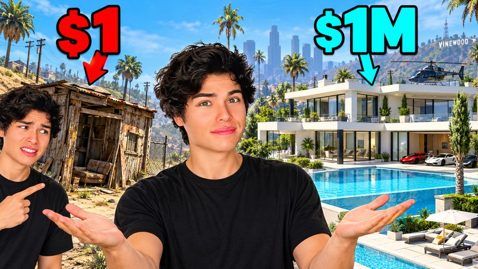

Three crews test a shack and a mansion for comfort, security and a party everyone actually wants to attend.

GTA 5 launch / follow-up · GTA 5

- **0 (First Frame)–5s:** Tiny leaning wooden shack left versus white mansion with blue pool right, Alex opening his hands between them; $1 and $1M.

- **5s–15s:** Choose the better house after three visible tests. Same number of guests and same simulated break-in challenge.

- **15s–30s:** The cheap house has one chair for the entire crew, forcing the first comfort decision. Show the crew choosing its next move.

**Why this idea:** Shape: $[VALUE] vs $[VALUE] [SUBJECT] in [GAME]. Ingredients: houses, mansion, cheap. Combined package: $1 vs $1,000,000 Houses in GTA. Translate the main-channel price ladder into fair, visible tests; label prices as in-game.

**Shape evidence:**

- [$2 VS $16,000 Minecraft House!](https://www.youtube.com/watch?v=IPtpwh7r0Eo) — MrBeast Gaming · 2021-08-25 · family · 116,928,432 views · 3.26× reported lift. Same title/premise family: $2 VS $16,000 Minecraft House!. Game, cast and execution transfer remains a hypothesis; this source does not validate the new episode outcome. Window: lifetime through source snapshot. [Metric source](https://majieddd.github.io/influint-channels-public/channels/UCIPPMRA040LQr5QPyJEbmXA.html).

- [$1 VS $1,000,000 MOVIE THEATER!](https://www.youtube.com/watch?v=NbJGkWNL9Ow) — Unspeakable · 2025-03-22 · family · 9,548,848 views · 3.15× reported lift. Same title/premise family: $1 VS $1,000,000 MOVIE THEATER!. Game, cast and execution transfer remains a hypothesis; this source does not validate the new episode outcome. Window: lifetime through source snapshot. [Metric source](https://majieddd.github.io/influint-channels-public/channels/UCwIWAbIeu0xI0ReKWOcw3eg.html).

- [$50 vs $50,000 Family Vacation](https://www.youtube.com/watch?v=Mp8c5F16i1A) — Brianna · 2022-08-28 · family · 4,879,296 views · 2.45× reported lift. Same title/premise family: $50 vs $50,000 Family Vacation. Game, cast and execution transfer remains a hypothesis; this source does not validate the new episode outcome. Window: lifetime through source snapshot. [Metric source](https://majieddd.github.io/influint-channels-public/channels/UCXg4rJUbDP1IP3TmZ9KDpJg.html).

- [$1 vs $1,000,000 Vacation!](https://www.youtube.com/watch?v=K7FjCmlWvuY) — Stokes Twins · 2022-11-23 · family · 127,518,732 views · 1.33× reported lift. Same title/premise family: $1 vs $1,000,000 Vacation!. Game, cast and execution transfer remains a hypothesis; this source does not validate the new episode outcome. Window: lifetime through source snapshot. [Metric source](https://majieddd.github.io/influint-channels-public/channels/UCbp9MyKCTEww4CxEzc_Tp0Q.html).

**Ingredient evidence:**

- [I FOUND PRESTON'S SECRET MINECRAFT HOUSE!](https://www.youtube.com/watch?v=1tlqVLYR9aM) — Brianna · 2019-01-19 · family · 20,172,457 views · 6.78× reported lift. Same concrete ingredient houses: I FOUND PRESTON'S SECRET MINECRAFT HOUSE!. Game, cast and execution transfer remains a hypothesis; this source does not validate the new episode outcome. Window: lifetime through source snapshot. [Metric source](https://majieddd.github.io/influint-channels-public/channels/UCXg4rJUbDP1IP3TmZ9KDpJg.html).

- [If You Build a House, I'll Pay For It!](https://www.youtube.com/watch?v=xN8ENrfE-TY) — MrBeast Gaming · 2021-01-02 · family · 249,642,469 views · 5.38× reported lift. Same concrete ingredient houses: If You Build a House, I'll Pay For It!. Game, cast and execution transfer remains a hypothesis; this source does not validate the new episode outcome. Window: lifetime through source snapshot. [Metric source](https://majieddd.github.io/influint-channels-public/channels/UCIPPMRA040LQr5QPyJEbmXA.html).

- [I Turned My House Into a Waterpark!](https://www.youtube.com/watch?v=WthL6_K8Kys) — Unspeakable · 2024-08-24 · family · 20,543,332 views · 4.23× reported lift. Same concrete ingredient houses: I Turned My House Into a Waterpark!. Game, cast and execution transfer remains a hypothesis; this source does not validate the new episode outcome. Window: lifetime through source snapshot. [Metric source](https://majieddd.github.io/influint-channels-public/channels/UCwIWAbIeu0xI0ReKWOcw3eg.html).

- [I Found the HOUSE HEAD in Minecraft…](https://www.youtube.com/watch?v=JCy5R45b7k0) — PrestonPlayz · 2026-08-29 · family · 4,665,662 views · 2.38× reported lift. Same concrete ingredient houses: I Found the HOUSE HEAD in Minecraft…. Game, cast and execution transfer remains a hypothesis; this source does not validate the new episode outcome. Window: Source says lifetime; row says 28d; unresolved. [Metric source](https://majieddd.github.io/influint-channels-public/channels/UCJZam2u1G0syq3kyqrCXrNw.html).

Two qualifying source channels on both axes; creator groups and exact-mixture limitations remain visible in the website.

**Objective:** Choose the better house after three visible tests.

**Rules:** Same number of guests and same simulated break-in challenge; home values are in-game.

**Escalation:** A luxury reveal gives way to a security failure and a final party judged without price labels.

**Payoff:** Open the crew votes and compare the promise of luxury with the lived experience.

**Gamer reward:** Cars, houses and visible performance differences reward game knowledge.

**Non-gamer reward:** Everyone can judge cheap versus extravagant and whether money changes the result.

**People:** Alan/Alex host or drive alongside rotating crew; every driver runs the same understandable tests.

**Production:** Reuse a tested world · $1,650–$3,600 · authored incremental allowance.

**Dependencies:** A scoped vehicle/prop selection and scoring system; do not imply fictional prices are cash spend.

**Thumbnail:** Tiny leaning wooden shack left versus white mansion with blue pool right, Alex opening his hands between them; $1 and $1M.

Composition reference: [$2 VS $16,000 Minecraft House!](https://www.youtube.com/watch?v=IPtpwh7r0Eo).

[Original PNG](generated-thumbnails/002.png) · [Exact image prompt](prompts/002.txt)

#### Idea 003 — $1 vs $1,000,000 Boats in GTA

The crew crosses the same stormy bay in a leaking dinghy and a superyacht before attempting one shared rescue.

GTA 5 launch / follow-up · GTA 5

- **0 (First Frame)–5s:** Tiny battered dinghy left and enormous white yacht right in turquoise water, Alan foreground holding a life ring; $1 and $1M.

- **5s–15s:** Finish the crossing and bring back the stranded passenger. Identical route, weather seed and passenger pickup.

- **15s–30s:** The dinghy starts taking water while the yacht cannot fit through the first channel. Show the crew choosing its next move.

**Why this idea:** Shape: $[VALUE] vs $[VALUE] [SUBJECT] in [GAME]. Ingredients: boat, yacht, water. Combined package: $1 vs $1,000,000 Boats in GTA. Translate the main-channel price ladder into fair, visible tests; label prices as in-game.

**Shape evidence:**

- [$2 VS $16,000 Minecraft House!](https://www.youtube.com/watch?v=IPtpwh7r0Eo) — MrBeast Gaming · 2021-08-25 · family · 116,928,432 views · 3.26× reported lift. Same title/premise family: $2 VS $16,000 Minecraft House!. Game, cast and execution transfer remains a hypothesis; this source does not validate the new episode outcome. Window: lifetime through source snapshot. [Metric source](https://majieddd.github.io/influint-channels-public/channels/UCIPPMRA040LQr5QPyJEbmXA.html).

- [$1 VS $1,000,000 MOVIE THEATER!](https://www.youtube.com/watch?v=NbJGkWNL9Ow) — Unspeakable · 2025-03-22 · family · 9,548,848 views · 3.15× reported lift. Same title/premise family: $1 VS $1,000,000 MOVIE THEATER!. Game, cast and execution transfer remains a hypothesis; this source does not validate the new episode outcome. Window: lifetime through source snapshot. [Metric source](https://majieddd.github.io/influint-channels-public/channels/UCwIWAbIeu0xI0ReKWOcw3eg.html).

- [$50 vs $50,000 Family Vacation](https://www.youtube.com/watch?v=Mp8c5F16i1A) — Brianna · 2022-08-28 · family · 4,879,296 views · 2.45× reported lift. Same title/premise family: $50 vs $50,000 Family Vacation. Game, cast and execution transfer remains a hypothesis; this source does not validate the new episode outcome. Window: lifetime through source snapshot. [Metric source](https://majieddd.github.io/influint-channels-public/channels/UCXg4rJUbDP1IP3TmZ9KDpJg.html).

- [$1 vs $1,000,000 Vacation!](https://www.youtube.com/watch?v=K7FjCmlWvuY) — Stokes Twins · 2022-11-23 · family · 127,518,732 views · 1.33× reported lift. Same title/premise family: $1 vs $1,000,000 Vacation!. Game, cast and execution transfer remains a hypothesis; this source does not validate the new episode outcome. Window: lifetime through source snapshot. [Metric source](https://majieddd.github.io/influint-channels-public/channels/UCbp9MyKCTEww4CxEzc_Tp0Q.html).

**Ingredient evidence:**

- [WORST Reviewed Water Park vs BEST Reviewed Water Park!](https://www.youtube.com/watch?v=-LVdJNIs2PY) — Brianna · 2020-09-26 · family · 11,857,144 views · 5.63× reported lift. Same concrete ingredient boat: WORST Reviewed Water Park vs BEST Reviewed Water Park!. Game, cast and execution transfer remains a hypothesis; this source does not validate the new episode outcome. Window: lifetime through source snapshot. [Metric source](https://majieddd.github.io/influint-channels-public/channels/UCXg4rJUbDP1IP3TmZ9KDpJg.html).

- [I Turned My House Into a Waterpark!](https://www.youtube.com/watch?v=WthL6_K8Kys) — Unspeakable · 2024-08-24 · family · 20,543,332 views · 4.23× reported lift. Same concrete ingredient boat: I Turned My House Into a Waterpark!. Game, cast and execution transfer remains a hypothesis; this source does not validate the new episode outcome. Window: lifetime through source snapshot. [Metric source](https://majieddd.github.io/influint-channels-public/channels/UCwIWAbIeu0xI0ReKWOcw3eg.html).

- [Walking on Water Prank!](https://www.youtube.com/watch?v=hHdKug_wQkU) — Stokes Twins · 2025-03-22 · family · 169,129,541 views · 1.34× reported lift. Same concrete ingredient boat: Walking on Water Prank!. Game, cast and execution transfer remains a hypothesis; this source does not validate the new episode outcome. Window: lifetime through source snapshot. [Metric source](https://majieddd.github.io/influint-channels-public/channels/UCbp9MyKCTEww4CxEzc_Tp0Q.html).

- [Level 1 to 100 Waterparks in Minecraft!](https://www.youtube.com/watch?v=fU03uSHbTGo) — PrestonPlayz · 2026-07-25 · family · 2,624,764 views · 1.14× reported lift. Same concrete ingredient boat: Level 1 to 100 Waterparks in Minecraft!. Game, cast and execution transfer remains a hypothesis; this source does not validate the new episode outcome. Window: lifetime through source snapshot. [Metric source](https://majieddd.github.io/influint-channels-public/channels/UCJZam2u1G0syq3kyqrCXrNw.html).

Two qualifying source channels on both axes; creator groups and exact-mixture limitations remain visible in the website.

**Objective:** Finish the crossing and bring back the stranded passenger.

**Rules:** Identical route, weather seed and passenger pickup; only the boats change.

**Escalation:** Comfort becomes speed, then shallow water where size may become a disadvantage.

**Payoff:** Show the real rescue result and the boat that earns the best overall score.

**Gamer reward:** Cars, houses and visible performance differences reward game knowledge.

**Non-gamer reward:** Everyone can judge cheap versus extravagant and whether money changes the result.

**People:** Alan/Alex host or drive alongside rotating crew; every driver runs the same understandable tests.

**Production:** Reuse a tested world · $1,650–$3,600 · authored incremental allowance.

**Dependencies:** A scoped vehicle/prop selection and scoring system; do not imply fictional prices are cash spend.

**Thumbnail:** Tiny battered dinghy left and enormous white yacht right in turquoise water, Alan foreground holding a life ring; $1 and $1M.

Composition reference: [$2 VS $16,000 Minecraft House!](https://www.youtube.com/watch?v=IPtpwh7r0Eo).

[Original PNG](generated-thumbnails/003.png) · [Exact image prompt](prompts/003.txt)

#### Idea 004 — $1 vs $1,000,000 Security in GTA

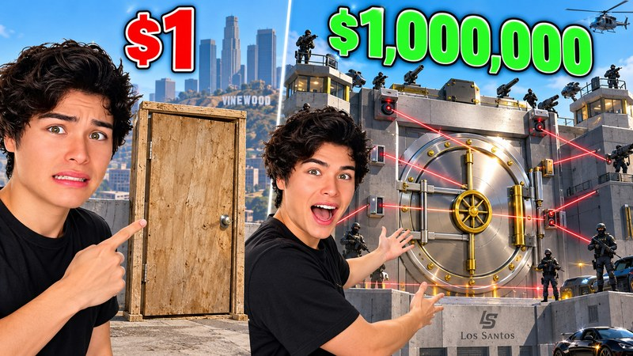

One crew protects a small vault with cheap defenses while another builds extravagant security against the same determined intruder.

GTA 5 launch / follow-up · GTA 5

- **0 (First Frame)–5s:** Alan beside a flimsy wooden door left and a giant polished steel vault right, red laser beams, $1 and $1M.

- **5s–15s:** Keep the single marked treasure safe until the timer ends. Equal preparation time, identical treasure and the same attacker.

- **15s–30s:** The intruder spots an unguarded window beside the most impressive door. Show the crew choosing its next move.

**Why this idea:** Shape: $[VALUE] vs $[VALUE] [SUBJECT] in [GAME]. Ingredients: security, vault, expensive. Combined package: $1 vs $1,000,000 Security in GTA. Translate the main-channel price ladder into fair, visible tests; label prices as in-game.

**Shape evidence:**

- [$2 VS $16,000 Minecraft House!](https://www.youtube.com/watch?v=IPtpwh7r0Eo) — MrBeast Gaming · 2021-08-25 · family · 116,928,432 views · 3.26× reported lift. Same title/premise family: $2 VS $16,000 Minecraft House!. Game, cast and execution transfer remains a hypothesis; this source does not validate the new episode outcome. Window: lifetime through source snapshot. [Metric source](https://majieddd.github.io/influint-channels-public/channels/UCIPPMRA040LQr5QPyJEbmXA.html).

- [$1 VS $1,000,000 MOVIE THEATER!](https://www.youtube.com/watch?v=NbJGkWNL9Ow) — Unspeakable · 2025-03-22 · family · 9,548,848 views · 3.15× reported lift. Same title/premise family: $1 VS $1,000,000 MOVIE THEATER!. Game, cast and execution transfer remains a hypothesis; this source does not validate the new episode outcome. Window: lifetime through source snapshot. [Metric source](https://majieddd.github.io/influint-channels-public/channels/UCwIWAbIeu0xI0ReKWOcw3eg.html).

- [$50 vs $50,000 Family Vacation](https://www.youtube.com/watch?v=Mp8c5F16i1A) — Brianna · 2022-08-28 · family · 4,879,296 views · 2.45× reported lift. Same title/premise family: $50 vs $50,000 Family Vacation. Game, cast and execution transfer remains a hypothesis; this source does not validate the new episode outcome. Window: lifetime through source snapshot. [Metric source](https://majieddd.github.io/influint-channels-public/channels/UCXg4rJUbDP1IP3TmZ9KDpJg.html).

- [$1 vs $1,000,000 Vacation!](https://www.youtube.com/watch?v=K7FjCmlWvuY) — Stokes Twins · 2022-11-23 · family · 127,518,732 views · 1.33× reported lift. Same title/premise family: $1 vs $1,000,000 Vacation!. Game, cast and execution transfer remains a hypothesis; this source does not validate the new episode outcome. Window: lifetime through source snapshot. [Metric source](https://majieddd.github.io/influint-channels-public/channels/UCbp9MyKCTEww4CxEzc_Tp0Q.html).

**Ingredient evidence:**

- [7 Days Escaping Cardboard Prison!](https://www.youtube.com/watch?v=WU05jZnUiYs) — Unspeakable · 2026-01-24 · family · 12,880,314 views · 3.65× reported lift. Same concrete ingredient security: 7 Days Escaping Cardboard Prison!. Game, cast and execution transfer remains a hypothesis; this source does not validate the new episode outcome. Window: lifetime through source snapshot. [Metric source](https://majieddd.github.io/influint-channels-public/channels/UCwIWAbIeu0xI0ReKWOcw3eg.html).

- [Preston TRAPPED Me in an UNDERWATER Prison!](https://www.youtube.com/watch?v=4ydq5MXO42c) — Brianna · 2022-07-31 · family · 4,059,814 views · 2.97× reported lift. Same concrete ingredient security: Preston TRAPPED Me in an UNDERWATER Prison!. Game, cast and execution transfer remains a hypothesis; this source does not validate the new episode outcome. Window: lifetime through source snapshot. [Metric source](https://majieddd.github.io/influint-channels-public/channels/UCXg4rJUbDP1IP3TmZ9KDpJg.html).

- [Prisoner Drive Thru Prank](https://www.youtube.com/watch?v=nuK7e1xzThc) — Stokes Twins · 2019-08-18 · family · 25,610,924 views · 2.94× reported lift. Same concrete ingredient security: Prisoner Drive Thru Prank. Game, cast and execution transfer remains a hypothesis; this source does not validate the new episode outcome. Window: lifetime through source snapshot. [Metric source](https://majieddd.github.io/influint-channels-public/channels/UCbp9MyKCTEww4CxEzc_Tp0Q.html).

- [7 Days Escaping Trampoline Park Prison!](https://www.youtube.com/watch?v=Rsx9LHfKoXU) — Unspeakable · 2026-09-05 · family · 4,301,184 views · 1.73× reported lift. Same concrete ingredient security: 7 Days Escaping Trampoline Park Prison!. Game, cast and execution transfer remains a hypothesis; this source does not validate the new episode outcome. Window: lifetime through source snapshot. [Metric source](https://majieddd.github.io/influint-channels-public/channels/UCwIWAbIeu0xI0ReKWOcw3eg.html).

Two qualifying source channels on both axes; creator groups and exact-mixture limitations remain visible in the website.

**Objective:** Keep the single marked treasure safe until the timer ends.

**Rules:** Equal preparation time, identical treasure and the same attacker; defense values are fictional game values.

**Escalation:** Basic locks become decoys and alarms, then an intruder learns from the first attempt.

**Payoff:** Compare breach times and show which expensive defense was actually useful.

**Gamer reward:** Cars, houses and visible performance differences reward game knowledge.

**Non-gamer reward:** Everyone can judge cheap versus extravagant and whether money changes the result.

**People:** Alan/Alex host or drive alongside rotating crew; every driver runs the same understandable tests.

**Production:** Reuse a tested world · $1,650–$3,600 · authored incremental allowance.

**Dependencies:** A scoped vehicle/prop selection and scoring system; do not imply fictional prices are cash spend.

**Thumbnail:** Alan beside a flimsy wooden door left and a giant polished steel vault right, red laser beams, $1 and $1M.

Composition reference: [$2 VS $16,000 Minecraft House!](https://www.youtube.com/watch?v=IPtpwh7r0Eo).

[Original PNG](generated-thumbnails/004.png) · [Exact image prompt](prompts/004.txt)

#### Idea 005 — $1 vs $1,000,000 Minecraft Houses

The crew builds two radically different homes and tests them against the same night, weather and unwelcome visitors.

Later game expansion · Minecraft

- **0 (First Frame)–5s:** Tiny dirt hut left and enormous luminous Minecraft castle right, Alex foreground; $1 and $1M game-value labels.

- **5s–15s:** Find the home that best survives the agreed three trials. Use a disclosed points allowance rather than pretend real spending.

- **15s–30s:** The cheap builder uses the whole allowance on a roof and forgets a door. Show the crew choosing its next move.

**Why this idea:** Shape: $[VALUE] vs $[VALUE] [GAME] [SUBJECT]. Ingredients: house, castle, Minecraft. Combined package: $1 vs $1,000,000 Minecraft Houses. Translate the main-channel price ladder into fair, visible tests; label prices as in-game.

**Shape evidence:**

- [$2 VS $16,000 Minecraft House!](https://www.youtube.com/watch?v=IPtpwh7r0Eo) — MrBeast Gaming · 2021-08-25 · family · 116,928,432 views · 3.26× reported lift. Same title/premise family: $2 VS $16,000 Minecraft House!. Game, cast and execution transfer remains a hypothesis; this source does not validate the new episode outcome. Window: lifetime through source snapshot. [Metric source](https://majieddd.github.io/influint-channels-public/channels/UCIPPMRA040LQr5QPyJEbmXA.html).

- [$1 VS $1,000,000 MOVIE THEATER!](https://www.youtube.com/watch?v=NbJGkWNL9Ow) — Unspeakable · 2025-03-22 · family · 9,548,848 views · 3.15× reported lift. Same title/premise family: $1 VS $1,000,000 MOVIE THEATER!. Game, cast and execution transfer remains a hypothesis; this source does not validate the new episode outcome. Window: lifetime through source snapshot. [Metric source](https://majieddd.github.io/influint-channels-public/channels/UCwIWAbIeu0xI0ReKWOcw3eg.html).

- [$50 vs $50,000 Family Vacation](https://www.youtube.com/watch?v=Mp8c5F16i1A) — Brianna · 2022-08-28 · family · 4,879,296 views · 2.45× reported lift. Same title/premise family: $50 vs $50,000 Family Vacation. Game, cast and execution transfer remains a hypothesis; this source does not validate the new episode outcome. Window: lifetime through source snapshot. [Metric source](https://majieddd.github.io/influint-channels-public/channels/UCXg4rJUbDP1IP3TmZ9KDpJg.html).

- [$1 vs $1,000,000 Vacation!](https://www.youtube.com/watch?v=K7FjCmlWvuY) — Stokes Twins · 2022-11-23 · family · 127,518,732 views · 1.33× reported lift. Same title/premise family: $1 vs $1,000,000 Vacation!. Game, cast and execution transfer remains a hypothesis; this source does not validate the new episode outcome. Window: lifetime through source snapshot. [Metric source](https://majieddd.github.io/influint-channels-public/channels/UCbp9MyKCTEww4CxEzc_Tp0Q.html).

**Ingredient evidence:**

- [I FOUND PRESTON'S SECRET MINECRAFT HOUSE!](https://www.youtube.com/watch?v=1tlqVLYR9aM) — Brianna · 2019-01-19 · family · 20,172,457 views · 6.78× reported lift. Same concrete ingredient house: I FOUND PRESTON'S SECRET MINECRAFT HOUSE!. Game, cast and execution transfer remains a hypothesis; this source does not validate the new episode outcome. Window: lifetime through source snapshot. [Metric source](https://majieddd.github.io/influint-channels-public/channels/UCXg4rJUbDP1IP3TmZ9KDpJg.html).

- [If You Build a House, I'll Pay For It!](https://www.youtube.com/watch?v=xN8ENrfE-TY) — MrBeast Gaming · 2021-01-02 · family · 249,642,469 views · 5.38× reported lift. Same concrete ingredient house: If You Build a House, I'll Pay For It!. Game, cast and execution transfer remains a hypothesis; this source does not validate the new episode outcome. Window: lifetime through source snapshot. [Metric source](https://majieddd.github.io/influint-channels-public/channels/UCIPPMRA040LQr5QPyJEbmXA.html).

- [I Turned My House Into a Waterpark!](https://www.youtube.com/watch?v=WthL6_K8Kys) — Unspeakable · 2024-08-24 · family · 20,543,332 views · 4.23× reported lift. Same concrete ingredient house: I Turned My House Into a Waterpark!. Game, cast and execution transfer remains a hypothesis; this source does not validate the new episode outcome. Window: lifetime through source snapshot. [Metric source](https://majieddd.github.io/influint-channels-public/channels/UCwIWAbIeu0xI0ReKWOcw3eg.html).

- [I Found the HOUSE HEAD in Minecraft…](https://www.youtube.com/watch?v=JCy5R45b7k0) — PrestonPlayz · 2026-08-29 · family · 4,665,662 views · 2.38× reported lift. Same concrete ingredient house: I Found the HOUSE HEAD in Minecraft…. Game, cast and execution transfer remains a hypothesis; this source does not validate the new episode outcome. Window: Source says lifetime; row says 28d; unresolved. [Metric source](https://majieddd.github.io/influint-channels-public/channels/UCJZam2u1G0syq3kyqrCXrNw.html).

Two qualifying source channels on both axes; creator groups and exact-mixture limitations remain visible in the website.

**Objective:** Find the home that best survives the agreed three trials.

**Rules:** Use a disclosed points allowance rather than pretend real spending; identical trials and guest count.

**Escalation:** A dirt shelter faces a storm, a visitor challenge and a final practical comfort vote.

**Payoff:** Reveal the score and whether the giant castle solves problems the dirt house cannot.

**Gamer reward:** Cars, houses and visible performance differences reward game knowledge.

**Non-gamer reward:** Everyone can judge cheap versus extravagant and whether money changes the result.

**People:** Alan/Alex host or drive alongside rotating crew; every driver runs the same understandable tests.

**Production:** Reuse a tested world · $1,650–$3,600 · authored incremental allowance.

**Dependencies:** A scoped vehicle/prop selection and scoring system; do not imply fictional prices are cash spend. Verify the exact edition, map, mod license and working mechanics; GTA-system reuse does not imply Minecraft support.

**Thumbnail:** Tiny dirt hut left and enormous luminous Minecraft castle right, Alex foreground; $1 and $1M game-value labels.

Composition reference: [$2 VS $16,000 Minecraft House!](https://www.youtube.com/watch?v=IPtpwh7r0Eo).

[Original PNG](generated-thumbnails/005.png) · [Exact image prompt](prompts/005.txt)

### Format 02 — The crew versus overwhelming hunters

Two rotating cast fugitives must reach a clearly marked extraction point while coordinated hunters close routes and increase the pressure.

Title family: ___ vs ___ Hunters in ___

Retained. Increase the visible opposition if the capture/server test supports it; the larger number is a proposed execution, not a prediction.

#### Idea 006 — 2 vs 100 Hunters in GTA

Two crew members try to reach the rescue helicopter while an overwhelming hunter force closes every obvious route.

GTA 5 launch / follow-up · GTA 5

- **0 (First Frame)–5s:** Alan and a different adult crew member in a red getaway car foreground; a dense wall of pursuing police vehicles and helicopter behind; 2 vs 100.

- **5s–15s:** Both fugitives reach the extraction pad before capture. State the tested hunter count and player/NPC split.

- **15s–30s:** The obvious exit is already blocked, forcing the first route choice. Show the crew choosing its next move.

**Why this idea:** Shape: [COUNT] vs [COUNT] [SUBJECT] in [GAME]. Ingredients: hunter, GTA, escape. Combined package: 2 vs 100 Hunters in GTA. Keep the chase and Stokes personalities; the fugitives can be either twin plus another crew member, or both twins when useful.

**Shape evidence:**

- [1 vs 10 Hunters in GTA!](https://www.youtube.com/watch?v=xwdhHTtc-3w) — MrBeast Gaming · 2021-02-16 · family · 116,232,703 views · 2.25× reported lift. Same title/premise family: 1 vs 10 Hunters in GTA!. Game, cast and execution transfer remains a hypothesis; this source does not validate the new episode outcome. Window: lifetime through source snapshot. [Metric source](https://majieddd.github.io/influint-channels-public/channels/UCIPPMRA040LQr5QPyJEbmXA.html).

- [I Built 5 Secret Rooms To Escape EVIL KPop Demon Hunters!](https://www.youtube.com/watch?v=U8UNlVatBCM) — Stokes Twins · 2026-03-24 · family · 50,881,070 views · 0.99× reported lift. Same title/premise family: I Built 5 Secret Rooms To Escape EVIL KPop Demon Hunters!. Game, cast and execution transfer remains a hypothesis; this source does not validate the new episode outcome. Window: lifetime through source snapshot. [Metric source](https://majieddd.github.io/influint-channels-public/channels/UCbp9MyKCTEww4CxEzc_Tp0Q.html).

- [1 vs 100 Player Manhunt!](https://www.youtube.com/watch?v=dLDj2TTyMGM) — MrBeast Gaming · 2021-06-30 · family · 164,600,391 views · 2.18× reported lift. Same title/premise family: 1 vs 100 Player Manhunt!. Game, cast and execution transfer remains a hypothesis; this source does not validate the new episode outcome. Window: lifetime through source snapshot. [Metric source](https://majieddd.github.io/influint-channels-public/channels/UCIPPMRA040LQr5QPyJEbmXA.html).

- [1000 vs 1000 Player War!](https://www.youtube.com/watch?v=VQY_m3wCBCE) — MrBeast Gaming · 2021-09-11 · family · 79,327,795 views · 1.83× reported lift. Same title/premise family: 1000 vs 1000 Player War!. Game, cast and execution transfer remains a hypothesis; this source does not validate the new episode outcome. Window: lifetime through source snapshot. [Metric source](https://majieddd.github.io/influint-channels-public/channels/UCIPPMRA040LQr5QPyJEbmXA.html).

**Ingredient evidence:**

- [1 vs 10 Hunters in GTA!](https://www.youtube.com/watch?v=xwdhHTtc-3w) — MrBeast Gaming · 2021-02-16 · family · 116,232,703 views · 2.25× reported lift. Same concrete ingredient hunter: 1 vs 10 Hunters in GTA!. Game, cast and execution transfer remains a hypothesis; this source does not validate the new episode outcome. Window: lifetime through source snapshot. [Metric source](https://majieddd.github.io/influint-channels-public/channels/UCIPPMRA040LQr5QPyJEbmXA.html).

- [KPop Demon Hunters Were Murdered..](https://www.youtube.com/watch?v=oUee1Bv0sFE) — Stokes Twins · 2026-01-28 · family · 70,579,597 views · 1.20× reported lift. Same concrete ingredient hunter: KPop Demon Hunters Were Murdered... Game, cast and execution transfer remains a hypothesis; this source does not validate the new episode outcome. Window: lifetime through source snapshot. [Metric source](https://majieddd.github.io/influint-channels-public/channels/UCbp9MyKCTEww4CxEzc_Tp0Q.html).

- [I Built a KPop Demon Hunter House for my Cat!](https://www.youtube.com/watch?v=c45NhKDTYto) — Brianna · 2026-02-14 · family · 757,143 views · 0.24× reported lift. Same concrete ingredient hunter: I Built a KPop Demon Hunter House for my Cat!. Game, cast and execution transfer remains a hypothesis; this source does not validate the new episode outcome. Window: lifetime through source snapshot. [Metric source](https://majieddd.github.io/influint-channels-public/channels/UCXg4rJUbDP1IP3TmZ9KDpJg.html).

- [1 vs 100 Player Manhunt!](https://www.youtube.com/watch?v=dLDj2TTyMGM) — MrBeast Gaming · 2021-06-30 · family · 164,600,391 views · 2.18× reported lift. Same concrete ingredient hunter: 1 vs 100 Player Manhunt!. Game, cast and execution transfer remains a hypothesis; this source does not validate the new episode outcome. Window: lifetime through source snapshot. [Metric source](https://majieddd.github.io/influint-channels-public/channels/UCIPPMRA040LQr5QPyJEbmXA.html).

Evidence gaps: Shape: 1/2 qualifying outlier channels in the verified public pool; adjacent precedents remain proposals, not replication. Ingredients: 1/2 qualifying outlier channels for the principal ingredient; this does not establish the full game/cast combination.

**Objective:** Both fugitives reach the extraction pad before capture.

**Rules:** State the tested hunter count and player/NPC split; one marked exit, limited lives and no unannounced teleports.

**Escalation:** Hunters close the main road, the crew risks a decoy and the helicopter becomes a final exposed sprint.

**Payoff:** Show the arrival or final capture in continuous geography rather than manufacture an escape.

**Gamer reward:** Routes, vehicles and evasive skill create a second layer of strategy.

**Non-gamer reward:** The size mismatch, pursuit and finish line are understandable without knowing GTA.

**People:** Two featured fugitives; crew members lead hunter teams, set traps and supply rival personalities. A hundred hunters requires a verified player/NPC plan.

**Production:** Reusable custom challenge · $3,400–$7,500 · authored incremental allowance.

**Dependencies:** Reliable pursuit setup, participant recording and a capacity test. Use the truthful actual hunter count; do not label NPCs as 100 real people.

**Thumbnail:** Alan and a different adult crew member in a red getaway car foreground; a dense wall of pursuing police vehicles and helicopter behind; 2 vs 100.

Composition reference: [1 vs 10 Hunters in GTA!](https://www.youtube.com/watch?v=xwdhHTtc-3w).

[Original PNG](generated-thumbnails/006.png) · [Exact image prompt](prompts/006-correction.txt)

#### Idea 007 — We Escaped 100 Hunters With No Cars in GTA

The crew must escape on foot as hunters control the roads and every shortcut becomes a risky choice.

GTA 5 launch / follow-up · GTA 5

- **0 (First Frame)–5s:** Alex sprinting foreground across a rooftop, red hunter crowd below and rescue helicopter beyond; NO CARS.

- **5s–15s:** Reach the rooftop rescue beacon on foot. No entering vehicles.

- **15s–30s:** A hunter car seals the first alley and the crew has to climb instead. Show the crew choosing its next move.

**Why this idea:** Shape: We Escaped [COUNT] [SUBJECT] With No [SUBJECT] in [GAME]. Ingredients: hunter, escape, challenge. Combined package: We Escaped 100 Hunters With No Cars in GTA. Keep the chase and Stokes personalities; the fugitives can be either twin plus another crew member, or both twins when useful.

**Shape evidence:**

- [1 vs 10 Hunters in GTA!](https://www.youtube.com/watch?v=xwdhHTtc-3w) — MrBeast Gaming · 2021-02-16 · family · 116,232,703 views · 2.25× reported lift. Same title/premise family: 1 vs 10 Hunters in GTA!. Game, cast and execution transfer remains a hypothesis; this source does not validate the new episode outcome. Window: lifetime through source snapshot. [Metric source](https://majieddd.github.io/influint-channels-public/channels/UCIPPMRA040LQr5QPyJEbmXA.html).

- [I Built 5 Secret Rooms To Escape EVIL KPop Demon Hunters!](https://www.youtube.com/watch?v=U8UNlVatBCM) — Stokes Twins · 2026-03-24 · family · 50,881,070 views · 0.99× reported lift. Same title/premise family: I Built 5 Secret Rooms To Escape EVIL KPop Demon Hunters!. Game, cast and execution transfer remains a hypothesis; this source does not validate the new episode outcome. Window: lifetime through source snapshot. [Metric source](https://majieddd.github.io/influint-channels-public/channels/UCbp9MyKCTEww4CxEzc_Tp0Q.html).

- [1 vs 100 Player Manhunt!](https://www.youtube.com/watch?v=dLDj2TTyMGM) — MrBeast Gaming · 2021-06-30 · family · 164,600,391 views · 2.18× reported lift. Same title/premise family: 1 vs 100 Player Manhunt!. Game, cast and execution transfer remains a hypothesis; this source does not validate the new episode outcome. Window: lifetime through source snapshot. [Metric source](https://majieddd.github.io/influint-channels-public/channels/UCIPPMRA040LQr5QPyJEbmXA.html).

- [1000 vs 1000 Player War!](https://www.youtube.com/watch?v=VQY_m3wCBCE) — MrBeast Gaming · 2021-09-11 · family · 79,327,795 views · 1.83× reported lift. Same title/premise family: 1000 vs 1000 Player War!. Game, cast and execution transfer remains a hypothesis; this source does not validate the new episode outcome. Window: lifetime through source snapshot. [Metric source](https://majieddd.github.io/influint-channels-public/channels/UCIPPMRA040LQr5QPyJEbmXA.html).

**Ingredient evidence:**

- [1 vs 10 Hunters in GTA!](https://www.youtube.com/watch?v=xwdhHTtc-3w) — MrBeast Gaming · 2021-02-16 · family · 116,232,703 views · 2.25× reported lift. Same concrete ingredient hunter: 1 vs 10 Hunters in GTA!. Game, cast and execution transfer remains a hypothesis; this source does not validate the new episode outcome. Window: lifetime through source snapshot. [Metric source](https://majieddd.github.io/influint-channels-public/channels/UCIPPMRA040LQr5QPyJEbmXA.html).

- [KPop Demon Hunters Were Murdered..](https://www.youtube.com/watch?v=oUee1Bv0sFE) — Stokes Twins · 2026-01-28 · family · 70,579,597 views · 1.20× reported lift. Same concrete ingredient hunter: KPop Demon Hunters Were Murdered... Game, cast and execution transfer remains a hypothesis; this source does not validate the new episode outcome. Window: lifetime through source snapshot. [Metric source](https://majieddd.github.io/influint-channels-public/channels/UCbp9MyKCTEww4CxEzc_Tp0Q.html).

- [I Built a KPop Demon Hunter House for my Cat!](https://www.youtube.com/watch?v=c45NhKDTYto) — Brianna · 2026-02-14 · family · 757,143 views · 0.24× reported lift. Same concrete ingredient hunter: I Built a KPop Demon Hunter House for my Cat!. Game, cast and execution transfer remains a hypothesis; this source does not validate the new episode outcome. Window: lifetime through source snapshot. [Metric source](https://majieddd.github.io/influint-channels-public/channels/UCXg4rJUbDP1IP3TmZ9KDpJg.html).

- [1 vs 100 Player Manhunt!](https://www.youtube.com/watch?v=dLDj2TTyMGM) — MrBeast Gaming · 2021-06-30 · family · 164,600,391 views · 2.18× reported lift. Same concrete ingredient hunter: 1 vs 100 Player Manhunt!. Game, cast and execution transfer remains a hypothesis; this source does not validate the new episode outcome. Window: lifetime through source snapshot. [Metric source](https://majieddd.github.io/influint-channels-public/channels/UCIPPMRA040LQr5QPyJEbmXA.html).

Evidence gaps: Shape: 1/2 qualifying outlier channels in the verified public pool; adjacent precedents remain proposals, not replication. Ingredients: 1/2 qualifying outlier channels for the principal ingredient; this does not establish the full game/cast combination.

**Objective:** Reach the rooftop rescue beacon on foot.

**Rules:** No entering vehicles; disclosed hunter count, a limited map and clear tag/capture rules.

**Escalation:** Safe alleys disappear, a footbridge closes and the final climb leaves the crew exposed.

**Payoff:** Resolve the last rooftop approach with both sides' footage and an unambiguous capture result.

**Gamer reward:** Routes, vehicles and evasive skill create a second layer of strategy.

**Non-gamer reward:** The size mismatch, pursuit and finish line are understandable without knowing GTA.

**People:** Two featured fugitives; crew members lead hunter teams, set traps and supply rival personalities. A hundred hunters requires a verified player/NPC plan.

**Production:** Reusable custom challenge · $3,400–$7,500 · authored incremental allowance.

**Dependencies:** Reliable pursuit setup, participant recording and a capacity test. Use the truthful actual hunter count; do not label NPCs as 100 real people.

**Thumbnail:** Alex sprinting foreground across a rooftop, red hunter crowd below and rescue helicopter beyond; NO CARS.

Composition reference: [1 vs 10 Hunters in GTA!](https://www.youtube.com/watch?v=xwdhHTtc-3w).

[Original PNG](generated-thumbnails/007.png) · [Exact image prompt](prompts/007.txt)

#### Idea 008 — 1 Tiny Car vs 100 Hunters in GTA

A single crew team squeezes into a tiny getaway car and attempts three escapes against a far larger pursuit force.

GTA 5 launch / follow-up · GTA 5

- **0 (First Frame)–5s:** Alan squeezed into a ridiculous tiny yellow car, enormous black police SUVs towering behind, a ferry visible ahead; 1 vs 100.

- **5s–15s:** Reach the ferry with the tiny car still driveable. One preselected tiny car, a tested pursuit force, one repair token and no off-camera replacement.

- **15s–30s:** The little car cannot climb the first steep ramp with the whole team inside. Show the crew choosing its next move.

**Why this idea:** Shape: [COUNT] Tiny [SUBJECT] vs [COUNT] [SUBJECT] in [GAME]. Ingredients: car, hunter, GTA. Combined package: 1 Tiny Car vs 100 Hunters in GTA. Keep the chase and Stokes personalities; the fugitives can be either twin plus another crew member, or both twins when useful.

**Shape evidence:**

- [1 vs 10 Hunters in GTA!](https://www.youtube.com/watch?v=xwdhHTtc-3w) — MrBeast Gaming · 2021-02-16 · family · 116,232,703 views · 2.25× reported lift. Same title/premise family: 1 vs 10 Hunters in GTA!. Game, cast and execution transfer remains a hypothesis; this source does not validate the new episode outcome. Window: lifetime through source snapshot. [Metric source](https://majieddd.github.io/influint-channels-public/channels/UCIPPMRA040LQr5QPyJEbmXA.html).

- [I Built 5 Secret Rooms To Escape EVIL KPop Demon Hunters!](https://www.youtube.com/watch?v=U8UNlVatBCM) — Stokes Twins · 2026-03-24 · family · 50,881,070 views · 0.99× reported lift. Same title/premise family: I Built 5 Secret Rooms To Escape EVIL KPop Demon Hunters!. Game, cast and execution transfer remains a hypothesis; this source does not validate the new episode outcome. Window: lifetime through source snapshot. [Metric source](https://majieddd.github.io/influint-channels-public/channels/UCbp9MyKCTEww4CxEzc_Tp0Q.html).

- [1 vs 100 Player Manhunt!](https://www.youtube.com/watch?v=dLDj2TTyMGM) — MrBeast Gaming · 2021-06-30 · family · 164,600,391 views · 2.18× reported lift. Same title/premise family: 1 vs 100 Player Manhunt!. Game, cast and execution transfer remains a hypothesis; this source does not validate the new episode outcome. Window: lifetime through source snapshot. [Metric source](https://majieddd.github.io/influint-channels-public/channels/UCIPPMRA040LQr5QPyJEbmXA.html).

- [1000 vs 1000 Player War!](https://www.youtube.com/watch?v=VQY_m3wCBCE) — MrBeast Gaming · 2021-09-11 · family · 79,327,795 views · 1.83× reported lift. Same title/premise family: 1000 vs 1000 Player War!. Game, cast and execution transfer remains a hypothesis; this source does not validate the new episode outcome. Window: lifetime through source snapshot. [Metric source](https://majieddd.github.io/influint-channels-public/channels/UCIPPMRA040LQr5QPyJEbmXA.html).

**Ingredient evidence:**

- [Preston Cheated in Cardboard Hide and Seek](https://www.youtube.com/watch?v=5zbvDh28XUQ) — Brianna · 2022-04-28 · family · 11,051,826 views · 5.01× reported lift. Same concrete ingredient car: Preston Cheated in Cardboard Hide and Seek. Game, cast and execution transfer remains a hypothesis; this source does not validate the new episode outcome. Window: lifetime through source snapshot. [Metric source](https://majieddd.github.io/influint-channels-public/channels/UCXg4rJUbDP1IP3TmZ9KDpJg.html).

- [Tesla Autopilot For 24 Hours!](https://www.youtube.com/watch?v=SsJ7oOpbmIk) — Stokes Twins · 2021-04-20 · family · 38,321,506 views · 4.25× reported lift. Same concrete ingredient car: Tesla Autopilot For 24 Hours!. Game, cast and execution transfer remains a hypothesis; this source does not validate the new episode outcome. Window: lifetime through source snapshot. [Metric source](https://majieddd.github.io/influint-channels-public/channels/UCbp9MyKCTEww4CxEzc_Tp0Q.html).

- [World's Fastest Car!](https://www.youtube.com/watch?v=nopEs-K4ExM) — MrBeast Gaming · 2022-07-09 · family · 122,277,058 views · 3.68× reported lift. Same concrete ingredient car: World's Fastest Car!. Game, cast and execution transfer remains a hypothesis; this source does not validate the new episode outcome. Window: lifetime through source snapshot. [Metric source](https://majieddd.github.io/influint-channels-public/channels/UCIPPMRA040LQr5QPyJEbmXA.html).

- [7 Days Escaping Cardboard Prison!](https://www.youtube.com/watch?v=WU05jZnUiYs) — Unspeakable · 2026-01-24 · family · 12,880,314 views · 3.65× reported lift. Same concrete ingredient car: 7 Days Escaping Cardboard Prison!. Game, cast and execution transfer remains a hypothesis; this source does not validate the new episode outcome. Window: lifetime through source snapshot. [Metric source](https://majieddd.github.io/influint-channels-public/channels/UCwIWAbIeu0xI0ReKWOcw3eg.html).

Evidence gaps: Shape: 1/2 qualifying outlier channels in the verified public pool; adjacent precedents remain proposals, not replication.

**Objective:** Reach the ferry with the tiny car still driveable.

**Rules:** One preselected tiny car, a tested pursuit force, one repair token and no off-camera replacement.

**Escalation:** Speed loses to concealment, the repair token becomes a tough decision and the ferry timer forces a sprint.

**Payoff:** Reveal whether the small car's one advantage beats the force chasing it.

**Gamer reward:** Routes, vehicles and evasive skill create a second layer of strategy.

**Non-gamer reward:** The size mismatch, pursuit and finish line are understandable without knowing GTA.

**People:** Two featured fugitives; crew members lead hunter teams, set traps and supply rival personalities. A hundred hunters requires a verified player/NPC plan.

**Production:** Reusable custom challenge · $3,400–$7,500 · authored incremental allowance.

**Dependencies:** Reliable pursuit setup, participant recording and a capacity test. Use the truthful actual hunter count; do not label NPCs as 100 real people.

**Thumbnail:** Alan squeezed into a ridiculous tiny yellow car, enormous black police SUVs towering behind, a ferry visible ahead; 1 vs 100.

Composition reference: [1 vs 10 Hunters in GTA!](https://www.youtube.com/watch?v=xwdhHTtc-3w).

[Original PNG](generated-thumbnails/008.png) · [Exact image prompt](prompts/008.txt)

#### Idea 009 — We Hid $1,000,000 From 100 Hunters in GTA

The crew moves a marked virtual treasure across the city while hunters try to locate its carrier.

GTA 5 launch / follow-up · GTA 5

- **0 (First Frame)–5s:** Alan clutching a glowing money case marked $1M, black pursuit SUVs behind, one open bank door ahead.

- **5s–15s:** Deliver the game-value treasure to the bank without interception. One real tracked treasure object, disclosed hunters and three possible carriers.

- **15s–30s:** A hunter correctly identifies the first carrier before the decoy is ready. Show the crew choosing its next move.

**Why this idea:** Shape: We Hid $[VALUE] From [COUNT] [SUBJECT] in [GAME]. Ingredients: hunter, money, escape. Combined package: We Hid $1,000,000 From 100 Hunters in GTA. Keep the chase and Stokes personalities; the fugitives can be either twin plus another crew member, or both twins when useful.

**Shape evidence:**

- [1 vs 10 Hunters in GTA!](https://www.youtube.com/watch?v=xwdhHTtc-3w) — MrBeast Gaming · 2021-02-16 · family · 116,232,703 views · 2.25× reported lift. Same title/premise family: 1 vs 10 Hunters in GTA!. Game, cast and execution transfer remains a hypothesis; this source does not validate the new episode outcome. Window: lifetime through source snapshot. [Metric source](https://majieddd.github.io/influint-channels-public/channels/UCIPPMRA040LQr5QPyJEbmXA.html).

- [I Built 5 Secret Rooms To Escape EVIL KPop Demon Hunters!](https://www.youtube.com/watch?v=U8UNlVatBCM) — Stokes Twins · 2026-03-24 · family · 50,881,070 views · 0.99× reported lift. Same title/premise family: I Built 5 Secret Rooms To Escape EVIL KPop Demon Hunters!. Game, cast and execution transfer remains a hypothesis; this source does not validate the new episode outcome. Window: lifetime through source snapshot. [Metric source](https://majieddd.github.io/influint-channels-public/channels/UCbp9MyKCTEww4CxEzc_Tp0Q.html).

- [1 vs 100 Player Manhunt!](https://www.youtube.com/watch?v=dLDj2TTyMGM) — MrBeast Gaming · 2021-06-30 · family · 164,600,391 views · 2.18× reported lift. Same title/premise family: 1 vs 100 Player Manhunt!. Game, cast and execution transfer remains a hypothesis; this source does not validate the new episode outcome. Window: lifetime through source snapshot. [Metric source](https://majieddd.github.io/influint-channels-public/channels/UCIPPMRA040LQr5QPyJEbmXA.html).

- [1000 vs 1000 Player War!](https://www.youtube.com/watch?v=VQY_m3wCBCE) — MrBeast Gaming · 2021-09-11 · family · 79,327,795 views · 1.83× reported lift. Same title/premise family: 1000 vs 1000 Player War!. Game, cast and execution transfer remains a hypothesis; this source does not validate the new episode outcome. Window: lifetime through source snapshot. [Metric source](https://majieddd.github.io/influint-channels-public/channels/UCIPPMRA040LQr5QPyJEbmXA.html).

**Ingredient evidence:**

- [1 vs 10 Hunters in GTA!](https://www.youtube.com/watch?v=xwdhHTtc-3w) — MrBeast Gaming · 2021-02-16 · family · 116,232,703 views · 2.25× reported lift. Same concrete ingredient hunter: 1 vs 10 Hunters in GTA!. Game, cast and execution transfer remains a hypothesis; this source does not validate the new episode outcome. Window: lifetime through source snapshot. [Metric source](https://majieddd.github.io/influint-channels-public/channels/UCIPPMRA040LQr5QPyJEbmXA.html).

- [KPop Demon Hunters Were Murdered..](https://www.youtube.com/watch?v=oUee1Bv0sFE) — Stokes Twins · 2026-01-28 · family · 70,579,597 views · 1.20× reported lift. Same concrete ingredient hunter: KPop Demon Hunters Were Murdered... Game, cast and execution transfer remains a hypothesis; this source does not validate the new episode outcome. Window: lifetime through source snapshot. [Metric source](https://majieddd.github.io/influint-channels-public/channels/UCbp9MyKCTEww4CxEzc_Tp0Q.html).

- [I Built a KPop Demon Hunter House for my Cat!](https://www.youtube.com/watch?v=c45NhKDTYto) — Brianna · 2026-02-14 · family · 757,143 views · 0.24× reported lift. Same concrete ingredient hunter: I Built a KPop Demon Hunter House for my Cat!. Game, cast and execution transfer remains a hypothesis; this source does not validate the new episode outcome. Window: lifetime through source snapshot. [Metric source](https://majieddd.github.io/influint-channels-public/channels/UCXg4rJUbDP1IP3TmZ9KDpJg.html).

- [1 vs 100 Player Manhunt!](https://www.youtube.com/watch?v=dLDj2TTyMGM) — MrBeast Gaming · 2021-06-30 · family · 164,600,391 views · 2.18× reported lift. Same concrete ingredient hunter: 1 vs 100 Player Manhunt!. Game, cast and execution transfer remains a hypothesis; this source does not validate the new episode outcome. Window: lifetime through source snapshot. [Metric source](https://majieddd.github.io/influint-channels-public/channels/UCIPPMRA040LQr5QPyJEbmXA.html).

Evidence gaps: Shape: 1/2 qualifying outlier channels in the verified public pool; adjacent precedents remain proposals, not replication. Ingredients: 1/2 qualifying outlier channels for the principal ingredient; this does not establish the full game/cast combination.

**Objective:** Deliver the game-value treasure to the bank without interception.

**Rules:** One real tracked treasure object, disclosed hunters and three possible carriers; the audience always knows its true location.

**Escalation:** A fake convoy draws attention, a carrier swap nearly fails and the final bank corridor has no cover.

**Payoff:** Follow the actual treasure to a delivery or capture and reveal which decoy fooled the hunters.

**Gamer reward:** Routes, vehicles and evasive skill create a second layer of strategy.

**Non-gamer reward:** The size mismatch, pursuit and finish line are understandable without knowing GTA.

**People:** Two featured fugitives; crew members lead hunter teams, set traps and supply rival personalities. A hundred hunters requires a verified player/NPC plan.

**Production:** Reusable custom challenge · $3,400–$7,500 · authored incremental allowance.

**Dependencies:** Reliable pursuit setup, participant recording and a capacity test. Use the truthful actual hunter count; do not label NPCs as 100 real people.

**Thumbnail:** Alan clutching a glowing money case marked $1M, black pursuit SUVs behind, one open bank door ahead.

Composition reference: [1 vs 10 Hunters in GTA!](https://www.youtube.com/watch?v=xwdhHTtc-3w).

[Original PNG](generated-thumbnails/009.png) · [Exact image prompt](prompts/009.txt)

#### Idea 010 — 2 vs 100 Hunters in Minecraft

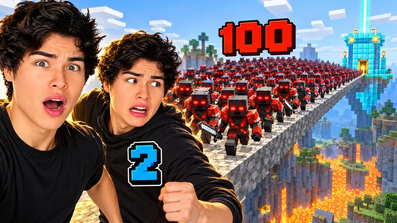

Two builders cross a shrinking wilderness to a rescue tower while hunters follow the visible trail they leave behind.

Later game expansion · Minecraft

- **0 (First Frame)–5s:** Alan and Alex small on a narrow Minecraft bridge, an enormous red-armored hunter crowd behind, blue rescue tower ahead; 2 vs 100.

- **5s–15s:** Reach the rescue tower alive as a pair. Disclosed human/NPC count, a bounded world and a fixed extraction tower.

- **15s–30s:** The crew reaches a ravine with hunters visible on the opposite hill. Show the crew choosing its next move.

**Why this idea:** Shape: [COUNT] vs [COUNT] [SUBJECT] in [GAME]. Ingredients: hunter, Minecraft, escape. Combined package: 2 vs 100 Hunters in Minecraft. Keep the chase and Stokes personalities; the fugitives can be either twin plus another crew member, or both twins when useful.

**Shape evidence:**

- [1 vs 10 Hunters in GTA!](https://www.youtube.com/watch?v=xwdhHTtc-3w) — MrBeast Gaming · 2021-02-16 · family · 116,232,703 views · 2.25× reported lift. Same title/premise family: 1 vs 10 Hunters in GTA!. Game, cast and execution transfer remains a hypothesis; this source does not validate the new episode outcome. Window: lifetime through source snapshot. [Metric source](https://majieddd.github.io/influint-channels-public/channels/UCIPPMRA040LQr5QPyJEbmXA.html).

- [I Built 5 Secret Rooms To Escape EVIL KPop Demon Hunters!](https://www.youtube.com/watch?v=U8UNlVatBCM) — Stokes Twins · 2026-03-24 · family · 50,881,070 views · 0.99× reported lift. Same title/premise family: I Built 5 Secret Rooms To Escape EVIL KPop Demon Hunters!. Game, cast and execution transfer remains a hypothesis; this source does not validate the new episode outcome. Window: lifetime through source snapshot. [Metric source](https://majieddd.github.io/influint-channels-public/channels/UCbp9MyKCTEww4CxEzc_Tp0Q.html).

- [1 vs 100 Player Manhunt!](https://www.youtube.com/watch?v=dLDj2TTyMGM) — MrBeast Gaming · 2021-06-30 · family · 164,600,391 views · 2.18× reported lift. Same title/premise family: 1 vs 100 Player Manhunt!. Game, cast and execution transfer remains a hypothesis; this source does not validate the new episode outcome. Window: lifetime through source snapshot. [Metric source](https://majieddd.github.io/influint-channels-public/channels/UCIPPMRA040LQr5QPyJEbmXA.html).

- [1000 vs 1000 Player War!](https://www.youtube.com/watch?v=VQY_m3wCBCE) — MrBeast Gaming · 2021-09-11 · family · 79,327,795 views · 1.83× reported lift. Same title/premise family: 1000 vs 1000 Player War!. Game, cast and execution transfer remains a hypothesis; this source does not validate the new episode outcome. Window: lifetime through source snapshot. [Metric source](https://majieddd.github.io/influint-channels-public/channels/UCIPPMRA040LQr5QPyJEbmXA.html).

**Ingredient evidence:**

- [1 vs 10 Hunters in GTA!](https://www.youtube.com/watch?v=xwdhHTtc-3w) — MrBeast Gaming · 2021-02-16 · family · 116,232,703 views · 2.25× reported lift. Same concrete ingredient hunter: 1 vs 10 Hunters in GTA!. Game, cast and execution transfer remains a hypothesis; this source does not validate the new episode outcome. Window: lifetime through source snapshot. [Metric source](https://majieddd.github.io/influint-channels-public/channels/UCIPPMRA040LQr5QPyJEbmXA.html).

- [KPop Demon Hunters Were Murdered..](https://www.youtube.com/watch?v=oUee1Bv0sFE) — Stokes Twins · 2026-01-28 · family · 70,579,597 views · 1.20× reported lift. Same concrete ingredient hunter: KPop Demon Hunters Were Murdered... Game, cast and execution transfer remains a hypothesis; this source does not validate the new episode outcome. Window: lifetime through source snapshot. [Metric source](https://majieddd.github.io/influint-channels-public/channels/UCbp9MyKCTEww4CxEzc_Tp0Q.html).

- [I Built a KPop Demon Hunter House for my Cat!](https://www.youtube.com/watch?v=c45NhKDTYto) — Brianna · 2026-02-14 · family · 757,143 views · 0.24× reported lift. Same concrete ingredient hunter: I Built a KPop Demon Hunter House for my Cat!. Game, cast and execution transfer remains a hypothesis; this source does not validate the new episode outcome. Window: lifetime through source snapshot. [Metric source](https://majieddd.github.io/influint-channels-public/channels/UCXg4rJUbDP1IP3TmZ9KDpJg.html).

- [1 vs 100 Player Manhunt!](https://www.youtube.com/watch?v=dLDj2TTyMGM) — MrBeast Gaming · 2021-06-30 · family · 164,600,391 views · 2.18× reported lift. Same concrete ingredient hunter: 1 vs 100 Player Manhunt!. Game, cast and execution transfer remains a hypothesis; this source does not validate the new episode outcome. Window: lifetime through source snapshot. [Metric source](https://majieddd.github.io/influint-channels-public/channels/UCIPPMRA040LQr5QPyJEbmXA.html).

Evidence gaps: Shape: 1/2 qualifying outlier channels in the verified public pool; adjacent precedents remain proposals, not replication. Ingredients: 1/2 qualifying outlier channels for the principal ingredient; this does not establish the full game/cast combination.

**Objective:** Reach the rescue tower alive as a pair.

**Rules:** Disclosed human/NPC count, a bounded world and a fixed extraction tower; no admin teleport for fugitives.

**Escalation:** A river crossing exposes them, a shelter becomes a trap and the last bridge must be built under pressure.

**Payoff:** Show the final bridge and the real winning side with both teams' views.

**Gamer reward:** Routes, vehicles and evasive skill create a second layer of strategy.

**Non-gamer reward:** The size mismatch, pursuit and finish line are understandable without knowing GTA.

**People:** Two featured fugitives; crew members lead hunter teams, set traps and supply rival personalities. A hundred hunters requires a verified player/NPC plan.

**Production:** Reusable custom challenge · $3,400–$7,500 · authored incremental allowance.

**Dependencies:** Reliable pursuit setup, participant recording and a capacity test. Use the truthful actual hunter count; do not label NPCs as 100 real people. Verify the exact edition, map, mod license and working mechanics; GTA-system reuse does not imply Minecraft support.

**Thumbnail:** Alan and Alex small on a narrow Minecraft bridge, an enormous red-armored hunter crowd behind, blue rescue tower ahead; 2 vs 100.

Composition reference: [1 vs 10 Hunters in GTA!](https://www.youtube.com/watch?v=xwdhHTtc-3w).

[Original PNG](generated-thumbnails/010.png) · [Exact image prompt](prompts/010.txt)

### Format 03 — Secret builds with a discovery deadline

Show the audience five concealed, functional spaces, then let rotating crew seekers search under a deadline; every discovery reveals the next layer of ingenuity.

Title family: I Built ___ Secret Rooms You'd Never Find in ___

Retained. Five strong reveals beat an unsupported promise that merely multiplies the room count.

#### Idea 011 — I Built 5 Secret Rooms You'd Never Find in GTA

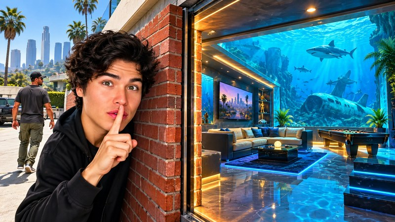

The audience sees five ingenious hidden rooms before the crew searches the same building against a deadline.

GTA 5 launch / follow-up · GTA 5

- **0 (First Frame)–5s:** Alan shushing beside a normal brick wall sliding open to a luminous underwater lounge, tiny crew seeker walking past.

- **5s–15s:** Find all five functional entrances before the search timer runs out. The seekers receive a bounded search area.

- **15s–30s:** A seeker enters the first room through an unintended opening, testing whether the build actually conceals it. Show the crew choosing its next move.

**Why this idea:** Shape: I Built [COUNT] [SUBJECT] You'd Never Find in [GAME]. Ingredients: secret, room, hidden. Combined package: I Built 5 Secret Rooms You'd Never Find in GTA. Keep the familiar Stokes secret-room promise and make the entrances/reveals genuinely new; the test is against the whole crew.

**Shape evidence:**

- [I Built 30 Secret Rooms You’d Never Find!](https://www.youtube.com/watch?v=X9AYf8gy5sU) — Unspeakable · 2024-06-22 · family · 18,997,959 views · 5.00× reported lift. Same title/premise family: I Built 30 Secret Rooms You’d Never Find!. Game, cast and execution transfer remains a hypothesis; this source does not validate the new episode outcome. Window: lifetime through source snapshot. [Metric source](https://majieddd.github.io/influint-channels-public/channels/UCwIWAbIeu0xI0ReKWOcw3eg.html).

- [I Built 7 Secret Rooms That Shouldn't Exist...](https://www.youtube.com/watch?v=ujX_NcWwnQo) — Brianna · 2024-01-11 · family · 4,313,017 views · 2.38× reported lift. Same title/premise family: I Built 7 Secret Rooms That Shouldn't Exist.... Game, cast and execution transfer remains a hypothesis; this source does not validate the new episode outcome. Window: lifetime through source snapshot. [Metric source](https://majieddd.github.io/influint-channels-public/channels/UCXg4rJUbDP1IP3TmZ9KDpJg.html).

- [I Built 5 SECRET Rooms In ONE COLOR!](https://www.youtube.com/watch?v=cfFtBojH_-Y) — Stokes Twins · 2025-06-27 · family · 180,421,614 views · 1.74× reported lift. Same title/premise family: I Built 5 SECRET Rooms In ONE COLOR!. Game, cast and execution transfer remains a hypothesis; this source does not validate the new episode outcome. Window: lifetime through source snapshot. [Metric source](https://majieddd.github.io/influint-channels-public/channels/UCbp9MyKCTEww4CxEzc_Tp0Q.html).

- [Preston Built a Secret HIDDEN Room to CHEAT in Hide and Seek!](https://www.youtube.com/watch?v=HPtF-z5QAyI) — Brianna · 2021-03-04 · family · 7,584,560 views · 2.16× reported lift. Same title/premise family: Preston Built a Secret HIDDEN Room to CHEAT in Hide and Seek!. Game, cast and execution transfer remains a hypothesis; this source does not validate the new episode outcome. Window: lifetime through source snapshot. [Metric source](https://majieddd.github.io/influint-channels-public/channels/UCXg4rJUbDP1IP3TmZ9KDpJg.html).

**Ingredient evidence:**

- [I FOUND PRESTONPLAYZ SECRET SKY BASE IN MINECRAFT!](https://www.youtube.com/watch?v=d0q9y0GkrEg) — Brianna · 2019-02-01 · family · 27,428,622 views · 8.87× reported lift. Same concrete ingredient secret: I FOUND PRESTONPLAYZ SECRET SKY BASE IN MINECRAFT!. Game, cast and execution transfer remains a hypothesis; this source does not validate the new episode outcome. Window: lifetime through source snapshot. [Metric source](https://majieddd.github.io/influint-channels-public/channels/UCXg4rJUbDP1IP3TmZ9KDpJg.html).

- [I Built 30 Secret Rooms You’d Never Find!](https://www.youtube.com/watch?v=X9AYf8gy5sU) — Unspeakable · 2024-06-22 · family · 18,997,959 views · 5.00× reported lift. Same concrete ingredient secret: I Built 30 Secret Rooms You’d Never Find!. Game, cast and execution transfer remains a hypothesis; this source does not validate the new episode outcome. Window: lifetime through source snapshot. [Metric source](https://majieddd.github.io/influint-channels-public/channels/UCwIWAbIeu0xI0ReKWOcw3eg.html).

- [$1 vs $25,000 Secret Rooms](https://www.youtube.com/watch?v=jEG8wuUE1pY) — MrBeast Gaming · 2025-07-26 · family · 63,275,703 views · 1.97× reported lift. Same concrete ingredient secret: $1 vs $25,000 Secret Rooms. Game, cast and execution transfer remains a hypothesis; this source does not validate the new episode outcome. Window: lifetime through source snapshot. [Metric source](https://majieddd.github.io/influint-channels-public/channels/UCIPPMRA040LQr5QPyJEbmXA.html).

- [I Built 5 SECRET Rooms In ONE COLOR!](https://www.youtube.com/watch?v=cfFtBojH_-Y) — Stokes Twins · 2025-06-27 · family · 180,421,614 views · 1.74× reported lift. Same concrete ingredient secret: I Built 5 SECRET Rooms In ONE COLOR!. Game, cast and execution transfer remains a hypothesis; this source does not validate the new episode outcome. Window: lifetime through source snapshot. [Metric source](https://majieddd.github.io/influint-channels-public/channels/UCbp9MyKCTEww4CxEzc_Tp0Q.html).

Two qualifying source channels on both axes; creator groups and exact-mixture limitations remain visible in the website.

**Objective:** Find all five functional entrances before the search timer runs out.

**Rules:** The seekers receive a bounded search area; rooms must be accessible in the filmed build and clues are scheduled in advance.

**Escalation:** An easy fake door becomes a moving wall, an underwater entrance and a final room hiding in plain sight.

**Payoff:** Open every missed room and show the seekers' genuine reactions to the entrances they walked past.

**Gamer reward:** Game-world building tricks and concealed entrances create novelty.

**Non-gamer reward:** The audience knows the secret and anticipates the crew missing it or finding it.

**People:** One creator/host presents the builds; multiple crew members search, compete or react. Both twins need not be the only relationship.

**Production:** Bespoke working hero build · $7,100–$15,900 · authored incremental allowance.

**Dependencies:** Custom environments/entrances and capture; costs are lower on sequels reusing the build system.

**Thumbnail:** Alan shushing beside a normal brick wall sliding open to a luminous underwater lounge, tiny crew seeker walking past.

Composition reference: [I Built 5 SECRET Rooms In ONE COLOR!](https://www.youtube.com/watch?v=cfFtBojH_-Y).

[Original PNG](generated-thumbnails/011.png) · [Exact image prompt](prompts/011.txt)

#### Idea 012 — I Built a Secret Room Under My Friend's GTA House

One host builds a functional hidden gaming lounge beneath a friend's familiar home and tries to keep the surprise intact all day.

GTA 5 launch / follow-up · GTA 5

- **0 (First Frame)–5s:** Alex shushing at a cutaway of an ordinary GTA house, luxurious red secret gaming room glowing beneath the floor.

- **5s–15s:** Complete and use the room without the resident finding it before the reveal. Use an agreed in-game house and genuine undisclosed entrance.

- **15s–30s:** The resident notices a floor tile moving during the first visit. Show the crew choosing its next move.

**Why this idea:** Shape: I Built a [SUBJECT] Under My Friend's [GAME] [SUBJECT]. Ingredients: secret, house, room. Combined package: I Built a Secret Room Under My Friend's GTA House. Keep the familiar Stokes secret-room promise and make the entrances/reveals genuinely new; the test is against the whole crew.

**Shape evidence:**

- [I Built 30 Secret Rooms You’d Never Find!](https://www.youtube.com/watch?v=X9AYf8gy5sU) — Unspeakable · 2024-06-22 · family · 18,997,959 views · 5.00× reported lift. Same title/premise family: I Built 30 Secret Rooms You’d Never Find!. Game, cast and execution transfer remains a hypothesis; this source does not validate the new episode outcome. Window: lifetime through source snapshot. [Metric source](https://majieddd.github.io/influint-channels-public/channels/UCwIWAbIeu0xI0ReKWOcw3eg.html).

- [I Built 7 Secret Rooms That Shouldn't Exist...](https://www.youtube.com/watch?v=ujX_NcWwnQo) — Brianna · 2024-01-11 · family · 4,313,017 views · 2.38× reported lift. Same title/premise family: I Built 7 Secret Rooms That Shouldn't Exist.... Game, cast and execution transfer remains a hypothesis; this source does not validate the new episode outcome. Window: lifetime through source snapshot. [Metric source](https://majieddd.github.io/influint-channels-public/channels/UCXg4rJUbDP1IP3TmZ9KDpJg.html).

- [I Built 5 SECRET Rooms In ONE COLOR!](https://www.youtube.com/watch?v=cfFtBojH_-Y) — Stokes Twins · 2025-06-27 · family · 180,421,614 views · 1.74× reported lift. Same title/premise family: I Built 5 SECRET Rooms In ONE COLOR!. Game, cast and execution transfer remains a hypothesis; this source does not validate the new episode outcome. Window: lifetime through source snapshot. [Metric source](https://majieddd.github.io/influint-channels-public/channels/UCbp9MyKCTEww4CxEzc_Tp0Q.html).

- [Preston Built a Secret HIDDEN Room to CHEAT in Hide and Seek!](https://www.youtube.com/watch?v=HPtF-z5QAyI) — Brianna · 2021-03-04 · family · 7,584,560 views · 2.16× reported lift. Same title/premise family: Preston Built a Secret HIDDEN Room to CHEAT in Hide and Seek!. Game, cast and execution transfer remains a hypothesis; this source does not validate the new episode outcome. Window: lifetime through source snapshot. [Metric source](https://majieddd.github.io/influint-channels-public/channels/UCXg4rJUbDP1IP3TmZ9KDpJg.html).

**Ingredient evidence:**

- [I FOUND PRESTONPLAYZ SECRET SKY BASE IN MINECRAFT!](https://www.youtube.com/watch?v=d0q9y0GkrEg) — Brianna · 2019-02-01 · family · 27,428,622 views · 8.87× reported lift. Same concrete ingredient secret: I FOUND PRESTONPLAYZ SECRET SKY BASE IN MINECRAFT!. Game, cast and execution transfer remains a hypothesis; this source does not validate the new episode outcome. Window: lifetime through source snapshot. [Metric source](https://majieddd.github.io/influint-channels-public/channels/UCXg4rJUbDP1IP3TmZ9KDpJg.html).

- [I Built 30 Secret Rooms You’d Never Find!](https://www.youtube.com/watch?v=X9AYf8gy5sU) — Unspeakable · 2024-06-22 · family · 18,997,959 views · 5.00× reported lift. Same concrete ingredient secret: I Built 30 Secret Rooms You’d Never Find!. Game, cast and execution transfer remains a hypothesis; this source does not validate the new episode outcome. Window: lifetime through source snapshot. [Metric source](https://majieddd.github.io/influint-channels-public/channels/UCwIWAbIeu0xI0ReKWOcw3eg.html).

- [$1 vs $25,000 Secret Rooms](https://www.youtube.com/watch?v=jEG8wuUE1pY) — MrBeast Gaming · 2025-07-26 · family · 63,275,703 views · 1.97× reported lift. Same concrete ingredient secret: $1 vs $25,000 Secret Rooms. Game, cast and execution transfer remains a hypothesis; this source does not validate the new episode outcome. Window: lifetime through source snapshot. [Metric source](https://majieddd.github.io/influint-channels-public/channels/UCIPPMRA040LQr5QPyJEbmXA.html).

- [I Built 5 SECRET Rooms In ONE COLOR!](https://www.youtube.com/watch?v=cfFtBojH_-Y) — Stokes Twins · 2025-06-27 · family · 180,421,614 views · 1.74× reported lift. Same concrete ingredient secret: I Built 5 SECRET Rooms In ONE COLOR!. Game, cast and execution transfer remains a hypothesis; this source does not validate the new episode outcome. Window: lifetime through source snapshot. [Metric source](https://majieddd.github.io/influint-channels-public/channels/UCbp9MyKCTEww4CxEzc_Tp0Q.html).

Two qualifying source channels on both axes; creator groups and exact-mixture limitations remain visible in the website.

**Objective:** Complete and use the room without the resident finding it before the reveal.

**Rules:** Use an agreed in-game house and genuine undisclosed entrance; the resident knows they are filming a challenge, not the precise prank.

**Escalation:** Construction noise becomes a clue, a delivery nearly exposes the hatch and the final visit forces a risky escape.

**Payoff:** Invite the friend through the hidden entrance and demonstrate the finished lounge actually works.

**Gamer reward:** Game-world building tricks and concealed entrances create novelty.

**Non-gamer reward:** The audience knows the secret and anticipates the crew missing it or finding it.

**People:** One creator/host presents the builds; multiple crew members search, compete or react. Both twins need not be the only relationship.

**Production:** Bespoke working hero build · $7,100–$15,900 · authored incremental allowance.

**Dependencies:** Custom environments/entrances and capture; costs are lower on sequels reusing the build system.

**Thumbnail:** Alex shushing at a cutaway of an ordinary GTA house, luxurious red secret gaming room glowing beneath the floor.

Composition reference: [I Built 5 SECRET Rooms In ONE COLOR!](https://www.youtube.com/watch?v=cfFtBojH_-Y).

[Original PNG](generated-thumbnails/012.png) · [Exact image prompt](prompts/012.txt)

#### Idea 013 — I Built 5 Secret Rooms Inside GTA Vehicles

The crew searches ordinary-looking vehicles that hide five surprising spaces inside or beneath their functioning entrances.

GTA 5 launch / follow-up · GTA 5

- **0 (First Frame)–5s:** Alan opening a plain white van door to a huge neon cinema, ordinary van silhouette outside, stunned adult crew member beside him.

- **5s–15s:** Discover all five rooms before the convoy leaves. Each vehicle has one documented custom interior.

- **15s–30s:** A seeker spots an interior much larger than the exterior and asks where the hidden door really leads. Show the crew choosing its next move.

**Why this idea:** Shape: I Built [COUNT] [SUBJECT] Inside [GAME] [SUBJECT]. Ingredients: secret, vehicle, room. Combined package: I Built 5 Secret Rooms Inside GTA Vehicles. Keep the familiar Stokes secret-room promise and make the entrances/reveals genuinely new; the test is against the whole crew.

**Shape evidence:**

- [I Built 30 Secret Rooms You’d Never Find!](https://www.youtube.com/watch?v=X9AYf8gy5sU) — Unspeakable · 2024-06-22 · family · 18,997,959 views · 5.00× reported lift. Same title/premise family: I Built 30 Secret Rooms You’d Never Find!. Game, cast and execution transfer remains a hypothesis; this source does not validate the new episode outcome. Window: lifetime through source snapshot. [Metric source](https://majieddd.github.io/influint-channels-public/channels/UCwIWAbIeu0xI0ReKWOcw3eg.html).

- [I Built 7 Secret Rooms That Shouldn't Exist...](https://www.youtube.com/watch?v=ujX_NcWwnQo) — Brianna · 2024-01-11 · family · 4,313,017 views · 2.38× reported lift. Same title/premise family: I Built 7 Secret Rooms That Shouldn't Exist.... Game, cast and execution transfer remains a hypothesis; this source does not validate the new episode outcome. Window: lifetime through source snapshot. [Metric source](https://majieddd.github.io/influint-channels-public/channels/UCXg4rJUbDP1IP3TmZ9KDpJg.html).

- [I Built 5 SECRET Rooms In ONE COLOR!](https://www.youtube.com/watch?v=cfFtBojH_-Y) — Stokes Twins · 2025-06-27 · family · 180,421,614 views · 1.74× reported lift. Same title/premise family: I Built 5 SECRET Rooms In ONE COLOR!. Game, cast and execution transfer remains a hypothesis; this source does not validate the new episode outcome. Window: lifetime through source snapshot. [Metric source](https://majieddd.github.io/influint-channels-public/channels/UCbp9MyKCTEww4CxEzc_Tp0Q.html).

- [Preston Built a Secret HIDDEN Room to CHEAT in Hide and Seek!](https://www.youtube.com/watch?v=HPtF-z5QAyI) — Brianna · 2021-03-04 · family · 7,584,560 views · 2.16× reported lift. Same title/premise family: Preston Built a Secret HIDDEN Room to CHEAT in Hide and Seek!. Game, cast and execution transfer remains a hypothesis; this source does not validate the new episode outcome. Window: lifetime through source snapshot. [Metric source](https://majieddd.github.io/influint-channels-public/channels/UCXg4rJUbDP1IP3TmZ9KDpJg.html).

**Ingredient evidence:**

- [I FOUND PRESTONPLAYZ SECRET SKY BASE IN MINECRAFT!](https://www.youtube.com/watch?v=d0q9y0GkrEg) — Brianna · 2019-02-01 · family · 27,428,622 views · 8.87× reported lift. Same concrete ingredient secret: I FOUND PRESTONPLAYZ SECRET SKY BASE IN MINECRAFT!. Game, cast and execution transfer remains a hypothesis; this source does not validate the new episode outcome. Window: lifetime through source snapshot. [Metric source](https://majieddd.github.io/influint-channels-public/channels/UCXg4rJUbDP1IP3TmZ9KDpJg.html).

- [I Built 30 Secret Rooms You’d Never Find!](https://www.youtube.com/watch?v=X9AYf8gy5sU) — Unspeakable · 2024-06-22 · family · 18,997,959 views · 5.00× reported lift. Same concrete ingredient secret: I Built 30 Secret Rooms You’d Never Find!. Game, cast and execution transfer remains a hypothesis; this source does not validate the new episode outcome. Window: lifetime through source snapshot. [Metric source](https://majieddd.github.io/influint-channels-public/channels/UCwIWAbIeu0xI0ReKWOcw3eg.html).

- [$1 vs $25,000 Secret Rooms](https://www.youtube.com/watch?v=jEG8wuUE1pY) — MrBeast Gaming · 2025-07-26 · family · 63,275,703 views · 1.97× reported lift. Same concrete ingredient secret: $1 vs $25,000 Secret Rooms. Game, cast and execution transfer remains a hypothesis; this source does not validate the new episode outcome. Window: lifetime through source snapshot. [Metric source](https://majieddd.github.io/influint-channels-public/channels/UCIPPMRA040LQr5QPyJEbmXA.html).

- [I Built 5 SECRET Rooms In ONE COLOR!](https://www.youtube.com/watch?v=cfFtBojH_-Y) — Stokes Twins · 2025-06-27 · family · 180,421,614 views · 1.74× reported lift. Same concrete ingredient secret: I Built 5 SECRET Rooms In ONE COLOR!. Game, cast and execution transfer remains a hypothesis; this source does not validate the new episode outcome. Window: lifetime through source snapshot. [Metric source](https://majieddd.github.io/influint-channels-public/channels/UCbp9MyKCTEww4CxEzc_Tp0Q.html).

Two qualifying source channels on both axes; creator groups and exact-mixture limitations remain visible in the website.

**Objective:** Discover all five rooms before the convoy leaves.

**Rules:** Each vehicle has one documented custom interior; show exterior-to-interior continuity rather than imply stock-game geometry.

**Escalation:** A van hides a lounge, a bus conceals a cinema and a tiny vehicle carries the least expected doorway.

**Payoff:** Reveal the full convoy and prove every door leads to the room claimed.

**Gamer reward:** Game-world building tricks and concealed entrances create novelty.

**Non-gamer reward:** The audience knows the secret and anticipates the crew missing it or finding it.

**People:** One creator/host presents the builds; multiple crew members search, compete or react. Both twins need not be the only relationship.

**Production:** Bespoke working hero build · $7,100–$15,900 · authored incremental allowance.

**Dependencies:** Custom environments/entrances and capture; costs are lower on sequels reusing the build system.

**Thumbnail:** Alan opening a plain white van door to a huge neon cinema, ordinary van silhouette outside, stunned adult crew member beside him.

Composition reference: [I Built 5 SECRET Rooms In ONE COLOR!](https://www.youtube.com/watch?v=cfFtBojH_-Y).

[Original PNG](generated-thumbnails/013.png) · [Exact image prompt](prompts/013.txt)

#### Idea 014 — I Built 5 Secret Rooms Using Only One Color in GTA

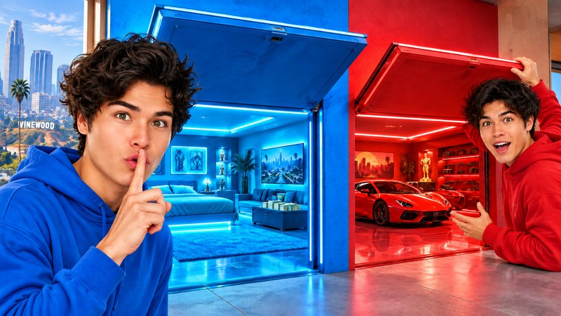

Five crew builders hide rooms in one color each while rival seekers try to spot the camouflage.

GTA 5 launch / follow-up · GTA 5

- **0 (First Frame)–5s:** Alan in front of a blue wall hatch revealing an aqua room, red wall hatch at right; saturated one-color secret-room split.

- **5s–15s:** Hide the most convincing room and discover the opposing team's entrances. Each builder draws one color.

- **15s–30s:** The first builder realizes their assigned neon red clashes with the street outside. Show the crew choosing its next move.

**Why this idea:** Shape: I Built [COUNT] [SUBJECT] Using Only One Color in [GAME]. Ingredients: secret, color, room. Combined package: I Built 5 Secret Rooms Using Only One Color in GTA. Keep the familiar Stokes secret-room promise and make the entrances/reveals genuinely new; the test is against the whole crew.

**Shape evidence:**

- [I Built 30 Secret Rooms You’d Never Find!](https://www.youtube.com/watch?v=X9AYf8gy5sU) — Unspeakable · 2024-06-22 · family · 18,997,959 views · 5.00× reported lift. Same title/premise family: I Built 30 Secret Rooms You’d Never Find!. Game, cast and execution transfer remains a hypothesis; this source does not validate the new episode outcome. Window: lifetime through source snapshot. [Metric source](https://majieddd.github.io/influint-channels-public/channels/UCwIWAbIeu0xI0ReKWOcw3eg.html).

- [I Built 7 Secret Rooms That Shouldn't Exist...](https://www.youtube.com/watch?v=ujX_NcWwnQo) — Brianna · 2024-01-11 · family · 4,313,017 views · 2.38× reported lift. Same title/premise family: I Built 7 Secret Rooms That Shouldn't Exist.... Game, cast and execution transfer remains a hypothesis; this source does not validate the new episode outcome. Window: lifetime through source snapshot. [Metric source](https://majieddd.github.io/influint-channels-public/channels/UCXg4rJUbDP1IP3TmZ9KDpJg.html).

- [I Built 5 SECRET Rooms In ONE COLOR!](https://www.youtube.com/watch?v=cfFtBojH_-Y) — Stokes Twins · 2025-06-27 · family · 180,421,614 views · 1.74× reported lift. Same title/premise family: I Built 5 SECRET Rooms In ONE COLOR!. Game, cast and execution transfer remains a hypothesis; this source does not validate the new episode outcome. Window: lifetime through source snapshot. [Metric source](https://majieddd.github.io/influint-channels-public/channels/UCbp9MyKCTEww4CxEzc_Tp0Q.html).

- [Preston Built a Secret HIDDEN Room to CHEAT in Hide and Seek!](https://www.youtube.com/watch?v=HPtF-z5QAyI) — Brianna · 2021-03-04 · family · 7,584,560 views · 2.16× reported lift. Same title/premise family: Preston Built a Secret HIDDEN Room to CHEAT in Hide and Seek!. Game, cast and execution transfer remains a hypothesis; this source does not validate the new episode outcome. Window: lifetime through source snapshot. [Metric source](https://majieddd.github.io/influint-channels-public/channels/UCXg4rJUbDP1IP3TmZ9KDpJg.html).

**Ingredient evidence:**

- [I FOUND PRESTONPLAYZ SECRET SKY BASE IN MINECRAFT!](https://www.youtube.com/watch?v=d0q9y0GkrEg) — Brianna · 2019-02-01 · family · 27,428,622 views · 8.87× reported lift. Same concrete ingredient secret: I FOUND PRESTONPLAYZ SECRET SKY BASE IN MINECRAFT!. Game, cast and execution transfer remains a hypothesis; this source does not validate the new episode outcome. Window: lifetime through source snapshot. [Metric source](https://majieddd.github.io/influint-channels-public/channels/UCXg4rJUbDP1IP3TmZ9KDpJg.html).

- [I Built 30 Secret Rooms You’d Never Find!](https://www.youtube.com/watch?v=X9AYf8gy5sU) — Unspeakable · 2024-06-22 · family · 18,997,959 views · 5.00× reported lift. Same concrete ingredient secret: I Built 30 Secret Rooms You’d Never Find!. Game, cast and execution transfer remains a hypothesis; this source does not validate the new episode outcome. Window: lifetime through source snapshot. [Metric source](https://majieddd.github.io/influint-channels-public/channels/UCwIWAbIeu0xI0ReKWOcw3eg.html).

- [$1 vs $25,000 Secret Rooms](https://www.youtube.com/watch?v=jEG8wuUE1pY) — MrBeast Gaming · 2025-07-26 · family · 63,275,703 views · 1.97× reported lift. Same concrete ingredient secret: $1 vs $25,000 Secret Rooms. Game, cast and execution transfer remains a hypothesis; this source does not validate the new episode outcome. Window: lifetime through source snapshot. [Metric source](https://majieddd.github.io/influint-channels-public/channels/UCIPPMRA040LQr5QPyJEbmXA.html).

- [I Built 5 SECRET Rooms In ONE COLOR!](https://www.youtube.com/watch?v=cfFtBojH_-Y) — Stokes Twins · 2025-06-27 · family · 180,421,614 views · 1.74× reported lift. Same concrete ingredient secret: I Built 5 SECRET Rooms In ONE COLOR!. Game, cast and execution transfer remains a hypothesis; this source does not validate the new episode outcome. Window: lifetime through source snapshot. [Metric source](https://majieddd.github.io/influint-channels-public/channels/UCbp9MyKCTEww4CxEzc_Tp0Q.html).

Two qualifying source channels on both axes; creator groups and exact-mixture limitations remain visible in the website.

**Objective:** Hide the most convincing room and discover the opposing team's entrances.

**Rules:** Each builder draws one color; entrances and interiors follow it, with identical build time and search boundaries.

**Escalation:** Bold rooms look impossible to hide until scenery becomes camouflage and a seeker notices one mismatched object.

**Payoff:** Rank discovery times, then reveal every builder's concealment trick.

**Gamer reward:** Game-world building tricks and concealed entrances create novelty.

**Non-gamer reward:** The audience knows the secret and anticipates the crew missing it or finding it.

**People:** One creator/host presents the builds; multiple crew members search, compete or react. Both twins need not be the only relationship.

**Production:** Bespoke working hero build · $7,100–$15,900 · authored incremental allowance.

**Dependencies:** Custom environments/entrances and capture; costs are lower on sequels reusing the build system.

**Thumbnail:** Alan in front of a blue wall hatch revealing an aqua room, red wall hatch at right; saturated one-color secret-room split.

Composition reference: [I Built 5 SECRET Rooms In ONE COLOR!](https://www.youtube.com/watch?v=cfFtBojH_-Y).

[Original PNG](generated-thumbnails/014.png) · [Exact image prompt](prompts/014-correction.txt)

#### Idea 015 — I Built Secret Rooms Inside Minecraft Landmarks

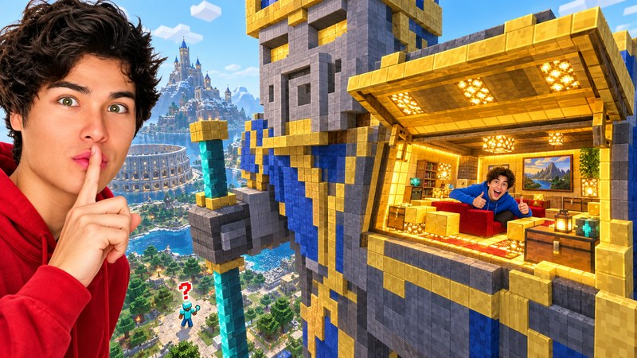

The crew explores recognizable Minecraft landmarks that conceal custom rooms behind ordinary details.

Later game expansion · Minecraft

- **0 (First Frame)–5s:** Alex shushing beside a Minecraft statue with an open chest hatch showing a golden lounge; tiny seeker below.

- **5s–15s:** Find the five hidden entrances on the marked landmark route. Use a bounded custom map with five working entrances and a fixed clue budget.

- **15s–30s:** The seekers correctly guess the first landmark but cannot find its actual door. Show the crew choosing its next move.

**Why this idea:** Shape: I Built [SUBJECT] Inside [GAME] [SUBJECT]. Ingredients: secret, Minecraft, build. Combined package: I Built Secret Rooms Inside Minecraft Landmarks. Keep the familiar Stokes secret-room promise and make the entrances/reveals genuinely new; the test is against the whole crew.

**Shape evidence:**

- [I Built 30 Secret Rooms You’d Never Find!](https://www.youtube.com/watch?v=X9AYf8gy5sU) — Unspeakable · 2024-06-22 · family · 18,997,959 views · 5.00× reported lift. Same title/premise family: I Built 30 Secret Rooms You’d Never Find!. Game, cast and execution transfer remains a hypothesis; this source does not validate the new episode outcome. Window: lifetime through source snapshot. [Metric source](https://majieddd.github.io/influint-channels-public/channels/UCwIWAbIeu0xI0ReKWOcw3eg.html).

- [I Built 7 Secret Rooms That Shouldn't Exist...](https://www.youtube.com/watch?v=ujX_NcWwnQo) — Brianna · 2024-01-11 · family · 4,313,017 views · 2.38× reported lift. Same title/premise family: I Built 7 Secret Rooms That Shouldn't Exist.... Game, cast and execution transfer remains a hypothesis; this source does not validate the new episode outcome. Window: lifetime through source snapshot. [Metric source](https://majieddd.github.io/influint-channels-public/channels/UCXg4rJUbDP1IP3TmZ9KDpJg.html).

- [I Built 5 SECRET Rooms In ONE COLOR!](https://www.youtube.com/watch?v=cfFtBojH_-Y) — Stokes Twins · 2025-06-27 · family · 180,421,614 views · 1.74× reported lift. Same title/premise family: I Built 5 SECRET Rooms In ONE COLOR!. Game, cast and execution transfer remains a hypothesis; this source does not validate the new episode outcome. Window: lifetime through source snapshot. [Metric source](https://majieddd.github.io/influint-channels-public/channels/UCbp9MyKCTEww4CxEzc_Tp0Q.html).

- [Preston Built a Secret HIDDEN Room to CHEAT in Hide and Seek!](https://www.youtube.com/watch?v=HPtF-z5QAyI) — Brianna · 2021-03-04 · family · 7,584,560 views · 2.16× reported lift. Same title/premise family: Preston Built a Secret HIDDEN Room to CHEAT in Hide and Seek!. Game, cast and execution transfer remains a hypothesis; this source does not validate the new episode outcome. Window: lifetime through source snapshot. [Metric source](https://majieddd.github.io/influint-channels-public/channels/UCXg4rJUbDP1IP3TmZ9KDpJg.html).

**Ingredient evidence:**

- [I FOUND PRESTONPLAYZ SECRET SKY BASE IN MINECRAFT!](https://www.youtube.com/watch?v=d0q9y0GkrEg) — Brianna · 2019-02-01 · family · 27,428,622 views · 8.87× reported lift. Same concrete ingredient secret: I FOUND PRESTONPLAYZ SECRET SKY BASE IN MINECRAFT!. Game, cast and execution transfer remains a hypothesis; this source does not validate the new episode outcome. Window: lifetime through source snapshot. [Metric source](https://majieddd.github.io/influint-channels-public/channels/UCXg4rJUbDP1IP3TmZ9KDpJg.html).

- [I Built 30 Secret Rooms You’d Never Find!](https://www.youtube.com/watch?v=X9AYf8gy5sU) — Unspeakable · 2024-06-22 · family · 18,997,959 views · 5.00× reported lift. Same concrete ingredient secret: I Built 30 Secret Rooms You’d Never Find!. Game, cast and execution transfer remains a hypothesis; this source does not validate the new episode outcome. Window: lifetime through source snapshot. [Metric source](https://majieddd.github.io/influint-channels-public/channels/UCwIWAbIeu0xI0ReKWOcw3eg.html).

- [$1 vs $25,000 Secret Rooms](https://www.youtube.com/watch?v=jEG8wuUE1pY) — MrBeast Gaming · 2025-07-26 · family · 63,275,703 views · 1.97× reported lift. Same concrete ingredient secret: $1 vs $25,000 Secret Rooms. Game, cast and execution transfer remains a hypothesis; this source does not validate the new episode outcome. Window: lifetime through source snapshot. [Metric source](https://majieddd.github.io/influint-channels-public/channels/UCIPPMRA040LQr5QPyJEbmXA.html).

- [I Built 5 SECRET Rooms In ONE COLOR!](https://www.youtube.com/watch?v=cfFtBojH_-Y) — Stokes Twins · 2025-06-27 · family · 180,421,614 views · 1.74× reported lift. Same concrete ingredient secret: I Built 5 SECRET Rooms In ONE COLOR!. Game, cast and execution transfer remains a hypothesis; this source does not validate the new episode outcome. Window: lifetime through source snapshot. [Metric source](https://majieddd.github.io/influint-channels-public/channels/UCbp9MyKCTEww4CxEzc_Tp0Q.html).

Two qualifying source channels on both axes; creator groups and exact-mixture limitations remain visible in the website.

**Objective:** Find the five hidden entrances on the marked landmark route.

**Rules:** Use a bounded custom map with five working entrances and a fixed clue budget.

**Escalation:** A statue hides a bedroom, a bridge hides a cinema and the final landmark appears completely solid.

**Payoff:** Replay the missed details and open the last room from the seeker's original viewpoint.

**Gamer reward:** Game-world building tricks and concealed entrances create novelty.

**Non-gamer reward:** The audience knows the secret and anticipates the crew missing it or finding it.

**People:** One creator/host presents the builds; multiple crew members search, compete or react. Both twins need not be the only relationship.

**Production:** Bespoke working hero build · $7,100–$15,900 · authored incremental allowance.

**Dependencies:** Custom environments/entrances and capture; costs are lower on sequels reusing the build system. Verify the exact edition, map, mod license and working mechanics; GTA-system reuse does not imply Minecraft support.

**Thumbnail:** Alex shushing beside a Minecraft statue with an open chest hatch showing a golden lounge; tiny seeker below.

Composition reference: [I Built 5 SECRET Rooms In ONE COLOR!](https://www.youtube.com/watch?v=cfFtBojH_-Y).

[Original PNG](generated-thumbnails/015.png) · [Exact image prompt](prompts/015.txt)

### Format 04 — Budgeted secret-room build-off

Give builders contrasting fixed allowances and the same brief, follow the tradeoffs, then have the crew discover and experience each room before choosing the best use of the budget.

Title family: $1 vs $___ Secret Rooms in ___

New direction requested by the user. Replaces the standalone last-to-leave slot. Last-to-leave can still be an in-video rule inside a larger premise.

#### Idea 016 — $1 vs $25,000 Secret Rooms in GTA

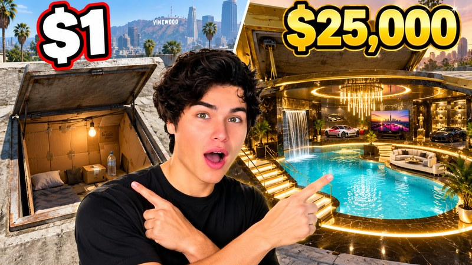

Two build teams use unequal virtual allowances to create hidden rooms for the same demanding crew guests.

GTA 5 launch / follow-up · GTA 5

- **0 (First Frame)–5s:** Tiny cardboard secret nook left versus spectacular gold underground pool right, Alan centered; $1 and $25,000.

- **5s–15s:** Win the crew's concealment, function and fun score. Amounts are disclosed in-game build values in this launch version, not real contractor spend.

- **15s–30s:** The cheap team cannot afford a normal door and designs a curtain camouflage instead. Show the crew choosing its next move.

**Why this idea:** Shape: $[VALUE] vs $[VALUE] [SUBJECT] in [GAME]. Ingredients: secret, room, cheap. Combined package: $1 vs $25,000 Secret Rooms in GTA. Combine the user-requested price-contrast title with the main channel’s hidden construction appeal.

**Shape evidence:**

- [$2 VS $16,000 Minecraft House!](https://www.youtube.com/watch?v=IPtpwh7r0Eo) — MrBeast Gaming · 2021-08-25 · family · 116,928,432 views · 3.26× reported lift. Same title/premise family: $2 VS $16,000 Minecraft House!. Game, cast and execution transfer remains a hypothesis; this source does not validate the new episode outcome. Window: lifetime through source snapshot. [Metric source](https://majieddd.github.io/influint-channels-public/channels/UCIPPMRA040LQr5QPyJEbmXA.html).

- [$1 VS $1,000,000 MOVIE THEATER!](https://www.youtube.com/watch?v=NbJGkWNL9Ow) — Unspeakable · 2025-03-22 · family · 9,548,848 views · 3.15× reported lift. Same title/premise family: $1 VS $1,000,000 MOVIE THEATER!. Game, cast and execution transfer remains a hypothesis; this source does not validate the new episode outcome. Window: lifetime through source snapshot. [Metric source](https://majieddd.github.io/influint-channels-public/channels/UCwIWAbIeu0xI0ReKWOcw3eg.html).

- [$50 vs $50,000 Family Vacation](https://www.youtube.com/watch?v=Mp8c5F16i1A) — Brianna · 2022-08-28 · family · 4,879,296 views · 2.45× reported lift. Same title/premise family: $50 vs $50,000 Family Vacation. Game, cast and execution transfer remains a hypothesis; this source does not validate the new episode outcome. Window: lifetime through source snapshot. [Metric source](https://majieddd.github.io/influint-channels-public/channels/UCXg4rJUbDP1IP3TmZ9KDpJg.html).

- [$1 vs $1,000,000 Vacation!](https://www.youtube.com/watch?v=K7FjCmlWvuY) — Stokes Twins · 2022-11-23 · family · 127,518,732 views · 1.33× reported lift. Same title/premise family: $1 vs $1,000,000 Vacation!. Game, cast and execution transfer remains a hypothesis; this source does not validate the new episode outcome. Window: lifetime through source snapshot. [Metric source](https://majieddd.github.io/influint-channels-public/channels/UCbp9MyKCTEww4CxEzc_Tp0Q.html).

**Ingredient evidence:**

- [I FOUND PRESTONPLAYZ SECRET SKY BASE IN MINECRAFT!](https://www.youtube.com/watch?v=d0q9y0GkrEg) — Brianna · 2019-02-01 · family · 27,428,622 views · 8.87× reported lift. Same concrete ingredient secret: I FOUND PRESTONPLAYZ SECRET SKY BASE IN MINECRAFT!. Game, cast and execution transfer remains a hypothesis; this source does not validate the new episode outcome. Window: lifetime through source snapshot. [Metric source](https://majieddd.github.io/influint-channels-public/channels/UCXg4rJUbDP1IP3TmZ9KDpJg.html).

- [I Built 30 Secret Rooms You’d Never Find!](https://www.youtube.com/watch?v=X9AYf8gy5sU) — Unspeakable · 2024-06-22 · family · 18,997,959 views · 5.00× reported lift. Same concrete ingredient secret: I Built 30 Secret Rooms You’d Never Find!. Game, cast and execution transfer remains a hypothesis; this source does not validate the new episode outcome. Window: lifetime through source snapshot. [Metric source](https://majieddd.github.io/influint-channels-public/channels/UCwIWAbIeu0xI0ReKWOcw3eg.html).

- [$1 vs $25,000 Secret Rooms](https://www.youtube.com/watch?v=jEG8wuUE1pY) — MrBeast Gaming · 2025-07-26 · family · 63,275,703 views · 1.97× reported lift. Same concrete ingredient secret: $1 vs $25,000 Secret Rooms. Game, cast and execution transfer remains a hypothesis; this source does not validate the new episode outcome. Window: lifetime through source snapshot. [Metric source](https://majieddd.github.io/influint-channels-public/channels/UCIPPMRA040LQr5QPyJEbmXA.html).

- [I Built 5 SECRET Rooms In ONE COLOR!](https://www.youtube.com/watch?v=cfFtBojH_-Y) — Stokes Twins · 2025-06-27 · family · 180,421,614 views · 1.74× reported lift. Same concrete ingredient secret: I Built 5 SECRET Rooms In ONE COLOR!. Game, cast and execution transfer remains a hypothesis; this source does not validate the new episode outcome. Window: lifetime through source snapshot. [Metric source](https://majieddd.github.io/influint-channels-public/channels/UCbp9MyKCTEww4CxEzc_Tp0Q.html).

Two qualifying source channels on both axes; creator groups and exact-mixture limitations remain visible in the website.

**Objective:** Win the crew's concealment, function and fun score.

**Rules:** Amounts are disclosed in-game build values in this launch version, not real contractor spend; same footprint and recording window.

**Escalation:** The cheap team improvises, the luxury team runs into a functional problem and blind guest testing upsets the price expectations.

**Payoff:** Reveal the judges' scores and the actual cash production allowance beside the game-value brief.

**Gamer reward:** Custom-world design and functional entrances supply ingenuity without a rules tutorial.

**Non-gamer reward:** The audience compares an obviously tiny allowance with a spectacular build and judges whether the upgrade is worth it.

**People:** Two or more build teams, crew room testers and an Alan/Alex host/judge; specialist developers can execute the selected designs.

**Production:** Bespoke working hero build · $7,100–$15,900 · authored incremental allowance.

**Dependencies:** Real build allowances and contractor scope must be specified. $25,000 is a requested title direction, not approved launch spending; distinguish a real budget from a game-value variant.

**Thumbnail:** Tiny cardboard secret nook left versus spectacular gold underground pool right, Alan centered; $1 and $25,000.

Composition reference: [$1 vs $25,000 Secret Rooms](https://www.youtube.com/watch?v=jEG8wuUE1pY).

[Original PNG](generated-thumbnails/016.png) · [Exact image prompt](prompts/016.txt)

#### Idea 017 — $1 vs $25,000 Secret Rooms Inside GTA Cars

Two teams hide a tiny improvised lounge and an extravagant cinema behind matching vehicle entrances.

GTA 5 launch / follow-up · GTA 5

- **0 (First Frame)–5s:** Cheap rusty van with cramped nook left, polished supercar door opening to golden cinema right, Alex foreground; $1 / $25K.

- **5s–15s:** Make the most convincing and enjoyable hidden car room. Game-value allowances, same base vehicle and equal judging.

- **15s–30s:** The expensive interior is ready but the vehicle door fails to open correctly. Show the crew choosing its next move.

**Why this idea:** Shape: $[VALUE] vs $[VALUE] [SUBJECT] Inside [GAME] [SUBJECT]. Ingredients: secret, car, build. Combined package: $1 vs $25,000 Secret Rooms Inside GTA Cars. Combine the user-requested price-contrast title with the main channel’s hidden construction appeal.

**Shape evidence:**

- [$2 VS $16,000 Minecraft House!](https://www.youtube.com/watch?v=IPtpwh7r0Eo) — MrBeast Gaming · 2021-08-25 · family · 116,928,432 views · 3.26× reported lift. Same title/premise family: $2 VS $16,000 Minecraft House!. Game, cast and execution transfer remains a hypothesis; this source does not validate the new episode outcome. Window: lifetime through source snapshot. [Metric source](https://majieddd.github.io/influint-channels-public/channels/UCIPPMRA040LQr5QPyJEbmXA.html).

- [$1 VS $1,000,000 MOVIE THEATER!](https://www.youtube.com/watch?v=NbJGkWNL9Ow) — Unspeakable · 2025-03-22 · family · 9,548,848 views · 3.15× reported lift. Same title/premise family: $1 VS $1,000,000 MOVIE THEATER!. Game, cast and execution transfer remains a hypothesis; this source does not validate the new episode outcome. Window: lifetime through source snapshot. [Metric source](https://majieddd.github.io/influint-channels-public/channels/UCwIWAbIeu0xI0ReKWOcw3eg.html).

- [$50 vs $50,000 Family Vacation](https://www.youtube.com/watch?v=Mp8c5F16i1A) — Brianna · 2022-08-28 · family · 4,879,296 views · 2.45× reported lift. Same title/premise family: $50 vs $50,000 Family Vacation. Game, cast and execution transfer remains a hypothesis; this source does not validate the new episode outcome. Window: lifetime through source snapshot. [Metric source](https://majieddd.github.io/influint-channels-public/channels/UCXg4rJUbDP1IP3TmZ9KDpJg.html).

- [$1 vs $1,000,000 Vacation!](https://www.youtube.com/watch?v=K7FjCmlWvuY) — Stokes Twins · 2022-11-23 · family · 127,518,732 views · 1.33× reported lift. Same title/premise family: $1 vs $1,000,000 Vacation!. Game, cast and execution transfer remains a hypothesis; this source does not validate the new episode outcome. Window: lifetime through source snapshot. [Metric source](https://majieddd.github.io/influint-channels-public/channels/UCbp9MyKCTEww4CxEzc_Tp0Q.html).

**Ingredient evidence:**

- [I FOUND PRESTONPLAYZ SECRET SKY BASE IN MINECRAFT!](https://www.youtube.com/watch?v=d0q9y0GkrEg) — Brianna · 2019-02-01 · family · 27,428,622 views · 8.87× reported lift. Same concrete ingredient secret: I FOUND PRESTONPLAYZ SECRET SKY BASE IN MINECRAFT!. Game, cast and execution transfer remains a hypothesis; this source does not validate the new episode outcome. Window: lifetime through source snapshot. [Metric source](https://majieddd.github.io/influint-channels-public/channels/UCXg4rJUbDP1IP3TmZ9KDpJg.html).

- [I Built 30 Secret Rooms You’d Never Find!](https://www.youtube.com/watch?v=X9AYf8gy5sU) — Unspeakable · 2024-06-22 · family · 18,997,959 views · 5.00× reported lift. Same concrete ingredient secret: I Built 30 Secret Rooms You’d Never Find!. Game, cast and execution transfer remains a hypothesis; this source does not validate the new episode outcome. Window: lifetime through source snapshot. [Metric source](https://majieddd.github.io/influint-channels-public/channels/UCwIWAbIeu0xI0ReKWOcw3eg.html).

- [$1 vs $25,000 Secret Rooms](https://www.youtube.com/watch?v=jEG8wuUE1pY) — MrBeast Gaming · 2025-07-26 · family · 63,275,703 views · 1.97× reported lift. Same concrete ingredient secret: $1 vs $25,000 Secret Rooms. Game, cast and execution transfer remains a hypothesis; this source does not validate the new episode outcome. Window: lifetime through source snapshot. [Metric source](https://majieddd.github.io/influint-channels-public/channels/UCIPPMRA040LQr5QPyJEbmXA.html).

- [I Built 5 SECRET Rooms In ONE COLOR!](https://www.youtube.com/watch?v=cfFtBojH_-Y) — Stokes Twins · 2025-06-27 · family · 180,421,614 views · 1.74× reported lift. Same concrete ingredient secret: I Built 5 SECRET Rooms In ONE COLOR!. Game, cast and execution transfer remains a hypothesis; this source does not validate the new episode outcome. Window: lifetime through source snapshot. [Metric source](https://majieddd.github.io/influint-channels-public/channels/UCbp9MyKCTEww4CxEzc_Tp0Q.html).

Two qualifying source channels on both axes; creator groups and exact-mixture limitations remain visible in the website.

**Objective:** Make the most convincing and enjoyable hidden car room.

**Rules:** Game-value allowances, same base vehicle and equal judging; custom doorway/interior geometry is explained visually.

**Escalation:** The small build wins portability while the luxury build struggles with a working reveal mechanism.

**Payoff:** Show each exterior-to-interior journey and let the guests choose the room they would keep.

**Gamer reward:** Custom-world design and functional entrances supply ingenuity without a rules tutorial.

**Non-gamer reward:** The audience compares an obviously tiny allowance with a spectacular build and judges whether the upgrade is worth it.

**People:** Two or more build teams, crew room testers and an Alan/Alex host/judge; specialist developers can execute the selected designs.

**Production:** Bespoke working hero build · $7,100–$15,900 · authored incremental allowance.

**Dependencies:** Real build allowances and contractor scope must be specified. $25,000 is a requested title direction, not approved launch spending; distinguish a real budget from a game-value variant.

**Thumbnail:** Cheap rusty van with cramped nook left, polished supercar door opening to golden cinema right, Alex foreground; $1 / $25K.

Composition reference: [$1 vs $25,000 Secret Rooms](https://www.youtube.com/watch?v=jEG8wuUE1pY).

[Original PNG](generated-thumbnails/017.png) · [Exact image prompt](prompts/017.txt)

#### Idea 018 — $1 vs $25,000 Underwater Rooms in GTA

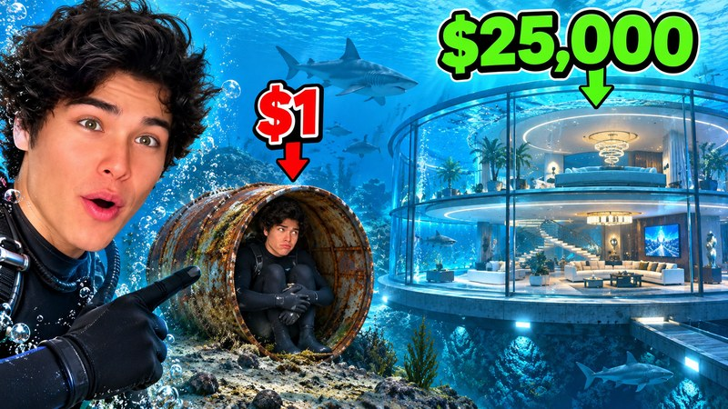

The crew builds two underwater hideouts and tests whether either can stay concealed while remaining usable.

GTA 5 launch / follow-up · GTA 5

- **0 (First Frame)–5s:** Alan underwater beside tiny barrel hideout left and enormous glass blue underwater lounge right; $1 and $25K.

- **5s–15s:** Win a safe-entry, concealment and experience score inside the game. Disclosed virtual allowances and identical water depth.

- **15s–30s:** The crew can see the luxury room immediately from the surface. Show the crew choosing its next move.

**Why this idea:** Shape: $[VALUE] vs $[VALUE] [SUBJECT] in [GAME]. Ingredients: water, secret, room. Combined package: $1 vs $25,000 Underwater Rooms in GTA. Combine the user-requested price-contrast title with the main channel’s hidden construction appeal.

**Shape evidence:**

- [$2 VS $16,000 Minecraft House!](https://www.youtube.com/watch?v=IPtpwh7r0Eo) — MrBeast Gaming · 2021-08-25 · family · 116,928,432 views · 3.26× reported lift. Same title/premise family: $2 VS $16,000 Minecraft House!. Game, cast and execution transfer remains a hypothesis; this source does not validate the new episode outcome. Window: lifetime through source snapshot. [Metric source](https://majieddd.github.io/influint-channels-public/channels/UCIPPMRA040LQr5QPyJEbmXA.html).

- [$1 VS $1,000,000 MOVIE THEATER!](https://www.youtube.com/watch?v=NbJGkWNL9Ow) — Unspeakable · 2025-03-22 · family · 9,548,848 views · 3.15× reported lift. Same title/premise family: $1 VS $1,000,000 MOVIE THEATER!. Game, cast and execution transfer remains a hypothesis; this source does not validate the new episode outcome. Window: lifetime through source snapshot. [Metric source](https://majieddd.github.io/influint-channels-public/channels/UCwIWAbIeu0xI0ReKWOcw3eg.html).

- [$50 vs $50,000 Family Vacation](https://www.youtube.com/watch?v=Mp8c5F16i1A) — Brianna · 2022-08-28 · family · 4,879,296 views · 2.45× reported lift. Same title/premise family: $50 vs $50,000 Family Vacation. Game, cast and execution transfer remains a hypothesis; this source does not validate the new episode outcome. Window: lifetime through source snapshot. [Metric source](https://majieddd.github.io/influint-channels-public/channels/UCXg4rJUbDP1IP3TmZ9KDpJg.html).

- [$1 vs $1,000,000 Vacation!](https://www.youtube.com/watch?v=K7FjCmlWvuY) — Stokes Twins · 2022-11-23 · family · 127,518,732 views · 1.33× reported lift. Same title/premise family: $1 vs $1,000,000 Vacation!. Game, cast and execution transfer remains a hypothesis; this source does not validate the new episode outcome. Window: lifetime through source snapshot. [Metric source](https://majieddd.github.io/influint-channels-public/channels/UCbp9MyKCTEww4CxEzc_Tp0Q.html).

**Ingredient evidence:**

- [WORST Reviewed Water Park vs BEST Reviewed Water Park!](https://www.youtube.com/watch?v=-LVdJNIs2PY) — Brianna · 2020-09-26 · family · 11,857,144 views · 5.63× reported lift. Same concrete ingredient water: WORST Reviewed Water Park vs BEST Reviewed Water Park!. Game, cast and execution transfer remains a hypothesis; this source does not validate the new episode outcome. Window: lifetime through source snapshot. [Metric source](https://majieddd.github.io/influint-channels-public/channels/UCXg4rJUbDP1IP3TmZ9KDpJg.html).

- [I Turned My House Into a Waterpark!](https://www.youtube.com/watch?v=WthL6_K8Kys) — Unspeakable · 2024-08-24 · family · 20,543,332 views · 4.23× reported lift. Same concrete ingredient water: I Turned My House Into a Waterpark!. Game, cast and execution transfer remains a hypothesis; this source does not validate the new episode outcome. Window: lifetime through source snapshot. [Metric source](https://majieddd.github.io/influint-channels-public/channels/UCwIWAbIeu0xI0ReKWOcw3eg.html).

- [Why I Flooded My Friend’s ENTIRE World?](https://www.youtube.com/watch?v=-LUNQPxD0vY) — PrestonPlayz · 2026-03-07 · family · 13,665,235 views · 2.81× reported lift. Same concrete ingredient water: Why I Flooded My Friend’s ENTIRE World?. Game, cast and execution transfer remains a hypothesis; this source does not validate the new episode outcome. Window: lifetime through source snapshot. [Metric source](https://majieddd.github.io/influint-channels-public/channels/UCJZam2u1G0syq3kyqrCXrNw.html).

- [Walking on Water Prank!](https://www.youtube.com/watch?v=hHdKug_wQkU) — Stokes Twins · 2025-03-22 · family · 169,129,541 views · 1.34× reported lift. Same concrete ingredient water: Walking on Water Prank!. Game, cast and execution transfer remains a hypothesis; this source does not validate the new episode outcome. Window: lifetime through source snapshot. [Metric source](https://majieddd.github.io/influint-channels-public/channels/UCbp9MyKCTEww4CxEzc_Tp0Q.html).

Two qualifying source channels on both axes; creator groups and exact-mixture limitations remain visible in the website.

**Objective:** Win a safe-entry, concealment and experience score inside the game.

**Rules:** Disclosed virtual allowances and identical water depth; game oxygen rules are shown simply and no real underwater stunt is required.

**Escalation:** A cheap air pocket beats a grand view on access, then guests test each exit under a timer.

**Payoff:** Reveal the score and the room that the crew can genuinely enter, enjoy and leave.

**Gamer reward:** Custom-world design and functional entrances supply ingenuity without a rules tutorial.

**Non-gamer reward:** The audience compares an obviously tiny allowance with a spectacular build and judges whether the upgrade is worth it.

**People:** Two or more build teams, crew room testers and an Alan/Alex host/judge; specialist developers can execute the selected designs.

**Production:** Bespoke working hero build · $7,100–$15,900 · authored incremental allowance.

**Dependencies:** Real build allowances and contractor scope must be specified. $25,000 is a requested title direction, not approved launch spending; distinguish a real budget from a game-value variant.

**Thumbnail:** Alan underwater beside tiny barrel hideout left and enormous glass blue underwater lounge right; $1 and $25K.

Composition reference: [$1 vs $25,000 Secret Rooms](https://www.youtube.com/watch?v=jEG8wuUE1pY).

[Original PNG](generated-thumbnails/018.png) · [Exact image prompt](prompts/018.txt)

#### Idea 019 — $1 vs $25,000 Secret Rooms for Our Friends in GTA

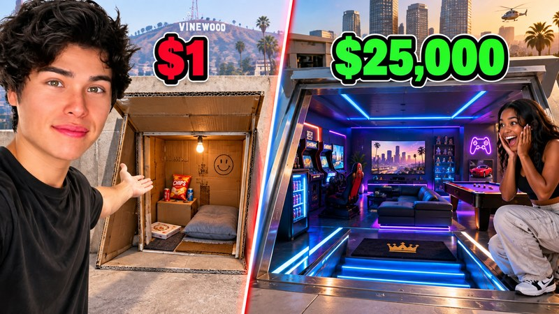

Build teams compete to satisfy one friend's exact wish using radically different game-value budgets.

GTA 5 launch / follow-up · GTA 5

- **0 (First Frame)–5s:** Alan presenting tiny cardboard snack room left and giant neon arcade right to one delighted crew guest; $1 / $25K.

- **5s–15s:** Win the friend's vote after both rooms meet a written wish list. Reveal the guest's three priorities before building.

- **15s–30s:** The guest's most important request turns out to be absent from the expensive design. Show the crew choosing its next move.

**Why this idea:** Shape: $[VALUE] vs $[VALUE] [SUBJECT] for Our Friends in [GAME]. Ingredients: secret, friends, build. Combined package: $1 vs $25,000 Secret Rooms for Our Friends in GTA. Combine the user-requested price-contrast title with the main channel’s hidden construction appeal.

**Shape evidence:**

- [$2 VS $16,000 Minecraft House!](https://www.youtube.com/watch?v=IPtpwh7r0Eo) — MrBeast Gaming · 2021-08-25 · family · 116,928,432 views · 3.26× reported lift. Same title/premise family: $2 VS $16,000 Minecraft House!. Game, cast and execution transfer remains a hypothesis; this source does not validate the new episode outcome. Window: lifetime through source snapshot. [Metric source](https://majieddd.github.io/influint-channels-public/channels/UCIPPMRA040LQr5QPyJEbmXA.html).

- [$1 VS $1,000,000 MOVIE THEATER!](https://www.youtube.com/watch?v=NbJGkWNL9Ow) — Unspeakable · 2025-03-22 · family · 9,548,848 views · 3.15× reported lift. Same title/premise family: $1 VS $1,000,000 MOVIE THEATER!. Game, cast and execution transfer remains a hypothesis; this source does not validate the new episode outcome. Window: lifetime through source snapshot. [Metric source](https://majieddd.github.io/influint-channels-public/channels/UCwIWAbIeu0xI0ReKWOcw3eg.html).

- [$50 vs $50,000 Family Vacation](https://www.youtube.com/watch?v=Mp8c5F16i1A) — Brianna · 2022-08-28 · family · 4,879,296 views · 2.45× reported lift. Same title/premise family: $50 vs $50,000 Family Vacation. Game, cast and execution transfer remains a hypothesis; this source does not validate the new episode outcome. Window: lifetime through source snapshot. [Metric source](https://majieddd.github.io/influint-channels-public/channels/UCXg4rJUbDP1IP3TmZ9KDpJg.html).

- [$1 vs $1,000,000 Vacation!](https://www.youtube.com/watch?v=K7FjCmlWvuY) — Stokes Twins · 2022-11-23 · family · 127,518,732 views · 1.33× reported lift. Same title/premise family: $1 vs $1,000,000 Vacation!. Game, cast and execution transfer remains a hypothesis; this source does not validate the new episode outcome. Window: lifetime through source snapshot. [Metric source](https://majieddd.github.io/influint-channels-public/channels/UCbp9MyKCTEww4CxEzc_Tp0Q.html).

**Ingredient evidence:**

- [I FOUND PRESTONPLAYZ SECRET SKY BASE IN MINECRAFT!](https://www.youtube.com/watch?v=d0q9y0GkrEg) — Brianna · 2019-02-01 · family · 27,428,622 views · 8.87× reported lift. Same concrete ingredient secret: I FOUND PRESTONPLAYZ SECRET SKY BASE IN MINECRAFT!. Game, cast and execution transfer remains a hypothesis; this source does not validate the new episode outcome. Window: lifetime through source snapshot. [Metric source](https://majieddd.github.io/influint-channels-public/channels/UCXg4rJUbDP1IP3TmZ9KDpJg.html).

- [I Built 30 Secret Rooms You’d Never Find!](https://www.youtube.com/watch?v=X9AYf8gy5sU) — Unspeakable · 2024-06-22 · family · 18,997,959 views · 5.00× reported lift. Same concrete ingredient secret: I Built 30 Secret Rooms You’d Never Find!. Game, cast and execution transfer remains a hypothesis; this source does not validate the new episode outcome. Window: lifetime through source snapshot. [Metric source](https://majieddd.github.io/influint-channels-public/channels/UCwIWAbIeu0xI0ReKWOcw3eg.html).

- [$1 vs $25,000 Secret Rooms](https://www.youtube.com/watch?v=jEG8wuUE1pY) — MrBeast Gaming · 2025-07-26 · family · 63,275,703 views · 1.97× reported lift. Same concrete ingredient secret: $1 vs $25,000 Secret Rooms. Game, cast and execution transfer remains a hypothesis; this source does not validate the new episode outcome. Window: lifetime through source snapshot. [Metric source](https://majieddd.github.io/influint-channels-public/channels/UCIPPMRA040LQr5QPyJEbmXA.html).

- [I Built 5 SECRET Rooms In ONE COLOR!](https://www.youtube.com/watch?v=cfFtBojH_-Y) — Stokes Twins · 2025-06-27 · family · 180,421,614 views · 1.74× reported lift. Same concrete ingredient secret: I Built 5 SECRET Rooms In ONE COLOR!. Game, cast and execution transfer remains a hypothesis; this source does not validate the new episode outcome. Window: lifetime through source snapshot. [Metric source](https://majieddd.github.io/influint-channels-public/channels/UCbp9MyKCTEww4CxEzc_Tp0Q.html).

Two qualifying source channels on both axes; creator groups and exact-mixture limitations remain visible in the website.

**Objective:** Win the friend's vote after both rooms meet a written wish list.

**Rules:** Reveal the guest's three priorities before building; virtual values, fixed scope and no changing the brief after judging.

**Escalation:** The cheap builder solves the personal detail first while the expensive builder chases spectacle and risks forgetting it.

**Payoff:** The friend tests both rooms and explains which details earned the vote.

**Gamer reward:** Custom-world design and functional entrances supply ingenuity without a rules tutorial.

**Non-gamer reward:** The audience compares an obviously tiny allowance with a spectacular build and judges whether the upgrade is worth it.

**People:** Two or more build teams, crew room testers and an Alan/Alex host/judge; specialist developers can execute the selected designs.

**Production:** Bespoke working hero build · $7,100–$15,900 · authored incremental allowance.

**Dependencies:** Real build allowances and contractor scope must be specified. $25,000 is a requested title direction, not approved launch spending; distinguish a real budget from a game-value variant.

**Thumbnail:** Alan presenting tiny cardboard snack room left and giant neon arcade right to one delighted crew guest; $1 / $25K.

Composition reference: [$1 vs $25,000 Secret Rooms](https://www.youtube.com/watch?v=jEG8wuUE1pY).

[Original PNG](generated-thumbnails/019.png) · [Exact image prompt](prompts/019.txt)

#### Idea 020 — $1 vs $25,000 Secret Rooms in Minecraft

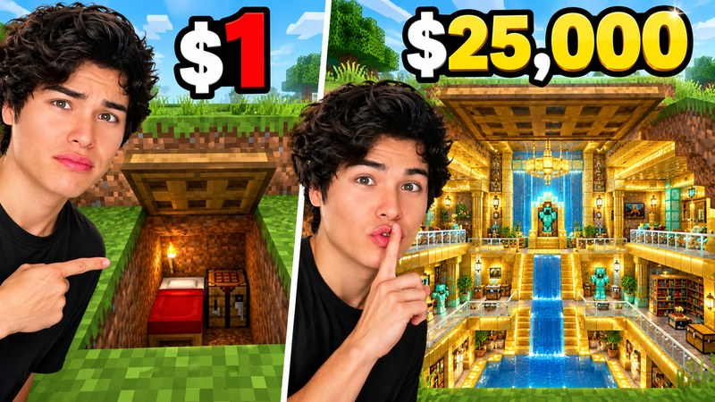

Two teams turn the same Minecraft hillside into a tiny clever hideout and a vast secret palace.

Later game expansion · Minecraft

- **0 (First Frame)–5s:** Dirt hatch with tiny bed left versus immense golden Minecraft underground palace right, Alex shushing; $1 / $25K.

- **5s–15s:** Earn the best concealment and guest-experience score. Amounts are symbolic game-value allowances.

- **15s–30s:** The expensive build lights leak through the hill and attract a seeker. Show the crew choosing its next move.

**Why this idea:** Shape: $[VALUE] vs $[VALUE] [SUBJECT] in [GAME]. Ingredients: secret, Minecraft, cheap. Combined package: $1 vs $25,000 Secret Rooms in Minecraft. Combine the user-requested price-contrast title with the main channel’s hidden construction appeal.

**Shape evidence:**

- [$2 VS $16,000 Minecraft House!](https://www.youtube.com/watch?v=IPtpwh7r0Eo) — MrBeast Gaming · 2021-08-25 · family · 116,928,432 views · 3.26× reported lift. Same title/premise family: $2 VS $16,000 Minecraft House!. Game, cast and execution transfer remains a hypothesis; this source does not validate the new episode outcome. Window: lifetime through source snapshot. [Metric source](https://majieddd.github.io/influint-channels-public/channels/UCIPPMRA040LQr5QPyJEbmXA.html).

- [$1 VS $1,000,000 MOVIE THEATER!](https://www.youtube.com/watch?v=NbJGkWNL9Ow) — Unspeakable · 2025-03-22 · family · 9,548,848 views · 3.15× reported lift. Same title/premise family: $1 VS $1,000,000 MOVIE THEATER!. Game, cast and execution transfer remains a hypothesis; this source does not validate the new episode outcome. Window: lifetime through source snapshot. [Metric source](https://majieddd.github.io/influint-channels-public/channels/UCwIWAbIeu0xI0ReKWOcw3eg.html).

- [$50 vs $50,000 Family Vacation](https://www.youtube.com/watch?v=Mp8c5F16i1A) — Brianna · 2022-08-28 · family · 4,879,296 views · 2.45× reported lift. Same title/premise family: $50 vs $50,000 Family Vacation. Game, cast and execution transfer remains a hypothesis; this source does not validate the new episode outcome. Window: lifetime through source snapshot. [Metric source](https://majieddd.github.io/influint-channels-public/channels/UCXg4rJUbDP1IP3TmZ9KDpJg.html).

- [$1 vs $1,000,000 Vacation!](https://www.youtube.com/watch?v=K7FjCmlWvuY) — Stokes Twins · 2022-11-23 · family · 127,518,732 views · 1.33× reported lift. Same title/premise family: $1 vs $1,000,000 Vacation!. Game, cast and execution transfer remains a hypothesis; this source does not validate the new episode outcome. Window: lifetime through source snapshot. [Metric source](https://majieddd.github.io/influint-channels-public/channels/UCbp9MyKCTEww4CxEzc_Tp0Q.html).

**Ingredient evidence:**

- [I FOUND PRESTONPLAYZ SECRET SKY BASE IN MINECRAFT!](https://www.youtube.com/watch?v=d0q9y0GkrEg) — Brianna · 2019-02-01 · family · 27,428,622 views · 8.87× reported lift. Same concrete ingredient secret: I FOUND PRESTONPLAYZ SECRET SKY BASE IN MINECRAFT!. Game, cast and execution transfer remains a hypothesis; this source does not validate the new episode outcome. Window: lifetime through source snapshot. [Metric source](https://majieddd.github.io/influint-channels-public/channels/UCXg4rJUbDP1IP3TmZ9KDpJg.html).

- [I Built 30 Secret Rooms You’d Never Find!](https://www.youtube.com/watch?v=X9AYf8gy5sU) — Unspeakable · 2024-06-22 · family · 18,997,959 views · 5.00× reported lift. Same concrete ingredient secret: I Built 30 Secret Rooms You’d Never Find!. Game, cast and execution transfer remains a hypothesis; this source does not validate the new episode outcome. Window: lifetime through source snapshot. [Metric source](https://majieddd.github.io/influint-channels-public/channels/UCwIWAbIeu0xI0ReKWOcw3eg.html).

- [$1 vs $25,000 Secret Rooms](https://www.youtube.com/watch?v=jEG8wuUE1pY) — MrBeast Gaming · 2025-07-26 · family · 63,275,703 views · 1.97× reported lift. Same concrete ingredient secret: $1 vs $25,000 Secret Rooms. Game, cast and execution transfer remains a hypothesis; this source does not validate the new episode outcome. Window: lifetime through source snapshot. [Metric source](https://majieddd.github.io/influint-channels-public/channels/UCIPPMRA040LQr5QPyJEbmXA.html).

- [I Built 5 SECRET Rooms In ONE COLOR!](https://www.youtube.com/watch?v=cfFtBojH_-Y) — Stokes Twins · 2025-06-27 · family · 180,421,614 views · 1.74× reported lift. Same concrete ingredient secret: I Built 5 SECRET Rooms In ONE COLOR!. Game, cast and execution transfer remains a hypothesis; this source does not validate the new episode outcome. Window: lifetime through source snapshot. [Metric source](https://majieddd.github.io/influint-channels-public/channels/UCbp9MyKCTEww4CxEzc_Tp0Q.html).

Two qualifying source channels on both axes; creator groups and exact-mixture limitations remain visible in the website.

**Objective:** Earn the best concealment and guest-experience score.

**Rules:** Amounts are symbolic game-value allowances; equal plot, entrance limit and search time.

**Escalation:** The cheap entrance disappears naturally while the luxury elevator gives away its location before a repair.

**Payoff:** Reveal both spaces and compare the discovery time with the crew's comfort vote.

**Gamer reward:** Custom-world design and functional entrances supply ingenuity without a rules tutorial.

**Non-gamer reward:** The audience compares an obviously tiny allowance with a spectacular build and judges whether the upgrade is worth it.

**People:** Two or more build teams, crew room testers and an Alan/Alex host/judge; specialist developers can execute the selected designs.

**Production:** Bespoke working hero build · $7,100–$15,900 · authored incremental allowance.

**Dependencies:** Real build allowances and contractor scope must be specified. $25,000 is a requested title direction, not approved launch spending; distinguish a real budget from a game-value variant. Verify the exact edition, map, mod license and working mechanics; GTA-system reuse does not imply Minecraft support.

**Thumbnail:** Dirt hatch with tiny bed left versus immense golden Minecraft underground palace right, Alex shushing; $1 / $25K.

Composition reference: [$1 vs $25,000 Secret Rooms](https://www.youtube.com/watch?v=jEG8wuUE1pY).

[Original PNG](generated-thumbnails/020.png) · [Exact image prompt](prompts/020.txt)

### Format 05 — Survive a city-scale disaster

The crew must reach safety through a clearly introduced disaster that changes the available route; preparation, sacrifice and improvised escapes provide escalation.

Title family: We Survived ___ in ___

Reworked. No Los Santos in the title. Each episode uses a concrete recognizable disaster rather than generic survival exposition.

#### Idea 021 — We Survived GTA's Deadliest Natural Disasters

The crew races to a mountaintop shelter as three escalating simulated disasters remove their easiest escape routes.

GTA 5 launch / follow-up · GTA 5

- **0 (First Frame)–5s:** Alan and adult crew in a red jeep foreground, enormous blue tsunami at left and tornado at right over a GTA skyline.

- **5s–15s:** Get the entire crew to the shelter with the marked supply case. Three tested hazards, fixed safe zone and one shared supply case.

- **15s–30s:** The first flood takes the direct road before the crew leaves the city. Show the crew choosing its next move.

**Why this idea:** Shape: We Survived [GAME]'s Deadliest [SUBJECT]. Ingredients: disaster, survive, GTA. Combined package: We Survived GTA's Deadliest Natural Disasters. Environmental survival spectacle with cast reactions; no map-lore knowledge is needed.

**Shape evidence:**

- [Overnight Survival Challenge in the World's Largest ZOO!](https://www.youtube.com/watch?v=TLHIKUvhXsU) — Brianna · 2020-10-17 · family · 14,469,543 views · 6.88× reported lift. Same title/premise family: Overnight Survival Challenge in the World's Largest ZOO!. Game, cast and execution transfer remains a hypothesis; this source does not validate the new episode outcome. Window: lifetime through source snapshot. [Metric source](https://majieddd.github.io/influint-channels-public/channels/UCXg4rJUbDP1IP3TmZ9KDpJg.html).

- [I Survived 100 Days Of Hardcore Minecraft!](https://www.youtube.com/watch?v=jk6thMe6Vq8) — MrBeast Gaming · 2021-07-22 · family · 186,681,366 views · 4.27× reported lift. Same title/premise family: I Survived 100 Days Of Hardcore Minecraft!. Game, cast and execution transfer remains a hypothesis; this source does not validate the new episode outcome. Window: lifetime through source snapshot. [Metric source](https://majieddd.github.io/influint-channels-public/channels/UCIPPMRA040LQr5QPyJEbmXA.html).

- [I Escaped 1,000 Layers of ICE!](https://www.youtube.com/watch?v=mXqlDp61MMA) — Unspeakable · 2025-04-19 · family · 13,160,154 views · 3.66× reported lift. Same title/premise family: I Escaped 1,000 Layers of ICE!. Game, cast and execution transfer remains a hypothesis; this source does not validate the new episode outcome. Window: lifetime through source snapshot. [Metric source](https://majieddd.github.io/influint-channels-public/channels/UCwIWAbIeu0xI0ReKWOcw3eg.html).

- [Can I Survive Inside a Mob's Body?](https://www.youtube.com/watch?v=ioTKTLSoIFw) — PrestonPlayz · 2026-03-21 · family · 7,021,145 views · 1.49× reported lift. Same title/premise family: Can I Survive Inside a Mob's Body?. Game, cast and execution transfer remains a hypothesis; this source does not validate the new episode outcome. Window: lifetime through source snapshot. [Metric source](https://majieddd.github.io/influint-channels-public/channels/UCJZam2u1G0syq3kyqrCXrNw.html).

**Ingredient evidence:**

- [13 Days Stranded Hunting Tornados](https://www.youtube.com/watch?v=Nq1OKpsJOMM) — Unspeakable · 2024-08-17 · family · 20,700,552 views · 3.56× reported lift. Same concrete ingredient disaster: 13 Days Stranded Hunting Tornados. Game, cast and execution transfer remains a hypothesis; this source does not validate the new episode outcome. Window: lifetime through source snapshot. [Metric source](https://majieddd.github.io/influint-channels-public/channels/UCwIWAbIeu0xI0ReKWOcw3eg.html).

- [Why I Flooded My Friend’s ENTIRE World?](https://www.youtube.com/watch?v=-LUNQPxD0vY) — PrestonPlayz · 2026-03-07 · family · 13,665,235 views · 2.81× reported lift. Same concrete ingredient disaster: Why I Flooded My Friend’s ENTIRE World?. Game, cast and execution transfer remains a hypothesis; this source does not validate the new episode outcome. Window: lifetime through source snapshot. [Metric source](https://majieddd.github.io/influint-channels-public/channels/UCJZam2u1G0syq3kyqrCXrNw.html).

- [My Lego House Vs Natural Disasters](https://www.youtube.com/watch?v=-eVYFC7hd9o) — Unspeakable · 2025-11-08 · family · 7,576,150 views · 1.29× reported lift. Same concrete ingredient disaster: My Lego House Vs Natural Disasters. Game, cast and execution transfer remains a hypothesis; this source does not validate the new episode outcome. Window: lifetime through source snapshot. [Metric source](https://majieddd.github.io/influint-channels-public/channels/UCwIWAbIeu0xI0ReKWOcw3eg.html).

- [I Survived A Tornado](https://www.youtube.com/watch?v=8_TmqPxK6yI) — Unspeakable · 2024-07-13 · family · 8,090,156 views · 1.26× reported lift. Same concrete ingredient disaster: I Survived A Tornado. Game, cast and execution transfer remains a hypothesis; this source does not validate the new episode outcome. Window: lifetime through source snapshot. [Metric source](https://majieddd.github.io/influint-channels-public/channels/UCwIWAbIeu0xI0ReKWOcw3eg.html).

Two qualifying source channels on both axes; creator groups and exact-mixture limitations remain visible in the website.

**Objective:** Get the entire crew to the shelter with the marked supply case.

**Rules:** Three tested hazards, fixed safe zone and one shared supply case; a visible map explains the route.

**Escalation:** A flood blocks the road, a quake breaks the bridge and a storm hits the final climb.

**Payoff:** Show who reaches shelter and which rescue choice changes the result.

**Gamer reward:** Map knowledge and improvised traversal become useful.

**Non-gamer reward:** A rising threat, shrinking safety and an earned escape need no game knowledge.

**People:** A mixed survival group with a visible shared objective; rotate who makes decisions, fails and rescues someone.

**Production:** Bespoke working hero build · $7,100–$15,900 · authored incremental allowance.

**Dependencies:** Scoped GTA 5 hazards and a tested escape route, effects/capture and a fallback. GTA 6 adaptations depend on actual supported tools.

**Thumbnail:** Alan and adult crew in a red jeep foreground, enormous blue tsunami at left and tornado at right over a GTA skyline.

Composition reference: [7 EXTREME Ways To Survive For 24 HOURS!](https://www.youtube.com/watch?v=A58m8KTOWWM).

[Original PNG](generated-thumbnails/021.png) · [Exact image prompt](prompts/021.txt)

#### Idea 022 — We Survived a Giant Tsunami in GTA

The crew has to reach high ground before a giant simulated wave overtakes a city evacuation route.

GTA 5 launch / follow-up · GTA 5

- **0 (First Frame)–5s:** Alex fleeing in a tiny red car while a colossal turquoise tsunami curls above a GTA city, one mountain visible ahead.

- **5s–15s:** Reach the marked mountain shelter before the wave. One visible wave path and timer.

- **15s–30s:** The chosen road is jammed with abandoned vehicles. Show the crew choosing its next move.

**Why this idea:** Shape: We Survived a Giant [SUBJECT] in [GAME]. Ingredients: tsunami, water, survive. Combined package: We Survived a Giant Tsunami in GTA. Environmental survival spectacle with cast reactions; no map-lore knowledge is needed.

**Shape evidence:**

- [Overnight Survival Challenge in the World's Largest ZOO!](https://www.youtube.com/watch?v=TLHIKUvhXsU) — Brianna · 2020-10-17 · family · 14,469,543 views · 6.88× reported lift. Same title/premise family: Overnight Survival Challenge in the World's Largest ZOO!. Game, cast and execution transfer remains a hypothesis; this source does not validate the new episode outcome. Window: lifetime through source snapshot. [Metric source](https://majieddd.github.io/influint-channels-public/channels/UCXg4rJUbDP1IP3TmZ9KDpJg.html).

- [I Survived 100 Days Of Hardcore Minecraft!](https://www.youtube.com/watch?v=jk6thMe6Vq8) — MrBeast Gaming · 2021-07-22 · family · 186,681,366 views · 4.27× reported lift. Same title/premise family: I Survived 100 Days Of Hardcore Minecraft!. Game, cast and execution transfer remains a hypothesis; this source does not validate the new episode outcome. Window: lifetime through source snapshot. [Metric source](https://majieddd.github.io/influint-channels-public/channels/UCIPPMRA040LQr5QPyJEbmXA.html).

- [I Escaped 1,000 Layers of ICE!](https://www.youtube.com/watch?v=mXqlDp61MMA) — Unspeakable · 2025-04-19 · family · 13,160,154 views · 3.66× reported lift. Same title/premise family: I Escaped 1,000 Layers of ICE!. Game, cast and execution transfer remains a hypothesis; this source does not validate the new episode outcome. Window: lifetime through source snapshot. [Metric source](https://majieddd.github.io/influint-channels-public/channels/UCwIWAbIeu0xI0ReKWOcw3eg.html).

- [Can I Survive Inside a Mob's Body?](https://www.youtube.com/watch?v=ioTKTLSoIFw) — PrestonPlayz · 2026-03-21 · family · 7,021,145 views · 1.49× reported lift. Same title/premise family: Can I Survive Inside a Mob's Body?. Game, cast and execution transfer remains a hypothesis; this source does not validate the new episode outcome. Window: lifetime through source snapshot. [Metric source](https://majieddd.github.io/influint-channels-public/channels/UCJZam2u1G0syq3kyqrCXrNw.html).

**Ingredient evidence:**

- [WORST Reviewed Water Park vs BEST Reviewed Water Park!](https://www.youtube.com/watch?v=-LVdJNIs2PY) — Brianna · 2020-09-26 · family · 11,857,144 views · 5.63× reported lift. Same concrete ingredient water: WORST Reviewed Water Park vs BEST Reviewed Water Park!. Game, cast and execution transfer remains a hypothesis; this source does not validate the new episode outcome. Window: lifetime through source snapshot. [Metric source](https://majieddd.github.io/influint-channels-public/channels/UCXg4rJUbDP1IP3TmZ9KDpJg.html).

- [I Turned My House Into a Waterpark!](https://www.youtube.com/watch?v=WthL6_K8Kys) — Unspeakable · 2024-08-24 · family · 20,543,332 views · 4.23× reported lift. Same concrete ingredient water: I Turned My House Into a Waterpark!. Game, cast and execution transfer remains a hypothesis; this source does not validate the new episode outcome. Window: lifetime through source snapshot. [Metric source](https://majieddd.github.io/influint-channels-public/channels/UCwIWAbIeu0xI0ReKWOcw3eg.html).

- [Why I Flooded My Friend’s ENTIRE World?](https://www.youtube.com/watch?v=-LUNQPxD0vY) — PrestonPlayz · 2026-03-07 · family · 13,665,235 views · 2.81× reported lift. Same concrete ingredient water: Why I Flooded My Friend’s ENTIRE World?. Game, cast and execution transfer remains a hypothesis; this source does not validate the new episode outcome. Window: lifetime through source snapshot. [Metric source](https://majieddd.github.io/influint-channels-public/channels/UCJZam2u1G0syq3kyqrCXrNw.html).

- [Walking on Water Prank!](https://www.youtube.com/watch?v=hHdKug_wQkU) — Stokes Twins · 2025-03-22 · family · 169,129,541 views · 1.34× reported lift. Same concrete ingredient water: Walking on Water Prank!. Game, cast and execution transfer remains a hypothesis; this source does not validate the new episode outcome. Window: lifetime through source snapshot. [Metric source](https://majieddd.github.io/influint-channels-public/channels/UCbp9MyKCTEww4CxEzc_Tp0Q.html).

Two qualifying source channels on both axes; creator groups and exact-mixture limitations remain visible in the website.

**Objective:** Reach the marked mountain shelter before the wave.

**Rules:** One visible wave path and timer; equal starts, no teleporting and a disclosed rescue policy.

**Escalation:** A traffic jam forces a vehicle swap, a friend falls behind and the final slope becomes a last-second climb.

**Payoff:** Resolve the mountain arrival with a wide view of the wave and the actual last survivor.

**Gamer reward:** Map knowledge and improvised traversal become useful.

**Non-gamer reward:** A rising threat, shrinking safety and an earned escape need no game knowledge.

**People:** A mixed survival group with a visible shared objective; rotate who makes decisions, fails and rescues someone.

**Production:** Bespoke working hero build · $7,100–$15,900 · authored incremental allowance.

**Dependencies:** Scoped GTA 5 hazards and a tested escape route, effects/capture and a fallback. GTA 6 adaptations depend on actual supported tools.

**Thumbnail:** Alex fleeing in a tiny red car while a colossal turquoise tsunami curls above a GTA city, one mountain visible ahead.

Composition reference: [7 EXTREME Ways To Survive For 24 HOURS!](https://www.youtube.com/watch?v=A58m8KTOWWM).

[Original PNG](generated-thumbnails/022.png) · [Exact image prompt](prompts/022.txt)

#### Idea 023 — A Tornado Chased Us Across GTA

The crew transports a fragile prize across the city while a moving tornado tears apart every route they choose.

GTA 5 launch / follow-up · GTA 5

- **0 (First Frame)–5s:** Alan gripping a red jeep door, gigantic dark tornado behind pulling cars into the sky, gold prize case visible.

- **5s–15s:** Deliver the marked prize to the bunker intact. Tested moving hazard, one tracked prize and clear destruction rules.

- **15s–30s:** The first road disappears under the tornado's moving debris. Show the crew choosing its next move.

**Why this idea:** Shape: A [SUBJECT] Chased Us Across [GAME]. Ingredients: tornado, survive, disaster. Combined package: A Tornado Chased Us Across GTA. Environmental survival spectacle with cast reactions; no map-lore knowledge is needed.

**Shape evidence:**

- [Overnight Survival Challenge in the World's Largest ZOO!](https://www.youtube.com/watch?v=TLHIKUvhXsU) — Brianna · 2020-10-17 · family · 14,469,543 views · 6.88× reported lift. Same title/premise family: Overnight Survival Challenge in the World's Largest ZOO!. Game, cast and execution transfer remains a hypothesis; this source does not validate the new episode outcome. Window: lifetime through source snapshot. [Metric source](https://majieddd.github.io/influint-channels-public/channels/UCXg4rJUbDP1IP3TmZ9KDpJg.html).

- [I Survived 100 Days Of Hardcore Minecraft!](https://www.youtube.com/watch?v=jk6thMe6Vq8) — MrBeast Gaming · 2021-07-22 · family · 186,681,366 views · 4.27× reported lift. Same title/premise family: I Survived 100 Days Of Hardcore Minecraft!. Game, cast and execution transfer remains a hypothesis; this source does not validate the new episode outcome. Window: lifetime through source snapshot. [Metric source](https://majieddd.github.io/influint-channels-public/channels/UCIPPMRA040LQr5QPyJEbmXA.html).

- [I Escaped 1,000 Layers of ICE!](https://www.youtube.com/watch?v=mXqlDp61MMA) — Unspeakable · 2025-04-19 · family · 13,160,154 views · 3.66× reported lift. Same title/premise family: I Escaped 1,000 Layers of ICE!. Game, cast and execution transfer remains a hypothesis; this source does not validate the new episode outcome. Window: lifetime through source snapshot. [Metric source](https://majieddd.github.io/influint-channels-public/channels/UCwIWAbIeu0xI0ReKWOcw3eg.html).

- [Can I Survive Inside a Mob's Body?](https://www.youtube.com/watch?v=ioTKTLSoIFw) — PrestonPlayz · 2026-03-21 · family · 7,021,145 views · 1.49× reported lift. Same title/premise family: Can I Survive Inside a Mob's Body?. Game, cast and execution transfer remains a hypothesis; this source does not validate the new episode outcome. Window: lifetime through source snapshot. [Metric source](https://majieddd.github.io/influint-channels-public/channels/UCJZam2u1G0syq3kyqrCXrNw.html).

**Ingredient evidence:**

- [13 Days Stranded Hunting Tornados](https://www.youtube.com/watch?v=Nq1OKpsJOMM) — Unspeakable · 2024-08-17 · family · 20,700,552 views · 3.56× reported lift. Same concrete ingredient disaster: 13 Days Stranded Hunting Tornados. Game, cast and execution transfer remains a hypothesis; this source does not validate the new episode outcome. Window: lifetime through source snapshot. [Metric source](https://majieddd.github.io/influint-channels-public/channels/UCwIWAbIeu0xI0ReKWOcw3eg.html).

- [Why I Flooded My Friend’s ENTIRE World?](https://www.youtube.com/watch?v=-LUNQPxD0vY) — PrestonPlayz · 2026-03-07 · family · 13,665,235 views · 2.81× reported lift. Same concrete ingredient disaster: Why I Flooded My Friend’s ENTIRE World?. Game, cast and execution transfer remains a hypothesis; this source does not validate the new episode outcome. Window: lifetime through source snapshot. [Metric source](https://majieddd.github.io/influint-channels-public/channels/UCJZam2u1G0syq3kyqrCXrNw.html).

- [My Lego House Vs Natural Disasters](https://www.youtube.com/watch?v=-eVYFC7hd9o) — Unspeakable · 2025-11-08 · family · 7,576,150 views · 1.29× reported lift. Same concrete ingredient disaster: My Lego House Vs Natural Disasters. Game, cast and execution transfer remains a hypothesis; this source does not validate the new episode outcome. Window: lifetime through source snapshot. [Metric source](https://majieddd.github.io/influint-channels-public/channels/UCwIWAbIeu0xI0ReKWOcw3eg.html).

- [I Survived A Tornado](https://www.youtube.com/watch?v=8_TmqPxK6yI) — Unspeakable · 2024-07-13 · family · 8,090,156 views · 1.26× reported lift. Same concrete ingredient disaster: I Survived A Tornado. Game, cast and execution transfer remains a hypothesis; this source does not validate the new episode outcome. Window: lifetime through source snapshot. [Metric source](https://majieddd.github.io/influint-channels-public/channels/UCwIWAbIeu0xI0ReKWOcw3eg.html).

Two qualifying source channels on both axes; creator groups and exact-mixture limitations remain visible in the website.

**Objective:** Deliver the marked prize to the bunker intact.

**Rules:** Tested moving hazard, one tracked prize and clear destruction rules; no real-weather claim.

**Escalation:** Open roads become debris fields, a detour loses time and the last handoff requires leaving the vehicle.

**Payoff:** Show the delivered or destroyed prize and replay the decisive choice from a wide camera.

**Gamer reward:** Map knowledge and improvised traversal become useful.

**Non-gamer reward:** A rising threat, shrinking safety and an earned escape need no game knowledge.

**People:** A mixed survival group with a visible shared objective; rotate who makes decisions, fails and rescues someone.

**Production:** Bespoke working hero build · $7,100–$15,900 · authored incremental allowance.

**Dependencies:** Scoped GTA 5 hazards and a tested escape route, effects/capture and a fallback. GTA 6 adaptations depend on actual supported tools.

**Thumbnail:** Alan gripping a red jeep door, gigantic dark tornado behind pulling cars into the sky, gold prize case visible.

Composition reference: [7 EXTREME Ways To Survive For 24 HOURS!](https://www.youtube.com/watch?v=A58m8KTOWWM).

[Original PNG](generated-thumbnails/023.png) · [Exact image prompt](prompts/023.txt)

#### Idea 024 — We Survived a City That Flooded Every Minute in GTA

Water rises each minute while the crew moves supplies from the street to the last dry rooftop.

GTA 5 launch / follow-up · GTA 5

- **0 (First Frame)–5s:** Alex on a tiny rooftop holding a box, flooded GTA skyline and red submerged sports car below, rising water line.

- **5s–15s:** Save the crew and three marked supply boxes. Real timed water-height steps, visible rooftop finish and one box per carrier.

- **15s–30s:** The first supply box is left on a street that is already going underwater. Show the crew choosing its next move.

**Why this idea:** Shape: We Survived a [SUBJECT] That Flooded Every Minute in [GAME]. Ingredients: flood, water, survive. Combined package: We Survived a City That Flooded Every Minute in GTA. Environmental survival spectacle with cast reactions; no map-lore knowledge is needed.

**Shape evidence:**

- [Overnight Survival Challenge in the World's Largest ZOO!](https://www.youtube.com/watch?v=TLHIKUvhXsU) — Brianna · 2020-10-17 · family · 14,469,543 views · 6.88× reported lift. Same title/premise family: Overnight Survival Challenge in the World's Largest ZOO!. Game, cast and execution transfer remains a hypothesis; this source does not validate the new episode outcome. Window: lifetime through source snapshot. [Metric source](https://majieddd.github.io/influint-channels-public/channels/UCXg4rJUbDP1IP3TmZ9KDpJg.html).

- [I Survived 100 Days Of Hardcore Minecraft!](https://www.youtube.com/watch?v=jk6thMe6Vq8) — MrBeast Gaming · 2021-07-22 · family · 186,681,366 views · 4.27× reported lift. Same title/premise family: I Survived 100 Days Of Hardcore Minecraft!. Game, cast and execution transfer remains a hypothesis; this source does not validate the new episode outcome. Window: lifetime through source snapshot. [Metric source](https://majieddd.github.io/influint-channels-public/channels/UCIPPMRA040LQr5QPyJEbmXA.html).

- [I Escaped 1,000 Layers of ICE!](https://www.youtube.com/watch?v=mXqlDp61MMA) — Unspeakable · 2025-04-19 · family · 13,160,154 views · 3.66× reported lift. Same title/premise family: I Escaped 1,000 Layers of ICE!. Game, cast and execution transfer remains a hypothesis; this source does not validate the new episode outcome. Window: lifetime through source snapshot. [Metric source](https://majieddd.github.io/influint-channels-public/channels/UCwIWAbIeu0xI0ReKWOcw3eg.html).

- [Can I Survive Inside a Mob's Body?](https://www.youtube.com/watch?v=ioTKTLSoIFw) — PrestonPlayz · 2026-03-21 · family · 7,021,145 views · 1.49× reported lift. Same title/premise family: Can I Survive Inside a Mob's Body?. Game, cast and execution transfer remains a hypothesis; this source does not validate the new episode outcome. Window: lifetime through source snapshot. [Metric source](https://majieddd.github.io/influint-channels-public/channels/UCJZam2u1G0syq3kyqrCXrNw.html).

**Ingredient evidence:**

- [WORST Reviewed Water Park vs BEST Reviewed Water Park!](https://www.youtube.com/watch?v=-LVdJNIs2PY) — Brianna · 2020-09-26 · family · 11,857,144 views · 5.63× reported lift. Same concrete ingredient water: WORST Reviewed Water Park vs BEST Reviewed Water Park!. Game, cast and execution transfer remains a hypothesis; this source does not validate the new episode outcome. Window: lifetime through source snapshot. [Metric source](https://majieddd.github.io/influint-channels-public/channels/UCXg4rJUbDP1IP3TmZ9KDpJg.html).

- [I Turned My House Into a Waterpark!](https://www.youtube.com/watch?v=WthL6_K8Kys) — Unspeakable · 2024-08-24 · family · 20,543,332 views · 4.23× reported lift. Same concrete ingredient water: I Turned My House Into a Waterpark!. Game, cast and execution transfer remains a hypothesis; this source does not validate the new episode outcome. Window: lifetime through source snapshot. [Metric source](https://majieddd.github.io/influint-channels-public/channels/UCwIWAbIeu0xI0ReKWOcw3eg.html).

- [Why I Flooded My Friend’s ENTIRE World?](https://www.youtube.com/watch?v=-LUNQPxD0vY) — PrestonPlayz · 2026-03-07 · family · 13,665,235 views · 2.81× reported lift. Same concrete ingredient water: Why I Flooded My Friend’s ENTIRE World?. Game, cast and execution transfer remains a hypothesis; this source does not validate the new episode outcome. Window: lifetime through source snapshot. [Metric source](https://majieddd.github.io/influint-channels-public/channels/UCJZam2u1G0syq3kyqrCXrNw.html).

- [Walking on Water Prank!](https://www.youtube.com/watch?v=hHdKug_wQkU) — Stokes Twins · 2025-03-22 · family · 169,129,541 views · 1.34× reported lift. Same concrete ingredient water: Walking on Water Prank!. Game, cast and execution transfer remains a hypothesis; this source does not validate the new episode outcome. Window: lifetime through source snapshot. [Metric source](https://majieddd.github.io/influint-channels-public/channels/UCbp9MyKCTEww4CxEzc_Tp0Q.html).

Two qualifying source channels on both axes; creator groups and exact-mixture limitations remain visible in the website.

**Objective:** Save the crew and three marked supply boxes.

**Rules:** Real timed water-height steps, visible rooftop finish and one box per carrier; lost boxes remain lost.

**Escalation:** Street walking becomes boating, a staircase submerges and the final rooftop can only be reached by a risky bridge.

**Payoff:** Reveal the saved supplies and the last safe rooftop as the water stops.

**Gamer reward:** Map knowledge and improvised traversal become useful.

**Non-gamer reward:** A rising threat, shrinking safety and an earned escape need no game knowledge.

**People:** A mixed survival group with a visible shared objective; rotate who makes decisions, fails and rescues someone.

**Production:** Bespoke working hero build · $7,100–$15,900 · authored incremental allowance.

**Dependencies:** Scoped GTA 5 hazards and a tested escape route, effects/capture and a fallback. GTA 6 adaptations depend on actual supported tools.

**Thumbnail:** Alex on a tiny rooftop holding a box, flooded GTA skyline and red submerged sports car below, rising water line.

Composition reference: [7 EXTREME Ways To Survive For 24 HOURS!](https://www.youtube.com/watch?v=A58m8KTOWWM).

[Original PNG](generated-thumbnails/024.png) · [Exact image prompt](prompts/024.txt)

#### Idea 025 — We Survived a Giant Tsunami in Minecraft

The crew builds an escape tower before a advancing custom wave swallows the starting village.

Later game expansion · Minecraft

- **0 (First Frame)–5s:** Alan building a tiny Minecraft tower under an immense turquoise blocky wave, crew climbing behind him.

- **5s–15s:** Reach the tower with every remaining teammate before the wave. Custom wave shown as a game effect, fixed build time and shared materials.

- **15s–30s:** The crew discovers its first tower is lower than the marked wave height. Show the crew choosing its next move.

**Why this idea:** Shape: We Survived a Giant [SUBJECT] in [GAME]. Ingredients: tsunami, Minecraft, survive. Combined package: We Survived a Giant Tsunami in Minecraft. Environmental survival spectacle with cast reactions; no map-lore knowledge is needed.

**Shape evidence:**

- [Overnight Survival Challenge in the World's Largest ZOO!](https://www.youtube.com/watch?v=TLHIKUvhXsU) — Brianna · 2020-10-17 · family · 14,469,543 views · 6.88× reported lift. Same title/premise family: Overnight Survival Challenge in the World's Largest ZOO!. Game, cast and execution transfer remains a hypothesis; this source does not validate the new episode outcome. Window: lifetime through source snapshot. [Metric source](https://majieddd.github.io/influint-channels-public/channels/UCXg4rJUbDP1IP3TmZ9KDpJg.html).

- [I Survived 100 Days Of Hardcore Minecraft!](https://www.youtube.com/watch?v=jk6thMe6Vq8) — MrBeast Gaming · 2021-07-22 · family · 186,681,366 views · 4.27× reported lift. Same title/premise family: I Survived 100 Days Of Hardcore Minecraft!. Game, cast and execution transfer remains a hypothesis; this source does not validate the new episode outcome. Window: lifetime through source snapshot. [Metric source](https://majieddd.github.io/influint-channels-public/channels/UCIPPMRA040LQr5QPyJEbmXA.html).

- [I Escaped 1,000 Layers of ICE!](https://www.youtube.com/watch?v=mXqlDp61MMA) — Unspeakable · 2025-04-19 · family · 13,160,154 views · 3.66× reported lift. Same title/premise family: I Escaped 1,000 Layers of ICE!. Game, cast and execution transfer remains a hypothesis; this source does not validate the new episode outcome. Window: lifetime through source snapshot. [Metric source](https://majieddd.github.io/influint-channels-public/channels/UCwIWAbIeu0xI0ReKWOcw3eg.html).

- [Can I Survive Inside a Mob's Body?](https://www.youtube.com/watch?v=ioTKTLSoIFw) — PrestonPlayz · 2026-03-21 · family · 7,021,145 views · 1.49× reported lift. Same title/premise family: Can I Survive Inside a Mob's Body?. Game, cast and execution transfer remains a hypothesis; this source does not validate the new episode outcome. Window: lifetime through source snapshot. [Metric source](https://majieddd.github.io/influint-channels-public/channels/UCJZam2u1G0syq3kyqrCXrNw.html).

**Ingredient evidence:**

- [7 EXTREME Ways To Survive For 24 HOURS!](https://www.youtube.com/watch?v=A58m8KTOWWM) — Stokes Twins · 2023-08-04 · adjacent · 152,360,828 views · 1.21× reported lift. Adjacent format/cast/setting reference from the reviewed board; does not satisfy exact/family outlier coverage for this episode. Window: lifetime through source snapshot. [Metric source](https://majieddd.github.io/influint-channels-public/channels/UCbp9MyKCTEww4CxEzc_Tp0Q.html).

- [Why I Flooded My Friend’s ENTIRE World?](https://www.youtube.com/watch?v=-LUNQPxD0vY) — PrestonPlayz · 2026-03-07 · adjacent · 13,665,235 views · 2.81× reported lift. Adjacent format/cast/setting reference from the reviewed board; does not satisfy exact/family outlier coverage for this episode. Window: lifetime through source snapshot. [Metric source](https://majieddd.github.io/influint-channels-public/channels/UCJZam2u1G0syq3kyqrCXrNw.html).

- [I Survived 100 Days Of Hardcore Minecraft!](https://www.youtube.com/watch?v=jk6thMe6Vq8) — MrBeast Gaming · 2021-07-22 · adjacent · 186,681,366 views · 4.27× reported lift. Adjacent format/cast/setting reference from the reviewed board; does not satisfy exact/family outlier coverage for this episode. Window: lifetime through source snapshot. [Metric source](https://majieddd.github.io/influint-channels-public/channels/UCIPPMRA040LQr5QPyJEbmXA.html).

Evidence gaps: Ingredients: 0/2 qualifying outlier channels for the principal ingredient; this does not establish the full game/cast combination.

**Objective:** Reach the tower with every remaining teammate before the wave.

**Rules:** Custom wave shown as a game effect, fixed build time and shared materials; no hidden creative-mode rescue.

**Escalation:** The first tower is too low, a bridge collapses and the crew must decide who carries the last blocks.

**Payoff:** Show the final build and the real surviving team from an uninterrupted wide viewpoint.

**Gamer reward:** Map knowledge and improvised traversal become useful.

**Non-gamer reward:** A rising threat, shrinking safety and an earned escape need no game knowledge.

**People:** A mixed survival group with a visible shared objective; rotate who makes decisions, fails and rescues someone.

**Production:** Bespoke working hero build · $7,100–$15,900 · authored incremental allowance.

**Dependencies:** Scoped GTA 5 hazards and a tested escape route, effects/capture and a fallback. GTA 6 adaptations depend on actual supported tools. Verify the exact edition, map, mod license and working mechanics; GTA-system reuse does not imply Minecraft support.

**Thumbnail:** Alan building a tiny Minecraft tower under an immense turquoise blocky wave, crew climbing behind him.

Composition reference: [7 EXTREME Ways To Survive For 24 HOURS!](https://www.youtube.com/watch?v=A58m8KTOWWM).

[Original PNG](generated-thumbnails/025.png) · [Exact image prompt](prompts/025.txt)

### Format 06 — Busting spectacular myths

State testable claims, run consistent tests and reveal results; group escalation instead of repetitive attempts.

Title family: Busting ___ Myths in ___

Retained. Start with a spectacular claim everyone can understand; preserve the actual test count.

#### Idea 026 — We Busted 100 GTA Myths

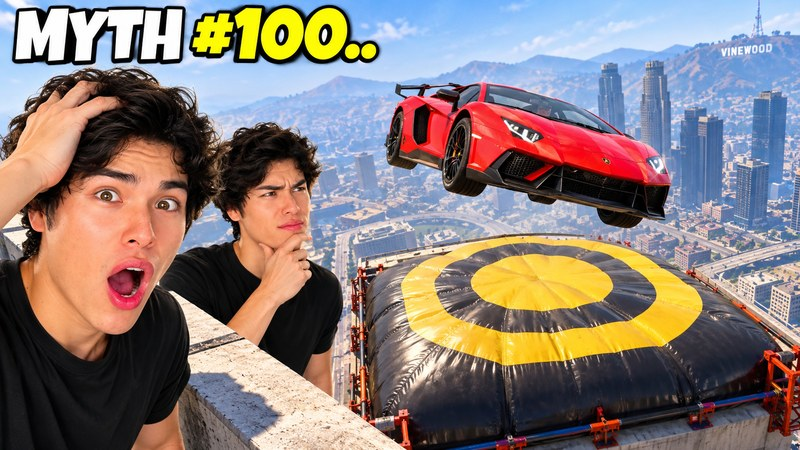

The crew tests a counted list of spectacular GTA claims, saving the most unbelievable experiment for the final verdict.

GTA 5 launch / follow-up · GTA 5

- **0 (First Frame)–5s:** Alan shocked beside a red supercar landing on a huge air cushion, Alex judging nearby; MYTH #100.

- **5s–15s:** Give an observable verdict to 100 distinct prelisted claims. Publish the tested list, distinguish repeat trials from separate myths and show failures as well as successes.

- **15s–30s:** The first obvious-looking shortcut fails in a way the crew did not expect. Show the crew choosing its next move.

**Why this idea:** Shape: We Busted [COUNT] [GAME] [SUBJECT]. Ingredients: myth, GTA, test. Combined package: We Busted 100 GTA Myths. Direct transfer of the main-channel myth-testing engine.

**Shape evidence:**

- [Busting 1000 Deadliest Myths in 24 Hours](https://www.youtube.com/watch?v=77164j9LI0I) — Brianna · 2022-07-14 · family · 16,791,526 views · 6.38× reported lift. Same title/premise family: Busting 1000 Deadliest Myths in 24 Hours. Game, cast and execution transfer remains a hypothesis; this source does not validate the new episode outcome. Window: lifetime through source snapshot. [Metric source](https://majieddd.github.io/influint-channels-public/channels/UCXg4rJUbDP1IP3TmZ9KDpJg.html).

- [BUSTING 100 MYTHS IN 24 HOURS!!](https://www.youtube.com/watch?v=IuWj5GAPdWo) — Stokes Twins · 2021-09-30 · family · 112,113,127 views · 2.15× reported lift. Same title/premise family: BUSTING 100 MYTHS IN 24 HOURS!!. Game, cast and execution transfer remains a hypothesis; this source does not validate the new episode outcome. Window: lifetime through source snapshot. [Metric source](https://majieddd.github.io/influint-channels-public/channels/UCbp9MyKCTEww4CxEzc_Tp0Q.html).

- [Testing Scary Ocean Myths That Are Unsolved…](https://www.youtube.com/watch?v=_2jkon0w2zE) — PrestonPlayz · 2026-04-25 · family · 4,479,771 views · 1.26× reported lift. Same title/premise family: Testing Scary Ocean Myths That Are Unsolved…. Game, cast and execution transfer remains a hypothesis; this source does not validate the new episode outcome. Window: lifetime through source snapshot. [Metric source](https://majieddd.github.io/influint-channels-public/channels/UCJZam2u1G0syq3kyqrCXrNw.html).

- [Busting 100 Myths In 100 Hours!](https://www.youtube.com/watch?v=UV6SL3InS1U) — Unspeakable · 2026-03-21 · family · 2,141,014 views · 0.63× reported lift. Same title/premise family: Busting 100 Myths In 100 Hours!. Game, cast and execution transfer remains a hypothesis; this source does not validate the new episode outcome. Window: lifetime through source snapshot. [Metric source](https://majieddd.github.io/influint-channels-public/channels/UCwIWAbIeu0xI0ReKWOcw3eg.html).

**Ingredient evidence:**

- [Busting 1000 Deadliest Myths in 24 Hours](https://www.youtube.com/watch?v=77164j9LI0I) — Brianna · 2022-07-14 · family · 16,791,526 views · 6.38× reported lift. Same concrete ingredient myth: Busting 1000 Deadliest Myths in 24 Hours. Game, cast and execution transfer remains a hypothesis; this source does not validate the new episode outcome. Window: lifetime through source snapshot. [Metric source](https://majieddd.github.io/influint-channels-public/channels/UCXg4rJUbDP1IP3TmZ9KDpJg.html).

- [BUSTING 100 MYTHS IN 24 HOURS!!](https://www.youtube.com/watch?v=IuWj5GAPdWo) — Stokes Twins · 2021-09-30 · family · 112,113,127 views · 2.15× reported lift. Same concrete ingredient myth: BUSTING 100 MYTHS IN 24 HOURS!!. Game, cast and execution transfer remains a hypothesis; this source does not validate the new episode outcome. Window: lifetime through source snapshot. [Metric source](https://majieddd.github.io/influint-channels-public/channels/UCbp9MyKCTEww4CxEzc_Tp0Q.html).

- [Testing Scary Ocean Myths That Are Unsolved…](https://www.youtube.com/watch?v=_2jkon0w2zE) — PrestonPlayz · 2026-04-25 · family · 4,479,771 views · 1.26× reported lift. Same concrete ingredient myth: Testing Scary Ocean Myths That Are Unsolved…. Game, cast and execution transfer remains a hypothesis; this source does not validate the new episode outcome. Window: lifetime through source snapshot. [Metric source](https://majieddd.github.io/influint-channels-public/channels/UCJZam2u1G0syq3kyqrCXrNw.html).

- [Busting 100 Myths In 100 Hours!](https://www.youtube.com/watch?v=UV6SL3InS1U) — Unspeakable · 2026-03-21 · family · 2,141,014 views · 0.63× reported lift. Same concrete ingredient myth: Busting 100 Myths In 100 Hours!. Game, cast and execution transfer remains a hypothesis; this source does not validate the new episode outcome. Window: lifetime through source snapshot. [Metric source](https://majieddd.github.io/influint-channels-public/channels/UCwIWAbIeu0xI0ReKWOcw3eg.html).

Two qualifying source channels on both axes; creator groups and exact-mixture limitations remain visible in the website.

**Objective:** Give an observable verdict to 100 distinct prelisted claims.

**Rules:** Publish the tested list, distinguish repeat trials from separate myths and show failures as well as successes.

**Escalation:** Quick obvious tests build to expensive-looking vehicle and survival claims that need several attempts.

**Payoff:** Resolve the teased final myth with the full test and reveal the true overall result count.

**Gamer reward:** Players get answers about familiar mechanics and surprising edge cases.

**Non-gamer reward:** Anyone understands whether the promised stunt or claim works.

**People:** Crew members propose, attempt and judge myths; Alan/Alex can host or compete with them.

**Production:** Reuse a tested world · $1,650–$3,600 · authored incremental allowance.

**Dependencies:** Research actual testable mechanics; title count must match real tests, with setups and resets compressed.

**Thumbnail:** Alan shocked beside a red supercar landing on a huge air cushion, Alex judging nearby; MYTH #100.

Composition reference: [BUSTING 100 MYTHS IN 24 HOURS!!](https://www.youtube.com/watch?v=IuWj5GAPdWo).

[Original PNG](generated-thumbnails/026.png) · [Exact image prompt](prompts/026.txt)

#### Idea 027 — We Tested GTA Myths That Should Be Impossible

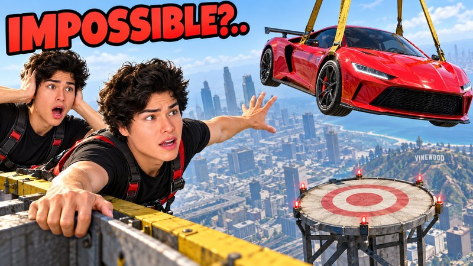

The crew attempts five apparently impossible feats and explains the visible trick only after each fair test.

GTA 5 launch / follow-up · GTA 5

- **0 (First Frame)–5s:** Alex reaching toward a red supercar suspended above a tiny landing platform, Alan astonished; IMPOSSIBLE?.

- **5s–15s:** Find which of five physical-looking claims can actually work. Show the conditions before each test.

- **15s–30s:** The first test works once but fails on repetition, forcing a proper retest. Show the crew choosing its next move.

**Why this idea:** Shape: We Tested [GAME] [SUBJECT] That Should Be Impossible. Ingredients: myth, impossible, test. Combined package: We Tested GTA Myths That Should Be Impossible. Direct transfer of the main-channel myth-testing engine.

**Shape evidence:**

- [Busting 1000 Deadliest Myths in 24 Hours](https://www.youtube.com/watch?v=77164j9LI0I) — Brianna · 2022-07-14 · family · 16,791,526 views · 6.38× reported lift. Same title/premise family: Busting 1000 Deadliest Myths in 24 Hours. Game, cast and execution transfer remains a hypothesis; this source does not validate the new episode outcome. Window: lifetime through source snapshot. [Metric source](https://majieddd.github.io/influint-channels-public/channels/UCXg4rJUbDP1IP3TmZ9KDpJg.html).

- [BUSTING 100 MYTHS IN 24 HOURS!!](https://www.youtube.com/watch?v=IuWj5GAPdWo) — Stokes Twins · 2021-09-30 · family · 112,113,127 views · 2.15× reported lift. Same title/premise family: BUSTING 100 MYTHS IN 24 HOURS!!. Game, cast and execution transfer remains a hypothesis; this source does not validate the new episode outcome. Window: lifetime through source snapshot. [Metric source](https://majieddd.github.io/influint-channels-public/channels/UCbp9MyKCTEww4CxEzc_Tp0Q.html).

- [Testing Scary Ocean Myths That Are Unsolved…](https://www.youtube.com/watch?v=_2jkon0w2zE) — PrestonPlayz · 2026-04-25 · family · 4,479,771 views · 1.26× reported lift. Same title/premise family: Testing Scary Ocean Myths That Are Unsolved…. Game, cast and execution transfer remains a hypothesis; this source does not validate the new episode outcome. Window: lifetime through source snapshot. [Metric source](https://majieddd.github.io/influint-channels-public/channels/UCJZam2u1G0syq3kyqrCXrNw.html).

- [Busting 100 Myths In 100 Hours!](https://www.youtube.com/watch?v=UV6SL3InS1U) — Unspeakable · 2026-03-21 · family · 2,141,014 views · 0.63× reported lift. Same title/premise family: Busting 100 Myths In 100 Hours!. Game, cast and execution transfer remains a hypothesis; this source does not validate the new episode outcome. Window: lifetime through source snapshot. [Metric source](https://majieddd.github.io/influint-channels-public/channels/UCwIWAbIeu0xI0ReKWOcw3eg.html).

**Ingredient evidence:**

- [Busting 1000 Deadliest Myths in 24 Hours](https://www.youtube.com/watch?v=77164j9LI0I) — Brianna · 2022-07-14 · family · 16,791,526 views · 6.38× reported lift. Same concrete ingredient myth: Busting 1000 Deadliest Myths in 24 Hours. Game, cast and execution transfer remains a hypothesis; this source does not validate the new episode outcome. Window: lifetime through source snapshot. [Metric source](https://majieddd.github.io/influint-channels-public/channels/UCXg4rJUbDP1IP3TmZ9KDpJg.html).

- [BUSTING 100 MYTHS IN 24 HOURS!!](https://www.youtube.com/watch?v=IuWj5GAPdWo) — Stokes Twins · 2021-09-30 · family · 112,113,127 views · 2.15× reported lift. Same concrete ingredient myth: BUSTING 100 MYTHS IN 24 HOURS!!. Game, cast and execution transfer remains a hypothesis; this source does not validate the new episode outcome. Window: lifetime through source snapshot. [Metric source](https://majieddd.github.io/influint-channels-public/channels/UCbp9MyKCTEww4CxEzc_Tp0Q.html).

- [Testing Scary Ocean Myths That Are Unsolved…](https://www.youtube.com/watch?v=_2jkon0w2zE) — PrestonPlayz · 2026-04-25 · family · 4,479,771 views · 1.26× reported lift. Same concrete ingredient myth: Testing Scary Ocean Myths That Are Unsolved…. Game, cast and execution transfer remains a hypothesis; this source does not validate the new episode outcome. Window: lifetime through source snapshot. [Metric source](https://majieddd.github.io/influint-channels-public/channels/UCJZam2u1G0syq3kyqrCXrNw.html).

- [Busting 100 Myths In 100 Hours!](https://www.youtube.com/watch?v=UV6SL3InS1U) — Unspeakable · 2026-03-21 · family · 2,141,014 views · 0.63× reported lift. Same concrete ingredient myth: Busting 100 Myths In 100 Hours!. Game, cast and execution transfer remains a hypothesis; this source does not validate the new episode outcome. Window: lifetime through source snapshot. [Metric source](https://majieddd.github.io/influint-channels-public/channels/UCwIWAbIeu0xI0ReKWOcw3eg.html).

Two qualifying source channels on both axes; creator groups and exact-mixture limitations remain visible in the website.

**Objective:** Find which of five physical-looking claims can actually work.

**Rules:** Show the conditions before each test; keep failed attempts and label modded versus stock behavior.

**Escalation:** A simple bridge jump gives way to a falling-car catch and a finale with almost no margin for error.

**Payoff:** Replay the hardest success or failure slowly and explain why the result happened.

**Gamer reward:** Players get answers about familiar mechanics and surprising edge cases.

**Non-gamer reward:** Anyone understands whether the promised stunt or claim works.

**People:** Crew members propose, attempt and judge myths; Alan/Alex can host or compete with them.

**Production:** Reuse a tested world · $1,650–$3,600 · authored incremental allowance.

**Dependencies:** Research actual testable mechanics; title count must match real tests, with setups and resets compressed.

**Thumbnail:** Alex reaching toward a red supercar suspended above a tiny landing platform, Alan astonished; IMPOSSIBLE?.

Composition reference: [BUSTING 100 MYTHS IN 24 HOURS!!](https://www.youtube.com/watch?v=IuWj5GAPdWo).

[Original PNG](generated-thumbnails/027.png) · [Exact image prompt](prompts/027.txt)

#### Idea 028 — We Tested Every Way to Escape a Sinking Car in GTA

Crew teams compare a defined set of sinking-car escape plans under the same simulated countdown.

GTA 5 launch / follow-up · GTA 5

- **0 (First Frame)–5s:** Alan trapped in a red GTA car underwater, open roof hatch visible, blue water and a giant question mark.

- **5s–15s:** Identify the fastest reliable exit from the disclosed test list. Every means every method on the shown list, not all imaginable methods.

- **15s–30s:** The obvious door cannot open in the first underwater attempt. Show the crew choosing its next move.

**Why this idea:** Shape: We Tested Every Way to Escape a Sinking [SUBJECT] in [GAME]. Ingredients: car, water, myth. Combined package: We Tested Every Way to Escape a Sinking Car in GTA. Direct transfer of the main-channel myth-testing engine.

**Shape evidence:**

- [Busting 1000 Deadliest Myths in 24 Hours](https://www.youtube.com/watch?v=77164j9LI0I) — Brianna · 2022-07-14 · family · 16,791,526 views · 6.38× reported lift. Same title/premise family: Busting 1000 Deadliest Myths in 24 Hours. Game, cast and execution transfer remains a hypothesis; this source does not validate the new episode outcome. Window: lifetime through source snapshot. [Metric source](https://majieddd.github.io/influint-channels-public/channels/UCXg4rJUbDP1IP3TmZ9KDpJg.html).

- [BUSTING 100 MYTHS IN 24 HOURS!!](https://www.youtube.com/watch?v=IuWj5GAPdWo) — Stokes Twins · 2021-09-30 · family · 112,113,127 views · 2.15× reported lift. Same title/premise family: BUSTING 100 MYTHS IN 24 HOURS!!. Game, cast and execution transfer remains a hypothesis; this source does not validate the new episode outcome. Window: lifetime through source snapshot. [Metric source](https://majieddd.github.io/influint-channels-public/channels/UCbp9MyKCTEww4CxEzc_Tp0Q.html).

- [Testing Scary Ocean Myths That Are Unsolved…](https://www.youtube.com/watch?v=_2jkon0w2zE) — PrestonPlayz · 2026-04-25 · family · 4,479,771 views · 1.26× reported lift. Same title/premise family: Testing Scary Ocean Myths That Are Unsolved…. Game, cast and execution transfer remains a hypothesis; this source does not validate the new episode outcome. Window: lifetime through source snapshot. [Metric source](https://majieddd.github.io/influint-channels-public/channels/UCJZam2u1G0syq3kyqrCXrNw.html).

- [Busting 100 Myths In 100 Hours!](https://www.youtube.com/watch?v=UV6SL3InS1U) — Unspeakable · 2026-03-21 · family · 2,141,014 views · 0.63× reported lift. Same title/premise family: Busting 100 Myths In 100 Hours!. Game, cast and execution transfer remains a hypothesis; this source does not validate the new episode outcome. Window: lifetime through source snapshot. [Metric source](https://majieddd.github.io/influint-channels-public/channels/UCwIWAbIeu0xI0ReKWOcw3eg.html).

**Ingredient evidence:**

- [Preston Cheated in Cardboard Hide and Seek](https://www.youtube.com/watch?v=5zbvDh28XUQ) — Brianna · 2022-04-28 · family · 11,051,826 views · 5.01× reported lift. Same concrete ingredient car: Preston Cheated in Cardboard Hide and Seek. Game, cast and execution transfer remains a hypothesis; this source does not validate the new episode outcome. Window: lifetime through source snapshot. [Metric source](https://majieddd.github.io/influint-channels-public/channels/UCXg4rJUbDP1IP3TmZ9KDpJg.html).

- [Tesla Autopilot For 24 Hours!](https://www.youtube.com/watch?v=SsJ7oOpbmIk) — Stokes Twins · 2021-04-20 · family · 38,321,506 views · 4.25× reported lift. Same concrete ingredient car: Tesla Autopilot For 24 Hours!. Game, cast and execution transfer remains a hypothesis; this source does not validate the new episode outcome. Window: lifetime through source snapshot. [Metric source](https://majieddd.github.io/influint-channels-public/channels/UCbp9MyKCTEww4CxEzc_Tp0Q.html).

- [World's Fastest Car!](https://www.youtube.com/watch?v=nopEs-K4ExM) — MrBeast Gaming · 2022-07-09 · family · 122,277,058 views · 3.68× reported lift. Same concrete ingredient car: World's Fastest Car!. Game, cast and execution transfer remains a hypothesis; this source does not validate the new episode outcome. Window: lifetime through source snapshot. [Metric source](https://majieddd.github.io/influint-channels-public/channels/UCIPPMRA040LQr5QPyJEbmXA.html).

- [7 Days Escaping Cardboard Prison!](https://www.youtube.com/watch?v=WU05jZnUiYs) — Unspeakable · 2026-01-24 · family · 12,880,314 views · 3.65× reported lift. Same concrete ingredient car: 7 Days Escaping Cardboard Prison!. Game, cast and execution transfer remains a hypothesis; this source does not validate the new episode outcome. Window: lifetime through source snapshot. [Metric source](https://majieddd.github.io/influint-channels-public/channels/UCwIWAbIeu0xI0ReKWOcw3eg.html).

Two qualifying source channels on both axes; creator groups and exact-mixture limitations remain visible in the website.

**Objective:** Identify the fastest reliable exit from the disclosed test list.

**Rules:** Every means every method on the shown list, not all imaginable methods; identical vehicle and water depth, game-only experiment.

**Escalation:** An obvious door fails, a roof exit looks promising and the final recovery test changes the winner.

**Payoff:** Rank reliable results and show the safest-in-game method actually repeated successfully.

**Gamer reward:** Players get answers about familiar mechanics and surprising edge cases.

**Non-gamer reward:** Anyone understands whether the promised stunt or claim works.

**People:** Crew members propose, attempt and judge myths; Alan/Alex can host or compete with them.

**Production:** Reuse a tested world · $1,650–$3,600 · authored incremental allowance.

**Dependencies:** Research actual testable mechanics; title count must match real tests, with setups and resets compressed.

**Thumbnail:** Alan trapped in a red GTA car underwater, open roof hatch visible, blue water and a giant question mark.

Composition reference: [BUSTING 100 MYTHS IN 24 HOURS!!](https://www.youtube.com/watch?v=IuWj5GAPdWo).

[Original PNG](generated-thumbnails/028.png) · [Exact image prompt](prompts/028.txt)

#### Idea 029 — We Tested 100 Viral GTA Stunts

The crew recreates 100 counted stunt claims and tests whether the impressive clips can be repeated without hidden help.

GTA 5 launch / follow-up · GTA 5

- **0 (First Frame)–5s:** Alex watching a red sports car leap through a flaming game-world hoop between skyscrapers; 100 STUNTS.

- **5s–15s:** Separate repeatable stunts from setup-dependent or failed claims. Use a prelisted 100 attempts, cite submitted clips with permission where used and disclose vehicle/mod settings.

- **15s–30s:** The first copied stunt misses because the original clip never showed its starting speed. Show the crew choosing its next move.

**Why this idea:** Shape: We Tested [COUNT] Viral [GAME] [SUBJECT]. Ingredients: stunt, myth, GTA. Combined package: We Tested 100 Viral GTA Stunts. Direct transfer of the main-channel myth-testing engine.

**Shape evidence:**

- [Busting 1000 Deadliest Myths in 24 Hours](https://www.youtube.com/watch?v=77164j9LI0I) — Brianna · 2022-07-14 · family · 16,791,526 views · 6.38× reported lift. Same title/premise family: Busting 1000 Deadliest Myths in 24 Hours. Game, cast and execution transfer remains a hypothesis; this source does not validate the new episode outcome. Window: lifetime through source snapshot. [Metric source](https://majieddd.github.io/influint-channels-public/channels/UCXg4rJUbDP1IP3TmZ9KDpJg.html).

- [BUSTING 100 MYTHS IN 24 HOURS!!](https://www.youtube.com/watch?v=IuWj5GAPdWo) — Stokes Twins · 2021-09-30 · family · 112,113,127 views · 2.15× reported lift. Same title/premise family: BUSTING 100 MYTHS IN 24 HOURS!!. Game, cast and execution transfer remains a hypothesis; this source does not validate the new episode outcome. Window: lifetime through source snapshot. [Metric source](https://majieddd.github.io/influint-channels-public/channels/UCbp9MyKCTEww4CxEzc_Tp0Q.html).

- [Testing Scary Ocean Myths That Are Unsolved…](https://www.youtube.com/watch?v=_2jkon0w2zE) — PrestonPlayz · 2026-04-25 · family · 4,479,771 views · 1.26× reported lift. Same title/premise family: Testing Scary Ocean Myths That Are Unsolved…. Game, cast and execution transfer remains a hypothesis; this source does not validate the new episode outcome. Window: lifetime through source snapshot. [Metric source](https://majieddd.github.io/influint-channels-public/channels/UCJZam2u1G0syq3kyqrCXrNw.html).

- [Busting 100 Myths In 100 Hours!](https://www.youtube.com/watch?v=UV6SL3InS1U) — Unspeakable · 2026-03-21 · family · 2,141,014 views · 0.63× reported lift. Same title/premise family: Busting 100 Myths In 100 Hours!. Game, cast and execution transfer remains a hypothesis; this source does not validate the new episode outcome. Window: lifetime through source snapshot. [Metric source](https://majieddd.github.io/influint-channels-public/channels/UCwIWAbIeu0xI0ReKWOcw3eg.html).

**Ingredient evidence:**

- [BREAKING 100 WORLD RECORDS IN 24 HOURS!!](https://www.youtube.com/watch?v=xrH7VwkBzZI) — Stokes Twins · 2023-02-04 · family · 84,290,250 views · 1.04× reported lift. Same concrete ingredient stunt: BREAKING 100 WORLD RECORDS IN 24 HOURS!!. Game, cast and execution transfer remains a hypothesis; this source does not validate the new episode outcome. Window: lifetime through source snapshot. [Metric source](https://majieddd.github.io/influint-channels-public/channels/UCbp9MyKCTEww4CxEzc_Tp0Q.html).

- [BUSTING 100 MYTHS IN 24 HOURS!!](https://www.youtube.com/watch?v=IuWj5GAPdWo) — Stokes Twins · 2021-09-30 · adjacent · 112,113,127 views · 2.15× reported lift. Adjacent format/cast/setting reference from the reviewed board; does not satisfy exact/family outlier coverage for this episode. Window: lifetime through source snapshot. [Metric source](https://majieddd.github.io/influint-channels-public/channels/UCbp9MyKCTEww4CxEzc_Tp0Q.html).

- [I Busted 200 Myths In 50 Hours!](https://www.youtube.com/watch?v=bABseBbIiFk) — Stokes Twins · 2022-01-31 · adjacent · 178,358,799 views · 1.98× reported lift. Adjacent format/cast/setting reference from the reviewed board; does not satisfy exact/family outlier coverage for this episode. Window: lifetime through source snapshot. [Metric source](https://majieddd.github.io/influint-channels-public/channels/UCbp9MyKCTEww4CxEzc_Tp0Q.html).

Evidence gaps: Ingredients: 0/2 qualifying outlier channels for the principal ingredient; this does not establish the full game/cast combination.

**Objective:** Separate repeatable stunts from setup-dependent or failed claims.

**Rules:** Use a prelisted 100 attempts, cite submitted clips with permission where used and disclose vehicle/mod settings.

**Escalation:** Small jumps lead to moving targets and a final stunt combining the most reliable tricks.

**Payoff:** Reveal the repeatability score and the full final attempt rather than only a flattering montage.

**Gamer reward:** Players get answers about familiar mechanics and surprising edge cases.

**Non-gamer reward:** Anyone understands whether the promised stunt or claim works.

**People:** Crew members propose, attempt and judge myths; Alan/Alex can host or compete with them.

**Production:** Reuse a tested world · $1,650–$3,600 · authored incremental allowance.

**Dependencies:** Research actual testable mechanics; title count must match real tests, with setups and resets compressed.

**Thumbnail:** Alex watching a red sports car leap through a flaming game-world hoop between skyscrapers; 100 STUNTS.

Composition reference: [BUSTING 100 MYTHS IN 24 HOURS!!](https://www.youtube.com/watch?v=IuWj5GAPdWo).

[Original PNG](generated-thumbnails/029.png) · [Exact image prompt](prompts/029.txt)

#### Idea 030 — We Busted 100 Minecraft Myths

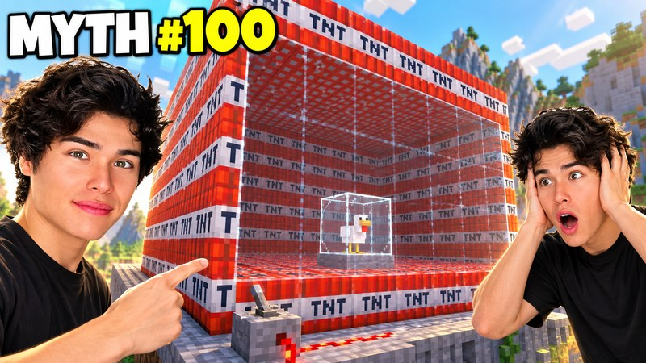

The crew tests a counted mix of everyday and spectacular Minecraft claims before attempting the one the builders disagree about most.

Later game expansion · Minecraft

- **0 (First Frame)–5s:** Alan beside a huge Minecraft TNT test chamber with one intact tiny chicken, Alex stunned; MYTH #100.

- **5s–15s:** Give 100 prelisted claims a reproducible verdict. Label edition/version, separate modded effects from stock tests and do not count repeats as new myths.

- **15s–30s:** The first myth behaves differently in the selected version and the crew has to explain the condition. Show the crew choosing its next move.

**Why this idea:** Shape: We Busted [COUNT] [GAME] [SUBJECT]. Ingredients: myth, Minecraft, test. Combined package: We Busted 100 Minecraft Myths. Direct transfer of the main-channel myth-testing engine.

**Shape evidence:**

- [Busting 1000 Deadliest Myths in 24 Hours](https://www.youtube.com/watch?v=77164j9LI0I) — Brianna · 2022-07-14 · family · 16,791,526 views · 6.38× reported lift. Same title/premise family: Busting 1000 Deadliest Myths in 24 Hours. Game, cast and execution transfer remains a hypothesis; this source does not validate the new episode outcome. Window: lifetime through source snapshot. [Metric source](https://majieddd.github.io/influint-channels-public/channels/UCXg4rJUbDP1IP3TmZ9KDpJg.html).

- [BUSTING 100 MYTHS IN 24 HOURS!!](https://www.youtube.com/watch?v=IuWj5GAPdWo) — Stokes Twins · 2021-09-30 · family · 112,113,127 views · 2.15× reported lift. Same title/premise family: BUSTING 100 MYTHS IN 24 HOURS!!. Game, cast and execution transfer remains a hypothesis; this source does not validate the new episode outcome. Window: lifetime through source snapshot. [Metric source](https://majieddd.github.io/influint-channels-public/channels/UCbp9MyKCTEww4CxEzc_Tp0Q.html).

- [Testing Scary Ocean Myths That Are Unsolved…](https://www.youtube.com/watch?v=_2jkon0w2zE) — PrestonPlayz · 2026-04-25 · family · 4,479,771 views · 1.26× reported lift. Same title/premise family: Testing Scary Ocean Myths That Are Unsolved…. Game, cast and execution transfer remains a hypothesis; this source does not validate the new episode outcome. Window: lifetime through source snapshot. [Metric source](https://majieddd.github.io/influint-channels-public/channels/UCJZam2u1G0syq3kyqrCXrNw.html).

- [Busting 100 Myths In 100 Hours!](https://www.youtube.com/watch?v=UV6SL3InS1U) — Unspeakable · 2026-03-21 · family · 2,141,014 views · 0.63× reported lift. Same title/premise family: Busting 100 Myths In 100 Hours!. Game, cast and execution transfer remains a hypothesis; this source does not validate the new episode outcome. Window: lifetime through source snapshot. [Metric source](https://majieddd.github.io/influint-channels-public/channels/UCwIWAbIeu0xI0ReKWOcw3eg.html).

**Ingredient evidence:**

- [Busting 1000 Deadliest Myths in 24 Hours](https://www.youtube.com/watch?v=77164j9LI0I) — Brianna · 2022-07-14 · family · 16,791,526 views · 6.38× reported lift. Same concrete ingredient myth: Busting 1000 Deadliest Myths in 24 Hours. Game, cast and execution transfer remains a hypothesis; this source does not validate the new episode outcome. Window: lifetime through source snapshot. [Metric source](https://majieddd.github.io/influint-channels-public/channels/UCXg4rJUbDP1IP3TmZ9KDpJg.html).

- [BUSTING 100 MYTHS IN 24 HOURS!!](https://www.youtube.com/watch?v=IuWj5GAPdWo) — Stokes Twins · 2021-09-30 · family · 112,113,127 views · 2.15× reported lift. Same concrete ingredient myth: BUSTING 100 MYTHS IN 24 HOURS!!. Game, cast and execution transfer remains a hypothesis; this source does not validate the new episode outcome. Window: lifetime through source snapshot. [Metric source](https://majieddd.github.io/influint-channels-public/channels/UCbp9MyKCTEww4CxEzc_Tp0Q.html).

- [Testing Scary Ocean Myths That Are Unsolved…](https://www.youtube.com/watch?v=_2jkon0w2zE) — PrestonPlayz · 2026-04-25 · family · 4,479,771 views · 1.26× reported lift. Same concrete ingredient myth: Testing Scary Ocean Myths That Are Unsolved…. Game, cast and execution transfer remains a hypothesis; this source does not validate the new episode outcome. Window: lifetime through source snapshot. [Metric source](https://majieddd.github.io/influint-channels-public/channels/UCJZam2u1G0syq3kyqrCXrNw.html).

- [Busting 100 Myths In 100 Hours!](https://www.youtube.com/watch?v=UV6SL3InS1U) — Unspeakable · 2026-03-21 · family · 2,141,014 views · 0.63× reported lift. Same concrete ingredient myth: Busting 100 Myths In 100 Hours!. Game, cast and execution transfer remains a hypothesis; this source does not validate the new episode outcome. Window: lifetime through source snapshot. [Metric source](https://majieddd.github.io/influint-channels-public/channels/UCwIWAbIeu0xI0ReKWOcw3eg.html).

Two qualifying source channels on both axes; creator groups and exact-mixture limitations remain visible in the website.

**Objective:** Give 100 prelisted claims a reproducible verdict.

**Rules:** Label edition/version, separate modded effects from stock tests and do not count repeats as new myths.

**Escalation:** Simple player claims become enormous contraptions and a finale that can overturn the crew's favorite belief.

**Payoff:** Show the final mechanism working or failing and make the test world reproducible.

**Gamer reward:** Players get answers about familiar mechanics and surprising edge cases.

**Non-gamer reward:** Anyone understands whether the promised stunt or claim works.

**People:** Crew members propose, attempt and judge myths; Alan/Alex can host or compete with them.

**Production:** Reuse a tested world · $1,650–$3,600 · authored incremental allowance.

**Dependencies:** Research actual testable mechanics; title count must match real tests, with setups and resets compressed. Verify the exact edition, map, mod license and working mechanics; GTA-system reuse does not imply Minecraft support.

**Thumbnail:** Alan beside a huge Minecraft TNT test chamber with one intact tiny chicken, Alex stunned; MYTH #100.

Composition reference: [BUSTING 100 MYTHS IN 24 HOURS!!](https://www.youtube.com/watch?v=IuWj5GAPdWo).

[Original PNG](generated-thumbnails/030.png) · [Exact image prompt](prompts/030.txt)

### Format 07 — A wheel controls the crew’s lives

A visible wheel decides consequential life choices such as transport, teammate or where the crew must live while they try to complete one understandable day-long goal.

Title family: We Let ___ Control Our Lives in ___

Reworked. Package lost agency and comedy, rather than a new game mechanic every five minutes.

#### Idea 031 — We Let a Wheel Control Our Lives in GTA

A visible wheel chooses the crew's transport, teammates and home while they try to reach one final party on time.

GTA 5 launch / follow-up · GTA 5

- **0 (First Frame)–5s:** Alan beside an enormous red-yellow choice wheel, rusty bicycle versus red supercar visible behind it; Alex worried.

- **5s–15s:** Get the whole crew to the agreed party before sunset. Show all wheel options before each spin, accept the first valid result and preserve one continuing destination.

- **15s–30s:** The first transport spin gives the host a bicycle while everyone else receives cars. Show the crew choosing its next move.

**Why this idea:** Shape: We Let a Wheel Control Our Lives in [GAME]. Ingredients: wheel, friends, challenge. Combined package: We Let a Wheel Control Our Lives in GTA. Dare-wheel and controls-our-life energy with the cast doing the performance.

**Shape evidence:**

- [Spin The DARE Wheel Challenge w/ CRUSH!!](https://www.youtube.com/watch?v=-M2Q-HfhnSo) — Stokes Twins · 2021-03-22 · family · 28,244,161 views · 2.30× reported lift. Same title/premise family: Spin The DARE Wheel Challenge w/ CRUSH!!. Game, cast and execution transfer remains a hypothesis; this source does not validate the new episode outcome. Window: lifetime through source snapshot. [Metric source](https://majieddd.github.io/influint-channels-public/channels/UCbp9MyKCTEww4CxEzc_Tp0Q.html).

- [RAINBOW SPIN WHEEL TRUTH OR DARE CHALLENGE WITH PRESTONPLAYZ! (Husband vs Wife)](https://www.youtube.com/watch?v=SQbsQBAucBA) — Brianna · 2019-01-02 · family · 2,368,180 views · 1.83× reported lift. Same title/premise family: RAINBOW SPIN WHEEL TRUTH OR DARE CHALLENGE WITH PRESTONPLAYZ! (Husband vs Wife). Game, cast and execution transfer remains a hypothesis; this source does not validate the new episode outcome. Window: lifetime through source snapshot. [Metric source](https://majieddd.github.io/influint-channels-public/channels/UCXg4rJUbDP1IP3TmZ9KDpJg.html).

- [Instagram Followers Control Our Life For a Day! | Stokes Twins](https://www.youtube.com/watch?v=4pAAskz5iw0) — Stokes Twins · 2019-03-29 · family · 5,373,705 views · 1.48× reported lift. Same title/premise family: Instagram Followers Control Our Life For a Day! | Stokes Twins. Game, cast and execution transfer remains a hypothesis; this source does not validate the new episode outcome. Window: lifetime through source snapshot. [Metric source](https://majieddd.github.io/influint-channels-public/channels/UCbp9MyKCTEww4CxEzc_Tp0Q.html).

- [100 YouTubers Control My Life for 24 Hours!](https://www.youtube.com/watch?v=5hr9GsVbt6s) — Brianna · 2024-12-07 · family · 1,069,604 views · 1.44× reported lift. Same title/premise family: 100 YouTubers Control My Life for 24 Hours!. Game, cast and execution transfer remains a hypothesis; this source does not validate the new episode outcome. Window: lifetime through source snapshot. [Metric source](https://majieddd.github.io/influint-channels-public/channels/UCXg4rJUbDP1IP3TmZ9KDpJg.html).

**Ingredient evidence:**

- [Spin The DARE Wheel Challenge w/ CRUSH!!](https://www.youtube.com/watch?v=-M2Q-HfhnSo) — Stokes Twins · 2021-03-22 · family · 28,244,161 views · 2.30× reported lift. Same concrete ingredient wheel: Spin The DARE Wheel Challenge w/ CRUSH!!. Game, cast and execution transfer remains a hypothesis; this source does not validate the new episode outcome. Window: lifetime through source snapshot. [Metric source](https://majieddd.github.io/influint-channels-public/channels/UCbp9MyKCTEww4CxEzc_Tp0Q.html).

- [Minecraft, But Crafts Are Random…](https://www.youtube.com/watch?v=KVNfYikQu48) — PrestonPlayz · 2025-07-26 · family · 15,896,072 views · 2.29× reported lift. Same concrete ingredient wheel: Minecraft, But Crafts Are Random…. Game, cast and execution transfer remains a hypothesis; this source does not validate the new episode outcome. Window: lifetime through source snapshot. [Metric source](https://majieddd.github.io/influint-channels-public/channels/UCJZam2u1G0syq3kyqrCXrNw.html).

- [Minecraft, But Every Minute There's Random Chaos!](https://www.youtube.com/watch?v=D1eZybtieJM) — MrBeast Gaming · 2020-11-19 · family · 77,561,333 views · 2.05× reported lift. Same concrete ingredient wheel: Minecraft, But Every Minute There's Random Chaos!. Game, cast and execution transfer remains a hypothesis; this source does not validate the new episode outcome. Window: lifetime through source snapshot. [Metric source](https://majieddd.github.io/influint-channels-public/channels/UCIPPMRA040LQr5QPyJEbmXA.html).

- [RAINBOW SPIN WHEEL TRUTH OR DARE CHALLENGE WITH PRESTONPLAYZ! (Husband vs Wife)](https://www.youtube.com/watch?v=SQbsQBAucBA) — Brianna · 2019-01-02 · family · 2,368,180 views · 1.83× reported lift. Same concrete ingredient wheel: RAINBOW SPIN WHEEL TRUTH OR DARE CHALLENGE WITH PRESTONPLAYZ! (Husband vs Wife). Game, cast and execution transfer remains a hypothesis; this source does not validate the new episode outcome. Window: lifetime through source snapshot. [Metric source](https://majieddd.github.io/influint-channels-public/channels/UCXg4rJUbDP1IP3TmZ9KDpJg.html).

Evidence gaps: Shape: 1/2 qualifying outlier channels in the verified public pool; adjacent precedents remain proposals, not replication.

**Objective:** Get the whole crew to the agreed party before sunset.

**Rules:** Show all wheel options before each spin, accept the first valid result and preserve one continuing destination.

**Escalation:** A bad vehicle becomes a worse teammate pairing and the last spin changes where they must sleep.

**Payoff:** Show the party arrival and let each cast member reveal the choice that cost them most.

**Gamer reward:** The crew improvises with the game’s spaces and vehicles after each decision.

**Non-gamer reward:** The entertainment is losing control of familiar choices and watching friends deal with the consequences.

**People:** Crew spins, lives with the consequence and occasionally controls another player’s choice; rotate the host and affected participant.

**Production:** Reuse a tested world · $1,650–$3,600 · authored incremental allowance.

**Dependencies:** A small, tested list of visible choices and a continuing goal. Manual rules can stay inexpensive; automated effects are optional.

**Thumbnail:** Alan beside an enormous red-yellow choice wheel, rusty bicycle versus red supercar visible behind it; Alex worried.

Composition reference: [Minecraft, But Every Minute There's Random Chaos!](https://www.youtube.com/watch?v=D1eZybtieJM).

[Original PNG](generated-thumbnails/031.png) · [Exact image prompt](prompts/031.txt)

#### Idea 032 — My Friends Controlled My Life in GTA

The host hands every consequential choice to the crew while trying to keep a single appointment across the city.

GTA 5 launch / follow-up · GTA 5

- **0 (First Frame)–5s:** Alex strapped into a tiny pink GTA car, adult crew laughing with giant game controllers behind him; YOU CHOOSE.

- **5s–15s:** Reach the final appointment without rejecting the crew's choices. Crew can choose only from disclosed feasible options.

- **15s–30s:** The crew immediately votes against the host's preferred route. Show the crew choosing its next move.

**Why this idea:** Shape: My Friends Controlled My Life in [GAME]. Ingredients: friends, control, GTA. Combined package: My Friends Controlled My Life in GTA. Dare-wheel and controls-our-life energy with the cast doing the performance.

**Shape evidence:**

- [Spin The DARE Wheel Challenge w/ CRUSH!!](https://www.youtube.com/watch?v=-M2Q-HfhnSo) — Stokes Twins · 2021-03-22 · family · 28,244,161 views · 2.30× reported lift. Same title/premise family: Spin The DARE Wheel Challenge w/ CRUSH!!. Game, cast and execution transfer remains a hypothesis; this source does not validate the new episode outcome. Window: lifetime through source snapshot. [Metric source](https://majieddd.github.io/influint-channels-public/channels/UCbp9MyKCTEww4CxEzc_Tp0Q.html).

- [RAINBOW SPIN WHEEL TRUTH OR DARE CHALLENGE WITH PRESTONPLAYZ! (Husband vs Wife)](https://www.youtube.com/watch?v=SQbsQBAucBA) — Brianna · 2019-01-02 · family · 2,368,180 views · 1.83× reported lift. Same title/premise family: RAINBOW SPIN WHEEL TRUTH OR DARE CHALLENGE WITH PRESTONPLAYZ! (Husband vs Wife). Game, cast and execution transfer remains a hypothesis; this source does not validate the new episode outcome. Window: lifetime through source snapshot. [Metric source](https://majieddd.github.io/influint-channels-public/channels/UCXg4rJUbDP1IP3TmZ9KDpJg.html).

- [Instagram Followers Control Our Life For a Day! | Stokes Twins](https://www.youtube.com/watch?v=4pAAskz5iw0) — Stokes Twins · 2019-03-29 · family · 5,373,705 views · 1.48× reported lift. Same title/premise family: Instagram Followers Control Our Life For a Day! | Stokes Twins. Game, cast and execution transfer remains a hypothesis; this source does not validate the new episode outcome. Window: lifetime through source snapshot. [Metric source](https://majieddd.github.io/influint-channels-public/channels/UCbp9MyKCTEww4CxEzc_Tp0Q.html).

- [100 YouTubers Control My Life for 24 Hours!](https://www.youtube.com/watch?v=5hr9GsVbt6s) — Brianna · 2024-12-07 · family · 1,069,604 views · 1.44× reported lift. Same title/premise family: 100 YouTubers Control My Life for 24 Hours!. Game, cast and execution transfer remains a hypothesis; this source does not validate the new episode outcome. Window: lifetime through source snapshot. [Metric source](https://majieddd.github.io/influint-channels-public/channels/UCXg4rJUbDP1IP3TmZ9KDpJg.html).

**Ingredient evidence:**

- [Minecraft, But Every Minute There's Random Chaos!](https://www.youtube.com/watch?v=D1eZybtieJM) — MrBeast Gaming · 2020-11-19 · family · 77,561,333 views · 2.05× reported lift. Same concrete ingredient control: Minecraft, But Every Minute There's Random Chaos!. Game, cast and execution transfer remains a hypothesis; this source does not validate the new episode outcome. Window: lifetime through source snapshot. [Metric source](https://majieddd.github.io/influint-channels-public/channels/UCIPPMRA040LQr5QPyJEbmXA.html).

- [Instagram Followers Control Our Life For a Day! | Stokes Twins](https://www.youtube.com/watch?v=4pAAskz5iw0) — Stokes Twins · 2019-03-29 · family · 5,373,705 views · 1.48× reported lift. Same concrete ingredient control: Instagram Followers Control Our Life For a Day! | Stokes Twins. Game, cast and execution transfer remains a hypothesis; this source does not validate the new episode outcome. Window: lifetime through source snapshot. [Metric source](https://majieddd.github.io/influint-channels-public/channels/UCbp9MyKCTEww4CxEzc_Tp0Q.html).

- [100 YouTubers Control My Life for 24 Hours!](https://www.youtube.com/watch?v=5hr9GsVbt6s) — Brianna · 2024-12-07 · family · 1,069,604 views · 1.44× reported lift. Same concrete ingredient control: 100 YouTubers Control My Life for 24 Hours!. Game, cast and execution transfer remains a hypothesis; this source does not validate the new episode outcome. Window: lifetime through source snapshot. [Metric source](https://majieddd.github.io/influint-channels-public/channels/UCXg4rJUbDP1IP3TmZ9KDpJg.html).

- [Every Minute COCA-COLA Rises Higher In Minecraft!](https://www.youtube.com/watch?v=dy1Pgbvmdfg) — PrestonPlayz · 2026-07-09 · family · 2,925,855 views · 1.11× reported lift. Same concrete ingredient control: Every Minute COCA-COLA Rises Higher In Minecraft!. Game, cast and execution transfer remains a hypothesis; this source does not validate the new episode outcome. Window: lifetime through source snapshot. [Metric source](https://majieddd.github.io/influint-channels-public/channels/UCJZam2u1G0syq3kyqrCXrNw.html).

Evidence gaps: Shape: 1/2 qualifying outlier channels in the verified public pool; adjacent precedents remain proposals, not replication. Ingredients: 1/2 qualifying outlier channels for the principal ingredient; this does not establish the full game/cast combination.

**Objective:** Reach the final appointment without rejecting the crew's choices.

**Rules:** Crew can choose only from disclosed feasible options; every vote is visible and no secret override is allowed.

**Escalation:** A harmless outfit vote becomes a terrible vehicle choice and an expensive-looking detour at the worst moment.

**Payoff:** Resolve the appointment and reveal the crew member responsible for the decisive choice.

**Gamer reward:** The crew improvises with the game’s spaces and vehicles after each decision.

**Non-gamer reward:** The entertainment is losing control of familiar choices and watching friends deal with the consequences.

**People:** Crew spins, lives with the consequence and occasionally controls another player’s choice; rotate the host and affected participant.

**Production:** Reuse a tested world · $1,650–$3,600 · authored incremental allowance.

**Dependencies:** A small, tested list of visible choices and a continuing goal. Manual rules can stay inexpensive; automated effects are optional.

**Thumbnail:** Alex strapped into a tiny pink GTA car, adult crew laughing with giant game controllers behind him; YOU CHOOSE.

Composition reference: [Minecraft, But Every Minute There's Random Chaos!](https://www.youtube.com/watch?v=D1eZybtieJM).

[Original PNG](generated-thumbnails/032.png) · [Exact image prompt](prompts/032.txt)

#### Idea 033 — A Wheel Decided Where We Lived in GTA

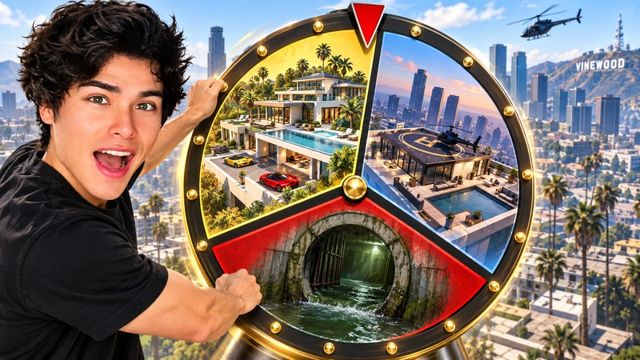

The crew experiences three wheel-selected homes while attempting to keep the same comfort checklist intact.

GTA 5 launch / follow-up · GTA 5

- **0 (First Frame)–5s:** Alan foreground spinning a giant wheel; mansion, rooftop and sewer-door silhouettes on its three large segments.

- **5s–15s:** Complete food, shelter and sleep tasks at all three selected homes. Disclosed locations and checklist, genuine random selection and equal time at each stop.

- **15s–30s:** The first lucky mansion has no usable kitchen in the selected build. Show the crew choosing its next move.

**Why this idea:** Shape: A Wheel Decided Where We Lived in [GAME]. Ingredients: wheel, house, challenge. Combined package: A Wheel Decided Where We Lived in GTA. Dare-wheel and controls-our-life energy with the cast doing the performance.

**Shape evidence:**

- [Spin The DARE Wheel Challenge w/ CRUSH!!](https://www.youtube.com/watch?v=-M2Q-HfhnSo) — Stokes Twins · 2021-03-22 · family · 28,244,161 views · 2.30× reported lift. Same title/premise family: Spin The DARE Wheel Challenge w/ CRUSH!!. Game, cast and execution transfer remains a hypothesis; this source does not validate the new episode outcome. Window: lifetime through source snapshot. [Metric source](https://majieddd.github.io/influint-channels-public/channels/UCbp9MyKCTEww4CxEzc_Tp0Q.html).

- [RAINBOW SPIN WHEEL TRUTH OR DARE CHALLENGE WITH PRESTONPLAYZ! (Husband vs Wife)](https://www.youtube.com/watch?v=SQbsQBAucBA) — Brianna · 2019-01-02 · family · 2,368,180 views · 1.83× reported lift. Same title/premise family: RAINBOW SPIN WHEEL TRUTH OR DARE CHALLENGE WITH PRESTONPLAYZ! (Husband vs Wife). Game, cast and execution transfer remains a hypothesis; this source does not validate the new episode outcome. Window: lifetime through source snapshot. [Metric source](https://majieddd.github.io/influint-channels-public/channels/UCXg4rJUbDP1IP3TmZ9KDpJg.html).

- [Instagram Followers Control Our Life For a Day! | Stokes Twins](https://www.youtube.com/watch?v=4pAAskz5iw0) — Stokes Twins · 2019-03-29 · family · 5,373,705 views · 1.48× reported lift. Same title/premise family: Instagram Followers Control Our Life For a Day! | Stokes Twins. Game, cast and execution transfer remains a hypothesis; this source does not validate the new episode outcome. Window: lifetime through source snapshot. [Metric source](https://majieddd.github.io/influint-channels-public/channels/UCbp9MyKCTEww4CxEzc_Tp0Q.html).

- [100 YouTubers Control My Life for 24 Hours!](https://www.youtube.com/watch?v=5hr9GsVbt6s) — Brianna · 2024-12-07 · family · 1,069,604 views · 1.44× reported lift. Same title/premise family: 100 YouTubers Control My Life for 24 Hours!. Game, cast and execution transfer remains a hypothesis; this source does not validate the new episode outcome. Window: lifetime through source snapshot. [Metric source](https://majieddd.github.io/influint-channels-public/channels/UCXg4rJUbDP1IP3TmZ9KDpJg.html).

**Ingredient evidence:**

- [Spin The DARE Wheel Challenge w/ CRUSH!!](https://www.youtube.com/watch?v=-M2Q-HfhnSo) — Stokes Twins · 2021-03-22 · family · 28,244,161 views · 2.30× reported lift. Same concrete ingredient wheel: Spin The DARE Wheel Challenge w/ CRUSH!!. Game, cast and execution transfer remains a hypothesis; this source does not validate the new episode outcome. Window: lifetime through source snapshot. [Metric source](https://majieddd.github.io/influint-channels-public/channels/UCbp9MyKCTEww4CxEzc_Tp0Q.html).

- [Minecraft, But Crafts Are Random…](https://www.youtube.com/watch?v=KVNfYikQu48) — PrestonPlayz · 2025-07-26 · family · 15,896,072 views · 2.29× reported lift. Same concrete ingredient wheel: Minecraft, But Crafts Are Random…. Game, cast and execution transfer remains a hypothesis; this source does not validate the new episode outcome. Window: lifetime through source snapshot. [Metric source](https://majieddd.github.io/influint-channels-public/channels/UCJZam2u1G0syq3kyqrCXrNw.html).

- [Minecraft, But Every Minute There's Random Chaos!](https://www.youtube.com/watch?v=D1eZybtieJM) — MrBeast Gaming · 2020-11-19 · family · 77,561,333 views · 2.05× reported lift. Same concrete ingredient wheel: Minecraft, But Every Minute There's Random Chaos!. Game, cast and execution transfer remains a hypothesis; this source does not validate the new episode outcome. Window: lifetime through source snapshot. [Metric source](https://majieddd.github.io/influint-channels-public/channels/UCIPPMRA040LQr5QPyJEbmXA.html).

- [RAINBOW SPIN WHEEL TRUTH OR DARE CHALLENGE WITH PRESTONPLAYZ! (Husband vs Wife)](https://www.youtube.com/watch?v=SQbsQBAucBA) — Brianna · 2019-01-02 · family · 2,368,180 views · 1.83× reported lift. Same concrete ingredient wheel: RAINBOW SPIN WHEEL TRUTH OR DARE CHALLENGE WITH PRESTONPLAYZ! (Husband vs Wife). Game, cast and execution transfer remains a hypothesis; this source does not validate the new episode outcome. Window: lifetime through source snapshot. [Metric source](https://majieddd.github.io/influint-channels-public/channels/UCXg4rJUbDP1IP3TmZ9KDpJg.html).

Evidence gaps: Shape: 1/2 qualifying outlier channels in the verified public pool; adjacent precedents remain proposals, not replication.

**Objective:** Complete food, shelter and sleep tasks at all three selected homes.

**Rules:** Disclosed locations and checklist, genuine random selection and equal time at each stop.

**Escalation:** A mansion seems lucky until the next spin sends the crew to a roof and the final home requires a strange entrance.

**Payoff:** Show all completed tasks and the crew's honest best/worst-home vote.

**Gamer reward:** The crew improvises with the game’s spaces and vehicles after each decision.

**Non-gamer reward:** The entertainment is losing control of familiar choices and watching friends deal with the consequences.

**People:** Crew spins, lives with the consequence and occasionally controls another player’s choice; rotate the host and affected participant.

**Production:** Reuse a tested world · $1,650–$3,600 · authored incremental allowance.

**Dependencies:** A small, tested list of visible choices and a continuing goal. Manual rules can stay inexpensive; automated effects are optional.

**Thumbnail:** Alan foreground spinning a giant wheel; mansion, rooftop and sewer-door silhouettes on its three large segments.

Composition reference: [Minecraft, But Every Minute There's Random Chaos!](https://www.youtube.com/watch?v=D1eZybtieJM).

[Original PNG](generated-thumbnails/033.png) · [Exact image prompt](prompts/033.txt)

#### Idea 034 — We Let a Wheel Choose Our Getaway in GTA

The crew faces the same escape mission three times with wheel-selected transport that can help or ruin the plan.

GTA 5 launch / follow-up · GTA 5

- **0 (First Frame)–5s:** Alex beside a giant wheel pointing at a bicycle, enormous police convoy behind; small red escape beacon ahead.

- **5s–15s:** Reach the extraction point in the chosen vehicle. Fixed pursuit route, disclosed transport options and no respin after a bad choice.

- **15s–30s:** The wheel selects a bus too large for the planned shortcut. Show the crew choosing its next move.

**Why this idea:** Shape: We Let a Wheel Choose Our Getaway in [GAME]. Ingredients: wheel, escape, vehicle. Combined package: We Let a Wheel Choose Our Getaway in GTA. Dare-wheel and controls-our-life energy with the cast doing the performance.

**Shape evidence:**

- [Spin The DARE Wheel Challenge w/ CRUSH!!](https://www.youtube.com/watch?v=-M2Q-HfhnSo) — Stokes Twins · 2021-03-22 · family · 28,244,161 views · 2.30× reported lift. Same title/premise family: Spin The DARE Wheel Challenge w/ CRUSH!!. Game, cast and execution transfer remains a hypothesis; this source does not validate the new episode outcome. Window: lifetime through source snapshot. [Metric source](https://majieddd.github.io/influint-channels-public/channels/UCbp9MyKCTEww4CxEzc_Tp0Q.html).

- [RAINBOW SPIN WHEEL TRUTH OR DARE CHALLENGE WITH PRESTONPLAYZ! (Husband vs Wife)](https://www.youtube.com/watch?v=SQbsQBAucBA) — Brianna · 2019-01-02 · family · 2,368,180 views · 1.83× reported lift. Same title/premise family: RAINBOW SPIN WHEEL TRUTH OR DARE CHALLENGE WITH PRESTONPLAYZ! (Husband vs Wife). Game, cast and execution transfer remains a hypothesis; this source does not validate the new episode outcome. Window: lifetime through source snapshot. [Metric source](https://majieddd.github.io/influint-channels-public/channels/UCXg4rJUbDP1IP3TmZ9KDpJg.html).

- [Instagram Followers Control Our Life For a Day! | Stokes Twins](https://www.youtube.com/watch?v=4pAAskz5iw0) — Stokes Twins · 2019-03-29 · family · 5,373,705 views · 1.48× reported lift. Same title/premise family: Instagram Followers Control Our Life For a Day! | Stokes Twins. Game, cast and execution transfer remains a hypothesis; this source does not validate the new episode outcome. Window: lifetime through source snapshot. [Metric source](https://majieddd.github.io/influint-channels-public/channels/UCbp9MyKCTEww4CxEzc_Tp0Q.html).

- [100 YouTubers Control My Life for 24 Hours!](https://www.youtube.com/watch?v=5hr9GsVbt6s) — Brianna · 2024-12-07 · family · 1,069,604 views · 1.44× reported lift. Same title/premise family: 100 YouTubers Control My Life for 24 Hours!. Game, cast and execution transfer remains a hypothesis; this source does not validate the new episode outcome. Window: lifetime through source snapshot. [Metric source](https://majieddd.github.io/influint-channels-public/channels/UCXg4rJUbDP1IP3TmZ9KDpJg.html).

**Ingredient evidence:**

- [Spin The DARE Wheel Challenge w/ CRUSH!!](https://www.youtube.com/watch?v=-M2Q-HfhnSo) — Stokes Twins · 2021-03-22 · family · 28,244,161 views · 2.30× reported lift. Same concrete ingredient wheel: Spin The DARE Wheel Challenge w/ CRUSH!!. Game, cast and execution transfer remains a hypothesis; this source does not validate the new episode outcome. Window: lifetime through source snapshot. [Metric source](https://majieddd.github.io/influint-channels-public/channels/UCbp9MyKCTEww4CxEzc_Tp0Q.html).

- [Minecraft, But Crafts Are Random…](https://www.youtube.com/watch?v=KVNfYikQu48) — PrestonPlayz · 2025-07-26 · family · 15,896,072 views · 2.29× reported lift. Same concrete ingredient wheel: Minecraft, But Crafts Are Random…. Game, cast and execution transfer remains a hypothesis; this source does not validate the new episode outcome. Window: lifetime through source snapshot. [Metric source](https://majieddd.github.io/influint-channels-public/channels/UCJZam2u1G0syq3kyqrCXrNw.html).

- [Minecraft, But Every Minute There's Random Chaos!](https://www.youtube.com/watch?v=D1eZybtieJM) — MrBeast Gaming · 2020-11-19 · family · 77,561,333 views · 2.05× reported lift. Same concrete ingredient wheel: Minecraft, But Every Minute There's Random Chaos!. Game, cast and execution transfer remains a hypothesis; this source does not validate the new episode outcome. Window: lifetime through source snapshot. [Metric source](https://majieddd.github.io/influint-channels-public/channels/UCIPPMRA040LQr5QPyJEbmXA.html).

- [RAINBOW SPIN WHEEL TRUTH OR DARE CHALLENGE WITH PRESTONPLAYZ! (Husband vs Wife)](https://www.youtube.com/watch?v=SQbsQBAucBA) — Brianna · 2019-01-02 · family · 2,368,180 views · 1.83× reported lift. Same concrete ingredient wheel: RAINBOW SPIN WHEEL TRUTH OR DARE CHALLENGE WITH PRESTONPLAYZ! (Husband vs Wife). Game, cast and execution transfer remains a hypothesis; this source does not validate the new episode outcome. Window: lifetime through source snapshot. [Metric source](https://majieddd.github.io/influint-channels-public/channels/UCXg4rJUbDP1IP3TmZ9KDpJg.html).

Evidence gaps: Shape: 1/2 qualifying outlier channels in the verified public pool; adjacent precedents remain proposals, not replication.

**Objective:** Reach the extraction point in the chosen vehicle.

**Rules:** Fixed pursuit route, disclosed transport options and no respin after a bad choice.

**Escalation:** A fast car is followed by a bus, then a tiny bike that needs a completely different escape plan.

**Payoff:** Compare the three real escapes and show which absurd option unexpectedly worked best.

**Gamer reward:** The crew improvises with the game’s spaces and vehicles after each decision.

**Non-gamer reward:** The entertainment is losing control of familiar choices and watching friends deal with the consequences.

**People:** Crew spins, lives with the consequence and occasionally controls another player’s choice; rotate the host and affected participant.

**Production:** Reuse a tested world · $1,650–$3,600 · authored incremental allowance.

**Dependencies:** A small, tested list of visible choices and a continuing goal. Manual rules can stay inexpensive; automated effects are optional.

**Thumbnail:** Alex beside a giant wheel pointing at a bicycle, enormous police convoy behind; small red escape beacon ahead.

Composition reference: [Minecraft, But Every Minute There's Random Chaos!](https://www.youtube.com/watch?v=D1eZybtieJM).

[Original PNG](generated-thumbnails/034.png) · [Exact image prompt](prompts/034.txt)

#### Idea 035 — My Friends Controlled My Roblox Life

The host lets the crew choose their home, job and transport in a private Roblox world while trying to finish one public-looking celebration.

Later game expansion · Roblox

- **0 (First Frame)–5s:** Alan foreground holding a controller; tiny Roblox delivery scooter, giant party castle and three adult crew choice cards behind.

- **5s–15s:** Deliver the party supplies and arrive at the celebration. Private owned or permitted experience, disclosed choices and no reliance on strangers' consent or purchases.

- **15s–30s:** The crew assigns a delivery job but chooses a vehicle that cannot carry the full order. Show the crew choosing its next move.

**Why this idea:** Shape: My Friends Controlled My [GAME] Life. Ingredients: Roblox, friends, control. Combined package: My Friends Controlled My Roblox Life. Dare-wheel and controls-our-life energy with the cast doing the performance.

**Shape evidence:**

- [Spin The DARE Wheel Challenge w/ CRUSH!!](https://www.youtube.com/watch?v=-M2Q-HfhnSo) — Stokes Twins · 2021-03-22 · family · 28,244,161 views · 2.30× reported lift. Same title/premise family: Spin The DARE Wheel Challenge w/ CRUSH!!. Game, cast and execution transfer remains a hypothesis; this source does not validate the new episode outcome. Window: lifetime through source snapshot. [Metric source](https://majieddd.github.io/influint-channels-public/channels/UCbp9MyKCTEww4CxEzc_Tp0Q.html).

- [RAINBOW SPIN WHEEL TRUTH OR DARE CHALLENGE WITH PRESTONPLAYZ! (Husband vs Wife)](https://www.youtube.com/watch?v=SQbsQBAucBA) — Brianna · 2019-01-02 · family · 2,368,180 views · 1.83× reported lift. Same title/premise family: RAINBOW SPIN WHEEL TRUTH OR DARE CHALLENGE WITH PRESTONPLAYZ! (Husband vs Wife). Game, cast and execution transfer remains a hypothesis; this source does not validate the new episode outcome. Window: lifetime through source snapshot. [Metric source](https://majieddd.github.io/influint-channels-public/channels/UCXg4rJUbDP1IP3TmZ9KDpJg.html).

- [Instagram Followers Control Our Life For a Day! | Stokes Twins](https://www.youtube.com/watch?v=4pAAskz5iw0) — Stokes Twins · 2019-03-29 · family · 5,373,705 views · 1.48× reported lift. Same title/premise family: Instagram Followers Control Our Life For a Day! | Stokes Twins. Game, cast and execution transfer remains a hypothesis; this source does not validate the new episode outcome. Window: lifetime through source snapshot. [Metric source](https://majieddd.github.io/influint-channels-public/channels/UCbp9MyKCTEww4CxEzc_Tp0Q.html).

- [100 YouTubers Control My Life for 24 Hours!](https://www.youtube.com/watch?v=5hr9GsVbt6s) — Brianna · 2024-12-07 · family · 1,069,604 views · 1.44× reported lift. Same title/premise family: 100 YouTubers Control My Life for 24 Hours!. Game, cast and execution transfer remains a hypothesis; this source does not validate the new episode outcome. Window: lifetime through source snapshot. [Metric source](https://majieddd.github.io/influint-channels-public/channels/UCXg4rJUbDP1IP3TmZ9KDpJg.html).

**Ingredient evidence:**

- [Minecraft, But Every Minute There's Random Chaos!](https://www.youtube.com/watch?v=D1eZybtieJM) — MrBeast Gaming · 2020-11-19 · family · 77,561,333 views · 2.05× reported lift. Same concrete ingredient control: Minecraft, But Every Minute There's Random Chaos!. Game, cast and execution transfer remains a hypothesis; this source does not validate the new episode outcome. Window: lifetime through source snapshot. [Metric source](https://majieddd.github.io/influint-channels-public/channels/UCIPPMRA040LQr5QPyJEbmXA.html).

- [Instagram Followers Control Our Life For a Day! | Stokes Twins](https://www.youtube.com/watch?v=4pAAskz5iw0) — Stokes Twins · 2019-03-29 · family · 5,373,705 views · 1.48× reported lift. Same concrete ingredient control: Instagram Followers Control Our Life For a Day! | Stokes Twins. Game, cast and execution transfer remains a hypothesis; this source does not validate the new episode outcome. Window: lifetime through source snapshot. [Metric source](https://majieddd.github.io/influint-channels-public/channels/UCbp9MyKCTEww4CxEzc_Tp0Q.html).

- [100 YouTubers Control My Life for 24 Hours!](https://www.youtube.com/watch?v=5hr9GsVbt6s) — Brianna · 2024-12-07 · family · 1,069,604 views · 1.44× reported lift. Same concrete ingredient control: 100 YouTubers Control My Life for 24 Hours!. Game, cast and execution transfer remains a hypothesis; this source does not validate the new episode outcome. Window: lifetime through source snapshot. [Metric source](https://majieddd.github.io/influint-channels-public/channels/UCXg4rJUbDP1IP3TmZ9KDpJg.html).

- [Every Minute COCA-COLA Rises Higher In Minecraft!](https://www.youtube.com/watch?v=dy1Pgbvmdfg) — PrestonPlayz · 2026-07-09 · family · 2,925,855 views · 1.11× reported lift. Same concrete ingredient control: Every Minute COCA-COLA Rises Higher In Minecraft!. Game, cast and execution transfer remains a hypothesis; this source does not validate the new episode outcome. Window: lifetime through source snapshot. [Metric source](https://majieddd.github.io/influint-channels-public/channels/UCJZam2u1G0syq3kyqrCXrNw.html).

Evidence gaps: Shape: 1/2 qualifying outlier channels in the verified public pool; adjacent precedents remain proposals, not replication. Ingredients: 1/2 qualifying outlier channels for the principal ingredient; this does not establish the full game/cast combination.

**Objective:** Deliver the party supplies and arrive at the celebration.

**Rules:** Private owned or permitted experience, disclosed choices and no reliance on strangers' consent or purchases.

**Escalation:** A silly job assignment delays the supplies and a bad vehicle choice threatens the final delivery.

**Payoff:** Show the completed celebration and award the crew's funniest consequential choice.

**Gamer reward:** The crew improvises with the game’s spaces and vehicles after each decision.

**Non-gamer reward:** The entertainment is losing control of familiar choices and watching friends deal with the consequences.

**People:** Crew spins, lives with the consequence and occasionally controls another player’s choice; rotate the host and affected participant.

**Production:** Reuse a tested world · $1,650–$3,600 · authored incremental allowance.

**Dependencies:** A small, tested list of visible choices and a continuing goal. Manual rules can stay inexpensive; automated effects are optional. Use an owned or permitted private experience and scoped developer features before casting/recording.

**Thumbnail:** Alan foreground holding a controller; tiny Roblox delivery scooter, giant party castle and three adult crew choice cards behind.

Composition reference: [Minecraft, But Every Minute There's Random Chaos!](https://www.youtube.com/watch?v=D1eZybtieJM).

[Original PNG](generated-thumbnails/035.png) · [Exact image prompt](prompts/035.txt)

### Format 08 — Give the crew their dream lives

Collect each crew member’s specific dream, recreate it in-game, reveal it to them and follow their attempts to actually live that fantasy, culminating in a shared extravagant day.

Title family: I Gave My Friends Their Dream ___ in ___

Replaced the economy-grind presentation. This is wish fulfillment and cast performance; direct winning evidence for this exact engine is still missing.

#### Idea 036 — I Gave My Friends Their Dream Lives in GTA

Each friend gets a custom day built around a real wish before the crew compares which experience meant the most.

GTA 5 launch / follow-up · GTA 5

- **0 (First Frame)–5s:** Alan presenting a gold GTA mansion, red supercar and private helicopter to three delighted adult crew friends.

- **5s–15s:** Fulfill three recorded crew wishes in a working game world. Record the wish before building.

- **15s–30s:** The first friend's dream is a tiny personal detail the spectacular mansion does not contain yet. Show the crew choosing its next move.

**Why this idea:** Shape: I Gave My Friends Their Dream Lives in [GAME]. Ingredients: friends, dream, house. Combined package: I Gave My Friends Their Dream Lives in GTA. Extend dream-car/surprise and aspirational-experience appeal to multiple crew members.

**Shape evidence:**

- [I Made a GIANT Barbie Cardboard Dream House! - Challenge](https://www.youtube.com/watch?v=XVhxtCHkb08) — Brianna · 2019-06-25 · family · 5,217,204 views · 1.70× reported lift. Same title/premise family: I Made a GIANT Barbie Cardboard Dream House! - Challenge. Game, cast and execution transfer remains a hypothesis; this source does not validate the new episode outcome. Window: lifetime through source snapshot. [Metric source](https://majieddd.github.io/influint-channels-public/channels/UCXg4rJUbDP1IP3TmZ9KDpJg.html).

- [SURPRISING MY TWIN BROTHER WITH HIS DREAM CAR!!](https://www.youtube.com/watch?v=sDmJz5TewoA) — Stokes Twins · 2020-11-28 · family · 8,967,316 views · 0.88× reported lift. Same title/premise family: SURPRISING MY TWIN BROTHER WITH HIS DREAM CAR!!. Game, cast and execution transfer remains a hypothesis; this source does not validate the new episode outcome. Window: lifetime through source snapshot. [Metric source](https://majieddd.github.io/influint-channels-public/channels/UCbp9MyKCTEww4CxEzc_Tp0Q.html).

- [I Built My Cat a BARBIE Dream House!](https://www.youtube.com/watch?v=PqANayOhIqQ) — Brianna · 2023-07-09 · family · 4,372,306 views · 1.11× reported lift. Same title/premise family: I Built My Cat a BARBIE Dream House!. Game, cast and execution transfer remains a hypothesis; this source does not validate the new episode outcome. Window: lifetime through source snapshot. [Metric source](https://majieddd.github.io/influint-channels-public/channels/UCXg4rJUbDP1IP3TmZ9KDpJg.html).

- [Surprising My Husband With His Dream Car! - Prank](https://www.youtube.com/watch?v=YSUGtRakpqk) — Brianna · 2019-07-11 · family · 6,608,326 views · 1.07× reported lift. Same title/premise family: Surprising My Husband With His Dream Car! - Prank. Game, cast and execution transfer remains a hypothesis; this source does not validate the new episode outcome. Window: lifetime through source snapshot. [Metric source](https://majieddd.github.io/influint-channels-public/channels/UCXg4rJUbDP1IP3TmZ9KDpJg.html).

**Ingredient evidence:**

- [I Made a GIANT Barbie Cardboard Dream House! - Challenge](https://www.youtube.com/watch?v=XVhxtCHkb08) — Brianna · 2019-06-25 · family · 5,217,204 views · 1.70× reported lift. Same concrete ingredient dream: I Made a GIANT Barbie Cardboard Dream House! - Challenge. Game, cast and execution transfer remains a hypothesis; this source does not validate the new episode outcome. Window: lifetime through source snapshot. [Metric source](https://majieddd.github.io/influint-channels-public/channels/UCXg4rJUbDP1IP3TmZ9KDpJg.html).

- [SURPRISING MY TWIN BROTHER WITH HIS DREAM CAR!!](https://www.youtube.com/watch?v=sDmJz5TewoA) — Stokes Twins · 2020-11-28 · family · 8,967,316 views · 0.88× reported lift. Same concrete ingredient dream: SURPRISING MY TWIN BROTHER WITH HIS DREAM CAR!!. Game, cast and execution transfer remains a hypothesis; this source does not validate the new episode outcome. Window: lifetime through source snapshot. [Metric source](https://majieddd.github.io/influint-channels-public/channels/UCbp9MyKCTEww4CxEzc_Tp0Q.html).

- [Surviving First Day Of DREAM SCHOOL!](https://www.youtube.com/watch?v=Nx-oA7bsuCY) — Unspeakable · 2026-06-27 · family · 3,167,331 views · 0.81× reported lift. Same concrete ingredient dream: Surviving First Day Of DREAM SCHOOL!. Game, cast and execution transfer remains a hypothesis; this source does not validate the new episode outcome. Window: lifetime through source snapshot. [Metric source](https://majieddd.github.io/influint-channels-public/channels/UCwIWAbIeu0xI0ReKWOcw3eg.html).

- [I Hid $100,000 On The Dream SMP!](https://www.youtube.com/watch?v=HrY_eDbF0XQ) — MrBeast Gaming · 2021-01-13 · family · 39,917,627 views · 0.61× reported lift. Same concrete ingredient dream: I Hid $100,000 On The Dream SMP!. Game, cast and execution transfer remains a hypothesis; this source does not validate the new episode outcome. Window: lifetime through source snapshot. [Metric source](https://majieddd.github.io/influint-channels-public/channels/UCIPPMRA040LQr5QPyJEbmXA.html).

Evidence gaps: Shape: 0/2 qualifying outlier channels in the verified public pool; adjacent precedents remain proposals, not replication. Ingredients: 0/2 qualifying outlier channels for the principal ingredient; this does not establish the full game/cast combination.

**Objective:** Fulfill three recorded crew wishes in a working game world.

**Rules:** Record the wish before building; use existing licensed assets where possible and avoid promising real property or money.

**Escalation:** A dream vehicle becomes a dream house, then a personalized finale that beats pure expense.

**Payoff:** The friends try every promised feature and explain the moment they would keep.

**Gamer reward:** Creative use of existing properties, vehicles and a few scoped modifications.

**Non-gamer reward:** Personal wishes, transformations, reactions and failure to live up to the fantasy carry the episode.

**People:** Several crew members receive different dreams; either twin or another regular can host, and participants perform their own story.

**Production:** Reuse a tested world · $1,650–$3,600 · authored incremental allowance.

**Dependencies:** Collect real crew wishes; use available in-game assets and limit bespoke builds. The fantasy is virtual, with no implied real gift purchase.

**Thumbnail:** Alan presenting a gold GTA mansion, red supercar and private helicopter to three delighted adult crew friends.

Composition reference: [SURPRISING MY TWIN BROTHER WITH HIS DREAM CAR!!](https://www.youtube.com/watch?v=sDmJz5TewoA).

[Original PNG](generated-thumbnails/036.png) · [Exact image prompt](prompts/036.txt)

#### Idea 037 — I Built My Friend's Dream Garage in GTA

The crew fills a working garage with one friend's dream vehicles and makes the owner prove each deserves a place.

GTA 5 launch / follow-up · GTA 5

- **0 (First Frame)–5s:** Alex opening an enormous glowing garage filled with red exotic cars, one delighted adult friend foreground.

- **5s–15s:** Keep the five vehicles that best fit the friend's disclosed priorities. Use actual pre-recorded preferences, disclosed vehicle mods and the same short test for every candidate.

- **15s–30s:** The most expensive-looking car cannot complete the friend's favorite stunt. Show the crew choosing its next move.

**Why this idea:** Shape: I Built My Friend's Dream [SUBJECT] in [GAME]. Ingredients: car, garage, friends. Combined package: I Built My Friend's Dream Garage in GTA. Extend dream-car/surprise and aspirational-experience appeal to multiple crew members.

**Shape evidence:**

- [I Made a GIANT Barbie Cardboard Dream House! - Challenge](https://www.youtube.com/watch?v=XVhxtCHkb08) — Brianna · 2019-06-25 · family · 5,217,204 views · 1.70× reported lift. Same title/premise family: I Made a GIANT Barbie Cardboard Dream House! - Challenge. Game, cast and execution transfer remains a hypothesis; this source does not validate the new episode outcome. Window: lifetime through source snapshot. [Metric source](https://majieddd.github.io/influint-channels-public/channels/UCXg4rJUbDP1IP3TmZ9KDpJg.html).

- [SURPRISING MY TWIN BROTHER WITH HIS DREAM CAR!!](https://www.youtube.com/watch?v=sDmJz5TewoA) — Stokes Twins · 2020-11-28 · family · 8,967,316 views · 0.88× reported lift. Same title/premise family: SURPRISING MY TWIN BROTHER WITH HIS DREAM CAR!!. Game, cast and execution transfer remains a hypothesis; this source does not validate the new episode outcome. Window: lifetime through source snapshot. [Metric source](https://majieddd.github.io/influint-channels-public/channels/UCbp9MyKCTEww4CxEzc_Tp0Q.html).

- [I Built My Cat a BARBIE Dream House!](https://www.youtube.com/watch?v=PqANayOhIqQ) — Brianna · 2023-07-09 · family · 4,372,306 views · 1.11× reported lift. Same title/premise family: I Built My Cat a BARBIE Dream House!. Game, cast and execution transfer remains a hypothesis; this source does not validate the new episode outcome. Window: lifetime through source snapshot. [Metric source](https://majieddd.github.io/influint-channels-public/channels/UCXg4rJUbDP1IP3TmZ9KDpJg.html).

- [Surprising My Husband With His Dream Car! - Prank](https://www.youtube.com/watch?v=YSUGtRakpqk) — Brianna · 2019-07-11 · family · 6,608,326 views · 1.07× reported lift. Same title/premise family: Surprising My Husband With His Dream Car! - Prank. Game, cast and execution transfer remains a hypothesis; this source does not validate the new episode outcome. Window: lifetime through source snapshot. [Metric source](https://majieddd.github.io/influint-channels-public/channels/UCXg4rJUbDP1IP3TmZ9KDpJg.html).

**Ingredient evidence:**

- [Preston Cheated in Cardboard Hide and Seek](https://www.youtube.com/watch?v=5zbvDh28XUQ) — Brianna · 2022-04-28 · family · 11,051,826 views · 5.01× reported lift. Same concrete ingredient car: Preston Cheated in Cardboard Hide and Seek. Game, cast and execution transfer remains a hypothesis; this source does not validate the new episode outcome. Window: lifetime through source snapshot. [Metric source](https://majieddd.github.io/influint-channels-public/channels/UCXg4rJUbDP1IP3TmZ9KDpJg.html).

- [Tesla Autopilot For 24 Hours!](https://www.youtube.com/watch?v=SsJ7oOpbmIk) — Stokes Twins · 2021-04-20 · family · 38,321,506 views · 4.25× reported lift. Same concrete ingredient car: Tesla Autopilot For 24 Hours!. Game, cast and execution transfer remains a hypothesis; this source does not validate the new episode outcome. Window: lifetime through source snapshot. [Metric source](https://majieddd.github.io/influint-channels-public/channels/UCbp9MyKCTEww4CxEzc_Tp0Q.html).

- [World's Fastest Car!](https://www.youtube.com/watch?v=nopEs-K4ExM) — MrBeast Gaming · 2022-07-09 · family · 122,277,058 views · 3.68× reported lift. Same concrete ingredient car: World's Fastest Car!. Game, cast and execution transfer remains a hypothesis; this source does not validate the new episode outcome. Window: lifetime through source snapshot. [Metric source](https://majieddd.github.io/influint-channels-public/channels/UCIPPMRA040LQr5QPyJEbmXA.html).

- [7 Days Escaping Cardboard Prison!](https://www.youtube.com/watch?v=WU05jZnUiYs) — Unspeakable · 2026-01-24 · family · 12,880,314 views · 3.65× reported lift. Same concrete ingredient car: 7 Days Escaping Cardboard Prison!. Game, cast and execution transfer remains a hypothesis; this source does not validate the new episode outcome. Window: lifetime through source snapshot. [Metric source](https://majieddd.github.io/influint-channels-public/channels/UCwIWAbIeu0xI0ReKWOcw3eg.html).

Evidence gaps: Shape: 0/2 qualifying outlier channels in the verified public pool; adjacent precedents remain proposals, not replication.

**Objective:** Keep the five vehicles that best fit the friend's disclosed priorities.

**Rules:** Use actual pre-recorded preferences, disclosed vehicle mods and the same short test for every candidate.

**Escalation:** A gorgeous car fails a practical task and the unexpected final vehicle wins the owner's favorite slot.

**Payoff:** Open the completed garage and let the friend choose the keys on merit.

**Gamer reward:** Creative use of existing properties, vehicles and a few scoped modifications.

**Non-gamer reward:** Personal wishes, transformations, reactions and failure to live up to the fantasy carry the episode.

**People:** Several crew members receive different dreams; either twin or another regular can host, and participants perform their own story.

**Production:** Reuse a tested world · $1,650–$3,600 · authored incremental allowance.

**Dependencies:** Collect real crew wishes; use available in-game assets and limit bespoke builds. The fantasy is virtual, with no implied real gift purchase.

**Thumbnail:** Alex opening an enormous glowing garage filled with red exotic cars, one delighted adult friend foreground.

Composition reference: [SURPRISING MY TWIN BROTHER WITH HIS DREAM CAR!!](https://www.youtube.com/watch?v=sDmJz5TewoA).

[Original PNG](generated-thumbnails/037.png) · [Exact image prompt](prompts/037.txt)

#### Idea 038 — We Lived Like Billionaires in GTA

The crew tries a game-world billionaire itinerary and discovers which extravagant experiences are actually fun together.

GTA 5 launch / follow-up · GTA 5

- **0 (First Frame)–5s:** Alan in black shirt foreground, gold mansion and enormous white yacht behind, cast celebrating in the pool.

- **5s–15s:** Complete five luxury experiences and choose the best shared moment. Every asset and price is virtual.

- **15s–30s:** The first luxury commute leaves half the crew behind because the helicopter is too small. Show the crew choosing its next move.

**Why this idea:** Shape: We Lived Like Billionaires in [GAME]. Ingredients: billionaire, house, friends. Combined package: We Lived Like Billionaires in GTA. Extend dream-car/surprise and aspirational-experience appeal to multiple crew members.

**Shape evidence:**

- [I Made a GIANT Barbie Cardboard Dream House! - Challenge](https://www.youtube.com/watch?v=XVhxtCHkb08) — Brianna · 2019-06-25 · family · 5,217,204 views · 1.70× reported lift. Same title/premise family: I Made a GIANT Barbie Cardboard Dream House! - Challenge. Game, cast and execution transfer remains a hypothesis; this source does not validate the new episode outcome. Window: lifetime through source snapshot. [Metric source](https://majieddd.github.io/influint-channels-public/channels/UCXg4rJUbDP1IP3TmZ9KDpJg.html).

- [SURPRISING MY TWIN BROTHER WITH HIS DREAM CAR!!](https://www.youtube.com/watch?v=sDmJz5TewoA) — Stokes Twins · 2020-11-28 · family · 8,967,316 views · 0.88× reported lift. Same title/premise family: SURPRISING MY TWIN BROTHER WITH HIS DREAM CAR!!. Game, cast and execution transfer remains a hypothesis; this source does not validate the new episode outcome. Window: lifetime through source snapshot. [Metric source](https://majieddd.github.io/influint-channels-public/channels/UCbp9MyKCTEww4CxEzc_Tp0Q.html).

- [I Built My Cat a BARBIE Dream House!](https://www.youtube.com/watch?v=PqANayOhIqQ) — Brianna · 2023-07-09 · family · 4,372,306 views · 1.11× reported lift. Same title/premise family: I Built My Cat a BARBIE Dream House!. Game, cast and execution transfer remains a hypothesis; this source does not validate the new episode outcome. Window: lifetime through source snapshot. [Metric source](https://majieddd.github.io/influint-channels-public/channels/UCXg4rJUbDP1IP3TmZ9KDpJg.html).

- [Surprising My Husband With His Dream Car! - Prank](https://www.youtube.com/watch?v=YSUGtRakpqk) — Brianna · 2019-07-11 · family · 6,608,326 views · 1.07× reported lift. Same title/premise family: Surprising My Husband With His Dream Car! - Prank. Game, cast and execution transfer remains a hypothesis; this source does not validate the new episode outcome. Window: lifetime through source snapshot. [Metric source](https://majieddd.github.io/influint-channels-public/channels/UCXg4rJUbDP1IP3TmZ9KDpJg.html).

**Ingredient evidence:**

- [Buying the Most EXPENSIVE TikTok Items](https://www.youtube.com/watch?v=bn0G_a9u_DQ) — Brianna · 2022-12-18 · family · 2,120,452 views · 1.19× reported lift. Same concrete ingredient billionaire: Buying the Most EXPENSIVE TikTok Items. Game, cast and execution transfer remains a hypothesis; this source does not validate the new episode outcome. Window: lifetime through source snapshot. [Metric source](https://majieddd.github.io/influint-channels-public/channels/UCXg4rJUbDP1IP3TmZ9KDpJg.html).

- [CHEAP VS. EXPENSIVE GIFTS!!](https://www.youtube.com/watch?v=x_FEhVzdBT4) — Stokes Twins · 2021-01-10 · family · 7,481,802 views · 1.14× reported lift. Same concrete ingredient billionaire: CHEAP VS. EXPENSIVE GIFTS!!. Game, cast and execution transfer remains a hypothesis; this source does not validate the new episode outcome. Window: lifetime through source snapshot. [Metric source](https://majieddd.github.io/influint-channels-public/channels/UCbp9MyKCTEww4CxEzc_Tp0Q.html).

- [I Found Millionaire Villager City In Minecraft](https://www.youtube.com/watch?v=sbDRfsEPlCo) — PrestonPlayz · 2025-09-06 · family · 26,971,771 views · 1.07× reported lift. Same concrete ingredient billionaire: I Found Millionaire Villager City In Minecraft. Game, cast and execution transfer remains a hypothesis; this source does not validate the new episode outcome. Window: lifetime through source snapshot. [Metric source](https://majieddd.github.io/influint-channels-public/channels/UCJZam2u1G0syq3kyqrCXrNw.html).

- [Preston Surprised ME with the MOST Expensive Gift](https://www.youtube.com/watch?v=Ns157ofMaWI) — Brianna · 2022-12-26 · family · 1,503,788 views · 0.66× reported lift. Same concrete ingredient billionaire: Preston Surprised ME with the MOST Expensive Gift. Game, cast and execution transfer remains a hypothesis; this source does not validate the new episode outcome. Window: lifetime through source snapshot. [Metric source](https://majieddd.github.io/influint-channels-public/channels/UCXg4rJUbDP1IP3TmZ9KDpJg.html).

Evidence gaps: Shape: 0/2 qualifying outlier channels in the verified public pool; adjacent precedents remain proposals, not replication. Ingredients: 0/2 qualifying outlier channels for the principal ingredient; this does not establish the full game/cast combination.

**Objective:** Complete five luxury experiences and choose the best shared moment.

**Rules:** Every asset and price is virtual; a visible itinerary defines the day and all crew receive the same access.

**Escalation:** A mansion tour becomes a yacht event, a helicopter commute and a finale that unexpectedly favors a cheap activity.

**Payoff:** Reveal each person's favorite experience and compare spectacle with enjoyment.

**Gamer reward:** Creative use of existing properties, vehicles and a few scoped modifications.

**Non-gamer reward:** Personal wishes, transformations, reactions and failure to live up to the fantasy carry the episode.

**People:** Several crew members receive different dreams; either twin or another regular can host, and participants perform their own story.

**Production:** Reuse a tested world · $1,650–$3,600 · authored incremental allowance.

**Dependencies:** Collect real crew wishes; use available in-game assets and limit bespoke builds. The fantasy is virtual, with no implied real gift purchase.

**Thumbnail:** Alan in black shirt foreground, gold mansion and enormous white yacht behind, cast celebrating in the pool.

Composition reference: [SURPRISING MY TWIN BROTHER WITH HIS DREAM CAR!!](https://www.youtube.com/watch?v=sDmJz5TewoA).

[Original PNG](generated-thumbnails/038.png) · [Exact image prompt](prompts/038.txt)

#### Idea 039 — I Gave My Friends Their Dream Vacations in GTA

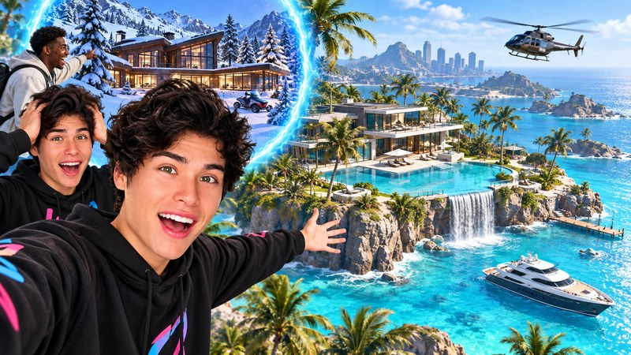

Three friends choose wildly different vacations and the crew builds each wish into a functioning game-world day.

GTA 5 launch / follow-up · GTA 5

- **0 (First Frame)–5s:** Alex foreground opening his arms to a turquoise GTA island resort, snow chalet visible in another revealed game portal.

- **5s–15s:** Complete every friend's must-do vacation activity. Wishes recorded in advance, three fixed itineraries and honest custom-map disclosure.

- **15s–30s:** The friend who wants peace discovers their beach is next to the crew's loud race route. Show the crew choosing its next move.

**Why this idea:** Shape: I Gave My Friends Their Dream [SUBJECT] in [GAME]. Ingredients: vacation, friends, dream. Combined package: I Gave My Friends Their Dream Vacations in GTA. Extend dream-car/surprise and aspirational-experience appeal to multiple crew members.

**Shape evidence:**

- [I Made a GIANT Barbie Cardboard Dream House! - Challenge](https://www.youtube.com/watch?v=XVhxtCHkb08) — Brianna · 2019-06-25 · family · 5,217,204 views · 1.70× reported lift. Same title/premise family: I Made a GIANT Barbie Cardboard Dream House! - Challenge. Game, cast and execution transfer remains a hypothesis; this source does not validate the new episode outcome. Window: lifetime through source snapshot. [Metric source](https://majieddd.github.io/influint-channels-public/channels/UCXg4rJUbDP1IP3TmZ9KDpJg.html).

- [SURPRISING MY TWIN BROTHER WITH HIS DREAM CAR!!](https://www.youtube.com/watch?v=sDmJz5TewoA) — Stokes Twins · 2020-11-28 · family · 8,967,316 views · 0.88× reported lift. Same title/premise family: SURPRISING MY TWIN BROTHER WITH HIS DREAM CAR!!. Game, cast and execution transfer remains a hypothesis; this source does not validate the new episode outcome. Window: lifetime through source snapshot. [Metric source](https://majieddd.github.io/influint-channels-public/channels/UCbp9MyKCTEww4CxEzc_Tp0Q.html).

- [I Built My Cat a BARBIE Dream House!](https://www.youtube.com/watch?v=PqANayOhIqQ) — Brianna · 2023-07-09 · family · 4,372,306 views · 1.11× reported lift. Same title/premise family: I Built My Cat a BARBIE Dream House!. Game, cast and execution transfer remains a hypothesis; this source does not validate the new episode outcome. Window: lifetime through source snapshot. [Metric source](https://majieddd.github.io/influint-channels-public/channels/UCXg4rJUbDP1IP3TmZ9KDpJg.html).

- [Surprising My Husband With His Dream Car! - Prank](https://www.youtube.com/watch?v=YSUGtRakpqk) — Brianna · 2019-07-11 · family · 6,608,326 views · 1.07× reported lift. Same title/premise family: Surprising My Husband With His Dream Car! - Prank. Game, cast and execution transfer remains a hypothesis; this source does not validate the new episode outcome. Window: lifetime through source snapshot. [Metric source](https://majieddd.github.io/influint-channels-public/channels/UCXg4rJUbDP1IP3TmZ9KDpJg.html).

**Ingredient evidence:**

- [WORST Reviewed Hotel vs BEST Reviewed Hotel! *disgusting*](https://www.youtube.com/watch?v=saLH6f4jU1U) — Brianna · 2019-12-03 · family · 17,452,634 views · 3.79× reported lift. Same concrete ingredient vacation: WORST Reviewed Hotel vs BEST Reviewed Hotel! *disgusting*. Game, cast and execution transfer remains a hypothesis; this source does not validate the new episode outcome. Window: lifetime through source snapshot. [Metric source](https://majieddd.github.io/influint-channels-public/channels/UCXg4rJUbDP1IP3TmZ9KDpJg.html).

- [Minecraft But You Can Travel 1,000,000 Blocks](https://www.youtube.com/watch?v=8NBvKMbQqug) — PrestonPlayz · 2025-12-13 · family · 11,029,068 views · 1.77× reported lift. Same concrete ingredient vacation: Minecraft But You Can Travel 1,000,000 Blocks. Game, cast and execution transfer remains a hypothesis; this source does not validate the new episode outcome. Window: lifetime through source snapshot. [Metric source](https://majieddd.github.io/influint-channels-public/channels/UCJZam2u1G0syq3kyqrCXrNw.html).

- [Last To Leave Capsule Hotel Wins $100,000](https://www.youtube.com/watch?v=aAFMeSRVTuw) — Stokes Twins · 2023-04-29 · family · 141,773,914 views · 1.70× reported lift. Same concrete ingredient vacation: Last To Leave Capsule Hotel Wins $100,000. Game, cast and execution transfer remains a hypothesis; this source does not validate the new episode outcome. Window: lifetime through source snapshot. [Metric source](https://majieddd.github.io/influint-channels-public/channels/UCbp9MyKCTEww4CxEzc_Tp0Q.html).

- [$1 VS $100,000 Hotel!](https://www.youtube.com/watch?v=Dzp4FyZHvDA) — Unspeakable · 2025-04-12 · family · 2,172,253 views · 0.49× reported lift. Same concrete ingredient vacation: $1 VS $100,000 Hotel!. Game, cast and execution transfer remains a hypothesis; this source does not validate the new episode outcome. Window: lifetime through source snapshot. [Metric source](https://majieddd.github.io/influint-channels-public/channels/UCwIWAbIeu0xI0ReKWOcw3eg.html).

Evidence gaps: Shape: 0/2 qualifying outlier channels in the verified public pool; adjacent precedents remain proposals, not replication. Ingredients: 1/2 qualifying outlier channels for the principal ingredient; this does not establish the full game/cast combination.

**Objective:** Complete every friend's must-do vacation activity.

**Rules:** Wishes recorded in advance, three fixed itineraries and honest custom-map disclosure.

**Escalation:** A beach day clashes with a snow trip before a luxury cruise forces the crew to reconcile their preferences.

**Payoff:** End with all three friends comparing the specific moment that made their vacation.

**Gamer reward:** Creative use of existing properties, vehicles and a few scoped modifications.

**Non-gamer reward:** Personal wishes, transformations, reactions and failure to live up to the fantasy carry the episode.

**People:** Several crew members receive different dreams; either twin or another regular can host, and participants perform their own story.

**Production:** Reuse a tested world · $1,650–$3,600 · authored incremental allowance.

**Dependencies:** Collect real crew wishes; use available in-game assets and limit bespoke builds. The fantasy is virtual, with no implied real gift purchase.

**Thumbnail:** Alex foreground opening his arms to a turquoise GTA island resort, snow chalet visible in another revealed game portal.

Composition reference: [SURPRISING MY TWIN BROTHER WITH HIS DREAM CAR!!](https://www.youtube.com/watch?v=sDmJz5TewoA).

[Original PNG](generated-thumbnails/039.png) · [Exact image prompt](prompts/039.txt)

#### Idea 040 — I Built My Friends' Dream Worlds in Minecraft

Three builders turn their friends' personal wishes into playable Minecraft worlds rather than empty monuments.

Later game expansion · Minecraft

- **0 (First Frame)–5s:** Alan presenting a luminous Minecraft castle, roller coaster and tropical block island to delighted adult crew.

- **5s–15s:** Deliver three functional worlds that each friend can actually use. Recorded wish lists, bounded map sizes and one working signature activity in each world.

- **15s–30s:** The first beautiful world has no working activity and needs a focused redesign. Show the crew choosing its next move.

**Why this idea:** Shape: I Built My Friends' Dream Worlds in [GAME]. Ingredients: Minecraft, build, friends. Combined package: I Built My Friends' Dream Worlds in Minecraft. Extend dream-car/surprise and aspirational-experience appeal to multiple crew members.

**Shape evidence:**

- [I Made a GIANT Barbie Cardboard Dream House! - Challenge](https://www.youtube.com/watch?v=XVhxtCHkb08) — Brianna · 2019-06-25 · family · 5,217,204 views · 1.70× reported lift. Same title/premise family: I Made a GIANT Barbie Cardboard Dream House! - Challenge. Game, cast and execution transfer remains a hypothesis; this source does not validate the new episode outcome. Window: lifetime through source snapshot. [Metric source](https://majieddd.github.io/influint-channels-public/channels/UCXg4rJUbDP1IP3TmZ9KDpJg.html).

- [SURPRISING MY TWIN BROTHER WITH HIS DREAM CAR!!](https://www.youtube.com/watch?v=sDmJz5TewoA) — Stokes Twins · 2020-11-28 · family · 8,967,316 views · 0.88× reported lift. Same title/premise family: SURPRISING MY TWIN BROTHER WITH HIS DREAM CAR!!. Game, cast and execution transfer remains a hypothesis; this source does not validate the new episode outcome. Window: lifetime through source snapshot. [Metric source](https://majieddd.github.io/influint-channels-public/channels/UCbp9MyKCTEww4CxEzc_Tp0Q.html).

- [I Built My Cat a BARBIE Dream House!](https://www.youtube.com/watch?v=PqANayOhIqQ) — Brianna · 2023-07-09 · family · 4,372,306 views · 1.11× reported lift. Same title/premise family: I Built My Cat a BARBIE Dream House!. Game, cast and execution transfer remains a hypothesis; this source does not validate the new episode outcome. Window: lifetime through source snapshot. [Metric source](https://majieddd.github.io/influint-channels-public/channels/UCXg4rJUbDP1IP3TmZ9KDpJg.html).

- [Surprising My Husband With His Dream Car! - Prank](https://www.youtube.com/watch?v=YSUGtRakpqk) — Brianna · 2019-07-11 · family · 6,608,326 views · 1.07× reported lift. Same title/premise family: Surprising My Husband With His Dream Car! - Prank. Game, cast and execution transfer remains a hypothesis; this source does not validate the new episode outcome. Window: lifetime through source snapshot. [Metric source](https://majieddd.github.io/influint-channels-public/channels/UCXg4rJUbDP1IP3TmZ9KDpJg.html).

**Ingredient evidence:**

- [SURPRISING MY TWIN BROTHER WITH HIS DREAM CAR!!](https://www.youtube.com/watch?v=sDmJz5TewoA) — Stokes Twins · 2020-11-28 · adjacent · 8,967,316 views · 0.88× reported lift. Adjacent format/cast/setting reference from the reviewed board; does not satisfy exact/family outlier coverage for this episode. Window: lifetime through source snapshot. [Metric source](https://majieddd.github.io/influint-channels-public/channels/UCbp9MyKCTEww4CxEzc_Tp0Q.html).

- [Surprising Twin Brother With Dream Vacation!](https://www.youtube.com/watch?v=uKHKUyua9OE) — Stokes Twins · 2025-07-23 · adjacent · 67,863,866 views · 0.85× reported lift. Adjacent format/cast/setting reference from the reviewed board; does not satisfy exact/family outlier coverage for this episode. Window: lifetime through source snapshot. [Metric source](https://majieddd.github.io/influint-channels-public/channels/UCbp9MyKCTEww4CxEzc_Tp0Q.html).

- [Whatever You Buy, I'll Pay For!](https://www.youtube.com/watch?v=0OFwRdDeX4Y) — MrBeast Gaming · 2020-11-02 · adjacent · 47,867,575 views · 1.26× reported lift. Adjacent format/cast/setting reference from the reviewed board; does not satisfy exact/family outlier coverage for this episode. Window: lifetime through source snapshot. [Metric source](https://majieddd.github.io/influint-channels-public/channels/UCIPPMRA040LQr5QPyJEbmXA.html).

Evidence gaps: Shape: 0/2 qualifying outlier channels in the verified public pool; adjacent precedents remain proposals, not replication. Ingredients: 0/2 qualifying outlier channels for the principal ingredient; this does not establish the full game/cast combination.

**Objective:** Deliver three functional worlds that each friend can actually use.

**Rules:** Recorded wish lists, bounded map sizes and one working signature activity in each world.

**Escalation:** An enormous design runs late, a personal detail gets lost and the final test checks the promised function.

**Payoff:** Give each friend control of the world and show them playing the feature built for them.

**Gamer reward:** Creative use of existing properties, vehicles and a few scoped modifications.

**Non-gamer reward:** Personal wishes, transformations, reactions and failure to live up to the fantasy carry the episode.

**People:** Several crew members receive different dreams; either twin or another regular can host, and participants perform their own story.

**Production:** Reuse a tested world · $1,650–$3,600 · authored incremental allowance.

**Dependencies:** Collect real crew wishes; use available in-game assets and limit bespoke builds. The fantasy is virtual, with no implied real gift purchase. Verify the exact edition, map, mod license and working mechanics; GTA-system reuse does not imply Minecraft support.

**Thumbnail:** Alan presenting a luminous Minecraft castle, roller coaster and tropical block island to delighted adult crew.

Composition reference: [SURPRISING MY TWIN BROTHER WITH HIS DREAM CAR!!](https://www.youtube.com/watch?v=sDmJz5TewoA).

[Original PNG](generated-thumbnails/040.png) · [Exact image prompt](prompts/040.txt)

### Format 09 — The world-sized experiment

Increase the size and design of a vehicle barrier in controlled stages, show genuine impacts and failures, and finish with a large final test of whether the train can be stopped.

Title family: Can ___ ___ Stop a ___ in ___?

Retained and made bigger. 10,000 is a concept-scale target requiring a load/physics test; use the achieved true count in final packaging. Bigger means a more spectacular problem and earned final experiment.

#### Idea 041 — Can 10,000 Cars Stop a Train in GTA?

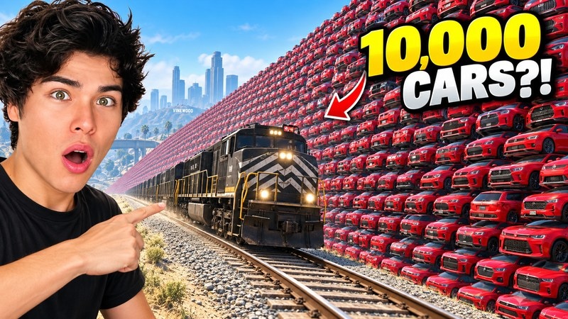

Crew teams increase the size and design of a car barrier until a genuine train impact resolves the experiment.

GTA 5 launch / follow-up · GTA 5

- **0 (First Frame)–5s:** Alan huge left, black train charging toward a colossal red-car wall stretching to the horizon; 10,000 CARS?.

- **5s–15s:** Find the smallest tested barrier that can actually stop the train. Prototype physical spawn capacity.

- **15s–30s:** The first ten-car barrier scatters without noticeably slowing the train. Show the crew choosing its next move.

**Why this idea:** Shape: Can [COUNT] [SUBJECT] Stop a [SUBJECT] in [GAME]?. Ingredients: train, car, experiment. Combined package: Can 10,000 Cars Stop a Train in GTA?. Transfer the main-channel product-test curiosity into one grand experiment.

**Shape evidence:**

- [FILLING my pool with a THOUSAND Bath Bombs! - Experiment](https://www.youtube.com/watch?v=zfcKQlgOf0g) — Brianna · 2019-06-20 · family · 19,523,536 views · 7.70× reported lift. Same title/premise family: FILLING my pool with a THOUSAND Bath Bombs! - Experiment. Game, cast and execution transfer remains a hypothesis; this source does not validate the new episode outcome. Window: lifetime through source snapshot. [Metric source](https://majieddd.github.io/influint-channels-public/channels/UCXg4rJUbDP1IP3TmZ9KDpJg.html).

- [World’s Largest Explosion!](https://www.youtube.com/watch?v=ABTdTTnnEU8) — MrBeast Gaming · 2021-04-07 · family · 287,473,152 views · 3.15× reported lift. Same title/premise family: World’s Largest Explosion!. Game, cast and execution transfer remains a hypothesis; this source does not validate the new episode outcome. Window: lifetime through source snapshot. [Metric source](https://majieddd.github.io/influint-channels-public/channels/UCIPPMRA040LQr5QPyJEbmXA.html).

- [Experiment: Coca Cola and Mentos Inside Bathtub](https://www.youtube.com/watch?v=FvXudYgDJpc) — Stokes Twins · 2019-12-15 · family · 6,049,060 views · 1.03× reported lift. Same title/premise family: Experiment: Coca Cola and Mentos Inside Bathtub. Game, cast and execution transfer remains a hypothesis; this source does not validate the new episode outcome. Window: lifetime through source snapshot. [Metric source](https://majieddd.github.io/influint-channels-public/channels/UCbp9MyKCTEww4CxEzc_Tp0Q.html).

- [I Tested $1 VS $10,000 Experiments!](https://www.youtube.com/watch?v=p-CtAPVKKrQ) — Unspeakable · 2024-11-30 · family · 6,262,307 views · 1.00× reported lift. Same title/premise family: I Tested $1 VS $10,000 Experiments!. Game, cast and execution transfer remains a hypothesis; this source does not validate the new episode outcome. Window: lifetime through source snapshot. [Metric source](https://majieddd.github.io/influint-channels-public/channels/UCwIWAbIeu0xI0ReKWOcw3eg.html).

**Ingredient evidence:**

- [I Sent Preston to Santa Training School...](https://www.youtube.com/watch?v=1VUwRiae8IM) — Brianna · 2020-12-02 · family · 3,067,787 views · 1.80× reported lift. Same concrete ingredient train: I Sent Preston to Santa Training School.... Game, cast and execution transfer remains a hypothesis; this source does not validate the new episode outcome. Window: lifetime through source snapshot. [Metric source](https://majieddd.github.io/influint-channels-public/channels/UCXg4rJUbDP1IP3TmZ9KDpJg.html).

- [Driving 100 Hours In A Cardboard Train!](https://www.youtube.com/watch?v=3InYPKOC0jQ) — Unspeakable · 2025-08-02 · family · 7,024,006 views · 1.57× reported lift. Same concrete ingredient train: Driving 100 Hours In A Cardboard Train!. Game, cast and execution transfer remains a hypothesis; this source does not validate the new episode outcome. Window: lifetime through source snapshot. [Metric source](https://majieddd.github.io/influint-channels-public/channels/UCwIWAbIeu0xI0ReKWOcw3eg.html).

- [How To Train Your Dragon In Real Life](https://www.youtube.com/watch?v=x__vFVb4p78) — Unspeakable · 2025-06-14 · family · 2,768,981 views · 0.81× reported lift. Same concrete ingredient train: How To Train Your Dragon In Real Life. Game, cast and execution transfer remains a hypothesis; this source does not validate the new episode outcome. Window: lifetime through source snapshot. [Metric source](https://majieddd.github.io/influint-channels-public/channels/UCwIWAbIeu0xI0ReKWOcw3eg.html).

- [Last to Leave Actual SWAT Training Wins $1000! - Challenge](https://www.youtube.com/watch?v=Mz_4cCErgw4) — Brianna · 2020-06-24 · family · 2,040,812 views · 0.62× reported lift. Same concrete ingredient train: Last to Leave Actual SWAT Training Wins $1000! - Challenge. Game, cast and execution transfer remains a hypothesis; this source does not validate the new episode outcome. Window: lifetime through source snapshot. [Metric source](https://majieddd.github.io/influint-channels-public/channels/UCXg4rJUbDP1IP3TmZ9KDpJg.html).

Evidence gaps: Ingredients: 0/2 qualifying outlier channels for the principal ingredient; this does not establish the full game/cast combination.

**Objective:** Find the smallest tested barrier that can actually stop the train.

**Rules:** Prototype physical spawn capacity; the final title uses the true achieved active count and separates decorative cars from physics objects.

**Escalation:** Ten cars fail, better geometry changes the impact and the largest feasible barrier becomes the final trial.

**Payoff:** Show the final train impact continuously and publish the real count and result even if the train wins.

**Gamer reward:** Physics and mechanics reward prior knowledge.

**Non-gamer reward:** Scale and an intuitive question carry the suspense.

**People:** Crew teams propose and build different barriers; Alan/Alex or another host runs the test while participants react to the result.

**Production:** Reusable custom challenge · $3,400–$7,500 · authored incremental allowance.

**Dependencies:** A physics/spawn feasibility prototype before the full build, staged attempts and cinematic capture. Separate visual crowd dressing from objects that actually participate in the simulation.

**Thumbnail:** Alan huge left, black train charging toward a colossal red-car wall stretching to the horizon; 10,000 CARS?.

Composition reference: [World's Largest Experiment!](https://www.youtube.com/watch?v=JeTkMdw6RK8).

[Original PNG](generated-thumbnails/041.png) · [Exact image prompt](prompts/041.txt)

Conditional addition: Large-object physics proof · $1,000–$2,500 · Before 09: count active simulated objects and record stable capture. Cut title scale to achieved count if needed.

#### Idea 042 — Can 1,000 Boats Stop a Tsunami in GTA?

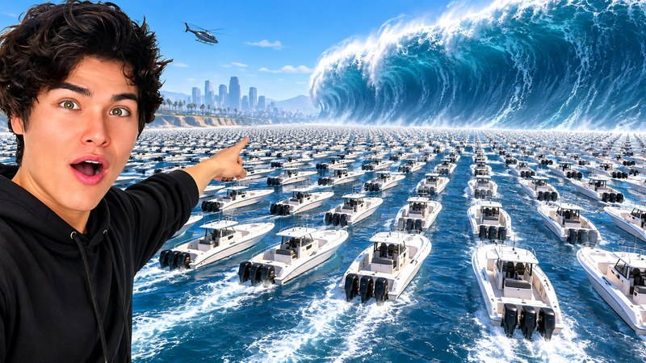

The crew tests increasingly large boat barriers against the same custom wave to learn whether more objects can redirect it.

GTA 5 launch / follow-up · GTA 5

- **0 (First Frame)–5s:** Alex beside a vast line of white boats confronting an enormous blue GTA wave; 1,000?.

- **5s–15s:** Find whether any tested barrier changes the wave's route. Simulation effect and active-object count disclosed.

- **15s–30s:** The first boats rise with the water instead of forming a wall. Show the crew choosing its next move.

**Why this idea:** Shape: Can [COUNT] [SUBJECT] Stop a [SUBJECT] in [GAME]?. Ingredients: boat, tsunami, experiment. Combined package: Can 1,000 Boats Stop a Tsunami in GTA?. Transfer the main-channel product-test curiosity into one grand experiment.

**Shape evidence:**

- [FILLING my pool with a THOUSAND Bath Bombs! - Experiment](https://www.youtube.com/watch?v=zfcKQlgOf0g) — Brianna · 2019-06-20 · family · 19,523,536 views · 7.70× reported lift. Same title/premise family: FILLING my pool with a THOUSAND Bath Bombs! - Experiment. Game, cast and execution transfer remains a hypothesis; this source does not validate the new episode outcome. Window: lifetime through source snapshot. [Metric source](https://majieddd.github.io/influint-channels-public/channels/UCXg4rJUbDP1IP3TmZ9KDpJg.html).

- [World’s Largest Explosion!](https://www.youtube.com/watch?v=ABTdTTnnEU8) — MrBeast Gaming · 2021-04-07 · family · 287,473,152 views · 3.15× reported lift. Same title/premise family: World’s Largest Explosion!. Game, cast and execution transfer remains a hypothesis; this source does not validate the new episode outcome. Window: lifetime through source snapshot. [Metric source](https://majieddd.github.io/influint-channels-public/channels/UCIPPMRA040LQr5QPyJEbmXA.html).

- [Experiment: Coca Cola and Mentos Inside Bathtub](https://www.youtube.com/watch?v=FvXudYgDJpc) — Stokes Twins · 2019-12-15 · family · 6,049,060 views · 1.03× reported lift. Same title/premise family: Experiment: Coca Cola and Mentos Inside Bathtub. Game, cast and execution transfer remains a hypothesis; this source does not validate the new episode outcome. Window: lifetime through source snapshot. [Metric source](https://majieddd.github.io/influint-channels-public/channels/UCbp9MyKCTEww4CxEzc_Tp0Q.html).

- [I Tested $1 VS $10,000 Experiments!](https://www.youtube.com/watch?v=p-CtAPVKKrQ) — Unspeakable · 2024-11-30 · family · 6,262,307 views · 1.00× reported lift. Same title/premise family: I Tested $1 VS $10,000 Experiments!. Game, cast and execution transfer remains a hypothesis; this source does not validate the new episode outcome. Window: lifetime through source snapshot. [Metric source](https://majieddd.github.io/influint-channels-public/channels/UCwIWAbIeu0xI0ReKWOcw3eg.html).

**Ingredient evidence:**

- [WORST Reviewed Water Park vs BEST Reviewed Water Park!](https://www.youtube.com/watch?v=-LVdJNIs2PY) — Brianna · 2020-09-26 · family · 11,857,144 views · 5.63× reported lift. Same concrete ingredient boat: WORST Reviewed Water Park vs BEST Reviewed Water Park!. Game, cast and execution transfer remains a hypothesis; this source does not validate the new episode outcome. Window: lifetime through source snapshot. [Metric source](https://majieddd.github.io/influint-channels-public/channels/UCXg4rJUbDP1IP3TmZ9KDpJg.html).

- [I Turned My House Into a Waterpark!](https://www.youtube.com/watch?v=WthL6_K8Kys) — Unspeakable · 2024-08-24 · family · 20,543,332 views · 4.23× reported lift. Same concrete ingredient boat: I Turned My House Into a Waterpark!. Game, cast and execution transfer remains a hypothesis; this source does not validate the new episode outcome. Window: lifetime through source snapshot. [Metric source](https://majieddd.github.io/influint-channels-public/channels/UCwIWAbIeu0xI0ReKWOcw3eg.html).

- [Walking on Water Prank!](https://www.youtube.com/watch?v=hHdKug_wQkU) — Stokes Twins · 2025-03-22 · family · 169,129,541 views · 1.34× reported lift. Same concrete ingredient boat: Walking on Water Prank!. Game, cast and execution transfer remains a hypothesis; this source does not validate the new episode outcome. Window: lifetime through source snapshot. [Metric source](https://majieddd.github.io/influint-channels-public/channels/UCbp9MyKCTEww4CxEzc_Tp0Q.html).

- [Level 1 to 100 Waterparks in Minecraft!](https://www.youtube.com/watch?v=fU03uSHbTGo) — PrestonPlayz · 2026-07-25 · family · 2,624,764 views · 1.14× reported lift. Same concrete ingredient boat: Level 1 to 100 Waterparks in Minecraft!. Game, cast and execution transfer remains a hypothesis; this source does not validate the new episode outcome. Window: lifetime through source snapshot. [Metric source](https://majieddd.github.io/influint-channels-public/channels/UCJZam2u1G0syq3kyqrCXrNw.html).

Two qualifying source channels on both axes; creator groups and exact-mixture limitations remain visible in the website.

**Objective:** Find whether any tested barrier changes the wave's route.

**Rules:** Simulation effect and active-object count disclosed; if the wave has no physical interaction, reframe as a flood evacuation test before filming.

**Escalation:** Loose boats fail, tethered rows last longer and the biggest feasible wall exposes the limit of the simulation.

**Payoff:** Reveal the real simulated interaction and the barrier that worked or failed without inventing physics.

**Gamer reward:** Physics and mechanics reward prior knowledge.

**Non-gamer reward:** Scale and an intuitive question carry the suspense.

**People:** Crew teams propose and build different barriers; Alan/Alex or another host runs the test while participants react to the result.

**Production:** Reusable custom challenge · $3,400–$7,500 · authored incremental allowance.

**Dependencies:** A physics/spawn feasibility prototype before the full build, staged attempts and cinematic capture. Separate visual crowd dressing from objects that actually participate in the simulation.

**Thumbnail:** Alex beside a vast line of white boats confronting an enormous blue GTA wave; 1,000?.

Composition reference: [World's Largest Experiment!](https://www.youtube.com/watch?v=JeTkMdw6RK8).

[Original PNG](generated-thumbnails/042.png) · [Exact image prompt](prompts/042.txt)

Conditional addition: Large-object physics proof · $1,000–$2,500 · Before 09: count active simulated objects and record stable capture. Cut title scale to achieved count if needed.

#### Idea 043 — I Created GTA's Biggest Car Crash

The crew combines its largest verified vehicle setup into one recorded chain reaction after smaller designs keep failing.

GTA 5 launch / follow-up · GTA 5

- **0 (First Frame)–5s:** Alan left foreground, giant red-car domino crash sweeping across a city bridge into a single huge pileup.

- **5s–15s:** Create the largest successful crash within the tested production setup. Biggest refers to this production's measured setup, not an unverified world record.

- **15s–30s:** The initial cars stop transferring momentum halfway through the line. Show the crew choosing its next move.

**Why this idea:** Shape: I Created [GAME]'s Biggest [SUBJECT] Crash. Ingredients: car, experiment, crash. Combined package: I Created GTA's Biggest Car Crash. Transfer the main-channel product-test curiosity into one grand experiment.

**Shape evidence:**

- [FILLING my pool with a THOUSAND Bath Bombs! - Experiment](https://www.youtube.com/watch?v=zfcKQlgOf0g) — Brianna · 2019-06-20 · family · 19,523,536 views · 7.70× reported lift. Same title/premise family: FILLING my pool with a THOUSAND Bath Bombs! - Experiment. Game, cast and execution transfer remains a hypothesis; this source does not validate the new episode outcome. Window: lifetime through source snapshot. [Metric source](https://majieddd.github.io/influint-channels-public/channels/UCXg4rJUbDP1IP3TmZ9KDpJg.html).

- [World’s Largest Explosion!](https://www.youtube.com/watch?v=ABTdTTnnEU8) — MrBeast Gaming · 2021-04-07 · family · 287,473,152 views · 3.15× reported lift. Same title/premise family: World’s Largest Explosion!. Game, cast and execution transfer remains a hypothesis; this source does not validate the new episode outcome. Window: lifetime through source snapshot. [Metric source](https://majieddd.github.io/influint-channels-public/channels/UCIPPMRA040LQr5QPyJEbmXA.html).

- [Experiment: Coca Cola and Mentos Inside Bathtub](https://www.youtube.com/watch?v=FvXudYgDJpc) — Stokes Twins · 2019-12-15 · family · 6,049,060 views · 1.03× reported lift. Same title/premise family: Experiment: Coca Cola and Mentos Inside Bathtub. Game, cast and execution transfer remains a hypothesis; this source does not validate the new episode outcome. Window: lifetime through source snapshot. [Metric source](https://majieddd.github.io/influint-channels-public/channels/UCbp9MyKCTEww4CxEzc_Tp0Q.html).

- [I Tested $1 VS $10,000 Experiments!](https://www.youtube.com/watch?v=p-CtAPVKKrQ) — Unspeakable · 2024-11-30 · family · 6,262,307 views · 1.00× reported lift. Same title/premise family: I Tested $1 VS $10,000 Experiments!. Game, cast and execution transfer remains a hypothesis; this source does not validate the new episode outcome. Window: lifetime through source snapshot. [Metric source](https://majieddd.github.io/influint-channels-public/channels/UCwIWAbIeu0xI0ReKWOcw3eg.html).

**Ingredient evidence:**

- [Preston Cheated in Cardboard Hide and Seek](https://www.youtube.com/watch?v=5zbvDh28XUQ) — Brianna · 2022-04-28 · family · 11,051,826 views · 5.01× reported lift. Same concrete ingredient car: Preston Cheated in Cardboard Hide and Seek. Game, cast and execution transfer remains a hypothesis; this source does not validate the new episode outcome. Window: lifetime through source snapshot. [Metric source](https://majieddd.github.io/influint-channels-public/channels/UCXg4rJUbDP1IP3TmZ9KDpJg.html).

- [Tesla Autopilot For 24 Hours!](https://www.youtube.com/watch?v=SsJ7oOpbmIk) — Stokes Twins · 2021-04-20 · family · 38,321,506 views · 4.25× reported lift. Same concrete ingredient car: Tesla Autopilot For 24 Hours!. Game, cast and execution transfer remains a hypothesis; this source does not validate the new episode outcome. Window: lifetime through source snapshot. [Metric source](https://majieddd.github.io/influint-channels-public/channels/UCbp9MyKCTEww4CxEzc_Tp0Q.html).

- [World's Fastest Car!](https://www.youtube.com/watch?v=nopEs-K4ExM) — MrBeast Gaming · 2022-07-09 · family · 122,277,058 views · 3.68× reported lift. Same concrete ingredient car: World's Fastest Car!. Game, cast and execution transfer remains a hypothesis; this source does not validate the new episode outcome. Window: lifetime through source snapshot. [Metric source](https://majieddd.github.io/influint-channels-public/channels/UCIPPMRA040LQr5QPyJEbmXA.html).

- [7 Days Escaping Cardboard Prison!](https://www.youtube.com/watch?v=WU05jZnUiYs) — Unspeakable · 2026-01-24 · family · 12,880,314 views · 3.65× reported lift. Same concrete ingredient car: 7 Days Escaping Cardboard Prison!. Game, cast and execution transfer remains a hypothesis; this source does not validate the new episode outcome. Window: lifetime through source snapshot. [Metric source](https://majieddd.github.io/influint-channels-public/channels/UCwIWAbIeu0xI0ReKWOcw3eg.html).

Two qualifying source channels on both axes; creator groups and exact-mixture limitations remain visible in the website.

**Objective:** Create the largest successful crash within the tested production setup.

**Rules:** Biggest refers to this production's measured setup, not an unverified world record; count active vehicles and use real replay footage.

**Escalation:** Spacing ruins the first chain, a ramp improves transfer and the final arrangement puts the whole design to the test.

**Payoff:** Show the full chain reaction, the actual count and the crew's winning design.

**Gamer reward:** Physics and mechanics reward prior knowledge.

**Non-gamer reward:** Scale and an intuitive question carry the suspense.

**People:** Crew teams propose and build different barriers; Alan/Alex or another host runs the test while participants react to the result.

**Production:** Reusable custom challenge · $3,400–$7,500 · authored incremental allowance.

**Dependencies:** A physics/spawn feasibility prototype before the full build, staged attempts and cinematic capture. Separate visual crowd dressing from objects that actually participate in the simulation.

**Thumbnail:** Alan left foreground, giant red-car domino crash sweeping across a city bridge into a single huge pileup.

Composition reference: [World's Largest Experiment!](https://www.youtube.com/watch?v=JeTkMdw6RK8).

[Original PNG](generated-thumbnails/043.png) · [Exact image prompt](prompts/043.txt)

Conditional addition: Large-object physics proof · $1,000–$2,500 · Before 09: count active simulated objects and record stable capture. Cut title scale to achieved count if needed.

#### Idea 044 — Can 100 Helicopters Lift a House in GTA?

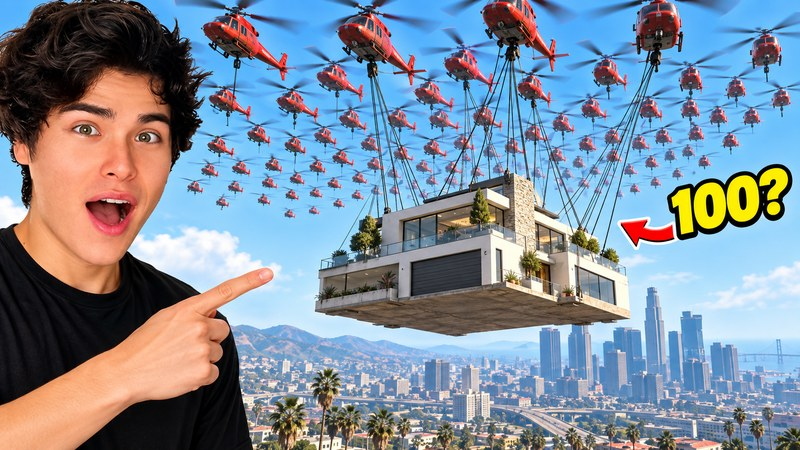

Crew engineers try larger helicopter teams against a custom liftable house while ordinary-looking plans spectacularly fail.

GTA 5 launch / follow-up · GTA 5

- **0 (First Frame)–5s:** Alex foreground, an entire white GTA house suspended beneath a grand cluster of red helicopters, clear sky silhouette; 100?.

- **5s–15s:** Lift the disclosed movable house above the marked height. Custom physics house and attachment system disclosed.

- **15s–30s:** The first helicopter rotates the house instead of lifting it straight. Show the crew choosing its next move.

**Why this idea:** Shape: Can [COUNT] [SUBJECT] Lift a [SUBJECT] in [GAME]?. Ingredients: helicopter, house, experiment. Combined package: Can 100 Helicopters Lift a House in GTA?. Transfer the main-channel product-test curiosity into one grand experiment.

**Shape evidence:**

- [FILLING my pool with a THOUSAND Bath Bombs! - Experiment](https://www.youtube.com/watch?v=zfcKQlgOf0g) — Brianna · 2019-06-20 · family · 19,523,536 views · 7.70× reported lift. Same title/premise family: FILLING my pool with a THOUSAND Bath Bombs! - Experiment. Game, cast and execution transfer remains a hypothesis; this source does not validate the new episode outcome. Window: lifetime through source snapshot. [Metric source](https://majieddd.github.io/influint-channels-public/channels/UCXg4rJUbDP1IP3TmZ9KDpJg.html).

- [World’s Largest Explosion!](https://www.youtube.com/watch?v=ABTdTTnnEU8) — MrBeast Gaming · 2021-04-07 · family · 287,473,152 views · 3.15× reported lift. Same title/premise family: World’s Largest Explosion!. Game, cast and execution transfer remains a hypothesis; this source does not validate the new episode outcome. Window: lifetime through source snapshot. [Metric source](https://majieddd.github.io/influint-channels-public/channels/UCIPPMRA040LQr5QPyJEbmXA.html).

- [Experiment: Coca Cola and Mentos Inside Bathtub](https://www.youtube.com/watch?v=FvXudYgDJpc) — Stokes Twins · 2019-12-15 · family · 6,049,060 views · 1.03× reported lift. Same title/premise family: Experiment: Coca Cola and Mentos Inside Bathtub. Game, cast and execution transfer remains a hypothesis; this source does not validate the new episode outcome. Window: lifetime through source snapshot. [Metric source](https://majieddd.github.io/influint-channels-public/channels/UCbp9MyKCTEww4CxEzc_Tp0Q.html).

- [I Tested $1 VS $10,000 Experiments!](https://www.youtube.com/watch?v=p-CtAPVKKrQ) — Unspeakable · 2024-11-30 · family · 6,262,307 views · 1.00× reported lift. Same title/premise family: I Tested $1 VS $10,000 Experiments!. Game, cast and execution transfer remains a hypothesis; this source does not validate the new episode outcome. Window: lifetime through source snapshot. [Metric source](https://majieddd.github.io/influint-channels-public/channels/UCwIWAbIeu0xI0ReKWOcw3eg.html).

**Ingredient evidence:**

- [World's Largest Experiment!](https://www.youtube.com/watch?v=JeTkMdw6RK8) — MrBeast Gaming · 2022-05-22 · adjacent · 147,057,293 views · 2.78× reported lift. Adjacent format/cast/setting reference from the reviewed board; does not satisfy exact/family outlier coverage for this episode. Window: lifetime through source snapshot. [Metric source](https://majieddd.github.io/influint-channels-public/channels/UCIPPMRA040LQr5QPyJEbmXA.html).

- [World’s Largest Explosion!](https://www.youtube.com/watch?v=ABTdTTnnEU8) — MrBeast Gaming · 2021-04-07 · adjacent · 287,473,152 views · 3.15× reported lift. Adjacent format/cast/setting reference from the reviewed board; does not satisfy exact/family outlier coverage for this episode. Window: lifetime through source snapshot. [Metric source](https://majieddd.github.io/influint-channels-public/channels/UCIPPMRA040LQr5QPyJEbmXA.html).

- [BUSTING VIRAL TIKTOK GADGETS!!](https://www.youtube.com/watch?v=AwQz703eOt0) — Stokes Twins · 2021-01-15 · adjacent · 28,640,105 views · 4.18× reported lift. Adjacent format/cast/setting reference from the reviewed board; does not satisfy exact/family outlier coverage for this episode. Window: lifetime through source snapshot. [Metric source](https://majieddd.github.io/influint-channels-public/channels/UCbp9MyKCTEww4CxEzc_Tp0Q.html).

Evidence gaps: Ingredients: 0/2 qualifying outlier channels for the principal ingredient; this does not establish the full game/cast combination.

**Objective:** Lift the disclosed movable house above the marked height.

**Rules:** Custom physics house and attachment system disclosed, active helicopter count verified and title revised to real achieved scale.

**Escalation:** One aircraft tips the load, a better rig balances it and the final team must coordinate a simultaneous ascent.

**Payoff:** Show the real lift or failure and the exact rig configuration responsible.

**Gamer reward:** Physics and mechanics reward prior knowledge.

**Non-gamer reward:** Scale and an intuitive question carry the suspense.

**People:** Crew teams propose and build different barriers; Alan/Alex or another host runs the test while participants react to the result.

**Production:** Reusable custom challenge · $3,400–$7,500 · authored incremental allowance.

**Dependencies:** A physics/spawn feasibility prototype before the full build, staged attempts and cinematic capture. Separate visual crowd dressing from objects that actually participate in the simulation.

**Thumbnail:** Alex foreground, an entire white GTA house suspended beneath a grand cluster of red helicopters, clear sky silhouette; 100?.

Composition reference: [World's Largest Experiment!](https://www.youtube.com/watch?v=JeTkMdw6RK8).

[Original PNG](generated-thumbnails/044.png) · [Exact image prompt](prompts/044.txt)

Conditional addition: Large-object physics proof · $1,000–$2,500 · Before 09: count active simulated objects and record stable capture. Cut title scale to achieved count if needed.

#### Idea 045 — Can 10,000 Minecraft Minecarts Stop a Train?

The crew uses a tested modded train world to compare increasingly large minecart barriers in one visible collision experiment.

Later game expansion · Minecraft

- **0 (First Frame)–5s:** Alan left, giant Minecraft train facing an enormous receding wall of minecarts, bright red/cyan cinematic block world.

- **5s–15s:** Find whether the largest functioning barrier can halt the modded train. Name and license the tested train mod, label non-stock behavior and count active minecarts.

- **15s–30s:** The smallest minecart barrier is pushed off the track before the train slows. Show the crew choosing its next move.

**Why this idea:** Shape: Can [COUNT] [GAME] Minecarts Stop a [SUBJECT]?. Ingredients: Minecraft, train, experiment. Combined package: Can 10,000 Minecraft Minecarts Stop a Train?. Transfer the main-channel product-test curiosity into one grand experiment.

**Shape evidence:**

- [FILLING my pool with a THOUSAND Bath Bombs! - Experiment](https://www.youtube.com/watch?v=zfcKQlgOf0g) — Brianna · 2019-06-20 · family · 19,523,536 views · 7.70× reported lift. Same title/premise family: FILLING my pool with a THOUSAND Bath Bombs! - Experiment. Game, cast and execution transfer remains a hypothesis; this source does not validate the new episode outcome. Window: lifetime through source snapshot. [Metric source](https://majieddd.github.io/influint-channels-public/channels/UCXg4rJUbDP1IP3TmZ9KDpJg.html).

- [World’s Largest Explosion!](https://www.youtube.com/watch?v=ABTdTTnnEU8) — MrBeast Gaming · 2021-04-07 · family · 287,473,152 views · 3.15× reported lift. Same title/premise family: World’s Largest Explosion!. Game, cast and execution transfer remains a hypothesis; this source does not validate the new episode outcome. Window: lifetime through source snapshot. [Metric source](https://majieddd.github.io/influint-channels-public/channels/UCIPPMRA040LQr5QPyJEbmXA.html).

- [Experiment: Coca Cola and Mentos Inside Bathtub](https://www.youtube.com/watch?v=FvXudYgDJpc) — Stokes Twins · 2019-12-15 · family · 6,049,060 views · 1.03× reported lift. Same title/premise family: Experiment: Coca Cola and Mentos Inside Bathtub. Game, cast and execution transfer remains a hypothesis; this source does not validate the new episode outcome. Window: lifetime through source snapshot. [Metric source](https://majieddd.github.io/influint-channels-public/channels/UCbp9MyKCTEww4CxEzc_Tp0Q.html).

- [I Tested $1 VS $10,000 Experiments!](https://www.youtube.com/watch?v=p-CtAPVKKrQ) — Unspeakable · 2024-11-30 · family · 6,262,307 views · 1.00× reported lift. Same title/premise family: I Tested $1 VS $10,000 Experiments!. Game, cast and execution transfer remains a hypothesis; this source does not validate the new episode outcome. Window: lifetime through source snapshot. [Metric source](https://majieddd.github.io/influint-channels-public/channels/UCwIWAbIeu0xI0ReKWOcw3eg.html).

**Ingredient evidence:**

- [I Sent Preston to Santa Training School...](https://www.youtube.com/watch?v=1VUwRiae8IM) — Brianna · 2020-12-02 · family · 3,067,787 views · 1.80× reported lift. Same concrete ingredient train: I Sent Preston to Santa Training School.... Game, cast and execution transfer remains a hypothesis; this source does not validate the new episode outcome. Window: lifetime through source snapshot. [Metric source](https://majieddd.github.io/influint-channels-public/channels/UCXg4rJUbDP1IP3TmZ9KDpJg.html).

- [Driving 100 Hours In A Cardboard Train!](https://www.youtube.com/watch?v=3InYPKOC0jQ) — Unspeakable · 2025-08-02 · family · 7,024,006 views · 1.57× reported lift. Same concrete ingredient train: Driving 100 Hours In A Cardboard Train!. Game, cast and execution transfer remains a hypothesis; this source does not validate the new episode outcome. Window: lifetime through source snapshot. [Metric source](https://majieddd.github.io/influint-channels-public/channels/UCwIWAbIeu0xI0ReKWOcw3eg.html).

- [How To Train Your Dragon In Real Life](https://www.youtube.com/watch?v=x__vFVb4p78) — Unspeakable · 2025-06-14 · family · 2,768,981 views · 0.81× reported lift. Same concrete ingredient train: How To Train Your Dragon In Real Life. Game, cast and execution transfer remains a hypothesis; this source does not validate the new episode outcome. Window: lifetime through source snapshot. [Metric source](https://majieddd.github.io/influint-channels-public/channels/UCwIWAbIeu0xI0ReKWOcw3eg.html).

- [Last to Leave Actual SWAT Training Wins $1000! - Challenge](https://www.youtube.com/watch?v=Mz_4cCErgw4) — Brianna · 2020-06-24 · family · 2,040,812 views · 0.62× reported lift. Same concrete ingredient train: Last to Leave Actual SWAT Training Wins $1000! - Challenge. Game, cast and execution transfer remains a hypothesis; this source does not validate the new episode outcome. Window: lifetime through source snapshot. [Metric source](https://majieddd.github.io/influint-channels-public/channels/UCXg4rJUbDP1IP3TmZ9KDpJg.html).

Evidence gaps: Ingredients: 0/2 qualifying outlier channels for the principal ingredient; this does not establish the full game/cast combination.

**Objective:** Find whether the largest functioning barrier can halt the modded train.

**Rules:** Name and license the tested train mod, label non-stock behavior and count active minecarts; scale is conditional on performance.

**Escalation:** Loose minecarts fail, stacked barriers change the collision and the biggest feasible setup gets one final run.

**Payoff:** Show the actual collision and the precise mod/settings rather than imply stock Minecraft has a train system.

**Gamer reward:** Physics and mechanics reward prior knowledge.

**Non-gamer reward:** Scale and an intuitive question carry the suspense.

**People:** Crew teams propose and build different barriers; Alan/Alex or another host runs the test while participants react to the result.

**Production:** Reusable custom challenge · $3,400–$7,500 · authored incremental allowance.

**Dependencies:** A physics/spawn feasibility prototype before the full build, staged attempts and cinematic capture. Separate visual crowd dressing from objects that actually participate in the simulation. Verify the exact edition, map, mod license and working mechanics; GTA-system reuse does not imply Minecraft support.

**Thumbnail:** Alan left, giant Minecraft train facing an enormous receding wall of minecarts, bright red/cyan cinematic block world.

Composition reference: [World's Largest Experiment!](https://www.youtube.com/watch?v=JeTkMdw6RK8).

[Original PNG](generated-thumbnails/045.png) · [Exact image prompt](prompts/045.txt)

Conditional addition: Large-object physics proof · $1,000–$2,500 · Before 09: count active simulated objects and record stable capture. Cut title scale to achieved count if needed.

### Format 10 — Play GTA across its cities

Complete one accessible, city-specific challenge at every stop, with a progress map and final journey payoff; the user is choosing whether the stops are real filming locations or different GTA games.

Title family: I Played ___ in Every ___

New user direction replacing shared controls. Exact cross-city performance precedent is not established; do not describe this as a proven outlier.

#### Idea 046 — I Played GTA in Every GTA City!

A traveling host completes one matching game challenge at each real-world city inspiration in a defined GTA-city itinerary.

Later hybrid / travel pilot · GTA 5

- **0 (First Frame)–5s:** Alan foreground with a controller, epic globe journey joining Los Angeles-style skyline, Miami-style palms and New York-style towers; GTA CITIES.

- **5s–15s:** Finish the disclosed city list and its one simple challenge per stop. Working assumption is real-city filming.

- **15s–30s:** The first landmark looks familiar but the game route differs from the real street. Show the crew choosing its next move.

**Why this idea:** Shape: I Played [GAME] in Every [GAME] [SUBJECT]!. Ingredients: city, travel, GTA. Combined package: I Played GTA in Every GTA City!. The user’s proposed travel direction; cast personalities and landmark comparisons connect gaming to the broader Stokes audience.

**Shape evidence:**

- [I Played Steal A Brainrot In REAL LIFE!](https://www.youtube.com/watch?v=PmFU6Dk5DRE) — Unspeakable · 2025-10-11 · family · 10,365,257 views · 1.68× reported lift. Same title/premise family: I Played Steal A Brainrot In REAL LIFE!. Game, cast and execution transfer remains a hypothesis; this source does not validate the new episode outcome. Window: lifetime through source snapshot. [Metric source](https://majieddd.github.io/influint-channels-public/channels/UCwIWAbIeu0xI0ReKWOcw3eg.html).

- [I Played POPPY PLAYTIME Chapter 2 in Real Life!](https://www.youtube.com/watch?v=oAGQugG1n4Q) — Brianna · 2022-05-01 · family · 1,728,451 views · 0.68× reported lift. Same title/premise family: I Played POPPY PLAYTIME Chapter 2 in Real Life!. Game, cast and execution transfer remains a hypothesis; this source does not validate the new episode outcome. Window: lifetime through source snapshot. [Metric source](https://majieddd.github.io/influint-channels-public/channels/UCXg4rJUbDP1IP3TmZ9KDpJg.html).

- [We Played AMONG US But IN REAL LIFE!! (Imposter IQ 9,999,999%)](https://www.youtube.com/watch?v=dajCqgha8vY) — Stokes Twins · 2020-10-12 · family · 7,837,423 views · 0.63× reported lift. Same title/premise family: We Played AMONG US But IN REAL LIFE!! (Imposter IQ 9,999,999%). Game, cast and execution transfer remains a hypothesis; this source does not validate the new episode outcome. Window: lifetime through source snapshot. [Metric source](https://majieddd.github.io/influint-channels-public/channels/UCbp9MyKCTEww4CxEzc_Tp0Q.html).

- [I Played Poppy Playtime in Real Life! *Huggy Wuggy*](https://www.youtube.com/watch?v=hkVgXv925HU) — Brianna · 2021-12-19 · family · 2,004,126 views · 0.40× reported lift. Same title/premise family: I Played Poppy Playtime in Real Life! *Huggy Wuggy*. Game, cast and execution transfer remains a hypothesis; this source does not validate the new episode outcome. Window: lifetime through source snapshot. [Metric source](https://majieddd.github.io/influint-channels-public/channels/UCXg4rJUbDP1IP3TmZ9KDpJg.html).

**Ingredient evidence:**

- [Overnight Survival Challenge in the World's Largest ZOO!](https://www.youtube.com/watch?v=TLHIKUvhXsU) — Brianna · 2020-10-17 · family · 14,469,543 views · 6.88× reported lift. Same concrete ingredient city: Overnight Survival Challenge in the World's Largest ZOO!. Game, cast and execution transfer remains a hypothesis; this source does not validate the new episode outcome. Window: lifetime through source snapshot. [Metric source](https://majieddd.github.io/influint-channels-public/channels/UCXg4rJUbDP1IP3TmZ9KDpJg.html).

- [World's Fastest Car!](https://www.youtube.com/watch?v=nopEs-K4ExM) — MrBeast Gaming · 2022-07-09 · family · 122,277,058 views · 3.68× reported lift. Same concrete ingredient city: World's Fastest Car!. Game, cast and execution transfer remains a hypothesis; this source does not validate the new episode outcome. Window: lifetime through source snapshot. [Metric source](https://majieddd.github.io/influint-channels-public/channels/UCIPPMRA040LQr5QPyJEbmXA.html).

- [Riding the World's Scariest Rollercoasters! (PASSED OUT)](https://www.youtube.com/watch?v=ZNoAsoLNyWA) — Stokes Twins · 2019-09-29 · family · 17,068,064 views · 2.81× reported lift. Same concrete ingredient city: Riding the World's Scariest Rollercoasters! (PASSED OUT). Game, cast and execution transfer remains a hypothesis; this source does not validate the new episode outcome. Window: lifetime through source snapshot. [Metric source](https://majieddd.github.io/influint-channels-public/channels/UCbp9MyKCTEww4CxEzc_Tp0Q.html).

- [Why I Flooded My Friend’s ENTIRE World?](https://www.youtube.com/watch?v=-LUNQPxD0vY) — PrestonPlayz · 2026-03-07 · family · 13,665,235 views · 2.81× reported lift. Same concrete ingredient city: Why I Flooded My Friend’s ENTIRE World?. Game, cast and execution transfer remains a hypothesis; this source does not validate the new episode outcome. Window: lifetime through source snapshot. [Metric source](https://majieddd.github.io/influint-channels-public/channels/UCJZam2u1G0syq3kyqrCXrNw.html).

Evidence gaps: Shape: 0/2 qualifying outlier channels in the verified public pool; adjacent precedents remain proposals, not replication. Exact successful game-versus-IRL or GTA-city journey precedent is not verified; test a smaller route before travel scale.

**Objective:** Finish the disclosed city list and its one simple challenge per stop.

**Rules:** Working assumption is real-city filming; say the exact selected-city scope in the opening, license location filming and never call an incomplete itinerary every city.

**Escalation:** Familiar landmark matching becomes a travel delay and a final city challenge with almost no spare time.

**Payoff:** Finish the map with paired real/game shots and the actual completed itinerary.

**Gamer reward:** Recognition, nostalgia and differences between the represented cities.

**Non-gamer reward:** A travel/journey goal, unfamiliar settings and a simple task at each stop carry the episode.

**People:** One traveling/playing host with crew participants at different stops; another cast member can lead the comparison or challenge.

**Production:** Three-city travel pilot · $5,940–$13,200 · authored incremental allowance.

**Dependencies:** Pending user clarification on real cities versus cities across games. Real travel adds flights/hotels/local transport and location access; game touring adds game/capture setup. Verify the represented city list; every must match the stated scope.

**Thumbnail:** Alan foreground with a controller, epic globe journey joining Los Angeles-style skyline, Miami-style palms and New York-style towers; GTA CITIES.

Composition reference: [World's Largest Minecraft Build!](https://www.youtube.com/watch?v=Dy06SXknr_g).

[Original PNG](generated-thumbnails/046.png) · [Exact image prompt](prompts/046.txt)

#### Idea 047 — GTA vs Real Life: The Same Day in Every City

The cast attempts the same simple itinerary in a defined set of GTA-inspired real cities and their game counterparts.

Later hybrid / travel pilot · GTA 5

- **0 (First Frame)–5s:** Alex foreground holding a controller, clean game/real split of matching palm-lined city streets and skyline.

- **5s–15s:** Complete breakfast, transport and one local landmark task at each paired stop. Defined cities, lawful public-location filming and matched task scope.

- **15s–30s:** The virtual breakfast task finishes while the real crew is still traveling to the cafe. Show the crew choosing its next move.

**Why this idea:** Shape: [GAME] vs Real Life: The Same Day in Every [SUBJECT]. Ingredients: city, IRL, GTA. Combined package: GTA vs Real Life: The Same Day in Every City. The user’s proposed travel direction; cast personalities and landmark comparisons connect gaming to the broader Stokes audience.

**Shape evidence:**

- [I Played Steal A Brainrot In REAL LIFE!](https://www.youtube.com/watch?v=PmFU6Dk5DRE) — Unspeakable · 2025-10-11 · family · 10,365,257 views · 1.68× reported lift. Same title/premise family: I Played Steal A Brainrot In REAL LIFE!. Game, cast and execution transfer remains a hypothesis; this source does not validate the new episode outcome. Window: lifetime through source snapshot. [Metric source](https://majieddd.github.io/influint-channels-public/channels/UCwIWAbIeu0xI0ReKWOcw3eg.html).

- [I Played POPPY PLAYTIME Chapter 2 in Real Life!](https://www.youtube.com/watch?v=oAGQugG1n4Q) — Brianna · 2022-05-01 · family · 1,728,451 views · 0.68× reported lift. Same title/premise family: I Played POPPY PLAYTIME Chapter 2 in Real Life!. Game, cast and execution transfer remains a hypothesis; this source does not validate the new episode outcome. Window: lifetime through source snapshot. [Metric source](https://majieddd.github.io/influint-channels-public/channels/UCXg4rJUbDP1IP3TmZ9KDpJg.html).

- [We Played AMONG US But IN REAL LIFE!! (Imposter IQ 9,999,999%)](https://www.youtube.com/watch?v=dajCqgha8vY) — Stokes Twins · 2020-10-12 · family · 7,837,423 views · 0.63× reported lift. Same title/premise family: We Played AMONG US But IN REAL LIFE!! (Imposter IQ 9,999,999%). Game, cast and execution transfer remains a hypothesis; this source does not validate the new episode outcome. Window: lifetime through source snapshot. [Metric source](https://majieddd.github.io/influint-channels-public/channels/UCbp9MyKCTEww4CxEzc_Tp0Q.html).

- [I Played Poppy Playtime in Real Life! *Huggy Wuggy*](https://www.youtube.com/watch?v=hkVgXv925HU) — Brianna · 2021-12-19 · family · 2,004,126 views · 0.40× reported lift. Same title/premise family: I Played Poppy Playtime in Real Life! *Huggy Wuggy*. Game, cast and execution transfer remains a hypothesis; this source does not validate the new episode outcome. Window: lifetime through source snapshot. [Metric source](https://majieddd.github.io/influint-channels-public/channels/UCXg4rJUbDP1IP3TmZ9KDpJg.html).

**Ingredient evidence:**

- [Overnight Survival Challenge in the World's Largest ZOO!](https://www.youtube.com/watch?v=TLHIKUvhXsU) — Brianna · 2020-10-17 · family · 14,469,543 views · 6.88× reported lift. Same concrete ingredient city: Overnight Survival Challenge in the World's Largest ZOO!. Game, cast and execution transfer remains a hypothesis; this source does not validate the new episode outcome. Window: lifetime through source snapshot. [Metric source](https://majieddd.github.io/influint-channels-public/channels/UCXg4rJUbDP1IP3TmZ9KDpJg.html).

- [World's Fastest Car!](https://www.youtube.com/watch?v=nopEs-K4ExM) — MrBeast Gaming · 2022-07-09 · family · 122,277,058 views · 3.68× reported lift. Same concrete ingredient city: World's Fastest Car!. Game, cast and execution transfer remains a hypothesis; this source does not validate the new episode outcome. Window: lifetime through source snapshot. [Metric source](https://majieddd.github.io/influint-channels-public/channels/UCIPPMRA040LQr5QPyJEbmXA.html).

- [Riding the World's Scariest Rollercoasters! (PASSED OUT)](https://www.youtube.com/watch?v=ZNoAsoLNyWA) — Stokes Twins · 2019-09-29 · family · 17,068,064 views · 2.81× reported lift. Same concrete ingredient city: Riding the World's Scariest Rollercoasters! (PASSED OUT). Game, cast and execution transfer remains a hypothesis; this source does not validate the new episode outcome. Window: lifetime through source snapshot. [Metric source](https://majieddd.github.io/influint-channels-public/channels/UCbp9MyKCTEww4CxEzc_Tp0Q.html).

- [Why I Flooded My Friend’s ENTIRE World?](https://www.youtube.com/watch?v=-LUNQPxD0vY) — PrestonPlayz · 2026-03-07 · family · 13,665,235 views · 2.81× reported lift. Same concrete ingredient city: Why I Flooded My Friend’s ENTIRE World?. Game, cast and execution transfer remains a hypothesis; this source does not validate the new episode outcome. Window: lifetime through source snapshot. [Metric source](https://majieddd.github.io/influint-channels-public/channels/UCJZam2u1G0syq3kyqrCXrNw.html).

Evidence gaps: Shape: 0/2 qualifying outlier channels in the verified public pool; adjacent precedents remain proposals, not replication. Exact successful game-versus-IRL or GTA-city journey precedent is not verified; test a smaller route before travel scale.

**Objective:** Complete breakfast, transport and one local landmark task at each paired stop.

**Rules:** Defined cities, lawful public-location filming and matched task scope; real travel time is shown separately from game time.

**Escalation:** A quick virtual errand takes hours outside the game and a later game limitation reverses the advantage.

**Payoff:** Compare the paired days and reveal where the crew most enjoyed the difference.

**Gamer reward:** Recognition, nostalgia and differences between the represented cities.

**Non-gamer reward:** A travel/journey goal, unfamiliar settings and a simple task at each stop carry the episode.

**People:** One traveling/playing host with crew participants at different stops; another cast member can lead the comparison or challenge.

**Production:** Three-city travel pilot · $5,940–$13,200 · authored incremental allowance.

**Dependencies:** Pending user clarification on real cities versus cities across games. Real travel adds flights/hotels/local transport and location access; game touring adds game/capture setup. Verify the represented city list; every must match the stated scope.

**Thumbnail:** Alex foreground holding a controller, clean game/real split of matching palm-lined city streets and skyline.

Composition reference: [World's Largest Minecraft Build!](https://www.youtube.com/watch?v=Dy06SXknr_g).

[Original PNG](generated-thumbnails/047.png) · [Exact image prompt](prompts/047.txt)

#### Idea 048 — I Played GTA in the Real Places That Inspired It

The crew visits verified locations that inspired a selected game city and recreates harmless matching challenges on screen.

Later hybrid / travel pilot · GTA 5

- **0 (First Frame)–5s:** Alan holding a controller in a real palm-lined boulevard, cinematic matching GTA street opening beside him.

- **5s–15s:** Match five permitted real landmarks to their documented game inspirations. Verify inspiration sources and use safe permitted real activities.

- **15s–30s:** The first street layout changes so much that the crew needs a wider landmark view to establish the match. Show the crew choosing its next move.

**Why this idea:** Shape: I Played [GAME] in the Real Places That Inspired It. Ingredients: city, IRL, GTA. Combined package: I Played GTA in the Real Places That Inspired It. The user’s proposed travel direction; cast personalities and landmark comparisons connect gaming to the broader Stokes audience.

**Shape evidence:**

- [I Played Steal A Brainrot In REAL LIFE!](https://www.youtube.com/watch?v=PmFU6Dk5DRE) — Unspeakable · 2025-10-11 · family · 10,365,257 views · 1.68× reported lift. Same title/premise family: I Played Steal A Brainrot In REAL LIFE!. Game, cast and execution transfer remains a hypothesis; this source does not validate the new episode outcome. Window: lifetime through source snapshot. [Metric source](https://majieddd.github.io/influint-channels-public/channels/UCwIWAbIeu0xI0ReKWOcw3eg.html).

- [I Played POPPY PLAYTIME Chapter 2 in Real Life!](https://www.youtube.com/watch?v=oAGQugG1n4Q) — Brianna · 2022-05-01 · family · 1,728,451 views · 0.68× reported lift. Same title/premise family: I Played POPPY PLAYTIME Chapter 2 in Real Life!. Game, cast and execution transfer remains a hypothesis; this source does not validate the new episode outcome. Window: lifetime through source snapshot. [Metric source](https://majieddd.github.io/influint-channels-public/channels/UCXg4rJUbDP1IP3TmZ9KDpJg.html).

- [We Played AMONG US But IN REAL LIFE!! (Imposter IQ 9,999,999%)](https://www.youtube.com/watch?v=dajCqgha8vY) — Stokes Twins · 2020-10-12 · family · 7,837,423 views · 0.63× reported lift. Same title/premise family: We Played AMONG US But IN REAL LIFE!! (Imposter IQ 9,999,999%). Game, cast and execution transfer remains a hypothesis; this source does not validate the new episode outcome. Window: lifetime through source snapshot. [Metric source](https://majieddd.github.io/influint-channels-public/channels/UCbp9MyKCTEww4CxEzc_Tp0Q.html).

- [I Played Poppy Playtime in Real Life! *Huggy Wuggy*](https://www.youtube.com/watch?v=hkVgXv925HU) — Brianna · 2021-12-19 · family · 2,004,126 views · 0.40× reported lift. Same title/premise family: I Played Poppy Playtime in Real Life! *Huggy Wuggy*. Game, cast and execution transfer remains a hypothesis; this source does not validate the new episode outcome. Window: lifetime through source snapshot. [Metric source](https://majieddd.github.io/influint-channels-public/channels/UCXg4rJUbDP1IP3TmZ9KDpJg.html).

**Ingredient evidence:**

- [Overnight Survival Challenge in the World's Largest ZOO!](https://www.youtube.com/watch?v=TLHIKUvhXsU) — Brianna · 2020-10-17 · family · 14,469,543 views · 6.88× reported lift. Same concrete ingredient city: Overnight Survival Challenge in the World's Largest ZOO!. Game, cast and execution transfer remains a hypothesis; this source does not validate the new episode outcome. Window: lifetime through source snapshot. [Metric source](https://majieddd.github.io/influint-channels-public/channels/UCXg4rJUbDP1IP3TmZ9KDpJg.html).

- [World's Fastest Car!](https://www.youtube.com/watch?v=nopEs-K4ExM) — MrBeast Gaming · 2022-07-09 · family · 122,277,058 views · 3.68× reported lift. Same concrete ingredient city: World's Fastest Car!. Game, cast and execution transfer remains a hypothesis; this source does not validate the new episode outcome. Window: lifetime through source snapshot. [Metric source](https://majieddd.github.io/influint-channels-public/channels/UCIPPMRA040LQr5QPyJEbmXA.html).

- [Riding the World's Scariest Rollercoasters! (PASSED OUT)](https://www.youtube.com/watch?v=ZNoAsoLNyWA) — Stokes Twins · 2019-09-29 · family · 17,068,064 views · 2.81× reported lift. Same concrete ingredient city: Riding the World's Scariest Rollercoasters! (PASSED OUT). Game, cast and execution transfer remains a hypothesis; this source does not validate the new episode outcome. Window: lifetime through source snapshot. [Metric source](https://majieddd.github.io/influint-channels-public/channels/UCbp9MyKCTEww4CxEzc_Tp0Q.html).

- [Why I Flooded My Friend’s ENTIRE World?](https://www.youtube.com/watch?v=-LUNQPxD0vY) — PrestonPlayz · 2026-03-07 · family · 13,665,235 views · 2.81× reported lift. Same concrete ingredient city: Why I Flooded My Friend’s ENTIRE World?. Game, cast and execution transfer remains a hypothesis; this source does not validate the new episode outcome. Window: lifetime through source snapshot. [Metric source](https://majieddd.github.io/influint-channels-public/channels/UCJZam2u1G0syq3kyqrCXrNw.html).

Evidence gaps: Shape: 0/2 qualifying outlier channels in the verified public pool; adjacent precedents remain proposals, not replication. Exact successful game-versus-IRL or GTA-city journey precedent is not verified; test a smaller route before travel scale.

**Objective:** Match five permitted real landmarks to their documented game inspirations.

**Rules:** Verify inspiration sources and use safe permitted real activities; do not claim a filming location is a developer studio.

**Escalation:** An obvious landmark match becomes an ambiguous street, then a final route that shows what the game changed.

**Payoff:** Show all verified matches and the game-versus-reality differences without pretending every scene is exact.

**Gamer reward:** Recognition, nostalgia and differences between the represented cities.

**Non-gamer reward:** A travel/journey goal, unfamiliar settings and a simple task at each stop carry the episode.

**People:** One traveling/playing host with crew participants at different stops; another cast member can lead the comparison or challenge.

**Production:** Three-city travel pilot · $5,940–$13,200 · authored incremental allowance.

**Dependencies:** Pending user clarification on real cities versus cities across games. Real travel adds flights/hotels/local transport and location access; game touring adds game/capture setup. Verify the represented city list; every must match the stated scope.

**Thumbnail:** Alan holding a controller in a real palm-lined boulevard, cinematic matching GTA street opening beside him.

Composition reference: [World's Largest Minecraft Build!](https://www.youtube.com/watch?v=Dy06SXknr_g).

[Original PNG](generated-thumbnails/048.png) · [Exact image prompt](prompts/048.txt)

#### Idea 049 — We Crossed Every GTA City Without Flying

The crew tours a disclosed set of GTA games and must complete one ground-level traversal in each selected city.

Later hybrid / travel pilot · GTA 5

- **0 (First Frame)–5s:** Alex foreground, red road linking three stylized game city skylines with a grounded red car and crossed-out plane.

- **5s–15s:** Finish the selected playable-city route without aircraft. This is the lower-cost game-tour alternative, not seamless travel between games.

- **15s–30s:** The first game's convenient route does not exist in the next city. Show the crew choosing its next move.

**Why this idea:** Shape: We Crossed Every [GAME] [SUBJECT] Without Flying. Ingredients: city, journey, GTA. Combined package: We Crossed Every GTA City Without Flying. The user’s proposed travel direction; cast personalities and landmark comparisons connect gaming to the broader Stokes audience.

**Shape evidence:**

- [I Played Steal A Brainrot In REAL LIFE!](https://www.youtube.com/watch?v=PmFU6Dk5DRE) — Unspeakable · 2025-10-11 · family · 10,365,257 views · 1.68× reported lift. Same title/premise family: I Played Steal A Brainrot In REAL LIFE!. Game, cast and execution transfer remains a hypothesis; this source does not validate the new episode outcome. Window: lifetime through source snapshot. [Metric source](https://majieddd.github.io/influint-channels-public/channels/UCwIWAbIeu0xI0ReKWOcw3eg.html).

- [I Played POPPY PLAYTIME Chapter 2 in Real Life!](https://www.youtube.com/watch?v=oAGQugG1n4Q) — Brianna · 2022-05-01 · family · 1,728,451 views · 0.68× reported lift. Same title/premise family: I Played POPPY PLAYTIME Chapter 2 in Real Life!. Game, cast and execution transfer remains a hypothesis; this source does not validate the new episode outcome. Window: lifetime through source snapshot. [Metric source](https://majieddd.github.io/influint-channels-public/channels/UCXg4rJUbDP1IP3TmZ9KDpJg.html).

- [We Played AMONG US But IN REAL LIFE!! (Imposter IQ 9,999,999%)](https://www.youtube.com/watch?v=dajCqgha8vY) — Stokes Twins · 2020-10-12 · family · 7,837,423 views · 0.63× reported lift. Same title/premise family: We Played AMONG US But IN REAL LIFE!! (Imposter IQ 9,999,999%). Game, cast and execution transfer remains a hypothesis; this source does not validate the new episode outcome. Window: lifetime through source snapshot. [Metric source](https://majieddd.github.io/influint-channels-public/channels/UCbp9MyKCTEww4CxEzc_Tp0Q.html).

- [I Played Poppy Playtime in Real Life! *Huggy Wuggy*](https://www.youtube.com/watch?v=hkVgXv925HU) — Brianna · 2021-12-19 · family · 2,004,126 views · 0.40× reported lift. Same title/premise family: I Played Poppy Playtime in Real Life! *Huggy Wuggy*. Game, cast and execution transfer remains a hypothesis; this source does not validate the new episode outcome. Window: lifetime through source snapshot. [Metric source](https://majieddd.github.io/influint-channels-public/channels/UCXg4rJUbDP1IP3TmZ9KDpJg.html).

**Ingredient evidence:**

- [Overnight Survival Challenge in the World's Largest ZOO!](https://www.youtube.com/watch?v=TLHIKUvhXsU) — Brianna · 2020-10-17 · family · 14,469,543 views · 6.88× reported lift. Same concrete ingredient city: Overnight Survival Challenge in the World's Largest ZOO!. Game, cast and execution transfer remains a hypothesis; this source does not validate the new episode outcome. Window: lifetime through source snapshot. [Metric source](https://majieddd.github.io/influint-channels-public/channels/UCXg4rJUbDP1IP3TmZ9KDpJg.html).

- [World's Fastest Car!](https://www.youtube.com/watch?v=nopEs-K4ExM) — MrBeast Gaming · 2022-07-09 · family · 122,277,058 views · 3.68× reported lift. Same concrete ingredient city: World's Fastest Car!. Game, cast and execution transfer remains a hypothesis; this source does not validate the new episode outcome. Window: lifetime through source snapshot. [Metric source](https://majieddd.github.io/influint-channels-public/channels/UCIPPMRA040LQr5QPyJEbmXA.html).

- [Riding the World's Scariest Rollercoasters! (PASSED OUT)](https://www.youtube.com/watch?v=ZNoAsoLNyWA) — Stokes Twins · 2019-09-29 · family · 17,068,064 views · 2.81× reported lift. Same concrete ingredient city: Riding the World's Scariest Rollercoasters! (PASSED OUT). Game, cast and execution transfer remains a hypothesis; this source does not validate the new episode outcome. Window: lifetime through source snapshot. [Metric source](https://majieddd.github.io/influint-channels-public/channels/UCbp9MyKCTEww4CxEzc_Tp0Q.html).

- [Why I Flooded My Friend’s ENTIRE World?](https://www.youtube.com/watch?v=-LUNQPxD0vY) — PrestonPlayz · 2026-03-07 · family · 13,665,235 views · 2.81× reported lift. Same concrete ingredient city: Why I Flooded My Friend’s ENTIRE World?. Game, cast and execution transfer remains a hypothesis; this source does not validate the new episode outcome. Window: lifetime through source snapshot. [Metric source](https://majieddd.github.io/influint-channels-public/channels/UCJZam2u1G0syq3kyqrCXrNw.html).

Evidence gaps: Shape: 0/2 qualifying outlier channels in the verified public pool; adjacent precedents remain proposals, not replication. Exact successful game-versus-IRL or GTA-city journey precedent is not verified; test a smaller route before travel scale.

**Objective:** Finish the selected playable-city route without aircraft.

**Rules:** This is the lower-cost game-tour alternative, not seamless travel between games; show game changes, edition support and exact city list.

**Escalation:** A familiar car route becomes an older game's difficult crossing and the last city tests the crew's slowest vehicle.

**Payoff:** Complete the progress map and compare the distinct city journeys rather than hide loading transitions.

**Gamer reward:** Recognition, nostalgia and differences between the represented cities.

**Non-gamer reward:** A travel/journey goal, unfamiliar settings and a simple task at each stop carry the episode.

**People:** One traveling/playing host with crew participants at different stops; another cast member can lead the comparison or challenge.

**Production:** Reuse a tested world · $1,650–$3,600 · authored incremental allowance.

**Dependencies:** Pending user clarification on real cities versus cities across games. Real travel adds flights/hotels/local transport and location access; game touring adds game/capture setup. Verify the represented city list; every must match the stated scope.

**Thumbnail:** Alex foreground, red road linking three stylized game city skylines with a grounded red car and crossed-out plane.

Composition reference: [World's Largest Minecraft Build!](https://www.youtube.com/watch?v=Dy06SXknr_g).

[Original PNG](generated-thumbnails/049.png) · [Exact image prompt](prompts/049.txt)

#### Idea 050 — I Played GTA 6 in the City That Inspired It

After the released game is available, a host pairs its verified city inspirations with permitted real-world landmarks.

Post-release; capabilities to verify · GTA 6

- **0 (First Frame)–5s:** Alan foreground with a controller, epic photographic Miami-like waterfront beside a clearly conceptual game-city counterpart; no official GTA 6 logo.

- **5s–15s:** Complete five accessible location pairs from released GTA 6 gameplay. Post-release only, verified platform/capture support and location list.

- **15s–30s:** The first real route takes far longer than its compressed game counterpart. Show the crew choosing its next move.

**Why this idea:** Shape: I Played [GAME] in the [SUBJECT] That Inspired It. Ingredients: city, GTA 6, IRL. Combined package: I Played GTA 6 in the City That Inspired It. The user’s proposed travel direction; cast personalities and landmark comparisons connect gaming to the broader Stokes audience.

**Shape evidence:**

- [I Played Steal A Brainrot In REAL LIFE!](https://www.youtube.com/watch?v=PmFU6Dk5DRE) — Unspeakable · 2025-10-11 · family · 10,365,257 views · 1.68× reported lift. Same title/premise family: I Played Steal A Brainrot In REAL LIFE!. Game, cast and execution transfer remains a hypothesis; this source does not validate the new episode outcome. Window: lifetime through source snapshot. [Metric source](https://majieddd.github.io/influint-channels-public/channels/UCwIWAbIeu0xI0ReKWOcw3eg.html).

- [I Played POPPY PLAYTIME Chapter 2 in Real Life!](https://www.youtube.com/watch?v=oAGQugG1n4Q) — Brianna · 2022-05-01 · family · 1,728,451 views · 0.68× reported lift. Same title/premise family: I Played POPPY PLAYTIME Chapter 2 in Real Life!. Game, cast and execution transfer remains a hypothesis; this source does not validate the new episode outcome. Window: lifetime through source snapshot. [Metric source](https://majieddd.github.io/influint-channels-public/channels/UCXg4rJUbDP1IP3TmZ9KDpJg.html).

- [We Played AMONG US But IN REAL LIFE!! (Imposter IQ 9,999,999%)](https://www.youtube.com/watch?v=dajCqgha8vY) — Stokes Twins · 2020-10-12 · family · 7,837,423 views · 0.63× reported lift. Same title/premise family: We Played AMONG US But IN REAL LIFE!! (Imposter IQ 9,999,999%). Game, cast and execution transfer remains a hypothesis; this source does not validate the new episode outcome. Window: lifetime through source snapshot. [Metric source](https://majieddd.github.io/influint-channels-public/channels/UCbp9MyKCTEww4CxEzc_Tp0Q.html).

- [I Played Poppy Playtime in Real Life! *Huggy Wuggy*](https://www.youtube.com/watch?v=hkVgXv925HU) — Brianna · 2021-12-19 · family · 2,004,126 views · 0.40× reported lift. Same title/premise family: I Played Poppy Playtime in Real Life! *Huggy Wuggy*. Game, cast and execution transfer remains a hypothesis; this source does not validate the new episode outcome. Window: lifetime through source snapshot. [Metric source](https://majieddd.github.io/influint-channels-public/channels/UCXg4rJUbDP1IP3TmZ9KDpJg.html).

**Ingredient evidence:**

- [Overnight Survival Challenge in the World's Largest ZOO!](https://www.youtube.com/watch?v=TLHIKUvhXsU) — Brianna · 2020-10-17 · family · 14,469,543 views · 6.88× reported lift. Same concrete ingredient city: Overnight Survival Challenge in the World's Largest ZOO!. Game, cast and execution transfer remains a hypothesis; this source does not validate the new episode outcome. Window: lifetime through source snapshot. [Metric source](https://majieddd.github.io/influint-channels-public/channels/UCXg4rJUbDP1IP3TmZ9KDpJg.html).

- [World's Fastest Car!](https://www.youtube.com/watch?v=nopEs-K4ExM) — MrBeast Gaming · 2022-07-09 · family · 122,277,058 views · 3.68× reported lift. Same concrete ingredient city: World's Fastest Car!. Game, cast and execution transfer remains a hypothesis; this source does not validate the new episode outcome. Window: lifetime through source snapshot. [Metric source](https://majieddd.github.io/influint-channels-public/channels/UCIPPMRA040LQr5QPyJEbmXA.html).

- [Riding the World's Scariest Rollercoasters! (PASSED OUT)](https://www.youtube.com/watch?v=ZNoAsoLNyWA) — Stokes Twins · 2019-09-29 · family · 17,068,064 views · 2.81× reported lift. Same concrete ingredient city: Riding the World's Scariest Rollercoasters! (PASSED OUT). Game, cast and execution transfer remains a hypothesis; this source does not validate the new episode outcome. Window: lifetime through source snapshot. [Metric source](https://majieddd.github.io/influint-channels-public/channels/UCbp9MyKCTEww4CxEzc_Tp0Q.html).

- [Why I Flooded My Friend’s ENTIRE World?](https://www.youtube.com/watch?v=-LUNQPxD0vY) — PrestonPlayz · 2026-03-07 · family · 13,665,235 views · 2.81× reported lift. Same concrete ingredient city: Why I Flooded My Friend’s ENTIRE World?. Game, cast and execution transfer remains a hypothesis; this source does not validate the new episode outcome. Window: lifetime through source snapshot. [Metric source](https://majieddd.github.io/influint-channels-public/channels/UCJZam2u1G0syq3kyqrCXrNw.html).

Evidence gaps: Shape: 0/2 qualifying outlier channels in the verified public pool; adjacent precedents remain proposals, not replication. Exact successful game-versus-IRL or GTA-city journey precedent is not verified; test a smaller route before travel scale.

**Objective:** Complete five accessible location pairs from released GTA 6 gameplay.

**Rules:** Post-release only, verified platform/capture support and location list; no fabricated GTA 6 gameplay or promised mods.

**Escalation:** A landmark match gives way to a surprising scale difference and the final route reveals what the game compressed.

**Payoff:** Show the completed paired journey and actual differences in the released game.

**Gamer reward:** Recognition, nostalgia and differences between the represented cities.

**Non-gamer reward:** A travel/journey goal, unfamiliar settings and a simple task at each stop carry the episode.

**People:** One traveling/playing host with crew participants at different stops; another cast member can lead the comparison or challenge.

**Production:** Local game / IRL matched-route pilot · $4,500–$10,200 · authored incremental allowance.

**Dependencies:** Pending user clarification on real cities versus cities across games. Real travel adds flights/hotels/local transport and location access; game touring adds game/capture setup. Verify the represented city list; every must match the stated scope.

**Thumbnail:** Alan foreground with a controller, epic photographic Miami-like waterfront beside a clearly conceptual game-city counterpart; no official GTA 6 logo.

Composition reference: [World's Largest Minecraft Build!](https://www.youtube.com/watch?v=Dy06SXknr_g).

[Original PNG](generated-thumbnails/050.png) · [Exact image prompt](prompts/050.txt)

### Format 11 — A crew whodunit

The crew investigates a performed mystery with visible evidence, competing explanations and a reveal the audience could solve from the same clues.

Title family: Who ___ Our ___ in ___?

Reworked. The missing supercar/twin framing is removed. The family is mixed, so the actual cast mystery and clue quality must earn the title.

#### Idea 051 — Who Murdered Our Friend in GTA?

The crew investigates a performed game-world mystery using clues the audience can inspect before the final accusation.

GTA 5 launch / follow-up · GTA 5

- **0 (First Frame)–5s:** Alan detective foreground, three adult crew suspects beside a covered game-world figure and one glowing tire-track clue; WHO?.

- **5s–15s:** Identify the culprit and explain the method from the same evidence viewers receive. Script the incident and clue logic, not the investigators' reactions.

- **15s–30s:** The obvious suspect was visible somewhere else when the incident happened. Show the crew choosing its next move.

**Why this idea:** Shape: Who Murdered Our Friend in [GAME]?. Ingredients: murder, mystery, friends. Combined package: Who Murdered Our Friend in GTA?. Adapt the main-channel mystery format without hinging on game property values or twin identity.

**Shape evidence:**

- [Preston was MURDERED!!](https://www.youtube.com/watch?v=TqmKbXNslgs) — Brianna · 2022-10-09 · family · 7,092,776 views · 7.63× reported lift. Same title/premise family: Preston was MURDERED!!. Game, cast and execution transfer remains a hypothesis; this source does not validate the new episode outcome. Window: lifetime through source snapshot. [Metric source](https://majieddd.github.io/influint-channels-public/channels/UCXg4rJUbDP1IP3TmZ9KDpJg.html).

- [MrBeast Was Murdered..](https://www.youtube.com/watch?v=Vhlwk1HcFdI) — Stokes Twins · 2024-12-19 · family · 207,198,706 views · 1.77× reported lift. Same title/premise family: MrBeast Was Murdered... Game, cast and execution transfer remains a hypothesis; this source does not validate the new episode outcome. Window: lifetime through source snapshot. [Metric source](https://majieddd.github.io/influint-channels-public/channels/UCbp9MyKCTEww4CxEzc_Tp0Q.html).

- [Ben Azelart Was MURDERED!](https://www.youtube.com/watch?v=KKbyAUqlpCQ) — Brianna · 2024-01-21 · family · 10,936,574 views · 6.04× reported lift. Same title/premise family: Ben Azelart Was MURDERED!. Game, cast and execution transfer remains a hypothesis; this source does not validate the new episode outcome. Window: lifetime through source snapshot. [Metric source](https://majieddd.github.io/influint-channels-public/channels/UCXg4rJUbDP1IP3TmZ9KDpJg.html).

- [Unspeakable was MURDERED](https://www.youtube.com/watch?v=B5U3HYunkJc) — Brianna · 2023-01-08 · family · 7,003,151 views · 3.64× reported lift. Same title/premise family: Unspeakable was MURDERED. Game, cast and execution transfer remains a hypothesis; this source does not validate the new episode outcome. Window: lifetime through source snapshot. [Metric source](https://majieddd.github.io/influint-channels-public/channels/UCXg4rJUbDP1IP3TmZ9KDpJg.html).

**Ingredient evidence:**

- [Preston was MURDERED!!](https://www.youtube.com/watch?v=TqmKbXNslgs) — Brianna · 2022-10-09 · family · 7,092,776 views · 7.63× reported lift. Same concrete ingredient murder: Preston was MURDERED!!. Game, cast and execution transfer remains a hypothesis; this source does not validate the new episode outcome. Window: lifetime through source snapshot. [Metric source](https://majieddd.github.io/influint-channels-public/channels/UCXg4rJUbDP1IP3TmZ9KDpJg.html).

- [Among Us With 100 Real Players!](https://www.youtube.com/watch?v=-C_hRVM0_po) — MrBeast Gaming · 2020-10-16 · family · 131,674,651 views · 4.10× reported lift. Same concrete ingredient murder: Among Us With 100 Real Players!. Game, cast and execution transfer remains a hypothesis; this source does not validate the new episode outcome. Window: lifetime through source snapshot. [Metric source](https://majieddd.github.io/influint-channels-public/channels/UCIPPMRA040LQr5QPyJEbmXA.html).

- [MrBeast Was Murdered..](https://www.youtube.com/watch?v=Vhlwk1HcFdI) — Stokes Twins · 2024-12-19 · family · 207,198,706 views · 1.77× reported lift. Same concrete ingredient murder: MrBeast Was Murdered... Game, cast and execution transfer remains a hypothesis; this source does not validate the new episode outcome. Window: lifetime through source snapshot. [Metric source](https://majieddd.github.io/influint-channels-public/channels/UCbp9MyKCTEww4CxEzc_Tp0Q.html).

- [Ben Azelart Was MURDERED!](https://www.youtube.com/watch?v=KKbyAUqlpCQ) — Brianna · 2024-01-21 · family · 10,936,574 views · 6.04× reported lift. Same concrete ingredient murder: Ben Azelart Was MURDERED!. Game, cast and execution transfer remains a hypothesis; this source does not validate the new episode outcome. Window: lifetime through source snapshot. [Metric source](https://majieddd.github.io/influint-channels-public/channels/UCXg4rJUbDP1IP3TmZ9KDpJg.html).

Evidence gaps: Shape: 1/2 qualifying outlier channels in the verified public pool; adjacent precedents remain proposals, not replication.

**Objective:** Identify the culprit and explain the method from the same evidence viewers receive.

**Rules:** Script the incident and clue logic, not the investigators' reactions; no gore, fair clues and one declared accusation per team.

**Escalation:** A convincing suspect gains an alibi, a small background clue changes the timeline and the final reconstruction exposes the method.

**Payoff:** Reveal the culprit with a continuous reconstruction linking every decisive clue.

**Gamer reward:** The environment creates ingenious hiding places and methods, explained when they matter.

**Non-gamer reward:** A victim, suspects, clues and a fair reveal work as a human mystery.

**People:** An ensemble of investigators, suspects and a victim; Alan/Alex may take any of those roles.

**Production:** Reusable custom challenge · $3,400–$7,500 · authored incremental allowance.

**Dependencies:** Scripted/performed scenes and multiple capture angles; clearly distinguish authored comedy from competitive outcomes.

**Thumbnail:** Alan detective foreground, three adult crew suspects beside a covered game-world figure and one glowing tire-track clue; WHO?.

Composition reference: [MrBeast Was Murdered..](https://www.youtube.com/watch?v=Vhlwk1HcFdI).

[Original PNG](generated-thumbnails/051.png) · [Exact image prompt](prompts/051.txt)

#### Idea 052 — One of My Friends Is a Secret Killer in GTA

One cast member secretly eliminates game characters while the rest of the crew tries to expose them from visible behavior.

GTA 5 launch / follow-up · GTA 5

- **0 (First Frame)–5s:** Alex looking suspiciously at three adult crew silhouettes, one holding a concealed red game prop; giant question mark.

- **5s–15s:** Find the secret culprit before the final game-world elimination. Private performed game, no real harm, fixed role draw and evidence rules.

- **15s–30s:** The crew votes out its most suspicious friend and discovers the culprit is still active. Show the crew choosing its next move.

**Why this idea:** Shape: One of My Friends Is a Secret Killer in [GAME]. Ingredients: killer, friends, mystery. Combined package: One of My Friends Is a Secret Killer in GTA. Adapt the main-channel mystery format without hinging on game property values or twin identity.

**Shape evidence:**

- [Preston was MURDERED!!](https://www.youtube.com/watch?v=TqmKbXNslgs) — Brianna · 2022-10-09 · family · 7,092,776 views · 7.63× reported lift. Same title/premise family: Preston was MURDERED!!. Game, cast and execution transfer remains a hypothesis; this source does not validate the new episode outcome. Window: lifetime through source snapshot. [Metric source](https://majieddd.github.io/influint-channels-public/channels/UCXg4rJUbDP1IP3TmZ9KDpJg.html).

- [MrBeast Was Murdered..](https://www.youtube.com/watch?v=Vhlwk1HcFdI) — Stokes Twins · 2024-12-19 · family · 207,198,706 views · 1.77× reported lift. Same title/premise family: MrBeast Was Murdered... Game, cast and execution transfer remains a hypothesis; this source does not validate the new episode outcome. Window: lifetime through source snapshot. [Metric source](https://majieddd.github.io/influint-channels-public/channels/UCbp9MyKCTEww4CxEzc_Tp0Q.html).

- [Ben Azelart Was MURDERED!](https://www.youtube.com/watch?v=KKbyAUqlpCQ) — Brianna · 2024-01-21 · family · 10,936,574 views · 6.04× reported lift. Same title/premise family: Ben Azelart Was MURDERED!. Game, cast and execution transfer remains a hypothesis; this source does not validate the new episode outcome. Window: lifetime through source snapshot. [Metric source](https://majieddd.github.io/influint-channels-public/channels/UCXg4rJUbDP1IP3TmZ9KDpJg.html).

- [Unspeakable was MURDERED](https://www.youtube.com/watch?v=B5U3HYunkJc) — Brianna · 2023-01-08 · family · 7,003,151 views · 3.64× reported lift. Same title/premise family: Unspeakable was MURDERED. Game, cast and execution transfer remains a hypothesis; this source does not validate the new episode outcome. Window: lifetime through source snapshot. [Metric source](https://majieddd.github.io/influint-channels-public/channels/UCXg4rJUbDP1IP3TmZ9KDpJg.html).

**Ingredient evidence:**

- [Preston was MURDERED!!](https://www.youtube.com/watch?v=TqmKbXNslgs) — Brianna · 2022-10-09 · family · 7,092,776 views · 7.63× reported lift. Same concrete ingredient mystery: Preston was MURDERED!!. Game, cast and execution transfer remains a hypothesis; this source does not validate the new episode outcome. Window: lifetime through source snapshot. [Metric source](https://majieddd.github.io/influint-channels-public/channels/UCXg4rJUbDP1IP3TmZ9KDpJg.html).

- [Among Us With 100 Real Players!](https://www.youtube.com/watch?v=-C_hRVM0_po) — MrBeast Gaming · 2020-10-16 · family · 131,674,651 views · 4.10× reported lift. Same concrete ingredient mystery: Among Us With 100 Real Players!. Game, cast and execution transfer remains a hypothesis; this source does not validate the new episode outcome. Window: lifetime through source snapshot. [Metric source](https://majieddd.github.io/influint-channels-public/channels/UCIPPMRA040LQr5QPyJEbmXA.html).

- [MrBeast Was Murdered..](https://www.youtube.com/watch?v=Vhlwk1HcFdI) — Stokes Twins · 2024-12-19 · family · 207,198,706 views · 1.77× reported lift. Same concrete ingredient mystery: MrBeast Was Murdered... Game, cast and execution transfer remains a hypothesis; this source does not validate the new episode outcome. Window: lifetime through source snapshot. [Metric source](https://majieddd.github.io/influint-channels-public/channels/UCbp9MyKCTEww4CxEzc_Tp0Q.html).

- [Ben Azelart Was MURDERED!](https://www.youtube.com/watch?v=KKbyAUqlpCQ) — Brianna · 2024-01-21 · family · 10,936,574 views · 6.04× reported lift. Same concrete ingredient mystery: Ben Azelart Was MURDERED!. Game, cast and execution transfer remains a hypothesis; this source does not validate the new episode outcome. Window: lifetime through source snapshot. [Metric source](https://majieddd.github.io/influint-channels-public/channels/UCXg4rJUbDP1IP3TmZ9KDpJg.html).

Evidence gaps: Shape: 1/2 qualifying outlier channels in the verified public pool; adjacent precedents remain proposals, not replication.

**Objective:** Find the secret culprit before the final game-world elimination.

**Rules:** Private performed game, no real harm, fixed role draw and evidence rules; observers cannot use hidden voice channels to cheat.

**Escalation:** An accusation divides the crew, a false trail wastes a vote and the final suspect must explain an impossible timeline.

**Payoff:** Reveal the role and replay the clues viewers could fairly have noticed.

**Gamer reward:** The environment creates ingenious hiding places and methods, explained when they matter.

**Non-gamer reward:** A victim, suspects, clues and a fair reveal work as a human mystery.

**People:** An ensemble of investigators, suspects and a victim; Alan/Alex may take any of those roles.

**Production:** Reusable custom challenge · $3,400–$7,500 · authored incremental allowance.

**Dependencies:** Scripted/performed scenes and multiple capture angles; clearly distinguish authored comedy from competitive outcomes.

**Thumbnail:** Alex looking suspiciously at three adult crew silhouettes, one holding a concealed red game prop; giant question mark.

Composition reference: [MrBeast Was Murdered..](https://www.youtube.com/watch?v=Vhlwk1HcFdI).

[Original PNG](generated-thumbnails/052.png) · [Exact image prompt](prompts/052.txt)

#### Idea 053 — Who Stole Our $1,000,000 Car in GTA?

The crew follows physical clues after a marked virtual supercar disappears from a locked garage.

GTA 5 launch / follow-up · GTA 5

- **0 (First Frame)–5s:** Alan in front of an empty gold-lit garage, red supercar silhouette ghosted in place, three crew suspects and one question mark.

- **5s–15s:** Recover the game-value car and identify the crew thief. One traceable vehicle, visible clue chain and no off-camera vehicle swap.

- **15s–30s:** The garage is locked but the car's tracker shows it moving above street level. Show the crew choosing its next move.

**Why this idea:** Shape: Who Stole Our $[VALUE] [SUBJECT] in [GAME]?. Ingredients: car, mystery, money. Combined package: Who Stole Our $1,000,000 Car in GTA?. Adapt the main-channel mystery format without hinging on game property values or twin identity.

**Shape evidence:**

- [Preston was MURDERED!!](https://www.youtube.com/watch?v=TqmKbXNslgs) — Brianna · 2022-10-09 · family · 7,092,776 views · 7.63× reported lift. Same title/premise family: Preston was MURDERED!!. Game, cast and execution transfer remains a hypothesis; this source does not validate the new episode outcome. Window: lifetime through source snapshot. [Metric source](https://majieddd.github.io/influint-channels-public/channels/UCXg4rJUbDP1IP3TmZ9KDpJg.html).

- [MrBeast Was Murdered..](https://www.youtube.com/watch?v=Vhlwk1HcFdI) — Stokes Twins · 2024-12-19 · family · 207,198,706 views · 1.77× reported lift. Same title/premise family: MrBeast Was Murdered... Game, cast and execution transfer remains a hypothesis; this source does not validate the new episode outcome. Window: lifetime through source snapshot. [Metric source](https://majieddd.github.io/influint-channels-public/channels/UCbp9MyKCTEww4CxEzc_Tp0Q.html).

- [Ben Azelart Was MURDERED!](https://www.youtube.com/watch?v=KKbyAUqlpCQ) — Brianna · 2024-01-21 · family · 10,936,574 views · 6.04× reported lift. Same title/premise family: Ben Azelart Was MURDERED!. Game, cast and execution transfer remains a hypothesis; this source does not validate the new episode outcome. Window: lifetime through source snapshot. [Metric source](https://majieddd.github.io/influint-channels-public/channels/UCXg4rJUbDP1IP3TmZ9KDpJg.html).

- [Unspeakable was MURDERED](https://www.youtube.com/watch?v=B5U3HYunkJc) — Brianna · 2023-01-08 · family · 7,003,151 views · 3.64× reported lift. Same title/premise family: Unspeakable was MURDERED. Game, cast and execution transfer remains a hypothesis; this source does not validate the new episode outcome. Window: lifetime through source snapshot. [Metric source](https://majieddd.github.io/influint-channels-public/channels/UCXg4rJUbDP1IP3TmZ9KDpJg.html).

**Ingredient evidence:**

- [Preston Cheated in Cardboard Hide and Seek](https://www.youtube.com/watch?v=5zbvDh28XUQ) — Brianna · 2022-04-28 · family · 11,051,826 views · 5.01× reported lift. Same concrete ingredient car: Preston Cheated in Cardboard Hide and Seek. Game, cast and execution transfer remains a hypothesis; this source does not validate the new episode outcome. Window: lifetime through source snapshot. [Metric source](https://majieddd.github.io/influint-channels-public/channels/UCXg4rJUbDP1IP3TmZ9KDpJg.html).

- [Tesla Autopilot For 24 Hours!](https://www.youtube.com/watch?v=SsJ7oOpbmIk) — Stokes Twins · 2021-04-20 · family · 38,321,506 views · 4.25× reported lift. Same concrete ingredient car: Tesla Autopilot For 24 Hours!. Game, cast and execution transfer remains a hypothesis; this source does not validate the new episode outcome. Window: lifetime through source snapshot. [Metric source](https://majieddd.github.io/influint-channels-public/channels/UCbp9MyKCTEww4CxEzc_Tp0Q.html).

- [World's Fastest Car!](https://www.youtube.com/watch?v=nopEs-K4ExM) — MrBeast Gaming · 2022-07-09 · family · 122,277,058 views · 3.68× reported lift. Same concrete ingredient car: World's Fastest Car!. Game, cast and execution transfer remains a hypothesis; this source does not validate the new episode outcome. Window: lifetime through source snapshot. [Metric source](https://majieddd.github.io/influint-channels-public/channels/UCIPPMRA040LQr5QPyJEbmXA.html).

- [7 Days Escaping Cardboard Prison!](https://www.youtube.com/watch?v=WU05jZnUiYs) — Unspeakable · 2026-01-24 · family · 12,880,314 views · 3.65× reported lift. Same concrete ingredient car: 7 Days Escaping Cardboard Prison!. Game, cast and execution transfer remains a hypothesis; this source does not validate the new episode outcome. Window: lifetime through source snapshot. [Metric source](https://majieddd.github.io/influint-channels-public/channels/UCwIWAbIeu0xI0ReKWOcw3eg.html).

Evidence gaps: Shape: 1/2 qualifying outlier channels in the verified public pool; adjacent precedents remain proposals, not replication.

**Objective:** Recover the game-value car and identify the crew thief.

**Rules:** One traceable vehicle, visible clue chain and no off-camera vehicle swap; game value is stated immediately.

**Escalation:** A tire trail points at the wrong friend, an alibi collapses and a hidden transport method explains the locked garage.

**Payoff:** Find the actual car and demonstrate how the theft was performed.

**Gamer reward:** The environment creates ingenious hiding places and methods, explained when they matter.

**Non-gamer reward:** A victim, suspects, clues and a fair reveal work as a human mystery.

**People:** An ensemble of investigators, suspects and a victim; Alan/Alex may take any of those roles.

**Production:** Reusable custom challenge · $3,400–$7,500 · authored incremental allowance.

**Dependencies:** Scripted/performed scenes and multiple capture angles; clearly distinguish authored comedy from competitive outcomes.

**Thumbnail:** Alan in front of an empty gold-lit garage, red supercar silhouette ghosted in place, three crew suspects and one question mark.

Composition reference: [MrBeast Was Murdered..](https://www.youtube.com/watch?v=Vhlwk1HcFdI).

[Original PNG](generated-thumbnails/053.png) · [Exact image prompt](prompts/053.txt)

#### Idea 054 — Who Trapped Our Friends in a Secret GTA Room?

Investigators race to free the crew from a hidden room while one participant quietly misdirects the search.

GTA 5 launch / follow-up · GTA 5

- **0 (First Frame)–5s:** Alex detective left, adult crew behind a glowing secret-room hatch right, one masked game-world suspect in background.

- **5s–15s:** Find the room, solve its exit and identify the saboteur. A performed confinement in-game, verified working exit and shared clue feed.

- **15s–30s:** The first map clue points to a room that has no entrance where expected. Show the crew choosing its next move.

**Why this idea:** Shape: Who Trapped Our Friends in a Secret [GAME] [SUBJECT]?. Ingredients: secret, room, mystery. Combined package: Who Trapped Our Friends in a Secret GTA Room?. Adapt the main-channel mystery format without hinging on game property values or twin identity.

**Shape evidence:**

- [Preston was MURDERED!!](https://www.youtube.com/watch?v=TqmKbXNslgs) — Brianna · 2022-10-09 · family · 7,092,776 views · 7.63× reported lift. Same title/premise family: Preston was MURDERED!!. Game, cast and execution transfer remains a hypothesis; this source does not validate the new episode outcome. Window: lifetime through source snapshot. [Metric source](https://majieddd.github.io/influint-channels-public/channels/UCXg4rJUbDP1IP3TmZ9KDpJg.html).

- [MrBeast Was Murdered..](https://www.youtube.com/watch?v=Vhlwk1HcFdI) — Stokes Twins · 2024-12-19 · family · 207,198,706 views · 1.77× reported lift. Same title/premise family: MrBeast Was Murdered... Game, cast and execution transfer remains a hypothesis; this source does not validate the new episode outcome. Window: lifetime through source snapshot. [Metric source](https://majieddd.github.io/influint-channels-public/channels/UCbp9MyKCTEww4CxEzc_Tp0Q.html).

- [Ben Azelart Was MURDERED!](https://www.youtube.com/watch?v=KKbyAUqlpCQ) — Brianna · 2024-01-21 · family · 10,936,574 views · 6.04× reported lift. Same title/premise family: Ben Azelart Was MURDERED!. Game, cast and execution transfer remains a hypothesis; this source does not validate the new episode outcome. Window: lifetime through source snapshot. [Metric source](https://majieddd.github.io/influint-channels-public/channels/UCXg4rJUbDP1IP3TmZ9KDpJg.html).

- [Unspeakable was MURDERED](https://www.youtube.com/watch?v=B5U3HYunkJc) — Brianna · 2023-01-08 · family · 7,003,151 views · 3.64× reported lift. Same title/premise family: Unspeakable was MURDERED. Game, cast and execution transfer remains a hypothesis; this source does not validate the new episode outcome. Window: lifetime through source snapshot. [Metric source](https://majieddd.github.io/influint-channels-public/channels/UCXg4rJUbDP1IP3TmZ9KDpJg.html).

**Ingredient evidence:**

- [I FOUND PRESTONPLAYZ SECRET SKY BASE IN MINECRAFT!](https://www.youtube.com/watch?v=d0q9y0GkrEg) — Brianna · 2019-02-01 · family · 27,428,622 views · 8.87× reported lift. Same concrete ingredient secret: I FOUND PRESTONPLAYZ SECRET SKY BASE IN MINECRAFT!. Game, cast and execution transfer remains a hypothesis; this source does not validate the new episode outcome. Window: lifetime through source snapshot. [Metric source](https://majieddd.github.io/influint-channels-public/channels/UCXg4rJUbDP1IP3TmZ9KDpJg.html).

- [I Built 30 Secret Rooms You’d Never Find!](https://www.youtube.com/watch?v=X9AYf8gy5sU) — Unspeakable · 2024-06-22 · family · 18,997,959 views · 5.00× reported lift. Same concrete ingredient secret: I Built 30 Secret Rooms You’d Never Find!. Game, cast and execution transfer remains a hypothesis; this source does not validate the new episode outcome. Window: lifetime through source snapshot. [Metric source](https://majieddd.github.io/influint-channels-public/channels/UCwIWAbIeu0xI0ReKWOcw3eg.html).

- [$1 vs $25,000 Secret Rooms](https://www.youtube.com/watch?v=jEG8wuUE1pY) — MrBeast Gaming · 2025-07-26 · family · 63,275,703 views · 1.97× reported lift. Same concrete ingredient secret: $1 vs $25,000 Secret Rooms. Game, cast and execution transfer remains a hypothesis; this source does not validate the new episode outcome. Window: lifetime through source snapshot. [Metric source](https://majieddd.github.io/influint-channels-public/channels/UCIPPMRA040LQr5QPyJEbmXA.html).

- [I Built 5 SECRET Rooms In ONE COLOR!](https://www.youtube.com/watch?v=cfFtBojH_-Y) — Stokes Twins · 2025-06-27 · family · 180,421,614 views · 1.74× reported lift. Same concrete ingredient secret: I Built 5 SECRET Rooms In ONE COLOR!. Game, cast and execution transfer remains a hypothesis; this source does not validate the new episode outcome. Window: lifetime through source snapshot. [Metric source](https://majieddd.github.io/influint-channels-public/channels/UCbp9MyKCTEww4CxEzc_Tp0Q.html).

Evidence gaps: Shape: 1/2 qualifying outlier channels in the verified public pool; adjacent precedents remain proposals, not replication.

**Objective:** Find the room, solve its exit and identify the saboteur.

**Rules:** A performed confinement in-game, verified working exit and shared clue feed; no real person is restrained.

**Escalation:** A useful clue disappears, a false room costs time and the final door needs cooperation with the trapped team.

**Payoff:** Free the crew and explain the saboteur's actions from evidence already shown.

**Gamer reward:** The environment creates ingenious hiding places and methods, explained when they matter.

**Non-gamer reward:** A victim, suspects, clues and a fair reveal work as a human mystery.

**People:** An ensemble of investigators, suspects and a victim; Alan/Alex may take any of those roles.

**Production:** Reusable custom challenge · $3,400–$7,500 · authored incremental allowance.

**Dependencies:** Scripted/performed scenes and multiple capture angles; clearly distinguish authored comedy from competitive outcomes.

**Thumbnail:** Alex detective left, adult crew behind a glowing secret-room hatch right, one masked game-world suspect in background.

Composition reference: [MrBeast Was Murdered..](https://www.youtube.com/watch?v=Vhlwk1HcFdI).

[Original PNG](generated-thumbnails/054.png) · [Exact image prompt](prompts/054.txt)

#### Idea 055 — Who Destroyed Our Minecraft Mansion?

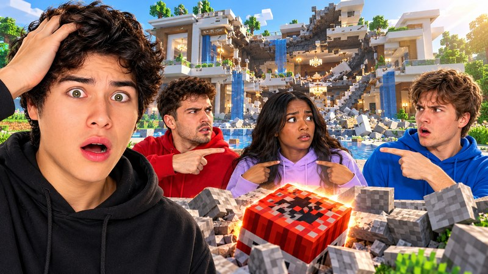

The crew investigates a ruined shared mansion and reconstructs which friend's actions caused the damage.

Later game expansion · Minecraft

- **0 (First Frame)–5s:** Alan foreground shocked, enormous broken Minecraft mansion, three adult crew suspects and a glowing TNT clue.

- **5s–15s:** Identify the responsible player and recover the hidden keepsake. A performed custom-map mystery, equal clue access and visible event timeline.

- **15s–30s:** The most obvious suspect's equipment could not have triggered the recorded destruction. Show the crew choosing its next move.

**Why this idea:** Shape: Who Destroyed Our [GAME] [SUBJECT]?. Ingredients: Minecraft, mansion, mystery. Combined package: Who Destroyed Our Minecraft Mansion?. Adapt the main-channel mystery format without hinging on game property values or twin identity.

**Shape evidence:**

- [Preston was MURDERED!!](https://www.youtube.com/watch?v=TqmKbXNslgs) — Brianna · 2022-10-09 · family · 7,092,776 views · 7.63× reported lift. Same title/premise family: Preston was MURDERED!!. Game, cast and execution transfer remains a hypothesis; this source does not validate the new episode outcome. Window: lifetime through source snapshot. [Metric source](https://majieddd.github.io/influint-channels-public/channels/UCXg4rJUbDP1IP3TmZ9KDpJg.html).

- [MrBeast Was Murdered..](https://www.youtube.com/watch?v=Vhlwk1HcFdI) — Stokes Twins · 2024-12-19 · family · 207,198,706 views · 1.77× reported lift. Same title/premise family: MrBeast Was Murdered... Game, cast and execution transfer remains a hypothesis; this source does not validate the new episode outcome. Window: lifetime through source snapshot. [Metric source](https://majieddd.github.io/influint-channels-public/channels/UCbp9MyKCTEww4CxEzc_Tp0Q.html).

- [Ben Azelart Was MURDERED!](https://www.youtube.com/watch?v=KKbyAUqlpCQ) — Brianna · 2024-01-21 · family · 10,936,574 views · 6.04× reported lift. Same title/premise family: Ben Azelart Was MURDERED!. Game, cast and execution transfer remains a hypothesis; this source does not validate the new episode outcome. Window: lifetime through source snapshot. [Metric source](https://majieddd.github.io/influint-channels-public/channels/UCXg4rJUbDP1IP3TmZ9KDpJg.html).

- [Unspeakable was MURDERED](https://www.youtube.com/watch?v=B5U3HYunkJc) — Brianna · 2023-01-08 · family · 7,003,151 views · 3.64× reported lift. Same title/premise family: Unspeakable was MURDERED. Game, cast and execution transfer remains a hypothesis; this source does not validate the new episode outcome. Window: lifetime through source snapshot. [Metric source](https://majieddd.github.io/influint-channels-public/channels/UCXg4rJUbDP1IP3TmZ9KDpJg.html).

**Ingredient evidence:**

- [I FOUND PRESTON'S SECRET MINECRAFT HOUSE!](https://www.youtube.com/watch?v=1tlqVLYR9aM) — Brianna · 2019-01-19 · family · 20,172,457 views · 6.78× reported lift. Same concrete ingredient mansion: I FOUND PRESTON'S SECRET MINECRAFT HOUSE!. Game, cast and execution transfer remains a hypothesis; this source does not validate the new episode outcome. Window: lifetime through source snapshot. [Metric source](https://majieddd.github.io/influint-channels-public/channels/UCXg4rJUbDP1IP3TmZ9KDpJg.html).

- [If You Build a House, I'll Pay For It!](https://www.youtube.com/watch?v=xN8ENrfE-TY) — MrBeast Gaming · 2021-01-02 · family · 249,642,469 views · 5.38× reported lift. Same concrete ingredient mansion: If You Build a House, I'll Pay For It!. Game, cast and execution transfer remains a hypothesis; this source does not validate the new episode outcome. Window: lifetime through source snapshot. [Metric source](https://majieddd.github.io/influint-channels-public/channels/UCIPPMRA040LQr5QPyJEbmXA.html).

- [I Turned My House Into a Waterpark!](https://www.youtube.com/watch?v=WthL6_K8Kys) — Unspeakable · 2024-08-24 · family · 20,543,332 views · 4.23× reported lift. Same concrete ingredient mansion: I Turned My House Into a Waterpark!. Game, cast and execution transfer remains a hypothesis; this source does not validate the new episode outcome. Window: lifetime through source snapshot. [Metric source](https://majieddd.github.io/influint-channels-public/channels/UCwIWAbIeu0xI0ReKWOcw3eg.html).

- [I Found the HOUSE HEAD in Minecraft…](https://www.youtube.com/watch?v=JCy5R45b7k0) — PrestonPlayz · 2026-08-29 · family · 4,665,662 views · 2.38× reported lift. Same concrete ingredient mansion: I Found the HOUSE HEAD in Minecraft…. Game, cast and execution transfer remains a hypothesis; this source does not validate the new episode outcome. Window: Source says lifetime; row says 28d; unresolved. [Metric source](https://majieddd.github.io/influint-channels-public/channels/UCJZam2u1G0syq3kyqrCXrNw.html).

Evidence gaps: Shape: 1/2 qualifying outlier channels in the verified public pool; adjacent precedents remain proposals, not replication.

**Objective:** Identify the responsible player and recover the hidden keepsake.

**Rules:** A performed custom-map mystery, equal clue access and visible event timeline; no accusations about real unfilmed behavior.

**Escalation:** A familiar tool looks incriminating, a redstone clue changes the sequence and the last intact room reveals the motive.

**Payoff:** Replay the actual mechanism and give the keepsake back to the crew.

**Gamer reward:** The environment creates ingenious hiding places and methods, explained when they matter.

**Non-gamer reward:** A victim, suspects, clues and a fair reveal work as a human mystery.

**People:** An ensemble of investigators, suspects and a victim; Alan/Alex may take any of those roles.

**Production:** Reusable custom challenge · $3,400–$7,500 · authored incremental allowance.

**Dependencies:** Scripted/performed scenes and multiple capture angles; clearly distinguish authored comedy from competitive outcomes. Verify the exact edition, map, mod license and working mechanics; GTA-system reuse does not imply Minecraft support.

**Thumbnail:** Alan foreground shocked, enormous broken Minecraft mansion, three adult crew suspects and a glowing TNT clue.

Composition reference: [MrBeast Was Murdered..](https://www.youtube.com/watch?v=Vhlwk1HcFdI).

[Original PNG](generated-thumbnails/055.png) · [Exact image prompt](prompts/055.txt)

### Format 12 — Pranks that change the mission

One host secretly adds a meaningful difficulty every minute while the whole crew attempts an ordinary, easy-to-understand goal; viewers see the cause before the crew realizes the prank.

Title family: I Secretly Made ___ Harder Every ___

Retained with the user’s exact title and whole-crew prank direction.

#### Idea 056 — I Secretly Made GTA Harder Every Minute

One host secretly adds a meaningful obstacle each minute while the whole crew attempts an ordinary delivery.

GTA 5 launch / follow-up · GTA 5

- **0 (First Frame)–5s:** Alan shushing at left with one large red difficulty lever, Alex and two varied adult crew in a tiny car facing a giant road obstacle; HARDER.

- **5s–15s:** Deliver one marked package while unknowingly facing the growing prank. Actual minute triggers and one fixed mission.

- **15s–30s:** The crew notices a suddenly blocked road but blames its route choice. Show the crew choosing its next move.

**Why this idea:** Shape: I Secretly Made [GAME] Harder Every Minute. Ingredients: prank, GTA, harder. Combined package: I Secretly Made GTA Harder Every Minute. Keep Stokes prank energy while targeting the entire crew.

**Shape evidence:**

- [Minecraft, But Every Minute There's Random Chaos!](https://www.youtube.com/watch?v=D1eZybtieJM) — MrBeast Gaming · 2020-11-19 · family · 77,561,333 views · 2.05× reported lift. Same title/premise family: Minecraft, But Every Minute There's Random Chaos!. Game, cast and execution transfer remains a hypothesis; this source does not validate the new episode outcome. Window: lifetime through source snapshot. [Metric source](https://majieddd.github.io/influint-channels-public/channels/UCIPPMRA040LQr5QPyJEbmXA.html).

- [Every Minute COCA-COLA Rises Higher In Minecraft!](https://www.youtube.com/watch?v=dy1Pgbvmdfg) — PrestonPlayz · 2026-07-09 · family · 2,925,855 views · 1.11× reported lift. Same title/premise family: Every Minute COCA-COLA Rises Higher In Minecraft!. Game, cast and execution transfer remains a hypothesis; this source does not validate the new episode outcome. Window: lifetime through source snapshot. [Metric source](https://majieddd.github.io/influint-channels-public/channels/UCJZam2u1G0syq3kyqrCXrNw.html).

- [100 Players, But Lava Rises Every Minute!](https://www.youtube.com/watch?v=TU99gX7NGZ8) — MrBeast Gaming · 2020-11-27 · family · 73,449,855 views · 1.88× reported lift. Same title/premise family: 100 Players, But Lava Rises Every Minute!. Game, cast and execution transfer remains a hypothesis; this source does not validate the new episode outcome. Window: lifetime through source snapshot. [Metric source](https://majieddd.github.io/influint-channels-public/channels/UCIPPMRA040LQr5QPyJEbmXA.html).

- [$1,000 Every Minute You Survive](https://www.youtube.com/watch?v=usGPK2hHomI) — MrBeast Gaming · 2025-08-09 · family · 20,496,918 views · 0.64× reported lift. Same title/premise family: $1,000 Every Minute You Survive. Game, cast and execution transfer remains a hypothesis; this source does not validate the new episode outcome. Window: lifetime through source snapshot. [Metric source](https://majieddd.github.io/influint-channels-public/channels/UCIPPMRA040LQr5QPyJEbmXA.html).

**Ingredient evidence:**

- [100 Pranks on Preston in 24 Hours! *REVENGE*](https://www.youtube.com/watch?v=ya5Ehhltcpw) — Brianna · 2023-12-03 · family · 8,781,789 views · 5.44× reported lift. Same concrete ingredient prank: 100 Pranks on Preston in 24 Hours! *REVENGE*. Game, cast and execution transfer remains a hypothesis; this source does not validate the new episode outcome. Window: lifetime through source snapshot. [Metric source](https://majieddd.github.io/influint-channels-public/channels/UCXg4rJUbDP1IP3TmZ9KDpJg.html).

- [Prisoner Drive Thru Prank](https://www.youtube.com/watch?v=nuK7e1xzThc) — Stokes Twins · 2019-08-18 · family · 25,610,924 views · 2.94× reported lift. Same concrete ingredient prank: Prisoner Drive Thru Prank. Game, cast and execution transfer remains a hypothesis; this source does not validate the new episode outcome. Window: lifetime through source snapshot. [Metric source](https://majieddd.github.io/influint-channels-public/channels/UCbp9MyKCTEww4CxEzc_Tp0Q.html).

- [I Built Satisfying Traps to Prank My Friends](https://www.youtube.com/watch?v=He-6IxLgr74) — PrestonPlayz · 2025-06-28 · family · 5,816,216 views · 0.91× reported lift. Same concrete ingredient prank: I Built Satisfying Traps to Prank My Friends. Game, cast and execution transfer remains a hypothesis; this source does not validate the new episode outcome. Window: lifetime through source snapshot. [Metric source](https://majieddd.github.io/influint-channels-public/channels/UCJZam2u1G0syq3kyqrCXrNw.html).

- [1,000 PRANKS IN 24 HOURS!!](https://www.youtube.com/watch?v=S3unAsfCFSs) — Brianna · 2024-03-17 · family · 4,725,931 views · 5.39× reported lift. Same concrete ingredient prank: 1,000 PRANKS IN 24 HOURS!!. Game, cast and execution transfer remains a hypothesis; this source does not validate the new episode outcome. Window: lifetime through source snapshot. [Metric source](https://majieddd.github.io/influint-channels-public/channels/UCXg4rJUbDP1IP3TmZ9KDpJg.html).

Evidence gaps: Shape: 1/2 qualifying outlier channels in the verified public pool; adjacent precedents remain proposals, not replication.

**Objective:** Deliver one marked package while unknowingly facing the growing prank.

**Rules:** Actual minute triggers and one fixed mission; audience sees the changes, crew reactions are unscripted and retries are defined.

**Escalation:** Traffic thickens, weather changes and the final route becomes an absurd obstacle course.

**Payoff:** Resolve the delivery first, then reveal the operator and replay the crew's missed clues.

**Gamer reward:** Players recognize the escalating obstacles and enjoy clever responses.

**Non-gamer reward:** Dramatic irony, growing frustration and the reveal create a prank story.

**People:** One concealed prank operator, several unaware crew participants and recorded reactions from everyone.

**Production:** Reuse a tested world · $1,650–$3,600 · authored incremental allowance.

**Dependencies:** Reversible, rehearsed difficulty effects and visible cause-and-effect. The audience understands the secret; the final reveal and crew reaction are the payoff.

**Thumbnail:** Alan shushing at left with one large red difficulty lever, Alex and two varied adult crew in a tiny car facing a giant road obstacle; HARDER.

Composition reference: [365 PRANKS IN 365 DAYS!!](https://www.youtube.com/watch?v=5ZX_eypUHns).

[Original PNG](generated-thumbnails/056.png) · [Exact image prompt](higgsfield-prompts/056.txt)

#### Idea 057 — I Secretly Made My Friends' GTA Cars Worse

The host quietly degrades the crew's vehicles between matched tests until they work out why their race keeps collapsing.

GTA 5 launch / follow-up · GTA 5

- **0 (First Frame)–5s:** Alan shushing with controller left, Alex beside a red supercar visibly shrinking into a battered tiny car right.

- **5s–15s:** Finish the race and identify the cause of the worsening cars. One disclosed post-reveal mod setup, changes only between tests and no fake reaction takes.

- **15s–30s:** The first driver complains about acceleration even though the car looks unchanged. Show the crew choosing its next move.

**Why this idea:** Shape: I Secretly Made My Friends' [GAME] [SUBJECT] Worse. Ingredients: prank, car, GTA. Combined package: I Secretly Made My Friends' GTA Cars Worse. Keep Stokes prank energy while targeting the entire crew.

**Shape evidence:**

- [Minecraft, But Every Minute There's Random Chaos!](https://www.youtube.com/watch?v=D1eZybtieJM) — MrBeast Gaming · 2020-11-19 · family · 77,561,333 views · 2.05× reported lift. Same title/premise family: Minecraft, But Every Minute There's Random Chaos!. Game, cast and execution transfer remains a hypothesis; this source does not validate the new episode outcome. Window: lifetime through source snapshot. [Metric source](https://majieddd.github.io/influint-channels-public/channels/UCIPPMRA040LQr5QPyJEbmXA.html).

- [Every Minute COCA-COLA Rises Higher In Minecraft!](https://www.youtube.com/watch?v=dy1Pgbvmdfg) — PrestonPlayz · 2026-07-09 · family · 2,925,855 views · 1.11× reported lift. Same title/premise family: Every Minute COCA-COLA Rises Higher In Minecraft!. Game, cast and execution transfer remains a hypothesis; this source does not validate the new episode outcome. Window: lifetime through source snapshot. [Metric source](https://majieddd.github.io/influint-channels-public/channels/UCJZam2u1G0syq3kyqrCXrNw.html).

- [100 Players, But Lava Rises Every Minute!](https://www.youtube.com/watch?v=TU99gX7NGZ8) — MrBeast Gaming · 2020-11-27 · family · 73,449,855 views · 1.88× reported lift. Same title/premise family: 100 Players, But Lava Rises Every Minute!. Game, cast and execution transfer remains a hypothesis; this source does not validate the new episode outcome. Window: lifetime through source snapshot. [Metric source](https://majieddd.github.io/influint-channels-public/channels/UCIPPMRA040LQr5QPyJEbmXA.html).

- [$1,000 Every Minute You Survive](https://www.youtube.com/watch?v=usGPK2hHomI) — MrBeast Gaming · 2025-08-09 · family · 20,496,918 views · 0.64× reported lift. Same title/premise family: $1,000 Every Minute You Survive. Game, cast and execution transfer remains a hypothesis; this source does not validate the new episode outcome. Window: lifetime through source snapshot. [Metric source](https://majieddd.github.io/influint-channels-public/channels/UCIPPMRA040LQr5QPyJEbmXA.html).

**Ingredient evidence:**

- [100 Pranks on Preston in 24 Hours! *REVENGE*](https://www.youtube.com/watch?v=ya5Ehhltcpw) — Brianna · 2023-12-03 · family · 8,781,789 views · 5.44× reported lift. Same concrete ingredient prank: 100 Pranks on Preston in 24 Hours! *REVENGE*. Game, cast and execution transfer remains a hypothesis; this source does not validate the new episode outcome. Window: lifetime through source snapshot. [Metric source](https://majieddd.github.io/influint-channels-public/channels/UCXg4rJUbDP1IP3TmZ9KDpJg.html).

- [Prisoner Drive Thru Prank](https://www.youtube.com/watch?v=nuK7e1xzThc) — Stokes Twins · 2019-08-18 · family · 25,610,924 views · 2.94× reported lift. Same concrete ingredient prank: Prisoner Drive Thru Prank. Game, cast and execution transfer remains a hypothesis; this source does not validate the new episode outcome. Window: lifetime through source snapshot. [Metric source](https://majieddd.github.io/influint-channels-public/channels/UCbp9MyKCTEww4CxEzc_Tp0Q.html).

- [I Built Satisfying Traps to Prank My Friends](https://www.youtube.com/watch?v=He-6IxLgr74) — PrestonPlayz · 2025-06-28 · family · 5,816,216 views · 0.91× reported lift. Same concrete ingredient prank: I Built Satisfying Traps to Prank My Friends. Game, cast and execution transfer remains a hypothesis; this source does not validate the new episode outcome. Window: lifetime through source snapshot. [Metric source](https://majieddd.github.io/influint-channels-public/channels/UCJZam2u1G0syq3kyqrCXrNw.html).

- [1,000 PRANKS IN 24 HOURS!!](https://www.youtube.com/watch?v=S3unAsfCFSs) — Brianna · 2024-03-17 · family · 4,725,931 views · 5.39× reported lift. Same concrete ingredient prank: 1,000 PRANKS IN 24 HOURS!!. Game, cast and execution transfer remains a hypothesis; this source does not validate the new episode outcome. Window: lifetime through source snapshot. [Metric source](https://majieddd.github.io/influint-channels-public/channels/UCXg4rJUbDP1IP3TmZ9KDpJg.html).

Evidence gaps: Shape: 1/2 qualifying outlier channels in the verified public pool; adjacent precedents remain proposals, not replication.

**Objective:** Finish the race and identify the cause of the worsening cars.

**Rules:** One disclosed post-reveal mod setup, changes only between tests and no fake reaction takes; record the alteration log.

**Escalation:** A slow engine becomes bad handling and the final tiny-car swap makes the pattern hard to ignore.

**Payoff:** Reveal the actual change sequence and let the crew demand one fair rematch.

**Gamer reward:** Players recognize the escalating obstacles and enjoy clever responses.

**Non-gamer reward:** Dramatic irony, growing frustration and the reveal create a prank story.

**People:** One concealed prank operator, several unaware crew participants and recorded reactions from everyone.

**Production:** Reuse a tested world · $1,650–$3,600 · authored incremental allowance.

**Dependencies:** Reversible, rehearsed difficulty effects and visible cause-and-effect. The audience understands the secret; the final reveal and crew reaction are the payoff.

**Thumbnail:** Alan shushing with controller left, Alex beside a red supercar visibly shrinking into a battered tiny car right.

Composition reference: [365 PRANKS IN 365 DAYS!!](https://www.youtube.com/watch?v=5ZX_eypUHns).

[Original PNG](generated-thumbnails/057.png) · [Exact image prompt](higgsfield-prompts/057.txt)

#### Idea 058 — I Secretly Shrunk Our GTA World Every Minute

The host reduces the playable space while the crew tries to finish a scavenger delivery across the city.

GTA 5 launch / follow-up · GTA 5

- **0 (First Frame)–5s:** Alan shushing left, tiny GTA city island compressing inside giant glowing red walls, surprised crew car in the center.

- **5s–15s:** Collect three marked objects and reach the finish before the space closes. Timed boundary changes shown to viewers, collisions tested and one visible final goal.

- **15s–30s:** The crew's familiar shortcut now ends at an unexplained wall. Show the crew choosing its next move.

**Why this idea:** Shape: I Secretly Shrunk Our [GAME] [SUBJECT] Every Minute. Ingredients: prank, world, GTA. Combined package: I Secretly Shrunk Our GTA World Every Minute. Keep Stokes prank energy while targeting the entire crew.

**Shape evidence:**

- [Minecraft, But Every Minute There's Random Chaos!](https://www.youtube.com/watch?v=D1eZybtieJM) — MrBeast Gaming · 2020-11-19 · family · 77,561,333 views · 2.05× reported lift. Same title/premise family: Minecraft, But Every Minute There's Random Chaos!. Game, cast and execution transfer remains a hypothesis; this source does not validate the new episode outcome. Window: lifetime through source snapshot. [Metric source](https://majieddd.github.io/influint-channels-public/channels/UCIPPMRA040LQr5QPyJEbmXA.html).

- [Every Minute COCA-COLA Rises Higher In Minecraft!](https://www.youtube.com/watch?v=dy1Pgbvmdfg) — PrestonPlayz · 2026-07-09 · family · 2,925,855 views · 1.11× reported lift. Same title/premise family: Every Minute COCA-COLA Rises Higher In Minecraft!. Game, cast and execution transfer remains a hypothesis; this source does not validate the new episode outcome. Window: lifetime through source snapshot. [Metric source](https://majieddd.github.io/influint-channels-public/channels/UCJZam2u1G0syq3kyqrCXrNw.html).

- [100 Players, But Lava Rises Every Minute!](https://www.youtube.com/watch?v=TU99gX7NGZ8) — MrBeast Gaming · 2020-11-27 · family · 73,449,855 views · 1.88× reported lift. Same title/premise family: 100 Players, But Lava Rises Every Minute!. Game, cast and execution transfer remains a hypothesis; this source does not validate the new episode outcome. Window: lifetime through source snapshot. [Metric source](https://majieddd.github.io/influint-channels-public/channels/UCIPPMRA040LQr5QPyJEbmXA.html).

- [$1,000 Every Minute You Survive](https://www.youtube.com/watch?v=usGPK2hHomI) — MrBeast Gaming · 2025-08-09 · family · 20,496,918 views · 0.64× reported lift. Same title/premise family: $1,000 Every Minute You Survive. Game, cast and execution transfer remains a hypothesis; this source does not validate the new episode outcome. Window: lifetime through source snapshot. [Metric source](https://majieddd.github.io/influint-channels-public/channels/UCIPPMRA040LQr5QPyJEbmXA.html).

**Ingredient evidence:**

- [100 Pranks on Preston in 24 Hours! *REVENGE*](https://www.youtube.com/watch?v=ya5Ehhltcpw) — Brianna · 2023-12-03 · family · 8,781,789 views · 5.44× reported lift. Same concrete ingredient prank: 100 Pranks on Preston in 24 Hours! *REVENGE*. Game, cast and execution transfer remains a hypothesis; this source does not validate the new episode outcome. Window: lifetime through source snapshot. [Metric source](https://majieddd.github.io/influint-channels-public/channels/UCXg4rJUbDP1IP3TmZ9KDpJg.html).

- [Prisoner Drive Thru Prank](https://www.youtube.com/watch?v=nuK7e1xzThc) — Stokes Twins · 2019-08-18 · family · 25,610,924 views · 2.94× reported lift. Same concrete ingredient prank: Prisoner Drive Thru Prank. Game, cast and execution transfer remains a hypothesis; this source does not validate the new episode outcome. Window: lifetime through source snapshot. [Metric source](https://majieddd.github.io/influint-channels-public/channels/UCbp9MyKCTEww4CxEzc_Tp0Q.html).

- [I Built Satisfying Traps to Prank My Friends](https://www.youtube.com/watch?v=He-6IxLgr74) — PrestonPlayz · 2025-06-28 · family · 5,816,216 views · 0.91× reported lift. Same concrete ingredient prank: I Built Satisfying Traps to Prank My Friends. Game, cast and execution transfer remains a hypothesis; this source does not validate the new episode outcome. Window: lifetime through source snapshot. [Metric source](https://majieddd.github.io/influint-channels-public/channels/UCJZam2u1G0syq3kyqrCXrNw.html).

- [1,000 PRANKS IN 24 HOURS!!](https://www.youtube.com/watch?v=S3unAsfCFSs) — Brianna · 2024-03-17 · family · 4,725,931 views · 5.39× reported lift. Same concrete ingredient prank: 1,000 PRANKS IN 24 HOURS!!. Game, cast and execution transfer remains a hypothesis; this source does not validate the new episode outcome. Window: lifetime through source snapshot. [Metric source](https://majieddd.github.io/influint-channels-public/channels/UCXg4rJUbDP1IP3TmZ9KDpJg.html).

Evidence gaps: Shape: 1/2 qualifying outlier channels in the verified public pool; adjacent precedents remain proposals, not replication.

**Objective:** Collect three marked objects and reach the finish before the space closes.

**Rules:** Timed boundary changes shown to viewers, collisions tested and one visible final goal; do not secretly undo a genuine failure.

**Escalation:** A shortcut disappears, teammates separate and the last shrinking block forces a hard route decision.

**Payoff:** Resolve the mission and show the full overhead change log during the reveal.

**Gamer reward:** Players recognize the escalating obstacles and enjoy clever responses.

**Non-gamer reward:** Dramatic irony, growing frustration and the reveal create a prank story.

**People:** One concealed prank operator, several unaware crew participants and recorded reactions from everyone.

**Production:** Reuse a tested world · $1,650–$3,600 · authored incremental allowance.

**Dependencies:** Reversible, rehearsed difficulty effects and visible cause-and-effect. The audience understands the secret; the final reveal and crew reaction are the payoff.

**Thumbnail:** Alan shushing left, tiny GTA city island compressing inside giant glowing red walls, surprised crew car in the center.

Composition reference: [365 PRANKS IN 365 DAYS!!](https://www.youtube.com/watch?v=5ZX_eypUHns).

[Original PNG](generated-thumbnails/058.png) · [Exact image prompt](higgsfield-prompts/058.txt)

#### Idea 059 — I Secretly Made GTA Flood While My Friends Played

The crew attempts a normal city errand as a hidden operator raises the water in timed stages.

GTA 5 launch / follow-up · GTA 5

- **0 (First Frame)–5s:** Alan shushing with a large red water valve left, Alex surprised in a red car half-submerged in vivid blue city water right.

- **5s–15s:** Deliver the errand item and work out the strange changes. Actual staged water triggers and tested exit routes, game-only effect.

- **15s–30s:** The crew drives through its first shallow puddle and dismisses the warning. Show the crew choosing its next move.

**Why this idea:** Shape: I Secretly Made [GAME] Flood While My Friends Played. Ingredients: prank, flood, GTA. Combined package: I Secretly Made GTA Flood While My Friends Played. Keep Stokes prank energy while targeting the entire crew.

**Shape evidence:**

- [Minecraft, But Every Minute There's Random Chaos!](https://www.youtube.com/watch?v=D1eZybtieJM) — MrBeast Gaming · 2020-11-19 · family · 77,561,333 views · 2.05× reported lift. Same title/premise family: Minecraft, But Every Minute There's Random Chaos!. Game, cast and execution transfer remains a hypothesis; this source does not validate the new episode outcome. Window: lifetime through source snapshot. [Metric source](https://majieddd.github.io/influint-channels-public/channels/UCIPPMRA040LQr5QPyJEbmXA.html).

- [Every Minute COCA-COLA Rises Higher In Minecraft!](https://www.youtube.com/watch?v=dy1Pgbvmdfg) — PrestonPlayz · 2026-07-09 · family · 2,925,855 views · 1.11× reported lift. Same title/premise family: Every Minute COCA-COLA Rises Higher In Minecraft!. Game, cast and execution transfer remains a hypothesis; this source does not validate the new episode outcome. Window: lifetime through source snapshot. [Metric source](https://majieddd.github.io/influint-channels-public/channels/UCJZam2u1G0syq3kyqrCXrNw.html).

- [100 Players, But Lava Rises Every Minute!](https://www.youtube.com/watch?v=TU99gX7NGZ8) — MrBeast Gaming · 2020-11-27 · family · 73,449,855 views · 1.88× reported lift. Same title/premise family: 100 Players, But Lava Rises Every Minute!. Game, cast and execution transfer remains a hypothesis; this source does not validate the new episode outcome. Window: lifetime through source snapshot. [Metric source](https://majieddd.github.io/influint-channels-public/channels/UCIPPMRA040LQr5QPyJEbmXA.html).

- [$1,000 Every Minute You Survive](https://www.youtube.com/watch?v=usGPK2hHomI) — MrBeast Gaming · 2025-08-09 · family · 20,496,918 views · 0.64× reported lift. Same title/premise family: $1,000 Every Minute You Survive. Game, cast and execution transfer remains a hypothesis; this source does not validate the new episode outcome. Window: lifetime through source snapshot. [Metric source](https://majieddd.github.io/influint-channels-public/channels/UCIPPMRA040LQr5QPyJEbmXA.html).

**Ingredient evidence:**

- [100 Pranks on Preston in 24 Hours! *REVENGE*](https://www.youtube.com/watch?v=ya5Ehhltcpw) — Brianna · 2023-12-03 · family · 8,781,789 views · 5.44× reported lift. Same concrete ingredient prank: 100 Pranks on Preston in 24 Hours! *REVENGE*. Game, cast and execution transfer remains a hypothesis; this source does not validate the new episode outcome. Window: lifetime through source snapshot. [Metric source](https://majieddd.github.io/influint-channels-public/channels/UCXg4rJUbDP1IP3TmZ9KDpJg.html).

- [Prisoner Drive Thru Prank](https://www.youtube.com/watch?v=nuK7e1xzThc) — Stokes Twins · 2019-08-18 · family · 25,610,924 views · 2.94× reported lift. Same concrete ingredient prank: Prisoner Drive Thru Prank. Game, cast and execution transfer remains a hypothesis; this source does not validate the new episode outcome. Window: lifetime through source snapshot. [Metric source](https://majieddd.github.io/influint-channels-public/channels/UCbp9MyKCTEww4CxEzc_Tp0Q.html).

- [I Built Satisfying Traps to Prank My Friends](https://www.youtube.com/watch?v=He-6IxLgr74) — PrestonPlayz · 2025-06-28 · family · 5,816,216 views · 0.91× reported lift. Same concrete ingredient prank: I Built Satisfying Traps to Prank My Friends. Game, cast and execution transfer remains a hypothesis; this source does not validate the new episode outcome. Window: lifetime through source snapshot. [Metric source](https://majieddd.github.io/influint-channels-public/channels/UCJZam2u1G0syq3kyqrCXrNw.html).

- [1,000 PRANKS IN 24 HOURS!!](https://www.youtube.com/watch?v=S3unAsfCFSs) — Brianna · 2024-03-17 · family · 4,725,931 views · 5.39× reported lift. Same concrete ingredient prank: 1,000 PRANKS IN 24 HOURS!!. Game, cast and execution transfer remains a hypothesis; this source does not validate the new episode outcome. Window: lifetime through source snapshot. [Metric source](https://majieddd.github.io/influint-channels-public/channels/UCXg4rJUbDP1IP3TmZ9KDpJg.html).

Evidence gaps: Shape: 1/2 qualifying outlier channels in the verified public pool; adjacent precedents remain proposals, not replication.

**Objective:** Deliver the errand item and work out the strange changes.

**Rules:** Actual staged water triggers and tested exit routes, game-only effect; audience sees cause before reaction.

**Escalation:** Wet streets become abandoned cars, a boat becomes necessary and the final clue exposes the prank.

**Payoff:** Finish or fail the errand honestly, then show the operator's full sequence.

**Gamer reward:** Players recognize the escalating obstacles and enjoy clever responses.

**Non-gamer reward:** Dramatic irony, growing frustration and the reveal create a prank story.

**People:** One concealed prank operator, several unaware crew participants and recorded reactions from everyone.

**Production:** Reuse a tested world · $1,650–$3,600 · authored incremental allowance.

**Dependencies:** Reversible, rehearsed difficulty effects and visible cause-and-effect. The audience understands the secret; the final reveal and crew reaction are the payoff.

**Thumbnail:** Alan shushing with a large red water valve left, Alex surprised in a red car half-submerged in vivid blue city water right.

Composition reference: [365 PRANKS IN 365 DAYS!!](https://www.youtube.com/watch?v=5ZX_eypUHns).

[Original PNG](generated-thumbnails/059.png) · [Exact image prompt](higgsfield-prompts/059.txt)

#### Idea 060 — I Secretly Made Minecraft Harder Every Minute

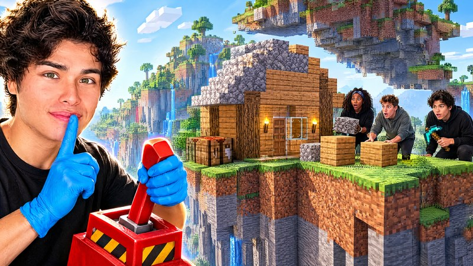

The host adds a new meaningful difficulty each minute while friends try to finish one ordinary house.

Later game expansion · Minecraft

- **0 (First Frame)–5s:** Alan shushing with a red lever, Alex and adult crew building a small Minecraft house as the land rises into impossible cliffs.

- **5s–15s:** Finish the house and survive its first night despite the hidden changes. Working custom rules recorded in a trigger log, fixed build brief and no secret creative-mode repairs.

- **15s–30s:** A familiar material disappears from the crew's supply chest. Show the crew choosing its next move.

**Why this idea:** Shape: I Secretly Made [GAME] Harder Every Minute. Ingredients: prank, Minecraft, harder. Combined package: I Secretly Made Minecraft Harder Every Minute. Keep Stokes prank energy while targeting the entire crew.

**Shape evidence:**

- [Minecraft, But Every Minute There's Random Chaos!](https://www.youtube.com/watch?v=D1eZybtieJM) — MrBeast Gaming · 2020-11-19 · family · 77,561,333 views · 2.05× reported lift. Same title/premise family: Minecraft, But Every Minute There's Random Chaos!. Game, cast and execution transfer remains a hypothesis; this source does not validate the new episode outcome. Window: lifetime through source snapshot. [Metric source](https://majieddd.github.io/influint-channels-public/channels/UCIPPMRA040LQr5QPyJEbmXA.html).

- [Every Minute COCA-COLA Rises Higher In Minecraft!](https://www.youtube.com/watch?v=dy1Pgbvmdfg) — PrestonPlayz · 2026-07-09 · family · 2,925,855 views · 1.11× reported lift. Same title/premise family: Every Minute COCA-COLA Rises Higher In Minecraft!. Game, cast and execution transfer remains a hypothesis; this source does not validate the new episode outcome. Window: lifetime through source snapshot. [Metric source](https://majieddd.github.io/influint-channels-public/channels/UCJZam2u1G0syq3kyqrCXrNw.html).

- [100 Players, But Lava Rises Every Minute!](https://www.youtube.com/watch?v=TU99gX7NGZ8) — MrBeast Gaming · 2020-11-27 · family · 73,449,855 views · 1.88× reported lift. Same title/premise family: 100 Players, But Lava Rises Every Minute!. Game, cast and execution transfer remains a hypothesis; this source does not validate the new episode outcome. Window: lifetime through source snapshot. [Metric source](https://majieddd.github.io/influint-channels-public/channels/UCIPPMRA040LQr5QPyJEbmXA.html).

- [$1,000 Every Minute You Survive](https://www.youtube.com/watch?v=usGPK2hHomI) — MrBeast Gaming · 2025-08-09 · family · 20,496,918 views · 0.64× reported lift. Same title/premise family: $1,000 Every Minute You Survive. Game, cast and execution transfer remains a hypothesis; this source does not validate the new episode outcome. Window: lifetime through source snapshot. [Metric source](https://majieddd.github.io/influint-channels-public/channels/UCIPPMRA040LQr5QPyJEbmXA.html).

**Ingredient evidence:**

- [100 Pranks on Preston in 24 Hours! *REVENGE*](https://www.youtube.com/watch?v=ya5Ehhltcpw) — Brianna · 2023-12-03 · family · 8,781,789 views · 5.44× reported lift. Same concrete ingredient prank: 100 Pranks on Preston in 24 Hours! *REVENGE*. Game, cast and execution transfer remains a hypothesis; this source does not validate the new episode outcome. Window: lifetime through source snapshot. [Metric source](https://majieddd.github.io/influint-channels-public/channels/UCXg4rJUbDP1IP3TmZ9KDpJg.html).

- [Prisoner Drive Thru Prank](https://www.youtube.com/watch?v=nuK7e1xzThc) — Stokes Twins · 2019-08-18 · family · 25,610,924 views · 2.94× reported lift. Same concrete ingredient prank: Prisoner Drive Thru Prank. Game, cast and execution transfer remains a hypothesis; this source does not validate the new episode outcome. Window: lifetime through source snapshot. [Metric source](https://majieddd.github.io/influint-channels-public/channels/UCbp9MyKCTEww4CxEzc_Tp0Q.html).

- [I Built Satisfying Traps to Prank My Friends](https://www.youtube.com/watch?v=He-6IxLgr74) — PrestonPlayz · 2025-06-28 · family · 5,816,216 views · 0.91× reported lift. Same concrete ingredient prank: I Built Satisfying Traps to Prank My Friends. Game, cast and execution transfer remains a hypothesis; this source does not validate the new episode outcome. Window: lifetime through source snapshot. [Metric source](https://majieddd.github.io/influint-channels-public/channels/UCJZam2u1G0syq3kyqrCXrNw.html).

- [1,000 PRANKS IN 24 HOURS!!](https://www.youtube.com/watch?v=S3unAsfCFSs) — Brianna · 2024-03-17 · family · 4,725,931 views · 5.39× reported lift. Same concrete ingredient prank: 1,000 PRANKS IN 24 HOURS!!. Game, cast and execution transfer remains a hypothesis; this source does not validate the new episode outcome. Window: lifetime through source snapshot. [Metric source](https://majieddd.github.io/influint-channels-public/channels/UCXg4rJUbDP1IP3TmZ9KDpJg.html).

Evidence gaps: Shape: 1/2 qualifying outlier channels in the verified public pool; adjacent precedents remain proposals, not replication.

**Objective:** Finish the house and survive its first night despite the hidden changes.

**Rules:** Working custom rules recorded in a trigger log, fixed build brief and no secret creative-mode repairs.

**Escalation:** Missing resources become changing terrain and the final night forces the crew to use its unfinished home.

**Payoff:** Test the completed or incomplete house and reveal the operator after the outcome.

**Gamer reward:** Players recognize the escalating obstacles and enjoy clever responses.

**Non-gamer reward:** Dramatic irony, growing frustration and the reveal create a prank story.

**People:** One concealed prank operator, several unaware crew participants and recorded reactions from everyone.

**Production:** Reuse a tested world · $1,650–$3,600 · authored incremental allowance.

**Dependencies:** Reversible, rehearsed difficulty effects and visible cause-and-effect. The audience understands the secret; the final reveal and crew reaction are the payoff. Verify the exact edition, map, mod license and working mechanics; GTA-system reuse does not imply Minecraft support.

**Thumbnail:** Alan shushing with a red lever, Alex and adult crew building a small Minecraft house as the land rises into impossible cliffs.

Composition reference: [365 PRANKS IN 365 DAYS!!](https://www.youtube.com/watch?v=5ZX_eypUHns).

[Original PNG](generated-thumbnails/060.png) · [Exact image prompt](higgsfield-prompts/060.txt)

### Format 13 — One day in an impossible job

A clear job produces escalating tasks, customers and a final performance test.

Title family: We Became The Worst ___ in ___

User-directed rewrite retained for review; the latest explicit retained-core list did not separately confirm 13.

#### Idea 061 — We Became The Worst Taxi Drivers in GTA

Crew drivers try to satisfy increasingly demanding game-world passengers while their terrible decisions build an escalating comedy story.

GTA 5 launch / follow-up · GTA 5

- **0 (First Frame)–5s:** Alan in a bright yellow taxi tilted on a GTA rooftop, Alex and a varied adult crew passenger staring in disbelief.

- **5s–15s:** Earn the best passenger score across three fixed rides. Crew performs passenger roles, identical base fares and visible route/comfort scoring.

- **15s–30s:** The first driver takes a jump shortcut that scares the passenger more than it saves time. Show the crew choosing its next move.

**Why this idea:** Shape: We Became The Worst [SUBJECT] in [GAME]. Ingredients: taxi, job, friends. Combined package: We Became The Worst Taxi Drivers in GTA. Cast-led job comedy. We reflects a group attempting the job rather than a twin-only setup.

**Shape evidence:**

- [I Became A Principal At The World's Strictest School!](https://www.youtube.com/watch?v=LJYkuCoTOKg) — Stokes Twins · 2026-04-24 · adjacent · 58,118,322 views · 1.58× reported lift. Adjacent format/cast/setting reference from the reviewed board; does not satisfy exact/family outlier coverage for this episode. Window: lifetime through source snapshot. [Metric source](https://majieddd.github.io/influint-channels-public/channels/UCbp9MyKCTEww4CxEzc_Tp0Q.html).

- [I Sent Preston Back to Minecraft School...](https://www.youtube.com/watch?v=_Fu97rtvJPw) — Brianna · 2020-09-09 · adjacent · 31,092,651 views · 9.46× reported lift. Adjacent format/cast/setting reference from the reviewed board; does not satisfy exact/family outlier coverage for this episode. Window: lifetime through source snapshot. [Metric source](https://majieddd.github.io/influint-channels-public/channels/UCXg4rJUbDP1IP3TmZ9KDpJg.html).

- [LIVING Like MY SIM For 24 HOURS! - Challenge](https://www.youtube.com/watch?v=MNqF0h6LJDI) — Brianna · 2019-04-26 · adjacent · 17,927,907 views · 4.58× reported lift. Adjacent format/cast/setting reference from the reviewed board; does not satisfy exact/family outlier coverage for this episode. Window: lifetime through source snapshot. [Metric source](https://majieddd.github.io/influint-channels-public/channels/UCXg4rJUbDP1IP3TmZ9KDpJg.html).

**Ingredient evidence:**

- [I Became A Principal At The World's Strictest School!](https://www.youtube.com/watch?v=LJYkuCoTOKg) — Stokes Twins · 2026-04-24 · adjacent · 58,118,322 views · 1.58× reported lift. Adjacent format/cast/setting reference from the reviewed board; does not satisfy exact/family outlier coverage for this episode. Window: lifetime through source snapshot. [Metric source](https://majieddd.github.io/influint-channels-public/channels/UCbp9MyKCTEww4CxEzc_Tp0Q.html).

- [I Sent Preston Back to Minecraft School...](https://www.youtube.com/watch?v=_Fu97rtvJPw) — Brianna · 2020-09-09 · adjacent · 31,092,651 views · 9.46× reported lift. Adjacent format/cast/setting reference from the reviewed board; does not satisfy exact/family outlier coverage for this episode. Window: lifetime through source snapshot. [Metric source](https://majieddd.github.io/influint-channels-public/channels/UCXg4rJUbDP1IP3TmZ9KDpJg.html).

- [LIVING Like MY SIM For 24 HOURS! - Challenge](https://www.youtube.com/watch?v=MNqF0h6LJDI) — Brianna · 2019-04-26 · adjacent · 17,927,907 views · 4.58× reported lift. Adjacent format/cast/setting reference from the reviewed board; does not satisfy exact/family outlier coverage for this episode. Window: lifetime through source snapshot. [Metric source](https://majieddd.github.io/influint-channels-public/channels/UCXg4rJUbDP1IP3TmZ9KDpJg.html).

Evidence gaps: Shape: 0/2 qualifying outlier channels in the verified public pool; adjacent precedents remain proposals, not replication. Ingredients: 0/2 qualifying outlier channels for the principal ingredient; this does not establish the full game/cast combination.

**Objective:** Earn the best passenger score across three fixed rides.

**Rules:** Crew performs passenger roles, identical base fares and visible route/comfort scoring; no real taxi service or unsuspecting riders.

**Escalation:** A rushed airport run becomes a fragile-cargo ride and the final passenger refuses the crew's favorite shortcut.

**Payoff:** Reveal the real passenger votes and the driver who learned enough to recover.

**Gamer reward:** Game systems and roleplay provide situational variety.

**Non-gamer reward:** The ordinary job and escalating incompetence are understandable.

**People:** Multiple crew drivers and customers, with Alan/Alex participating or directing the day.

**Production:** Reuse a tested world · $1,650–$3,600 · authored incremental allowance.

**Dependencies:** Actual supported job mechanic or a transparently performed scenario; keep exposition short and task outcomes visible.

**Thumbnail:** Alan in a bright yellow taxi tilted on a GTA rooftop, Alex and a varied adult crew passenger staring in disbelief.

Composition reference: [I Became A Principal At The World's Strictest School!](https://www.youtube.com/watch?v=LJYkuCoTOKg).

[Original PNG](generated-thumbnails/061.png) · [Exact image prompt](higgsfield-prompts/061.txt)

#### Idea 062 — We Became GTA's Worst Delivery Drivers

The crew transports progressively more fragile game-world orders and turns a simple delivery into a rivalry with real consequences.

GTA 5 launch / follow-up · GTA 5

- **0 (First Frame)–5s:** Alex driving a tiny red delivery scooter beside a enormous toppled game-world cake, Alan astonished as a customer.

- **5s–15s:** Deliver three marked orders with the least damage and delay. Same route windows, tracked cargo and disclosed scoring.

- **15s–30s:** The first driver accelerates before fastening the order to the vehicle. Show the crew choosing its next move.

**Why this idea:** Shape: We Became [GAME]'s Worst [SUBJECT]. Ingredients: delivery, job, vehicle. Combined package: We Became GTA's Worst Delivery Drivers. Cast-led job comedy. We reflects a group attempting the job rather than a twin-only setup.

**Shape evidence:**

- [I Became A Principal At The World's Strictest School!](https://www.youtube.com/watch?v=LJYkuCoTOKg) — Stokes Twins · 2026-04-24 · adjacent · 58,118,322 views · 1.58× reported lift. Adjacent format/cast/setting reference from the reviewed board; does not satisfy exact/family outlier coverage for this episode. Window: lifetime through source snapshot. [Metric source](https://majieddd.github.io/influint-channels-public/channels/UCbp9MyKCTEww4CxEzc_Tp0Q.html).

- [I Sent Preston Back to Minecraft School...](https://www.youtube.com/watch?v=_Fu97rtvJPw) — Brianna · 2020-09-09 · adjacent · 31,092,651 views · 9.46× reported lift. Adjacent format/cast/setting reference from the reviewed board; does not satisfy exact/family outlier coverage for this episode. Window: lifetime through source snapshot. [Metric source](https://majieddd.github.io/influint-channels-public/channels/UCXg4rJUbDP1IP3TmZ9KDpJg.html).

- [LIVING Like MY SIM For 24 HOURS! - Challenge](https://www.youtube.com/watch?v=MNqF0h6LJDI) — Brianna · 2019-04-26 · adjacent · 17,927,907 views · 4.58× reported lift. Adjacent format/cast/setting reference from the reviewed board; does not satisfy exact/family outlier coverage for this episode. Window: lifetime through source snapshot. [Metric source](https://majieddd.github.io/influint-channels-public/channels/UCXg4rJUbDP1IP3TmZ9KDpJg.html).

**Ingredient evidence:**

- [Minecraft PIZZA DELIVERY Girl vs Boy Challenge!](https://www.youtube.com/watch?v=ZR_GoeGho9U) — Brianna · 2019-06-06 · family · 1,651,238 views · 0.40× reported lift. Same concrete ingredient delivery: Minecraft PIZZA DELIVERY Girl vs Boy Challenge!. Game, cast and execution transfer remains a hypothesis; this source does not validate the new episode outcome. Window: lifetime through source snapshot. [Metric source](https://majieddd.github.io/influint-channels-public/channels/UCXg4rJUbDP1IP3TmZ9KDpJg.html).

- [I Became A Principal At The World's Strictest School!](https://www.youtube.com/watch?v=LJYkuCoTOKg) — Stokes Twins · 2026-04-24 · adjacent · 58,118,322 views · 1.58× reported lift. Adjacent format/cast/setting reference from the reviewed board; does not satisfy exact/family outlier coverage for this episode. Window: lifetime through source snapshot. [Metric source](https://majieddd.github.io/influint-channels-public/channels/UCbp9MyKCTEww4CxEzc_Tp0Q.html).

- [I Sent Preston Back to Minecraft School...](https://www.youtube.com/watch?v=_Fu97rtvJPw) — Brianna · 2020-09-09 · adjacent · 31,092,651 views · 9.46× reported lift. Adjacent format/cast/setting reference from the reviewed board; does not satisfy exact/family outlier coverage for this episode. Window: lifetime through source snapshot. [Metric source](https://majieddd.github.io/influint-channels-public/channels/UCXg4rJUbDP1IP3TmZ9KDpJg.html).

Evidence gaps: Shape: 0/2 qualifying outlier channels in the verified public pool; adjacent precedents remain proposals, not replication. Ingredients: 0/2 qualifying outlier channels for the principal ingredient; this does not establish the full game/cast combination.

**Objective:** Deliver three marked orders with the least damage and delay.

**Rules:** Same route windows, tracked cargo and disclosed scoring; the customers are crew performers.

**Escalation:** Pizza seems easy until a giant cake tips over and the final valuable order forces the driver to slow down.

**Payoff:** Open the delivered cargo and reveal the actual winning score.

**Gamer reward:** Game systems and roleplay provide situational variety.

**Non-gamer reward:** The ordinary job and escalating incompetence are understandable.

**People:** Multiple crew drivers and customers, with Alan/Alex participating or directing the day.

**Production:** Reuse a tested world · $1,650–$3,600 · authored incremental allowance.

**Dependencies:** Actual supported job mechanic or a transparently performed scenario; keep exposition short and task outcomes visible.

**Thumbnail:** Alex driving a tiny red delivery scooter beside a enormous toppled game-world cake, Alan astonished as a customer.

Composition reference: [I Became A Principal At The World's Strictest School!](https://www.youtube.com/watch?v=LJYkuCoTOKg).

[Original PNG](generated-thumbnails/062.png) · [Exact image prompt](higgsfield-prompts/062.txt)

#### Idea 063 — We Opened GTA's Worst Restaurant

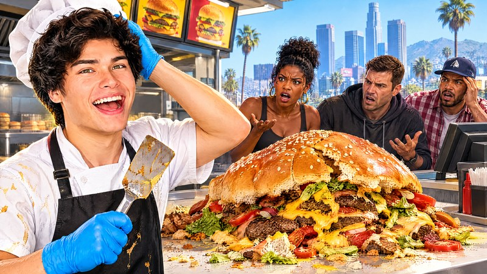

The crew runs a working game-world restaurant where impatient crew guests expose every flaw in the team's plan.

GTA 5 launch / follow-up · GTA 5

- **0 (First Frame)–5s:** Alan as chef foreground, bright GTA restaurant counter, giant burger collapse and annoyed adult crew customers.

- **5s–15s:** Serve all five guest orders before the closing timer. Crew customers, a fixed simple menu and visible order board.

- **15s–30s:** The crew receives its first order before anyone agrees who is cooking. Show the crew choosing its next move.

**Why this idea:** Shape: We Opened [GAME]'s Worst [SUBJECT]. Ingredients: restaurant, job, friends. Combined package: We Opened GTA's Worst Restaurant. Cast-led job comedy. We reflects a group attempting the job rather than a twin-only setup.

**Shape evidence:**

- [I Became A Principal At The World's Strictest School!](https://www.youtube.com/watch?v=LJYkuCoTOKg) — Stokes Twins · 2026-04-24 · adjacent · 58,118,322 views · 1.58× reported lift. Adjacent format/cast/setting reference from the reviewed board; does not satisfy exact/family outlier coverage for this episode. Window: lifetime through source snapshot. [Metric source](https://majieddd.github.io/influint-channels-public/channels/UCbp9MyKCTEww4CxEzc_Tp0Q.html).

- [I Sent Preston Back to Minecraft School...](https://www.youtube.com/watch?v=_Fu97rtvJPw) — Brianna · 2020-09-09 · adjacent · 31,092,651 views · 9.46× reported lift. Adjacent format/cast/setting reference from the reviewed board; does not satisfy exact/family outlier coverage for this episode. Window: lifetime through source snapshot. [Metric source](https://majieddd.github.io/influint-channels-public/channels/UCXg4rJUbDP1IP3TmZ9KDpJg.html).

- [LIVING Like MY SIM For 24 HOURS! - Challenge](https://www.youtube.com/watch?v=MNqF0h6LJDI) — Brianna · 2019-04-26 · adjacent · 17,927,907 views · 4.58× reported lift. Adjacent format/cast/setting reference from the reviewed board; does not satisfy exact/family outlier coverage for this episode. Window: lifetime through source snapshot. [Metric source](https://majieddd.github.io/influint-channels-public/channels/UCXg4rJUbDP1IP3TmZ9KDpJg.html).

**Ingredient evidence:**

- [I Sent Preston Back to Minecraft School...](https://www.youtube.com/watch?v=_Fu97rtvJPw) — Brianna · 2020-09-09 · family · 31,092,651 views · 9.46× reported lift. Same concrete ingredient job: I Sent Preston Back to Minecraft School.... Game, cast and execution transfer remains a hypothesis; this source does not validate the new episode outcome. Window: lifetime through source snapshot. [Metric source](https://majieddd.github.io/influint-channels-public/channels/UCXg4rJUbDP1IP3TmZ9KDpJg.html).

- [I Turned My School Bus Into A FISH TANK!](https://www.youtube.com/watch?v=Uq3-7nrC8gI) — Unspeakable · 2026-03-28 · family · 17,610,818 views · 6.82× reported lift. Same concrete ingredient job: I Turned My School Bus Into A FISH TANK!. Game, cast and execution transfer remains a hypothesis; this source does not validate the new episode outcome. Window: lifetime through source snapshot. [Metric source](https://majieddd.github.io/influint-channels-public/channels/UCwIWAbIeu0xI0ReKWOcw3eg.html).

- [5 BEST WAYS TO SKIP SCHOOL!](https://www.youtube.com/watch?v=aaG-QeqPKhA) — Stokes Twins · 2020-03-08 · family · 13,217,445 views · 1.64× reported lift. Same concrete ingredient job: 5 BEST WAYS TO SKIP SCHOOL!. Game, cast and execution transfer remains a hypothesis; this source does not validate the new episode outcome. Window: lifetime through source snapshot. [Metric source](https://majieddd.github.io/influint-channels-public/channels/UCbp9MyKCTEww4CxEzc_Tp0Q.html).

- [Minecraft Mobs If They Had Jobs](https://www.youtube.com/watch?v=n31qOWV3ev0) — PrestonPlayz · 2025-08-23 · family · 24,824,020 views · 1.00× reported lift. Same concrete ingredient job: Minecraft Mobs If They Had Jobs. Game, cast and execution transfer remains a hypothesis; this source does not validate the new episode outcome. Window: lifetime through source snapshot. [Metric source](https://majieddd.github.io/influint-channels-public/channels/UCJZam2u1G0syq3kyqrCXrNw.html).

Evidence gaps: Shape: 0/2 qualifying outlier channels in the verified public pool; adjacent precedents remain proposals, not replication.

**Objective:** Serve all five guest orders before the closing timer.

**Rules:** Crew customers, a fixed simple menu and visible order board; interaction scope and game mod are disclosed.

**Escalation:** One missing ingredient becomes a queue, a surprise large order and a final team reshuffle.

**Payoff:** Serve the remaining order or show the genuine failure and publish the guest verdicts.

**Gamer reward:** Game systems and roleplay provide situational variety.

**Non-gamer reward:** The ordinary job and escalating incompetence are understandable.

**People:** Multiple crew drivers and customers, with Alan/Alex participating or directing the day.

**Production:** Reuse a tested world · $1,650–$3,600 · authored incremental allowance.

**Dependencies:** Actual supported job mechanic or a transparently performed scenario; keep exposition short and task outcomes visible.

**Thumbnail:** Alan as chef foreground, bright GTA restaurant counter, giant burger collapse and annoyed adult crew customers.

Composition reference: [I Became A Principal At The World's Strictest School!](https://www.youtube.com/watch?v=LJYkuCoTOKg).

[Original PNG](generated-thumbnails/063.png) · [Exact image prompt](higgsfield-prompts/063.txt)

#### Idea 064 — We Became GTA's Worst Firefighters

Crew teams attempt three plainly visible game-world rescue tasks while their improvised teamwork causes comic setbacks.

GTA 5 launch / follow-up · GTA 5

- **0 (First Frame)–5s:** Alex gripping a hose spraying the wrong direction, red GTA fire truck, giant building blaze and Alan reacting; no injured people.

- **5s–15s:** Rescue the marked game characters and contain the three tested hazards. Simulated fires only, no real instructional claim.

- **15s–30s:** The first team arrives with a truck but forgets who operates the water. Show the crew choosing its next move.

**Why this idea:** Shape: We Became [GAME]'s Worst [SUBJECT]. Ingredients: fire, job, rescue. Combined package: We Became GTA's Worst Firefighters. Cast-led job comedy. We reflects a group attempting the job rather than a twin-only setup.

**Shape evidence:**

- [I Became A Principal At The World's Strictest School!](https://www.youtube.com/watch?v=LJYkuCoTOKg) — Stokes Twins · 2026-04-24 · adjacent · 58,118,322 views · 1.58× reported lift. Adjacent format/cast/setting reference from the reviewed board; does not satisfy exact/family outlier coverage for this episode. Window: lifetime through source snapshot. [Metric source](https://majieddd.github.io/influint-channels-public/channels/UCbp9MyKCTEww4CxEzc_Tp0Q.html).

- [I Sent Preston Back to Minecraft School...](https://www.youtube.com/watch?v=_Fu97rtvJPw) — Brianna · 2020-09-09 · adjacent · 31,092,651 views · 9.46× reported lift. Adjacent format/cast/setting reference from the reviewed board; does not satisfy exact/family outlier coverage for this episode. Window: lifetime through source snapshot. [Metric source](https://majieddd.github.io/influint-channels-public/channels/UCXg4rJUbDP1IP3TmZ9KDpJg.html).

- [LIVING Like MY SIM For 24 HOURS! - Challenge](https://www.youtube.com/watch?v=MNqF0h6LJDI) — Brianna · 2019-04-26 · adjacent · 17,927,907 views · 4.58× reported lift. Adjacent format/cast/setting reference from the reviewed board; does not satisfy exact/family outlier coverage for this episode. Window: lifetime through source snapshot. [Metric source](https://majieddd.github.io/influint-channels-public/channels/UCXg4rJUbDP1IP3TmZ9KDpJg.html).

**Ingredient evidence:**

- [I Found PrestonPlayz Secret Lava Minecraft House!](https://www.youtube.com/watch?v=5bX69nAZ5cM) — Brianna · 2019-02-09 · family · 10,031,355 views · 2.91× reported lift. Same concrete ingredient fire: I Found PrestonPlayz Secret Lava Minecraft House!. Game, cast and execution transfer remains a hypothesis; this source does not validate the new episode outcome. Window: lifetime through source snapshot. [Metric source](https://majieddd.github.io/influint-channels-public/channels/UCXg4rJUbDP1IP3TmZ9KDpJg.html).

- [100 Players, But Lava Rises Every Minute!](https://www.youtube.com/watch?v=TU99gX7NGZ8) — MrBeast Gaming · 2020-11-27 · family · 73,449,855 views · 1.88× reported lift. Same concrete ingredient fire: 100 Players, But Lava Rises Every Minute!. Game, cast and execution transfer remains a hypothesis; this source does not validate the new episode outcome. Window: lifetime through source snapshot. [Metric source](https://majieddd.github.io/influint-channels-public/channels/UCIPPMRA040LQr5QPyJEbmXA.html).

- [I Filled My House with LAVA vs ICE!](https://www.youtube.com/watch?v=bcHBD0dlDR4) — Unspeakable · 2026-06-20 · family · 5,056,562 views · 1.29× reported lift. Same concrete ingredient fire: I Filled My House with LAVA vs ICE!. Game, cast and execution transfer remains a hypothesis; this source does not validate the new episode outcome. Window: lifetime through source snapshot. [Metric source](https://majieddd.github.io/influint-channels-public/channels/UCwIWAbIeu0xI0ReKWOcw3eg.html).

- [100 Layers Challenge vs An Actual Firefighter!](https://www.youtube.com/watch?v=0P0iMl0cfKY) — Brianna · 2020-03-06 · family · 9,549,528 views · 1.53× reported lift. Same concrete ingredient fire: 100 Layers Challenge vs An Actual Firefighter!. Game, cast and execution transfer remains a hypothesis; this source does not validate the new episode outcome. Window: lifetime through source snapshot. [Metric source](https://majieddd.github.io/influint-channels-public/channels/UCXg4rJUbDP1IP3TmZ9KDpJg.html).

Evidence gaps: Shape: 0/2 qualifying outlier channels in the verified public pool; adjacent precedents remain proposals, not replication. Ingredients: 1/2 qualifying outlier channels for the principal ingredient; this does not establish the full game/cast combination.

**Objective:** Rescue the marked game characters and contain the three tested hazards.

**Rules:** Simulated fires only, no real instructional claim; clear rescue markers, timer and tested game tools.

**Escalation:** A small kitchen fire becomes a tall-building rescue and a finale requiring every crew role.

**Payoff:** Show who is rescued and whether the final fire objective is achieved.

**Gamer reward:** Game systems and roleplay provide situational variety.

**Non-gamer reward:** The ordinary job and escalating incompetence are understandable.

**People:** Multiple crew drivers and customers, with Alan/Alex participating or directing the day.

**Production:** Reuse a tested world · $1,650–$3,600 · authored incremental allowance.

**Dependencies:** Actual supported job mechanic or a transparently performed scenario; keep exposition short and task outcomes visible.

**Thumbnail:** Alex gripping a hose spraying the wrong direction, red GTA fire truck, giant building blaze and Alan reacting; no injured people.

Composition reference: [I Became A Principal At The World's Strictest School!](https://www.youtube.com/watch?v=LJYkuCoTOKg).

[Original PNG](generated-thumbnails/064.png) · [Exact image prompt](higgsfield-prompts/064.txt)

#### Idea 065 — We Became Roblox's Worst Taxi Drivers

The crew runs a private Roblox taxi challenge where simple passenger wishes become increasingly absurd delivery tasks.

Later game expansion · Roblox

- **0 (First Frame)–5s:** Alan foreground in a tiny bright yellow Roblox taxi, enormous cheerful block-avatar passenger towering through the roof.

- **5s–15s:** Win the best combined passenger and arrival score. Owned or permitted private experience, crew customers and fixed scoring.

- **15s–30s:** The first passenger cannot fit in the taxi model the crew selected. Show the crew choosing its next move.

**Why this idea:** Shape: We Became [GAME]'s Worst [SUBJECT]. Ingredients: Roblox, taxi, job. Combined package: We Became Roblox's Worst Taxi Drivers. Cast-led job comedy. We reflects a group attempting the job rather than a twin-only setup.

**Shape evidence:**

- [I Became A Principal At The World's Strictest School!](https://www.youtube.com/watch?v=LJYkuCoTOKg) — Stokes Twins · 2026-04-24 · adjacent · 58,118,322 views · 1.58× reported lift. Adjacent format/cast/setting reference from the reviewed board; does not satisfy exact/family outlier coverage for this episode. Window: lifetime through source snapshot. [Metric source](https://majieddd.github.io/influint-channels-public/channels/UCbp9MyKCTEww4CxEzc_Tp0Q.html).

- [I Sent Preston Back to Minecraft School...](https://www.youtube.com/watch?v=_Fu97rtvJPw) — Brianna · 2020-09-09 · adjacent · 31,092,651 views · 9.46× reported lift. Adjacent format/cast/setting reference from the reviewed board; does not satisfy exact/family outlier coverage for this episode. Window: lifetime through source snapshot. [Metric source](https://majieddd.github.io/influint-channels-public/channels/UCXg4rJUbDP1IP3TmZ9KDpJg.html).

- [LIVING Like MY SIM For 24 HOURS! - Challenge](https://www.youtube.com/watch?v=MNqF0h6LJDI) — Brianna · 2019-04-26 · adjacent · 17,927,907 views · 4.58× reported lift. Adjacent format/cast/setting reference from the reviewed board; does not satisfy exact/family outlier coverage for this episode. Window: lifetime through source snapshot. [Metric source](https://majieddd.github.io/influint-channels-public/channels/UCXg4rJUbDP1IP3TmZ9KDpJg.html).

**Ingredient evidence:**

- [I Became A Principal At The World's Strictest School!](https://www.youtube.com/watch?v=LJYkuCoTOKg) — Stokes Twins · 2026-04-24 · adjacent · 58,118,322 views · 1.58× reported lift. Adjacent format/cast/setting reference from the reviewed board; does not satisfy exact/family outlier coverage for this episode. Window: lifetime through source snapshot. [Metric source](https://majieddd.github.io/influint-channels-public/channels/UCbp9MyKCTEww4CxEzc_Tp0Q.html).

- [I Sent Preston Back to Minecraft School...](https://www.youtube.com/watch?v=_Fu97rtvJPw) — Brianna · 2020-09-09 · adjacent · 31,092,651 views · 9.46× reported lift. Adjacent format/cast/setting reference from the reviewed board; does not satisfy exact/family outlier coverage for this episode. Window: lifetime through source snapshot. [Metric source](https://majieddd.github.io/influint-channels-public/channels/UCXg4rJUbDP1IP3TmZ9KDpJg.html).

- [LIVING Like MY SIM For 24 HOURS! - Challenge](https://www.youtube.com/watch?v=MNqF0h6LJDI) — Brianna · 2019-04-26 · adjacent · 17,927,907 views · 4.58× reported lift. Adjacent format/cast/setting reference from the reviewed board; does not satisfy exact/family outlier coverage for this episode. Window: lifetime through source snapshot. [Metric source](https://majieddd.github.io/influint-channels-public/channels/UCXg4rJUbDP1IP3TmZ9KDpJg.html).

Evidence gaps: Shape: 0/2 qualifying outlier channels in the verified public pool; adjacent precedents remain proposals, not replication. Ingredients: 0/2 qualifying outlier channels for the principal ingredient; this does not establish the full game/cast combination.

**Objective:** Win the best combined passenger and arrival score.

**Rules:** Owned or permitted private experience, crew customers and fixed scoring; no random-player harassment or pay-to-win shopping.

**Escalation:** A normal passenger becomes a towering avatar guest and the final ride requires a vehicle the driver dislikes.

**Payoff:** Let the passengers reveal their votes and show the last arrival.

**Gamer reward:** Game systems and roleplay provide situational variety.

**Non-gamer reward:** The ordinary job and escalating incompetence are understandable.

**People:** Multiple crew drivers and customers, with Alan/Alex participating or directing the day.

**Production:** Reuse a tested world · $1,650–$3,600 · authored incremental allowance.

**Dependencies:** Actual supported job mechanic or a transparently performed scenario; keep exposition short and task outcomes visible. Use an owned or permitted private experience and scoped developer features before casting/recording.

**Thumbnail:** Alan foreground in a tiny bright yellow Roblox taxi, enormous cheerful block-avatar passenger towering through the roof.

Composition reference: [I Became A Principal At The World's Strictest School!](https://www.youtube.com/watch?v=LJYkuCoTOKg).

[Original PNG](generated-thumbnails/065.png) · [Exact image prompt](higgsfield-prompts/065.txt)

### Format 14 — Beat the impossible course

A staged skill gauntlet with escalating obstacles, visible attempts and a final completion.

Title family: We Built the Most Impossible ___

Retained. Keep one clearly visible impossible obstacle and progress toward a genuine completion.

#### Idea 066 — We Built GTA's Most Impossible Obstacle Course

The crew attempts a reusable custom course where each recognizable obstacle demands a different kind of nerve and teamwork.

GTA 5 launch / follow-up · GTA 5

- **0 (First Frame)–5s:** Alan shocked foreground, enormous red GTA stunt track winding above skyscrapers toward one gold finish platform.

- **5s–15s:** Complete the course from the start to its visible final platform. Most impossible is a proposal superlative to test, not a world-record claim.

- **15s–30s:** The first driver reaches a bridge narrower than the selected car. Show the crew choosing its next move.

**Why this idea:** Shape: We Built [GAME]'s Most Impossible Obstacle [SUBJECT]. Ingredients: course, impossible, GTA. Combined package: We Built GTA's Most Impossible Obstacle Course. Stokes competition and engineering humor with an ensemble, not compulsory twin rivalry.

**Shape evidence:**

- [I Made 100 Players Escape An Impossible Maze!](https://www.youtube.com/watch?v=vrUOPr9v8g4) — MrBeast Gaming · 2020-12-02 · family · 157,040,201 views · 3.72× reported lift. Same title/premise family: I Made 100 Players Escape An Impossible Maze!. Game, cast and execution transfer remains a hypothesis; this source does not validate the new episode outcome. Window: lifetime through source snapshot. [Metric source](https://majieddd.github.io/influint-channels-public/channels/UCIPPMRA040LQr5QPyJEbmXA.html).

- [I Escaped 1,000 Layers of ICE!](https://www.youtube.com/watch?v=mXqlDp61MMA) — Unspeakable · 2025-04-19 · adjacent · 13,160,154 views · 3.66× reported lift. Adjacent format/cast/setting reference from the reviewed board; does not satisfy exact/family outlier coverage for this episode. Window: lifetime through source snapshot. [Metric source](https://majieddd.github.io/influint-channels-public/channels/UCwIWAbIeu0xI0ReKWOcw3eg.html).

- [7 Days Escaping Cardboard Prison!](https://www.youtube.com/watch?v=WU05jZnUiYs) — Unspeakable · 2026-01-24 · adjacent · 12,880,314 views · 3.65× reported lift. Adjacent format/cast/setting reference from the reviewed board; does not satisfy exact/family outlier coverage for this episode. Window: lifetime through source snapshot. [Metric source](https://majieddd.github.io/influint-channels-public/channels/UCwIWAbIeu0xI0ReKWOcw3eg.html).

**Ingredient evidence:**

- [I Made 100 Players Escape An Impossible Maze!](https://www.youtube.com/watch?v=vrUOPr9v8g4) — MrBeast Gaming · 2020-12-02 · family · 157,040,201 views · 3.72× reported lift. Same concrete ingredient course: I Made 100 Players Escape An Impossible Maze!. Game, cast and execution transfer remains a hypothesis; this source does not validate the new episode outcome. Window: lifetime through source snapshot. [Metric source](https://majieddd.github.io/influint-channels-public/channels/UCIPPMRA040LQr5QPyJEbmXA.html).

- [I Tested BANNED Obstacle Courses!](https://www.youtube.com/watch?v=9BVTCRIyb9U) — Stokes Twins · 2023-04-15 · family · 34,479,740 views · 0.41× reported lift. Same concrete ingredient course: I Tested BANNED Obstacle Courses!. Game, cast and execution transfer remains a hypothesis; this source does not validate the new episode outcome. Window: lifetime through source snapshot. [Metric source](https://majieddd.github.io/influint-channels-public/channels/UCbp9MyKCTEww4CxEzc_Tp0Q.html).

Evidence gaps: Shape: 1/2 qualifying outlier channels in the verified public pool; adjacent precedents remain proposals, not replication. Ingredients: 1/2 qualifying outlier channels for the principal ingredient; this does not establish the full game/cast combination.

**Objective:** Complete the course from the start to its visible final platform.

**Rules:** Most impossible is a proposal superlative to test, not a world-record claim; fixed retry/life rules and no hidden shortcuts.

**Escalation:** A narrow drive becomes a moving bridge, a leap and a finale that combines earlier skills.

**Payoff:** Show a complete legitimate finish or honestly reveal that nobody beat the course.

**Gamer reward:** Vehicle/control mastery adds a skill reward.

**Non-gamer reward:** The viewer can see each obstacle, failure and improvement.

**People:** Crew members attempt, coach and redesign obstacles; rotate competitors and provide each an understandable objective.

**Production:** Reusable custom challenge · $3,400–$7,500 · authored incremental allowance.

**Dependencies:** Course construction, finish-state validation and varied capture; reuse obstacles across subsequent episodes.

**Thumbnail:** Alan shocked foreground, enormous red GTA stunt track winding above skyscrapers toward one gold finish platform.

Composition reference: [I Made 100 Players Escape An Impossible Maze!](https://www.youtube.com/watch?v=vrUOPr9v8g4).

[Original PNG](generated-thumbnails/066.png) · [Exact image prompt](higgsfield-prompts/066.txt)

#### Idea 067 — We Built an Obstacle Course Above GTA's Tallest Buildings

The crew crosses a clearly visible high-altitude course and discovers which player stays calm when the ground disappears.

GTA 5 launch / follow-up · GTA 5

- **0 (First Frame)–5s:** Alex hanging over a tiny red platform high above GTA skyscrapers, gold rooftop finish in the distance.

- **5s–15s:** Reach the final rooftop through five connected obstacles. Verify the selected skyline and bounded superlative, fixed starts/checkpoints and actual attempt footage.

- **15s–30s:** The starting rooftop looks easy until the next platform begins moving. Show the crew choosing its next move.

**Why this idea:** Shape: We Built an Obstacle [SUBJECT] Above [GAME]'s Tallest Buildings. Ingredients: course, roof, GTA. Combined package: We Built an Obstacle Course Above GTA's Tallest Buildings. Stokes competition and engineering humor with an ensemble, not compulsory twin rivalry.

**Shape evidence:**

- [I Made 100 Players Escape An Impossible Maze!](https://www.youtube.com/watch?v=vrUOPr9v8g4) — MrBeast Gaming · 2020-12-02 · family · 157,040,201 views · 3.72× reported lift. Same title/premise family: I Made 100 Players Escape An Impossible Maze!. Game, cast and execution transfer remains a hypothesis; this source does not validate the new episode outcome. Window: lifetime through source snapshot. [Metric source](https://majieddd.github.io/influint-channels-public/channels/UCIPPMRA040LQr5QPyJEbmXA.html).

- [I Escaped 1,000 Layers of ICE!](https://www.youtube.com/watch?v=mXqlDp61MMA) — Unspeakable · 2025-04-19 · adjacent · 13,160,154 views · 3.66× reported lift. Adjacent format/cast/setting reference from the reviewed board; does not satisfy exact/family outlier coverage for this episode. Window: lifetime through source snapshot. [Metric source](https://majieddd.github.io/influint-channels-public/channels/UCwIWAbIeu0xI0ReKWOcw3eg.html).

- [7 Days Escaping Cardboard Prison!](https://www.youtube.com/watch?v=WU05jZnUiYs) — Unspeakable · 2026-01-24 · adjacent · 12,880,314 views · 3.65× reported lift. Adjacent format/cast/setting reference from the reviewed board; does not satisfy exact/family outlier coverage for this episode. Window: lifetime through source snapshot. [Metric source](https://majieddd.github.io/influint-channels-public/channels/UCwIWAbIeu0xI0ReKWOcw3eg.html).

**Ingredient evidence:**

- [I Made 100 Players Escape An Impossible Maze!](https://www.youtube.com/watch?v=vrUOPr9v8g4) — MrBeast Gaming · 2020-12-02 · family · 157,040,201 views · 3.72× reported lift. Same concrete ingredient course: I Made 100 Players Escape An Impossible Maze!. Game, cast and execution transfer remains a hypothesis; this source does not validate the new episode outcome. Window: lifetime through source snapshot. [Metric source](https://majieddd.github.io/influint-channels-public/channels/UCIPPMRA040LQr5QPyJEbmXA.html).

- [I Tested BANNED Obstacle Courses!](https://www.youtube.com/watch?v=9BVTCRIyb9U) — Stokes Twins · 2023-04-15 · family · 34,479,740 views · 0.41× reported lift. Same concrete ingredient course: I Tested BANNED Obstacle Courses!. Game, cast and execution transfer remains a hypothesis; this source does not validate the new episode outcome. Window: lifetime through source snapshot. [Metric source](https://majieddd.github.io/influint-channels-public/channels/UCbp9MyKCTEww4CxEzc_Tp0Q.html).

Evidence gaps: Shape: 1/2 qualifying outlier channels in the verified public pool; adjacent precedents remain proposals, not replication. Ingredients: 1/2 qualifying outlier channels for the principal ingredient; this does not establish the full game/cast combination.

**Objective:** Reach the final rooftop through five connected obstacles.

**Rules:** Verify the selected skyline and bounded superlative, fixed starts/checkpoints and actual attempt footage.

**Escalation:** A simple rooftop gap becomes a balance drive and the last obstacle removes the safety checkpoint.

**Payoff:** Resolve the final crossing with one wide view connecting start and finish.

**Gamer reward:** Vehicle/control mastery adds a skill reward.

**Non-gamer reward:** The viewer can see each obstacle, failure and improvement.

**People:** Crew members attempt, coach and redesign obstacles; rotate competitors and provide each an understandable objective.

**Production:** Reusable custom challenge · $3,400–$7,500 · authored incremental allowance.

**Dependencies:** Course construction, finish-state validation and varied capture; reuse obstacles across subsequent episodes.

**Thumbnail:** Alex hanging over a tiny red platform high above GTA skyscrapers, gold rooftop finish in the distance.

Composition reference: [I Made 100 Players Escape An Impossible Maze!](https://www.youtube.com/watch?v=vrUOPr9v8g4).

[Original PNG](generated-thumbnails/067.png) · [Exact image prompt](higgsfield-prompts/067.txt)

#### Idea 068 — We Built GTA's Impossible Course for Tiny Cars

The crew tries to beat a custom gauntlet in the same ridiculous tiny vehicle and learns that small size has real tradeoffs.

GTA 5 launch / follow-up · GTA 5

- **0 (First Frame)–5s:** Alan squeezed into a tiny yellow car at the edge of a huge red stunt ramp, enormous city gap ahead.

- **5s–15s:** Finish five obstacles using the unchanged tiny-car model. Same vehicle and physics settings, equal attempts and one published checkpoint map.

- **15s–30s:** The tiny car fits the first tunnel but cannot gather enough speed for the next ramp. Show the crew choosing its next move.

**Why this idea:** Shape: We Built [GAME]'s Impossible [SUBJECT] for Tiny [SUBJECT]. Ingredients: car, course, impossible. Combined package: We Built GTA's Impossible Course for Tiny Cars. Stokes competition and engineering humor with an ensemble, not compulsory twin rivalry.

**Shape evidence:**

- [I Made 100 Players Escape An Impossible Maze!](https://www.youtube.com/watch?v=vrUOPr9v8g4) — MrBeast Gaming · 2020-12-02 · family · 157,040,201 views · 3.72× reported lift. Same title/premise family: I Made 100 Players Escape An Impossible Maze!. Game, cast and execution transfer remains a hypothesis; this source does not validate the new episode outcome. Window: lifetime through source snapshot. [Metric source](https://majieddd.github.io/influint-channels-public/channels/UCIPPMRA040LQr5QPyJEbmXA.html).

- [I Escaped 1,000 Layers of ICE!](https://www.youtube.com/watch?v=mXqlDp61MMA) — Unspeakable · 2025-04-19 · adjacent · 13,160,154 views · 3.66× reported lift. Adjacent format/cast/setting reference from the reviewed board; does not satisfy exact/family outlier coverage for this episode. Window: lifetime through source snapshot. [Metric source](https://majieddd.github.io/influint-channels-public/channels/UCwIWAbIeu0xI0ReKWOcw3eg.html).

- [7 Days Escaping Cardboard Prison!](https://www.youtube.com/watch?v=WU05jZnUiYs) — Unspeakable · 2026-01-24 · adjacent · 12,880,314 views · 3.65× reported lift. Adjacent format/cast/setting reference from the reviewed board; does not satisfy exact/family outlier coverage for this episode. Window: lifetime through source snapshot. [Metric source](https://majieddd.github.io/influint-channels-public/channels/UCwIWAbIeu0xI0ReKWOcw3eg.html).

**Ingredient evidence:**

- [Preston Cheated in Cardboard Hide and Seek](https://www.youtube.com/watch?v=5zbvDh28XUQ) — Brianna · 2022-04-28 · family · 11,051,826 views · 5.01× reported lift. Same concrete ingredient car: Preston Cheated in Cardboard Hide and Seek. Game, cast and execution transfer remains a hypothesis; this source does not validate the new episode outcome. Window: lifetime through source snapshot. [Metric source](https://majieddd.github.io/influint-channels-public/channels/UCXg4rJUbDP1IP3TmZ9KDpJg.html).

- [Tesla Autopilot For 24 Hours!](https://www.youtube.com/watch?v=SsJ7oOpbmIk) — Stokes Twins · 2021-04-20 · family · 38,321,506 views · 4.25× reported lift. Same concrete ingredient car: Tesla Autopilot For 24 Hours!. Game, cast and execution transfer remains a hypothesis; this source does not validate the new episode outcome. Window: lifetime through source snapshot. [Metric source](https://majieddd.github.io/influint-channels-public/channels/UCbp9MyKCTEww4CxEzc_Tp0Q.html).

- [World's Fastest Car!](https://www.youtube.com/watch?v=nopEs-K4ExM) — MrBeast Gaming · 2022-07-09 · family · 122,277,058 views · 3.68× reported lift. Same concrete ingredient car: World's Fastest Car!. Game, cast and execution transfer remains a hypothesis; this source does not validate the new episode outcome. Window: lifetime through source snapshot. [Metric source](https://majieddd.github.io/influint-channels-public/channels/UCIPPMRA040LQr5QPyJEbmXA.html).

- [7 Days Escaping Cardboard Prison!](https://www.youtube.com/watch?v=WU05jZnUiYs) — Unspeakable · 2026-01-24 · family · 12,880,314 views · 3.65× reported lift. Same concrete ingredient car: 7 Days Escaping Cardboard Prison!. Game, cast and execution transfer remains a hypothesis; this source does not validate the new episode outcome. Window: lifetime through source snapshot. [Metric source](https://majieddd.github.io/influint-channels-public/channels/UCwIWAbIeu0xI0ReKWOcw3eg.html).

Evidence gaps: Shape: 1/2 qualifying outlier channels in the verified public pool; adjacent precedents remain proposals, not replication.

**Objective:** Finish five obstacles using the unchanged tiny-car model.

**Rules:** Same vehicle and physics settings, equal attempts and one published checkpoint map.

**Escalation:** A narrow tunnel helps the car, a long jump exposes its weakness and a final moving target tests timing.

**Payoff:** Show the actual fastest full completion and the failed plan that nearly worked.

**Gamer reward:** Vehicle/control mastery adds a skill reward.

**Non-gamer reward:** The viewer can see each obstacle, failure and improvement.

**People:** Crew members attempt, coach and redesign obstacles; rotate competitors and provide each an understandable objective.

**Production:** Reusable custom challenge · $3,400–$7,500 · authored incremental allowance.

**Dependencies:** Course construction, finish-state validation and varied capture; reuse obstacles across subsequent episodes.

**Thumbnail:** Alan squeezed into a tiny yellow car at the edge of a huge red stunt ramp, enormous city gap ahead.

Composition reference: [I Made 100 Players Escape An Impossible Maze!](https://www.youtube.com/watch?v=vrUOPr9v8g4).

[Original PNG](generated-thumbnails/068.png) · [Exact image prompt](higgsfield-prompts/068.txt)

#### Idea 069 — We Built a Course That Gets Harder Every Time You Fail

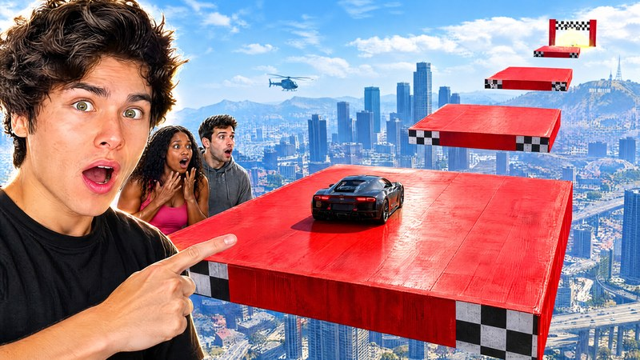

Each genuine failure changes a reusable GTA gauntlet so the crew must adapt rather than repeat the same route.

GTA 5 launch / follow-up · GTA 5

- **0 (First Frame)–5s:** Alex foreground staring at a huge GTA course with three progressively smaller red platforms; one big red difficulty arrow.

- **5s–15s:** Finish before the disclosed maximum difficulty stage. Changes occur after recorded failures, every stage is prototype-tested and the crew sees the update.

- **15s–30s:** The first easy-looking failure removes the team's favorite checkpoint. Show the crew choosing its next move.

**Why this idea:** Shape: We Built a [SUBJECT] That Gets Harder Every Time You Fail. Ingredients: course, harder, challenge. Combined package: We Built a Course That Gets Harder Every Time You Fail. Stokes competition and engineering humor with an ensemble, not compulsory twin rivalry.

**Shape evidence:**

- [I Made 100 Players Escape An Impossible Maze!](https://www.youtube.com/watch?v=vrUOPr9v8g4) — MrBeast Gaming · 2020-12-02 · family · 157,040,201 views · 3.72× reported lift. Same title/premise family: I Made 100 Players Escape An Impossible Maze!. Game, cast and execution transfer remains a hypothesis; this source does not validate the new episode outcome. Window: lifetime through source snapshot. [Metric source](https://majieddd.github.io/influint-channels-public/channels/UCIPPMRA040LQr5QPyJEbmXA.html).

- [I Escaped 1,000 Layers of ICE!](https://www.youtube.com/watch?v=mXqlDp61MMA) — Unspeakable · 2025-04-19 · adjacent · 13,160,154 views · 3.66× reported lift. Adjacent format/cast/setting reference from the reviewed board; does not satisfy exact/family outlier coverage for this episode. Window: lifetime through source snapshot. [Metric source](https://majieddd.github.io/influint-channels-public/channels/UCwIWAbIeu0xI0ReKWOcw3eg.html).

- [7 Days Escaping Cardboard Prison!](https://www.youtube.com/watch?v=WU05jZnUiYs) — Unspeakable · 2026-01-24 · adjacent · 12,880,314 views · 3.65× reported lift. Adjacent format/cast/setting reference from the reviewed board; does not satisfy exact/family outlier coverage for this episode. Window: lifetime through source snapshot. [Metric source](https://majieddd.github.io/influint-channels-public/channels/UCwIWAbIeu0xI0ReKWOcw3eg.html).

**Ingredient evidence:**

- [I Made 100 Players Escape An Impossible Maze!](https://www.youtube.com/watch?v=vrUOPr9v8g4) — MrBeast Gaming · 2020-12-02 · family · 157,040,201 views · 3.72× reported lift. Same concrete ingredient course: I Made 100 Players Escape An Impossible Maze!. Game, cast and execution transfer remains a hypothesis; this source does not validate the new episode outcome. Window: lifetime through source snapshot. [Metric source](https://majieddd.github.io/influint-channels-public/channels/UCIPPMRA040LQr5QPyJEbmXA.html).

- [I Tested BANNED Obstacle Courses!](https://www.youtube.com/watch?v=9BVTCRIyb9U) — Stokes Twins · 2023-04-15 · family · 34,479,740 views · 0.41× reported lift. Same concrete ingredient course: I Tested BANNED Obstacle Courses!. Game, cast and execution transfer remains a hypothesis; this source does not validate the new episode outcome. Window: lifetime through source snapshot. [Metric source](https://majieddd.github.io/influint-channels-public/channels/UCbp9MyKCTEww4CxEzc_Tp0Q.html).

Evidence gaps: Shape: 1/2 qualifying outlier channels in the verified public pool; adjacent precedents remain proposals, not replication. Ingredients: 1/2 qualifying outlier channels for the principal ingredient; this does not establish the full game/cast combination.

**Objective:** Finish before the disclosed maximum difficulty stage.

**Rules:** Changes occur after recorded failures, every stage is prototype-tested and the crew sees the update.

**Escalation:** A missed jump narrows a bridge, another mistake moves the landing and the last attempt becomes a shared planning decision.

**Payoff:** Resolve the final attempt and show the real failure-to-change log.

**Gamer reward:** Vehicle/control mastery adds a skill reward.

**Non-gamer reward:** The viewer can see each obstacle, failure and improvement.

**People:** Crew members attempt, coach and redesign obstacles; rotate competitors and provide each an understandable objective.

**Production:** Reusable custom challenge · $3,400–$7,500 · authored incremental allowance.

**Dependencies:** Course construction, finish-state validation and varied capture; reuse obstacles across subsequent episodes.

**Thumbnail:** Alex foreground staring at a huge GTA course with three progressively smaller red platforms; one big red difficulty arrow.

Composition reference: [I Made 100 Players Escape An Impossible Maze!](https://www.youtube.com/watch?v=vrUOPr9v8g4).

[Original PNG](generated-thumbnails/069.png) · [Exact image prompt](higgsfield-prompts/069.txt)

#### Idea 070 — We Built Minecraft's Most Impossible Obstacle Course

The crew tackles a purpose-built Minecraft course that combines physical-looking hazards with simple teamwork rules.

Later game expansion · Minecraft

- **0 (First Frame)–5s:** Alan foreground, massive red-and-gold Minecraft parkour course suspended over blue void, tiny players near the finish.

- **5s–15s:** Finish the five-stage course without bypassing its published route. Custom map, fixed checkpoints and actual player attempts.

- **15s–30s:** The first player reaches a platform that moves as soon as a teammate steps on it. Show the crew choosing its next move.

**Why this idea:** Shape: We Built [GAME]'s Most Impossible Obstacle [SUBJECT]. Ingredients: Minecraft, course, impossible. Combined package: We Built Minecraft's Most Impossible Obstacle Course. Stokes competition and engineering humor with an ensemble, not compulsory twin rivalry.

**Shape evidence:**

- [I Made 100 Players Escape An Impossible Maze!](https://www.youtube.com/watch?v=vrUOPr9v8g4) — MrBeast Gaming · 2020-12-02 · family · 157,040,201 views · 3.72× reported lift. Same title/premise family: I Made 100 Players Escape An Impossible Maze!. Game, cast and execution transfer remains a hypothesis; this source does not validate the new episode outcome. Window: lifetime through source snapshot. [Metric source](https://majieddd.github.io/influint-channels-public/channels/UCIPPMRA040LQr5QPyJEbmXA.html).

- [I Escaped 1,000 Layers of ICE!](https://www.youtube.com/watch?v=mXqlDp61MMA) — Unspeakable · 2025-04-19 · adjacent · 13,160,154 views · 3.66× reported lift. Adjacent format/cast/setting reference from the reviewed board; does not satisfy exact/family outlier coverage for this episode. Window: lifetime through source snapshot. [Metric source](https://majieddd.github.io/influint-channels-public/channels/UCwIWAbIeu0xI0ReKWOcw3eg.html).

- [7 Days Escaping Cardboard Prison!](https://www.youtube.com/watch?v=WU05jZnUiYs) — Unspeakable · 2026-01-24 · adjacent · 12,880,314 views · 3.65× reported lift. Adjacent format/cast/setting reference from the reviewed board; does not satisfy exact/family outlier coverage for this episode. Window: lifetime through source snapshot. [Metric source](https://majieddd.github.io/influint-channels-public/channels/UCwIWAbIeu0xI0ReKWOcw3eg.html).

**Ingredient evidence:**

- [I Made 100 Players Escape An Impossible Maze!](https://www.youtube.com/watch?v=vrUOPr9v8g4) — MrBeast Gaming · 2020-12-02 · family · 157,040,201 views · 3.72× reported lift. Same concrete ingredient course: I Made 100 Players Escape An Impossible Maze!. Game, cast and execution transfer remains a hypothesis; this source does not validate the new episode outcome. Window: lifetime through source snapshot. [Metric source](https://majieddd.github.io/influint-channels-public/channels/UCIPPMRA040LQr5QPyJEbmXA.html).

- [I Tested BANNED Obstacle Courses!](https://www.youtube.com/watch?v=9BVTCRIyb9U) — Stokes Twins · 2023-04-15 · family · 34,479,740 views · 0.41× reported lift. Same concrete ingredient course: I Tested BANNED Obstacle Courses!. Game, cast and execution transfer remains a hypothesis; this source does not validate the new episode outcome. Window: lifetime through source snapshot. [Metric source](https://majieddd.github.io/influint-channels-public/channels/UCbp9MyKCTEww4CxEzc_Tp0Q.html).

Evidence gaps: Shape: 1/2 qualifying outlier channels in the verified public pool; adjacent precedents remain proposals, not replication. Ingredients: 1/2 qualifying outlier channels for the principal ingredient; this does not establish the full game/cast combination.

**Objective:** Finish the five-stage course without bypassing its published route.

**Rules:** Custom map, fixed checkpoints and actual player attempts; use the final difficulty claim only after playtesting.

**Escalation:** A familiar jump becomes a moving-block crossing and a final shared mechanism punishes poor communication.

**Payoff:** Show the real full completion or the obstacle that defeats every participant.

**Gamer reward:** Vehicle/control mastery adds a skill reward.

**Non-gamer reward:** The viewer can see each obstacle, failure and improvement.

**People:** Crew members attempt, coach and redesign obstacles; rotate competitors and provide each an understandable objective.

**Production:** Reusable custom challenge · $3,400–$7,500 · authored incremental allowance.

**Dependencies:** Course construction, finish-state validation and varied capture; reuse obstacles across subsequent episodes. Verify the exact edition, map, mod license and working mechanics; GTA-system reuse does not imply Minecraft support.

**Thumbnail:** Alan foreground, massive red-and-gold Minecraft parkour course suspended over blue void, tiny players near the finish.

Composition reference: [I Made 100 Players Escape An Impossible Maze!](https://www.youtube.com/watch?v=vrUOPr9v8g4).

[Original PNG](generated-thumbnails/070.png) · [Exact image prompt](higgsfield-prompts/070.txt)

### Format 15 — Keep the reward or risk the next level

Crew contestants repeatedly choose between banking a known reward and risking it on a harder challenge; show what each choice costs and earn the final outcome.

Title family: Keep Or Risk $___ / Risk A ___, Win $___

Retained with the user’s requested variations. Prize value and real-versus-virtual framing remain production decisions; no million-dollar cash commitment is assumed.

#### Idea 071 — Keep Or Risk $1,000,000 in GTA

Each crew contestant repeatedly chooses to bank a virtual reward or risk it on a harder visible challenge.

GTA 5 launch / follow-up · GTA 5

- **0 (First Frame)–5s:** Alan face left, glowing game-money case marked $1M right balanced above a deep GTA pit; KEEP or RISK.

- **5s–15s:** Finish with the largest honestly banked game-value reward. State virtual money in the first frame.

- **15s–30s:** The first successful contestant immediately disagrees with the crew about whether to take the next risk. Show the crew choosing its next move.

**Why this idea:** Shape: Keep Or Risk $[VALUE] in [GAME]. Ingredients: risk, money, challenge. Combined package: Keep Or Risk $1,000,000 in GTA. Use the cast's contrasting confidence and decision styles.

**Shape evidence:**

- [Would You Risk $5,000 for $100,000?](https://www.youtube.com/watch?v=2O-9RmuiXog) — MrBeast Gaming · 2021-03-16 · family · 159,792,929 views · 2.70× reported lift. Same title/premise family: Would You Risk $5,000 for $100,000?. Game, cast and execution transfer remains a hypothesis; this source does not validate the new episode outcome. Window: lifetime through source snapshot. [Metric source](https://majieddd.github.io/influint-channels-public/channels/UCIPPMRA040LQr5QPyJEbmXA.html).

- [Press This Button = Win $100,000!](https://www.youtube.com/watch?v=lJrHLnhJl-M) — MrBeast Gaming · 2023-07-07 · family · 141,650,337 views · 2.35× reported lift. Same title/premise family: Press This Button = Win $100,000!. Game, cast and execution transfer remains a hypothesis; this source does not validate the new episode outcome. Window: lifetime through source snapshot. [Metric source](https://majieddd.github.io/influint-channels-public/channels/UCIPPMRA040LQr5QPyJEbmXA.html).

- [Press This Button To Win $250,000](https://www.youtube.com/watch?v=70LOaxzmcg4) — MrBeast Gaming · 2026-03-28 · family · 27,919,825 views · 0.54× reported lift. Same title/premise family: Press This Button To Win $250,000. Game, cast and execution transfer remains a hypothesis; this source does not validate the new episode outcome. Window: lifetime through source snapshot. [Metric source](https://majieddd.github.io/influint-channels-public/channels/UCIPPMRA040LQr5QPyJEbmXA.html).

**Ingredient evidence:**

- [100 Underwater Mystery Buttons but Only One Lets You Escape...](https://www.youtube.com/watch?v=XvV13G_WDdc) — Brianna · 2021-08-11 · family · 13,972,848 views · 4.63× reported lift. Same concrete ingredient risk: 100 Underwater Mystery Buttons but Only One Lets You Escape.... Game, cast and execution transfer remains a hypothesis; this source does not validate the new episode outcome. Window: lifetime through source snapshot. [Metric source](https://majieddd.github.io/influint-channels-public/channels/UCXg4rJUbDP1IP3TmZ9KDpJg.html).

- [Would You Risk $5,000 for $100,000?](https://www.youtube.com/watch?v=2O-9RmuiXog) — MrBeast Gaming · 2021-03-16 · family · 159,792,929 views · 2.70× reported lift. Same concrete ingredient risk: Would You Risk $5,000 for $100,000?. Game, cast and execution transfer remains a hypothesis; this source does not validate the new episode outcome. Window: lifetime through source snapshot. [Metric source](https://majieddd.github.io/influint-channels-public/channels/UCIPPMRA040LQr5QPyJEbmXA.html).

- [Clean The Sports Car, Keep It!](https://www.youtube.com/watch?v=6EtuOTq5TmM) — Stokes Twins · 2026-02-11 · family · 87,106,209 views · 1.48× reported lift. Same concrete ingredient risk: Clean The Sports Car, Keep It!. Game, cast and execution transfer remains a hypothesis; this source does not validate the new episode outcome. Window: lifetime through source snapshot. [Metric source](https://majieddd.github.io/influint-channels-public/channels/UCbp9MyKCTEww4CxEzc_Tp0Q.html).

- [If You Clean My House, You Keep It!](https://www.youtube.com/watch?v=I2MTojlaGQs) — Unspeakable · 2026-04-18 · family · 4,794,517 views · 1.47× reported lift. Same concrete ingredient risk: If You Clean My House, You Keep It!. Game, cast and execution transfer remains a hypothesis; this source does not validate the new episode outcome. Window: lifetime through source snapshot. [Metric source](https://majieddd.github.io/influint-channels-public/channels/UCwIWAbIeu0xI0ReKWOcw3eg.html).

Evidence gaps: Shape: 1/2 qualifying outlier channels in the verified public pool; adjacent precedents remain proposals, not replication.

**Objective:** Finish with the largest honestly banked game-value reward.

**Rules:** State virtual money in the first frame, publish the reward ladder and rules, and never undo a loss for a better ending.

**Escalation:** An easy small win becomes a meaningful middle decision and a final choice where a cautious player can still win.

**Payoff:** Resolve the final attempt and compare banked rewards with forfeited rewards.

**Gamer reward:** Risk decisions can reflect real game skill.

**Non-gamer reward:** Tradeoffs, regret and a readable ladder are universal.

**People:** Several crew contestants with different risk tolerances; a host presents each choice and clearly tracks what is at stake.

**Production:** Reuse a tested world · $1,650–$3,600 · authored incremental allowance.

**Dependencies:** Define the actual reward pool, eligibility, challenge and loss conditions. Requested cash headlines need funded real stakes or explicit GTA/game-value wording that tells viewers what is being offered.

**Thumbnail:** Alan face left, glowing game-money case marked $1M right balanced above a deep GTA pit; KEEP or RISK.

Composition reference: [Would You Risk $5,000 for $100,000?](https://www.youtube.com/watch?v=2O-9RmuiXog).

[Original PNG](generated-thumbnails/071.png) · [Exact image prompt](higgsfield-prompts/071.txt)

#### Idea 072 — Risk A Lamborghini, Win $1,000,000 in GTA

A player stakes a virtual supercar on a staged challenge ladder whose final reward is one million in disclosed game value.

GTA 5 launch / follow-up · GTA 5

- **0 (First Frame)–5s:** Alex worried foreground, red game-world Lamborghini-like supercar teetering over a pit beside a glowing $1M money case; RISK?.

- **5s–15s:** Choose whether to keep the game car or attempt the final virtual-money trial. Car and money are virtual in the launch version.

- **15s–30s:** The player clears the first jump easily and becomes overconfident about the next one. Show the crew choosing its next move.

**Why this idea:** Shape: Risk A [SUBJECT], Win $[VALUE] in [GAME]. Ingredients: risk, car, money. Combined package: Risk A Lamborghini, Win $1,000,000 in GTA. Use the cast's contrasting confidence and decision styles.

**Shape evidence:**

- [Would You Risk $5,000 for $100,000?](https://www.youtube.com/watch?v=2O-9RmuiXog) — MrBeast Gaming · 2021-03-16 · family · 159,792,929 views · 2.70× reported lift. Same title/premise family: Would You Risk $5,000 for $100,000?. Game, cast and execution transfer remains a hypothesis; this source does not validate the new episode outcome. Window: lifetime through source snapshot. [Metric source](https://majieddd.github.io/influint-channels-public/channels/UCIPPMRA040LQr5QPyJEbmXA.html).

- [Press This Button = Win $100,000!](https://www.youtube.com/watch?v=lJrHLnhJl-M) — MrBeast Gaming · 2023-07-07 · family · 141,650,337 views · 2.35× reported lift. Same title/premise family: Press This Button = Win $100,000!. Game, cast and execution transfer remains a hypothesis; this source does not validate the new episode outcome. Window: lifetime through source snapshot. [Metric source](https://majieddd.github.io/influint-channels-public/channels/UCIPPMRA040LQr5QPyJEbmXA.html).

- [Press This Button To Win $250,000](https://www.youtube.com/watch?v=70LOaxzmcg4) — MrBeast Gaming · 2026-03-28 · family · 27,919,825 views · 0.54× reported lift. Same title/premise family: Press This Button To Win $250,000. Game, cast and execution transfer remains a hypothesis; this source does not validate the new episode outcome. Window: lifetime through source snapshot. [Metric source](https://majieddd.github.io/influint-channels-public/channels/UCIPPMRA040LQr5QPyJEbmXA.html).

**Ingredient evidence:**

- [100 Underwater Mystery Buttons but Only One Lets You Escape...](https://www.youtube.com/watch?v=XvV13G_WDdc) — Brianna · 2021-08-11 · family · 13,972,848 views · 4.63× reported lift. Same concrete ingredient risk: 100 Underwater Mystery Buttons but Only One Lets You Escape.... Game, cast and execution transfer remains a hypothesis; this source does not validate the new episode outcome. Window: lifetime through source snapshot. [Metric source](https://majieddd.github.io/influint-channels-public/channels/UCXg4rJUbDP1IP3TmZ9KDpJg.html).

- [Would You Risk $5,000 for $100,000?](https://www.youtube.com/watch?v=2O-9RmuiXog) — MrBeast Gaming · 2021-03-16 · family · 159,792,929 views · 2.70× reported lift. Same concrete ingredient risk: Would You Risk $5,000 for $100,000?. Game, cast and execution transfer remains a hypothesis; this source does not validate the new episode outcome. Window: lifetime through source snapshot. [Metric source](https://majieddd.github.io/influint-channels-public/channels/UCIPPMRA040LQr5QPyJEbmXA.html).

- [Clean The Sports Car, Keep It!](https://www.youtube.com/watch?v=6EtuOTq5TmM) — Stokes Twins · 2026-02-11 · family · 87,106,209 views · 1.48× reported lift. Same concrete ingredient risk: Clean The Sports Car, Keep It!. Game, cast and execution transfer remains a hypothesis; this source does not validate the new episode outcome. Window: lifetime through source snapshot. [Metric source](https://majieddd.github.io/influint-channels-public/channels/UCbp9MyKCTEww4CxEzc_Tp0Q.html).

- [If You Clean My House, You Keep It!](https://www.youtube.com/watch?v=I2MTojlaGQs) — Unspeakable · 2026-04-18 · family · 4,794,517 views · 1.47× reported lift. Same concrete ingredient risk: If You Clean My House, You Keep It!. Game, cast and execution transfer remains a hypothesis; this source does not validate the new episode outcome. Window: lifetime through source snapshot. [Metric source](https://majieddd.github.io/influint-channels-public/channels/UCwIWAbIeu0xI0ReKWOcw3eg.html).

Evidence gaps: Shape: 1/2 qualifying outlier channels in the verified public pool; adjacent precedents remain proposals, not replication.

**Objective:** Choose whether to keep the game car or attempt the final virtual-money trial.

**Rules:** Car and money are virtual in the launch version; real-prize variation is conditional on separately funded obligations.

**Escalation:** Early checkpoints feel safe until the last jump makes the car stake matter emotionally.

**Payoff:** Show the decision and its real game result before any celebration.

**Gamer reward:** Risk decisions can reflect real game skill.

**Non-gamer reward:** Tradeoffs, regret and a readable ladder are universal.

**People:** Several crew contestants with different risk tolerances; a host presents each choice and clearly tracks what is at stake.

**Production:** Reuse a tested world · $1,650–$3,600 · authored incremental allowance.

**Dependencies:** Define the actual reward pool, eligibility, challenge and loss conditions. Requested cash headlines need funded real stakes or explicit GTA/game-value wording that tells viewers what is being offered.

**Thumbnail:** Alex worried foreground, red game-world Lamborghini-like supercar teetering over a pit beside a glowing $1M money case; RISK?.

Composition reference: [Would You Risk $5,000 for $100,000?](https://www.youtube.com/watch?v=2O-9RmuiXog).

[Original PNG](generated-thumbnails/072.png) · [Exact image prompt](higgsfield-prompts/072.txt)

#### Idea 073 — Press the Button, Risk Everything in GTA

The crew decides whether to press a visible button that reveals a harder trial and can wipe out their banked virtual rewards.

GTA 5 launch / follow-up · GTA 5

- **0 (First Frame)–5s:** Alan hand hovering above one enormous red button, gold game-money tower behind and Alex worried; PRESS?.

- **5s–15s:** Leave with the largest remaining game-value reward. Published odds or deterministic ladder, no fake randomness and a visible bank.

- **15s–30s:** The first lucky button result makes the crew underestimate the next risk. Show the crew choosing its next move.

**Why this idea:** Shape: Press the Button, Risk Everything in [GAME]. Ingredients: button, risk, money. Combined package: Press the Button, Risk Everything in GTA. Use the cast's contrasting confidence and decision styles.

**Shape evidence:**

- [Would You Risk $5,000 for $100,000?](https://www.youtube.com/watch?v=2O-9RmuiXog) — MrBeast Gaming · 2021-03-16 · family · 159,792,929 views · 2.70× reported lift. Same title/premise family: Would You Risk $5,000 for $100,000?. Game, cast and execution transfer remains a hypothesis; this source does not validate the new episode outcome. Window: lifetime through source snapshot. [Metric source](https://majieddd.github.io/influint-channels-public/channels/UCIPPMRA040LQr5QPyJEbmXA.html).

- [Press This Button = Win $100,000!](https://www.youtube.com/watch?v=lJrHLnhJl-M) — MrBeast Gaming · 2023-07-07 · family · 141,650,337 views · 2.35× reported lift. Same title/premise family: Press This Button = Win $100,000!. Game, cast and execution transfer remains a hypothesis; this source does not validate the new episode outcome. Window: lifetime through source snapshot. [Metric source](https://majieddd.github.io/influint-channels-public/channels/UCIPPMRA040LQr5QPyJEbmXA.html).

- [Press This Button To Win $250,000](https://www.youtube.com/watch?v=70LOaxzmcg4) — MrBeast Gaming · 2026-03-28 · family · 27,919,825 views · 0.54× reported lift. Same title/premise family: Press This Button To Win $250,000. Game, cast and execution transfer remains a hypothesis; this source does not validate the new episode outcome. Window: lifetime through source snapshot. [Metric source](https://majieddd.github.io/influint-channels-public/channels/UCIPPMRA040LQr5QPyJEbmXA.html).

**Ingredient evidence:**

- [100 Underwater Mystery Buttons but Only One Lets You Escape...](https://www.youtube.com/watch?v=XvV13G_WDdc) — Brianna · 2021-08-11 · family · 13,972,848 views · 4.63× reported lift. Same concrete ingredient button: 100 Underwater Mystery Buttons but Only One Lets You Escape.... Game, cast and execution transfer remains a hypothesis; this source does not validate the new episode outcome. Window: lifetime through source snapshot. [Metric source](https://majieddd.github.io/influint-channels-public/channels/UCXg4rJUbDP1IP3TmZ9KDpJg.html).

- [Press This Button = Win $100,000!](https://www.youtube.com/watch?v=lJrHLnhJl-M) — MrBeast Gaming · 2023-07-07 · family · 141,650,337 views · 2.35× reported lift. Same concrete ingredient button: Press This Button = Win $100,000!. Game, cast and execution transfer remains a hypothesis; this source does not validate the new episode outcome. Window: lifetime through source snapshot. [Metric source](https://majieddd.github.io/influint-channels-public/channels/UCIPPMRA040LQr5QPyJEbmXA.html).

- [100 BOY vs GIRL YouTuber Mystery Buttons! *Only One Lets You Escape*](https://www.youtube.com/watch?v=zn8vlq1qjP8) — Brianna · 2021-08-18 · family · 8,707,916 views · 2.89× reported lift. Same concrete ingredient button: 100 BOY vs GIRL YouTuber Mystery Buttons! *Only One Lets You Escape*. Game, cast and execution transfer remains a hypothesis; this source does not validate the new episode outcome. Window: lifetime through source snapshot. [Metric source](https://majieddd.github.io/influint-channels-public/channels/UCXg4rJUbDP1IP3TmZ9KDpJg.html).

- [100 ART Mystery Buttons with ZHC! - Challenge](https://www.youtube.com/watch?v=D9Bp2qvdgow) — Brianna · 2021-07-28 · family · 7,543,533 views · 2.50× reported lift. Same concrete ingredient button: 100 ART Mystery Buttons with ZHC! - Challenge. Game, cast and execution transfer remains a hypothesis; this source does not validate the new episode outcome. Window: lifetime through source snapshot. [Metric source](https://majieddd.github.io/influint-channels-public/channels/UCXg4rJUbDP1IP3TmZ9KDpJg.html).

Evidence gaps: Shape: 1/2 qualifying outlier channels in the verified public pool; adjacent precedents remain proposals, not replication.

**Objective:** Leave with the largest remaining game-value reward.

**Rules:** Published odds or deterministic ladder, no fake randomness and a visible bank; pressing always has the stated consequence.

**Escalation:** A generous first result encourages another press before a serious setback divides the group.

**Payoff:** Reveal the last button result and the contestant whose decision paid off.

**Gamer reward:** Risk decisions can reflect real game skill.

**Non-gamer reward:** Tradeoffs, regret and a readable ladder are universal.

**People:** Several crew contestants with different risk tolerances; a host presents each choice and clearly tracks what is at stake.

**Production:** Reuse a tested world · $1,650–$3,600 · authored incremental allowance.

**Dependencies:** Define the actual reward pool, eligibility, challenge and loss conditions. Requested cash headlines need funded real stakes or explicit GTA/game-value wording that tells viewers what is being offered.

**Thumbnail:** Alan hand hovering above one enormous red button, gold game-money tower behind and Alex worried; PRESS?.

Composition reference: [Would You Risk $5,000 for $100,000?](https://www.youtube.com/watch?v=2O-9RmuiXog).

[Original PNG](generated-thumbnails/073.png) · [Exact image prompt](higgsfield-prompts/073.txt)

#### Idea 074 — Risk Your Dream House, Win a Mansion in GTA

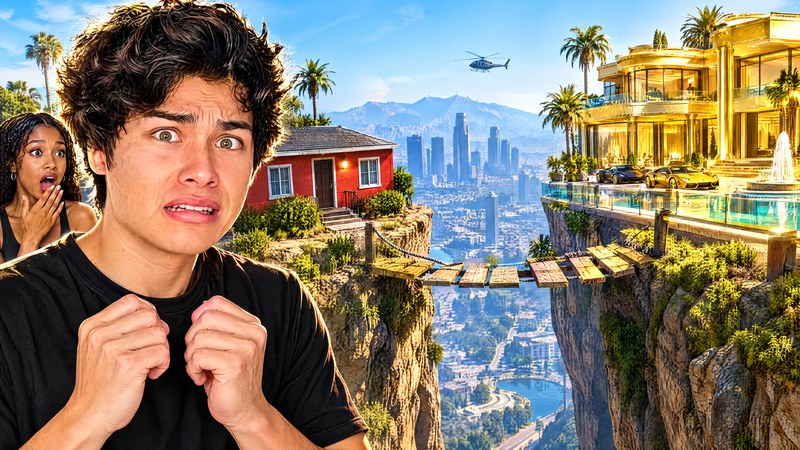

Crew contestants decide whether to keep a virtual dream home or risk it for a larger house through a fair final challenge.

GTA 5 launch / follow-up · GTA 5

- **0 (First Frame)–5s:** Alex foreground between a small red GTA home and a huge gold mansion, a dangerous gap separating them; KEEP / RISK.

- **5s–15s:** Choose and earn the home each contestant actually keeps. All property is in-game, disclosed house ladder and one fixed final trial.

- **15s–30s:** A contestant prefers the smaller house and refuses the seemingly obvious upgrade. Show the crew choosing its next move.

**Why this idea:** Shape: Risk Your Dream [SUBJECT], Win a [SUBJECT] in [GAME]. Ingredients: house, risk, money. Combined package: Risk Your Dream House, Win a Mansion in GTA. Use the cast's contrasting confidence and decision styles.

**Shape evidence:**

- [Would You Risk $5,000 for $100,000?](https://www.youtube.com/watch?v=2O-9RmuiXog) — MrBeast Gaming · 2021-03-16 · family · 159,792,929 views · 2.70× reported lift. Same title/premise family: Would You Risk $5,000 for $100,000?. Game, cast and execution transfer remains a hypothesis; this source does not validate the new episode outcome. Window: lifetime through source snapshot. [Metric source](https://majieddd.github.io/influint-channels-public/channels/UCIPPMRA040LQr5QPyJEbmXA.html).

- [Press This Button = Win $100,000!](https://www.youtube.com/watch?v=lJrHLnhJl-M) — MrBeast Gaming · 2023-07-07 · family · 141,650,337 views · 2.35× reported lift. Same title/premise family: Press This Button = Win $100,000!. Game, cast and execution transfer remains a hypothesis; this source does not validate the new episode outcome. Window: lifetime through source snapshot. [Metric source](https://majieddd.github.io/influint-channels-public/channels/UCIPPMRA040LQr5QPyJEbmXA.html).

- [Press This Button To Win $250,000](https://www.youtube.com/watch?v=70LOaxzmcg4) — MrBeast Gaming · 2026-03-28 · family · 27,919,825 views · 0.54× reported lift. Same title/premise family: Press This Button To Win $250,000. Game, cast and execution transfer remains a hypothesis; this source does not validate the new episode outcome. Window: lifetime through source snapshot. [Metric source](https://majieddd.github.io/influint-channels-public/channels/UCIPPMRA040LQr5QPyJEbmXA.html).

**Ingredient evidence:**

- [I FOUND PRESTON'S SECRET MINECRAFT HOUSE!](https://www.youtube.com/watch?v=1tlqVLYR9aM) — Brianna · 2019-01-19 · family · 20,172,457 views · 6.78× reported lift. Same concrete ingredient house: I FOUND PRESTON'S SECRET MINECRAFT HOUSE!. Game, cast and execution transfer remains a hypothesis; this source does not validate the new episode outcome. Window: lifetime through source snapshot. [Metric source](https://majieddd.github.io/influint-channels-public/channels/UCXg4rJUbDP1IP3TmZ9KDpJg.html).

- [If You Build a House, I'll Pay For It!](https://www.youtube.com/watch?v=xN8ENrfE-TY) — MrBeast Gaming · 2021-01-02 · family · 249,642,469 views · 5.38× reported lift. Same concrete ingredient house: If You Build a House, I'll Pay For It!. Game, cast and execution transfer remains a hypothesis; this source does not validate the new episode outcome. Window: lifetime through source snapshot. [Metric source](https://majieddd.github.io/influint-channels-public/channels/UCIPPMRA040LQr5QPyJEbmXA.html).

- [I Turned My House Into a Waterpark!](https://www.youtube.com/watch?v=WthL6_K8Kys) — Unspeakable · 2024-08-24 · family · 20,543,332 views · 4.23× reported lift. Same concrete ingredient house: I Turned My House Into a Waterpark!. Game, cast and execution transfer remains a hypothesis; this source does not validate the new episode outcome. Window: lifetime through source snapshot. [Metric source](https://majieddd.github.io/influint-channels-public/channels/UCwIWAbIeu0xI0ReKWOcw3eg.html).

- [I Found the HOUSE HEAD in Minecraft…](https://www.youtube.com/watch?v=JCy5R45b7k0) — PrestonPlayz · 2026-08-29 · family · 4,665,662 views · 2.38× reported lift. Same concrete ingredient house: I Found the HOUSE HEAD in Minecraft…. Game, cast and execution transfer remains a hypothesis; this source does not validate the new episode outcome. Window: Source says lifetime; row says 28d; unresolved. [Metric source](https://majieddd.github.io/influint-channels-public/channels/UCJZam2u1G0syq3kyqrCXrNw.html).

Evidence gaps: Shape: 1/2 qualifying outlier channels in the verified public pool; adjacent precedents remain proposals, not replication.

**Objective:** Choose and earn the home each contestant actually keeps.

**Rules:** All property is in-game, disclosed house ladder and one fixed final trial; no real-estate promise.

**Escalation:** A small upgrade seems obvious until a friend reaches the home they already love.

**Payoff:** Open the house actually won or retained and show the forfeiture if the attempt fails.

**Gamer reward:** Risk decisions can reflect real game skill.

**Non-gamer reward:** Tradeoffs, regret and a readable ladder are universal.

**People:** Several crew contestants with different risk tolerances; a host presents each choice and clearly tracks what is at stake.

**Production:** Reuse a tested world · $1,650–$3,600 · authored incremental allowance.

**Dependencies:** Define the actual reward pool, eligibility, challenge and loss conditions. Requested cash headlines need funded real stakes or explicit GTA/game-value wording that tells viewers what is being offered.

**Thumbnail:** Alex foreground between a small red GTA home and a huge gold mansion, a dangerous gap separating them; KEEP / RISK.

Composition reference: [Would You Risk $5,000 for $100,000?](https://www.youtube.com/watch?v=2O-9RmuiXog).

[Original PNG](generated-thumbnails/074.png) · [Exact image prompt](higgsfield-prompts/074.txt)

#### Idea 075 — Keep Your Minecraft Castle or Risk Everything

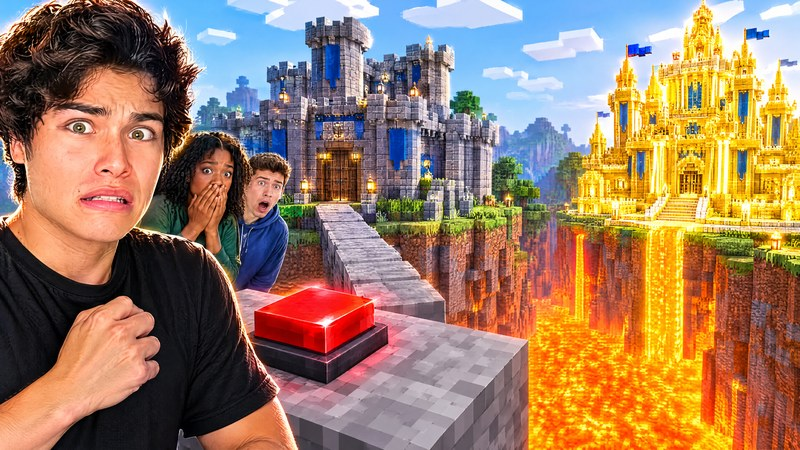

Builders choose whether to preserve their earned castle or wager it on a harder trial for a spectacular upgrade.

Later game expansion · Minecraft

- **0 (First Frame)–5s:** Alan foreground, gorgeous Minecraft castle behind a single red risk button, lava gap and bigger gold palace ahead.

- **5s–15s:** Finish with the best castle the contestant chooses to keep. Disclosed game builds and challenge ladder.

- **15s–30s:** The first builder becomes attached to a modest castle and surprises the crew by banking early. Show the crew choosing its next move.

**Why this idea:** Shape: Keep Your [GAME] [SUBJECT] or Risk Everything. Ingredients: Minecraft, risk, castle. Combined package: Keep Your Minecraft Castle or Risk Everything. Use the cast's contrasting confidence and decision styles.

**Shape evidence:**

- [Would You Risk $5,000 for $100,000?](https://www.youtube.com/watch?v=2O-9RmuiXog) — MrBeast Gaming · 2021-03-16 · family · 159,792,929 views · 2.70× reported lift. Same title/premise family: Would You Risk $5,000 for $100,000?. Game, cast and execution transfer remains a hypothesis; this source does not validate the new episode outcome. Window: lifetime through source snapshot. [Metric source](https://majieddd.github.io/influint-channels-public/channels/UCIPPMRA040LQr5QPyJEbmXA.html).

- [Press This Button = Win $100,000!](https://www.youtube.com/watch?v=lJrHLnhJl-M) — MrBeast Gaming · 2023-07-07 · family · 141,650,337 views · 2.35× reported lift. Same title/premise family: Press This Button = Win $100,000!. Game, cast and execution transfer remains a hypothesis; this source does not validate the new episode outcome. Window: lifetime through source snapshot. [Metric source](https://majieddd.github.io/influint-channels-public/channels/UCIPPMRA040LQr5QPyJEbmXA.html).

- [Press This Button To Win $250,000](https://www.youtube.com/watch?v=70LOaxzmcg4) — MrBeast Gaming · 2026-03-28 · family · 27,919,825 views · 0.54× reported lift. Same title/premise family: Press This Button To Win $250,000. Game, cast and execution transfer remains a hypothesis; this source does not validate the new episode outcome. Window: lifetime through source snapshot. [Metric source](https://majieddd.github.io/influint-channels-public/channels/UCIPPMRA040LQr5QPyJEbmXA.html).

**Ingredient evidence:**

- [100 Underwater Mystery Buttons but Only One Lets You Escape...](https://www.youtube.com/watch?v=XvV13G_WDdc) — Brianna · 2021-08-11 · family · 13,972,848 views · 4.63× reported lift. Same concrete ingredient risk: 100 Underwater Mystery Buttons but Only One Lets You Escape.... Game, cast and execution transfer remains a hypothesis; this source does not validate the new episode outcome. Window: lifetime through source snapshot. [Metric source](https://majieddd.github.io/influint-channels-public/channels/UCXg4rJUbDP1IP3TmZ9KDpJg.html).

- [Would You Risk $5,000 for $100,000?](https://www.youtube.com/watch?v=2O-9RmuiXog) — MrBeast Gaming · 2021-03-16 · family · 159,792,929 views · 2.70× reported lift. Same concrete ingredient risk: Would You Risk $5,000 for $100,000?. Game, cast and execution transfer remains a hypothesis; this source does not validate the new episode outcome. Window: lifetime through source snapshot. [Metric source](https://majieddd.github.io/influint-channels-public/channels/UCIPPMRA040LQr5QPyJEbmXA.html).

- [Clean The Sports Car, Keep It!](https://www.youtube.com/watch?v=6EtuOTq5TmM) — Stokes Twins · 2026-02-11 · family · 87,106,209 views · 1.48× reported lift. Same concrete ingredient risk: Clean The Sports Car, Keep It!. Game, cast and execution transfer remains a hypothesis; this source does not validate the new episode outcome. Window: lifetime through source snapshot. [Metric source](https://majieddd.github.io/influint-channels-public/channels/UCbp9MyKCTEww4CxEzc_Tp0Q.html).

- [If You Clean My House, You Keep It!](https://www.youtube.com/watch?v=I2MTojlaGQs) — Unspeakable · 2026-04-18 · family · 4,794,517 views · 1.47× reported lift. Same concrete ingredient risk: If You Clean My House, You Keep It!. Game, cast and execution transfer remains a hypothesis; this source does not validate the new episode outcome. Window: lifetime through source snapshot. [Metric source](https://majieddd.github.io/influint-channels-public/channels/UCwIWAbIeu0xI0ReKWOcw3eg.html).

Evidence gaps: Shape: 1/2 qualifying outlier channels in the verified public pool; adjacent precedents remain proposals, not replication.

**Objective:** Finish with the best castle the contestant chooses to keep.

**Rules:** Disclosed game builds and challenge ladder, backup for production safety only and no restoring a loss inside the published outcome.

**Escalation:** A cheap tower becomes a loved castle before a final trial threatens the entire result.

**Payoff:** Reveal the actual kept build and give every contestant a clear ending.

**Gamer reward:** Risk decisions can reflect real game skill.

**Non-gamer reward:** Tradeoffs, regret and a readable ladder are universal.

**People:** Several crew contestants with different risk tolerances; a host presents each choice and clearly tracks what is at stake.

**Production:** Reuse a tested world · $1,650–$3,600 · authored incremental allowance.

**Dependencies:** Define the actual reward pool, eligibility, challenge and loss conditions. Requested cash headlines need funded real stakes or explicit GTA/game-value wording that tells viewers what is being offered. Verify the exact edition, map, mod license and working mechanics; GTA-system reuse does not imply Minecraft support.

**Thumbnail:** Alan foreground, gorgeous Minecraft castle behind a single red risk button, lava gap and bigger gold palace ahead.

Composition reference: [Would You Risk $5,000 for $100,000?](https://www.youtube.com/watch?v=2O-9RmuiXog).

[Original PNG](generated-thumbnails/075.png) · [Exact image prompt](higgsfield-prompts/075.txt)

### Format 16 — Escape an extraordinary prison

A crew of inmates discovers and defeats layers of a designed security system, learning from failed plans before executing one coordinated escape.

Title family: We Escaped ___ Most ___ Prison

New proposal replacing camouflage hide-and-seek; needs user review.

#### Idea 076 — We Escaped GTA's Most Secure Prison

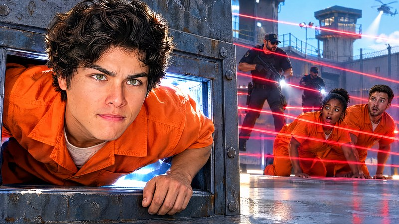

The crew breaks out of a purpose-built game prison by combining clues, timed choices and distinct cast roles.

GTA 5 launch / follow-up · GTA 5

- **0 (First Frame)–5s:** Alan climbing through a tiny bright opening in an immense steel GTA prison, red laser grid and adult crew guards behind.

- **5s–15s:** Get every surviving inmate through the final outside gate. Custom playable prison, fair disclosed life/time rules and crew guards.

- **15s–30s:** The first key opens a door but leads directly into the guard route. Show the crew choosing its next move.

**Why this idea:** Shape: We Escaped [GAME]'s Most Secure [SUBJECT]. Ingredients: prison, escape, GTA. Combined package: We Escaped GTA's Most Secure Prison. Bring IRL prison/escape spectacle into a playable cast adventure.

**Shape evidence:**

- [7 Days Escaping Cardboard Prison!](https://www.youtube.com/watch?v=WU05jZnUiYs) — Unspeakable · 2026-01-24 · family · 12,880,314 views · 3.65× reported lift. Same title/premise family: 7 Days Escaping Cardboard Prison!. Game, cast and execution transfer remains a hypothesis; this source does not validate the new episode outcome. Window: lifetime through source snapshot. [Metric source](https://majieddd.github.io/influint-channels-public/channels/UCwIWAbIeu0xI0ReKWOcw3eg.html).

- [7 Days Escaping Trampoline Park Prison!](https://www.youtube.com/watch?v=Rsx9LHfKoXU) — Unspeakable · 2026-09-05 · family · 4,301,184 views · 1.73× reported lift. Same title/premise family: 7 Days Escaping Trampoline Park Prison!. Game, cast and execution transfer remains a hypothesis; this source does not validate the new episode outcome. Window: lifetime through source snapshot. [Metric source](https://majieddd.github.io/influint-channels-public/channels/UCwIWAbIeu0xI0ReKWOcw3eg.html).

**Ingredient evidence:**

- [7 Days Escaping Cardboard Prison!](https://www.youtube.com/watch?v=WU05jZnUiYs) — Unspeakable · 2026-01-24 · family · 12,880,314 views · 3.65× reported lift. Same concrete ingredient prison: 7 Days Escaping Cardboard Prison!. Game, cast and execution transfer remains a hypothesis; this source does not validate the new episode outcome. Window: lifetime through source snapshot. [Metric source](https://majieddd.github.io/influint-channels-public/channels/UCwIWAbIeu0xI0ReKWOcw3eg.html).

- [Preston TRAPPED Me in an UNDERWATER Prison!](https://www.youtube.com/watch?v=4ydq5MXO42c) — Brianna · 2022-07-31 · family · 4,059,814 views · 2.97× reported lift. Same concrete ingredient prison: Preston TRAPPED Me in an UNDERWATER Prison!. Game, cast and execution transfer remains a hypothesis; this source does not validate the new episode outcome. Window: lifetime through source snapshot. [Metric source](https://majieddd.github.io/influint-channels-public/channels/UCXg4rJUbDP1IP3TmZ9KDpJg.html).

- [Prisoner Drive Thru Prank](https://www.youtube.com/watch?v=nuK7e1xzThc) — Stokes Twins · 2019-08-18 · family · 25,610,924 views · 2.94× reported lift. Same concrete ingredient prison: Prisoner Drive Thru Prank. Game, cast and execution transfer remains a hypothesis; this source does not validate the new episode outcome. Window: lifetime through source snapshot. [Metric source](https://majieddd.github.io/influint-channels-public/channels/UCbp9MyKCTEww4CxEzc_Tp0Q.html).

- [7 Days Escaping Trampoline Park Prison!](https://www.youtube.com/watch?v=Rsx9LHfKoXU) — Unspeakable · 2026-09-05 · family · 4,301,184 views · 1.73× reported lift. Same concrete ingredient prison: 7 Days Escaping Trampoline Park Prison!. Game, cast and execution transfer remains a hypothesis; this source does not validate the new episode outcome. Window: lifetime through source snapshot. [Metric source](https://majieddd.github.io/influint-channels-public/channels/UCwIWAbIeu0xI0ReKWOcw3eg.html).

Evidence gaps: Shape: 1/2 qualifying outlier channels in the verified public pool; adjacent precedents remain proposals, not replication.

**Objective:** Get every surviving inmate through the final outside gate.

**Rules:** Custom playable prison, fair disclosed life/time rules and crew guards; superlative is a tested creative premise, not a security record.

**Escalation:** A simple lock becomes a patrol problem, an apparent shortcut traps a teammate and the final gate requires coordinated action.

**Payoff:** Show the real escape or capture and replay the clue that made the difference.

**Gamer reward:** Sandbox improvisation and exploiting a deliberately built security puzzle.

**Non-gamer reward:** The guards, barriers, plan and freedom are easy to understand.

**People:** Several crew inmates; other crew play guards or the designer, with flexible twin roles.

**Production:** Reusable custom challenge · $3,400–$7,500 · authored incremental allowance.

**Dependencies:** Scoped prison/guard behaviors, a solvable final route and multi-angle recording. The most-secure headline needs a visibly exceptional designed challenge.

**Thumbnail:** Alan climbing through a tiny bright opening in an immense steel GTA prison, red laser grid and adult crew guards behind.

Composition reference: [7 Days Escaping Cardboard Prison!](https://www.youtube.com/watch?v=WU05jZnUiYs).

[Original PNG](generated-thumbnails/076.png) · [Exact image prompt](higgsfield-prompts/076.txt)

#### Idea 077 — We Escaped an Underwater Prison in GTA

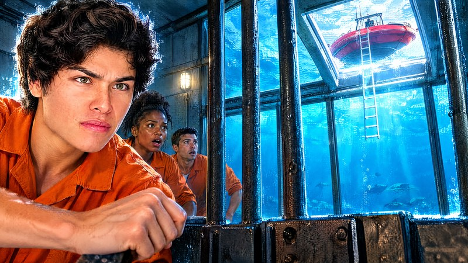

The crew solves a submerged custom prison and must plan an exit before a shared oxygen timer runs out.

GTA 5 launch / follow-up · GTA 5

- **0 (First Frame)–5s:** Alex behind enormous glass underwater prison bars, blue ocean outside, red rescue boat above and a tiny open hatch.

- **5s–15s:** Reach the marked rescue boat after opening the prison exit. Game-only oxygen rules, a tested playable exit and fixed retries.

- **15s–30s:** The crew sees the exit key through the glass but cannot reach it from the cell. Show the crew choosing its next move.

**Why this idea:** Shape: We Escaped an Underwater [SUBJECT] in [GAME]. Ingredients: prison, water, escape. Combined package: We Escaped an Underwater Prison in GTA. Bring IRL prison/escape spectacle into a playable cast adventure.

**Shape evidence:**

- [7 Days Escaping Cardboard Prison!](https://www.youtube.com/watch?v=WU05jZnUiYs) — Unspeakable · 2026-01-24 · family · 12,880,314 views · 3.65× reported lift. Same title/premise family: 7 Days Escaping Cardboard Prison!. Game, cast and execution transfer remains a hypothesis; this source does not validate the new episode outcome. Window: lifetime through source snapshot. [Metric source](https://majieddd.github.io/influint-channels-public/channels/UCwIWAbIeu0xI0ReKWOcw3eg.html).

- [7 Days Escaping Trampoline Park Prison!](https://www.youtube.com/watch?v=Rsx9LHfKoXU) — Unspeakable · 2026-09-05 · family · 4,301,184 views · 1.73× reported lift. Same title/premise family: 7 Days Escaping Trampoline Park Prison!. Game, cast and execution transfer remains a hypothesis; this source does not validate the new episode outcome. Window: lifetime through source snapshot. [Metric source](https://majieddd.github.io/influint-channels-public/channels/UCwIWAbIeu0xI0ReKWOcw3eg.html).

**Ingredient evidence:**

- [7 Days Escaping Cardboard Prison!](https://www.youtube.com/watch?v=WU05jZnUiYs) — Unspeakable · 2026-01-24 · family · 12,880,314 views · 3.65× reported lift. Same concrete ingredient prison: 7 Days Escaping Cardboard Prison!. Game, cast and execution transfer remains a hypothesis; this source does not validate the new episode outcome. Window: lifetime through source snapshot. [Metric source](https://majieddd.github.io/influint-channels-public/channels/UCwIWAbIeu0xI0ReKWOcw3eg.html).

- [Preston TRAPPED Me in an UNDERWATER Prison!](https://www.youtube.com/watch?v=4ydq5MXO42c) — Brianna · 2022-07-31 · family · 4,059,814 views · 2.97× reported lift. Same concrete ingredient prison: Preston TRAPPED Me in an UNDERWATER Prison!. Game, cast and execution transfer remains a hypothesis; this source does not validate the new episode outcome. Window: lifetime through source snapshot. [Metric source](https://majieddd.github.io/influint-channels-public/channels/UCXg4rJUbDP1IP3TmZ9KDpJg.html).

- [Prisoner Drive Thru Prank](https://www.youtube.com/watch?v=nuK7e1xzThc) — Stokes Twins · 2019-08-18 · family · 25,610,924 views · 2.94× reported lift. Same concrete ingredient prison: Prisoner Drive Thru Prank. Game, cast and execution transfer remains a hypothesis; this source does not validate the new episode outcome. Window: lifetime through source snapshot. [Metric source](https://majieddd.github.io/influint-channels-public/channels/UCbp9MyKCTEww4CxEzc_Tp0Q.html).

- [7 Days Escaping Trampoline Park Prison!](https://www.youtube.com/watch?v=Rsx9LHfKoXU) — Unspeakable · 2026-09-05 · family · 4,301,184 views · 1.73× reported lift. Same concrete ingredient prison: 7 Days Escaping Trampoline Park Prison!. Game, cast and execution transfer remains a hypothesis; this source does not validate the new episode outcome. Window: lifetime through source snapshot. [Metric source](https://majieddd.github.io/influint-channels-public/channels/UCwIWAbIeu0xI0ReKWOcw3eg.html).

Evidence gaps: Shape: 1/2 qualifying outlier channels in the verified public pool; adjacent precedents remain proposals, not replication.

**Objective:** Reach the marked rescue boat after opening the prison exit.

**Rules:** Game-only oxygen rules, a tested playable exit and fixed retries; no real underwater confinement.

**Escalation:** A key lies outside the cell, a leak blocks the easy tunnel and the final escape needs a coordinated handoff.

**Payoff:** Show the actual last inmate reaching the boat or the clear in-game failure.

**Gamer reward:** Sandbox improvisation and exploiting a deliberately built security puzzle.

**Non-gamer reward:** The guards, barriers, plan and freedom are easy to understand.

**People:** Several crew inmates; other crew play guards or the designer, with flexible twin roles.

**Production:** Reusable custom challenge · $3,400–$7,500 · authored incremental allowance.

**Dependencies:** Scoped prison/guard behaviors, a solvable final route and multi-angle recording. The most-secure headline needs a visibly exceptional designed challenge.

**Thumbnail:** Alex behind enormous glass underwater prison bars, blue ocean outside, red rescue boat above and a tiny open hatch.

Composition reference: [7 Days Escaping Cardboard Prison!](https://www.youtube.com/watch?v=WU05jZnUiYs).

[Original PNG](generated-thumbnails/077.png) · [Exact image prompt](higgsfield-prompts/077.txt)

#### Idea 078 — We Escaped a Prison Inside a Moving Train in GTA

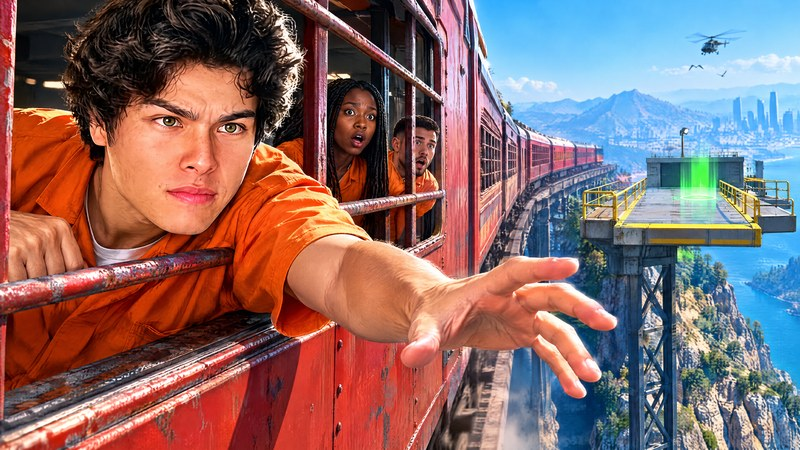

The crew works through a custom moving-train prison while the final destination creates a clear deadline.

GTA 5 launch / follow-up · GTA 5

- **0 (First Frame)–5s:** Alan reaching out of a barred red train-car window, enormous moving train over a blue valley, safe platform ahead.

- **5s–15s:** Unlock the exit and reach the marked safe platform before arrival. Tested game moving interior, fixed route and no off-camera vehicle teleport.

- **15s–30s:** The crew opens the first cell but discovers the connecting carriage door is missing its handle. Show the crew choosing its next move.

**Why this idea:** Shape: We Escaped a [SUBJECT] Inside a Moving [SUBJECT] in [GAME]. Ingredients: train, prison, escape. Combined package: We Escaped a Prison Inside a Moving Train in GTA. Bring IRL prison/escape spectacle into a playable cast adventure.

**Shape evidence:**

- [7 Days Escaping Cardboard Prison!](https://www.youtube.com/watch?v=WU05jZnUiYs) — Unspeakable · 2026-01-24 · family · 12,880,314 views · 3.65× reported lift. Same title/premise family: 7 Days Escaping Cardboard Prison!. Game, cast and execution transfer remains a hypothesis; this source does not validate the new episode outcome. Window: lifetime through source snapshot. [Metric source](https://majieddd.github.io/influint-channels-public/channels/UCwIWAbIeu0xI0ReKWOcw3eg.html).

- [7 Days Escaping Trampoline Park Prison!](https://www.youtube.com/watch?v=Rsx9LHfKoXU) — Unspeakable · 2026-09-05 · family · 4,301,184 views · 1.73× reported lift. Same title/premise family: 7 Days Escaping Trampoline Park Prison!. Game, cast and execution transfer remains a hypothesis; this source does not validate the new episode outcome. Window: lifetime through source snapshot. [Metric source](https://majieddd.github.io/influint-channels-public/channels/UCwIWAbIeu0xI0ReKWOcw3eg.html).

**Ingredient evidence:**

- [I Sent Preston to Santa Training School...](https://www.youtube.com/watch?v=1VUwRiae8IM) — Brianna · 2020-12-02 · family · 3,067,787 views · 1.80× reported lift. Same concrete ingredient train: I Sent Preston to Santa Training School.... Game, cast and execution transfer remains a hypothesis; this source does not validate the new episode outcome. Window: lifetime through source snapshot. [Metric source](https://majieddd.github.io/influint-channels-public/channels/UCXg4rJUbDP1IP3TmZ9KDpJg.html).

- [Driving 100 Hours In A Cardboard Train!](https://www.youtube.com/watch?v=3InYPKOC0jQ) — Unspeakable · 2025-08-02 · family · 7,024,006 views · 1.57× reported lift. Same concrete ingredient train: Driving 100 Hours In A Cardboard Train!. Game, cast and execution transfer remains a hypothesis; this source does not validate the new episode outcome. Window: lifetime through source snapshot. [Metric source](https://majieddd.github.io/influint-channels-public/channels/UCwIWAbIeu0xI0ReKWOcw3eg.html).

- [How To Train Your Dragon In Real Life](https://www.youtube.com/watch?v=x__vFVb4p78) — Unspeakable · 2025-06-14 · family · 2,768,981 views · 0.81× reported lift. Same concrete ingredient train: How To Train Your Dragon In Real Life. Game, cast and execution transfer remains a hypothesis; this source does not validate the new episode outcome. Window: lifetime through source snapshot. [Metric source](https://majieddd.github.io/influint-channels-public/channels/UCwIWAbIeu0xI0ReKWOcw3eg.html).

- [Last to Leave Actual SWAT Training Wins $1000! - Challenge](https://www.youtube.com/watch?v=Mz_4cCErgw4) — Brianna · 2020-06-24 · family · 2,040,812 views · 0.62× reported lift. Same concrete ingredient train: Last to Leave Actual SWAT Training Wins $1000! - Challenge. Game, cast and execution transfer remains a hypothesis; this source does not validate the new episode outcome. Window: lifetime through source snapshot. [Metric source](https://majieddd.github.io/influint-channels-public/channels/UCXg4rJUbDP1IP3TmZ9KDpJg.html).

Evidence gaps: Shape: 1/2 qualifying outlier channels in the verified public pool; adjacent precedents remain proposals, not replication. Ingredients: 0/2 qualifying outlier channels for the principal ingredient; this does not establish the full game/cast combination.

**Objective:** Unlock the exit and reach the marked safe platform before arrival.

**Rules:** Tested game moving interior, fixed route and no off-camera vehicle teleport; explain custom geometry visually.

**Escalation:** The first car opens, a missing bridge separates teammates and the approaching station forces one final timing choice.

**Payoff:** Show the actual escape with a wide exterior view and the train's arrival.

**Gamer reward:** Sandbox improvisation and exploiting a deliberately built security puzzle.

**Non-gamer reward:** The guards, barriers, plan and freedom are easy to understand.

**People:** Several crew inmates; other crew play guards or the designer, with flexible twin roles.

**Production:** Reusable custom challenge · $3,400–$7,500 · authored incremental allowance.

**Dependencies:** Scoped prison/guard behaviors, a solvable final route and multi-angle recording. The most-secure headline needs a visibly exceptional designed challenge.

**Thumbnail:** Alan reaching out of a barred red train-car window, enormous moving train over a blue valley, safe platform ahead.

Composition reference: [7 Days Escaping Cardboard Prison!](https://www.youtube.com/watch?v=WU05jZnUiYs).

[Original PNG](generated-thumbnails/078.png) · [Exact image prompt](higgsfield-prompts/078.txt)

#### Idea 079 — We Escaped a Prison That Changed Every Minute in GTA

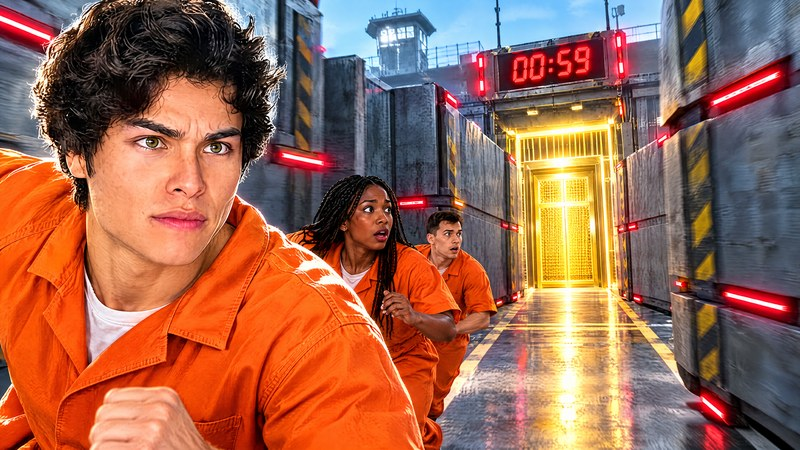

A visible timed prison mechanism changes the crew's route while they try to solve one consistent escape objective.

GTA 5 launch / follow-up · GTA 5

- **0 (First Frame)–5s:** Alex foreground surrounded by enormous moving steel prison walls, a single golden exit and red timer display.

- **5s–15s:** Exit before the final configuration closes the route. Every minute change is real and logged, each configuration is solvable and the audience sees the cause.

- **15s–30s:** The crew memorizes the first corridor just before its walls shift. Show the crew choosing its next move.

**Why this idea:** Shape: We Escaped a [SUBJECT] That Changed Every Minute in [GAME]. Ingredients: prison, harder, escape. Combined package: We Escaped a Prison That Changed Every Minute in GTA. Bring IRL prison/escape spectacle into a playable cast adventure.

**Shape evidence:**

- [7 Days Escaping Cardboard Prison!](https://www.youtube.com/watch?v=WU05jZnUiYs) — Unspeakable · 2026-01-24 · family · 12,880,314 views · 3.65× reported lift. Same title/premise family: 7 Days Escaping Cardboard Prison!. Game, cast and execution transfer remains a hypothesis; this source does not validate the new episode outcome. Window: lifetime through source snapshot. [Metric source](https://majieddd.github.io/influint-channels-public/channels/UCwIWAbIeu0xI0ReKWOcw3eg.html).

- [7 Days Escaping Trampoline Park Prison!](https://www.youtube.com/watch?v=Rsx9LHfKoXU) — Unspeakable · 2026-09-05 · family · 4,301,184 views · 1.73× reported lift. Same title/premise family: 7 Days Escaping Trampoline Park Prison!. Game, cast and execution transfer remains a hypothesis; this source does not validate the new episode outcome. Window: lifetime through source snapshot. [Metric source](https://majieddd.github.io/influint-channels-public/channels/UCwIWAbIeu0xI0ReKWOcw3eg.html).

**Ingredient evidence:**

- [7 Days Escaping Cardboard Prison!](https://www.youtube.com/watch?v=WU05jZnUiYs) — Unspeakable · 2026-01-24 · family · 12,880,314 views · 3.65× reported lift. Same concrete ingredient prison: 7 Days Escaping Cardboard Prison!. Game, cast and execution transfer remains a hypothesis; this source does not validate the new episode outcome. Window: lifetime through source snapshot. [Metric source](https://majieddd.github.io/influint-channels-public/channels/UCwIWAbIeu0xI0ReKWOcw3eg.html).

- [Preston TRAPPED Me in an UNDERWATER Prison!](https://www.youtube.com/watch?v=4ydq5MXO42c) — Brianna · 2022-07-31 · family · 4,059,814 views · 2.97× reported lift. Same concrete ingredient prison: Preston TRAPPED Me in an UNDERWATER Prison!. Game, cast and execution transfer remains a hypothesis; this source does not validate the new episode outcome. Window: lifetime through source snapshot. [Metric source](https://majieddd.github.io/influint-channels-public/channels/UCXg4rJUbDP1IP3TmZ9KDpJg.html).

- [Prisoner Drive Thru Prank](https://www.youtube.com/watch?v=nuK7e1xzThc) — Stokes Twins · 2019-08-18 · family · 25,610,924 views · 2.94× reported lift. Same concrete ingredient prison: Prisoner Drive Thru Prank. Game, cast and execution transfer remains a hypothesis; this source does not validate the new episode outcome. Window: lifetime through source snapshot. [Metric source](https://majieddd.github.io/influint-channels-public/channels/UCbp9MyKCTEww4CxEzc_Tp0Q.html).

- [7 Days Escaping Trampoline Park Prison!](https://www.youtube.com/watch?v=Rsx9LHfKoXU) — Unspeakable · 2026-09-05 · family · 4,301,184 views · 1.73× reported lift. Same concrete ingredient prison: 7 Days Escaping Trampoline Park Prison!. Game, cast and execution transfer remains a hypothesis; this source does not validate the new episode outcome. Window: lifetime through source snapshot. [Metric source](https://majieddd.github.io/influint-channels-public/channels/UCwIWAbIeu0xI0ReKWOcw3eg.html).

Evidence gaps: Shape: 1/2 qualifying outlier channels in the verified public pool; adjacent precedents remain proposals, not replication.

**Objective:** Exit before the final configuration closes the route.

**Rules:** Every minute change is real and logged, each configuration is solvable and the audience sees the cause.

**Escalation:** A familiar corridor moves, a previous clue gains a new use and the final change forces a shared gamble.

**Payoff:** Resolve the final escape and show the exact sequence of changes.

**Gamer reward:** Sandbox improvisation and exploiting a deliberately built security puzzle.

**Non-gamer reward:** The guards, barriers, plan and freedom are easy to understand.

**People:** Several crew inmates; other crew play guards or the designer, with flexible twin roles.

**Production:** Reusable custom challenge · $3,400–$7,500 · authored incremental allowance.

**Dependencies:** Scoped prison/guard behaviors, a solvable final route and multi-angle recording. The most-secure headline needs a visibly exceptional designed challenge.

**Thumbnail:** Alex foreground surrounded by enormous moving steel prison walls, a single golden exit and red timer display.

Composition reference: [7 Days Escaping Cardboard Prison!](https://www.youtube.com/watch?v=WU05jZnUiYs).

[Original PNG](generated-thumbnails/079.png) · [Exact image prompt](higgsfield-prompts/079.txt)

#### Idea 080 — We Escaped Minecraft's Most Secure Prison

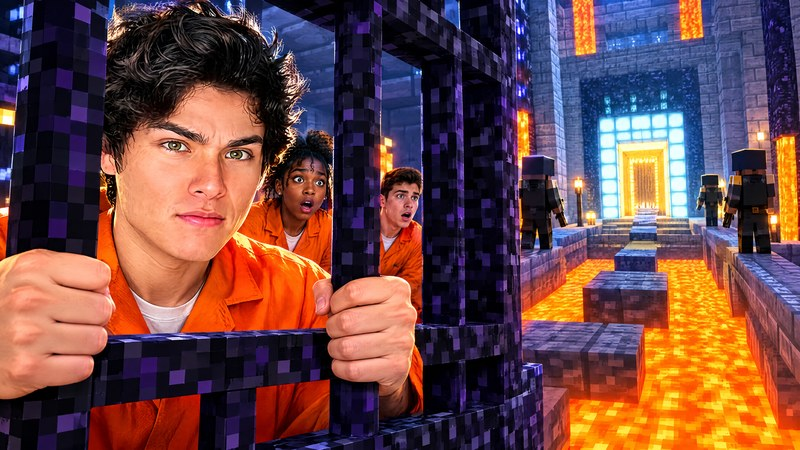

The crew solves a purpose-built Minecraft prison through environmental clues and cooperative mechanisms.

Later game expansion · Minecraft

- **0 (First Frame)–5s:** Alan behind gigantic Minecraft obsidian prison bars, tiny glowing exit, lava channel and adult crew guard silhouettes.

- **5s–15s:** Get the group through the final outside gate without bypassing the puzzle route. Custom map, fixed clue budget, true participant attempts and no admin escape during the filmed result.

- **15s–30s:** The first discovered switch helps one teammate but locks the other's route. Show the crew choosing its next move.

**Why this idea:** Shape: We Escaped [GAME]'s Most Secure [SUBJECT]. Ingredients: Minecraft, prison, escape. Combined package: We Escaped Minecraft's Most Secure Prison. Bring IRL prison/escape spectacle into a playable cast adventure.

**Shape evidence:**

- [7 Days Escaping Cardboard Prison!](https://www.youtube.com/watch?v=WU05jZnUiYs) — Unspeakable · 2026-01-24 · family · 12,880,314 views · 3.65× reported lift. Same title/premise family: 7 Days Escaping Cardboard Prison!. Game, cast and execution transfer remains a hypothesis; this source does not validate the new episode outcome. Window: lifetime through source snapshot. [Metric source](https://majieddd.github.io/influint-channels-public/channels/UCwIWAbIeu0xI0ReKWOcw3eg.html).

- [7 Days Escaping Trampoline Park Prison!](https://www.youtube.com/watch?v=Rsx9LHfKoXU) — Unspeakable · 2026-09-05 · family · 4,301,184 views · 1.73× reported lift. Same title/premise family: 7 Days Escaping Trampoline Park Prison!. Game, cast and execution transfer remains a hypothesis; this source does not validate the new episode outcome. Window: lifetime through source snapshot. [Metric source](https://majieddd.github.io/influint-channels-public/channels/UCwIWAbIeu0xI0ReKWOcw3eg.html).

**Ingredient evidence:**

- [7 Days Escaping Cardboard Prison!](https://www.youtube.com/watch?v=WU05jZnUiYs) — Unspeakable · 2026-01-24 · family · 12,880,314 views · 3.65× reported lift. Same concrete ingredient prison: 7 Days Escaping Cardboard Prison!. Game, cast and execution transfer remains a hypothesis; this source does not validate the new episode outcome. Window: lifetime through source snapshot. [Metric source](https://majieddd.github.io/influint-channels-public/channels/UCwIWAbIeu0xI0ReKWOcw3eg.html).

- [Preston TRAPPED Me in an UNDERWATER Prison!](https://www.youtube.com/watch?v=4ydq5MXO42c) — Brianna · 2022-07-31 · family · 4,059,814 views · 2.97× reported lift. Same concrete ingredient prison: Preston TRAPPED Me in an UNDERWATER Prison!. Game, cast and execution transfer remains a hypothesis; this source does not validate the new episode outcome. Window: lifetime through source snapshot. [Metric source](https://majieddd.github.io/influint-channels-public/channels/UCXg4rJUbDP1IP3TmZ9KDpJg.html).

- [Prisoner Drive Thru Prank](https://www.youtube.com/watch?v=nuK7e1xzThc) — Stokes Twins · 2019-08-18 · family · 25,610,924 views · 2.94× reported lift. Same concrete ingredient prison: Prisoner Drive Thru Prank. Game, cast and execution transfer remains a hypothesis; this source does not validate the new episode outcome. Window: lifetime through source snapshot. [Metric source](https://majieddd.github.io/influint-channels-public/channels/UCbp9MyKCTEww4CxEzc_Tp0Q.html).

- [7 Days Escaping Trampoline Park Prison!](https://www.youtube.com/watch?v=Rsx9LHfKoXU) — Unspeakable · 2026-09-05 · family · 4,301,184 views · 1.73× reported lift. Same concrete ingredient prison: 7 Days Escaping Trampoline Park Prison!. Game, cast and execution transfer remains a hypothesis; this source does not validate the new episode outcome. Window: lifetime through source snapshot. [Metric source](https://majieddd.github.io/influint-channels-public/channels/UCwIWAbIeu0xI0ReKWOcw3eg.html).

Evidence gaps: Shape: 1/2 qualifying outlier channels in the verified public pool; adjacent precedents remain proposals, not replication.

**Objective:** Get the group through the final outside gate without bypassing the puzzle route.

**Rules:** Custom map, fixed clue budget, true participant attempts and no admin escape during the filmed result.

**Escalation:** A simple chest clue becomes a team split and the final redstone gate needs both sides to act together.

**Payoff:** Show the full winning mechanism or the puzzle that actually defeats the crew.

**Gamer reward:** Sandbox improvisation and exploiting a deliberately built security puzzle.

**Non-gamer reward:** The guards, barriers, plan and freedom are easy to understand.

**People:** Several crew inmates; other crew play guards or the designer, with flexible twin roles.

**Production:** Reusable custom challenge · $3,400–$7,500 · authored incremental allowance.

**Dependencies:** Scoped prison/guard behaviors, a solvable final route and multi-angle recording. The most-secure headline needs a visibly exceptional designed challenge. Verify the exact edition, map, mod license and working mechanics; GTA-system reuse does not imply Minecraft support.

**Thumbnail:** Alan behind gigantic Minecraft obsidian prison bars, tiny glowing exit, lava channel and adult crew guard silhouettes.

Composition reference: [7 Days Escaping Cardboard Prison!](https://www.youtube.com/watch?v=WU05jZnUiYs).

[Original PNG](generated-thumbnails/080.png) · [Exact image prompt](higgsfield-prompts/080.txt)

### Format 17 — I’ll buy anything you build

Builders create objects they want under a clear scope, demonstrate what they built, and the host fulfills the promised purchase when the build meets the rules.

Title family: I'll Buy Anything You ___

Retained with the user’s exact title. Specify actual purchasing rules before packaging the episode.

#### Idea 081 — I'll Buy Anything You Build in GTA

Crew builders design functioning game creations and the host fulfills the winning designs inside the game.

GTA 5 launch / follow-up · GTA 5

- **0 (First Frame)–5s:** Alan delighted left pointing at an enormous gold GTA mansion and red custom supercar build; BUILD IT.

- **5s–15s:** Deliver every build that meets the disclosed size, function and game-value allowance. Launch version buys virtual creations with game currency.

- **15s–30s:** The first builder asks for a creation too large for the agreed plot. Show the crew choosing its next move.

**Why this idea:** Shape: I'll Buy Anything You Build in [GAME]. Ingredients: build, buy, GTA. Combined package: I'll Buy Anything You Build in GTA. Use the user’s preferred broad build-and-buy promise with Stokes presentation.

**Shape evidence:**

- [If You Build a House, I'll Pay For It!](https://www.youtube.com/watch?v=xN8ENrfE-TY) — MrBeast Gaming · 2021-01-02 · family · 249,642,469 views · 5.38× reported lift. Same title/premise family: If You Build a House, I'll Pay For It!. Game, cast and execution transfer remains a hypothesis; this source does not validate the new episode outcome. Window: lifetime through source snapshot. [Metric source](https://majieddd.github.io/influint-channels-public/channels/UCIPPMRA040LQr5QPyJEbmXA.html).

- [Whatever You Build, I'll Buy! - Challenge](https://www.youtube.com/watch?v=kvgm3ZrPgzk) — Brianna · 2020-12-19 · family · 3,825,802 views · 2.43× reported lift. Same title/premise family: Whatever You Build, I'll Buy! - Challenge. Game, cast and execution transfer remains a hypothesis; this source does not validate the new episode outcome. Window: lifetime through source snapshot. [Metric source](https://majieddd.github.io/influint-channels-public/channels/UCXg4rJUbDP1IP3TmZ9KDpJg.html).

- [If You Build It, I'll Pay For It!](https://www.youtube.com/watch?v=RvYkeTmM1gc) — MrBeast Gaming · 2022-12-31 · family · 121,694,173 views · 2.02× reported lift. Same title/premise family: If You Build It, I'll Pay For It!. Game, cast and execution transfer remains a hypothesis; this source does not validate the new episode outcome. Window: lifetime through source snapshot. [Metric source](https://majieddd.github.io/influint-channels-public/channels/UCIPPMRA040LQr5QPyJEbmXA.html).

- [If You Build A Lambo I'll Pay For It!](https://www.youtube.com/watch?v=iSvsf27wRns) — MrBeast Gaming · 2021-04-26 · family · 128,272,619 views · 1.24× reported lift. Same title/premise family: If You Build A Lambo I'll Pay For It!. Game, cast and execution transfer remains a hypothesis; this source does not validate the new episode outcome. Window: lifetime through source snapshot. [Metric source](https://majieddd.github.io/influint-channels-public/channels/UCIPPMRA040LQr5QPyJEbmXA.html).

**Ingredient evidence:**

- [If You Build a House, I'll Pay For It!](https://www.youtube.com/watch?v=xN8ENrfE-TY) — MrBeast Gaming · 2021-01-02 · family · 249,642,469 views · 5.38× reported lift. Same concrete ingredient buy: If You Build a House, I'll Pay For It!. Game, cast and execution transfer remains a hypothesis; this source does not validate the new episode outcome. Window: lifetime through source snapshot. [Metric source](https://majieddd.github.io/influint-channels-public/channels/UCIPPMRA040LQr5QPyJEbmXA.html).

- [I'll buy anything Preston Can Carry Challenge](https://www.youtube.com/watch?v=o-p9NSGzFOk) — Brianna · 2019-10-26 · family · 17,304,168 views · 2.96× reported lift. Same concrete ingredient buy: I'll buy anything Preston Can Carry Challenge. Game, cast and execution transfer remains a hypothesis; this source does not validate the new episode outcome. Window: lifetime through source snapshot. [Metric source](https://majieddd.github.io/influint-channels-public/channels/UCXg4rJUbDP1IP3TmZ9KDpJg.html).

- [Buying EVERYTHING My Twin Touches Blindfolded!](https://www.youtube.com/watch?v=V20fOzefeso) — Stokes Twins · 2019-08-14 · family · 4,237,440 views · 0.49× reported lift. Same concrete ingredient buy: Buying EVERYTHING My Twin Touches Blindfolded!. Game, cast and execution transfer remains a hypothesis; this source does not validate the new episode outcome. Window: lifetime through source snapshot. [Metric source](https://majieddd.github.io/influint-channels-public/channels/UCbp9MyKCTEww4CxEzc_Tp0Q.html).

- [Whatever You Build, I'll Buy! - Challenge](https://www.youtube.com/watch?v=kvgm3ZrPgzk) — Brianna · 2020-12-19 · family · 3,825,802 views · 2.43× reported lift. Same concrete ingredient buy: Whatever You Build, I'll Buy! - Challenge. Game, cast and execution transfer remains a hypothesis; this source does not validate the new episode outcome. Window: lifetime through source snapshot. [Metric source](https://majieddd.github.io/influint-channels-public/channels/UCXg4rJUbDP1IP3TmZ9KDpJg.html).

Two qualifying source channels on both axes; creator groups and exact-mixture limitations remain visible in the website.

**Objective:** Deliver every build that meets the disclosed size, function and game-value allowance.

**Rules:** Launch version buys virtual creations with game currency; explain the cap before building, with no implied real unlimited purchases.

**Escalation:** An ordinary request becomes a ridiculous vehicle and the final builder uses the rules more cleverly than expected.

**Payoff:** Deliver the accepted builds, demonstrate each function and show any rejection against the original rules.

**Gamer reward:** Design ingenuity and game-world function reward gamers.

**Non-gamer reward:** A creative transformation and the participant receiving the thing they wanted carry the payoff.

**People:** Several cast members or invited builders propose and create, while one host funds and tests the build; twins can rotate hosting.

**Production:** Bespoke working hero build · $7,100–$15,900 · authored incremental allowance.

**Dependencies:** A game/build environment, builder compensation, clear purchase rules and a funded reward cap. If fulfilling real builds is unaffordable, use an explicitly virtual version rather than imply a real purchase.

**Thumbnail:** Alan delighted left pointing at an enormous gold GTA mansion and red custom supercar build; BUILD IT.

Composition reference: [If You Build a House, I'll Pay For It!](https://www.youtube.com/watch?v=xN8ENrfE-TY).

[Original PNG](generated-thumbnails/081.png) · [Exact image prompt](higgsfield-prompts/081.txt)

#### Idea 082 — I'll Buy Any Car My Friends Build in GTA

The crew designs custom vehicles whose real game performance determines which virtual purchase the host fulfills.

GTA 5 launch / follow-up · GTA 5

- **0 (First Frame)–5s:** Alex foreground beside an outrageous red custom GTA supercar with giant wheels, adult crew builder proudly presenting it; BUILD IT.

- **5s–15s:** Build a driveable vehicle that passes the three disclosed tests. Game-only purchase, scoped modular vehicle editor and known asset licenses.

- **15s–30s:** The first dream car looks spectacular but cannot turn on the test track. Show the crew choosing its next move.

**Why this idea:** Shape: I'll Buy Any [SUBJECT] My Friends Build in [GAME]. Ingredients: car, build, buy. Combined package: I'll Buy Any Car My Friends Build in GTA. Use the user’s preferred broad build-and-buy promise with Stokes presentation.

**Shape evidence:**

- [If You Build a House, I'll Pay For It!](https://www.youtube.com/watch?v=xN8ENrfE-TY) — MrBeast Gaming · 2021-01-02 · family · 249,642,469 views · 5.38× reported lift. Same title/premise family: If You Build a House, I'll Pay For It!. Game, cast and execution transfer remains a hypothesis; this source does not validate the new episode outcome. Window: lifetime through source snapshot. [Metric source](https://majieddd.github.io/influint-channels-public/channels/UCIPPMRA040LQr5QPyJEbmXA.html).

- [Whatever You Build, I'll Buy! - Challenge](https://www.youtube.com/watch?v=kvgm3ZrPgzk) — Brianna · 2020-12-19 · family · 3,825,802 views · 2.43× reported lift. Same title/premise family: Whatever You Build, I'll Buy! - Challenge. Game, cast and execution transfer remains a hypothesis; this source does not validate the new episode outcome. Window: lifetime through source snapshot. [Metric source](https://majieddd.github.io/influint-channels-public/channels/UCXg4rJUbDP1IP3TmZ9KDpJg.html).

- [If You Build It, I'll Pay For It!](https://www.youtube.com/watch?v=RvYkeTmM1gc) — MrBeast Gaming · 2022-12-31 · family · 121,694,173 views · 2.02× reported lift. Same title/premise family: If You Build It, I'll Pay For It!. Game, cast and execution transfer remains a hypothesis; this source does not validate the new episode outcome. Window: lifetime through source snapshot. [Metric source](https://majieddd.github.io/influint-channels-public/channels/UCIPPMRA040LQr5QPyJEbmXA.html).

- [If You Build A Lambo I'll Pay For It!](https://www.youtube.com/watch?v=iSvsf27wRns) — MrBeast Gaming · 2021-04-26 · family · 128,272,619 views · 1.24× reported lift. Same title/premise family: If You Build A Lambo I'll Pay For It!. Game, cast and execution transfer remains a hypothesis; this source does not validate the new episode outcome. Window: lifetime through source snapshot. [Metric source](https://majieddd.github.io/influint-channels-public/channels/UCIPPMRA040LQr5QPyJEbmXA.html).

**Ingredient evidence:**

- [Preston Cheated in Cardboard Hide and Seek](https://www.youtube.com/watch?v=5zbvDh28XUQ) — Brianna · 2022-04-28 · family · 11,051,826 views · 5.01× reported lift. Same concrete ingredient car: Preston Cheated in Cardboard Hide and Seek. Game, cast and execution transfer remains a hypothesis; this source does not validate the new episode outcome. Window: lifetime through source snapshot. [Metric source](https://majieddd.github.io/influint-channels-public/channels/UCXg4rJUbDP1IP3TmZ9KDpJg.html).

- [Tesla Autopilot For 24 Hours!](https://www.youtube.com/watch?v=SsJ7oOpbmIk) — Stokes Twins · 2021-04-20 · family · 38,321,506 views · 4.25× reported lift. Same concrete ingredient car: Tesla Autopilot For 24 Hours!. Game, cast and execution transfer remains a hypothesis; this source does not validate the new episode outcome. Window: lifetime through source snapshot. [Metric source](https://majieddd.github.io/influint-channels-public/channels/UCbp9MyKCTEww4CxEzc_Tp0Q.html).

- [World's Fastest Car!](https://www.youtube.com/watch?v=nopEs-K4ExM) — MrBeast Gaming · 2022-07-09 · family · 122,277,058 views · 3.68× reported lift. Same concrete ingredient car: World's Fastest Car!. Game, cast and execution transfer remains a hypothesis; this source does not validate the new episode outcome. Window: lifetime through source snapshot. [Metric source](https://majieddd.github.io/influint-channels-public/channels/UCIPPMRA040LQr5QPyJEbmXA.html).

- [7 Days Escaping Cardboard Prison!](https://www.youtube.com/watch?v=WU05jZnUiYs) — Unspeakable · 2026-01-24 · family · 12,880,314 views · 3.65× reported lift. Same concrete ingredient car: 7 Days Escaping Cardboard Prison!. Game, cast and execution transfer remains a hypothesis; this source does not validate the new episode outcome. Window: lifetime through source snapshot. [Metric source](https://majieddd.github.io/influint-channels-public/channels/UCwIWAbIeu0xI0ReKWOcw3eg.html).

Two qualifying source channels on both axes; creator groups and exact-mixture limitations remain visible in the website.

**Objective:** Build a driveable vehicle that passes the three disclosed tests.

**Rules:** Game-only purchase, scoped modular vehicle editor and known asset licenses; no unfunded promise to buy real cars.

**Escalation:** A gorgeous design fails handling, a silly design wins practicality and the last builder combines both.

**Payoff:** Buy and test the accepted game cars, then let their creators drive them.

**Gamer reward:** Design ingenuity and game-world function reward gamers.

**Non-gamer reward:** A creative transformation and the participant receiving the thing they wanted carry the payoff.

**People:** Several cast members or invited builders propose and create, while one host funds and tests the build; twins can rotate hosting.

**Production:** Reusable custom challenge · $3,400–$7,500 · authored incremental allowance.

**Dependencies:** A game/build environment, builder compensation, clear purchase rules and a funded reward cap. If fulfilling real builds is unaffordable, use an explicitly virtual version rather than imply a real purchase.

**Thumbnail:** Alex foreground beside an outrageous red custom GTA supercar with giant wheels, adult crew builder proudly presenting it; BUILD IT.

Composition reference: [If You Build a House, I'll Pay For It!](https://www.youtube.com/watch?v=xN8ENrfE-TY).

[Original PNG](generated-thumbnails/082.png) · [Exact image prompt](higgsfield-prompts/082.txt)

#### Idea 083 — I'll Buy Any House You Build in GTA

Crew designers compete to create a functioning dream home that the host can fulfill within a disclosed game-value brief.

GTA 5 launch / follow-up · GTA 5

- **0 (First Frame)–5s:** Alan smiling left, enormous spectacular GTA glass mansion with blue pool right, one adult crew builder in foreground.

- **5s–15s:** Complete a usable home with the three promised features. Virtual purchase, equal plots and functional checklist.

- **15s–30s:** The first builder spends the allowance on size and has no working entrance. Show the crew choosing its next move.

**Why this idea:** Shape: I'll Buy Any [SUBJECT] You Build in [GAME]. Ingredients: house, build, buy. Combined package: I'll Buy Any House You Build in GTA. Use the user’s preferred broad build-and-buy promise with Stokes presentation.

**Shape evidence:**

- [If You Build a House, I'll Pay For It!](https://www.youtube.com/watch?v=xN8ENrfE-TY) — MrBeast Gaming · 2021-01-02 · family · 249,642,469 views · 5.38× reported lift. Same title/premise family: If You Build a House, I'll Pay For It!. Game, cast and execution transfer remains a hypothesis; this source does not validate the new episode outcome. Window: lifetime through source snapshot. [Metric source](https://majieddd.github.io/influint-channels-public/channels/UCIPPMRA040LQr5QPyJEbmXA.html).

- [Whatever You Build, I'll Buy! - Challenge](https://www.youtube.com/watch?v=kvgm3ZrPgzk) — Brianna · 2020-12-19 · family · 3,825,802 views · 2.43× reported lift. Same title/premise family: Whatever You Build, I'll Buy! - Challenge. Game, cast and execution transfer remains a hypothesis; this source does not validate the new episode outcome. Window: lifetime through source snapshot. [Metric source](https://majieddd.github.io/influint-channels-public/channels/UCXg4rJUbDP1IP3TmZ9KDpJg.html).

- [If You Build It, I'll Pay For It!](https://www.youtube.com/watch?v=RvYkeTmM1gc) — MrBeast Gaming · 2022-12-31 · family · 121,694,173 views · 2.02× reported lift. Same title/premise family: If You Build It, I'll Pay For It!. Game, cast and execution transfer remains a hypothesis; this source does not validate the new episode outcome. Window: lifetime through source snapshot. [Metric source](https://majieddd.github.io/influint-channels-public/channels/UCIPPMRA040LQr5QPyJEbmXA.html).

- [If You Build A Lambo I'll Pay For It!](https://www.youtube.com/watch?v=iSvsf27wRns) — MrBeast Gaming · 2021-04-26 · family · 128,272,619 views · 1.24× reported lift. Same title/premise family: If You Build A Lambo I'll Pay For It!. Game, cast and execution transfer remains a hypothesis; this source does not validate the new episode outcome. Window: lifetime through source snapshot. [Metric source](https://majieddd.github.io/influint-channels-public/channels/UCIPPMRA040LQr5QPyJEbmXA.html).

**Ingredient evidence:**

- [I FOUND PRESTON'S SECRET MINECRAFT HOUSE!](https://www.youtube.com/watch?v=1tlqVLYR9aM) — Brianna · 2019-01-19 · family · 20,172,457 views · 6.78× reported lift. Same concrete ingredient house: I FOUND PRESTON'S SECRET MINECRAFT HOUSE!. Game, cast and execution transfer remains a hypothesis; this source does not validate the new episode outcome. Window: lifetime through source snapshot. [Metric source](https://majieddd.github.io/influint-channels-public/channels/UCXg4rJUbDP1IP3TmZ9KDpJg.html).

- [If You Build a House, I'll Pay For It!](https://www.youtube.com/watch?v=xN8ENrfE-TY) — MrBeast Gaming · 2021-01-02 · family · 249,642,469 views · 5.38× reported lift. Same concrete ingredient house: If You Build a House, I'll Pay For It!. Game, cast and execution transfer remains a hypothesis; this source does not validate the new episode outcome. Window: lifetime through source snapshot. [Metric source](https://majieddd.github.io/influint-channels-public/channels/UCIPPMRA040LQr5QPyJEbmXA.html).

- [I Turned My House Into a Waterpark!](https://www.youtube.com/watch?v=WthL6_K8Kys) — Unspeakable · 2024-08-24 · family · 20,543,332 views · 4.23× reported lift. Same concrete ingredient house: I Turned My House Into a Waterpark!. Game, cast and execution transfer remains a hypothesis; this source does not validate the new episode outcome. Window: lifetime through source snapshot. [Metric source](https://majieddd.github.io/influint-channels-public/channels/UCwIWAbIeu0xI0ReKWOcw3eg.html).

- [I Found the HOUSE HEAD in Minecraft…](https://www.youtube.com/watch?v=JCy5R45b7k0) — PrestonPlayz · 2026-08-29 · family · 4,665,662 views · 2.38× reported lift. Same concrete ingredient house: I Found the HOUSE HEAD in Minecraft…. Game, cast and execution transfer remains a hypothesis; this source does not validate the new episode outcome. Window: Source says lifetime; row says 28d; unresolved. [Metric source](https://majieddd.github.io/influint-channels-public/channels/UCJZam2u1G0syq3kyqrCXrNw.html).

Two qualifying source channels on both axes; creator groups and exact-mixture limitations remain visible in the website.

**Objective:** Complete a usable home with the three promised features.

**Rules:** Virtual purchase, equal plots and functional checklist; funded real-world recreation is a separate later variation.

**Escalation:** A mansion budget runs out, a small house nails the personal details and the final room tests whether the entrance works.

**Payoff:** Deliver the actual finished homes and let the crew choose where to live for the next challenge.

**Gamer reward:** Design ingenuity and game-world function reward gamers.

**Non-gamer reward:** A creative transformation and the participant receiving the thing they wanted carry the payoff.

**People:** Several cast members or invited builders propose and create, while one host funds and tests the build; twins can rotate hosting.

**Production:** Reusable custom challenge · $3,400–$7,500 · authored incremental allowance.

**Dependencies:** A game/build environment, builder compensation, clear purchase rules and a funded reward cap. If fulfilling real builds is unaffordable, use an explicitly virtual version rather than imply a real purchase.

**Thumbnail:** Alan smiling left, enormous spectacular GTA glass mansion with blue pool right, one adult crew builder in foreground.

Composition reference: [If You Build a House, I'll Pay For It!](https://www.youtube.com/watch?v=xN8ENrfE-TY).

[Original PNG](generated-thumbnails/083.png) · [Exact image prompt](higgsfield-prompts/083.txt)

#### Idea 084 — I'll Buy Anything You Build in Minecraft

The crew competes to build one affordable real item in Minecraft before the host buys approved recreations from a separately capped fund.

Later game expansion · Minecraft

- **0 (First Frame)–5s:** Alex delighted left beside a massive Minecraft red sports-car build with an adult crew builder presenting it; BUILD IT.

- **5s–15s:** Earn the actual purchase of a qualifying build within the disclosed funded allowance. This real-prize variation requires a committed purchase fund before filming.

- **15s–30s:** The first build resembles the requested item but is too ambiguous to price against the original rules. Show the crew choosing its next move.

**Why this idea:** Shape: I'll Buy Anything You Build in [GAME]. Ingredients: Minecraft, build, buy. Combined package: I'll Buy Anything You Build in Minecraft. Use the user’s preferred broad build-and-buy promise with Stokes presentation.

**Shape evidence:**

- [If You Build a House, I'll Pay For It!](https://www.youtube.com/watch?v=xN8ENrfE-TY) — MrBeast Gaming · 2021-01-02 · family · 249,642,469 views · 5.38× reported lift. Same title/premise family: If You Build a House, I'll Pay For It!. Game, cast and execution transfer remains a hypothesis; this source does not validate the new episode outcome. Window: lifetime through source snapshot. [Metric source](https://majieddd.github.io/influint-channels-public/channels/UCIPPMRA040LQr5QPyJEbmXA.html).

- [Whatever You Build, I'll Buy! - Challenge](https://www.youtube.com/watch?v=kvgm3ZrPgzk) — Brianna · 2020-12-19 · family · 3,825,802 views · 2.43× reported lift. Same title/premise family: Whatever You Build, I'll Buy! - Challenge. Game, cast and execution transfer remains a hypothesis; this source does not validate the new episode outcome. Window: lifetime through source snapshot. [Metric source](https://majieddd.github.io/influint-channels-public/channels/UCXg4rJUbDP1IP3TmZ9KDpJg.html).

- [If You Build It, I'll Pay For It!](https://www.youtube.com/watch?v=RvYkeTmM1gc) — MrBeast Gaming · 2022-12-31 · family · 121,694,173 views · 2.02× reported lift. Same title/premise family: If You Build It, I'll Pay For It!. Game, cast and execution transfer remains a hypothesis; this source does not validate the new episode outcome. Window: lifetime through source snapshot. [Metric source](https://majieddd.github.io/influint-channels-public/channels/UCIPPMRA040LQr5QPyJEbmXA.html).

- [If You Build A Lambo I'll Pay For It!](https://www.youtube.com/watch?v=iSvsf27wRns) — MrBeast Gaming · 2021-04-26 · family · 128,272,619 views · 1.24× reported lift. Same title/premise family: If You Build A Lambo I'll Pay For It!. Game, cast and execution transfer remains a hypothesis; this source does not validate the new episode outcome. Window: lifetime through source snapshot. [Metric source](https://majieddd.github.io/influint-channels-public/channels/UCIPPMRA040LQr5QPyJEbmXA.html).

**Ingredient evidence:**

- [If You Build a House, I'll Pay For It!](https://www.youtube.com/watch?v=xN8ENrfE-TY) — MrBeast Gaming · 2021-01-02 · family · 249,642,469 views · 5.38× reported lift. Same concrete ingredient buy: If You Build a House, I'll Pay For It!. Game, cast and execution transfer remains a hypothesis; this source does not validate the new episode outcome. Window: lifetime through source snapshot. [Metric source](https://majieddd.github.io/influint-channels-public/channels/UCIPPMRA040LQr5QPyJEbmXA.html).

- [I'll buy anything Preston Can Carry Challenge](https://www.youtube.com/watch?v=o-p9NSGzFOk) — Brianna · 2019-10-26 · family · 17,304,168 views · 2.96× reported lift. Same concrete ingredient buy: I'll buy anything Preston Can Carry Challenge. Game, cast and execution transfer remains a hypothesis; this source does not validate the new episode outcome. Window: lifetime through source snapshot. [Metric source](https://majieddd.github.io/influint-channels-public/channels/UCXg4rJUbDP1IP3TmZ9KDpJg.html).

- [Buying EVERYTHING My Twin Touches Blindfolded!](https://www.youtube.com/watch?v=V20fOzefeso) — Stokes Twins · 2019-08-14 · family · 4,237,440 views · 0.49× reported lift. Same concrete ingredient buy: Buying EVERYTHING My Twin Touches Blindfolded!. Game, cast and execution transfer remains a hypothesis; this source does not validate the new episode outcome. Window: lifetime through source snapshot. [Metric source](https://majieddd.github.io/influint-channels-public/channels/UCbp9MyKCTEww4CxEzc_Tp0Q.html).

- [Whatever You Build, I'll Buy! - Challenge](https://www.youtube.com/watch?v=kvgm3ZrPgzk) — Brianna · 2020-12-19 · family · 3,825,802 views · 2.43× reported lift. Same concrete ingredient buy: Whatever You Build, I'll Buy! - Challenge. Game, cast and execution transfer remains a hypothesis; this source does not validate the new episode outcome. Window: lifetime through source snapshot. [Metric source](https://majieddd.github.io/influint-channels-public/channels/UCXg4rJUbDP1IP3TmZ9KDpJg.html).

Two qualifying source channels on both axes; creator groups and exact-mixture limitations remain visible in the website.

**Objective:** Earn the actual purchase of a qualifying build within the disclosed funded allowance.

**Rules:** This real-prize variation requires a committed purchase fund before filming; exclusions, cap and delivery terms are visible from the opening.

**Escalation:** A simple item becomes a creative interpretation and the final builder risks missing the function requirement.

**Payoff:** Show real receipts and delivery for funded approved items, or use the virtual-only alternative if funding is absent.

**Gamer reward:** Design ingenuity and game-world function reward gamers.

**Non-gamer reward:** A creative transformation and the participant receiving the thing they wanted carry the payoff.

**People:** Several cast members or invited builders propose and create, while one host funds and tests the build; twins can rotate hosting.

**Production:** Bespoke working hero build · $7,100–$15,900 · authored incremental allowance.

**Dependencies:** A game/build environment, builder compensation, clear purchase rules and a funded reward cap. If fulfilling real builds is unaffordable, use an explicitly virtual version rather than imply a real purchase. Verify the exact edition, map, mod license and working mechanics; GTA-system reuse does not imply Minecraft support.

**Thumbnail:** Alex delighted left beside a massive Minecraft red sports-car build with an adult crew builder presenting it; BUILD IT.

Composition reference: [If You Build a House, I'll Pay For It!](https://www.youtube.com/watch?v=xN8ENrfE-TY).

[Original PNG](generated-thumbnails/084.png) · [Exact image prompt](higgsfield-prompts/084.txt)

Conditional addition: Conditional real purchases for Minecraft builds · $1,000–$5,000 · Add to 084 only when funded; virtual-only alternative is available.

#### Idea 085 — I'll Buy Anything Our Crew Builds With One Color

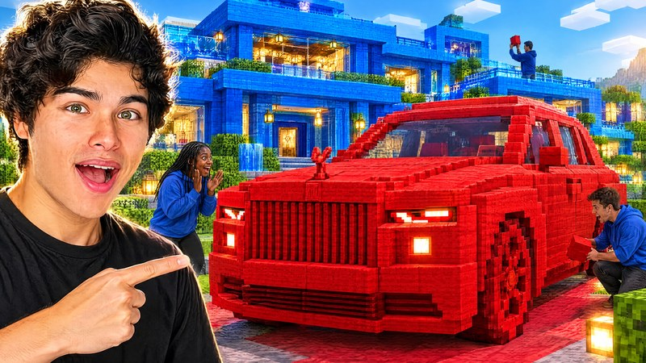

Each builder draws one color and creates a functional game-world wish whose fulfillment follows the same capped rules.

Later game expansion · Minecraft

- **0 (First Frame)–5s:** Alan foreground, enormous single-color red Minecraft vehicle beside blue block mansion, adult crew builders at each build.

- **5s–15s:** Build a qualifying one-color creation and receive it in-game. Virtual fulfillment by default, equal color/plot rules and a clear function checklist.

- **15s–30s:** A builder draws brown for a wish that usually depends on bright neon colors. Show the crew choosing its next move.

**Why this idea:** Shape: I'll Buy Anything Our Crew Builds With One Color. Ingredients: color, build, Minecraft. Combined package: I'll Buy Anything Our Crew Builds With One Color. Use the user’s preferred broad build-and-buy promise with Stokes presentation.

**Shape evidence:**

- [If You Build a House, I'll Pay For It!](https://www.youtube.com/watch?v=xN8ENrfE-TY) — MrBeast Gaming · 2021-01-02 · family · 249,642,469 views · 5.38× reported lift. Same title/premise family: If You Build a House, I'll Pay For It!. Game, cast and execution transfer remains a hypothesis; this source does not validate the new episode outcome. Window: lifetime through source snapshot. [Metric source](https://majieddd.github.io/influint-channels-public/channels/UCIPPMRA040LQr5QPyJEbmXA.html).

- [Whatever You Build, I'll Buy! - Challenge](https://www.youtube.com/watch?v=kvgm3ZrPgzk) — Brianna · 2020-12-19 · family · 3,825,802 views · 2.43× reported lift. Same title/premise family: Whatever You Build, I'll Buy! - Challenge. Game, cast and execution transfer remains a hypothesis; this source does not validate the new episode outcome. Window: lifetime through source snapshot. [Metric source](https://majieddd.github.io/influint-channels-public/channels/UCXg4rJUbDP1IP3TmZ9KDpJg.html).

- [If You Build It, I'll Pay For It!](https://www.youtube.com/watch?v=RvYkeTmM1gc) — MrBeast Gaming · 2022-12-31 · family · 121,694,173 views · 2.02× reported lift. Same title/premise family: If You Build It, I'll Pay For It!. Game, cast and execution transfer remains a hypothesis; this source does not validate the new episode outcome. Window: lifetime through source snapshot. [Metric source](https://majieddd.github.io/influint-channels-public/channels/UCIPPMRA040LQr5QPyJEbmXA.html).

- [If You Build A Lambo I'll Pay For It!](https://www.youtube.com/watch?v=iSvsf27wRns) — MrBeast Gaming · 2021-04-26 · family · 128,272,619 views · 1.24× reported lift. Same title/premise family: If You Build A Lambo I'll Pay For It!. Game, cast and execution transfer remains a hypothesis; this source does not validate the new episode outcome. Window: lifetime through source snapshot. [Metric source](https://majieddd.github.io/influint-channels-public/channels/UCIPPMRA040LQr5QPyJEbmXA.html).

**Ingredient evidence:**

- [I Adopted Animals in One Color!](https://www.youtube.com/watch?v=_qfQLKwJ4j4) — Brianna · 2025-10-18 · family · 19,874,174 views · 7.48× reported lift. Same concrete ingredient color: I Adopted Animals in One Color!. Game, cast and execution transfer remains a hypothesis; this source does not validate the new episode outcome. Window: lifetime through source snapshot. [Metric source](https://majieddd.github.io/influint-channels-public/channels/UCXg4rJUbDP1IP3TmZ9KDpJg.html).

- [I Built 5 SECRET Rooms In ONE COLOR!](https://www.youtube.com/watch?v=cfFtBojH_-Y) — Stokes Twins · 2025-06-27 · family · 180,421,614 views · 1.74× reported lift. Same concrete ingredient color: I Built 5 SECRET Rooms In ONE COLOR!. Game, cast and execution transfer remains a hypothesis; this source does not validate the new episode outcome. Window: lifetime through source snapshot. [Metric source](https://majieddd.github.io/influint-channels-public/channels/UCbp9MyKCTEww4CxEzc_Tp0Q.html).

- [I Survived 3 Houses In ONE COLOR!](https://www.youtube.com/watch?v=4FlLuKbKa_s) — Unspeakable · 2025-03-01 · family · 3,428,613 views · 0.48× reported lift. Same concrete ingredient color: I Survived 3 Houses In ONE COLOR!. Game, cast and execution transfer remains a hypothesis; this source does not validate the new episode outcome. Window: lifetime through source snapshot. [Metric source](https://majieddd.github.io/influint-channels-public/channels/UCwIWAbIeu0xI0ReKWOcw3eg.html).

- [Extreme Hide and Seek in One Color (Camouflage)](https://www.youtube.com/watch?v=BRqa1TRPs7Y) — Brianna · 2022-11-03 · family · 6,009,920 views · 5.22× reported lift. Same concrete ingredient color: Extreme Hide and Seek in One Color (Camouflage). Game, cast and execution transfer remains a hypothesis; this source does not validate the new episode outcome. Window: lifetime through source snapshot. [Metric source](https://majieddd.github.io/influint-channels-public/channels/UCXg4rJUbDP1IP3TmZ9KDpJg.html).

Evidence gaps: Ingredients: 1/2 qualifying outlier channels for the principal ingredient; this does not establish the full game/cast combination.

**Objective:** Build a qualifying one-color creation and receive it in-game.

**Rules:** Virtual fulfillment by default, equal color/plot rules and a clear function checklist; real purchase requires separate funding.

**Escalation:** A bad color draw forces improvisation, a beautiful build fails function and the last reveal combines personality with utility.

**Payoff:** Deliver every accepted creation and show the rule that decides the close case.

**Gamer reward:** Design ingenuity and game-world function reward gamers.

**Non-gamer reward:** A creative transformation and the participant receiving the thing they wanted carry the payoff.

**People:** Several cast members or invited builders propose and create, while one host funds and tests the build; twins can rotate hosting.

**Production:** Bespoke working hero build · $7,100–$15,900 · authored incremental allowance.

**Dependencies:** A game/build environment, builder compensation, clear purchase rules and a funded reward cap. If fulfilling real builds is unaffordable, use an explicitly virtual version rather than imply a real purchase. Verify the exact edition, map, mod license and working mechanics; GTA-system reuse does not imply Minecraft support.

**Thumbnail:** Alan foreground, enormous single-color red Minecraft vehicle beside blue block mansion, adult crew builders at each build.

Composition reference: [If You Build a House, I'll Pay For It!](https://www.youtube.com/watch?v=xN8ENrfE-TY).

[Original PNG](generated-thumbnails/085.png) · [Exact image prompt](higgsfield-prompts/085.txt)

### Format 18 — Game versus real life, same race

Two cast teams race between corresponding checkpoints in a virtual and real route, compare what each world makes easier or harder, and resolve the competition using stated fair progress/time rules.

Title family: ___ vs Real Life: Race Across ___

Retained. Add the requested Minecraft/IRL Earth race and winner’s free dinner for a year, with a defined meal allowance. It is one race-format variation, not an unrelated new format.

#### Idea 086 — GTA vs Real Life: Race Across the City

Two cast teams race between matched local landmarks, one inside GTA and one on a permitted real-world route.

Later hybrid / travel pilot · GTA 5

- **0 (First Frame)–5s:** Alan driving a red GTA car left and Alex riding in a real red car right, matching city bridge and one finish arch; GAME vs REAL.

- **5s–15s:** Reach the declared finish under transparent matched travel rules. Fixed local route, safe lawful real travel and separate in-game/real scale explanation.

- **15s–30s:** The game team arrives quickly but discovers it still must complete the shared landmark task. Show the crew choosing its next move.

**Why this idea:** Shape: [GAME] vs Real Life: Race Across the [SUBJECT]. Ingredients: race, IRL, GTA. Combined package: GTA vs Real Life: Race Across the City. The user-confirmed game/IRL blend extends the Stokes spectacle and crew rivalry into both worlds.

**Shape evidence:**

- [Tesla Autopilot For 24 Hours!](https://www.youtube.com/watch?v=SsJ7oOpbmIk) — Stokes Twins · 2021-04-20 · adjacent · 38,321,506 views · 4.25× reported lift. Adjacent format/cast/setting reference from the reviewed board; does not satisfy exact/family outlier coverage for this episode. Window: lifetime through source snapshot. [Metric source](https://majieddd.github.io/influint-channels-public/channels/UCbp9MyKCTEww4CxEzc_Tp0Q.html).

- [World's Fastest Car!](https://www.youtube.com/watch?v=nopEs-K4ExM) — MrBeast Gaming · 2022-07-09 · adjacent · 122,277,058 views · 3.68× reported lift. Adjacent format/cast/setting reference from the reviewed board; does not satisfy exact/family outlier coverage for this episode. Window: lifetime through source snapshot. [Metric source](https://majieddd.github.io/influint-channels-public/channels/UCIPPMRA040LQr5QPyJEbmXA.html).

- [Clean The Sports Car, Keep It!](https://www.youtube.com/watch?v=6EtuOTq5TmM) — Stokes Twins · 2026-02-11 · adjacent · 87,106,209 views · 1.48× reported lift. Adjacent format/cast/setting reference from the reviewed board; does not satisfy exact/family outlier coverage for this episode. Window: lifetime through source snapshot. [Metric source](https://majieddd.github.io/influint-channels-public/channels/UCbp9MyKCTEww4CxEzc_Tp0Q.html).

**Ingredient evidence:**

- [Preston Cheated in Cardboard Hide and Seek](https://www.youtube.com/watch?v=5zbvDh28XUQ) — Brianna · 2022-04-28 · family · 11,051,826 views · 5.01× reported lift. Same concrete ingredient race: Preston Cheated in Cardboard Hide and Seek. Game, cast and execution transfer remains a hypothesis; this source does not validate the new episode outcome. Window: lifetime through source snapshot. [Metric source](https://majieddd.github.io/influint-channels-public/channels/UCXg4rJUbDP1IP3TmZ9KDpJg.html).

- [World's Fastest Car!](https://www.youtube.com/watch?v=nopEs-K4ExM) — MrBeast Gaming · 2022-07-09 · family · 122,277,058 views · 3.68× reported lift. Same concrete ingredient race: World's Fastest Car!. Game, cast and execution transfer remains a hypothesis; this source does not validate the new episode outcome. Window: lifetime through source snapshot. [Metric source](https://majieddd.github.io/influint-channels-public/channels/UCIPPMRA040LQr5QPyJEbmXA.html).

- [7 Days Escaping Cardboard Prison!](https://www.youtube.com/watch?v=WU05jZnUiYs) — Unspeakable · 2026-01-24 · family · 12,880,314 views · 3.65× reported lift. Same concrete ingredient race: 7 Days Escaping Cardboard Prison!. Game, cast and execution transfer remains a hypothesis; this source does not validate the new episode outcome. Window: lifetime through source snapshot. [Metric source](https://majieddd.github.io/influint-channels-public/channels/UCwIWAbIeu0xI0ReKWOcw3eg.html).

- [SCARY Halloween Prank On Friends!](https://www.youtube.com/watch?v=a-8WCFtPhBU) — Stokes Twins · 2020-10-30 · family · 31,262,000 views · 2.87× reported lift. Same concrete ingredient race: SCARY Halloween Prank On Friends!. Game, cast and execution transfer remains a hypothesis; this source does not validate the new episode outcome. Window: lifetime through source snapshot. [Metric source](https://majieddd.github.io/influint-channels-public/channels/UCbp9MyKCTEww4CxEzc_Tp0Q.html).

Evidence gaps: Shape: 0/2 qualifying outlier channels in the verified public pool; adjacent precedents remain proposals, not replication. Exact successful game-versus-IRL or GTA-city journey precedent is not verified; test a smaller route before travel scale.

**Objective:** Reach the declared finish under transparent matched travel rules.

**Rules:** Fixed local route, safe lawful real travel and separate in-game/real scale explanation; avoid promising a perfect geography match.

**Escalation:** Game shortcuts dominate early, real traffic changes the gap and the last landmark needs a task both teams must perform.

**Payoff:** Show both finish timestamps and the factors that produced the winner.

**Gamer reward:** Real versus virtual geography and traversal choices create a second layer of comparison.

**Non-gamer reward:** The audience follows one physical route, a simple scoreboard and a recognizable winner’s reward.

**People:** Two mixed cast teams with separate game/IRL capture, a common presenter and a fair shared scoreboard.

**Production:** Local game / IRL matched-route pilot · $4,500–$10,200 · authored incremental allowance.

**Dependencies:** Flights only if the selected route requires them; local transport, lodging, access and extra IRL crew/capture are incremental costs. Define scale, checkpoints, allowed transport, start conditions and meal-prize liability.

**Thumbnail:** Alan driving a red GTA car left and Alex riding in a real red car right, matching city bridge and one finish arch; GAME vs REAL.

Composition reference: [Tesla Autopilot For 24 Hours!](https://www.youtube.com/watch?v=SsJ7oOpbmIk).

[Original PNG](generated-thumbnails/086.png) · [Exact image prompt](higgsfield-prompts/086.txt)

#### Idea 087 — Minecraft vs Real Life: Race Across the Earth

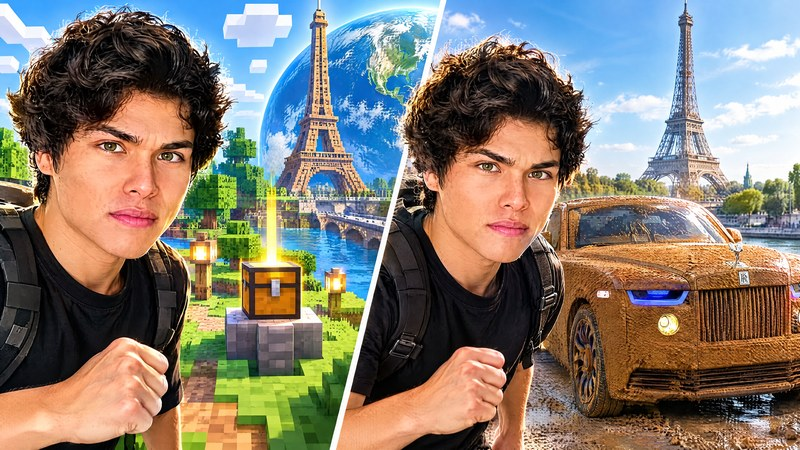

Two teams complete a declared four-city world route in Minecraft and real life for a separately funded dinner allowance.

Later funded global tentpole; local pilot separately scoped · Minecraft

- **0 (First Frame)–5s:** Alan on a beautiful blocky Minecraft Earth route left, Alex on the matching photographic landmark route right, cinematic globe behind; GAME vs REAL.

- **5s–15s:** Reach the four verified landmark checkpoints and win the defined dinner-for-a-year prize. Later global tentpole: proposed New York, Paris, Tokyo and Los Angeles route.

- **15s–30s:** The first matched landmark task requires a detour under the already declared route rules. Show the crew choosing its next move.

**Why this idea:** Shape: [GAME] vs Real Life: Race Across the [SUBJECT]. Ingredients: Minecraft, Earth, IRL, race. Combined package: Minecraft vs Real Life: Race Across the Earth. The user-confirmed game/IRL blend extends the Stokes spectacle and crew rivalry into both worlds.

**Shape evidence:**

- [Tesla Autopilot For 24 Hours!](https://www.youtube.com/watch?v=SsJ7oOpbmIk) — Stokes Twins · 2021-04-20 · adjacent · 38,321,506 views · 4.25× reported lift. Adjacent format/cast/setting reference from the reviewed board; does not satisfy exact/family outlier coverage for this episode. Window: lifetime through source snapshot. [Metric source](https://majieddd.github.io/influint-channels-public/channels/UCbp9MyKCTEww4CxEzc_Tp0Q.html).

- [World's Fastest Car!](https://www.youtube.com/watch?v=nopEs-K4ExM) — MrBeast Gaming · 2022-07-09 · adjacent · 122,277,058 views · 3.68× reported lift. Adjacent format/cast/setting reference from the reviewed board; does not satisfy exact/family outlier coverage for this episode. Window: lifetime through source snapshot. [Metric source](https://majieddd.github.io/influint-channels-public/channels/UCIPPMRA040LQr5QPyJEbmXA.html).

- [Clean The Sports Car, Keep It!](https://www.youtube.com/watch?v=6EtuOTq5TmM) — Stokes Twins · 2026-02-11 · adjacent · 87,106,209 views · 1.48× reported lift. Adjacent format/cast/setting reference from the reviewed board; does not satisfy exact/family outlier coverage for this episode. Window: lifetime through source snapshot. [Metric source](https://majieddd.github.io/influint-channels-public/channels/UCbp9MyKCTEww4CxEzc_Tp0Q.html).

**Ingredient evidence:**

- [Overnight Survival Challenge in the World's Largest ZOO!](https://www.youtube.com/watch?v=TLHIKUvhXsU) — Brianna · 2020-10-17 · family · 14,469,543 views · 6.88× reported lift. Same concrete ingredient Earth: Overnight Survival Challenge in the World's Largest ZOO!. Game, cast and execution transfer remains a hypothesis; this source does not validate the new episode outcome. Window: lifetime through source snapshot. [Metric source](https://majieddd.github.io/influint-channels-public/channels/UCXg4rJUbDP1IP3TmZ9KDpJg.html).

- [World's Fastest Car!](https://www.youtube.com/watch?v=nopEs-K4ExM) — MrBeast Gaming · 2022-07-09 · family · 122,277,058 views · 3.68× reported lift. Same concrete ingredient Earth: World's Fastest Car!. Game, cast and execution transfer remains a hypothesis; this source does not validate the new episode outcome. Window: lifetime through source snapshot. [Metric source](https://majieddd.github.io/influint-channels-public/channels/UCIPPMRA040LQr5QPyJEbmXA.html).

- [Riding the World's Scariest Rollercoasters! (PASSED OUT)](https://www.youtube.com/watch?v=ZNoAsoLNyWA) — Stokes Twins · 2019-09-29 · family · 17,068,064 views · 2.81× reported lift. Same concrete ingredient Earth: Riding the World's Scariest Rollercoasters! (PASSED OUT). Game, cast and execution transfer remains a hypothesis; this source does not validate the new episode outcome. Window: lifetime through source snapshot. [Metric source](https://majieddd.github.io/influint-channels-public/channels/UCbp9MyKCTEww4CxEzc_Tp0Q.html).

- [Why I Flooded My Friend’s ENTIRE World?](https://www.youtube.com/watch?v=-LUNQPxD0vY) — PrestonPlayz · 2026-03-07 · family · 13,665,235 views · 2.81× reported lift. Same concrete ingredient Earth: Why I Flooded My Friend’s ENTIRE World?. Game, cast and execution transfer remains a hypothesis; this source does not validate the new episode outcome. Window: lifetime through source snapshot. [Metric source](https://majieddd.github.io/influint-channels-public/channels/UCJZam2u1G0syq3kyqrCXrNw.html).

Evidence gaps: Shape: 0/2 qualifying outlier channels in the verified public pool; adjacent precedents remain proposals, not replication. Exact successful game-versus-IRL or GTA-city journey precedent is not verified; test a smaller route before travel scale.

**Objective:** Reach the four verified landmark checkpoints and win the defined dinner-for-a-year prize.

**Rules:** Later global tentpole: proposed New York, Paris, Tokyo and Los Angeles route; verify completed map coverage, permissions, entry requirements, clocks and meal funding before locking the itinerary. A local pilot uses the actual city title instead.

**Escalation:** Virtual travel wins early time, then each checkpoint requires the same visible task and the final destination changes the lead.

**Payoff:** Show both arrivals, explain real versus game travel time and deliver the funded meal allowance without implying a complete Earth map.

**Gamer reward:** Real versus virtual geography and traversal choices create a second layer of comparison.

**Non-gamer reward:** The audience follows one physical route, a simple scoreboard and a recognizable winner’s reward.

**People:** Two mixed cast teams with separate game/IRL capture, a common presenter and a fair shared scoreboard.

**Production:** Four-city global Earth race · $15,640–$34,400 · authored incremental allowance.

**Dependencies:** Flights only if the selected route requires them; local transport, lodging, access and extra IRL crew/capture are incremental costs. Define scale, checkpoints, allowed transport, start conditions and meal-prize liability. Verify the exact edition, map, mod license and working mechanics; GTA-system reuse does not imply Minecraft support.

**Thumbnail:** Alan on a beautiful blocky Minecraft Earth route left, Alex on the matching photographic landmark route right, cinematic globe behind; GAME vs REAL.

Composition reference: [Tesla Autopilot For 24 Hours!](https://www.youtube.com/watch?v=SsJ7oOpbmIk).

[Original PNG](generated-thumbnails/087.png) · [Exact image prompt](higgsfield-prompts/087.txt)

Conditional addition: Conditional dinner-for-a-year reward · $7,300–$7,300 · Illustrative capped real reward, not funded or promised now. Add to 087 only for the funded variation.

Global Earth title is a funded later four-city tentpole with its own $15,640–$34,400 travel profile and separate conditional $7,300 dinner prize; package a local pilot as “Minecraft vs Real Life: Race Across the City” using the local hybrid cost profile.

#### Idea 088 — GTA vs Real Life: Who Can Deliver Dinner Faster?

The crew races a permitted real dinner delivery against a matching game route with the same final handoff task.

Later hybrid / travel pilot · GTA 5

- **0 (First Frame)–5s:** Alan in a red GTA delivery scooter left, Alex with a real dinner box beside a red bicycle right, matching restaurant fronts.

- **5s–15s:** Deliver the marked dinner to the recipient first. No speeding or risky real maneuvers.

- **15s–30s:** The game driver reaches the destination but the recipient is one floor above the street. Show the crew choosing its next move.

**Why this idea:** Shape: [GAME] vs Real Life: Who Can Deliver Dinner Faster?. Ingredients: delivery, IRL, race. Combined package: GTA vs Real Life: Who Can Deliver Dinner Faster?. The user-confirmed game/IRL blend extends the Stokes spectacle and crew rivalry into both worlds.

**Shape evidence:**

- [Tesla Autopilot For 24 Hours!](https://www.youtube.com/watch?v=SsJ7oOpbmIk) — Stokes Twins · 2021-04-20 · adjacent · 38,321,506 views · 4.25× reported lift. Adjacent format/cast/setting reference from the reviewed board; does not satisfy exact/family outlier coverage for this episode. Window: lifetime through source snapshot. [Metric source](https://majieddd.github.io/influint-channels-public/channels/UCbp9MyKCTEww4CxEzc_Tp0Q.html).

- [World's Fastest Car!](https://www.youtube.com/watch?v=nopEs-K4ExM) — MrBeast Gaming · 2022-07-09 · adjacent · 122,277,058 views · 3.68× reported lift. Adjacent format/cast/setting reference from the reviewed board; does not satisfy exact/family outlier coverage for this episode. Window: lifetime through source snapshot. [Metric source](https://majieddd.github.io/influint-channels-public/channels/UCIPPMRA040LQr5QPyJEbmXA.html).

- [Clean The Sports Car, Keep It!](https://www.youtube.com/watch?v=6EtuOTq5TmM) — Stokes Twins · 2026-02-11 · adjacent · 87,106,209 views · 1.48× reported lift. Adjacent format/cast/setting reference from the reviewed board; does not satisfy exact/family outlier coverage for this episode. Window: lifetime through source snapshot. [Metric source](https://majieddd.github.io/influint-channels-public/channels/UCbp9MyKCTEww4CxEzc_Tp0Q.html).

**Ingredient evidence:**

- [Minecraft PIZZA DELIVERY Girl vs Boy Challenge!](https://www.youtube.com/watch?v=ZR_GoeGho9U) — Brianna · 2019-06-06 · family · 1,651,238 views · 0.40× reported lift. Same concrete ingredient delivery: Minecraft PIZZA DELIVERY Girl vs Boy Challenge!. Game, cast and execution transfer remains a hypothesis; this source does not validate the new episode outcome. Window: lifetime through source snapshot. [Metric source](https://majieddd.github.io/influint-channels-public/channels/UCXg4rJUbDP1IP3TmZ9KDpJg.html).

- [Tesla Autopilot For 24 Hours!](https://www.youtube.com/watch?v=SsJ7oOpbmIk) — Stokes Twins · 2021-04-20 · adjacent · 38,321,506 views · 4.25× reported lift. Adjacent format/cast/setting reference from the reviewed board; does not satisfy exact/family outlier coverage for this episode. Window: lifetime through source snapshot. [Metric source](https://majieddd.github.io/influint-channels-public/channels/UCbp9MyKCTEww4CxEzc_Tp0Q.html).

- [World's Fastest Car!](https://www.youtube.com/watch?v=nopEs-K4ExM) — MrBeast Gaming · 2022-07-09 · adjacent · 122,277,058 views · 3.68× reported lift. Adjacent format/cast/setting reference from the reviewed board; does not satisfy exact/family outlier coverage for this episode. Window: lifetime through source snapshot. [Metric source](https://majieddd.github.io/influint-channels-public/channels/UCIPPMRA040LQr5QPyJEbmXA.html).

Evidence gaps: Shape: 0/2 qualifying outlier channels in the verified public pool; adjacent precedents remain proposals, not replication. Ingredients: 0/2 qualifying outlier channels for the principal ingredient; this does not establish the full game/cast combination. Exact successful game-versus-IRL or GTA-city journey precedent is not verified; test a smaller route before travel scale.

**Objective:** Deliver the marked dinner to the recipient first.

**Rules:** No speeding or risky real maneuvers; lawful route, published task rules and game/real timing shown separately.

**Escalation:** A fast game route meets a parking task, real traffic improves unexpectedly and the last handoff makes the result close.

**Payoff:** Show the recipient receiving both deliveries and the real finish times.

**Gamer reward:** Real versus virtual geography and traversal choices create a second layer of comparison.

**Non-gamer reward:** The audience follows one physical route, a simple scoreboard and a recognizable winner’s reward.

**People:** Two mixed cast teams with separate game/IRL capture, a common presenter and a fair shared scoreboard.

**Production:** Local game / IRL matched-route pilot · $4,500–$10,200 · authored incremental allowance.

**Dependencies:** Flights only if the selected route requires them; local transport, lodging, access and extra IRL crew/capture are incremental costs. Define scale, checkpoints, allowed transport, start conditions and meal-prize liability.

**Thumbnail:** Alan in a red GTA delivery scooter left, Alex with a real dinner box beside a red bicycle right, matching restaurant fronts.

Composition reference: [Tesla Autopilot For 24 Hours!](https://www.youtube.com/watch?v=SsJ7oOpbmIk).

[Original PNG](generated-thumbnails/088.png) · [Exact image prompt](higgsfield-prompts/088.txt)

#### Idea 089 — GTA vs Real Life: Can We Escape the Same Maze?

Two crew teams solve matching game and real-location mazes whose different constraints make the winner unpredictable.

Later hybrid / travel pilot · GTA 5

- **0 (First Frame)–5s:** Alan inside giant GTA hedge maze left, Alex inside a real matching maze right, one red finish gate at center.

- **5s–15s:** Reach the visible exit using the same clue budget. Permitted real maze, game replica of the relevant layout and disclosed scale.

- **15s–30s:** The game team spots the exit from above but cannot identify the corridor leading to it. Show the crew choosing its next move.

**Why this idea:** Shape: [GAME] vs Real Life: Can We Escape the Same [SUBJECT]?. Ingredients: maze, IRL, race. Combined package: GTA vs Real Life: Can We Escape the Same Maze?. The user-confirmed game/IRL blend extends the Stokes spectacle and crew rivalry into both worlds.

**Shape evidence:**

- [Tesla Autopilot For 24 Hours!](https://www.youtube.com/watch?v=SsJ7oOpbmIk) — Stokes Twins · 2021-04-20 · adjacent · 38,321,506 views · 4.25× reported lift. Adjacent format/cast/setting reference from the reviewed board; does not satisfy exact/family outlier coverage for this episode. Window: lifetime through source snapshot. [Metric source](https://majieddd.github.io/influint-channels-public/channels/UCbp9MyKCTEww4CxEzc_Tp0Q.html).

- [World's Fastest Car!](https://www.youtube.com/watch?v=nopEs-K4ExM) — MrBeast Gaming · 2022-07-09 · adjacent · 122,277,058 views · 3.68× reported lift. Adjacent format/cast/setting reference from the reviewed board; does not satisfy exact/family outlier coverage for this episode. Window: lifetime through source snapshot. [Metric source](https://majieddd.github.io/influint-channels-public/channels/UCIPPMRA040LQr5QPyJEbmXA.html).

- [Clean The Sports Car, Keep It!](https://www.youtube.com/watch?v=6EtuOTq5TmM) — Stokes Twins · 2026-02-11 · adjacent · 87,106,209 views · 1.48× reported lift. Adjacent format/cast/setting reference from the reviewed board; does not satisfy exact/family outlier coverage for this episode. Window: lifetime through source snapshot. [Metric source](https://majieddd.github.io/influint-channels-public/channels/UCbp9MyKCTEww4CxEzc_Tp0Q.html).

**Ingredient evidence:**

- [Overnight Survival Challenge in the World's Largest ZOO!](https://www.youtube.com/watch?v=TLHIKUvhXsU) — Brianna · 2020-10-17 · family · 14,469,543 views · 6.88× reported lift. Same concrete ingredient IRL: Overnight Survival Challenge in the World's Largest ZOO!. Game, cast and execution transfer remains a hypothesis; this source does not validate the new episode outcome. Window: lifetime through source snapshot. [Metric source](https://majieddd.github.io/influint-channels-public/channels/UCXg4rJUbDP1IP3TmZ9KDpJg.html).

- [World's Fastest Car!](https://www.youtube.com/watch?v=nopEs-K4ExM) — MrBeast Gaming · 2022-07-09 · family · 122,277,058 views · 3.68× reported lift. Same concrete ingredient IRL: World's Fastest Car!. Game, cast and execution transfer remains a hypothesis; this source does not validate the new episode outcome. Window: lifetime through source snapshot. [Metric source](https://majieddd.github.io/influint-channels-public/channels/UCIPPMRA040LQr5QPyJEbmXA.html).

- [Riding the World's Scariest Rollercoasters! (PASSED OUT)](https://www.youtube.com/watch?v=ZNoAsoLNyWA) — Stokes Twins · 2019-09-29 · family · 17,068,064 views · 2.81× reported lift. Same concrete ingredient IRL: Riding the World's Scariest Rollercoasters! (PASSED OUT). Game, cast and execution transfer remains a hypothesis; this source does not validate the new episode outcome. Window: lifetime through source snapshot. [Metric source](https://majieddd.github.io/influint-channels-public/channels/UCbp9MyKCTEww4CxEzc_Tp0Q.html).

- [Why I Flooded My Friend’s ENTIRE World?](https://www.youtube.com/watch?v=-LUNQPxD0vY) — PrestonPlayz · 2026-03-07 · family · 13,665,235 views · 2.81× reported lift. Same concrete ingredient IRL: Why I Flooded My Friend’s ENTIRE World?. Game, cast and execution transfer remains a hypothesis; this source does not validate the new episode outcome. Window: lifetime through source snapshot. [Metric source](https://majieddd.github.io/influint-channels-public/channels/UCJZam2u1G0syq3kyqrCXrNw.html).

Evidence gaps: Shape: 0/2 qualifying outlier channels in the verified public pool; adjacent precedents remain proposals, not replication. Exact successful game-versus-IRL or GTA-city journey precedent is not verified; test a smaller route before travel scale.

**Objective:** Reach the visible exit using the same clue budget.

**Rules:** Permitted real maze, game replica of the relevant layout and disclosed scale; no hiding differences that affect the race.

**Escalation:** The game camera gives a clue, the physical team finds a useful landmark and the final junction tests memory.

**Payoff:** Show both continuous routes and compare how each world helped or hindered the players.

**Gamer reward:** Real versus virtual geography and traversal choices create a second layer of comparison.

**Non-gamer reward:** The audience follows one physical route, a simple scoreboard and a recognizable winner’s reward.

**People:** Two mixed cast teams with separate game/IRL capture, a common presenter and a fair shared scoreboard.

**Production:** Local game / IRL matched-route pilot · $4,500–$10,200 · authored incremental allowance.

**Dependencies:** Flights only if the selected route requires them; local transport, lodging, access and extra IRL crew/capture are incremental costs. Define scale, checkpoints, allowed transport, start conditions and meal-prize liability.

**Thumbnail:** Alan inside giant GTA hedge maze left, Alex inside a real matching maze right, one red finish gate at center.

Composition reference: [Tesla Autopilot For 24 Hours!](https://www.youtube.com/watch?v=SsJ7oOpbmIk).

[Original PNG](generated-thumbnails/089.png) · [Exact image prompt](higgsfield-prompts/089.txt)

#### Idea 090 — Minecraft vs Real Life: Build the Same Secret Room

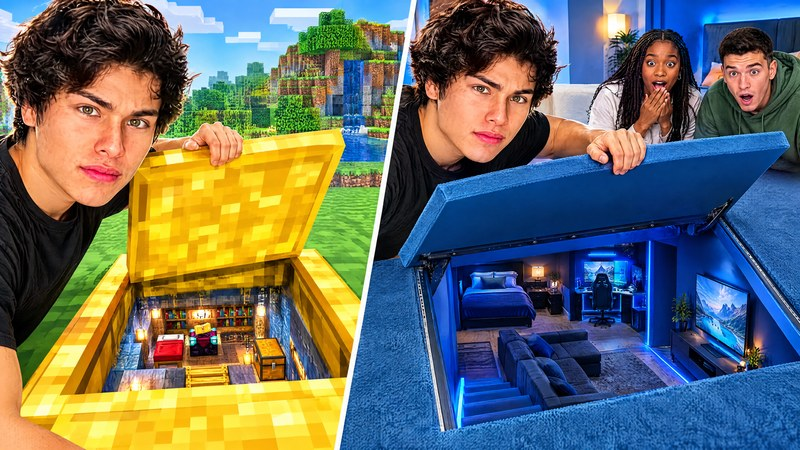

Two teams recreate the same small hidden room in Minecraft and a permitted existing real space with equal function goals.

Later hybrid / travel pilot · Minecraft

- **0 (First Frame)–5s:** Alan opening a golden Minecraft secret hatch left, Alex opening a photographic blue hidden room right; GAME vs REAL.

- **5s–15s:** Finish a usable concealed entrance and three matching room functions. Real-property permission, small funded retrofit and disclosed time/scale differences.

- **15s–30s:** The real room's wall cannot move the way the block-world entrance does. Show the crew choosing its next move.

**Why this idea:** Shape: [GAME] vs Real Life: Build the Same [SUBJECT]. Ingredients: secret, room, Minecraft, IRL. Combined package: Minecraft vs Real Life: Build the Same Secret Room. The user-confirmed game/IRL blend extends the Stokes spectacle and crew rivalry into both worlds.

**Shape evidence:**

- [Tesla Autopilot For 24 Hours!](https://www.youtube.com/watch?v=SsJ7oOpbmIk) — Stokes Twins · 2021-04-20 · adjacent · 38,321,506 views · 4.25× reported lift. Adjacent format/cast/setting reference from the reviewed board; does not satisfy exact/family outlier coverage for this episode. Window: lifetime through source snapshot. [Metric source](https://majieddd.github.io/influint-channels-public/channels/UCbp9MyKCTEww4CxEzc_Tp0Q.html).

- [World's Fastest Car!](https://www.youtube.com/watch?v=nopEs-K4ExM) — MrBeast Gaming · 2022-07-09 · adjacent · 122,277,058 views · 3.68× reported lift. Adjacent format/cast/setting reference from the reviewed board; does not satisfy exact/family outlier coverage for this episode. Window: lifetime through source snapshot. [Metric source](https://majieddd.github.io/influint-channels-public/channels/UCIPPMRA040LQr5QPyJEbmXA.html).

- [Clean The Sports Car, Keep It!](https://www.youtube.com/watch?v=6EtuOTq5TmM) — Stokes Twins · 2026-02-11 · adjacent · 87,106,209 views · 1.48× reported lift. Adjacent format/cast/setting reference from the reviewed board; does not satisfy exact/family outlier coverage for this episode. Window: lifetime through source snapshot. [Metric source](https://majieddd.github.io/influint-channels-public/channels/UCbp9MyKCTEww4CxEzc_Tp0Q.html).

**Ingredient evidence:**

- [I FOUND PRESTONPLAYZ SECRET SKY BASE IN MINECRAFT!](https://www.youtube.com/watch?v=d0q9y0GkrEg) — Brianna · 2019-02-01 · family · 27,428,622 views · 8.87× reported lift. Same concrete ingredient secret: I FOUND PRESTONPLAYZ SECRET SKY BASE IN MINECRAFT!. Game, cast and execution transfer remains a hypothesis; this source does not validate the new episode outcome. Window: lifetime through source snapshot. [Metric source](https://majieddd.github.io/influint-channels-public/channels/UCXg4rJUbDP1IP3TmZ9KDpJg.html).

- [I Built 30 Secret Rooms You’d Never Find!](https://www.youtube.com/watch?v=X9AYf8gy5sU) — Unspeakable · 2024-06-22 · family · 18,997,959 views · 5.00× reported lift. Same concrete ingredient secret: I Built 30 Secret Rooms You’d Never Find!. Game, cast and execution transfer remains a hypothesis; this source does not validate the new episode outcome. Window: lifetime through source snapshot. [Metric source](https://majieddd.github.io/influint-channels-public/channels/UCwIWAbIeu0xI0ReKWOcw3eg.html).

- [$1 vs $25,000 Secret Rooms](https://www.youtube.com/watch?v=jEG8wuUE1pY) — MrBeast Gaming · 2025-07-26 · family · 63,275,703 views · 1.97× reported lift. Same concrete ingredient secret: $1 vs $25,000 Secret Rooms. Game, cast and execution transfer remains a hypothesis; this source does not validate the new episode outcome. Window: lifetime through source snapshot. [Metric source](https://majieddd.github.io/influint-channels-public/channels/UCIPPMRA040LQr5QPyJEbmXA.html).

- [I Built 5 SECRET Rooms In ONE COLOR!](https://www.youtube.com/watch?v=cfFtBojH_-Y) — Stokes Twins · 2025-06-27 · family · 180,421,614 views · 1.74× reported lift. Same concrete ingredient secret: I Built 5 SECRET Rooms In ONE COLOR!. Game, cast and execution transfer remains a hypothesis; this source does not validate the new episode outcome. Window: lifetime through source snapshot. [Metric source](https://majieddd.github.io/influint-channels-public/channels/UCbp9MyKCTEww4CxEzc_Tp0Q.html).

Evidence gaps: Shape: 0/2 qualifying outlier channels in the verified public pool; adjacent precedents remain proposals, not replication. Exact successful game-versus-IRL or GTA-city journey precedent is not verified; test a smaller route before travel scale.

**Objective:** Finish a usable concealed entrance and three matching room functions.

**Rules:** Real-property permission, small funded retrofit and disclosed time/scale differences; no structural work assumed without specialists.

**Escalation:** The game build is faster but fails a real function, while the physical team discovers an entrance constraint.

**Payoff:** Open both rooms to the same guest and reveal the judged function and concealment score.

**Gamer reward:** Real versus virtual geography and traversal choices create a second layer of comparison.

**Non-gamer reward:** The audience follows one physical route, a simple scoreboard and a recognizable winner’s reward.

**People:** Two mixed cast teams with separate game/IRL capture, a common presenter and a fair shared scoreboard.

**Production:** Local game / IRL matched-route pilot · $4,500–$10,200 · authored incremental allowance.

**Dependencies:** Flights only if the selected route requires them; local transport, lodging, access and extra IRL crew/capture are incremental costs. Define scale, checkpoints, allowed transport, start conditions and meal-prize liability. Verify the exact edition, map, mod license and working mechanics; GTA-system reuse does not imply Minecraft support.

**Thumbnail:** Alan opening a golden Minecraft secret hatch left, Alex opening a photographic blue hidden room right; GAME vs REAL.

Composition reference: [Tesla Autopilot For 24 Hours!](https://www.youtube.com/watch?v=SsJ7oOpbmIk).

[Original PNG](generated-thumbnails/090.png) · [Exact image prompt](higgsfield-prompts/090.txt)

### Format 19 — Extreme test-drive catalogue

The crew tries a varied catalogue of extreme vehicles, gives each a clear real-world-style mission and ranks which actually work; different failures and capabilities supply each reveal.

Title family: I Tested ___ Most ___ ___

New proposal replacing the rescue mission; exact vehicle-catalogue evidence remains adjacent and this needs review.

#### Idea 091 — I Tested GTA's Most Dangerous Vehicles

The crew tests a defined catalogue of outrageous vehicles on the same increasingly difficult mission.

GTA 5 launch / follow-up · GTA 5

- **0 (First Frame)–5s:** Alan foreground terrified, enormous red rocket-powered GTA car launching above a city ramp, clear exhaust and vehicle silhouette.

- **5s–15s:** Choose the most thrilling vehicle that can actually finish the route. Disclosed tested vehicle list and custom assets, fixed task and genuine attempts.

- **15s–30s:** The first powerful vehicle overshoots the simple stopping zone. Show the crew choosing its next move.

**Why this idea:** Shape: I Tested [GAME]'s Most Dangerous [SUBJECT]. Ingredients: vehicle, dangerous, test. Combined package: I Tested GTA's Most Dangerous Vehicles. Adapt experiential product testing with crew reactions; do not call a vehicle banned unless that claim is actually true.

**Shape evidence:**

- [World's Fastest Car!](https://www.youtube.com/watch?v=nopEs-K4ExM) — MrBeast Gaming · 2022-07-09 · family · 122,277,058 views · 3.68× reported lift. Same title/premise family: World's Fastest Car!. Game, cast and execution transfer remains a hypothesis; this source does not validate the new episode outcome. Window: lifetime through source snapshot. [Metric source](https://majieddd.github.io/influint-channels-public/channels/UCIPPMRA040LQr5QPyJEbmXA.html).

- [Testing Scary Ocean Myths That Are Unsolved…](https://www.youtube.com/watch?v=_2jkon0w2zE) — PrestonPlayz · 2026-04-25 · family · 4,479,771 views · 1.26× reported lift. Same title/premise family: Testing Scary Ocean Myths That Are Unsolved…. Game, cast and execution transfer remains a hypothesis; this source does not validate the new episode outcome. Window: lifetime through source snapshot. [Metric source](https://majieddd.github.io/influint-channels-public/channels/UCJZam2u1G0syq3kyqrCXrNw.html).

- [Testing Scary Minecraft Myths That Are Unsolved…](https://www.youtube.com/watch?v=gEVCXrjvaT4) — PrestonPlayz · 2026-06-27 · family · 2,639,718 views · 1.08× reported lift. Same title/premise family: Testing Scary Minecraft Myths That Are Unsolved…. Game, cast and execution transfer remains a hypothesis; this source does not validate the new episode outcome. Window: lifetime through source snapshot. [Metric source](https://majieddd.github.io/influint-channels-public/channels/UCJZam2u1G0syq3kyqrCXrNw.html).

- [Testing Scary Minecraft Stories that are True](https://www.youtube.com/watch?v=zJ1ri976FCY) — PrestonPlayz · 2025-02-08 · family · 3,825,530 views · 1.05× reported lift. Same title/premise family: Testing Scary Minecraft Stories that are True. Game, cast and execution transfer remains a hypothesis; this source does not validate the new episode outcome. Window: lifetime through source snapshot. [Metric source](https://majieddd.github.io/influint-channels-public/channels/UCJZam2u1G0syq3kyqrCXrNw.html).

**Ingredient evidence:**

- [Preston Cheated in Cardboard Hide and Seek](https://www.youtube.com/watch?v=5zbvDh28XUQ) — Brianna · 2022-04-28 · family · 11,051,826 views · 5.01× reported lift. Same concrete ingredient vehicle: Preston Cheated in Cardboard Hide and Seek. Game, cast and execution transfer remains a hypothesis; this source does not validate the new episode outcome. Window: lifetime through source snapshot. [Metric source](https://majieddd.github.io/influint-channels-public/channels/UCXg4rJUbDP1IP3TmZ9KDpJg.html).

- [World's Fastest Car!](https://www.youtube.com/watch?v=nopEs-K4ExM) — MrBeast Gaming · 2022-07-09 · family · 122,277,058 views · 3.68× reported lift. Same concrete ingredient vehicle: World's Fastest Car!. Game, cast and execution transfer remains a hypothesis; this source does not validate the new episode outcome. Window: lifetime through source snapshot. [Metric source](https://majieddd.github.io/influint-channels-public/channels/UCIPPMRA040LQr5QPyJEbmXA.html).

- [7 Days Escaping Cardboard Prison!](https://www.youtube.com/watch?v=WU05jZnUiYs) — Unspeakable · 2026-01-24 · family · 12,880,314 views · 3.65× reported lift. Same concrete ingredient vehicle: 7 Days Escaping Cardboard Prison!. Game, cast and execution transfer remains a hypothesis; this source does not validate the new episode outcome. Window: lifetime through source snapshot. [Metric source](https://majieddd.github.io/influint-channels-public/channels/UCwIWAbIeu0xI0ReKWOcw3eg.html).

- [SCARY Halloween Prank On Friends!](https://www.youtube.com/watch?v=a-8WCFtPhBU) — Stokes Twins · 2020-10-30 · family · 31,262,000 views · 2.87× reported lift. Same concrete ingredient vehicle: SCARY Halloween Prank On Friends!. Game, cast and execution transfer remains a hypothesis; this source does not validate the new episode outcome. Window: lifetime through source snapshot. [Metric source](https://majieddd.github.io/influint-channels-public/channels/UCbp9MyKCTEww4CxEzc_Tp0Q.html).

Evidence gaps: Shape: 1/2 qualifying outlier channels in the verified public pool; adjacent precedents remain proposals, not replication.

**Objective:** Choose the most thrilling vehicle that can actually finish the route.

**Rules:** Disclosed tested vehicle list and custom assets, fixed task and genuine attempts; danger is in-game spectacle.

**Escalation:** A fast vehicle loses control, a huge vehicle cannot fit and the final oddity solves a problem nobody expected.

**Payoff:** Reveal the scored winner and the full final run.

**Gamer reward:** Surprising vehicle behavior and capabilities, rather than menu statistics.

**Non-gamer reward:** Anyone can understand whether a ridiculous car can fly, cross water or survive a visible obstacle.

**People:** Multiple crew drivers and a host, with specialists taking genuinely harder attempts.

**Production:** Reuse a tested world · $1,650–$3,600 · authored incremental allowance.

**Dependencies:** An available varied asset list, rights/access where needed and short test setups. Bespoke vehicle creation increases cost; avoid buying owned capture equipment again.

**Thumbnail:** Alan foreground terrified, enormous red rocket-powered GTA car launching above a city ramp, clear exhaust and vehicle silhouette.

Composition reference: [I Tested 100 BANNED School Products!](https://www.youtube.com/watch?v=AKa1N3Mo8mQ).

[Original PNG](generated-thumbnails/091.png) · [Exact image prompt](higgsfield-prompts/091.txt)

#### Idea 092 — I Tested GTA's Smallest and Biggest Cars

The crew compares extreme vehicle sizes on one familiar city mission and discovers which tradeoffs matter.

GTA 5 launch / follow-up · GTA 5

- **0 (First Frame)–5s:** Alex foreground between a tiny yellow GTA car and a colossal red SUV towering over a skyscraper; SMALL / BIG.

- **5s–15s:** Complete parking, transport and jump tasks in both size extremes. List the custom size range and truthful scope.

- **15s–30s:** The biggest vehicle cannot fit through the first garage door. Show the crew choosing its next move.

**Why this idea:** Shape: I Tested [GAME]'s Smallest and Biggest [SUBJECT]. Ingredients: car, size, test. Combined package: I Tested GTA's Smallest and Biggest Cars. Adapt experiential product testing with crew reactions; do not call a vehicle banned unless that claim is actually true.

**Shape evidence:**

- [World's Fastest Car!](https://www.youtube.com/watch?v=nopEs-K4ExM) — MrBeast Gaming · 2022-07-09 · family · 122,277,058 views · 3.68× reported lift. Same title/premise family: World's Fastest Car!. Game, cast and execution transfer remains a hypothesis; this source does not validate the new episode outcome. Window: lifetime through source snapshot. [Metric source](https://majieddd.github.io/influint-channels-public/channels/UCIPPMRA040LQr5QPyJEbmXA.html).

- [Testing Scary Ocean Myths That Are Unsolved…](https://www.youtube.com/watch?v=_2jkon0w2zE) — PrestonPlayz · 2026-04-25 · family · 4,479,771 views · 1.26× reported lift. Same title/premise family: Testing Scary Ocean Myths That Are Unsolved…. Game, cast and execution transfer remains a hypothesis; this source does not validate the new episode outcome. Window: lifetime through source snapshot. [Metric source](https://majieddd.github.io/influint-channels-public/channels/UCJZam2u1G0syq3kyqrCXrNw.html).

- [Testing Scary Minecraft Myths That Are Unsolved…](https://www.youtube.com/watch?v=gEVCXrjvaT4) — PrestonPlayz · 2026-06-27 · family · 2,639,718 views · 1.08× reported lift. Same title/premise family: Testing Scary Minecraft Myths That Are Unsolved…. Game, cast and execution transfer remains a hypothesis; this source does not validate the new episode outcome. Window: lifetime through source snapshot. [Metric source](https://majieddd.github.io/influint-channels-public/channels/UCJZam2u1G0syq3kyqrCXrNw.html).

- [Testing Scary Minecraft Stories that are True](https://www.youtube.com/watch?v=zJ1ri976FCY) — PrestonPlayz · 2025-02-08 · family · 3,825,530 views · 1.05× reported lift. Same title/premise family: Testing Scary Minecraft Stories that are True. Game, cast and execution transfer remains a hypothesis; this source does not validate the new episode outcome. Window: lifetime through source snapshot. [Metric source](https://majieddd.github.io/influint-channels-public/channels/UCJZam2u1G0syq3kyqrCXrNw.html).

**Ingredient evidence:**

- [Preston Cheated in Cardboard Hide and Seek](https://www.youtube.com/watch?v=5zbvDh28XUQ) — Brianna · 2022-04-28 · family · 11,051,826 views · 5.01× reported lift. Same concrete ingredient car: Preston Cheated in Cardboard Hide and Seek. Game, cast and execution transfer remains a hypothesis; this source does not validate the new episode outcome. Window: lifetime through source snapshot. [Metric source](https://majieddd.github.io/influint-channels-public/channels/UCXg4rJUbDP1IP3TmZ9KDpJg.html).

- [Tesla Autopilot For 24 Hours!](https://www.youtube.com/watch?v=SsJ7oOpbmIk) — Stokes Twins · 2021-04-20 · family · 38,321,506 views · 4.25× reported lift. Same concrete ingredient car: Tesla Autopilot For 24 Hours!. Game, cast and execution transfer remains a hypothesis; this source does not validate the new episode outcome. Window: lifetime through source snapshot. [Metric source](https://majieddd.github.io/influint-channels-public/channels/UCbp9MyKCTEww4CxEzc_Tp0Q.html).

- [World's Fastest Car!](https://www.youtube.com/watch?v=nopEs-K4ExM) — MrBeast Gaming · 2022-07-09 · family · 122,277,058 views · 3.68× reported lift. Same concrete ingredient car: World's Fastest Car!. Game, cast and execution transfer remains a hypothesis; this source does not validate the new episode outcome. Window: lifetime through source snapshot. [Metric source](https://majieddd.github.io/influint-channels-public/channels/UCIPPMRA040LQr5QPyJEbmXA.html).

- [7 Days Escaping Cardboard Prison!](https://www.youtube.com/watch?v=WU05jZnUiYs) — Unspeakable · 2026-01-24 · family · 12,880,314 views · 3.65× reported lift. Same concrete ingredient car: 7 Days Escaping Cardboard Prison!. Game, cast and execution transfer remains a hypothesis; this source does not validate the new episode outcome. Window: lifetime through source snapshot. [Metric source](https://majieddd.github.io/influint-channels-public/channels/UCwIWAbIeu0xI0ReKWOcw3eg.html).

Evidence gaps: Shape: 1/2 qualifying outlier channels in the verified public pool; adjacent precedents remain proposals, not replication.

**Objective:** Complete parking, transport and jump tasks in both size extremes.

**Rules:** List the custom size range and truthful scope; identical tasks and unchanged physics settings after the start.

**Escalation:** The tiny car wins access, the huge car wins a load task and the final gap tests their opposite weaknesses.

**Payoff:** Compare the actual task scores and show the surprise result.

**Gamer reward:** Surprising vehicle behavior and capabilities, rather than menu statistics.

**Non-gamer reward:** Anyone can understand whether a ridiculous car can fly, cross water or survive a visible obstacle.

**People:** Multiple crew drivers and a host, with specialists taking genuinely harder attempts.

**Production:** Reuse a tested world · $1,650–$3,600 · authored incremental allowance.

**Dependencies:** An available varied asset list, rights/access where needed and short test setups. Bespoke vehicle creation increases cost; avoid buying owned capture equipment again.

**Thumbnail:** Alex foreground between a tiny yellow GTA car and a colossal red SUV towering over a skyscraper; SMALL / BIG.

Composition reference: [I Tested 100 BANNED School Products!](https://www.youtube.com/watch?v=AKa1N3Mo8mQ).

[Original PNG](generated-thumbnails/092.png) · [Exact image prompt](higgsfield-prompts/092.txt)

#### Idea 093 — We Tested Vehicles That Shouldn't Exist in GTA

Crew drivers put five bizarre custom vehicles through a practical mission to see which invention is useful beyond its reveal.

GTA 5 launch / follow-up · GTA 5

- **0 (First Frame)–5s:** Alan foreground, gigantic red car with mechanical legs stepping over a GTA street, crew reacting nearby.

- **5s–15s:** Finish the fixed delivery mission in each accepted custom vehicle. Custom asset permissions, pretested handling and clear task.

- **15s–30s:** The first strange vehicle looks perfect until it reaches a normal road corner. Show the crew choosing its next move.

**Why this idea:** Shape: We Tested [SUBJECT] That Shouldn't Exist in [GAME]. Ingredients: vehicle, impossible, test. Combined package: We Tested Vehicles That Shouldn't Exist in GTA. Adapt experiential product testing with crew reactions; do not call a vehicle banned unless that claim is actually true.

**Shape evidence:**

- [World's Fastest Car!](https://www.youtube.com/watch?v=nopEs-K4ExM) — MrBeast Gaming · 2022-07-09 · family · 122,277,058 views · 3.68× reported lift. Same title/premise family: World's Fastest Car!. Game, cast and execution transfer remains a hypothesis; this source does not validate the new episode outcome. Window: lifetime through source snapshot. [Metric source](https://majieddd.github.io/influint-channels-public/channels/UCIPPMRA040LQr5QPyJEbmXA.html).

- [Testing Scary Ocean Myths That Are Unsolved…](https://www.youtube.com/watch?v=_2jkon0w2zE) — PrestonPlayz · 2026-04-25 · family · 4,479,771 views · 1.26× reported lift. Same title/premise family: Testing Scary Ocean Myths That Are Unsolved…. Game, cast and execution transfer remains a hypothesis; this source does not validate the new episode outcome. Window: lifetime through source snapshot. [Metric source](https://majieddd.github.io/influint-channels-public/channels/UCJZam2u1G0syq3kyqrCXrNw.html).

- [Testing Scary Minecraft Myths That Are Unsolved…](https://www.youtube.com/watch?v=gEVCXrjvaT4) — PrestonPlayz · 2026-06-27 · family · 2,639,718 views · 1.08× reported lift. Same title/premise family: Testing Scary Minecraft Myths That Are Unsolved…. Game, cast and execution transfer remains a hypothesis; this source does not validate the new episode outcome. Window: lifetime through source snapshot. [Metric source](https://majieddd.github.io/influint-channels-public/channels/UCJZam2u1G0syq3kyqrCXrNw.html).

- [Testing Scary Minecraft Stories that are True](https://www.youtube.com/watch?v=zJ1ri976FCY) — PrestonPlayz · 2025-02-08 · family · 3,825,530 views · 1.05× reported lift. Same title/premise family: Testing Scary Minecraft Stories that are True. Game, cast and execution transfer remains a hypothesis; this source does not validate the new episode outcome. Window: lifetime through source snapshot. [Metric source](https://majieddd.github.io/influint-channels-public/channels/UCJZam2u1G0syq3kyqrCXrNw.html).

**Ingredient evidence:**

- [Preston Cheated in Cardboard Hide and Seek](https://www.youtube.com/watch?v=5zbvDh28XUQ) — Brianna · 2022-04-28 · family · 11,051,826 views · 5.01× reported lift. Same concrete ingredient vehicle: Preston Cheated in Cardboard Hide and Seek. Game, cast and execution transfer remains a hypothesis; this source does not validate the new episode outcome. Window: lifetime through source snapshot. [Metric source](https://majieddd.github.io/influint-channels-public/channels/UCXg4rJUbDP1IP3TmZ9KDpJg.html).

- [World's Fastest Car!](https://www.youtube.com/watch?v=nopEs-K4ExM) — MrBeast Gaming · 2022-07-09 · family · 122,277,058 views · 3.68× reported lift. Same concrete ingredient vehicle: World's Fastest Car!. Game, cast and execution transfer remains a hypothesis; this source does not validate the new episode outcome. Window: lifetime through source snapshot. [Metric source](https://majieddd.github.io/influint-channels-public/channels/UCIPPMRA040LQr5QPyJEbmXA.html).

- [7 Days Escaping Cardboard Prison!](https://www.youtube.com/watch?v=WU05jZnUiYs) — Unspeakable · 2026-01-24 · family · 12,880,314 views · 3.65× reported lift. Same concrete ingredient vehicle: 7 Days Escaping Cardboard Prison!. Game, cast and execution transfer remains a hypothesis; this source does not validate the new episode outcome. Window: lifetime through source snapshot. [Metric source](https://majieddd.github.io/influint-channels-public/channels/UCwIWAbIeu0xI0ReKWOcw3eg.html).

- [SCARY Halloween Prank On Friends!](https://www.youtube.com/watch?v=a-8WCFtPhBU) — Stokes Twins · 2020-10-30 · family · 31,262,000 views · 2.87× reported lift. Same concrete ingredient vehicle: SCARY Halloween Prank On Friends!. Game, cast and execution transfer remains a hypothesis; this source does not validate the new episode outcome. Window: lifetime through source snapshot. [Metric source](https://majieddd.github.io/influint-channels-public/channels/UCbp9MyKCTEww4CxEzc_Tp0Q.html).

Evidence gaps: Shape: 1/2 qualifying outlier channels in the verified public pool; adjacent precedents remain proposals, not replication.

**Objective:** Finish the fixed delivery mission in each accepted custom vehicle.

**Rules:** Custom asset permissions, pretested handling and clear task; no implication these vehicles are stock-game unlocks.

**Escalation:** A walking car solves steps but falls on a bridge, a boat-car helps a flood and the final hybrid faces all obstacles.

**Payoff:** Rank the real mission completions and give the winning vehicle to its crew driver in-game.

**Gamer reward:** Surprising vehicle behavior and capabilities, rather than menu statistics.

**Non-gamer reward:** Anyone can understand whether a ridiculous car can fly, cross water or survive a visible obstacle.

**People:** Multiple crew drivers and a host, with specialists taking genuinely harder attempts.

**Production:** Reuse a tested world · $1,650–$3,600 · authored incremental allowance.

**Dependencies:** An available varied asset list, rights/access where needed and short test setups. Bespoke vehicle creation increases cost; avoid buying owned capture equipment again.

**Thumbnail:** Alan foreground, gigantic red car with mechanical legs stepping over a GTA street, crew reacting nearby.

Composition reference: [I Tested 100 BANNED School Products!](https://www.youtube.com/watch?v=AKa1N3Mo8mQ).

[Original PNG](generated-thumbnails/093.png) · [Exact image prompt](higgsfield-prompts/093.txt)

#### Idea 094 — Can GTA's Fastest Car Beat a Helicopter?

The crew races a verified fastest-in-test car against a helicopter under simple matched checkpoint rules.

GTA 5 launch / follow-up · GTA 5

- **0 (First Frame)–5s:** Alex driving a red supercar foreground left, enormous red helicopter racing beside it above a GTA bridge; CAR vs HELI.

- **5s–15s:** Hit all three checkpoints and reach the finish first. Fastest refers to the tested selected fleet, not an unverified global record.

- **15s–30s:** The helicopter reaches the first checkpoint but cannot claim it until landing in the marked zone. Show the crew choosing its next move.

**Why this idea:** Shape: Can [GAME]'s Fastest [SUBJECT] Beat a [SUBJECT]?. Ingredients: car, helicopter, race. Combined package: Can GTA's Fastest Car Beat a Helicopter?. Adapt experiential product testing with crew reactions; do not call a vehicle banned unless that claim is actually true.

**Shape evidence:**

- [World's Fastest Car!](https://www.youtube.com/watch?v=nopEs-K4ExM) — MrBeast Gaming · 2022-07-09 · family · 122,277,058 views · 3.68× reported lift. Same title/premise family: World's Fastest Car!. Game, cast and execution transfer remains a hypothesis; this source does not validate the new episode outcome. Window: lifetime through source snapshot. [Metric source](https://majieddd.github.io/influint-channels-public/channels/UCIPPMRA040LQr5QPyJEbmXA.html).

- [Testing Scary Ocean Myths That Are Unsolved…](https://www.youtube.com/watch?v=_2jkon0w2zE) — PrestonPlayz · 2026-04-25 · family · 4,479,771 views · 1.26× reported lift. Same title/premise family: Testing Scary Ocean Myths That Are Unsolved…. Game, cast and execution transfer remains a hypothesis; this source does not validate the new episode outcome. Window: lifetime through source snapshot. [Metric source](https://majieddd.github.io/influint-channels-public/channels/UCJZam2u1G0syq3kyqrCXrNw.html).

- [Testing Scary Minecraft Myths That Are Unsolved…](https://www.youtube.com/watch?v=gEVCXrjvaT4) — PrestonPlayz · 2026-06-27 · family · 2,639,718 views · 1.08× reported lift. Same title/premise family: Testing Scary Minecraft Myths That Are Unsolved…. Game, cast and execution transfer remains a hypothesis; this source does not validate the new episode outcome. Window: lifetime through source snapshot. [Metric source](https://majieddd.github.io/influint-channels-public/channels/UCJZam2u1G0syq3kyqrCXrNw.html).

- [Testing Scary Minecraft Stories that are True](https://www.youtube.com/watch?v=zJ1ri976FCY) — PrestonPlayz · 2025-02-08 · family · 3,825,530 views · 1.05× reported lift. Same title/premise family: Testing Scary Minecraft Stories that are True. Game, cast and execution transfer remains a hypothesis; this source does not validate the new episode outcome. Window: lifetime through source snapshot. [Metric source](https://majieddd.github.io/influint-channels-public/channels/UCJZam2u1G0syq3kyqrCXrNw.html).

**Ingredient evidence:**

- [Preston Cheated in Cardboard Hide and Seek](https://www.youtube.com/watch?v=5zbvDh28XUQ) — Brianna · 2022-04-28 · family · 11,051,826 views · 5.01× reported lift. Same concrete ingredient car: Preston Cheated in Cardboard Hide and Seek. Game, cast and execution transfer remains a hypothesis; this source does not validate the new episode outcome. Window: lifetime through source snapshot. [Metric source](https://majieddd.github.io/influint-channels-public/channels/UCXg4rJUbDP1IP3TmZ9KDpJg.html).

- [Tesla Autopilot For 24 Hours!](https://www.youtube.com/watch?v=SsJ7oOpbmIk) — Stokes Twins · 2021-04-20 · family · 38,321,506 views · 4.25× reported lift. Same concrete ingredient car: Tesla Autopilot For 24 Hours!. Game, cast and execution transfer remains a hypothesis; this source does not validate the new episode outcome. Window: lifetime through source snapshot. [Metric source](https://majieddd.github.io/influint-channels-public/channels/UCbp9MyKCTEww4CxEzc_Tp0Q.html).

- [World's Fastest Car!](https://www.youtube.com/watch?v=nopEs-K4ExM) — MrBeast Gaming · 2022-07-09 · family · 122,277,058 views · 3.68× reported lift. Same concrete ingredient car: World's Fastest Car!. Game, cast and execution transfer remains a hypothesis; this source does not validate the new episode outcome. Window: lifetime through source snapshot. [Metric source](https://majieddd.github.io/influint-channels-public/channels/UCIPPMRA040LQr5QPyJEbmXA.html).

- [7 Days Escaping Cardboard Prison!](https://www.youtube.com/watch?v=WU05jZnUiYs) — Unspeakable · 2026-01-24 · family · 12,880,314 views · 3.65× reported lift. Same concrete ingredient car: 7 Days Escaping Cardboard Prison!. Game, cast and execution transfer remains a hypothesis; this source does not validate the new episode outcome. Window: lifetime through source snapshot. [Metric source](https://majieddd.github.io/influint-channels-public/channels/UCwIWAbIeu0xI0ReKWOcw3eg.html).

Evidence gaps: Shape: 1/2 qualifying outlier channels in the verified public pool; adjacent precedents remain proposals, not replication.

**Objective:** Hit all three checkpoints and reach the finish first.

**Rules:** Fastest refers to the tested selected fleet, not an unverified global record; fixed start, checkpoints and travel restrictions.

**Escalation:** The helicopter takes an early lead, a landing task narrows the gap and the final city checkpoint favors precision.

**Payoff:** Show both finish times and the complete checkpoint record.

**Gamer reward:** Surprising vehicle behavior and capabilities, rather than menu statistics.

**Non-gamer reward:** Anyone can understand whether a ridiculous car can fly, cross water or survive a visible obstacle.

**People:** Multiple crew drivers and a host, with specialists taking genuinely harder attempts.

**Production:** Reuse a tested world · $1,650–$3,600 · authored incremental allowance.

**Dependencies:** An available varied asset list, rights/access where needed and short test setups. Bespoke vehicle creation increases cost; avoid buying owned capture equipment again.

**Thumbnail:** Alex driving a red supercar foreground left, enormous red helicopter racing beside it above a GTA bridge; CAR vs HELI.

Composition reference: [I Tested 100 BANNED School Products!](https://www.youtube.com/watch?v=AKa1N3Mo8mQ).

[Original PNG](generated-thumbnails/094.png) · [Exact image prompt](higgsfield-prompts/094.txt)

#### Idea 095 — I Tested Minecraft's Most Ridiculous Vehicles

The crew tests a clearly modded vehicle catalogue on one shared transport mission and discovers what the bizarre designs can do.

Later game expansion · Minecraft

- **0 (First Frame)–5s:** Alan foreground beside an enormous bright-red Minecraft walking truck crossing a block river with tiny passengers.

- **5s–15s:** Deliver the passengers and fragile cargo through the marked route. Name and license the selected mod, bounded vehicle list and stock/mod disclosure.

- **15s–30s:** The first enormous vehicle cannot pass under the route's smallest bridge. Show the crew choosing its next move.

**Why this idea:** Shape: I Tested [GAME]'s Most Ridiculous [SUBJECT]. Ingredients: Minecraft, vehicle, test. Combined package: I Tested Minecraft's Most Ridiculous Vehicles. Adapt experiential product testing with crew reactions; do not call a vehicle banned unless that claim is actually true.

**Shape evidence:**

- [World's Fastest Car!](https://www.youtube.com/watch?v=nopEs-K4ExM) — MrBeast Gaming · 2022-07-09 · family · 122,277,058 views · 3.68× reported lift. Same title/premise family: World's Fastest Car!. Game, cast and execution transfer remains a hypothesis; this source does not validate the new episode outcome. Window: lifetime through source snapshot. [Metric source](https://majieddd.github.io/influint-channels-public/channels/UCIPPMRA040LQr5QPyJEbmXA.html).

- [Testing Scary Ocean Myths That Are Unsolved…](https://www.youtube.com/watch?v=_2jkon0w2zE) — PrestonPlayz · 2026-04-25 · family · 4,479,771 views · 1.26× reported lift. Same title/premise family: Testing Scary Ocean Myths That Are Unsolved…. Game, cast and execution transfer remains a hypothesis; this source does not validate the new episode outcome. Window: lifetime through source snapshot. [Metric source](https://majieddd.github.io/influint-channels-public/channels/UCJZam2u1G0syq3kyqrCXrNw.html).

- [Testing Scary Minecraft Myths That Are Unsolved…](https://www.youtube.com/watch?v=gEVCXrjvaT4) — PrestonPlayz · 2026-06-27 · family · 2,639,718 views · 1.08× reported lift. Same title/premise family: Testing Scary Minecraft Myths That Are Unsolved…. Game, cast and execution transfer remains a hypothesis; this source does not validate the new episode outcome. Window: lifetime through source snapshot. [Metric source](https://majieddd.github.io/influint-channels-public/channels/UCJZam2u1G0syq3kyqrCXrNw.html).

- [Testing Scary Minecraft Stories that are True](https://www.youtube.com/watch?v=zJ1ri976FCY) — PrestonPlayz · 2025-02-08 · family · 3,825,530 views · 1.05× reported lift. Same title/premise family: Testing Scary Minecraft Stories that are True. Game, cast and execution transfer remains a hypothesis; this source does not validate the new episode outcome. Window: lifetime through source snapshot. [Metric source](https://majieddd.github.io/influint-channels-public/channels/UCJZam2u1G0syq3kyqrCXrNw.html).

**Ingredient evidence:**

- [Preston Cheated in Cardboard Hide and Seek](https://www.youtube.com/watch?v=5zbvDh28XUQ) — Brianna · 2022-04-28 · family · 11,051,826 views · 5.01× reported lift. Same concrete ingredient vehicle: Preston Cheated in Cardboard Hide and Seek. Game, cast and execution transfer remains a hypothesis; this source does not validate the new episode outcome. Window: lifetime through source snapshot. [Metric source](https://majieddd.github.io/influint-channels-public/channels/UCXg4rJUbDP1IP3TmZ9KDpJg.html).

- [World's Fastest Car!](https://www.youtube.com/watch?v=nopEs-K4ExM) — MrBeast Gaming · 2022-07-09 · family · 122,277,058 views · 3.68× reported lift. Same concrete ingredient vehicle: World's Fastest Car!. Game, cast and execution transfer remains a hypothesis; this source does not validate the new episode outcome. Window: lifetime through source snapshot. [Metric source](https://majieddd.github.io/influint-channels-public/channels/UCIPPMRA040LQr5QPyJEbmXA.html).

- [7 Days Escaping Cardboard Prison!](https://www.youtube.com/watch?v=WU05jZnUiYs) — Unspeakable · 2026-01-24 · family · 12,880,314 views · 3.65× reported lift. Same concrete ingredient vehicle: 7 Days Escaping Cardboard Prison!. Game, cast and execution transfer remains a hypothesis; this source does not validate the new episode outcome. Window: lifetime through source snapshot. [Metric source](https://majieddd.github.io/influint-channels-public/channels/UCwIWAbIeu0xI0ReKWOcw3eg.html).

- [SCARY Halloween Prank On Friends!](https://www.youtube.com/watch?v=a-8WCFtPhBU) — Stokes Twins · 2020-10-30 · family · 31,262,000 views · 2.87× reported lift. Same concrete ingredient vehicle: SCARY Halloween Prank On Friends!. Game, cast and execution transfer remains a hypothesis; this source does not validate the new episode outcome. Window: lifetime through source snapshot. [Metric source](https://majieddd.github.io/influint-channels-public/channels/UCbp9MyKCTEww4CxEzc_Tp0Q.html).

Evidence gaps: Shape: 1/2 qualifying outlier channels in the verified public pool; adjacent precedents remain proposals, not replication.

**Objective:** Deliver the passengers and fragile cargo through the marked route.

**Rules:** Name and license the selected mod, bounded vehicle list and stock/mod disclosure; identical mission for each entry.

**Escalation:** A huge block truck fails a tunnel, a tiny craft struggles with cargo and a hybrid solves the final route.

**Payoff:** Reveal actual completions and the odd vehicle the crew would use again.

**Gamer reward:** Surprising vehicle behavior and capabilities, rather than menu statistics.

**Non-gamer reward:** Anyone can understand whether a ridiculous car can fly, cross water or survive a visible obstacle.

**People:** Multiple crew drivers and a host, with specialists taking genuinely harder attempts.

**Production:** Reuse a tested world · $1,650–$3,600 · authored incremental allowance.

**Dependencies:** An available varied asset list, rights/access where needed and short test setups. Bespoke vehicle creation increases cost; avoid buying owned capture equipment again. Verify the exact edition, map, mod license and working mechanics; GTA-system reuse does not imply Minecraft support.

**Thumbnail:** Alan foreground beside an enormous bright-red Minecraft walking truck crossing a block river with tiny passengers.

Composition reference: [I Tested 100 BANNED School Products!](https://www.youtube.com/watch?v=AKa1N3Mo8mQ).

[Original PNG](generated-thumbnails/095.png) · [Exact image prompt](higgsfield-prompts/095.txt)

### Format 20 — Transform the world into an impossible attraction

Transform an ordinary area into a spectacular working attraction, reveal construction milestones and then have the crew open and use it; the payoff is whether the ambitious place functions.

Title family: I Turned ___ Into a ___

New proposal replacing the release relay; transformation precedents include weaker sequels, so novelty and a real functioning payoff matter.

#### Idea 096 — I Turned GTA Into a Giant Waterpark

The crew builds a functioning game-world waterpark and tests every major attraction on opening day.

GTA 5 launch / follow-up · GTA 5

- **0 (First Frame)–5s:** Alan delighted foreground, enormous colorful GTA waterpark winding between skyscrapers, huge red slide into turquoise pool.

- **5s–15s:** Open three working rides and satisfy the crew's guest score. Scoped modular map, licensed assets and actual playable rides.

- **15s–30s:** The first ride looks spectacular but its landing throws players past the pool. Show the crew choosing its next move.

**Why this idea:** Shape: I Turned [GAME] Into a Giant [SUBJECT]. Ingredients: waterpark, build, GTA. Combined package: I Turned GTA Into a Giant Waterpark. Directly adapt waterpark/house transformation appeal instead of packaging a release-day task list.

**Shape evidence:**

- [I Turned My House Into a Waterpark!](https://www.youtube.com/watch?v=WthL6_K8Kys) — Unspeakable · 2024-08-24 · family · 20,543,332 views · 4.23× reported lift. Same title/premise family: I Turned My House Into a Waterpark!. Game, cast and execution transfer remains a hypothesis; this source does not validate the new episode outcome. Window: lifetime through source snapshot. [Metric source](https://majieddd.github.io/influint-channels-public/channels/UCwIWAbIeu0xI0ReKWOcw3eg.html).

- [I Built a WATERPARK in My House!](https://www.youtube.com/watch?v=T8EC8CTw_uU) — Brianna · 2024-07-14 · family · 2,435,631 views · 2.28× reported lift. Same title/premise family: I Built a WATERPARK in My House!. Game, cast and execution transfer remains a hypothesis; this source does not validate the new episode outcome. Window: lifetime through source snapshot. [Metric source](https://majieddd.github.io/influint-channels-public/channels/UCXg4rJUbDP1IP3TmZ9KDpJg.html).

- [I Built a WATERPARK In My House!](https://www.youtube.com/watch?v=An52a50mVXs) — Stokes Twins · 2024-08-25 · family · 169,904,985 views · 1.21× reported lift. Same title/premise family: I Built a WATERPARK In My House!. Game, cast and execution transfer remains a hypothesis; this source does not validate the new episode outcome. Window: lifetime through source snapshot. [Metric source](https://majieddd.github.io/influint-channels-public/channels/UCbp9MyKCTEww4CxEzc_Tp0Q.html).

- [I Turned My Lego House Into A WATERPARK!](https://www.youtube.com/watch?v=r2yNGBz-mVc) — Unspeakable · 2025-09-27 · family · 15,896,305 views · 2.89× reported lift. Same title/premise family: I Turned My Lego House Into A WATERPARK!. Game, cast and execution transfer remains a hypothesis; this source does not validate the new episode outcome. Window: lifetime through source snapshot. [Metric source](https://majieddd.github.io/influint-channels-public/channels/UCwIWAbIeu0xI0ReKWOcw3eg.html).

**Ingredient evidence:**

- [I Turned My House Into a Waterpark!](https://www.youtube.com/watch?v=WthL6_K8Kys) — Unspeakable · 2024-08-24 · family · 20,543,332 views · 4.23× reported lift. Same concrete ingredient waterpark: I Turned My House Into a Waterpark!. Game, cast and execution transfer remains a hypothesis; this source does not validate the new episode outcome. Window: lifetime through source snapshot. [Metric source](https://majieddd.github.io/influint-channels-public/channels/UCwIWAbIeu0xI0ReKWOcw3eg.html).

- [Preston TRAPPED Me in 1 Star Waterpark](https://www.youtube.com/watch?v=_s1y0-x5oJI) — Brianna · 2024-06-23 · family · 2,026,378 views · 2.48× reported lift. Same concrete ingredient waterpark: Preston TRAPPED Me in 1 Star Waterpark. Game, cast and execution transfer remains a hypothesis; this source does not validate the new episode outcome. Window: lifetime through source snapshot. [Metric source](https://majieddd.github.io/influint-channels-public/channels/UCXg4rJUbDP1IP3TmZ9KDpJg.html).

- [I Built a WATERPARK In My House!](https://www.youtube.com/watch?v=An52a50mVXs) — Stokes Twins · 2024-08-25 · family · 169,904,985 views · 1.21× reported lift. Same concrete ingredient waterpark: I Built a WATERPARK In My House!. Game, cast and execution transfer remains a hypothesis; this source does not validate the new episode outcome. Window: lifetime through source snapshot. [Metric source](https://majieddd.github.io/influint-channels-public/channels/UCbp9MyKCTEww4CxEzc_Tp0Q.html).

- [Level 1 to 100 Waterparks in Minecraft!](https://www.youtube.com/watch?v=fU03uSHbTGo) — PrestonPlayz · 2026-07-25 · family · 2,624,764 views · 1.14× reported lift. Same concrete ingredient waterpark: Level 1 to 100 Waterparks in Minecraft!. Game, cast and execution transfer remains a hypothesis; this source does not validate the new episode outcome. Window: lifetime through source snapshot. [Metric source](https://majieddd.github.io/influint-channels-public/channels/UCJZam2u1G0syq3kyqrCXrNw.html).

Two qualifying source channels on both axes; creator groups and exact-mixture limitations remain visible in the website.

**Objective:** Open three working rides and satisfy the crew's guest score.

**Rules:** Scoped modular map, licensed assets and actual playable rides; reveal only functions the finished build supports.

**Escalation:** A giant slide works alone, a queue breaks the launch and the last attraction needs a cooperative crew repair.

**Payoff:** Show the completed park functioning with guests rather than end at a cinematic fly-through.

**Gamer reward:** World design and familiar spaces reimagined at impossible scale.

**Non-gamer reward:** A waterpark and a before/after transformation are readable without game lore.

**People:** Builders/designers, crew attraction testers and an Alan/Alex host; guest cast can appear at the opening.

**Production:** Bespoke working hero build · $7,100–$15,900 · authored incremental allowance.

**Dependencies:** A scoped modular attraction, working traversal/ride behavior and cinematic crew testing; build one area first instead of committing a whole city.

**Thumbnail:** Alan delighted foreground, enormous colorful GTA waterpark winding between skyscrapers, huge red slide into turquoise pool.

Composition reference: [I Built a WATERPARK In My House!](https://www.youtube.com/watch?v=An52a50mVXs).

[Original PNG](generated-thumbnails/096.png) · [Exact image prompt](higgsfield-prompts/096.txt)

#### Idea 097 — I Turned GTA Into a Giant Theme Park

The crew transforms a defined district into three playable attractions and lets guests choose whether the build deserves to open.

GTA 5 launch / follow-up · GTA 5

- **0 (First Frame)–5s:** Alex foreground pointing at a colossal red roller coaster looping around a GTA skyline, giant golden entrance gate.

- **5s–15s:** Complete three functional rides and a shared guest route. Clearly bounded park district, pretested interactions and honest custom-map disclosure.

- **15s–30s:** The first guests reach the entrance before the main ride passes its test. Show the crew choosing its next move.

**Why this idea:** Shape: I Turned [GAME] Into a Giant [SUBJECT]. Ingredients: park, build, GTA. Combined package: I Turned GTA Into a Giant Theme Park. Directly adapt waterpark/house transformation appeal instead of packaging a release-day task list.

**Shape evidence:**

- [I Turned My House Into a Waterpark!](https://www.youtube.com/watch?v=WthL6_K8Kys) — Unspeakable · 2024-08-24 · family · 20,543,332 views · 4.23× reported lift. Same title/premise family: I Turned My House Into a Waterpark!. Game, cast and execution transfer remains a hypothesis; this source does not validate the new episode outcome. Window: lifetime through source snapshot. [Metric source](https://majieddd.github.io/influint-channels-public/channels/UCwIWAbIeu0xI0ReKWOcw3eg.html).

- [I Built a WATERPARK in My House!](https://www.youtube.com/watch?v=T8EC8CTw_uU) — Brianna · 2024-07-14 · family · 2,435,631 views · 2.28× reported lift. Same title/premise family: I Built a WATERPARK in My House!. Game, cast and execution transfer remains a hypothesis; this source does not validate the new episode outcome. Window: lifetime through source snapshot. [Metric source](https://majieddd.github.io/influint-channels-public/channels/UCXg4rJUbDP1IP3TmZ9KDpJg.html).

- [I Built a WATERPARK In My House!](https://www.youtube.com/watch?v=An52a50mVXs) — Stokes Twins · 2024-08-25 · family · 169,904,985 views · 1.21× reported lift. Same title/premise family: I Built a WATERPARK In My House!. Game, cast and execution transfer remains a hypothesis; this source does not validate the new episode outcome. Window: lifetime through source snapshot. [Metric source](https://majieddd.github.io/influint-channels-public/channels/UCbp9MyKCTEww4CxEzc_Tp0Q.html).

- [I Turned My Lego House Into A WATERPARK!](https://www.youtube.com/watch?v=r2yNGBz-mVc) — Unspeakable · 2025-09-27 · family · 15,896,305 views · 2.89× reported lift. Same title/premise family: I Turned My Lego House Into A WATERPARK!. Game, cast and execution transfer remains a hypothesis; this source does not validate the new episode outcome. Window: lifetime through source snapshot. [Metric source](https://majieddd.github.io/influint-channels-public/channels/UCwIWAbIeu0xI0ReKWOcw3eg.html).

**Ingredient evidence:**

- [I Turned My House Into a Waterpark!](https://www.youtube.com/watch?v=WthL6_K8Kys) — Unspeakable · 2024-08-24 · family · 20,543,332 views · 4.23× reported lift. Same concrete ingredient park: I Turned My House Into a Waterpark!. Game, cast and execution transfer remains a hypothesis; this source does not validate the new episode outcome. Window: lifetime through source snapshot. [Metric source](https://majieddd.github.io/influint-channels-public/channels/UCwIWAbIeu0xI0ReKWOcw3eg.html).

- [Preston TRAPPED Me in 1 Star Waterpark](https://www.youtube.com/watch?v=_s1y0-x5oJI) — Brianna · 2024-06-23 · family · 2,026,378 views · 2.48× reported lift. Same concrete ingredient park: Preston TRAPPED Me in 1 Star Waterpark. Game, cast and execution transfer remains a hypothesis; this source does not validate the new episode outcome. Window: lifetime through source snapshot. [Metric source](https://majieddd.github.io/influint-channels-public/channels/UCXg4rJUbDP1IP3TmZ9KDpJg.html).

- [I Built a WATERPARK In My House!](https://www.youtube.com/watch?v=An52a50mVXs) — Stokes Twins · 2024-08-25 · family · 169,904,985 views · 1.21× reported lift. Same concrete ingredient park: I Built a WATERPARK In My House!. Game, cast and execution transfer remains a hypothesis; this source does not validate the new episode outcome. Window: lifetime through source snapshot. [Metric source](https://majieddd.github.io/influint-channels-public/channels/UCbp9MyKCTEww4CxEzc_Tp0Q.html).

- [Level 1 to 100 Waterparks in Minecraft!](https://www.youtube.com/watch?v=fU03uSHbTGo) — PrestonPlayz · 2026-07-25 · family · 2,624,764 views · 1.14× reported lift. Same concrete ingredient park: Level 1 to 100 Waterparks in Minecraft!. Game, cast and execution transfer remains a hypothesis; this source does not validate the new episode outcome. Window: lifetime through source snapshot. [Metric source](https://majieddd.github.io/influint-channels-public/channels/UCJZam2u1G0syq3kyqrCXrNw.html).

Two qualifying source channels on both axes; creator groups and exact-mixture limitations remain visible in the website.

**Objective:** Complete three functional rides and a shared guest route.

**Rules:** Clearly bounded park district, pretested interactions and honest custom-map disclosure.

**Escalation:** A grand entrance hides a broken ride, an unexpected shortcut fixes the queue and the finale combines the attractions.

**Payoff:** Open the park and show each ride's actual guest experience and vote.

**Gamer reward:** World design and familiar spaces reimagined at impossible scale.

**Non-gamer reward:** A waterpark and a before/after transformation are readable without game lore.

**People:** Builders/designers, crew attraction testers and an Alan/Alex host; guest cast can appear at the opening.

**Production:** Bespoke working hero build · $7,100–$15,900 · authored incremental allowance.

**Dependencies:** A scoped modular attraction, working traversal/ride behavior and cinematic crew testing; build one area first instead of committing a whole city.

**Thumbnail:** Alex foreground pointing at a colossal red roller coaster looping around a GTA skyline, giant golden entrance gate.

Composition reference: [I Built a WATERPARK In My House!](https://www.youtube.com/watch?v=An52a50mVXs).

[Original PNG](generated-thumbnails/097.png) · [Exact image prompt](higgsfield-prompts/097.txt)

#### Idea 098 — I Built a Giant Race Track Across GTA

Crew builders link recognizable city locations into a single spectacular driveable track and compete in its first complete race.

GTA 5 launch / follow-up · GTA 5

- **0 (First Frame)–5s:** Alan foreground, enormous red GTA race track weaving above a city and across a turquoise bay, gold finish arch.

- **5s–15s:** Build and finish the full disclosed route without skipped sections. Bounded map route, usable checkpoints and genuine completion footage.

- **15s–30s:** The first joined track section sends every test driver off the road. Show the crew choosing its next move.

**Why this idea:** Shape: I Built a Giant [SUBJECT] Across [GAME]. Ingredients: track, build, race. Combined package: I Built a Giant Race Track Across GTA. Directly adapt waterpark/house transformation appeal instead of packaging a release-day task list.

**Shape evidence:**

- [I Turned My House Into a Waterpark!](https://www.youtube.com/watch?v=WthL6_K8Kys) — Unspeakable · 2024-08-24 · family · 20,543,332 views · 4.23× reported lift. Same title/premise family: I Turned My House Into a Waterpark!. Game, cast and execution transfer remains a hypothesis; this source does not validate the new episode outcome. Window: lifetime through source snapshot. [Metric source](https://majieddd.github.io/influint-channels-public/channels/UCwIWAbIeu0xI0ReKWOcw3eg.html).

- [I Built a WATERPARK in My House!](https://www.youtube.com/watch?v=T8EC8CTw_uU) — Brianna · 2024-07-14 · family · 2,435,631 views · 2.28× reported lift. Same title/premise family: I Built a WATERPARK in My House!. Game, cast and execution transfer remains a hypothesis; this source does not validate the new episode outcome. Window: lifetime through source snapshot. [Metric source](https://majieddd.github.io/influint-channels-public/channels/UCXg4rJUbDP1IP3TmZ9KDpJg.html).

- [I Built a WATERPARK In My House!](https://www.youtube.com/watch?v=An52a50mVXs) — Stokes Twins · 2024-08-25 · family · 169,904,985 views · 1.21× reported lift. Same title/premise family: I Built a WATERPARK In My House!. Game, cast and execution transfer remains a hypothesis; this source does not validate the new episode outcome. Window: lifetime through source snapshot. [Metric source](https://majieddd.github.io/influint-channels-public/channels/UCbp9MyKCTEww4CxEzc_Tp0Q.html).

- [I Turned My Lego House Into A WATERPARK!](https://www.youtube.com/watch?v=r2yNGBz-mVc) — Unspeakable · 2025-09-27 · family · 15,896,305 views · 2.89× reported lift. Same title/premise family: I Turned My Lego House Into A WATERPARK!. Game, cast and execution transfer remains a hypothesis; this source does not validate the new episode outcome. Window: lifetime through source snapshot. [Metric source](https://majieddd.github.io/influint-channels-public/channels/UCwIWAbIeu0xI0ReKWOcw3eg.html).

**Ingredient evidence:**

- [Beat This Race, Win This Lamborghini!](https://www.youtube.com/watch?v=xiFsAjUDwdU) — MrBeast Gaming · 2025-06-14 · family · 67,273,664 views · 1.85× reported lift. Same concrete ingredient track: Beat This Race, Win This Lamborghini!. Game, cast and execution transfer remains a hypothesis; this source does not validate the new episode outcome. Window: lifetime through source snapshot. [Metric source](https://majieddd.github.io/influint-channels-public/channels/UCIPPMRA040LQr5QPyJEbmXA.html).

- [I Built a WATERPARK In My House!](https://www.youtube.com/watch?v=An52a50mVXs) — Stokes Twins · 2024-08-25 · adjacent · 169,904,985 views · 1.21× reported lift. Adjacent format/cast/setting reference from the reviewed board; does not satisfy exact/family outlier coverage for this episode. Window: lifetime through source snapshot. [Metric source](https://majieddd.github.io/influint-channels-public/channels/UCbp9MyKCTEww4CxEzc_Tp0Q.html).

- [I Turned My House Into a Waterpark!](https://www.youtube.com/watch?v=WthL6_K8Kys) — Unspeakable · 2024-08-24 · adjacent · 20,543,332 views · 4.23× reported lift. Adjacent format/cast/setting reference from the reviewed board; does not satisfy exact/family outlier coverage for this episode. Window: lifetime through source snapshot. [Metric source](https://majieddd.github.io/influint-channels-public/channels/UCwIWAbIeu0xI0ReKWOcw3eg.html).

Evidence gaps: Ingredients: 0/2 qualifying outlier channels for the principal ingredient; this does not establish the full game/cast combination.

**Objective:** Build and finish the full disclosed route without skipped sections.

**Rules:** Bounded map route, usable checkpoints and genuine completion footage; no whole-world scale claim.

**Escalation:** A rooftop section breaks the route, a bridge redesign changes the racing line and the last jump decides the opening race.

**Payoff:** Show the entire tested course and the real first-race winner.

**Gamer reward:** World design and familiar spaces reimagined at impossible scale.

**Non-gamer reward:** A waterpark and a before/after transformation are readable without game lore.

**People:** Builders/designers, crew attraction testers and an Alan/Alex host; guest cast can appear at the opening.

**Production:** Bespoke working hero build · $7,100–$15,900 · authored incremental allowance.

**Dependencies:** A scoped modular attraction, working traversal/ride behavior and cinematic crew testing; build one area first instead of committing a whole city.

**Thumbnail:** Alan foreground, enormous red GTA race track weaving above a city and across a turquoise bay, gold finish arch.

Composition reference: [I Built a WATERPARK In My House!](https://www.youtube.com/watch?v=An52a50mVXs).

[Original PNG](generated-thumbnails/098.png) · [Exact image prompt](higgsfield-prompts/098.txt)

#### Idea 099 — I Turned Minecraft Into a Giant Waterpark

The crew constructs a playable Minecraft waterpark whose biggest ride must work before guests judge opening day.

Later game expansion · Minecraft

- **0 (First Frame)–5s:** Alex foreground, colossal Minecraft waterpark with red and yellow block slides spiraling into huge blue pools.

- **5s–15s:** Open the three disclosed rides and complete a full guest circuit. Custom map and necessary mods declared, scoped functional rides and tested route.

- **15s–30s:** The first giant slide deposits guests outside its promised landing pool. Show the crew choosing its next move.

**Why this idea:** Shape: I Turned [GAME] Into a Giant [SUBJECT]. Ingredients: Minecraft, waterpark, build. Combined package: I Turned Minecraft Into a Giant Waterpark. Directly adapt waterpark/house transformation appeal instead of packaging a release-day task list.

**Shape evidence:**

- [I Turned My House Into a Waterpark!](https://www.youtube.com/watch?v=WthL6_K8Kys) — Unspeakable · 2024-08-24 · family · 20,543,332 views · 4.23× reported lift. Same title/premise family: I Turned My House Into a Waterpark!. Game, cast and execution transfer remains a hypothesis; this source does not validate the new episode outcome. Window: lifetime through source snapshot. [Metric source](https://majieddd.github.io/influint-channels-public/channels/UCwIWAbIeu0xI0ReKWOcw3eg.html).

- [I Built a WATERPARK in My House!](https://www.youtube.com/watch?v=T8EC8CTw_uU) — Brianna · 2024-07-14 · family · 2,435,631 views · 2.28× reported lift. Same title/premise family: I Built a WATERPARK in My House!. Game, cast and execution transfer remains a hypothesis; this source does not validate the new episode outcome. Window: lifetime through source snapshot. [Metric source](https://majieddd.github.io/influint-channels-public/channels/UCXg4rJUbDP1IP3TmZ9KDpJg.html).

- [I Built a WATERPARK In My House!](https://www.youtube.com/watch?v=An52a50mVXs) — Stokes Twins · 2024-08-25 · family · 169,904,985 views · 1.21× reported lift. Same title/premise family: I Built a WATERPARK In My House!. Game, cast and execution transfer remains a hypothesis; this source does not validate the new episode outcome. Window: lifetime through source snapshot. [Metric source](https://majieddd.github.io/influint-channels-public/channels/UCbp9MyKCTEww4CxEzc_Tp0Q.html).

- [I Turned My Lego House Into A WATERPARK!](https://www.youtube.com/watch?v=r2yNGBz-mVc) — Unspeakable · 2025-09-27 · family · 15,896,305 views · 2.89× reported lift. Same title/premise family: I Turned My Lego House Into A WATERPARK!. Game, cast and execution transfer remains a hypothesis; this source does not validate the new episode outcome. Window: lifetime through source snapshot. [Metric source](https://majieddd.github.io/influint-channels-public/channels/UCwIWAbIeu0xI0ReKWOcw3eg.html).

**Ingredient evidence:**

- [I Turned My House Into a Waterpark!](https://www.youtube.com/watch?v=WthL6_K8Kys) — Unspeakable · 2024-08-24 · family · 20,543,332 views · 4.23× reported lift. Same concrete ingredient waterpark: I Turned My House Into a Waterpark!. Game, cast and execution transfer remains a hypothesis; this source does not validate the new episode outcome. Window: lifetime through source snapshot. [Metric source](https://majieddd.github.io/influint-channels-public/channels/UCwIWAbIeu0xI0ReKWOcw3eg.html).

- [Preston TRAPPED Me in 1 Star Waterpark](https://www.youtube.com/watch?v=_s1y0-x5oJI) — Brianna · 2024-06-23 · family · 2,026,378 views · 2.48× reported lift. Same concrete ingredient waterpark: Preston TRAPPED Me in 1 Star Waterpark. Game, cast and execution transfer remains a hypothesis; this source does not validate the new episode outcome. Window: lifetime through source snapshot. [Metric source](https://majieddd.github.io/influint-channels-public/channels/UCXg4rJUbDP1IP3TmZ9KDpJg.html).

- [I Built a WATERPARK In My House!](https://www.youtube.com/watch?v=An52a50mVXs) — Stokes Twins · 2024-08-25 · family · 169,904,985 views · 1.21× reported lift. Same concrete ingredient waterpark: I Built a WATERPARK In My House!. Game, cast and execution transfer remains a hypothesis; this source does not validate the new episode outcome. Window: lifetime through source snapshot. [Metric source](https://majieddd.github.io/influint-channels-public/channels/UCbp9MyKCTEww4CxEzc_Tp0Q.html).

- [Level 1 to 100 Waterparks in Minecraft!](https://www.youtube.com/watch?v=fU03uSHbTGo) — PrestonPlayz · 2026-07-25 · family · 2,624,764 views · 1.14× reported lift. Same concrete ingredient waterpark: Level 1 to 100 Waterparks in Minecraft!. Game, cast and execution transfer remains a hypothesis; this source does not validate the new episode outcome. Window: lifetime through source snapshot. [Metric source](https://majieddd.github.io/influint-channels-public/channels/UCJZam2u1G0syq3kyqrCXrNw.html).

Two qualifying source channels on both axes; creator groups and exact-mixture limitations remain visible in the website.

**Objective:** Open the three disclosed rides and complete a full guest circuit.

**Rules:** Custom map and necessary mods declared, scoped functional rides and tested route; do not promise unsupported water physics.

**Escalation:** A simple slide becomes a giant drop and the final shared raft ride requires a redesign.

**Payoff:** Show the actual guest circuit and the crew's ride ranking.

**Gamer reward:** World design and familiar spaces reimagined at impossible scale.

**Non-gamer reward:** A waterpark and a before/after transformation are readable without game lore.

**People:** Builders/designers, crew attraction testers and an Alan/Alex host; guest cast can appear at the opening.

**Production:** Bespoke working hero build · $7,100–$15,900 · authored incremental allowance.

**Dependencies:** A scoped modular attraction, working traversal/ride behavior and cinematic crew testing; build one area first instead of committing a whole city. Verify the exact edition, map, mod license and working mechanics; GTA-system reuse does not imply Minecraft support.

**Thumbnail:** Alex foreground, colossal Minecraft waterpark with red and yellow block slides spiraling into huge blue pools.

Composition reference: [I Built a WATERPARK In My House!](https://www.youtube.com/watch?v=An52a50mVXs).

[Original PNG](generated-thumbnails/099.png) · [Exact image prompt](higgsfield-prompts/099.txt)

#### Idea 100 — I Built Our Dream Theme Park in Roblox

The crew designs a private Roblox park around its own favorite experiences and tests which attractions guests actually love.

Later game expansion · Roblox

- **0 (First Frame)–5s:** Alan foreground, epic bright-red Roblox roller coaster, enormous gold castle gate and adult crew avatars enjoying a blue water ride.

- **5s–15s:** Deliver three working attractions with clear play goals. Owned or permitted experience, no public-user spend assumed and scoped developer features.

- **15s–30s:** The first beautiful attraction has no meaningful player decision and gets an honest bad review. Show the crew choosing its next move.

**Why this idea:** Shape: I Built Our Dream [SUBJECT] in [GAME]. Ingredients: Roblox, park, build. Combined package: I Built Our Dream Theme Park in Roblox. Directly adapt waterpark/house transformation appeal instead of packaging a release-day task list.

**Shape evidence:**

- [I Turned My House Into a Waterpark!](https://www.youtube.com/watch?v=WthL6_K8Kys) — Unspeakable · 2024-08-24 · family · 20,543,332 views · 4.23× reported lift. Same title/premise family: I Turned My House Into a Waterpark!. Game, cast and execution transfer remains a hypothesis; this source does not validate the new episode outcome. Window: lifetime through source snapshot. [Metric source](https://majieddd.github.io/influint-channels-public/channels/UCwIWAbIeu0xI0ReKWOcw3eg.html).

- [I Built a WATERPARK in My House!](https://www.youtube.com/watch?v=T8EC8CTw_uU) — Brianna · 2024-07-14 · family · 2,435,631 views · 2.28× reported lift. Same title/premise family: I Built a WATERPARK in My House!. Game, cast and execution transfer remains a hypothesis; this source does not validate the new episode outcome. Window: lifetime through source snapshot. [Metric source](https://majieddd.github.io/influint-channels-public/channels/UCXg4rJUbDP1IP3TmZ9KDpJg.html).

- [I Built a WATERPARK In My House!](https://www.youtube.com/watch?v=An52a50mVXs) — Stokes Twins · 2024-08-25 · family · 169,904,985 views · 1.21× reported lift. Same title/premise family: I Built a WATERPARK In My House!. Game, cast and execution transfer remains a hypothesis; this source does not validate the new episode outcome. Window: lifetime through source snapshot. [Metric source](https://majieddd.github.io/influint-channels-public/channels/UCbp9MyKCTEww4CxEzc_Tp0Q.html).

- [I Turned My Lego House Into A WATERPARK!](https://www.youtube.com/watch?v=r2yNGBz-mVc) — Unspeakable · 2025-09-27 · family · 15,896,305 views · 2.89× reported lift. Same title/premise family: I Turned My Lego House Into A WATERPARK!. Game, cast and execution transfer remains a hypothesis; this source does not validate the new episode outcome. Window: lifetime through source snapshot. [Metric source](https://majieddd.github.io/influint-channels-public/channels/UCwIWAbIeu0xI0ReKWOcw3eg.html).

**Ingredient evidence:**

- [I Turned My House Into a Waterpark!](https://www.youtube.com/watch?v=WthL6_K8Kys) — Unspeakable · 2024-08-24 · family · 20,543,332 views · 4.23× reported lift. Same concrete ingredient park: I Turned My House Into a Waterpark!. Game, cast and execution transfer remains a hypothesis; this source does not validate the new episode outcome. Window: lifetime through source snapshot. [Metric source](https://majieddd.github.io/influint-channels-public/channels/UCwIWAbIeu0xI0ReKWOcw3eg.html).

- [Preston TRAPPED Me in 1 Star Waterpark](https://www.youtube.com/watch?v=_s1y0-x5oJI) — Brianna · 2024-06-23 · family · 2,026,378 views · 2.48× reported lift. Same concrete ingredient park: Preston TRAPPED Me in 1 Star Waterpark. Game, cast and execution transfer remains a hypothesis; this source does not validate the new episode outcome. Window: lifetime through source snapshot. [Metric source](https://majieddd.github.io/influint-channels-public/channels/UCXg4rJUbDP1IP3TmZ9KDpJg.html).

- [I Built a WATERPARK In My House!](https://www.youtube.com/watch?v=An52a50mVXs) — Stokes Twins · 2024-08-25 · family · 169,904,985 views · 1.21× reported lift. Same concrete ingredient park: I Built a WATERPARK In My House!. Game, cast and execution transfer remains a hypothesis; this source does not validate the new episode outcome. Window: lifetime through source snapshot. [Metric source](https://majieddd.github.io/influint-channels-public/channels/UCbp9MyKCTEww4CxEzc_Tp0Q.html).

- [Level 1 to 100 Waterparks in Minecraft!](https://www.youtube.com/watch?v=fU03uSHbTGo) — PrestonPlayz · 2026-07-25 · family · 2,624,764 views · 1.14× reported lift. Same concrete ingredient park: Level 1 to 100 Waterparks in Minecraft!. Game, cast and execution transfer remains a hypothesis; this source does not validate the new episode outcome. Window: lifetime through source snapshot. [Metric source](https://majieddd.github.io/influint-channels-public/channels/UCJZam2u1G0syq3kyqrCXrNw.html).

Two qualifying source channels on both axes; creator groups and exact-mixture limitations remain visible in the website.

**Objective:** Deliver three working attractions with clear play goals.

**Rules:** Owned or permitted experience, no public-user spend assumed and scoped developer features; playability takes priority over empty scenery.

**Escalation:** A great-looking ride feels dull, a simple crew game wins attention and the final attraction combines both.

**Payoff:** Open the private park, show actual play and reveal the guest-vote winner.

**Gamer reward:** World design and familiar spaces reimagined at impossible scale.

**Non-gamer reward:** A waterpark and a before/after transformation are readable without game lore.

**People:** Builders/designers, crew attraction testers and an Alan/Alex host; guest cast can appear at the opening.

**Production:** Bespoke working hero build · $7,100–$15,900 · authored incremental allowance.

**Dependencies:** A scoped modular attraction, working traversal/ride behavior and cinematic crew testing; build one area first instead of committing a whole city. Use an owned or permitted private experience and scoped developer features before casting/recording.

**Thumbnail:** Alan foreground, epic bright-red Roblox roller coaster, enormous gold castle gate and adult crew avatars enjoying a blue water ride.

Composition reference: [I Built a WATERPARK In My House!](https://www.youtube.com/watch?v=An52a50mVXs).

[Original PNG](generated-thumbnails/100.png) · [Exact image prompt](higgsfield-prompts/100.txt)

## Packaging

### Lead

Make a stranger understand the human promise before they recognize the game. Keep the game name as context, then earn the click with a familiar object, unequal stakes, an intriguing secret or a visible decision. The thumbnails carry cinematic scale; the page stays simple.

### Principles

- Expectation match: the opening gameplay must establish the same object, scale and danger shown in the thumbnail. Generated concepts are planning images; replace unsupported elements with the finished playable build before upload.

- Complement the title: a price title gets a tangible cheap/expensive object, a secret-room title gets the entrance, and a risk title gets the visible thing that can be lost. Avoid pasting the complete headline into the image.

- Use one dominant subject and at most three visual groups. A repeated wall of cars counts as one coherent group; ten disconnected props do not.

- Recognizable Stokes face, expressive but story-appropriate emotion, photographic creator cutout and a coherent cinematic game world. Rotate who is featured when the crew member drives the story.

- Show functional spectacle: a course has a reachable finish, a room has an entrance, a race has matching directions and a giant experiment has an observable impact. Increase actual consequence before increasing a title number.

- At phone size, identify the face, challenge object and information gap in a glance. Preserve silhouettes, color separation and readable minimal labels; check the duration-overlay corner.

- Translate later: ordinary words, numerals, objects and movement do the work. Avoid lore, unexplained acronyms, fake review screenshots and English puns as the sole hook.

### Compositions

#### Name

Value contrast

#### Formats

- 01

- 04

#### Reference Ids

- IPtpwh7r0Eo

- jEG8wuUE1pY

- u1i_GTpuhUc

#### Design

Two tangible versions of the same object, small/rough versus grand/polished; simple price anchors and one host.

#### Gap

Does the expensive version actually solve the problem?

#### Watchout

01 compares supplied products; 04 follows unequal-budget builders. Game values must not masquerade as cash production spend.

#### Name

Hidden entrance / revealed world

#### Formats

- 03

- 04

#### Reference Ids

- cfFtBojH_-Y

- -5bcG6tZKx8

- X9AYf8gy5sU

#### Design

Ordinary exterior with one open hatch into a surprising large space; shushing host and a clearly different interior color.

#### Gap

Where is it, how does it work, and will the crew discover it?

#### Watchout

A cinematic cutaway must match a working entrance in the final filmed map.

#### Name

Small team / overwhelming force

#### Formats

- 02

#### Reference Ids

- xwdhHTtc-3w

- dLDj2TTyMGM

#### Design

Big expressive host or small escape vehicle foreground; pursuit force receding into depth; readable destination.

#### Gap

How could they possibly get away?

#### Watchout

Actual participant/NPC counts and capture rules matter more than a decorative crowd.

#### Name

Disaster and escape route

#### Formats

- 05

#### Reference Ids

- A58m8KTOWWM

- jk6thMe6Vq8

#### Design

Recognizable cast in danger, one dominant wave/tornado and one visibly attainable safe area.

#### Gap

Who makes it out and what has to be sacrificed?

#### Watchout

No Los Santos dependency or unsupported disaster physics; use the real configured effect.

#### Name

Impossible physical question

#### Formats

- 06

- 09

- 19

#### Reference Ids

- IuWj5GAPdWo

- JeTkMdw6RK8

- ABTdTTnnEU8

#### Design

Host plus one unusual test object; repetition or scale difference supplies the apparent impossibility.

#### Gap

Will the collision, jump or strange invention really work?

#### Watchout

Do not spoil the final result or imply unverified stock-game behavior.

#### Name

Dramatic irony / prank cause

#### Formats

- 07

- 12

#### Reference Ids

- 5ZX_eypUHns

- D1eZybtieJM

#### Design

Knowing operator contrasted with surprised crew and one visible cause: lever, wheel or altered vehicle.

#### Gap

When will the crew realize what is happening?

#### Watchout

Prank the mission rather than recycle unrelated loud reactions.

#### Name

Dream fulfillment

#### Formats

- 08

- 17

#### Reference Ids

- sDmJz5TewoA

- xN8ENrfE-TY

- RvYkeTmM1gc

#### Design

Delighted creator/recipient and one enormous personal dream object or functioning build.

#### Gap

What will the friends choose, and can the promise be fulfilled?

#### Watchout

Name real versus virtual fulfillment; an unlimited real purchase headline needs an actual funded commitment.

#### Name

Fair mystery / suspects

#### Formats

- 11

#### Reference Ids

- Vhlwk1HcFdI

- TqmKbXNslgs

#### Design

A performed incident, a readable suspect group and one clue; cinematic suspense without gore.

#### Gap

Which friend did it and what clue did we miss?

#### Watchout

The mystery family is mixed; casting and fair reveal must earn the title.

#### Name

Risk versus kept reward

#### Formats

- 15

#### Reference Ids

- 2O-9RmuiXog

- lJrHLnhJl-M

#### Design

One valuable object visibly at risk, a big host reaction and a simple keep/risk decision.

#### Gap

Will the player bank the reward or lose it trying for more?

#### Watchout

Larger cash text alone is weak: the MrBeast Gaming prize family has a lower median than the best individual risk video.

#### Name

Impossible route / prison

#### Formats

- 14

- 16

#### Reference Ids

- vrUOPr9v8g4

- WU05jZnUiYs

- 4ydq5MXO42c

#### Design

Tiny opening or finish framed by an enormous readable obstacle or enclosure; host foreground for scale.

#### Gap

How can the crew cross or get out?

#### Watchout

14 is skill/attempts; 16 is cooperative clues/security. Their thumbnails can overlap, so titles and opening goals must distinguish them.

#### Name

Game versus reality / journey

#### Formats

- 10

- 18

#### Reference Ids

- Dy06SXknr_g

- SsJ7oOpbmIk

#### Design

Matched spatial directions across a clean split; selected landmarks or a globe supply journey scale.

#### Gap

Which world wins, and what changes when a game task becomes real?

#### Watchout

The exact winning cross-world race precedent is unverified. Name the actual route; a local pilot cannot promise a circumnavigation.

#### Name

Ordinary job made absurd

#### Formats

- 13

#### Reference Ids

- LJYkuCoTOKg

- _Fu97rtvJPw

#### Design

Familiar taxi/delivery/restaurant object, one visibly absurd consequence and expressive crew.

#### Gap

How badly can a normal job go, and can the crew recover?

#### Watchout

The source references are adjacent performance/cast examples, not proof that this specific job format is an outlier.

#### Name

Functional attraction / transformation

#### Formats

- 20

#### Reference Ids

- An52a50mVXs

- WthL6_K8Kys

- r2yNGBz-mVc

- nYwjuv4mukg

#### Design

One creator in a hero attraction with the larger park receding into depth; bright paths and a readable destination.

#### Gap

Does this huge creation actually work on opening day?

#### Watchout

Waterpark hits and weak sequels coexist. A new playable experience beats repeating a giant-slide image.

### Title Decisions

- Price contrast | MrBeast Gaming: 1.97× median, n=5; Stokes: 1.05×, n=4. | Use the obvious object/value contrast, then build a fair test; do not promise that adding dollars produces a hit.

- Unequal matchups | MrBeast Gaming: 1.745× median, n=8; recent subset 1.20×, n=3. | Keep a concrete escape goal and meaningful opposition; 2 vs 100 is a proposed execution, not an established optimum.

- Secret rooms | Stokes: 1.005× median, n=10; the 67-room and 10-room examples fall to 0.48× and 0.37×. | Retain recognizable brand interest while improving concealment and reveals; more rooms alone is not the answer.

- Build and fulfill | MrBeast Gaming: 1.63× median, n=4; individual Build A House examples vary sharply. | The user’s I’ll Buy Anything You Build wording is the direction; make the build choice, function and fulfillment the story.

- Risk / prizes | MrBeast Gaming: ___ Wins $___ family median 0.535×, n=14; Risk $5,000 example 2.70×. | Package the decision and loss possibility rather than a generic contest plus a giant prize number.

- Superlatives | MrBeast Gaming: World’s ___ median 0.83×, n=9; giant-experiment individual examples reach 2.78×/3.15×. | Use verified spectacle and a simple experiment question; scale claims require a working prototype.

### Testing

Create at least five distinct thumbnail sketches per pilot (comparison, action, reveal, scale, consequence), then choose one finished direction. This document supplies one selected concept per episode, not five rendered variants per idea. For upload tests, keep the premise truthful, compare watch-time share where native tests provide it, log dates and exposure, and avoid calling tiny uncontrolled samples winners.

## Creative

### Lead

The broad audience watches a person attempt something clear; the gamer also enjoys the route, physics, build ingenuity or strategy. Introduce only the mechanic needed to understand the next consequence. A difficult game can hold a simple story.

### Hooks

- Visible mismatch | Start with the wreck and supercar or the crew facing a hunter wall. A viewer can predict the obvious favorite before the first fair test. | 01, 02, 04

- Physical question | Put the moving train and barrier in the same geography. Ask one concrete question, show the smallest failed test, then earn the bigger attempt. | 06, 09, 19

- Dramatic irony | Let the audience see the hidden operator before the crew notices the obstruction. The gap is when and how the friends discover the cause. | 03, 07, 12

- Immediate jeopardy | Show the wave or locked exit while naming one attainable safe destination. Establish who can still succeed and what they carry. | 05, 14, 16

- Meaningful choice | Give someone a reward they already care about, then offer one visible harder trial. Let the person deliberate instead of forcing a scripted risk. | 15, 17

- Human wish | Record a friend’s exact wish before building. The payoff is their use and reaction, not an endless tour of expensive objects. | 08, 17, 20

- Fair mystery | Introduce a victim/object, suspects and one inspectable clue. Viewers should be able to form and revise an explanation. | 11

- World comparison | Use a matched task/landmark in both worlds and an understandable finish. Their different constraints create the interest. | 10, 18

- Comic competence gap | Show a familiar job, a crew member’s bad first decision and its consequence. Their attempt to recover links the jokes into a story. | 13

### Story

- 0–30 seconds | The card’s three authored beats establish the image promise, objective/rule and first consequential attempt. No game-history lecture or obligatory cast roll call.

- First act | Demonstrate the minimum rules through a real attempt; show a failure that teaches viewers how success would work. Introduce personalities when their decisions matter.

- Middle | Every sequence changes state: route lost, reward banked, clue found, room discovered, supply saved, design improved. Alternate progress with setbacks; remove repeated resets without new learning.

- Before finale | Account for what remains and why the last attempt is harder or more meaningful. Re-establish geography and stakes so a casual viewer can follow the outcome.

- Finale | Resolve the actual challenge clearly, preserve the failure if that is what happened, then show the human reaction and fulfilled reward. No arbitrary extra twist after the main payoff.

### Presentation

- Performed competition: a producer knows the rules, cast knows its role and the outcome remains earned. Use for races, pursuit, risk and obstacle attempts.

- Authored environment with unscripted discovery: developers build the room/puzzle, audience sees selected clues, crew discovers it on camera. Use for secret rooms and prisons.

- Performed story: clue logic, suspects and incident are authored; investigators and viewer deductions carry the mystery. Label clearly as a game-world story rather than a real crime.

- Experiment documentary: predeclare conditions, preserve failures and show measured counts/settings. Cinematic replays clarify the result without replacing the test.

- Crew comedy: normal job, meaningful score and recurring consequences. Plan playable situations rather than demand a joke at every cut.

- IRL/game hybrid: match task scope, establish route and travel rules, capture both clocks. The differences between worlds are the entertainment, not a fairness issue hidden from viewers.

### Cast

Alan and Alex anchor recognition. Rotate operator, skeptic, ambitious builder, nervous driver, strategist, guest judge and comic challenger across the crew. Give a supporting performer the consequential choice or payoff when it improves the episode; use the twins’ relationship only when it adds a specific story beat.

### Localization

Record clean isolated dialogue, protect words from music, keep names consistent, retain text-free title/thumbnail alternatives, export graphics separately and write jokes that survive translation. Explain a GTA wanted level as “the pursuers are closing in” before expecting the star icon to do the work. Teach a Minecraft interaction by showing its consequence.

### Audience Check

Before greenlight, a non-gamer should explain the objective, failure condition and final reward from the first 30 seconds. A gamer should identify at least one real ingenuity or skill layer. This is a proposed editorial acceptance test, not measured audience retention.

## Production

### Lead

Budget the incremental work this episode causes: game systems, new builds, extra capture, edit complexity, travel and any real reward. Existing cameras, computers and regular cast/crew payroll are not repeatedly charged as new purchases. Their time still constrains the schedule.

### Basis

All USD ranges are authored planning allowances, not vendor quotes or approved spending. Profiles separate per-video, one-time and monthly pools. They include incremental edit/capture allowances; replace them with actual internal capacity and quotes before booking. Real reward obligations are separate and are added only to funded variations.

### Economy

- Light episodes: reuse a tested world, vehicles and scoring module. Batch myth attempts, prank triggers and price tests on one capture day while recording unique story outcomes.

- Medium episodes: build one reusable pursuit, puzzle or course system; vary routes, goals and cast decisions. Prototype the highest-risk feature before spending on cinematic polish.

- Heavy episodes: commission a scoped room, disaster or attraction build. Approve one working hero feature first, then add the supporting set. Empty visual scale is not enough.

- Travel episodes: number of travelers, cities, nights and permitted activities drives cost. A local city pilot tests the hybrid before flights and hotels for a multi-city or global journey.

- Prize episodes: virtual money is explicit. A real Lamborghini, million-dollar payment or unlimited purchase is not a launch expense assumption. Dinner for a year needs a funded meal allowance and exact terms.

### Slate

#### Slot

#### Idea Id

001

#### Format Id

01

#### Learning

Can value contrast introduce the gaming extension to broad viewers?

#### Proposed Date

2026-11-06

#### Slot

#### Idea Id

026

#### Format Id

06

#### Learning

Do short intelligible experiments keep unfamiliar viewers oriented?

#### Proposed Date

2026-11-13

#### Slot

#### Idea Id

056

#### Format Id

12

#### Learning

Does whole-crew dramatic irony create a stronger story than raw gameplay?

#### Proposed Date

2026-11-20

#### Slot

#### Idea Id

006

#### Format Id

02

#### Learning

Can pursuit geography and supporting cast sustain an earned finale?

#### Proposed Date

2026-11-27

#### Slot

#### Idea Id

071

#### Format Id

15

#### Learning

Do viewers respond to real choices and explicit virtual stakes?

#### Proposed Date

2026-12-04

#### Slot

#### Idea Id

041

#### Format Id

09

#### Learning

Does the feasible large physics experiment pay off its package?

#### Proposed Date

2026-12-11

#### Slot

#### Idea Id

066

#### Format Id

14

#### Learning

Do repeated attempts stay interesting when each teaches something new?

#### Proposed Date

2026-12-18

#### Slot

#### Idea Id

011

#### Format Id

03

#### Learning

Does the parent brand’s secret-room interest transfer with strong game reveals?

#### Proposed Date

2026-12-25

### Schedule Note

Proposed eight-slot calendar, not a committed upload schedule. It fits the original Nov 2–7 first-upload window and the user’s revised eight-video capacity. All eight can be GTA 5; a GTA 6 experiment replaces a slot only after capture, platform and editorial readiness are proven. Keep two finished uploads ahead where capacity permits.

### Critical Path

- Oct 5–11 | Lock the first three briefs, real/virtual reward language, roster, mod operator and editing ownership; audit which September approvals actually happened.

- Oct 12–15 | Original plan seeks early capture before Majied’s departure. It also lists 2/3 capture on Oct 19–24: reconcile those contradictory dates with actual bookings.

- Oct 15–24 | Majied away in the tentative PDF; Dod coverage remains a staffing assumption until confirmed. Leave concrete review notes, working builds and a backup light episode.

- Oct 26–Nov 9 | Finish and review the first uploads; slower remote responses require explicit review owners and enough lead time.

- Nov–Dec | Release the proposed mixed slate; reserve room for reshoots and one replacement. A four-week emergency allowance exists only if there are actual finished fallback uploads or spare capacity.

### Capability

GTA 6: Rockstar currently lists PS5 and Xbox Series X|S with a November 19, 2026 launch. That does not establish private custom-server/mod support. Build launch spectacle in a tested GTA 5 setup; the later GTA 6 travel/discovery idea uses only verified released functionality. Recheck before recording.

### Earth

BuildTheEarth describes an in-progress 1:1 recreation. Select a completed, permitted route and test the exact Minecraft server/map before an IRL race. A global itinerary and dinner-for-a-year prize are later funded productions; the local learning pilot must be packaged as its actual local route.

### Additive production profiles

### Id

light

### Name

Reuse a tested world

### Tier

Light

### Currency

USD

### Cost Status

authored planning allowance; no vendor quote or approved funding

### Low

### High

### Line Items

#### Label

Game setup / asset adjustments

#### Low

#### High

#### Pool

per-video

#### Basis

Scoped planning allocation, replace with actual capacity/quotes.

#### Label

Extra capture or mod operator time

#### Low

#### High

#### Pool

per-video

#### Basis

Scoped planning allocation, replace with actual capacity/quotes.

#### Label

Incremental edit / sound

#### Low

#### High

#### Pool

per-video

#### Basis

Scoped planning allocation, replace with actual capacity/quotes.

#### Label

Packaging and essential graphics

#### Low

#### High

#### Pool

per-video

#### Basis

Scoped planning allocation, replace with actual capacity/quotes.

#### Label

Reshoot allowance

#### Low

#### High

#### Pool

per-video

#### Basis

Scoped planning allocation, replace with actual capacity/quotes.

### People

Alan/Alex plus 3–6 rotating cast, producer/mod operator and editor; regular payroll is outside incremental cash allowance.

### Prep Time

1–3 days

### Record Time

3–6 hours

### Note

### Pool

per-video

### Id

medium

### Name

Reusable custom challenge

### Tier

Medium

### Currency

USD

### Cost Status

authored planning allowance; no vendor quote or approved funding

### Low

### High

### Line Items

#### Label

Scoped system / map changes

#### Low

#### High

#### Pool

per-video

#### Basis

Scoped planning allocation, replace with actual capacity/quotes.

#### Label

Extra capture / coordination

#### Low

#### High

#### Pool

per-video

#### Basis

Scoped planning allocation, replace with actual capacity/quotes.

#### Label

Incremental edit / sound

#### Low

#### High

#### Pool

per-video

#### Basis

Scoped planning allocation, replace with actual capacity/quotes.

#### Label

Cinematic replay / graphics

#### Low

#### High

#### Pool

per-video

#### Basis

Scoped planning allocation, replace with actual capacity/quotes.

#### Label

Retest and reshoot allowance

#### Low

#### High

#### Pool

per-video

#### Basis

Scoped planning allocation, replace with actual capacity/quotes.

### People

Alan/Alex plus 3–6 rotating cast, producer/mod operator and editor; regular payroll is outside incremental cash allowance.

### Prep Time

3–6 days

### Record Time

4–8 hours

### Note

### Pool

per-video

### Id

heavy

### Name

Bespoke working hero build

### Tier

Heavy

### Currency

USD

### Cost Status

authored planning allowance; no vendor quote or approved funding

### Low

### High

### Line Items

#### Label

Scoped functional map / build

#### Low

#### High

#### Pool

per-video

#### Basis

Scoped planning allocation, replace with actual capacity/quotes.

#### Label

Additional capture / playtest support

#### Low

#### High

#### Pool

per-video

#### Basis

Scoped planning allocation, replace with actual capacity/quotes.

#### Label

Incremental edit / sound

#### Low

#### High

#### Pool

per-video

#### Basis

Scoped planning allocation, replace with actual capacity/quotes.

#### Label

Hero replay / graphics / packaging

#### Low

#### High

#### Pool

per-video

#### Basis

Scoped planning allocation, replace with actual capacity/quotes.

#### Label

Rework and reshoot allowance

#### Low

#### High

#### Pool

per-video

#### Basis

Scoped planning allocation, replace with actual capacity/quotes.

### People

Alan/Alex plus 3–6 rotating cast, producer/mod operator and editor; regular payroll is outside incremental cash allowance.

### Prep Time

10–20 working days

### Record Time

6–12 hours

### Note

One functioning hero feature approved before expanding the set.

### Pool

per-video

### Id

travel

### Name

Three-city travel pilot

### Tier

Travel

### Currency

USD

### Cost Status

authored planning allowance; no vendor quote or approved funding

### Low

### High

### Line Items

#### Label

Two travelers: domestic transport allowance

#### Low

#### High

#### Pool

per-video

#### Basis

Scoped planning allocation, replace with actual capacity/quotes.

#### Label

Two rooms × three nights

#### Low

#### High

#### Pool

per-video

#### Basis

Scoped planning allocation, replace with actual capacity/quotes.

#### Label

Ground transport and meals

#### Low

#### High

#### Pool

per-video

#### Basis

Scoped planning allocation, replace with actual capacity/quotes.

#### Label

Location permissions / extra field support

#### Low

#### High

#### Pool

per-video

#### Basis

Scoped planning allocation, replace with actual capacity/quotes.

#### Label

Game setup and capture

#### Low

#### High

#### Pool

per-video

#### Basis

Scoped planning allocation, replace with actual capacity/quotes.

#### Label

Incremental edit / comparison graphics

#### Low

#### High

#### Pool

per-video

#### Basis

Scoped planning allocation, replace with actual capacity/quotes.

#### Label

Travel contingency

#### Low

#### High

#### Pool

per-video

#### Basis

Scoped planning allocation, replace with actual capacity/quotes.

### People

One host and one field producer; other crew joins remotely or locally. Extra traveling cast requires a new estimate.

### Prep Time

2–4 weeks including bookings

### Record Time

4–7 field days

### Note

Assumes three selected US city inspirations, six room-nights, existing cameras. Full worldwide journey is uncosted and not greenlit.

### Pool

per-video

### Id

hybrid

### Name

Local game / IRL matched-route pilot

### Tier

Hybrid

### Currency

USD

### Cost Status

authored planning allowance; no vendor quote or approved funding

### Low

### High

### Line Items

#### Label

Game route / replica setup

#### Low

#### High

#### Pool

per-video

#### Basis

Scoped planning allocation, replace with actual capacity/quotes.

#### Label

Local travel / location access

#### Low

#### High

#### Pool

per-video

#### Basis

Scoped planning allocation, replace with actual capacity/quotes.

#### Label

Extra field and game coordination

#### Low

#### High

#### Pool

per-video

#### Basis

Scoped planning allocation, replace with actual capacity/quotes.

#### Label

Incremental edit / sound

#### Low

#### High

#### Pool

per-video

#### Basis

Scoped planning allocation, replace with actual capacity/quotes.

#### Label

Matched-clock graphics / packaging

#### Low

#### High

#### Pool

per-video

#### Basis

Scoped planning allocation, replace with actual capacity/quotes.

#### Label

Weather / reshoot allowance

#### Low

#### High

#### Pool

per-video

#### Basis

Scoped planning allocation, replace with actual capacity/quotes.

### People

Alan/Alex plus 3–6 rotating cast, producer/mod operator and editor; regular payroll is outside incremental cash allowance.

### Prep Time

5–10 days

### Record Time

1–2 field days plus a game session

### Note

Local route only. Global travel and prizes are separate obligations.

### Pool

per-video

### Id

earth-tentpole

### Name

Four-city global Earth race

### Tier

Travel

### Currency

USD

### Cost Status

authored planning allowance; no vendor quote or approved funding

### Low

### High

### Line Items

#### Label

Two travelers: international / domestic itinerary

#### Low

#### High

#### Pool

per-video

#### Basis

Scoped planning allocation, replace with actual capacity/quotes.

#### Label

Four-city lodging: fourteen room-nights

#### Low

#### High

#### Pool

per-video

#### Basis

Scoped planning allocation, replace with actual capacity/quotes.

#### Label

Ground transport and two travelers meals

#### Low

#### High

#### Pool

per-video

#### Basis

Scoped planning allocation, replace with actual capacity/quotes.

#### Label

Location permissions / travel administration

#### Low

#### High

#### Pool

per-video

#### Basis

Scoped planning allocation, replace with actual capacity/quotes.

#### Label

Local coordination / extra field support

#### Low

#### High

#### Pool

per-video

#### Basis

Scoped planning allocation, replace with actual capacity/quotes.

#### Label

Working Minecraft route / server setup

#### Low

#### High

#### Pool

per-video

#### Basis

Scoped planning allocation, replace with actual capacity/quotes.

#### Label

Incremental edit / sound

#### Low

#### High

#### Pool

per-video

#### Basis

Scoped planning allocation, replace with actual capacity/quotes.

#### Label

Matched-clock graphics / packaging

#### Low

#### High

#### Pool

per-video

#### Basis

Scoped planning allocation, replace with actual capacity/quotes.

#### Label

Travel / reshoot contingency

#### Low

#### High

#### Pool

per-video

#### Basis

Scoped planning allocation, replace with actual capacity/quotes.

### People

One real-world contestant and one field producer travel; gaming contestant, operator and supporting crew stay in the existing capture base. Regular payroll excluded.

### Prep Time

4–8 weeks after route and funding verification

### Record Time

Proposed fourteen-day itinerary plus game capture

### Note

Later tentpole, outside the eight-upload slate. Proposed New York/Paris/Tokyo/Los Angeles checkpoints, not a full circumnavigation or complete Earth-map claim. Dinner prize is a separate conditional pool. Local learning pilot uses the hybrid profile and a city-specific title.

### Pool

per-video

### Id

setup

### Name

Shared reusable capture / mod foundation

### Tier

Setup

### Currency

USD

### Cost Status

authored planning allowance; no vendor quote or approved funding

### Low

### High

### Line Items

#### Label

One-time private world, version lock and capture pipeline

#### Low

#### High

#### Pool

one-time

#### Basis

Scoped planning allocation, replace with actual capacity/quotes.

#### Label

Template scoring, triggers and replay workflow

#### Low

#### High

#### Pool

one-time

#### Basis

Scoped planning allocation, replace with actual capacity/quotes.

### People

Alan/Alex plus 3–6 rotating cast, producer/mod operator and editor; regular payroll is outside incremental cash allowance.

### Prep Time

1–2 weeks

### Record Time

One rehearsal day

### Note

Separate from per-video totals. Reuse reduces future setup; pay only when outside committed internal capacity.

### Pool

one-time

### Id

physics-prototype

### Name

Large-object physics proof

### Tier

Prototype

### Currency

USD

### Cost Status

authored planning allowance; no vendor quote or approved funding

### Low

### High

### Line Items

#### Label

Active-object load / collision test

#### Low

#### High

#### Pool

one-time

#### Basis

Scoped planning allocation, replace with actual capacity/quotes.

#### Label

Replay and fallback configuration

#### Low

#### High

#### Pool

one-time

#### Basis

Scoped planning allocation, replace with actual capacity/quotes.

### People

Alan/Alex plus 3–6 rotating cast, producer/mod operator and editor; regular payroll is outside incremental cash allowance.

### Prep Time

2–4 days

### Record Time

2–4 test hours

### Note

Before 09: count active simulated objects and record stable capture. Cut title scale to achieved count if needed.

### Pool

one-time

### Id

monthly

### Name

Optional recurring infrastructure

### Tier

Infrastructure

### Currency

USD

### Cost Status

authored planning allowance; no vendor quote or approved funding

### Low

### High

### Line Items

#### Label

Private hosting, shared storage and routine licensed tools

#### Low

#### High

#### Pool

monthly

#### Basis

Scoped planning allocation, replace with actual capacity/quotes.

### People

Producer / technical operator

### Prep Time

Monthly review

### Record Time

Not an episode recording expense

### Note

No equipment shopping list; use existing services first. Excludes regular employee payroll.

### Pool

monthly

### Id

dinner-prize

### Name

Conditional dinner-for-a-year reward

### Tier

Prize

### Currency

USD

### Cost Status

authored planning allowance; no vendor quote or approved funding

### Low

### High

### Line Items

#### Label

365 meals × $20 disclosed cap

#### Low

#### High

#### Pool

per-video

#### Basis

Scoped planning allocation, replace with actual capacity/quotes.

### People

Producer / prize administrator

### Prep Time

Fund and define terms before capture

### Record Time

Delivery documentation

### Note

Illustrative capped real reward, not funded or promised now. Add to 087 only for the funded variation.

### Pool

per-video

### Id

build-prize

### Name

Conditional real purchases for Minecraft builds

### Tier

Prize

### Currency

USD

### Cost Status

authored planning allowance; no vendor quote or approved funding

### Low

### High

### Line Items

#### Label

Committed capped item-purchase fund

#### Low

#### High

#### Pool

per-video

#### Basis

Scoped planning allocation, replace with actual capacity/quotes.

### People

Host, prize administrator and builders

### Prep Time

Fund and approve item exclusions

### Record Time

Delivery / receipt documentation

### Note

Add to 084 only when funded; virtual-only alternative is available.

### Pool

per-video

## Post-Production

### Lead

Four real peer/main-channel videos were sent for automated footage analysis. The moment notes identify candidate hooks, reveals and decisions to inspect; they do not identify measured retention winners. Two analyses cover only introductory excerpts and one stops before the catalogue runtime. Source-linked timestamps make each observation reviewable.

### Gap

No private YouTube Studio CTR, retention curves or audience-segment data has been supplied for Stokes Gaming or the parent channel. No MoreNizarisaqt graph is imported as Stokes evidence. Automated scene indexing can misdescribe longer videos; verify the original footage before copying an editorial moment.

### Review

- First-frame match: compare the thumbnail subject, opening environment and first spoken objective. Remove an unrelated cold open that postpones the promised challenge.

- Geography: use a brief overhead/map when the viewer loses the destination, then return to character action. A string of close-up crashes cannot explain who is winning a chase.

- State changes: annotate every new clue, decision, failure and gain. Cut repeated travel/reset footage when it changes neither understanding nor stakes.

- Reactions: preserve the decision, consequence and response in order. Do not splice a different reaction onto the result for manufactured drama.

- Payoffs: include the complete final attempt and real reward handoff. The viewer must know what happened before the cast celebrates.

- Avoid: unexplained inventory jargon, repeated rule speeches, arbitrary difficulty without a goal, visually impressive builds that never function and expensive prizes that have no human decision attached.

### Measurement

- Before launch | Create an event log keyed to source timecode: opening promise, first attempt, rule explanation, travel, reveal, choice, setback, finale and outro.

- After each upload | With authorized Studio access, export the real curve and align it to the event log. Inspect the first 30 seconds, exits around repeated explanations and responses to each payoff; watch the footage around every candidate dip/peak.

- Compare fairly | Separate first-time and returning viewers where available, traffic sources, age of upload and video length. Lifetime public lift and retention percentage are different quantities.

- Decide | A spike may be replay/confusion and a dip may be skipped dead time. Record a hypothesis, make one clear editorial change in the next comparable episode and check the outcome.

### Handoff

Each episode handoff contains the raw camera/gameplay clocks, separate cast audio, working map/mod version, rule/trigger log, attempt log, true count/prize ledger, edit event sheet, clean graphics and delivery receipt for funded rewards. An editor can verify the ending without relying on a producer’s memory.

### [$1 vs $25,000 Secret Rooms](https://www.youtube.com/watch?v=jEG8wuUE1pY)

Indexed through 40s of 975s catalogue runtime; incomplete coverage

qualitative automated footage index; candidate moments require original-video verification

- [0:00 Promise and build spectacle](https://www.youtube.com/watch?v=jEG8wuUE1pY&t=0s): Start with the build promise before a lecture; translate the setup into a real GTA room entrance. Avoid: Do not treat a beauty montage as proof that the room functions.

- [0:04 First concrete budget and objective](https://www.youtube.com/watch?v=jEG8wuUE1pY&t=4s): A tiny first build makes the comparison understandable and begins searching quickly. Avoid: Do not spend the opening on every later room.

- [0:20 An early revealed room](https://www.youtube.com/watch?v=jEG8wuUE1pY&t=20s): Reward curiosity early, then retain another larger reveal for later. Avoid: Do not make all the reveals identical.

- [0:28 Judging adds a second engine](https://www.youtube.com/watch?v=jEG8wuUE1pY&t=28s): A clear scoring/reward rule explains why the cast will compare the rooms. Avoid: In the Stokes version, state real versus virtual prize and the budget scope sooner.

### [1 vs 10 Hunters in GTA!](https://www.youtube.com/watch?v=xwdhHTtc-3w)

Indexed through 548s of 605s catalogue runtime; incomplete coverage

qualitative automated footage index; candidate moments require original-video verification

- [0:00 Visible opposition](https://www.youtube.com/watch?v=xwdhHTtc-3w&t=0s): Introduce the hunters in the same shot as the player relationship. Avoid: A decorative crowd without real pursuit does not earn the count.

- [2:30 Chase and search perspective](https://www.youtube.com/watch?v=xwdhHTtc-3w&t=150s): Alternate escape decisions and what hunters know; maintain a marked destination. Avoid: Close-up cuts alone can make geography unreadable.

- [5:03 A coordinated getaway](https://www.youtube.com/watch?v=xwdhHTtc-3w&t=303s): A friend’s vehicle pickup converts banter into consequential teamwork. Avoid: Keep the real approach, pickup and exit in a legible sequence.

- [8:55 Final pressure and result](https://www.youtube.com/watch?v=xwdhHTtc-3w&t=535s): A late encounter and captured player provide a clear outcome to resolve. Avoid: Scene indexing stops before the catalogue runtime; verify the original ending before adapting it.

### [Would You Risk $5,000 for $100,000?](https://www.youtube.com/watch?v=2O-9RmuiXog)

Full indexed duration

qualitative automated footage index; candidate moments require original-video verification

- [0:00 Risk demonstrated immediately](https://www.youtube.com/watch?v=2O-9RmuiXog&t=0s): An initial win and visible failure risk teach the game through action. Avoid: No long reward/economy preamble.

- [1:25 A bank-or-continue choice](https://www.youtube.com/watch?v=2O-9RmuiXog&t=85s): Pause for the contestant’s decision before the harder attempt. Avoid: Do not force everyone to take the same risk.

- [2:25 Personal meaning after a result](https://www.youtube.com/watch?v=2O-9RmuiXog&t=145s): Let a winner explain what the reward means once the outcome is clear. Avoid: Avoid adding a sentimental speech before the first playable decision.

- [9:10 Reward visibly drains under pressure](https://www.youtube.com/watch?v=2O-9RmuiXog&t=550s): A diminishing amount turns damage into an understandable human stake. Avoid: Maintain the visible tally; do not create a fake loss after filming.

- [10:10 Final account and ending](https://www.youtube.com/watch?v=2O-9RmuiXog&t=610s): Resolve the last participant’s reward and finish on fulfilled value. Avoid: This is a candidate editorial payoff, not a measured retention peak.

### [I Built 5 SECRET Rooms In ONE COLOR!](https://www.youtube.com/watch?v=cfFtBojH_-Y)

Indexed through 19s of 1599s catalogue runtime; incomplete coverage

qualitative automated footage index; candidate moments require original-video verification

- [0:00 Direct secret-room promise](https://www.youtube.com/watch?v=cfFtBojH_-Y&t=0s): Open with the hidden-build commitment and a recognizable Stokes host. Avoid: Avoid obscure map names or lore.

- [0:07 Confidence tested by a seeker](https://www.youtube.com/watch?v=cfFtBojH_-Y&t=7s): Turn a reveal into a challenge by introducing who will search. Avoid: An expert label alone does not create credible pressure.

- [0:14 Clear consequence](https://www.youtube.com/watch?v=cfFtBojH_-Y&t=14s): Add an understandable consequence to concealment while the entrance stays mysterious. Avoid: This analysis covers only 19 seconds; do not infer later structure or successful audience retention.

## Shorts Strategy

### Lead

Use standalone micro-stories that make a complete promise and show a result. Actual public Shorts examples below establish identifiable formats and raw reach, not a proven conversion system or age-controlled outlier lift. GTA myth examples come from two creators; Minecraft examples show a clear constraint and a hidden-build reveal.

### Distribution

For each long-form capture, deliberately record one self-contained myth test, one decisive crew reaction and one reveal or near-failure with enough vertical framing. Publish only clips with their own setup and payoff. Start with a small varied batch rather than filling a daily quota with incomplete teasers.

### Conversion

Attach the related long-form video where the platform permits and track engaged views, viewed-versus-swiped, actual retention, returning viewers and attributable long-form traffic with authorized analytics. A Short can have many public views and still attract viewers who never watch the launch channel’s episodes.

### Cadence

Working launch experiment: two strong Shorts around each of eight uploads, plus one native micro-experiment when capture capacity allows. Timing is a testable publishing plan, not an algorithm rule. Keep the long-form team’s edit bandwidth protected.

### Cost

Reuse clip allowance: $60–$180 incremental edit/graphics per finished Short. Native capture allowance: $180–$650 plus $0–$300 of new game setup. These are authored planning ranges, exclude regular payroll already budgeted and do not add a duplicate charge when the same work is included in a long-form profile.

### Limitations

Five primary-title/author-verified examples; two Minecraft examples have provisional shelf classification because the Shorts page could not be retrieved. Older public counts are reach examples, not a claim of current format growth. No verified Shorts-to-long-form conversion data is available.

### Id

S01

### Name

One spectacular myth, complete verdict

### Promise

A familiar-looking claim gets a decisive test.

### Hook

Show the car or object poised for the unusual test and state the claim in plain words.

### Beats

- 0–2s: claim/object

- 2–8s: conditions

- 8–25s: actual attempt

- 25–35s: result and one crew reaction

### Source Ids

- O0I6f8Crdao

- n_ARYccwelI

### Production Need

Crop or recapture one complete long-form myth with a wide enough vertical frame.

### Cost Basis

Reuse: $60–$180 edit allowance; new capture $180–$650 plus only new setup.

### Related Idea Ids

- 026

- 027

- 028

- 029

- 030

### Id

S02

### Name

Several fast tests with a final favorite

### Promise

A short, accurately counted batch of claims yields visible verdicts.

### Hook

Lead with the hardest claim, then begin the easiest test immediately.

### Beats

- 0–2s: count/promise

- 2–35s: 3–5 fast verified tests

- 35–50s: last test/result

### Source Ids

- O0I6f8Crdao

- n_ARYccwelI

### Production Need

Use only distinct filmed tests; fewer complete tests beat an inflated count.

### Cost Basis

Reuse: $90–$220 edit allowance for the extra sequencing, counted outside long-form only once.

### Related Idea Ids

- 026

- 029

- 091

### Id

S03

### Name

One obvious constraint, one goal

### Promise

A familiar goal becomes hard because a single restriction is visible.

### Hook

A normal action immediately hits the new limit.

### Beats

- 0–2s: constraint

- 2–8s: one objective

- 8–35s: consequential attempts

- 35–50s: resolve success/failure

### Source Ids

- 80VtSQHvWBo

- ssxkVMzGf9M

### Production Need

Native simple custom rule or a self-contained attempt from the course/prank episode; no rules menu.

### Cost Basis

$180–$650 native capture/edit plus $0–$300 only if new game setup is needed.

### Related Idea Ids

- 007

- 067

- 068

- 060

### Id

S04

### Name

Hidden entrance with a real reveal

### Promise

A normal-looking surface opens into an unexpected functional space.

### Hook

Show the suspicious ordinary exterior and the host’s knowing reaction.

### Beats

- 0–3s: exterior

- 3–12s: discover/use entrance

- 12–25s: reveal the working room

- 25–35s: guest payoff

### Source Ids

- FvIE7eYnaI8

### Production Need

Capture entrance continuity and an actual usable interior; source shelf classification is provisional.

### Cost Basis

$60–$180 reuse edit; a new room is paid by its long-form build profile, not charged again here.

### Related Idea Ids

- 011

- 012

- 013

- 020

- 090

### Id

S05

### Name

Absurd scale or body-size consequence

### Promise

One immediately readable scale change creates a fresh problem.

### Hook

Show the tiny player or enormous object against an ordinary familiar thing.

### Beats

- 0–2s: scale contrast

- 2–10s: goal

- 10–30s: attempt

- 30–45s: consequential result

### Source Ids

- 80VtSQHvWBo

### Production Need

Shorts source establishes the size-constraint family; GTA vehicle/experiment adaptation remains a hypothesis.

### Cost Basis

Reuse $60–$180; new native episode $180–$650 plus scoped mod adjustments.

### Related Idea Ids

- 008

- 041

- 044

- 092

### Id

S06

### Name

Audience knows the obstacle before the player

### Promise

Viewers see the constraint, then a crew member discovers its consequence.

### Hook

Reveal one hidden change visually and immediately cut to the affected attempt.

### Beats

- 0–3s: audience sees change

- 3–10s: crew goal

- 10–30s: attempt/reaction

- 30–45s: truthful reveal/result

### Source Ids

- 80VtSQHvWBo

### Production Need

The source proves a visible constraint example, not this crew-prank variant; format is a launch test supported by long-form 12.

### Cost Basis

$60–$180 reuse edit, preserve separate operator and player footage.

### Related Idea Ids

- 056

- 057

- 058

- 059

- 060

## Data Analysis

### Lead

The research uses the public Influint intelligence index, gaming theory/standing/rejection pages and five public channel catalogues, plus exact primary video metadata and capability sources. Authenticated API/private creator data was unavailable. The plan uses the system’s evidence labels and keeps theory, observed performance and creative hypotheses separate.

### Metrics

- Public individual lift | Influint reports views relative to publication-date nearby uploads. The exact neighbor count/value is not exposed. Preserve each row’s metric window; some displayed 28d labels conflict with the global lifetime description.

- Repeated title families | All 23 displayed repeated Stokes/MrBeast Gaming family memberships were read; medians, sample size, date range, recent subsets, best and weakest examples were recomputed from reported lifts.

- Outlier coverage | 2.0× is the declared qualifying threshold, with separate shape and ingredient matches. Adjacent examples, raw view counts and 1.97× secret-room evidence do not count as 2× proof.

- Creator diversity | Two channels can belong to the same creator ecosystem: Preston/Brianna are grouped together. Count channels and creator groups separately.

- Footage | Automated timestamps are qualitative candidate observations, with incomplete analysis scope disclosed. They are not Studio retention measurements.

- Generated images | One independently generated selected concept per idea, exact prompt/reference IDs, image dimensions, hashes and recorded model availability. No image has a measured CTR result.

- Costs | Incremental USD planning assumptions, separate per-video/one-time/monthly pools and unfunded real-prize liabilities. No contractor quote or approved cash budget is implied.

### Aspirations

The tentative PDF targets 10M subscribers and 10M first-28-day views per video by January 1, with overtaking MrBeast Gaming as an aspiration. These goals are not forecasts. The user’s working capacity is eight uploads, not ten.

### Budget Scenarios

- Original per-video scenario | 22M main-channel views × 42% transfer = 9.24M gaming views. At assumed $7–$10 RPM: $64,680–$92,400; 25% production share: $16,170–$23,100. Arithmetic holds; transfer, views and RPM are unvalidated.

- Exact 5% upkeep scenario | 722M × 5% = 36.1M monthly views, not 39M. At $7–$10 RPM: $252,700–$361,000; 10% upkeep: $25,270–$36,100.

- Separate 39M upkeep scenario | 39M assumed monthly views gives $273,000–$390,000; 10% is $27,300–$39,000. Keep this as a different assumption. 195M / 3.71B ≈ 5.26%, not exactly 5%.

- Timing and units | The first numerator models per-video first-28-day views, not monthly revenue. The PDF’s upkeep ceiling starts after six months. None of these scenarios authorizes launch spending.

### Next Data

Refresh public reference snapshots before selecting the next slate; preserve immutable snapshots and observed dates. Once the channel has comparable uploads and authorized analytics, build its own nearby-upload baseline rather than applying Stokes-main-channel views to a new gaming channel.

### Guidance

The two attached thumbnail PDFs informed expectation match, complementary text/visuals, one clear subject, restrained visual groups, mobile readability and appropriate emotion. Relevant frameworks include price/size comparison, action, hidden reveal, object repetition, landscape/map and transformation. Social/news UI is used only when it is genuine evidence; a decorative fake headline is not needed.

### Actual title-family comparison

| Channel | Family | n | Median lift | Recent median | Best | Weakest |

| --- | --- | --- | --- | --- | --- | --- |

| MrBeast Gaming | I Survived 100 Days ___ | 3 | 2.24× | 1.91× (n=2) | [I Survived 100 Days Of Hardcore Minecraft!](https://www.youtube.com/watch?v=jk6thMe6Vq8) | [I Survived 100 Days In Realistic Minecraft](https://www.youtube.com/watch?v=5F5MKI_jXJw) |

| MrBeast Gaming | $1 vs $___ ___ | 5 | 1.97× | 1.97× (n=3) | [$2 VS $16,000 Minecraft House!](https://www.youtube.com/watch?v=IPtpwh7r0Eo) | [$1 vs $25,000 Trap](https://www.youtube.com/watch?v=YWeEE9vchDo) |

| MrBeast Gaming | ___ vs ___ Player ___ | 8 | 1.745× | 1.2× (n=3) | [100 Assassins vs 10 Real Cops!](https://www.youtube.com/watch?v=ilS38Z0vysA) | [10 vs 1000 Player Manhunt!](https://www.youtube.com/watch?v=rdsXcS4guLQ) |

| MrBeast Gaming | If You Build ___, I'll Pay For It! | 4 | 1.63× | 1.09× (n=1) | [If You Build a House, I'll Pay For It!](https://www.youtube.com/watch?v=xN8ENrfE-TY) | [If You Build It, I'll Buy It!](https://www.youtube.com/watch?v=wZW016nna48) |

| MrBeast Gaming | Among Us But ___ | 8 | 1.51× | None× (n=0) | [Among Us With 100 Real Players!](https://www.youtube.com/watch?v=-C_hRVM0_po) | [The Biggest Outplay Ever in 3D Among Us!](https://www.youtube.com/watch?v=WbIACyJPaH8) |

| MrBeast Gaming | Minecraft, But ___ | 4 | 1.485× | None× (n=0) | [Minecraft, But It's Only One Block!](https://www.youtube.com/watch?v=jl7whFSiE0Q) | [Minecraft, But With Only 1 Heart!](https://www.youtube.com/watch?v=YaIh2sg2W-c) |

| MrBeast Gaming | 1000 Players ___ | 4 | 0.86× | 1.18× (n=1) | [1000 Players Simulate Civilization: Boys vs Girls](https://www.youtube.com/watch?v=zPbrkmdcTfo) | [1000 Players Simulate Civilization!](https://www.youtube.com/watch?v=mkKteoXE-X0) |

| MrBeast Gaming | World's ___ ___! | 9 | 0.83× | 0.74× (n=2) | [World's Fastest Car!](https://www.youtube.com/watch?v=nopEs-K4ExM) | [World's Hardest Challenge!](https://www.youtube.com/watch?v=WkZHyBc3Xnc) |

| MrBeast Gaming | $___ Every ___ You ___ | 5 | 0.76× | 1.45× (n=3) | [$10,000 Every Explosion You Survive](https://www.youtube.com/watch?v=zp_S2Uwjb-M) | [$1000 For Every Kill!](https://www.youtube.com/watch?v=dmNUwPxAuow) |

| MrBeast Gaming | ___ Wins $___ | 14 | 0.535× | 0.64× (n=8) | [Survive 1000 Days, Win $100,000](https://www.youtube.com/watch?v=npNmyb-qqGw) | [First To Raid Island Wins $100,000!](https://www.youtube.com/watch?v=t2AB05DypWk) |

| Stokes Twins | ___ ___ In 24 Hours | 19 | 1.33× | None× (n=0) | [EATING 100,000 CALORIES IN 24 HOURS CHALLENGE](https://www.youtube.com/watch?v=xUDLtB2Kcfg) | [100 DARES IN 24 HOURS!](https://www.youtube.com/watch?v=oN0iK-cClQI) |

| Stokes Twins | ___ Was Murdered.. | 6 | 1.135× | 0.94× (n=4) | [MrBeast Was Murdered..](https://www.youtube.com/watch?v=Vhlwk1HcFdI) | [3 YouTubers Were Murdered..](https://www.youtube.com/watch?v=9Ib1rni1SCc) |

| Stokes Twins | ___ For 24 Hours | 11 | 1.07× | None× (n=0) | [SPEAKING ONLY CHINESE TO MY FRIENDS FOR 24 HOURS!!](https://www.youtube.com/watch?v=sBkphcVw3jo) | [Saying YES to a Subscriber for 24 Hours!](https://www.youtube.com/watch?v=6_sMyALZ-mM) |

| Stokes Twins | I Spent 24 Hours With The World's ___ ___ | 4 | 1.06× | 0.91× (n=1) | [I Spent 24 Hours With The World’s SHORTEST Woman!](https://www.youtube.com/watch?v=TzebVGUMrGU) | [Eating The World's HEAVIEST Man’s Daily Diet!](https://www.youtube.com/watch?v=wTnp74TnRjQ) |

| Stokes Twins | $1 vs $___ ___ | 4 | 1.05× | 1.26× (n=1) | [$1 vs $1,000,000 Vacation!](https://www.youtube.com/watch?v=K7FjCmlWvuY) | [$1 vs $1,000,000,000 Nuclear Bunker!](https://www.youtube.com/watch?v=I_4hE_hsyu4) |

| Stokes Twins | I Tested ___ Banned ___ | 7 | 1.02× | 1.02× (n=3) | [I Tested 100 BANNED School Products!](https://www.youtube.com/watch?v=AKa1N3Mo8mQ) | [I Tested BANNED Obstacle Courses!](https://www.youtube.com/watch?v=9BVTCRIyb9U) |

| Stokes Twins | I Bought ___ ___ Products | 5 | 1.01× | None× (n=0) | [I Bought 250 DISCONTINUED Products From Our Childhood!](https://www.youtube.com/watch?v=Wny9C18HuHs) | [I Tested 100 Al Products That Shouldn't Exist!](https://www.youtube.com/watch?v=f5o7_wPmuiE) |

| Stokes Twins | I Built ___ Secret Rooms ___ | 10 | 1.005× | 1.005× (n=4) | [I Built 5 SECRET Rooms In ONE COLOR!](https://www.youtube.com/watch?v=cfFtBojH_-Y) | [I Built 10 SECRET Rooms You'll Never Believe Exist!](https://www.youtube.com/watch?v=raxAy3asJ90) |

| Stokes Twins | I Built A Secret ___ In My ___ | 7 | 0.97× | 0.725× (n=2) | [I Built a WATERPARK In My House!](https://www.youtube.com/watch?v=An52a50mVXs) | [I Built A Trampoline Park In My House!](https://www.youtube.com/watch?v=tB6nwft9KFk) |

| Stokes Twins | Busting ___ Myths ___ | 6 | 0.94× | 1.02× (n=1) | [I Busted 200 Myths In 50 Hours!](https://www.youtube.com/watch?v=bABseBbIiFk) | [Busting 100 Movie Myths In Real Life!](https://www.youtube.com/watch?v=dG3bhkAHMfA) |

| Stokes Twins | Last To Leave ___ Wins $___ | 10 | 0.88× | 0.75× (n=1) | [LAST TO FALL ASLEEP WINS $10,000](https://www.youtube.com/watch?v=4PaqJhHM9-s) | [LAST TO LEAVE ABANDONED BUILDING WINS $20,000!!](https://www.youtube.com/watch?v=Q6r6oRg7s3A) |

| Stokes Twins | I Exposed ___ ___ | 6 | 0.815× | 0.9× (n=5) | [I Exposed 100 Evil Kids!](https://www.youtube.com/watch?v=mPcvc6Rak6A) | [Exposing My FAKE Friends!](https://www.youtube.com/watch?v=cWtb2EhYGUE) |

| Stokes Twins | Pranking My Friends With ___ | 7 | 0.66× | None× (n=0) | [PRANKING MY FRIENDS WITH MY NEW HAIR!!](https://www.youtube.com/watch?v=SVshRi2tCtk) | [PRANKING MY FRIENDS WITH A CELEBRITY!!](https://www.youtube.com/watch?v=wmieCj2AREQ) |

### Influint Intelligence applications

- Setup cost and views | Theory / similar rejected entry | Use cheap pilots to learn; the public system does not prove that setup cost is unrelated to views.

- Three-to-five game rounds | Theory | Test escalating rounds only when they earn different choices and a finale; treat exact timing as a proposal.

- Novelty early, familiarity later | Theory | Start a distinct attempt early; confirm any benefit with the channel’s actual event log and curve.

- Average view duration alone | Warning | Compare percent viewed, length and moments; the niche evidence is limited and CTR is unavailable.

- Audience-specific upload timing | Theory | Use authorized audience-online data; public posting time does not establish an audience peak.

- Manufactured winner attachment | Theory / contradictory rejected entry | Capture real choices and reactions. Do not invent earlier testimony after learning the winner.

[Public intelligence index](https://majieddd.github.io/influint-channels-public/intelligence.html)

[Gaming intelligence](https://majieddd.github.io/influint-channels-public/intelligence/niche-gaming.html)

[Rockstar capability source](https://support.rockstargames.com/articles/4QfG4FmZCf5W1gS8jy4UVT/grand-theft-auto-vi-platform-editions-and-versions)

[BuildTheEarth](https://buildtheearth.net/)

## Source inventory

- [I Built 5 SECRET Rooms You’d Never Find!](https://www.youtube.com/watch?v=-5bcG6tZKx8) — Stokes Twins · 2024-03-26 · observed 2026-10-05T06:01:52.210629+00:00. [Metric/metadata source](https://majieddd.github.io/influint-channels-public/channels/UCbp9MyKCTEww4CxEzc_Tp0Q.html).

- [Among Us With 100 Real Players!](https://www.youtube.com/watch?v=-C_hRVM0_po) — MrBeast Gaming · 2020-10-16 · observed 2026-10-05T06:01:50.834014+00:00. [Metric/metadata source](https://majieddd.github.io/influint-channels-public/channels/UCIPPMRA040LQr5QPyJEbmXA.html).

- [Why I Flooded My Friend’s ENTIRE World?](https://www.youtube.com/watch?v=-LUNQPxD0vY) — PrestonPlayz · 2026-03-07 · observed 2026-10-05T06:01:51.392155+00:00. [Metric/metadata source](https://majieddd.github.io/influint-channels-public/channels/UCJZam2u1G0syq3kyqrCXrNw.html).

- [WORST Reviewed Water Park vs BEST Reviewed Water Park!](https://www.youtube.com/watch?v=-LVdJNIs2PY) — Brianna · 2020-09-26 · observed 2026-10-05T06:01:52.359438+00:00. [Metric/metadata source](https://majieddd.github.io/influint-channels-public/channels/UCXg4rJUbDP1IP3TmZ9KDpJg.html).

- [Spin The DARE Wheel Challenge w/ CRUSH!!](https://www.youtube.com/watch?v=-M2Q-HfhnSo) — Stokes Twins · 2021-03-22 · observed 2026-10-05T06:01:52.245276+00:00. [Metric/metadata source](https://majieddd.github.io/influint-channels-public/channels/UCbp9MyKCTEww4CxEzc_Tp0Q.html).

- [My Lego House Vs Natural Disasters](https://www.youtube.com/watch?v=-eVYFC7hd9o) — Unspeakable · 2025-11-08 · observed 2026-10-05T06:01:51.430437+00:00. [Metric/metadata source](https://majieddd.github.io/influint-channels-public/channels/UCwIWAbIeu0xI0ReKWOcw3eg.html).

- [Whatever You Buy, I'll Pay For!](https://www.youtube.com/watch?v=0OFwRdDeX4Y) — MrBeast Gaming · 2020-11-02 · observed 2026-10-05T06:01:50.833013+00:00. [Metric/metadata source](https://majieddd.github.io/influint-channels-public/channels/UCIPPMRA040LQr5QPyJEbmXA.html).

- [100 Layers Challenge vs An Actual Firefighter!](https://www.youtube.com/watch?v=0P0iMl0cfKY) — Brianna · 2020-03-06 · observed 2026-10-05T06:01:52.365448+00:00. [Metric/metadata source](https://majieddd.github.io/influint-channels-public/channels/UCXg4rJUbDP1IP3TmZ9KDpJg.html).

- [I Sent Preston to Santa Training School...](https://www.youtube.com/watch?v=1VUwRiae8IM) — Brianna · 2020-12-02 · observed 2026-10-05T06:01:52.357118+00:00. [Metric/metadata source](https://majieddd.github.io/influint-channels-public/channels/UCXg4rJUbDP1IP3TmZ9KDpJg.html).

- [I FOUND PRESTON'S SECRET MINECRAFT HOUSE!](https://www.youtube.com/watch?v=1tlqVLYR9aM) — Brianna · 2019-01-19 · observed 2026-10-05T06:01:52.450029+00:00. [Metric/metadata source](https://majieddd.github.io/influint-channels-public/channels/UCXg4rJUbDP1IP3TmZ9KDpJg.html).

- [$1 vs $25,000 Build Challenge](https://www.youtube.com/watch?v=2C6omXxIcyE) — MrBeast Gaming · 2025-04-19 · observed 2026-10-05T06:01:50.823392+00:00. [Metric/metadata source](https://majieddd.github.io/influint-channels-public/channels/UCIPPMRA040LQr5QPyJEbmXA.html).

- [Would You Risk $5,000 for $100,000?](https://www.youtube.com/watch?v=2O-9RmuiXog) — MrBeast Gaming · 2021-03-16 · observed 2026-10-05T06:01:50.829483+00:00. [Metric/metadata source](https://majieddd.github.io/influint-channels-public/channels/UCIPPMRA040LQr5QPyJEbmXA.html).

- [Driving 100 Hours In A Cardboard Train!](https://www.youtube.com/watch?v=3InYPKOC0jQ) — Unspeakable · 2025-08-02 · observed 2026-10-05T06:01:51.434483+00:00. [Metric/metadata source](https://majieddd.github.io/influint-channels-public/channels/UCwIWAbIeu0xI0ReKWOcw3eg.html).

- [I Survived 3 Houses In ONE COLOR!](https://www.youtube.com/watch?v=4FlLuKbKa_s) — Unspeakable · 2025-03-01 · observed 2026-10-05T06:01:51.438352+00:00. [Metric/metadata source](https://majieddd.github.io/influint-channels-public/channels/UCwIWAbIeu0xI0ReKWOcw3eg.html).

- [Instagram Followers Control Our Life For a Day! | Stokes Twins](https://www.youtube.com/watch?v=4pAAskz5iw0) — Stokes Twins · 2019-03-29 · observed 2026-10-05T06:01:52.276692+00:00. [Metric/metadata source](https://majieddd.github.io/influint-channels-public/channels/UCbp9MyKCTEww4CxEzc_Tp0Q.html).

- [Preston TRAPPED Me in an UNDERWATER Prison!](https://www.youtube.com/watch?v=4ydq5MXO42c) — Brianna · 2022-07-31 · observed 2026-10-05T06:01:52.322458+00:00. [Metric/metadata source](https://majieddd.github.io/influint-channels-public/channels/UCXg4rJUbDP1IP3TmZ9KDpJg.html).

- [365 PRANKS IN 365 DAYS!!](https://www.youtube.com/watch?v=5ZX_eypUHns) — Stokes Twins · 2022-01-07 · observed 2026-10-05T06:01:52.236728+00:00. [Metric/metadata source](https://majieddd.github.io/influint-channels-public/channels/UCbp9MyKCTEww4CxEzc_Tp0Q.html).

- [I Found PrestonPlayz Secret Lava Minecraft House!](https://www.youtube.com/watch?v=5bX69nAZ5cM) — Brianna · 2019-02-09 · observed 2026-10-05T06:01:52.433026+00:00. [Metric/metadata source](https://majieddd.github.io/influint-channels-public/channels/UCXg4rJUbDP1IP3TmZ9KDpJg.html).

- [100 YouTubers Control My Life for 24 Hours!](https://www.youtube.com/watch?v=5hr9GsVbt6s) — Brianna · 2024-12-07 · observed 2026-10-05T06:01:52.289090+00:00. [Metric/metadata source](https://majieddd.github.io/influint-channels-public/channels/UCXg4rJUbDP1IP3TmZ9KDpJg.html).

- [Preston Cheated in Cardboard Hide and Seek](https://www.youtube.com/watch?v=5zbvDh28XUQ) — Brianna · 2022-04-28 · observed 2026-10-05T06:01:52.326106+00:00. [Metric/metadata source](https://majieddd.github.io/influint-channels-public/channels/UCXg4rJUbDP1IP3TmZ9KDpJg.html).

- [Clean The Sports Car, Keep It!](https://www.youtube.com/watch?v=6EtuOTq5TmM) — Stokes Twins · 2026-02-11 · observed 2026-10-05T06:01:52.204559+00:00. [Metric/metadata source](https://majieddd.github.io/influint-channels-public/channels/UCbp9MyKCTEww4CxEzc_Tp0Q.html).

- [Press This Button To Win $250,000](https://www.youtube.com/watch?v=70LOaxzmcg4) — MrBeast Gaming · 2026-03-28 · observed 2026-10-05T06:01:50.819865+00:00. [Metric/metadata source](https://majieddd.github.io/influint-channels-public/channels/UCIPPMRA040LQr5QPyJEbmXA.html).

- [Busting 1000 Deadliest Myths in 24 Hours](https://www.youtube.com/watch?v=77164j9LI0I) — Brianna · 2022-07-14 · observed 2026-10-05T06:01:52.323438+00:00. [Metric/metadata source](https://majieddd.github.io/influint-channels-public/channels/UCXg4rJUbDP1IP3TmZ9KDpJg.html).

- [Minecraft But You Can Travel 1,000,000 Blocks](https://www.youtube.com/watch?v=8NBvKMbQqug) — PrestonPlayz · 2025-12-13 · observed 2026-10-05T06:01:51.394681+00:00. [Metric/metadata source](https://majieddd.github.io/influint-channels-public/channels/UCJZam2u1G0syq3kyqrCXrNw.html).

- [I Survived A Tornado](https://www.youtube.com/watch?v=8_TmqPxK6yI) — Unspeakable · 2024-07-13 · observed 2026-10-05T06:01:51.511613+00:00. [Metric/metadata source](https://majieddd.github.io/influint-channels-public/channels/UCwIWAbIeu0xI0ReKWOcw3eg.html).

- [I Tested BANNED Obstacle Courses!](https://www.youtube.com/watch?v=9BVTCRIyb9U) — Stokes Twins · 2023-04-15 · observed 2026-10-05T06:01:52.214399+00:00. [Metric/metadata source](https://majieddd.github.io/influint-channels-public/channels/UCbp9MyKCTEww4CxEzc_Tp0Q.html).

- [7 EXTREME Ways To Survive For 24 HOURS!](https://www.youtube.com/watch?v=A58m8KTOWWM) — Stokes Twins · 2023-08-04 · observed 2026-10-05T06:01:52.212871+00:00. [Metric/metadata source](https://majieddd.github.io/influint-channels-public/channels/UCbp9MyKCTEww4CxEzc_Tp0Q.html).

- [World’s Largest Explosion!](https://www.youtube.com/watch?v=ABTdTTnnEU8) — MrBeast Gaming · 2021-04-07 · observed 2026-10-05T06:01:50.829483+00:00. [Metric/metadata source](https://majieddd.github.io/influint-channels-public/channels/UCIPPMRA040LQr5QPyJEbmXA.html).

- [I Tested 100 BANNED School Products!](https://www.youtube.com/watch?v=AKa1N3Mo8mQ) — Stokes Twins · 2026-02-23 · observed 2026-10-05T06:01:52.204559+00:00. [Metric/metadata source](https://majieddd.github.io/influint-channels-public/channels/UCbp9MyKCTEww4CxEzc_Tp0Q.html).

- [I Built a WATERPARK In My House!](https://www.youtube.com/watch?v=An52a50mVXs) — Stokes Twins · 2024-08-25 · observed 2026-10-05T06:01:52.208094+00:00. [Metric/metadata source](https://majieddd.github.io/influint-channels-public/channels/UCbp9MyKCTEww4CxEzc_Tp0Q.html).

- [BUSTING VIRAL TIKTOK GADGETS!!](https://www.youtube.com/watch?v=AwQz703eOt0) — Stokes Twins · 2021-01-15 · observed 2026-10-05T06:01:52.265096+00:00. [Metric/metadata source](https://majieddd.github.io/influint-channels-public/channels/UCbp9MyKCTEww4CxEzc_Tp0Q.html).

- [Unspeakable was MURDERED](https://www.youtube.com/watch?v=B5U3HYunkJc) — Brianna · 2023-01-08 · observed 2026-10-05T06:01:52.315657+00:00. [Metric/metadata source](https://majieddd.github.io/influint-channels-public/channels/UCXg4rJUbDP1IP3TmZ9KDpJg.html).

- [Extreme Hide and Seek in One Color (Camouflage)](https://www.youtube.com/watch?v=BRqa1TRPs7Y) — Brianna · 2022-11-03 · observed 2026-10-05T06:01:52.318919+00:00. [Metric/metadata source](https://majieddd.github.io/influint-channels-public/channels/UCXg4rJUbDP1IP3TmZ9KDpJg.html).

- [Minecraft, But Every Minute There's Random Chaos!](https://www.youtube.com/watch?v=D1eZybtieJM) — MrBeast Gaming · 2020-11-19 · observed 2026-10-05T06:01:50.833013+00:00. [Metric/metadata source](https://majieddd.github.io/influint-channels-public/channels/UCIPPMRA040LQr5QPyJEbmXA.html).

- [100 ART Mystery Buttons with ZHC! - Challenge](https://www.youtube.com/watch?v=D9Bp2qvdgow) — Brianna · 2021-07-28 · observed 2026-10-05T06:01:52.348055+00:00. [Metric/metadata source](https://majieddd.github.io/influint-channels-public/channels/UCXg4rJUbDP1IP3TmZ9KDpJg.html).

- [World's Largest Minecraft Build!](https://www.youtube.com/watch?v=Dy06SXknr_g) — MrBeast Gaming · 2026-08-29 · observed 2026-10-05T06:01:50.725557+00:00. [Metric/metadata source](https://majieddd.github.io/influint-channels-public/channels/UCIPPMRA040LQr5QPyJEbmXA.html).

- [$1 VS $100,000 Hotel!](https://www.youtube.com/watch?v=Dzp4FyZHvDA) — Unspeakable · 2025-04-12 · observed 2026-10-05T06:01:51.437138+00:00. [Metric/metadata source](https://majieddd.github.io/influint-channels-public/channels/UCwIWAbIeu0xI0ReKWOcw3eg.html).

- [Experiment: Coca Cola and Mentos Inside Bathtub](https://www.youtube.com/watch?v=FvXudYgDJpc) — Stokes Twins · 2019-12-15 · observed 2026-10-05T06:01:52.273645+00:00. [Metric/metadata source](https://majieddd.github.io/influint-channels-public/channels/UCbp9MyKCTEww4CxEzc_Tp0Q.html).

- [Preston Built a Secret HIDDEN Room to CHEAT in Hide and Seek!](https://www.youtube.com/watch?v=HPtF-z5QAyI) — Brianna · 2021-03-04 · observed 2026-10-05T06:01:52.353588+00:00. [Metric/metadata source](https://majieddd.github.io/influint-channels-public/channels/UCXg4rJUbDP1IP3TmZ9KDpJg.html).

- [I Built Satisfying Traps to Prank My Friends](https://www.youtube.com/watch?v=He-6IxLgr74) — PrestonPlayz · 2025-06-28 · observed 2026-10-05T06:01:51.401316+00:00. [Metric/metadata source](https://majieddd.github.io/influint-channels-public/channels/UCJZam2u1G0syq3kyqrCXrNw.html).

- [I Hid $100,000 On The Dream SMP!](https://www.youtube.com/watch?v=HrY_eDbF0XQ) — MrBeast Gaming · 2021-01-13 · observed 2026-10-05T06:01:50.830998+00:00. [Metric/metadata source](https://majieddd.github.io/influint-channels-public/channels/UCIPPMRA040LQr5QPyJEbmXA.html).

- [If You Clean My House, You Keep It!](https://www.youtube.com/watch?v=I2MTojlaGQs) — Unspeakable · 2026-04-18 · observed 2026-10-05T06:01:51.366779+00:00. [Metric/metadata source](https://majieddd.github.io/influint-channels-public/channels/UCwIWAbIeu0xI0ReKWOcw3eg.html).

- [$2 VS $16,000 Minecraft House!](https://www.youtube.com/watch?v=IPtpwh7r0Eo) — MrBeast Gaming · 2021-08-25 · observed 2026-10-05T06:01:50.826922+00:00. [Metric/metadata source](https://majieddd.github.io/influint-channels-public/channels/UCIPPMRA040LQr5QPyJEbmXA.html).

- [BUSTING 100 MYTHS IN 24 HOURS!!](https://www.youtube.com/watch?v=IuWj5GAPdWo) — Stokes Twins · 2021-09-30 · observed 2026-10-05T06:01:52.239744+00:00. [Metric/metadata source](https://majieddd.github.io/influint-channels-public/channels/UCbp9MyKCTEww4CxEzc_Tp0Q.html).

- [I Found the HOUSE HEAD in Minecraft…](https://www.youtube.com/watch?v=JCy5R45b7k0) — PrestonPlayz · 2026-08-29 · observed 2026-10-05T06:01:51.352349+00:00. [Metric/metadata source](https://majieddd.github.io/influint-channels-public/channels/UCJZam2u1G0syq3kyqrCXrNw.html).

- [World's Largest Experiment!](https://www.youtube.com/watch?v=JeTkMdw6RK8) — MrBeast Gaming · 2022-05-22 · observed 2026-10-05T06:01:50.825407+00:00. [Metric/metadata source](https://majieddd.github.io/influint-channels-public/channels/UCIPPMRA040LQr5QPyJEbmXA.html).

- [$1 vs $1,000,000 Vacation!](https://www.youtube.com/watch?v=K7FjCmlWvuY) — Stokes Twins · 2022-11-23 · observed 2026-10-05T06:01:52.215421+00:00. [Metric/metadata source](https://majieddd.github.io/influint-channels-public/channels/UCbp9MyKCTEww4CxEzc_Tp0Q.html).

- [Ben Azelart Was MURDERED!](https://www.youtube.com/watch?v=KKbyAUqlpCQ) — Brianna · 2024-01-21 · observed 2026-10-05T06:01:52.303683+00:00. [Metric/metadata source](https://majieddd.github.io/influint-channels-public/channels/UCXg4rJUbDP1IP3TmZ9KDpJg.html).

- [Minecraft, But Crafts Are Random…](https://www.youtube.com/watch?v=KVNfYikQu48) — PrestonPlayz · 2025-07-26 · observed 2026-10-05T06:01:51.396678+00:00. [Metric/metadata source](https://majieddd.github.io/influint-channels-public/channels/UCJZam2u1G0syq3kyqrCXrNw.html).

- [I Became A Principal At The World's Strictest School!](https://www.youtube.com/watch?v=LJYkuCoTOKg) — Stokes Twins · 2026-04-24 · observed 2026-10-05T06:01:52.202557+00:00. [Metric/metadata source](https://majieddd.github.io/influint-channels-public/channels/UCbp9MyKCTEww4CxEzc_Tp0Q.html).

- [LIVING Like MY SIM For 24 HOURS! - Challenge](https://www.youtube.com/watch?v=MNqF0h6LJDI) — Brianna · 2019-04-26 · observed 2026-10-05T06:01:52.416078+00:00. [Metric/metadata source](https://majieddd.github.io/influint-channels-public/channels/UCXg4rJUbDP1IP3TmZ9KDpJg.html).

- [$50 vs $50,000 Family Vacation](https://www.youtube.com/watch?v=Mp8c5F16i1A) — Brianna · 2022-08-28 · observed 2026-10-05T06:01:52.321070+00:00. [Metric/metadata source](https://majieddd.github.io/influint-channels-public/channels/UCXg4rJUbDP1IP3TmZ9KDpJg.html).

- [Last to Leave Actual SWAT Training Wins $1000! - Challenge](https://www.youtube.com/watch?v=Mz_4cCErgw4) — Brianna · 2020-06-24 · observed 2026-10-05T06:01:52.363255+00:00. [Metric/metadata source](https://majieddd.github.io/influint-channels-public/channels/UCXg4rJUbDP1IP3TmZ9KDpJg.html).

- [$1 VS $1,000,000 MOVIE THEATER!](https://www.youtube.com/watch?v=NbJGkWNL9Ow) — Unspeakable · 2025-03-22 · observed 2026-10-05T06:01:51.438154+00:00. [Metric/metadata source](https://majieddd.github.io/influint-channels-public/channels/UCwIWAbIeu0xI0ReKWOcw3eg.html).

- [13 Days Stranded Hunting Tornados](https://www.youtube.com/watch?v=Nq1OKpsJOMM) — Unspeakable · 2024-08-17 · observed 2026-10-05T06:01:51.442653+00:00. [Metric/metadata source](https://majieddd.github.io/influint-channels-public/channels/UCwIWAbIeu0xI0ReKWOcw3eg.html).

- [Preston Surprised ME with the MOST Expensive Gift](https://www.youtube.com/watch?v=Ns157ofMaWI) — Brianna · 2022-12-26 · observed 2026-10-05T06:01:52.316674+00:00. [Metric/metadata source](https://majieddd.github.io/influint-channels-public/channels/UCXg4rJUbDP1IP3TmZ9KDpJg.html).

- [Surviving First Day Of DREAM SCHOOL!](https://www.youtube.com/watch?v=Nx-oA7bsuCY) — Unspeakable · 2026-06-27 · observed 2026-10-05T06:01:51.364780+00:00. [Metric/metadata source](https://majieddd.github.io/influint-channels-public/channels/UCwIWAbIeu0xI0ReKWOcw3eg.html).

- [I Walked Across The Earth!](https://www.youtube.com/watch?v=OMAZB31W9nE) — MrBeast Gaming · 2021-02-03 · observed 2026-10-05T06:01:50.830998+00:00. [Metric/metadata source](https://majieddd.github.io/influint-channels-public/channels/UCIPPMRA040LQr5QPyJEbmXA.html).

- [I Played Steal A Brainrot In REAL LIFE!](https://www.youtube.com/watch?v=PmFU6Dk5DRE) — Unspeakable · 2025-10-11 · observed 2026-10-05T06:01:51.431960+00:00. [Metric/metadata source](https://majieddd.github.io/influint-channels-public/channels/UCwIWAbIeu0xI0ReKWOcw3eg.html).

- [I Built My Cat a BARBIE Dream House!](https://www.youtube.com/watch?v=PqANayOhIqQ) — Brianna · 2023-07-09 · observed 2026-10-05T06:01:52.309209+00:00. [Metric/metadata source](https://majieddd.github.io/influint-channels-public/channels/UCXg4rJUbDP1IP3TmZ9KDpJg.html).

- [I Built 4 SECRET Rooms In ONE COLOR!](https://www.youtube.com/watch?v=RqKDKaHPPlQ) — Stokes Twins · 2024-06-02 · observed 2026-10-05T06:01:52.209611+00:00. [Metric/metadata source](https://majieddd.github.io/influint-channels-public/channels/UCbp9MyKCTEww4CxEzc_Tp0Q.html).

- [7 Days Escaping Trampoline Park Prison!](https://www.youtube.com/watch?v=Rsx9LHfKoXU) — Unspeakable · 2026-09-05 · observed 2026-10-05T06:01:51.363779+00:00. [Metric/metadata source](https://majieddd.github.io/influint-channels-public/channels/UCwIWAbIeu0xI0ReKWOcw3eg.html).

- [If You Build It, I'll Pay For It!](https://www.youtube.com/watch?v=RvYkeTmM1gc) — MrBeast Gaming · 2022-12-31 · observed 2026-10-05T06:01:50.824406+00:00. [Metric/metadata source](https://majieddd.github.io/influint-channels-public/channels/UCIPPMRA040LQr5QPyJEbmXA.html).

- [1,000 PRANKS IN 24 HOURS!!](https://www.youtube.com/watch?v=S3unAsfCFSs) — Brianna · 2024-03-17 · observed 2026-10-05T06:01:52.301686+00:00. [Metric/metadata source](https://majieddd.github.io/influint-channels-public/channels/UCXg4rJUbDP1IP3TmZ9KDpJg.html).

- [RAINBOW SPIN WHEEL TRUTH OR DARE CHALLENGE WITH PRESTONPLAYZ! (Husband vs Wife)](https://www.youtube.com/watch?v=SQbsQBAucBA) — Brianna · 2019-01-02 · observed 2026-10-05T06:01:52.455939+00:00. [Metric/metadata source](https://majieddd.github.io/influint-channels-public/channels/UCXg4rJUbDP1IP3TmZ9KDpJg.html).

- [Tesla Autopilot For 24 Hours!](https://www.youtube.com/watch?v=SsJ7oOpbmIk) — Stokes Twins · 2021-04-20 · observed 2026-10-05T06:01:52.244279+00:00. [Metric/metadata source](https://majieddd.github.io/influint-channels-public/channels/UCbp9MyKCTEww4CxEzc_Tp0Q.html).

- [I Built a WATERPARK in My House!](https://www.youtube.com/watch?v=T8EC8CTw_uU) — Brianna · 2024-07-14 · observed 2026-10-05T06:01:52.298671+00:00. [Metric/metadata source](https://majieddd.github.io/influint-channels-public/channels/UCXg4rJUbDP1IP3TmZ9KDpJg.html).

- [Overnight Survival Challenge in the World's Largest ZOO!](https://www.youtube.com/watch?v=TLHIKUvhXsU) — Brianna · 2020-10-17 · observed 2026-10-05T06:01:52.358733+00:00. [Metric/metadata source](https://majieddd.github.io/influint-channels-public/channels/UCXg4rJUbDP1IP3TmZ9KDpJg.html).

- [100 Players, But Lava Rises Every Minute!](https://www.youtube.com/watch?v=TU99gX7NGZ8) — MrBeast Gaming · 2020-11-27 · observed 2026-10-05T06:01:50.832014+00:00. [Metric/metadata source](https://majieddd.github.io/influint-channels-public/channels/UCIPPMRA040LQr5QPyJEbmXA.html).

- [Preston was MURDERED!!](https://www.youtube.com/watch?v=TqmKbXNslgs) — Brianna · 2022-10-09 · observed 2026-10-05T06:01:52.319997+00:00. [Metric/metadata source](https://majieddd.github.io/influint-channels-public/channels/UCXg4rJUbDP1IP3TmZ9KDpJg.html).

- [I Built 5 Secret Rooms To Escape EVIL KPop Demon Hunters!](https://www.youtube.com/watch?v=U8UNlVatBCM) — Stokes Twins · 2026-03-24 · observed 2026-10-05T06:01:52.203559+00:00. [Metric/metadata source](https://majieddd.github.io/influint-channels-public/channels/UCbp9MyKCTEww4CxEzc_Tp0Q.html).

- [Busting 100 Myths In 100 Hours!](https://www.youtube.com/watch?v=UV6SL3InS1U) — Unspeakable · 2026-03-21 · observed 2026-10-05T06:01:51.367289+00:00. [Metric/metadata source](https://majieddd.github.io/influint-channels-public/channels/UCwIWAbIeu0xI0ReKWOcw3eg.html).

- [I Turned My School Bus Into A FISH TANK!](https://www.youtube.com/watch?v=Uq3-7nrC8gI) — Unspeakable · 2026-03-28 · observed 2026-10-05T06:01:51.367289+00:00. [Metric/metadata source](https://majieddd.github.io/influint-channels-public/channels/UCwIWAbIeu0xI0ReKWOcw3eg.html).

- [Buying EVERYTHING My Twin Touches Blindfolded!](https://www.youtube.com/watch?v=V20fOzefeso) — Stokes Twins · 2019-08-14 · observed 2026-10-05T06:01:52.274157+00:00. [Metric/metadata source](https://majieddd.github.io/influint-channels-public/channels/UCbp9MyKCTEww4CxEzc_Tp0Q.html).

- [1000 vs 1000 Player War!](https://www.youtube.com/watch?v=VQY_m3wCBCE) — MrBeast Gaming · 2021-09-11 · observed 2026-10-05T06:01:50.826922+00:00. [Metric/metadata source](https://majieddd.github.io/influint-channels-public/channels/UCIPPMRA040LQr5QPyJEbmXA.html).

- [MrBeast Was Murdered..](https://www.youtube.com/watch?v=Vhlwk1HcFdI) — Stokes Twins · 2024-12-19 · observed 2026-10-05T06:01:52.208094+00:00. [Metric/metadata source](https://majieddd.github.io/influint-channels-public/channels/UCbp9MyKCTEww4CxEzc_Tp0Q.html).

- [7 Days Escaping Cardboard Prison!](https://www.youtube.com/watch?v=WU05jZnUiYs) — Unspeakable · 2026-01-24 · observed 2026-10-05T06:01:51.368731+00:00. [Metric/metadata source](https://majieddd.github.io/influint-channels-public/channels/UCwIWAbIeu0xI0ReKWOcw3eg.html).

- [I Turned My House Into a Waterpark!](https://www.youtube.com/watch?v=WthL6_K8Kys) — Unspeakable · 2024-08-24 · observed 2026-10-05T06:01:51.442653+00:00. [Metric/metadata source](https://majieddd.github.io/influint-channels-public/channels/UCwIWAbIeu0xI0ReKWOcw3eg.html).

- [I Built 30 Secret Rooms You’d Never Find!](https://www.youtube.com/watch?v=X9AYf8gy5sU) — Unspeakable · 2024-06-22 · observed 2026-10-05T06:01:51.512122+00:00. [Metric/metadata source](https://majieddd.github.io/influint-channels-public/channels/UCwIWAbIeu0xI0ReKWOcw3eg.html).

- [I Made a GIANT Barbie Cardboard Dream House! - Challenge](https://www.youtube.com/watch?v=XVhxtCHkb08) — Brianna · 2019-06-25 · observed 2026-10-05T06:01:52.410101+00:00. [Metric/metadata source](https://majieddd.github.io/influint-channels-public/channels/UCXg4rJUbDP1IP3TmZ9KDpJg.html).

- [100 Underwater Mystery Buttons but Only One Lets You Escape...](https://www.youtube.com/watch?v=XvV13G_WDdc) — Brianna · 2021-08-11 · observed 2026-10-05T06:01:52.347098+00:00. [Metric/metadata source](https://majieddd.github.io/influint-channels-public/channels/UCXg4rJUbDP1IP3TmZ9KDpJg.html).

- [Surprising My Husband With His Dream Car! - Prank](https://www.youtube.com/watch?v=YSUGtRakpqk) — Brianna · 2019-07-11 · observed 2026-10-05T06:01:52.407807+00:00. [Metric/metadata source](https://majieddd.github.io/influint-channels-public/channels/UCXg4rJUbDP1IP3TmZ9KDpJg.html).

- [Riding the World's Scariest Rollercoasters! (PASSED OUT)](https://www.youtube.com/watch?v=ZNoAsoLNyWA) — Stokes Twins · 2019-09-29 · observed 2026-10-05T06:01:52.274157+00:00. [Metric/metadata source](https://majieddd.github.io/influint-channels-public/channels/UCbp9MyKCTEww4CxEzc_Tp0Q.html).

- [Minecraft PIZZA DELIVERY Girl vs Boy Challenge!](https://www.youtube.com/watch?v=ZR_GoeGho9U) — Brianna · 2019-06-06 · observed 2026-10-05T06:01:52.412354+00:00. [Metric/metadata source](https://majieddd.github.io/influint-channels-public/channels/UCXg4rJUbDP1IP3TmZ9KDpJg.html).

- [Testing Scary Ocean Myths That Are Unsolved…](https://www.youtube.com/watch?v=_2jkon0w2zE) — PrestonPlayz · 2026-04-25 · observed 2026-10-05T06:01:51.391157+00:00. [Metric/metadata source](https://majieddd.github.io/influint-channels-public/channels/UCJZam2u1G0syq3kyqrCXrNw.html).

- [I Sent Preston Back to Minecraft School...](https://www.youtube.com/watch?v=_Fu97rtvJPw) — Brianna · 2020-09-09 · observed 2026-10-05T06:01:52.360272+00:00. [Metric/metadata source](https://majieddd.github.io/influint-channels-public/channels/UCXg4rJUbDP1IP3TmZ9KDpJg.html).

- [I Adopted Animals in One Color!](https://www.youtube.com/watch?v=_qfQLKwJ4j4) — Brianna · 2025-10-18 · observed 2026-10-05T06:01:52.280260+00:00. [Metric/metadata source](https://majieddd.github.io/influint-channels-public/channels/UCXg4rJUbDP1IP3TmZ9KDpJg.html).

- [Preston TRAPPED Me in 1 Star Waterpark](https://www.youtube.com/watch?v=_s1y0-x5oJI) — Brianna · 2024-06-23 · observed 2026-10-05T06:01:52.299686+00:00. [Metric/metadata source](https://majieddd.github.io/influint-channels-public/channels/UCXg4rJUbDP1IP3TmZ9KDpJg.html).

- [SCARY Halloween Prank On Friends!](https://www.youtube.com/watch?v=a-8WCFtPhBU) — Stokes Twins · 2020-10-30 · observed 2026-10-05T06:01:52.267611+00:00. [Metric/metadata source](https://majieddd.github.io/influint-channels-public/channels/UCbp9MyKCTEww4CxEzc_Tp0Q.html).

- [Last To Leave Capsule Hotel Wins $100,000](https://www.youtube.com/watch?v=aAFMeSRVTuw) — Stokes Twins · 2023-04-29 · observed 2026-10-05T06:01:52.214399+00:00. [Metric/metadata source](https://majieddd.github.io/influint-channels-public/channels/UCbp9MyKCTEww4CxEzc_Tp0Q.html).

- [5 BEST WAYS TO SKIP SCHOOL!](https://www.youtube.com/watch?v=aaG-QeqPKhA) — Stokes Twins · 2020-03-08 · observed 2026-10-05T06:01:52.271644+00:00. [Metric/metadata source](https://majieddd.github.io/influint-channels-public/channels/UCbp9MyKCTEww4CxEzc_Tp0Q.html).

- [I Busted 200 Myths In 50 Hours!](https://www.youtube.com/watch?v=bABseBbIiFk) — Stokes Twins · 2022-01-31 · observed 2026-10-05T06:01:52.235183+00:00. [Metric/metadata source](https://majieddd.github.io/influint-channels-public/channels/UCbp9MyKCTEww4CxEzc_Tp0Q.html).

- [I Filled My House with LAVA vs ICE!](https://www.youtube.com/watch?v=bcHBD0dlDR4) — Unspeakable · 2026-06-20 · observed 2026-10-05T06:01:51.364780+00:00. [Metric/metadata source](https://majieddd.github.io/influint-channels-public/channels/UCwIWAbIeu0xI0ReKWOcw3eg.html).

- [Buying the Most EXPENSIVE TikTok Items](https://www.youtube.com/watch?v=bn0G_a9u_DQ) — Brianna · 2022-12-18 · observed 2026-10-05T06:01:52.317190+00:00. [Metric/metadata source](https://majieddd.github.io/influint-channels-public/channels/UCXg4rJUbDP1IP3TmZ9KDpJg.html).

- [I Built a KPop Demon Hunter House for my Cat!](https://www.youtube.com/watch?v=c45NhKDTYto) — Brianna · 2026-02-14 · observed 2026-10-05T06:01:52.264099+00:00. [Metric/metadata source](https://majieddd.github.io/influint-channels-public/channels/UCXg4rJUbDP1IP3TmZ9KDpJg.html).

- [I Built 5 SECRET Rooms In ONE COLOR!](https://www.youtube.com/watch?v=cfFtBojH_-Y) — Stokes Twins · 2025-06-27 · observed 2026-10-05T06:01:52.205554+00:00. [Metric/metadata source](https://majieddd.github.io/influint-channels-public/channels/UCbp9MyKCTEww4CxEzc_Tp0Q.html).

- [I FOUND PRESTONPLAYZ SECRET SKY BASE IN MINECRAFT!](https://www.youtube.com/watch?v=d0q9y0GkrEg) — Brianna · 2019-02-01 · observed 2026-10-05T06:01:52.436040+00:00. [Metric/metadata source](https://majieddd.github.io/influint-channels-public/channels/UCXg4rJUbDP1IP3TmZ9KDpJg.html).

- [1 vs 100 Player Manhunt!](https://www.youtube.com/watch?v=dLDj2TTyMGM) — MrBeast Gaming · 2021-06-30 · observed 2026-10-05T06:01:50.828464+00:00. [Metric/metadata source](https://majieddd.github.io/influint-channels-public/channels/UCIPPMRA040LQr5QPyJEbmXA.html).

- [We Played AMONG US But IN REAL LIFE!! (Imposter IQ 9,999,999%)](https://www.youtube.com/watch?v=dajCqgha8vY) — Stokes Twins · 2020-10-12 · observed 2026-10-05T06:01:52.267611+00:00. [Metric/metadata source](https://majieddd.github.io/influint-channels-public/channels/UCbp9MyKCTEww4CxEzc_Tp0Q.html).

- [Every Minute COCA-COLA Rises Higher In Minecraft!](https://www.youtube.com/watch?v=dy1Pgbvmdfg) — PrestonPlayz · 2026-07-09 · observed 2026-10-05T06:01:51.388141+00:00. [Metric/metadata source](https://majieddd.github.io/influint-channels-public/channels/UCJZam2u1G0syq3kyqrCXrNw.html).

- [Level 1 to 100 Waterparks in Minecraft!](https://www.youtube.com/watch?v=fU03uSHbTGo) — PrestonPlayz · 2026-07-25 · observed 2026-10-05T06:01:51.387127+00:00. [Metric/metadata source](https://majieddd.github.io/influint-channels-public/channels/UCJZam2u1G0syq3kyqrCXrNw.html).

- [I Built 67 Secret Rooms In One Color!](https://www.youtube.com/watch?v=g3Qjx7y0eag) — Stokes Twins · 2025-12-21 · observed 2026-10-05T06:01:52.204559+00:00. [Metric/metadata source](https://majieddd.github.io/influint-channels-public/channels/UCbp9MyKCTEww4CxEzc_Tp0Q.html).

- [Testing Scary Minecraft Myths That Are Unsolved…](https://www.youtube.com/watch?v=gEVCXrjvaT4) — PrestonPlayz · 2026-06-27 · observed 2026-10-05T06:01:51.388141+00:00. [Metric/metadata source](https://majieddd.github.io/influint-channels-public/channels/UCJZam2u1G0syq3kyqrCXrNw.html).

- [Walking on Water Prank!](https://www.youtube.com/watch?v=hHdKug_wQkU) — Stokes Twins · 2025-03-22 · observed 2026-10-05T06:01:52.207070+00:00. [Metric/metadata source](https://majieddd.github.io/influint-channels-public/channels/UCbp9MyKCTEww4CxEzc_Tp0Q.html).

- [I Played Poppy Playtime in Real Life! *Huggy Wuggy*](https://www.youtube.com/watch?v=hkVgXv925HU) — Brianna · 2021-12-19 · observed 2026-10-05T06:01:52.341526+00:00. [Metric/metadata source](https://majieddd.github.io/influint-channels-public/channels/UCXg4rJUbDP1IP3TmZ9KDpJg.html).

- [If You Build A Lambo I'll Pay For It!](https://www.youtube.com/watch?v=iSvsf27wRns) — MrBeast Gaming · 2021-04-26 · observed 2026-10-05T06:01:50.828464+00:00. [Metric/metadata source](https://majieddd.github.io/influint-channels-public/channels/UCIPPMRA040LQr5QPyJEbmXA.html).

- [100 Assassins vs 10 Real Cops!](https://www.youtube.com/watch?v=ilS38Z0vysA) — MrBeast Gaming · 2023-04-05 · observed 2026-10-05T06:01:50.824406+00:00. [Metric/metadata source](https://majieddd.github.io/influint-channels-public/channels/UCIPPMRA040LQr5QPyJEbmXA.html).

- [Can I Survive Inside a Mob's Body?](https://www.youtube.com/watch?v=ioTKTLSoIFw) — PrestonPlayz · 2026-03-21 · observed 2026-10-05T06:01:51.392155+00:00. [Metric/metadata source](https://majieddd.github.io/influint-channels-public/channels/UCJZam2u1G0syq3kyqrCXrNw.html).

- [$1 vs $25,000 Secret Rooms](https://www.youtube.com/watch?v=jEG8wuUE1pY) — MrBeast Gaming · 2025-07-26 · observed 2026-10-05T06:01:50.822881+00:00. [Metric/metadata source](https://majieddd.github.io/influint-channels-public/channels/UCIPPMRA040LQr5QPyJEbmXA.html).

- [I Survived 100 Days Of Hardcore Minecraft!](https://www.youtube.com/watch?v=jk6thMe6Vq8) — MrBeast Gaming · 2021-07-22 · observed 2026-10-05T06:01:50.826922+00:00. [Metric/metadata source](https://majieddd.github.io/influint-channels-public/channels/UCIPPMRA040LQr5QPyJEbmXA.html).

- [Whatever You Build, I'll Buy! - Challenge](https://www.youtube.com/watch?v=kvgm3ZrPgzk) — Brianna · 2020-12-19 · observed 2026-10-05T06:01:52.356117+00:00. [Metric/metadata source](https://majieddd.github.io/influint-channels-public/channels/UCXg4rJUbDP1IP3TmZ9KDpJg.html).

- [Press This Button = Win $100,000!](https://www.youtube.com/watch?v=lJrHLnhJl-M) — MrBeast Gaming · 2023-07-07 · observed 2026-10-05T06:01:50.824406+00:00. [Metric/metadata source](https://majieddd.github.io/influint-channels-public/channels/UCIPPMRA040LQr5QPyJEbmXA.html).

- [I Escaped 1,000 Layers of ICE!](https://www.youtube.com/watch?v=mXqlDp61MMA) — Unspeakable · 2025-04-19 · observed 2026-10-05T06:01:51.437138+00:00. [Metric/metadata source](https://majieddd.github.io/influint-channels-public/channels/UCwIWAbIeu0xI0ReKWOcw3eg.html).

- [Minecraft Mobs If They Had Jobs](https://www.youtube.com/watch?v=n31qOWV3ev0) — PrestonPlayz · 2025-08-23 · observed 2026-10-05T06:01:51.396678+00:00. [Metric/metadata source](https://majieddd.github.io/influint-channels-public/channels/UCJZam2u1G0syq3kyqrCXrNw.html).

- [I Turned My Trampoline Into A WATERPARK!](https://www.youtube.com/watch?v=nYwjuv4mukg) — Unspeakable · 2026-01-10 · observed 2026-10-05T06:01:51.368731+00:00. [Metric/metadata source](https://majieddd.github.io/influint-channels-public/channels/UCwIWAbIeu0xI0ReKWOcw3eg.html).

- [World's Fastest Car!](https://www.youtube.com/watch?v=nopEs-K4ExM) — MrBeast Gaming · 2022-07-09 · observed 2026-10-05T06:01:50.825407+00:00. [Metric/metadata source](https://majieddd.github.io/influint-channels-public/channels/UCIPPMRA040LQr5QPyJEbmXA.html).

- [Prisoner Drive Thru Prank](https://www.youtube.com/watch?v=nuK7e1xzThc) — Stokes Twins · 2019-08-18 · observed 2026-10-05T06:01:52.274157+00:00. [Metric/metadata source](https://majieddd.github.io/influint-channels-public/channels/UCbp9MyKCTEww4CxEzc_Tp0Q.html).

- [I'll buy anything Preston Can Carry Challenge](https://www.youtube.com/watch?v=o-p9NSGzFOk) — Brianna · 2019-10-26 · observed 2026-10-05T06:01:52.374133+00:00. [Metric/metadata source](https://majieddd.github.io/influint-channels-public/channels/UCXg4rJUbDP1IP3TmZ9KDpJg.html).

- [I Played POPPY PLAYTIME Chapter 2 in Real Life!](https://www.youtube.com/watch?v=oAGQugG1n4Q) — Brianna · 2022-05-01 · observed 2026-10-05T06:01:52.326106+00:00. [Metric/metadata source](https://majieddd.github.io/influint-channels-public/channels/UCXg4rJUbDP1IP3TmZ9KDpJg.html).

- [KPop Demon Hunters Were Murdered..](https://www.youtube.com/watch?v=oUee1Bv0sFE) — Stokes Twins · 2026-01-28 · observed 2026-10-05T06:01:52.204559+00:00. [Metric/metadata source](https://majieddd.github.io/influint-channels-public/channels/UCbp9MyKCTEww4CxEzc_Tp0Q.html).

- [Minecraft But Everything is 10x Bigger!](https://www.youtube.com/watch?v=ork4qET7pV0) — MrBeast Gaming · 2021-02-24 · observed 2026-10-05T06:01:50.829483+00:00. [Metric/metadata source](https://majieddd.github.io/influint-channels-public/channels/UCIPPMRA040LQr5QPyJEbmXA.html).

- [I Tested $1 VS $10,000 Experiments!](https://www.youtube.com/watch?v=p-CtAPVKKrQ) — Unspeakable · 2024-11-30 · observed 2026-10-05T06:01:51.439878+00:00. [Metric/metadata source](https://majieddd.github.io/influint-channels-public/channels/UCwIWAbIeu0xI0ReKWOcw3eg.html).

- [I'll Buy Anything You Build Using ONE COLOR Only! - Challenge](https://www.youtube.com/watch?v=q5gRTB2uyuI) — Brianna · 2021-01-13 · observed 2026-10-05T06:01:52.355120+00:00. [Metric/metadata source](https://majieddd.github.io/influint-channels-public/channels/UCXg4rJUbDP1IP3TmZ9KDpJg.html).

- [I Turned My Lego House Into A WATERPARK!](https://www.youtube.com/watch?v=r2yNGBz-mVc) — Unspeakable · 2025-09-27 · observed 2026-10-05T06:01:51.432972+00:00. [Metric/metadata source](https://majieddd.github.io/influint-channels-public/channels/UCwIWAbIeu0xI0ReKWOcw3eg.html).

- [I Built 10 SECRET Rooms You'll Never Believe Exist!](https://www.youtube.com/watch?v=raxAy3asJ90) — Stokes Twins · 2024-07-21 · observed 2026-10-05T06:01:52.209611+00:00. [Metric/metadata source](https://majieddd.github.io/influint-channels-public/channels/UCbp9MyKCTEww4CxEzc_Tp0Q.html).

- [10 vs 1000 Player Manhunt!](https://www.youtube.com/watch?v=rdsXcS4guLQ) — MrBeast Gaming · 2021-12-23 · observed 2026-10-05T06:01:50.825407+00:00. [Metric/metadata source](https://majieddd.github.io/influint-channels-public/channels/UCIPPMRA040LQr5QPyJEbmXA.html).

- [SURPRISING MY TWIN BROTHER WITH HIS DREAM CAR!!](https://www.youtube.com/watch?v=sDmJz5TewoA) — Stokes Twins · 2020-11-28 · observed 2026-10-05T06:01:52.266098+00:00. [Metric/metadata source](https://majieddd.github.io/influint-channels-public/channels/UCbp9MyKCTEww4CxEzc_Tp0Q.html).

- [WORST Reviewed Hotel vs BEST Reviewed Hotel! *disgusting*](https://www.youtube.com/watch?v=saLH6f4jU1U) — Brianna · 2019-12-03 · observed 2026-10-05T06:01:52.371629+00:00. [Metric/metadata source](https://majieddd.github.io/influint-channels-public/channels/UCXg4rJUbDP1IP3TmZ9KDpJg.html).

- [I Found Millionaire Villager City In Minecraft](https://www.youtube.com/watch?v=sbDRfsEPlCo) — PrestonPlayz · 2025-09-06 · observed 2026-10-05T06:01:51.395686+00:00. [Metric/metadata source](https://majieddd.github.io/influint-channels-public/channels/UCJZam2u1G0syq3kyqrCXrNw.html).

- [Trying 100 Banned Amazon Products!](https://www.youtube.com/watch?v=tjobI43dbTU) — Stokes Twins · 2023-06-12 · observed 2026-10-05T06:01:52.213384+00:00. [Metric/metadata source](https://majieddd.github.io/influint-channels-public/channels/UCbp9MyKCTEww4CxEzc_Tp0Q.html).

- [$1 vs $100,000,000 YouTuber Houses!](https://www.youtube.com/watch?v=u1i_GTpuhUc) — Stokes Twins · 2024-12-09 · observed 2026-10-05T06:01:52.208094+00:00. [Metric/metadata source](https://majieddd.github.io/influint-channels-public/channels/UCbp9MyKCTEww4CxEzc_Tp0Q.html).

- [Surprising Twin Brother With Dream Vacation!](https://www.youtube.com/watch?v=uKHKUyua9OE) — Stokes Twins · 2025-07-23 · observed 2026-10-05T06:01:52.205554+00:00. [Metric/metadata source](https://majieddd.github.io/influint-channels-public/channels/UCbp9MyKCTEww4CxEzc_Tp0Q.html).

- [Brent Rivera Controls Our Life For A Day](https://www.youtube.com/watch?v=uKIvg7ddTu4) — Stokes Twins · 2019-05-11 · observed 2026-10-05T06:01:52.275173+00:00. [Metric/metadata source](https://majieddd.github.io/influint-channels-public/channels/UCbp9MyKCTEww4CxEzc_Tp0Q.html).

- [I Built 7 Secret Rooms That Shouldn't Exist...](https://www.youtube.com/watch?v=ujX_NcWwnQo) — Brianna · 2024-01-11 · observed 2026-10-05T06:01:52.303683+00:00. [Metric/metadata source](https://majieddd.github.io/influint-channels-public/channels/UCXg4rJUbDP1IP3TmZ9KDpJg.html).

- [$1,000 Every Minute You Survive](https://www.youtube.com/watch?v=usGPK2hHomI) — MrBeast Gaming · 2025-08-09 · observed 2026-10-05T06:01:50.822881+00:00. [Metric/metadata source](https://majieddd.github.io/influint-channels-public/channels/UCIPPMRA040LQr5QPyJEbmXA.html).

- [I Made 100 Players Escape An Impossible Maze!](https://www.youtube.com/watch?v=vrUOPr9v8g4) — MrBeast Gaming · 2020-12-02 · observed 2026-10-05T06:01:50.832014+00:00. [Metric/metadata source](https://majieddd.github.io/influint-channels-public/channels/UCIPPMRA040LQr5QPyJEbmXA.html).

- [If You Build a House, I'll Pay For It!](https://www.youtube.com/watch?v=xN8ENrfE-TY) — MrBeast Gaming · 2021-01-02 · observed 2026-10-05T06:01:50.830998+00:00. [Metric/metadata source](https://majieddd.github.io/influint-channels-public/channels/UCIPPMRA040LQr5QPyJEbmXA.html).

- [CHEAP VS. EXPENSIVE GIFTS!!](https://www.youtube.com/watch?v=x_FEhVzdBT4) — Stokes Twins · 2021-01-10 · observed 2026-10-05T06:01:52.265096+00:00. [Metric/metadata source](https://majieddd.github.io/influint-channels-public/channels/UCbp9MyKCTEww4CxEzc_Tp0Q.html).

- [How To Train Your Dragon In Real Life](https://www.youtube.com/watch?v=x__vFVb4p78) — Unspeakable · 2025-06-14 · observed 2026-10-05T06:01:51.435614+00:00. [Metric/metadata source](https://majieddd.github.io/influint-channels-public/channels/UCwIWAbIeu0xI0ReKWOcw3eg.html).

- [Beat This Race, Win This Lamborghini!](https://www.youtube.com/watch?v=xiFsAjUDwdU) — MrBeast Gaming · 2025-06-14 · observed 2026-10-05T06:01:50.822881+00:00. [Metric/metadata source](https://majieddd.github.io/influint-channels-public/channels/UCIPPMRA040LQr5QPyJEbmXA.html).

- [BREAKING 100 WORLD RECORDS IN 24 HOURS!!](https://www.youtube.com/watch?v=xrH7VwkBzZI) — Stokes Twins · 2023-02-04 · observed 2026-10-05T06:01:52.214911+00:00. [Metric/metadata source](https://majieddd.github.io/influint-channels-public/channels/UCbp9MyKCTEww4CxEzc_Tp0Q.html).

- [1 vs 10 Hunters in GTA!](https://www.youtube.com/watch?v=xwdhHTtc-3w) — MrBeast Gaming · 2021-02-16 · observed 2026-10-05T06:01:50.829483+00:00. [Metric/metadata source](https://majieddd.github.io/influint-channels-public/channels/UCIPPMRA040LQr5QPyJEbmXA.html).

- [100 Pranks on Preston in 24 Hours! *REVENGE*](https://www.youtube.com/watch?v=ya5Ehhltcpw) — Brianna · 2023-12-03 · observed 2026-10-05T06:01:52.304692+00:00. [Metric/metadata source](https://majieddd.github.io/influint-channels-public/channels/UCXg4rJUbDP1IP3TmZ9KDpJg.html).

- [Destroy Your Car, Win a New Lamborghini!](https://www.youtube.com/watch?v=yyEOJstAEIk) — Stokes Twins · 2026-05-16 · observed 2026-10-05T06:01:52.078690+00:00. [Metric/metadata source](https://majieddd.github.io/influint-channels-public/channels/UCbp9MyKCTEww4CxEzc_Tp0Q.html).

- [Testing Scary Minecraft Stories that are True](https://www.youtube.com/watch?v=zJ1ri976FCY) — PrestonPlayz · 2025-02-08 · observed 2026-10-05T06:01:51.500960+00:00. [Metric/metadata source](https://majieddd.github.io/influint-channels-public/channels/UCJZam2u1G0syq3kyqrCXrNw.html).

- [FILLING my pool with a THOUSAND Bath Bombs! - Experiment](https://www.youtube.com/watch?v=zfcKQlgOf0g) — Brianna · 2019-06-20 · observed 2026-10-05T06:01:52.410649+00:00. [Metric/metadata source](https://majieddd.github.io/influint-channels-public/channels/UCXg4rJUbDP1IP3TmZ9KDpJg.html).

- [100 BOY vs GIRL YouTuber Mystery Buttons! *Only One Lets You Escape*](https://www.youtube.com/watch?v=zn8vlq1qjP8) — Brianna · 2021-08-18 · observed 2026-10-05T06:01:52.347098+00:00. [Metric/metadata source](https://majieddd.github.io/influint-channels-public/channels/UCXg4rJUbDP1IP3TmZ9KDpJg.html).

- [$10,000 Every Explosion You Survive](https://www.youtube.com/watch?v=zp_S2Uwjb-M) — MrBeast Gaming · 2025-05-03 · observed 2026-10-05T06:01:50.823392+00:00. [Metric/metadata source](https://majieddd.github.io/influint-channels-public/channels/UCIPPMRA040LQr5QPyJEbmXA.html).

- [Busting 10 Myths in GTA 5! #shorts](https://www.youtube.com/watch?v=O0I6f8Crdao) — Caylus · 2022-07-24 · observed 2026-10-05. [Metric/metadata source](https://www.youtube.com/watch?v=O0I6f8Crdao).

- [Busting 10 Myths in GTA 5 #shorts](https://www.youtube.com/watch?v=n_ARYccwelI) — Nought · 2023-03-11 · observed 2026-10-05. [Metric/metadata source](https://www.youtube.com/watch?v=n_ARYccwelI).

- [Minecraft, But I Shrunk](https://www.youtube.com/watch?v=80VtSQHvWBo) — camman18 · 2021-12-03 · observed 2026-10-05. [Metric/metadata source](https://www.youtube.com/watch?v=80VtSQHvWBo).

- [Minecraft, But You Can't Touch Grass...](https://www.youtube.com/watch?v=ssxkVMzGf9M) — camman18 · 2021-06-04 · observed 2026-10-05. [Metric/metadata source](https://www.youtube.com/watch?v=ssxkVMzGf9M).

- [i made the most hidden base ever...](https://www.youtube.com/watch?v=FvIE7eYnaI8) — camman18 · 2022-10-26 · observed 2026-10-05. [Metric/metadata source](https://www.youtube.com/watch?v=FvIE7eYnaI8).

## Delivery

Generated planned-episode images are concepts, not actual footage or tested CTR winners. Images 001–055 use the built-in image generator (model unverified). Images 056–100 use Higgsfield GPT Image 2.5 Flare, high quality at 3840×2160. Full original/prompt hashes are in thumbnail-manifest.json. No private retention curves or public Stokes deployment are implied.
