# Stokes Gaming: Creative Launch Vision

Public creative edition, October 15, 2026. [Detailed briefs for the three priority launch videos](episode-details.html). Detailed operational information is private.

## Ideation

Three selected launch directions, followed by the full idea bank.

The Stokes crew attempts extraordinary, easy-to-follow challenges across surprising game worlds, with real competition, cinematic scale and earned outcomes.

Alex, Alan, Kat, Tanner and Shawn lead the first three. Six uploads form the base goal, with a seventh stretch; New Year is a shared goal, with no required series finale.

[Review the launch thumbnails](canvas.html?scope=launch) [Browse all 100 ideas](#thumbnail-gallery)

### I Beat The World’s Best Video Game

Five cast members explore five different game crossovers before joining forces to defeat one final Godzilla.

[Full video plan: story, cast, rules and execution](episode-details.html#MV01)

Existing artwork is composition inspiration; the final five pairings and shared boss package remain to review.

[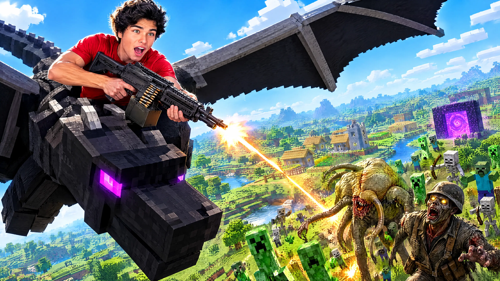A · Sky raid](canvas.html?scope=episode1#card-MV-A)[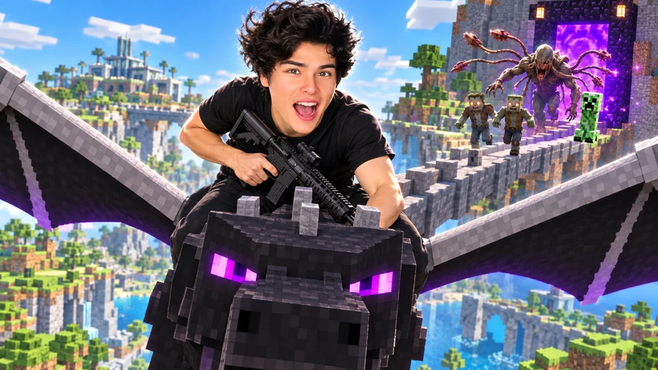H · They followed me](canvas.html?scope=episode1#card-MV-H)[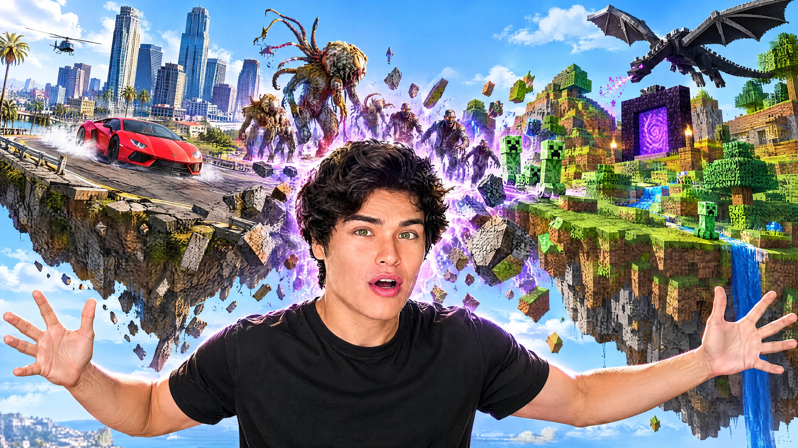J · Two worlds collide](canvas.html?scope=episode1#card-MV-J)

1. **0 (First Frame)–5s**Open on one instantly recognizable game collision and a real cast reaction, with a brief glimpse of the giant shared threat.
2. **5s–15s**Show Alex, Alan, Kat, Tanner and Shawn at five setups, each entering a different mashup. State the simple challenge that brings them together for the final boss.
3. **15s–30s**Start a real attempt, then cut to a contrasting world where another player discovers an unexpected mechanic or suffers a clear setback.

Why this idea and source videos

**Title shape:** I Beat [SUPERLATIVE] [SUBJECT]

**Ingredients:** Five contrasting game worlds + the Stokes cast + one shared giant-boss finale

**Objective:** Complete five contrasting individual crossover challenges, then defeat the shared final boss together.

* [MrBeast Gaming · World's Largest Minecraft Build!](https://www.youtube.com/watch?v=Dy06SXknr_g): Observed thumbnail: large real host beside a block-built Earth with bright blue sky. Style/composition reference only; no claim this validates the new crossover.
* [· Halo & MDE](https://modrinth.com/project/halo-mde): Developer-maintained Halo mod listing. Candidate component, not a tested full crossover stack.
* [· Dragon Mounts Remastered](https://www.curseforge.com/minecraft/mc-mods/dmr): Developer-maintained rideable dragon mod listing. Does not establish that the exact Ender Dragon and gun combination works.
* [· Immersive Vehicles](https://www.curseforge.com/minecraft/mc-mods/minecraft-transport-simulator): Developer-maintained vehicle framework. Candidate tool, not evidence of GTA integration.

Public source views/lift support adjacent formats and composition choices, not measured CTR or proof of these exact custom crossovers.

### I Found The Leaked GTA 6

Alex stages a fake GTA 6 experience for Alan, Kat, Tanner and Shawn, keeping the audience guessing until the reveal.

[Full video plan: story, cast, rules and execution](episode-details.html#L03)

Existing concepts retained; final title and thumbnail must match the staged experience without spoiling the reveal.

[A · The mysterious build](canvas.html?scope=episode2#card-L03-A)[B · The prankster behind him](canvas.html?scope=episode2#card-L03-B)[C · The beautiful city is a set](canvas.html?scope=episode2#card-L03-C)[D · Too realistic to be true](canvas.html?scope=episode2#card-L03-D)[E · The game was a prank](canvas.html?scope=episode2#card-L03-E)

1. **0 (First Frame)–5s**Open with a convincing-looking game moment and a cast reaction that makes the supposed access feel extraordinary.
2. **5s–15s**Show why the crew believes Alex, establish the first goal and let the audience form its own theory.
3. **15s–30s**An unusual detail creates the first suspicion while the crew keeps playing; save the explicit prank reveal for the payoff.

Why this idea and source videos

**Title shape:** I Found The \_\_\_

**Ingredients:** Alex as mischievous prankster + fake early access + unaware crew + escalating clues and reveal

**Objective:** Build convincing apparent proof, escalating suspicions and an earned prank reveal with real crew reactions.

* [Stokes Twins · Prisoner Drive Thru Prank](https://www.youtube.com/watch?v=nuK7e1xzThc): Observed source image: a real host in an orange prisoner costume inside a car, with a highlighted secondary face. The prank performance and human context are useful; the source is 2.94x.
* [Stokes Twins · 365 PRANKS IN 365 DAYS!!](https://www.youtube.com/watch?v=5ZX_eypUHns): Original is a two-panel prank thumbnail. One panel places a threat behind an unaware person; our chase combines that relation into a single coherent game scene.
* [Stokes Twins · BUSTING VIRAL TIKTOK GADGETS!!](https://www.youtube.com/watch?v=AwQz703eOt0): Large host gesture at left presents one surprising gadget mechanism at right. We keep the presentation gesture and replace the dark background with the requested blue sky.

Public source views/lift support adjacent formats and composition choices, not measured CTR or proof of these exact custom crossovers.

### I Survived 100 Hours in GTA

The crew plays five individual GTA 6 runs in one room, and everyone can leave when the first person beats the game.

[Full video plan: story, cast, rules and execution](episode-details.html#L01)

Existing compositions retained as references; adapt the final package to the room/race/group-release story.

[A · The last checkpoint](canvas.html?scope=episode3#card-L01-A)[B · We finally beat it](canvas.html?scope=episode3#card-L01-B)[C · One mistake from losing](canvas.html?scope=episode3#card-L01-C)[D · Twins versus the crew](canvas.html?scope=episode3#card-L01-D)[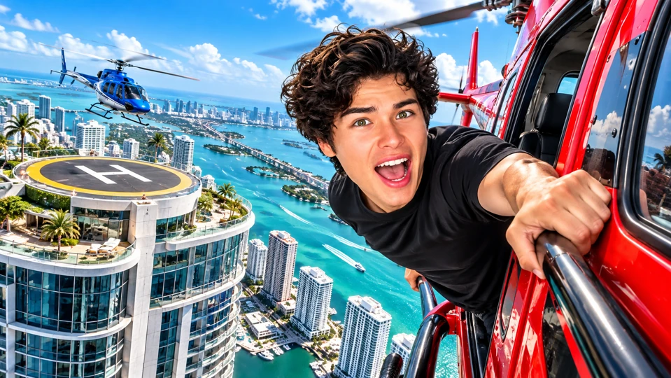E · One final mission](canvas.html?scope=episode3#card-L01-E)

1. **0 (First Frame)–5s**Show five occupied gaming stations, the closed-room premise and an elapsed clock; cut to a near-finish reaction without giving away the winner.
2. **5s–15s**Explain that each person plays their own run and one completion lets everyone leave. Establish the agreed finish checkpoint.
3. **15s–30s**A player gains an early lead while another hits a setback; make progress and crew rivalry easy to follow.

Why this idea and source videos

**Title shape:** I Survived [DURATION] in [GAME]

**Ingredients:** Actual GTA 6 + one room + five individual runs + first completion releases everyone

**Objective:** Be the first to beat actual GTA 6 and release the entire crew.

* [MrBeast Gaming · 1 vs 10 Hunters in GTA!](https://www.youtube.com/watch?v=xwdhHTtc-3w): Large real host at left with an airborne supercar on a clear diagonal at right against blue sky.
* [Stokes Twins · 365 PRANKS IN 365 DAYS!!](https://www.youtube.com/watch?v=5ZX_eypUHns): Original is a two-panel prank thumbnail. One panel places a threat behind an unaware person; our chase combines that relation into a single coherent game scene.
* [MrBeast Gaming · World's Fastest Car!](https://www.youtube.com/watch?v=nopEs-K4ExM): Observed source image: host left beside a rear-view sports car on a bright green acceleration lane. Source score 3.68x is a qualifying public outlier.

Public source views/lift support adjacent formats and composition choices, not measured CTR or proof of these exact custom crossovers.

Channel vision and development scope

English first, designed for later localization. Use the game as a vessel for clear human stakes, ensemble personality and cinematic spectacle that gamers and non-gamers can both follow.

The first mashup uses five per-person worlds and a shared finale. Later formats remain a mixed research portfolio, not 100 commissioned uploads.

Browse the 20-format portfolio01 · Cheap versus extravagant, same testretained core · 5 videos

Run matched tasks across contrasting vehicles or spaces; the comparison answers a question.

**Shape:** $1 vs $1,000,000 \_\_\_

Retained. Keep the direct price/object contrast; use visible speed, durability and stunt results rather than a game-economy lecture.

Alan/Alex host or drive alongside rotating crew; every driver runs the same understandable tests.

**Learning:** Does this distinct viewer promise attract broad viewers while feeling recognizably Stokes?

[001 · $1 vs $1,000,000 Cars in GTA](#idea-001)[002 · $1 vs $1,000,000 Houses in GTA](#idea-002)[003 · $1 vs $1,000,000 Boats in GTA](#idea-003)[004 · $1 vs $1,000,000 Security in GTA](#idea-004)[005 · $1 vs $1,000,000 Minecraft Houses](#idea-005)

02 · The crew versus overwhelming huntersretained core · 5 videos

Two rotating cast fugitives must reach a clearly marked extraction point while coordinated hunters close routes and increase the pressure.

**Shape:** \_\_\_ vs \_\_\_ Hunters in \_\_\_

Retained. Increase the visible opposition if the capture/server test supports it; the larger number is a proposed execution, not a prediction.

Two featured fugitives; crew members lead hunter teams, set traps and supply rival personalities. A hundred hunters requires a verified player/NPC plan.

**Learning:** Does this distinct viewer promise attract broad viewers while feeling recognizably Stokes?

[006 · 2 vs 100 Hunters in GTA](#idea-006)[007 · We Escaped 100 Hunters With No Cars in GTA](#idea-007)[008 · 1 Tiny Car vs 100 Hunters in GTA](#idea-008)[009 · We Hid $1,000,000 From 100 Hunters in GTA](#idea-009)[010 · 2 vs 100 Hunters in Minecraft](#idea-010)

03 · Secret builds with a discovery deadlineretained core · 5 videos

Show the audience five concealed, functional spaces, then let rotating crew seekers search under a deadline; every discovery reveals the next layer of ingenuity.

**Shape:** I Built \_\_\_ Secret Rooms You'd Never Find in \_\_\_

Retained. Five strong reveals beat an unsupported promise that merely multiplies the room count.

One creator/host presents the builds; multiple crew members search, compete or react. Both twins need not be the only relationship.

**Learning:** Does this distinct viewer promise attract broad viewers while feeling recognizably Stokes?

[011 · I Built 5 Secret Rooms You'd Never Find in GTA](#idea-011)[012 · I Built a Secret Room Under My Friend's GTA House](#idea-012)[013 · I Built 5 Secret Rooms Inside GTA Vehicles](#idea-013)[014 · I Built 5 Secret Rooms Using Only One Color in GTA](#idea-014)[015 · I Built Secret Rooms Inside Minecraft Landmarks](#idea-015)

04 · Budgeted secret-room build-offnew direction requested · 5 videos

Give builders contrasting fixed allowances and the same brief, follow the tradeoffs, then have the crew discover and experience each room before choosing the best use of the budget.

**Shape:** $1 vs $\_\_\_ Secret Rooms in \_\_\_

New direction requested by the user. Replaces the standalone last-to-leave slot. Last-to-leave can still be an in-video rule inside a larger premise.

Two or more build teams, crew room testers and an Alan/Alex host/judge; specialist developers can execute the selected designs.

**Learning:** Does this distinct viewer promise attract broad viewers while feeling recognizably Stokes?

[016 · $1 vs $25,000 Secret Rooms in GTA](#idea-016)[017 · $1 vs $25,000 Secret Rooms Inside GTA Cars](#idea-017)[018 · $1 vs $25,000 Underwater Rooms in GTA](#idea-018)[019 · $1 vs $25,000 Secret Rooms for Our Friends in GTA](#idea-019)[020 · $1 vs $25,000 Secret Rooms in Minecraft](#idea-020)

05 · Survive a city-scale disasterreworked/new proposal · 5 videos

The crew must reach safety through a clearly introduced disaster that changes the available route; preparation, sacrifice and improvised escapes provide escalation.

**Shape:** We Survived \_\_\_ in \_\_\_

Reworked. No Los Santos in the title. Each episode uses a concrete recognizable disaster rather than generic survival exposition.

A mixed survival group with a visible shared objective; rotate who makes decisions, fails and rescues someone.

**Learning:** Does this distinct viewer promise attract broad viewers while feeling recognizably Stokes?

[021 · We Survived GTA's Deadliest Natural Disasters](#idea-021)[022 · We Survived a Giant Tsunami in GTA](#idea-022)[023 · A Tornado Chased Us Across GTA](#idea-023)[024 · We Survived a City That Flooded Every Minute in GTA](#idea-024)[025 · We Survived a Giant Tsunami in Minecraft](#idea-025)

06 · Busting spectacular mythsretained core · 5 videos

State testable claims, run consistent tests and reveal results; group escalation instead of repetitive attempts.

**Shape:** Busting \_\_\_ Myths in \_\_\_

Retained. Start with a spectacular claim everyone can understand; preserve the actual test count.

Crew members propose, attempt and judge myths; Alan/Alex can host or compete with them.

**Learning:** Does this distinct viewer promise attract broad viewers while feeling recognizably Stokes?

[026 · We Busted 100 GTA Myths](#idea-026)[027 · We Tested GTA Myths That Should Be Impossible](#idea-027)[028 · We Tested Every Way to Escape a Sinking Car in GTA](#idea-028)[029 · We Tested 100 Viral GTA Stunts](#idea-029)[030 · We Busted 100 Minecraft Myths](#idea-030)

07 · A wheel controls the crew’s livesreworked/new proposal · 5 videos

A visible wheel decides consequential life choices such as transport, teammate or where the crew must live while they try to complete one understandable day-long goal.

**Shape:** We Let \_\_\_ Control Our Lives in \_\_\_

Reworked. Package lost agency and comedy, rather than a new game mechanic every five minutes.

Crew spins, lives with the consequence and occasionally controls another player’s choice; rotate the host and affected participant.

**Learning:** Does this distinct viewer promise attract broad viewers while feeling recognizably Stokes?

[031 · We Let a Wheel Control Our Lives in GTA](#idea-031)[032 · My Friends Controlled My Life in GTA](#idea-032)[033 · A Wheel Decided Where We Lived in GTA](#idea-033)[034 · We Let a Wheel Choose Our Getaway in GTA](#idea-034)[035 · My Friends Controlled My Roblox Life](#idea-035)

08 · Give the crew their dream livesreworked/new proposal · 5 videos

Collect each crew member’s specific dream, recreate it in-game, reveal it to them and follow their attempts to actually live that fantasy, culminating in a shared extravagant day.

**Shape:** I Gave My Friends Their Dream \_\_\_ in \_\_\_

Replaced the economy-grind presentation. This is wish fulfillment and cast performance; direct winning evidence for this exact engine is still missing.

Several crew members receive different dreams; either twin or another regular can host, and participants perform their own story.

**Learning:** Does this distinct viewer promise attract broad viewers while feeling recognizably Stokes?

[036 · I Gave My Friends Their Dream Lives in GTA](#idea-036)[037 · I Built My Friend's Dream Garage in GTA](#idea-037)[038 · We Lived Like Billionaires in GTA](#idea-038)[039 · I Gave My Friends Their Dream Vacations in GTA](#idea-039)[040 · I Built My Friends' Dream Worlds in Minecraft](#idea-040)

09 · The world-sized experimentretained core · 5 videos

Increase the size and design of a vehicle barrier in controlled stages, show genuine impacts and failures, and finish with a large final test of whether the train can be stopped.

**Shape:** Can \_\_\_ \_\_\_ Stop a \_\_\_ in \_\_\_?

Retained and made bigger. 10,000 is a concept-scale target requiring a load/physics test; use the achieved true count in final packaging. Bigger means a more spectacular problem and earned final experiment.

Crew teams propose and build different barriers; Alan/Alex or another host runs the test while participants react to the result.

**Learning:** Does this distinct viewer promise attract broad viewers while feeling recognizably Stokes?

[041 · Can 10,000 Cars Stop a Train in GTA?](#idea-041)[042 · Can 1,000 Boats Stop a Tsunami in GTA?](#idea-042)[043 · I Created GTA's Biggest Car Crash](#idea-043)[044 · Can 100 Helicopters Lift a House in GTA?](#idea-044)[045 · Can 10,000 Minecraft Minecarts Stop a Train?](#idea-045)

10 · Play GTA across its citiesnew direction requested · 5 videos

Complete one accessible, city-specific challenge at every stop, with a progress map and final journey payoff; the user is choosing whether the stops are real filming locations or different GTA games.

**Shape:** I Played \_\_\_ in Every \_\_\_

New user direction replacing shared controls. Exact cross-city performance precedent is not established; do not describe this as a proven outlier.

One traveling/playing host with crew participants at different stops; another cast member can lead the comparison or challenge.

**Learning:** Does this distinct viewer promise attract broad viewers while feeling recognizably Stokes?

[046 · I Played GTA in Every GTA City!](#idea-046)[047 · GTA vs Real Life: The Same Day in Every City](#idea-047)[048 · I Played GTA in the Real Places That Inspired It](#idea-048)[049 · We Crossed Every GTA City Without Flying](#idea-049)[050 · I Played GTA 6 in the City That Inspired It](#idea-050)

11 · A crew whodunitreworked/new proposal · 5 videos

The crew investigates a performed mystery with visible evidence, competing explanations and a reveal the audience could solve from the same clues.

**Shape:** Who \_\_\_ Our \_\_\_ in \_\_\_?

Reworked. The missing supercar/twin framing is removed. The family is mixed, so the actual cast mystery and clue quality must earn the title.

An ensemble of investigators, suspects and a victim; Alan/Alex may take any of those roles.

**Learning:** Does this distinct viewer promise attract broad viewers while feeling recognizably Stokes?

[051 · Who Murdered Our Friend in GTA?](#idea-051)[052 · One of My Friends Is a Secret Killer in GTA](#idea-052)[053 · Who Stole Our $1,000,000 Car in GTA?](#idea-053)[054 · Who Trapped Our Friends in a Secret GTA Room?](#idea-054)[055 · Who Destroyed Our Minecraft Mansion?](#idea-055)

12 · Pranks that change the missionretained core · 5 videos

One host secretly adds a meaningful difficulty every minute while the whole crew attempts an ordinary, easy-to-understand goal; viewers see the cause before the crew realizes the prank.

**Shape:** I Secretly Made \_\_\_ Harder Every \_\_\_

Retained with the user’s exact title and whole-crew prank direction.

One concealed prank operator, several unaware crew participants and recorded reactions from everyone.

**Learning:** Does this distinct viewer promise attract broad viewers while feeling recognizably Stokes?

[056 · I Secretly Made GTA Harder Every Minute](#idea-056)[057 · I Secretly Made My Friends' GTA Cars Worse](#idea-057)[058 · I Secretly Shrunk Our GTA World Every Minute](#idea-058)[059 · I Secretly Made GTA Flood While My Friends Played](#idea-059)[060 · I Secretly Made Minecraft Harder Every Minute](#idea-060)

13 · One day in an impossible jobreworked/new proposal · 5 videos

A clear job produces escalating tasks, customers and a final performance test.

**Shape:** We Became The Worst \_\_\_ in \_\_\_

User-directed rewrite retained for review; the latest explicit retained-core list did not separately confirm 13.

Multiple crew drivers and customers, with Alan/Alex participating or directing the day.

**Learning:** Does this distinct viewer promise attract broad viewers while feeling recognizably Stokes?

[061 · We Became The Worst Taxi Drivers in GTA](#idea-061)[062 · We Became GTA's Worst Delivery Drivers](#idea-062)[063 · We Opened GTA's Worst Restaurant](#idea-063)[064 · We Became GTA's Worst Firefighters](#idea-064)[065 · We Became Roblox's Worst Taxi Drivers](#idea-065)

14 · Beat the impossible courseretained core · 5 videos

A staged skill gauntlet with escalating obstacles, visible attempts and a final completion.

**Shape:** We Built the Most Impossible \_\_\_

Retained. Keep one clearly visible impossible obstacle and progress toward a genuine completion.

Crew members attempt, coach and redesign obstacles; rotate competitors and provide each an understandable objective.

**Learning:** Does this distinct viewer promise attract broad viewers while feeling recognizably Stokes?

[066 · We Built GTA's Most Impossible Obstacle Course](#idea-066)[067 · We Built an Obstacle Course Above GTA's Tallest Buildings](#idea-067)[068 · We Built GTA's Impossible Course for Tiny Cars](#idea-068)[069 · We Built a Course That Gets Harder Every Time You Fail](#idea-069)[070 · We Built Minecraft's Most Impossible Obstacle Course](#idea-070)

15 · Keep the reward or risk the next levelretained core · 5 videos

Crew contestants repeatedly choose between banking a known reward and risking it on a harder challenge; show what each choice costs and earn the final outcome.

**Shape:** Keep Or Risk $\_\_\_ / Risk A \_\_\_, Win $\_\_\_

Retained with the user’s requested variations. Prize value and real-versus-virtual framing remain production decisions; no million-dollar cash commitment is assumed.

Several crew contestants with different risk tolerances; a host presents each choice and clearly tracks what is at stake.

**Learning:** Does this distinct viewer promise attract broad viewers while feeling recognizably Stokes?

[071 · Keep Or Risk $1,000,000 in GTA](#idea-071)[072 · Risk A Lamborghini, Win $1,000,000 in GTA](#idea-072)[073 · Press the Button, Risk Everything in GTA](#idea-073)[074 · Risk Your Dream House, Win a Mansion in GTA](#idea-074)[075 · Keep Your Minecraft Castle or Risk Everything](#idea-075)

16 · Escape an extraordinary prisonreworked/new proposal · 5 videos

A crew of inmates discovers and defeats layers of a designed security system, learning from failed plans before executing one coordinated escape.

**Shape:** We Escaped \_\_\_ Most \_\_\_ Prison

New proposal replacing camouflage hide-and-seek; needs user review.

Several crew inmates; other crew play guards or the designer, with flexible twin roles.

**Learning:** Does this distinct viewer promise attract broad viewers while feeling recognizably Stokes?

[076 · We Escaped GTA's Most Secure Prison](#idea-076)[077 · We Escaped an Underwater Prison in GTA](#idea-077)[078 · We Escaped a Prison Inside a Moving Train in GTA](#idea-078)[079 · We Escaped a Prison That Changed Every Minute in GTA](#idea-079)[080 · We Escaped Minecraft's Most Secure Prison](#idea-080)

17 · I’ll buy anything you buildretained core · 5 videos

Builders create objects they want under a clear scope, demonstrate what they built, and the host fulfills the promised purchase when the build meets the rules.

**Shape:** I'll Buy Anything You \_\_\_

Retained with the user’s exact title. Specify actual purchasing rules before packaging the episode.

Several cast members or invited builders propose and create, while one host funds and tests the build; twins can rotate hosting.

**Learning:** Does this distinct viewer promise attract broad viewers while feeling recognizably Stokes?

[081 · I'll Buy Anything You Build in GTA](#idea-081)[082 · I'll Buy Any Car My Friends Build in GTA](#idea-082)[083 · I'll Buy Any House You Build in GTA](#idea-083)[084 · I'll Buy Anything You Build in Minecraft](#idea-084)[085 · I'll Buy Anything Our Crew Builds With One Color](#idea-085)

18 · Game versus real life, same raceretained core · 5 videos

Two cast teams race between corresponding checkpoints in a virtual and real route, compare what each world makes easier or harder, and resolve the competition using stated fair progress/time rules.

**Shape:** \_\_\_ vs Real Life: Race Across \_\_\_

Retained. Add the requested Minecraft/IRL Earth race and winner’s free dinner for a year, with a defined meal allowance. It is one race-format variation, not an unrelated new format.

Two mixed cast teams with separate game/IRL capture, a common presenter and a fair shared scoreboard.

**Learning:** Does this distinct viewer promise attract broad viewers while feeling recognizably Stokes?

[086 · GTA vs Real Life: Race Across the City](#idea-086)[087 · Minecraft vs Real Life: Race Across the Earth](#idea-087)[088 · GTA vs Real Life: Who Can Deliver Dinner Faster?](#idea-088)[089 · GTA vs Real Life: Can We Escape the Same Maze?](#idea-089)[090 · Minecraft vs Real Life: Build the Same Secret Room](#idea-090)

19 · Extreme test-drive cataloguereworked/new proposal · 5 videos

The crew tries a varied catalogue of extreme vehicles, gives each a clear real-world-style mission and ranks which actually work; different failures and capabilities supply each reveal.

**Shape:** I Tested \_\_\_ Most \_\_\_ \_\_\_

New proposal replacing the rescue mission; exact vehicle-catalogue evidence remains adjacent and this needs review.

Multiple crew drivers and a host, with specialists taking genuinely harder attempts.

**Learning:** Does this distinct viewer promise attract broad viewers while feeling recognizably Stokes?

[091 · I Tested GTA's Most Dangerous Vehicles](#idea-091)[092 · I Tested GTA's Smallest and Biggest Cars](#idea-092)[093 · We Tested Vehicles That Shouldn't Exist in GTA](#idea-093)[094 · Can GTA's Fastest Car Beat a Helicopter?](#idea-094)[095 · I Tested Minecraft's Most Ridiculous Vehicles](#idea-095)

20 · Transform the world into an impossible attractionreworked/new proposal · 5 videos

Transform an ordinary area into a spectacular working attraction, reveal construction milestones and then have the crew open and use it; the payoff is whether the ambitious place functions.

**Shape:** I Turned \_\_\_ Into a \_\_\_

New proposal replacing the release relay; transformation precedents include weaker sequels, so novelty and a real functioning payoff matter.

Builders/designers, crew attraction testers and an Alan/Alex host; guest cast can appear at the opening.

**Learning:** Does this distinct viewer promise attract broad viewers while feeling recognizably Stokes?

[096 · I Turned GTA Into a Giant Waterpark](#idea-096)[097 · I Turned GTA Into a Giant Theme Park](#idea-097)[098 · I Built a Giant Race Track Across GTA](#idea-098)[099 · I Turned Minecraft Into a Giant Waterpark](#idea-099)[100 · I Built Our Dream Theme Park in Roblox](#idea-100)

Search all 100 ideasFormatAll 20 formats01 · Cheap versus extravagant, same test02 · The crew versus overwhelming hunters03 · Secret builds with a discovery deadline04 · Budgeted secret-room build-off05 · Survive a city-scale disaster06 · Busting spectacular myths07 · A wheel controls the crew’s lives08 · Give the crew their dream lives09 · The world-sized experiment10 · Play GTA across its cities11 · A crew whodunit12 · Pranks that change the mission13 · One day in an impossible job14 · Beat the impossible course15 · Keep the reward or risk the next level16 · Escape an extraordinary prison17 · I’ll buy anything you build18 · Game versus real life, same race19 · Extreme test-drive catalogue20 · Transform the world into an impossible attractionGameAll gamesGTA 5GTA 6MinecraftRobloxProduction tierAll costsHeavyHybridLightMediumTravelEvidenceAll evidence levels2+ channels on both axesHas an evidence gapCards per page1025All 100

Reset filters

100 ideas

[Download full document + all images](https://github.com/majieddd/stokes-gaming-vision/releases/download/launch-v7/Stokes-Gaming-Creative-151.zip)

Each card includes a finished image, three intro beats, separate shape and ingredient sources, reference composition, and a production brief. Public lift is observational; evidence gaps are explicit.

001 / FORMAT 01 · Cheap versus extravagant, same test

### $1 vs $1,000,000 Cars in GTA

The crew races a wreck and an extravagant supercar through the same three tests to find what money really changes.

GTA 5 launch / follow-up · GTA 5

1. **0 (First Frame)–5s**A rusty tiny car left, a red supercar right, Alan between them; big $1 and $1M labels.
2. **5s–15s**Win the combined speed, survival and stunt score. Use the same driver rotation, route and reset conditions.
3. **15s–30s**The cheap car stalls at the first start, so the crew has to decide whether the agreed retry rule applies. Show the crew choosing its next move.

[Light complexity](#production)[Download image](full/001.jpg)

Why this idea

Title shape**$[VALUE] vs $[VALUE] [SUBJECT] in [GAME]**Content ingredients**cars, cheap, expensive**Combined package**$1 vs $1,000,000 Cars in GTA**

Translate the main-channel price ladder into fair, visible tests; label prices as in-game.

#### Title / premise family

3/2 qualifying outlier channels · 3 creator groups. Qualifying means source-reported lift ≥2×; family matches do not prove the exact mixed episode.

* 

  [$2 VS $16,000 Minecraft House!](https://www.youtube.com/watch?v=IPtpwh7r0Eo)

  MrBeast Gaming · 2021-08-25 · family

  116,928,432 public views · 3.26× reported lift

  Same title/premise family: $2 VS $16,000 Minecraft House!. Game, cast and execution transfer remains a hypothesis; this source does not validate the new episode outcome.Window: lifetime through source snapshot. [Metric source](https://majieddd.github.io/influint-channels-public/channels/UCIPPMRA040LQr5QPyJEbmXA.html)
* [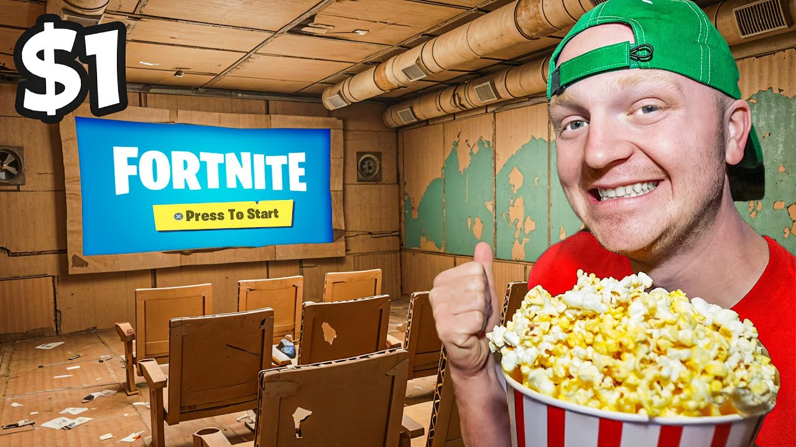](https://www.youtube.com/watch?v=NbJGkWNL9Ow)

  [$1 VS $1,000,000 MOVIE THEATER!](https://www.youtube.com/watch?v=NbJGkWNL9Ow)

  Unspeakable · 2025-03-22 · family

  9,548,848 public views · 3.15× reported lift

  Same title/premise family: $1 VS $1,000,000 MOVIE THEATER!. Game, cast and execution transfer remains a hypothesis; this source does not validate the new episode outcome.Window: lifetime through source snapshot. [Metric source](https://majieddd.github.io/influint-channels-public/channels/UCwIWAbIeu0xI0ReKWOcw3eg.html)
* 

  [$50 vs $50,000 Family Vacation](https://www.youtube.com/watch?v=Mp8c5F16i1A)

  Brianna · 2022-08-28 · family

  4,879,296 public views · 2.45× reported lift

  Same title/premise family: $50 vs $50,000 Family Vacation. Game, cast and execution transfer remains a hypothesis; this source does not validate the new episode outcome.Window: lifetime through source snapshot. [Metric source](https://majieddd.github.io/influint-channels-public/channels/UCXg4rJUbDP1IP3TmZ9KDpJg.html)
* [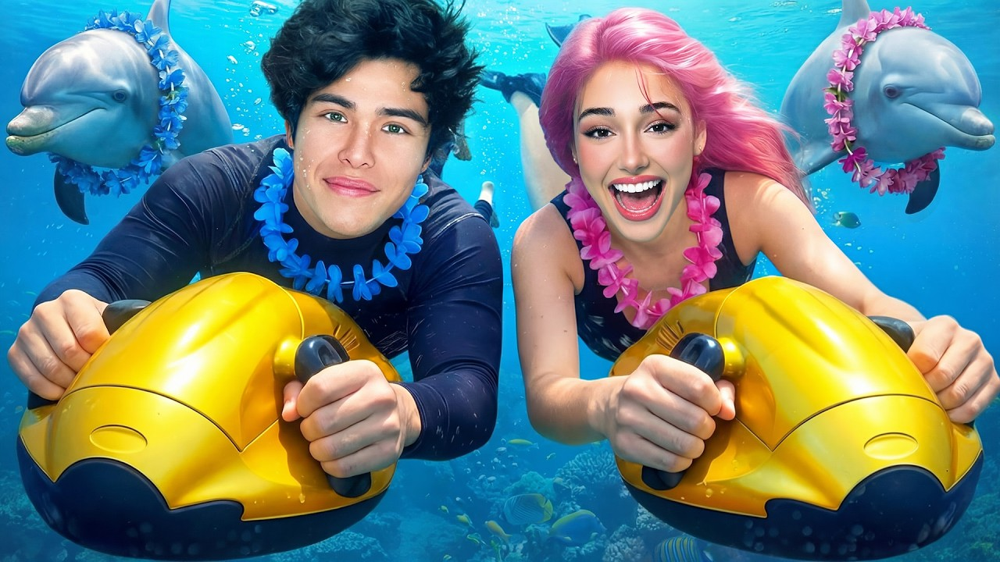](https://www.youtube.com/watch?v=K7FjCmlWvuY)

  [$1 vs $1,000,000 Vacation!](https://www.youtube.com/watch?v=K7FjCmlWvuY)

  Stokes Twins · 2022-11-23 · family

  127,518,732 public views · 1.33× reported lift

  Same title/premise family: $1 vs $1,000,000 Vacation!. Game, cast and execution transfer remains a hypothesis; this source does not validate the new episode outcome.Window: lifetime through source snapshot. [Metric source](https://majieddd.github.io/influint-channels-public/channels/UCbp9MyKCTEww4CxEzc_Tp0Q.html)

#### Principal content ingredient

4/2 qualifying outlier channels · 4 creator groups. Qualifying means source-reported lift ≥2×; family matches do not prove the exact mixed episode.

* [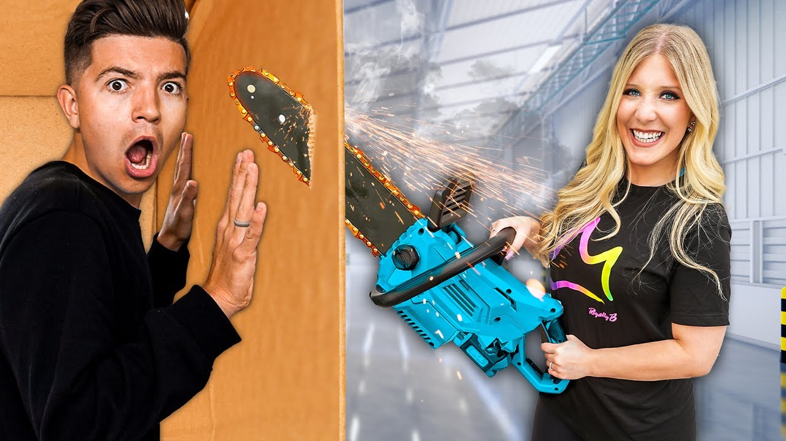](https://www.youtube.com/watch?v=5zbvDh28XUQ)

  [Preston Cheated in Cardboard Hide and Seek](https://www.youtube.com/watch?v=5zbvDh28XUQ)

  Brianna · 2022-04-28 · family

  11,051,826 public views · 5.01× reported lift

  Same concrete ingredient cars: Preston Cheated in Cardboard Hide and Seek. Game, cast and execution transfer remains a hypothesis; this source does not validate the new episode outcome.Window: lifetime through source snapshot. [Metric source](https://majieddd.github.io/influint-channels-public/channels/UCXg4rJUbDP1IP3TmZ9KDpJg.html)
* [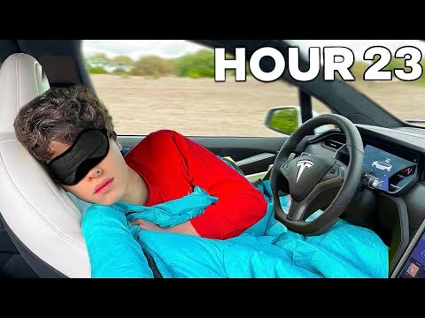](https://www.youtube.com/watch?v=SsJ7oOpbmIk)

  [Tesla Autopilot For 24 Hours!](https://www.youtube.com/watch?v=SsJ7oOpbmIk)

  Stokes Twins · 2021-04-20 · family

  38,321,506 public views · 4.25× reported lift

  Same concrete ingredient cars: Tesla Autopilot For 24 Hours!. Game, cast and execution transfer remains a hypothesis; this source does not validate the new episode outcome.Window: lifetime through source snapshot. [Metric source](https://majieddd.github.io/influint-channels-public/channels/UCbp9MyKCTEww4CxEzc_Tp0Q.html)
* 

  [World's Fastest Car!](https://www.youtube.com/watch?v=nopEs-K4ExM)

  MrBeast Gaming · 2022-07-09 · family

  122,277,058 public views · 3.68× reported lift

  Same concrete ingredient cars: World's Fastest Car!. Game, cast and execution transfer remains a hypothesis; this source does not validate the new episode outcome.Window: lifetime through source snapshot. [Metric source](https://majieddd.github.io/influint-channels-public/channels/UCIPPMRA040LQr5QPyJEbmXA.html)
* [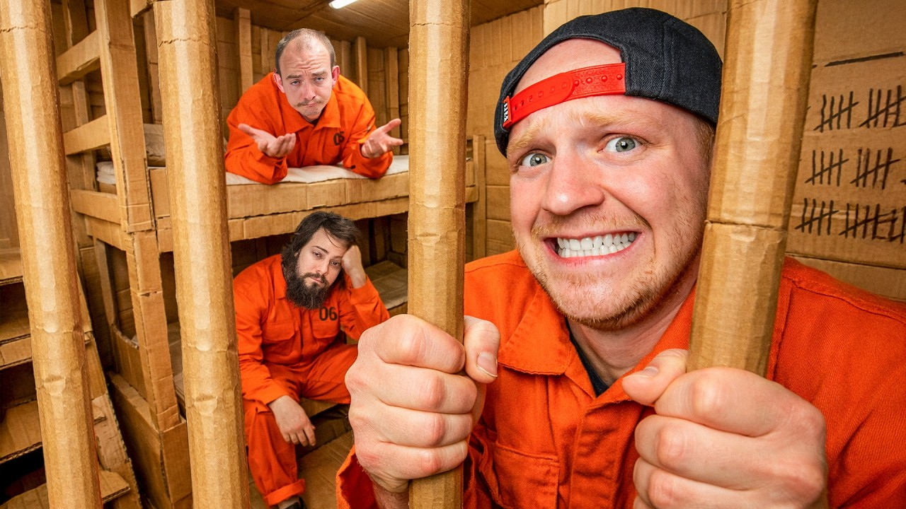](https://www.youtube.com/watch?v=WU05jZnUiYs)

  [7 Days Escaping Cardboard Prison!](https://www.youtube.com/watch?v=WU05jZnUiYs)

  Unspeakable · 2026-01-24 · family

  12,880,314 public views · 3.65× reported lift

  Same concrete ingredient cars: 7 Days Escaping Cardboard Prison!. Game, cast and execution transfer remains a hypothesis; this source does not validate the new episode outcome.Window: lifetime through source snapshot. [Metric source](https://majieddd.github.io/influint-channels-public/channels/UCwIWAbIeu0xI0ReKWOcw3eg.html)

Ingredient matches concern the principal object/premise, not proof of every mixed ingredient. Views/lift are observed package/content performance.

Thumbnail reference and composition

Composition source: MrBeast Gaming · $2 VS $16,000 Minecraft House!

Finished Stokes concept for this episode.

A rusty tiny car left, a red supercar right, Alan between them; big $1 and $1M labels.

Retain source subject placement, relative scale, action direction and visual contrast; use the Stokes identity and this episode’s actual content. This is a planned image, not a gameplay screenshot or a validated CTR winner.

Creative and production brief

Win the combined speed, survival and stunt score.

Use the same driver rotation, route and reset conditions; prices are stated game values.

#### Escalation

A straight race becomes a crash test, then a jump where an expensive car can still lose.

#### Payoff

Reveal the scored winner and the surprising test the cheap car wins or loses on merit.

#### For both audiences

**Gamer:** Cars, houses and visible performance differences reward game knowledge.

**Non-gamer:** Everyone can judge cheap versus extravagant and whether money changes the result.

#### People and production

Alan/Alex host or drive alongside rotating crew; every driver runs the same understandable tests.

* A scoped vehicle/prop selection and scoring system; do not imply fictional prices are cash spend.

#### Learning question

Does this distinct viewer promise attract broad viewers while feeling recognizably Stokes?

**Shorts opportunity:** Extract a complete first-complication-to-result micro-story or one resolved test/reveal; preserve setup and payoff.

[Link to idea 001](#idea-001)[Image prompt](prompts/001.txt)

002 / FORMAT 01 · Cheap versus extravagant, same test

### $1 vs $1,000,000 Houses in GTA

Three crews test a shack and a mansion for comfort, security and a party everyone actually wants to attend.

GTA 5 launch / follow-up · GTA 5

1. **0 (First Frame)–5s**Tiny leaning wooden shack left versus white mansion with blue pool right, Alex opening his hands between them; $1 and $1M.
2. **5s–15s**Choose the better house after three visible tests. Same number of guests and same simulated break-in challenge.
3. **15s–30s**The cheap house has one chair for the entire crew, forcing the first comfort decision. Show the crew choosing its next move.

[Light complexity](#production)[Download image](full/002.jpg)

Why this idea

Title shape**$[VALUE] vs $[VALUE] [SUBJECT] in [GAME]**Content ingredients**houses, mansion, cheap**Combined package**$1 vs $1,000,000 Houses in GTA**

Translate the main-channel price ladder into fair, visible tests; label prices as in-game.

#### Title / premise family

3/2 qualifying outlier channels · 3 creator groups. Qualifying means source-reported lift ≥2×; family matches do not prove the exact mixed episode.

* 

  [$2 VS $16,000 Minecraft House!](https://www.youtube.com/watch?v=IPtpwh7r0Eo)

  MrBeast Gaming · 2021-08-25 · family

  116,928,432 public views · 3.26× reported lift

  Same title/premise family: $2 VS $16,000 Minecraft House!. Game, cast and execution transfer remains a hypothesis; this source does not validate the new episode outcome.Window: lifetime through source snapshot. [Metric source](https://majieddd.github.io/influint-channels-public/channels/UCIPPMRA040LQr5QPyJEbmXA.html)
* 

  [$1 VS $1,000,000 MOVIE THEATER!](https://www.youtube.com/watch?v=NbJGkWNL9Ow)

  Unspeakable · 2025-03-22 · family

  9,548,848 public views · 3.15× reported lift

  Same title/premise family: $1 VS $1,000,000 MOVIE THEATER!. Game, cast and execution transfer remains a hypothesis; this source does not validate the new episode outcome.Window: lifetime through source snapshot. [Metric source](https://majieddd.github.io/influint-channels-public/channels/UCwIWAbIeu0xI0ReKWOcw3eg.html)
* 

  [$50 vs $50,000 Family Vacation](https://www.youtube.com/watch?v=Mp8c5F16i1A)

  Brianna · 2022-08-28 · family

  4,879,296 public views · 2.45× reported lift

  Same title/premise family: $50 vs $50,000 Family Vacation. Game, cast and execution transfer remains a hypothesis; this source does not validate the new episode outcome.Window: lifetime through source snapshot. [Metric source](https://majieddd.github.io/influint-channels-public/channels/UCXg4rJUbDP1IP3TmZ9KDpJg.html)
* 

  [$1 vs $1,000,000 Vacation!](https://www.youtube.com/watch?v=K7FjCmlWvuY)

  Stokes Twins · 2022-11-23 · family

  127,518,732 public views · 1.33× reported lift

  Same title/premise family: $1 vs $1,000,000 Vacation!. Game, cast and execution transfer remains a hypothesis; this source does not validate the new episode outcome.Window: lifetime through source snapshot. [Metric source](https://majieddd.github.io/influint-channels-public/channels/UCbp9MyKCTEww4CxEzc_Tp0Q.html)

#### Principal content ingredient

4/2 qualifying outlier channels · 3 creator groups. Qualifying means source-reported lift ≥2×; family matches do not prove the exact mixed episode.

* [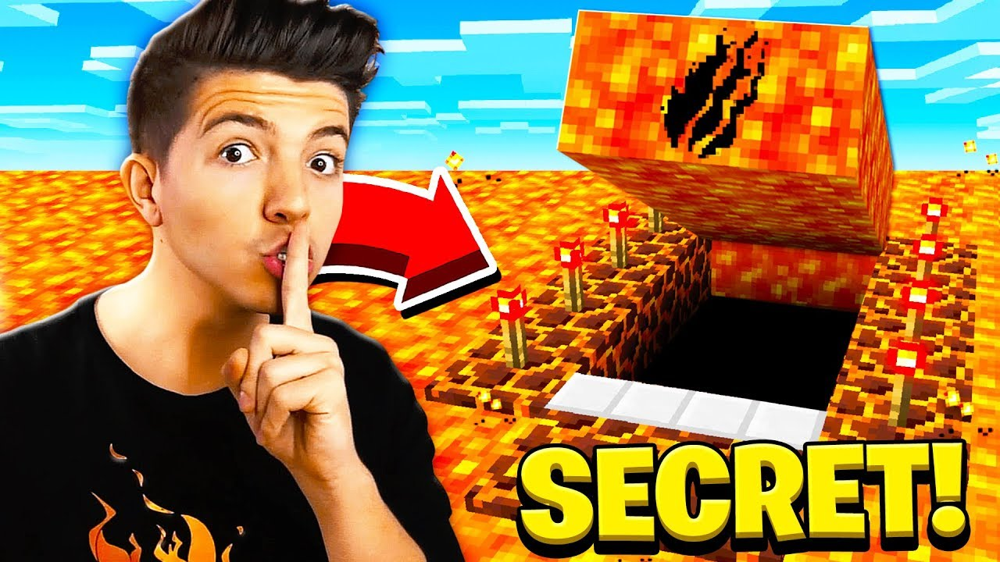](https://www.youtube.com/watch?v=1tlqVLYR9aM)

  [I FOUND PRESTON'S SECRET MINECRAFT HOUSE!](https://www.youtube.com/watch?v=1tlqVLYR9aM)

  Brianna · 2019-01-19 · family

  20,172,457 public views · 6.78× reported lift

  Same concrete ingredient houses: I FOUND PRESTON'S SECRET MINECRAFT HOUSE!. Game, cast and execution transfer remains a hypothesis; this source does not validate the new episode outcome.Window: lifetime through source snapshot. [Metric source](https://majieddd.github.io/influint-channels-public/channels/UCXg4rJUbDP1IP3TmZ9KDpJg.html)
* [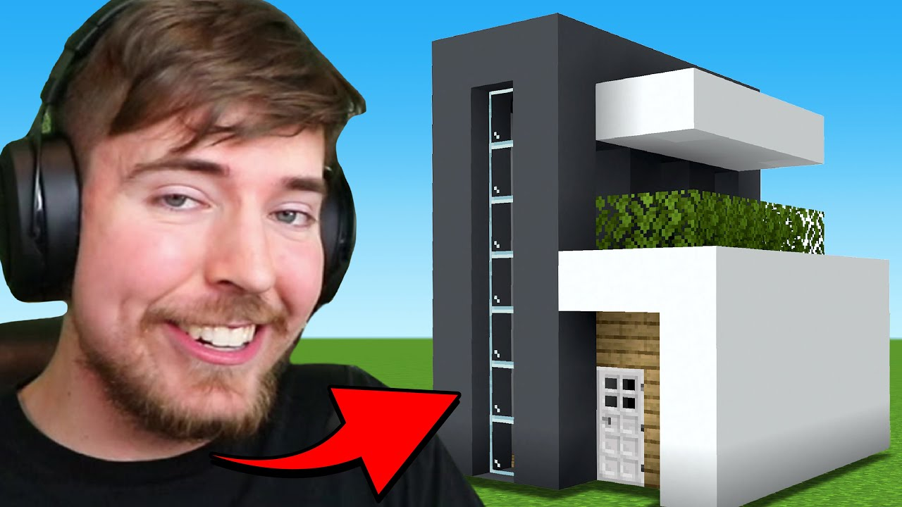](https://www.youtube.com/watch?v=xN8ENrfE-TY)

  [If You Build a House, I'll Pay For It!](https://www.youtube.com/watch?v=xN8ENrfE-TY)

  MrBeast Gaming · 2021-01-02 · family

  249,642,469 public views · 5.38× reported lift

  Same concrete ingredient houses: If You Build a House, I'll Pay For It!. Game, cast and execution transfer remains a hypothesis; this source does not validate the new episode outcome.Window: lifetime through source snapshot. [Metric source](https://majieddd.github.io/influint-channels-public/channels/UCIPPMRA040LQr5QPyJEbmXA.html)
* 

  [I Turned My House Into a Waterpark!](https://www.youtube.com/watch?v=WthL6_K8Kys)

  Unspeakable · 2024-08-24 · family

  20,543,332 public views · 4.23× reported lift

  Same concrete ingredient houses: I Turned My House Into a Waterpark!. Game, cast and execution transfer remains a hypothesis; this source does not validate the new episode outcome.Window: lifetime through source snapshot. [Metric source](https://majieddd.github.io/influint-channels-public/channels/UCwIWAbIeu0xI0ReKWOcw3eg.html)
* [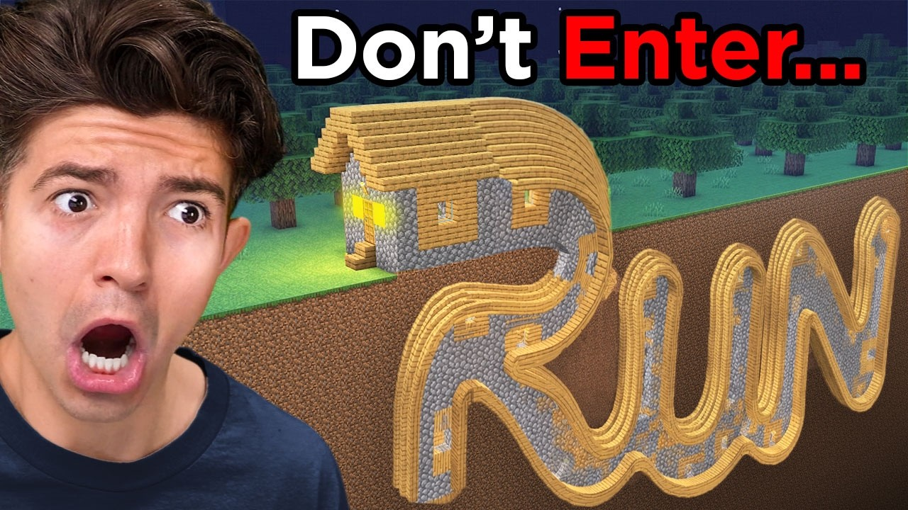](https://www.youtube.com/watch?v=JCy5R45b7k0)

  [I Found the HOUSE HEAD in Minecraft…](https://www.youtube.com/watch?v=JCy5R45b7k0)

  PrestonPlayz · 2026-08-29 · family

  4,665,662 public views · 2.38× reported lift

  Same concrete ingredient houses: I Found the HOUSE HEAD in Minecraft…. Game, cast and execution transfer remains a hypothesis; this source does not validate the new episode outcome.Window: Source says lifetime; row says 28d; unresolved. [Metric source](https://majieddd.github.io/influint-channels-public/channels/UCJZam2u1G0syq3kyqrCXrNw.html)

Ingredient matches concern the principal object/premise, not proof of every mixed ingredient. Views/lift are observed package/content performance.

Thumbnail reference and composition

Composition source: MrBeast Gaming · $2 VS $16,000 Minecraft House!

Finished Stokes concept for this episode.

Tiny leaning wooden shack left versus white mansion with blue pool right, Alex opening his hands between them; $1 and $1M.

Retain source subject placement, relative scale, action direction and visual contrast; use the Stokes identity and this episode’s actual content. This is a planned image, not a gameplay screenshot or a validated CTR winner.

Creative and production brief

Choose the better house after three visible tests.

Same number of guests and same simulated break-in challenge; home values are in-game.

#### Escalation

A luxury reveal gives way to a security failure and a final party judged without price labels.

#### Payoff

Open the crew votes and compare the promise of luxury with the lived experience.

#### For both audiences

**Gamer:** Cars, houses and visible performance differences reward game knowledge.

**Non-gamer:** Everyone can judge cheap versus extravagant and whether money changes the result.

#### People and production

Alan/Alex host or drive alongside rotating crew; every driver runs the same understandable tests.

* A scoped vehicle/prop selection and scoring system; do not imply fictional prices are cash spend.

#### Learning question

Does this distinct viewer promise attract broad viewers while feeling recognizably Stokes?

**Shorts opportunity:** Extract a complete first-complication-to-result micro-story or one resolved test/reveal; preserve setup and payoff.

[Link to idea 002](#idea-002)[Image prompt](prompts/002.txt)

003 / FORMAT 01 · Cheap versus extravagant, same test

### $1 vs $1,000,000 Boats in GTA

The crew crosses the same stormy bay in a leaking dinghy and a superyacht before attempting one shared rescue.

GTA 5 launch / follow-up · GTA 5

1. **0 (First Frame)–5s**Tiny battered dinghy left and enormous white yacht right in turquoise water, Alan foreground holding a life ring; $1 and $1M.
2. **5s–15s**Finish the crossing and bring back the stranded passenger. Identical route, weather seed and passenger pickup.
3. **15s–30s**The dinghy starts taking water while the yacht cannot fit through the first channel. Show the crew choosing its next move.

[Light complexity](#production)[Download image](full/003.jpg)

Why this idea

Title shape**$[VALUE] vs $[VALUE] [SUBJECT] in [GAME]**Content ingredients**boat, yacht, water**Combined package**$1 vs $1,000,000 Boats in GTA**

Translate the main-channel price ladder into fair, visible tests; label prices as in-game.

#### Title / premise family

3/2 qualifying outlier channels · 3 creator groups. Qualifying means source-reported lift ≥2×; family matches do not prove the exact mixed episode.

* 

  [$2 VS $16,000 Minecraft House!](https://www.youtube.com/watch?v=IPtpwh7r0Eo)

  MrBeast Gaming · 2021-08-25 · family

  116,928,432 public views · 3.26× reported lift

  Same title/premise family: $2 VS $16,000 Minecraft House!. Game, cast and execution transfer remains a hypothesis; this source does not validate the new episode outcome.Window: lifetime through source snapshot. [Metric source](https://majieddd.github.io/influint-channels-public/channels/UCIPPMRA040LQr5QPyJEbmXA.html)
* 

  [$1 VS $1,000,000 MOVIE THEATER!](https://www.youtube.com/watch?v=NbJGkWNL9Ow)

  Unspeakable · 2025-03-22 · family

  9,548,848 public views · 3.15× reported lift

  Same title/premise family: $1 VS $1,000,000 MOVIE THEATER!. Game, cast and execution transfer remains a hypothesis; this source does not validate the new episode outcome.Window: lifetime through source snapshot. [Metric source](https://majieddd.github.io/influint-channels-public/channels/UCwIWAbIeu0xI0ReKWOcw3eg.html)
* 

  [$50 vs $50,000 Family Vacation](https://www.youtube.com/watch?v=Mp8c5F16i1A)

  Brianna · 2022-08-28 · family

  4,879,296 public views · 2.45× reported lift

  Same title/premise family: $50 vs $50,000 Family Vacation. Game, cast and execution transfer remains a hypothesis; this source does not validate the new episode outcome.Window: lifetime through source snapshot. [Metric source](https://majieddd.github.io/influint-channels-public/channels/UCXg4rJUbDP1IP3TmZ9KDpJg.html)
* 

  [$1 vs $1,000,000 Vacation!](https://www.youtube.com/watch?v=K7FjCmlWvuY)

  Stokes Twins · 2022-11-23 · family

  127,518,732 public views · 1.33× reported lift

  Same title/premise family: $1 vs $1,000,000 Vacation!. Game, cast and execution transfer remains a hypothesis; this source does not validate the new episode outcome.Window: lifetime through source snapshot. [Metric source](https://majieddd.github.io/influint-channels-public/channels/UCbp9MyKCTEww4CxEzc_Tp0Q.html)

#### Principal content ingredient

2/2 qualifying outlier channels · 2 creator groups. Qualifying means source-reported lift ≥2×; family matches do not prove the exact mixed episode.

* 

  [WORST Reviewed Water Park vs BEST Reviewed Water Park!](https://www.youtube.com/watch?v=-LVdJNIs2PY)

  Brianna · 2020-09-26 · family

  11,857,144 public views · 5.63× reported lift

  Same concrete ingredient boat: WORST Reviewed Water Park vs BEST Reviewed Water Park!. Game, cast and execution transfer remains a hypothesis; this source does not validate the new episode outcome.Window: lifetime through source snapshot. [Metric source](https://majieddd.github.io/influint-channels-public/channels/UCXg4rJUbDP1IP3TmZ9KDpJg.html)
* 

  [I Turned My House Into a Waterpark!](https://www.youtube.com/watch?v=WthL6_K8Kys)

  Unspeakable · 2024-08-24 · family

  20,543,332 public views · 4.23× reported lift

  Same concrete ingredient boat: I Turned My House Into a Waterpark!. Game, cast and execution transfer remains a hypothesis; this source does not validate the new episode outcome.Window: lifetime through source snapshot. [Metric source](https://majieddd.github.io/influint-channels-public/channels/UCwIWAbIeu0xI0ReKWOcw3eg.html)
* [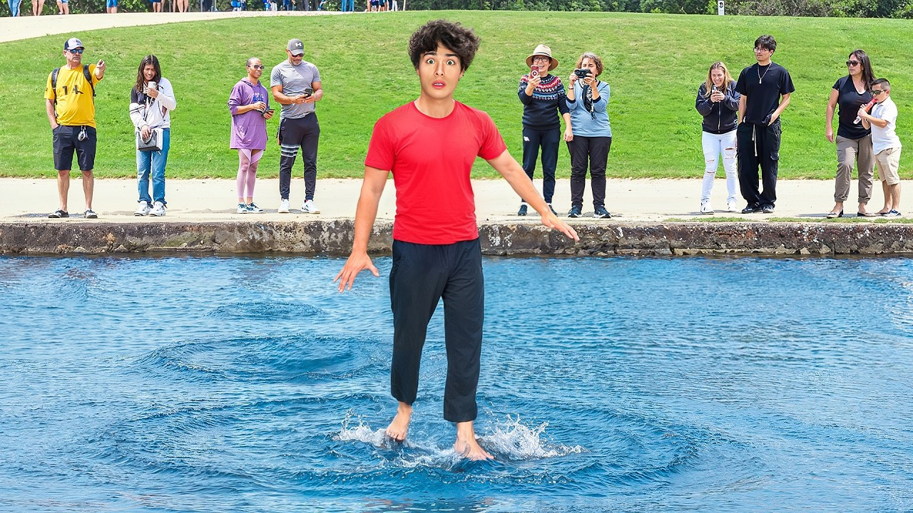](https://www.youtube.com/watch?v=hHdKug_wQkU)

  [Walking on Water Prank!](https://www.youtube.com/watch?v=hHdKug_wQkU)

  Stokes Twins · 2025-03-22 · family

  169,129,541 public views · 1.34× reported lift

  Same concrete ingredient boat: Walking on Water Prank!. Game, cast and execution transfer remains a hypothesis; this source does not validate the new episode outcome.Window: lifetime through source snapshot. [Metric source](https://majieddd.github.io/influint-channels-public/channels/UCbp9MyKCTEww4CxEzc_Tp0Q.html)
* [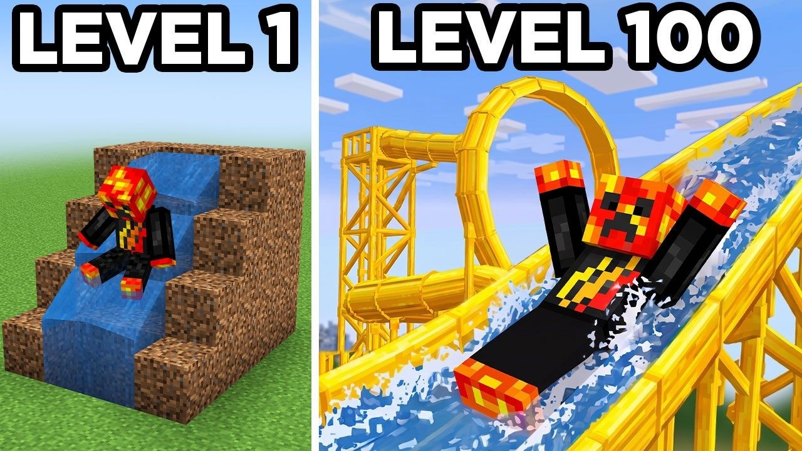](https://www.youtube.com/watch?v=fU03uSHbTGo)

  [Level 1 to 100 Waterparks in Minecraft!](https://www.youtube.com/watch?v=fU03uSHbTGo)

  PrestonPlayz · 2026-07-25 · family

  2,624,764 public views · 1.14× reported lift

  Same concrete ingredient boat: Level 1 to 100 Waterparks in Minecraft!. Game, cast and execution transfer remains a hypothesis; this source does not validate the new episode outcome.Window: lifetime through source snapshot. [Metric source](https://majieddd.github.io/influint-channels-public/channels/UCJZam2u1G0syq3kyqrCXrNw.html)

Ingredient matches concern the principal object/premise, not proof of every mixed ingredient. Views/lift are observed package/content performance.

Thumbnail reference and composition

Composition source: MrBeast Gaming · $2 VS $16,000 Minecraft House!

Finished Stokes concept for this episode.

Tiny battered dinghy left and enormous white yacht right in turquoise water, Alan foreground holding a life ring; $1 and $1M.

Retain source subject placement, relative scale, action direction and visual contrast; use the Stokes identity and this episode’s actual content. This is a planned image, not a gameplay screenshot or a validated CTR winner.

Creative and production brief

Finish the crossing and bring back the stranded passenger.

Identical route, weather seed and passenger pickup; only the boats change.

#### Escalation

Comfort becomes speed, then shallow water where size may become a disadvantage.

#### Payoff

Show the real rescue result and the boat that earns the best overall score.

#### For both audiences

**Gamer:** Cars, houses and visible performance differences reward game knowledge.

**Non-gamer:** Everyone can judge cheap versus extravagant and whether money changes the result.

#### People and production

Alan/Alex host or drive alongside rotating crew; every driver runs the same understandable tests.

* A scoped vehicle/prop selection and scoring system; do not imply fictional prices are cash spend.

#### Learning question

Does this distinct viewer promise attract broad viewers while feeling recognizably Stokes?

**Shorts opportunity:** Extract a complete first-complication-to-result micro-story or one resolved test/reveal; preserve setup and payoff.

[Link to idea 003](#idea-003)[Image prompt](prompts/003.txt)

004 / FORMAT 01 · Cheap versus extravagant, same test

### $1 vs $1,000,000 Security in GTA

One crew protects a small vault with cheap defenses while another builds extravagant security against the same determined intruder.

GTA 5 launch / follow-up · GTA 5

1. **0 (First Frame)–5s**Alan beside a flimsy wooden door left and a giant polished steel vault right, red laser beams, $1 and $1M.
2. **5s–15s**Keep the single marked treasure safe until the timer ends. Equal preparation time, identical treasure and the same attacker.
3. **15s–30s**The intruder spots an unguarded window beside the most impressive door. Show the crew choosing its next move.

[Light complexity](#production)[Download image](full/004.jpg)

Why this idea

Title shape**$[VALUE] vs $[VALUE] [SUBJECT] in [GAME]**Content ingredients**security, vault, expensive**Combined package**$1 vs $1,000,000 Security in GTA**

Translate the main-channel price ladder into fair, visible tests; label prices as in-game.

#### Title / premise family

3/2 qualifying outlier channels · 3 creator groups. Qualifying means source-reported lift ≥2×; family matches do not prove the exact mixed episode.

* 

  [$2 VS $16,000 Minecraft House!](https://www.youtube.com/watch?v=IPtpwh7r0Eo)

  MrBeast Gaming · 2021-08-25 · family

  116,928,432 public views · 3.26× reported lift

  Same title/premise family: $2 VS $16,000 Minecraft House!. Game, cast and execution transfer remains a hypothesis; this source does not validate the new episode outcome.Window: lifetime through source snapshot. [Metric source](https://majieddd.github.io/influint-channels-public/channels/UCIPPMRA040LQr5QPyJEbmXA.html)
* 

  [$1 VS $1,000,000 MOVIE THEATER!](https://www.youtube.com/watch?v=NbJGkWNL9Ow)

  Unspeakable · 2025-03-22 · family

  9,548,848 public views · 3.15× reported lift

  Same title/premise family: $1 VS $1,000,000 MOVIE THEATER!. Game, cast and execution transfer remains a hypothesis; this source does not validate the new episode outcome.Window: lifetime through source snapshot. [Metric source](https://majieddd.github.io/influint-channels-public/channels/UCwIWAbIeu0xI0ReKWOcw3eg.html)
* 

  [$50 vs $50,000 Family Vacation](https://www.youtube.com/watch?v=Mp8c5F16i1A)

  Brianna · 2022-08-28 · family

  4,879,296 public views · 2.45× reported lift

  Same title/premise family: $50 vs $50,000 Family Vacation. Game, cast and execution transfer remains a hypothesis; this source does not validate the new episode outcome.Window: lifetime through source snapshot. [Metric source](https://majieddd.github.io/influint-channels-public/channels/UCXg4rJUbDP1IP3TmZ9KDpJg.html)
* 

  [$1 vs $1,000,000 Vacation!](https://www.youtube.com/watch?v=K7FjCmlWvuY)

  Stokes Twins · 2022-11-23 · family

  127,518,732 public views · 1.33× reported lift

  Same title/premise family: $1 vs $1,000,000 Vacation!. Game, cast and execution transfer remains a hypothesis; this source does not validate the new episode outcome.Window: lifetime through source snapshot. [Metric source](https://majieddd.github.io/influint-channels-public/channels/UCbp9MyKCTEww4CxEzc_Tp0Q.html)

#### Principal content ingredient

3/2 qualifying outlier channels · 3 creator groups. Qualifying means source-reported lift ≥2×; family matches do not prove the exact mixed episode.

* 

  [7 Days Escaping Cardboard Prison!](https://www.youtube.com/watch?v=WU05jZnUiYs)

  Unspeakable · 2026-01-24 · family

  12,880,314 public views · 3.65× reported lift

  Same concrete ingredient security: 7 Days Escaping Cardboard Prison!. Game, cast and execution transfer remains a hypothesis; this source does not validate the new episode outcome.Window: lifetime through source snapshot. [Metric source](https://majieddd.github.io/influint-channels-public/channels/UCwIWAbIeu0xI0ReKWOcw3eg.html)
* [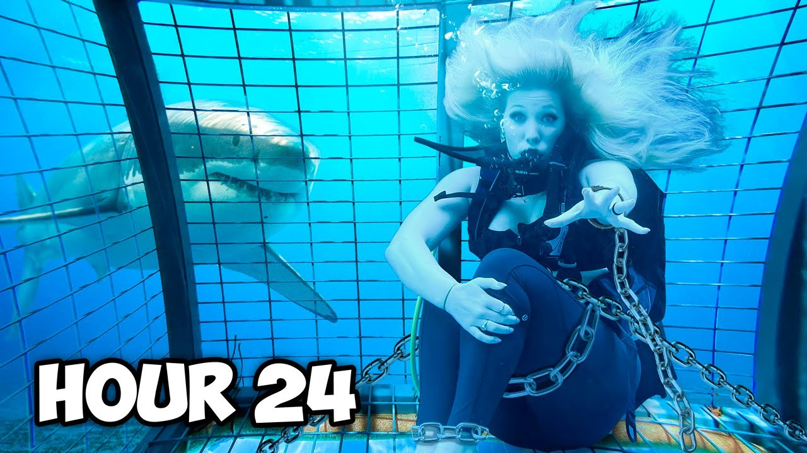](https://www.youtube.com/watch?v=4ydq5MXO42c)

  [Preston TRAPPED Me in an UNDERWATER Prison!](https://www.youtube.com/watch?v=4ydq5MXO42c)

  Brianna · 2022-07-31 · family

  4,059,814 public views · 2.97× reported lift

  Same concrete ingredient security: Preston TRAPPED Me in an UNDERWATER Prison!. Game, cast and execution transfer remains a hypothesis; this source does not validate the new episode outcome.Window: lifetime through source snapshot. [Metric source](https://majieddd.github.io/influint-channels-public/channels/UCXg4rJUbDP1IP3TmZ9KDpJg.html)
* [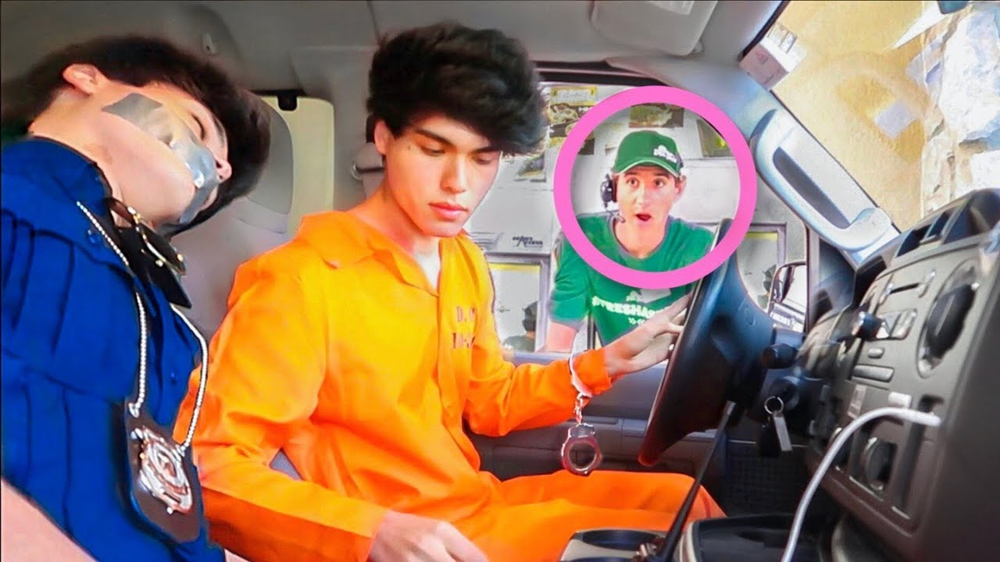](https://www.youtube.com/watch?v=nuK7e1xzThc)

  [Prisoner Drive Thru Prank](https://www.youtube.com/watch?v=nuK7e1xzThc)

  Stokes Twins · 2019-08-18 · family

  25,610,924 public views · 2.94× reported lift

  Same concrete ingredient security: Prisoner Drive Thru Prank. Game, cast and execution transfer remains a hypothesis; this source does not validate the new episode outcome.Window: lifetime through source snapshot. [Metric source](https://majieddd.github.io/influint-channels-public/channels/UCbp9MyKCTEww4CxEzc_Tp0Q.html)
* [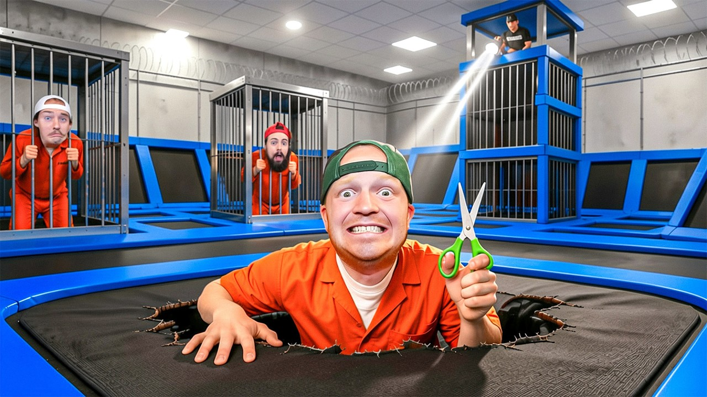](https://www.youtube.com/watch?v=Rsx9LHfKoXU)

  [7 Days Escaping Trampoline Park Prison!](https://www.youtube.com/watch?v=Rsx9LHfKoXU)

  Unspeakable · 2026-09-05 · family

  4,301,184 public views · 1.73× reported lift

  Same concrete ingredient security: 7 Days Escaping Trampoline Park Prison!. Game, cast and execution transfer remains a hypothesis; this source does not validate the new episode outcome.Window: lifetime through source snapshot. [Metric source](https://majieddd.github.io/influint-channels-public/channels/UCwIWAbIeu0xI0ReKWOcw3eg.html)

Ingredient matches concern the principal object/premise, not proof of every mixed ingredient. Views/lift are observed package/content performance.

Thumbnail reference and composition

Composition source: MrBeast Gaming · $2 VS $16,000 Minecraft House!

Finished Stokes concept for this episode.

Alan beside a flimsy wooden door left and a giant polished steel vault right, red laser beams, $1 and $1M.

Retain source subject placement, relative scale, action direction and visual contrast; use the Stokes identity and this episode’s actual content. This is a planned image, not a gameplay screenshot or a validated CTR winner.

Creative and production brief

Keep the single marked treasure safe until the timer ends.

Equal preparation time, identical treasure and the same attacker; defense values are fictional game values.

#### Escalation

Basic locks become decoys and alarms, then an intruder learns from the first attempt.

#### Payoff

Compare breach times and show which expensive defense was actually useful.

#### For both audiences

**Gamer:** Cars, houses and visible performance differences reward game knowledge.

**Non-gamer:** Everyone can judge cheap versus extravagant and whether money changes the result.

#### People and production

Alan/Alex host or drive alongside rotating crew; every driver runs the same understandable tests.

* A scoped vehicle/prop selection and scoring system; do not imply fictional prices are cash spend.

#### Learning question

Does this distinct viewer promise attract broad viewers while feeling recognizably Stokes?

**Shorts opportunity:** Extract a complete first-complication-to-result micro-story or one resolved test/reveal; preserve setup and payoff.

[Link to idea 004](#idea-004)[Image prompt](prompts/004.txt)

005 / FORMAT 01 · Cheap versus extravagant, same test

### $1 vs $1,000,000 Minecraft Houses

The crew builds two radically different homes and tests them against the same night, weather and unwelcome visitors.

Later game expansion · Minecraft

1. **0 (First Frame)–5s**Tiny dirt hut left and enormous luminous Minecraft castle right, Alex foreground; $1 and $1M game-value labels.
2. **5s–15s**Find the home that best survives the agreed three trials. Use a disclosed points allowance rather than pretend real spending.
3. **15s–30s**The cheap builder uses the whole allowance on a roof and forgets a door. Show the crew choosing its next move.

[Light complexity](#production)[Download image](full/005.jpg)

Why this idea

Title shape**$[VALUE] vs $[VALUE] [GAME] [SUBJECT]**Content ingredients**house, castle, Minecraft**Combined package**$1 vs $1,000,000 Minecraft Houses**

Translate the main-channel price ladder into fair, visible tests; label prices as in-game.

#### Title / premise family

3/2 qualifying outlier channels · 3 creator groups. Qualifying means source-reported lift ≥2×; family matches do not prove the exact mixed episode.

* 

  [$2 VS $16,000 Minecraft House!](https://www.youtube.com/watch?v=IPtpwh7r0Eo)

  MrBeast Gaming · 2021-08-25 · family

  116,928,432 public views · 3.26× reported lift

  Same title/premise family: $2 VS $16,000 Minecraft House!. Game, cast and execution transfer remains a hypothesis; this source does not validate the new episode outcome.Window: lifetime through source snapshot. [Metric source](https://majieddd.github.io/influint-channels-public/channels/UCIPPMRA040LQr5QPyJEbmXA.html)
* 

  [$1 VS $1,000,000 MOVIE THEATER!](https://www.youtube.com/watch?v=NbJGkWNL9Ow)

  Unspeakable · 2025-03-22 · family

  9,548,848 public views · 3.15× reported lift

  Same title/premise family: $1 VS $1,000,000 MOVIE THEATER!. Game, cast and execution transfer remains a hypothesis; this source does not validate the new episode outcome.Window: lifetime through source snapshot. [Metric source](https://majieddd.github.io/influint-channels-public/channels/UCwIWAbIeu0xI0ReKWOcw3eg.html)
* 

  [$50 vs $50,000 Family Vacation](https://www.youtube.com/watch?v=Mp8c5F16i1A)

  Brianna · 2022-08-28 · family

  4,879,296 public views · 2.45× reported lift

  Same title/premise family: $50 vs $50,000 Family Vacation. Game, cast and execution transfer remains a hypothesis; this source does not validate the new episode outcome.Window: lifetime through source snapshot. [Metric source](https://majieddd.github.io/influint-channels-public/channels/UCXg4rJUbDP1IP3TmZ9KDpJg.html)
* 

  [$1 vs $1,000,000 Vacation!](https://www.youtube.com/watch?v=K7FjCmlWvuY)

  Stokes Twins · 2022-11-23 · family

  127,518,732 public views · 1.33× reported lift

  Same title/premise family: $1 vs $1,000,000 Vacation!. Game, cast and execution transfer remains a hypothesis; this source does not validate the new episode outcome.Window: lifetime through source snapshot. [Metric source](https://majieddd.github.io/influint-channels-public/channels/UCbp9MyKCTEww4CxEzc_Tp0Q.html)

#### Principal content ingredient

4/2 qualifying outlier channels · 3 creator groups. Qualifying means source-reported lift ≥2×; family matches do not prove the exact mixed episode.

* 

  [I FOUND PRESTON'S SECRET MINECRAFT HOUSE!](https://www.youtube.com/watch?v=1tlqVLYR9aM)

  Brianna · 2019-01-19 · family

  20,172,457 public views · 6.78× reported lift

  Same concrete ingredient house: I FOUND PRESTON'S SECRET MINECRAFT HOUSE!. Game, cast and execution transfer remains a hypothesis; this source does not validate the new episode outcome.Window: lifetime through source snapshot. [Metric source](https://majieddd.github.io/influint-channels-public/channels/UCXg4rJUbDP1IP3TmZ9KDpJg.html)
* 

  [If You Build a House, I'll Pay For It!](https://www.youtube.com/watch?v=xN8ENrfE-TY)

  MrBeast Gaming · 2021-01-02 · family

  249,642,469 public views · 5.38× reported lift

  Same concrete ingredient house: If You Build a House, I'll Pay For It!. Game, cast and execution transfer remains a hypothesis; this source does not validate the new episode outcome.Window: lifetime through source snapshot. [Metric source](https://majieddd.github.io/influint-channels-public/channels/UCIPPMRA040LQr5QPyJEbmXA.html)
* 

  [I Turned My House Into a Waterpark!](https://www.youtube.com/watch?v=WthL6_K8Kys)

  Unspeakable · 2024-08-24 · family

  20,543,332 public views · 4.23× reported lift

  Same concrete ingredient house: I Turned My House Into a Waterpark!. Game, cast and execution transfer remains a hypothesis; this source does not validate the new episode outcome.Window: lifetime through source snapshot. [Metric source](https://majieddd.github.io/influint-channels-public/channels/UCwIWAbIeu0xI0ReKWOcw3eg.html)
* 

  [I Found the HOUSE HEAD in Minecraft…](https://www.youtube.com/watch?v=JCy5R45b7k0)

  PrestonPlayz · 2026-08-29 · family

  4,665,662 public views · 2.38× reported lift

  Same concrete ingredient house: I Found the HOUSE HEAD in Minecraft…. Game, cast and execution transfer remains a hypothesis; this source does not validate the new episode outcome.Window: Source says lifetime; row says 28d; unresolved. [Metric source](https://majieddd.github.io/influint-channels-public/channels/UCJZam2u1G0syq3kyqrCXrNw.html)

Ingredient matches concern the principal object/premise, not proof of every mixed ingredient. Views/lift are observed package/content performance.

Thumbnail reference and composition

Composition source: MrBeast Gaming · $2 VS $16,000 Minecraft House!

Finished Stokes concept for this episode.

Tiny dirt hut left and enormous luminous Minecraft castle right, Alex foreground; $1 and $1M game-value labels.

Retain source subject placement, relative scale, action direction and visual contrast; use the Stokes identity and this episode’s actual content. This is a planned image, not a gameplay screenshot or a validated CTR winner.

Creative and production brief

Find the home that best survives the agreed three trials.

Use a disclosed points allowance rather than pretend real spending; identical trials and guest count.

#### Escalation

A dirt shelter faces a storm, a visitor challenge and a final practical comfort vote.

#### Payoff

Reveal the score and whether the giant castle solves problems the dirt house cannot.

#### For both audiences

**Gamer:** Cars, houses and visible performance differences reward game knowledge.

**Non-gamer:** Everyone can judge cheap versus extravagant and whether money changes the result.

#### People and production

Alan/Alex host or drive alongside rotating crew; every driver runs the same understandable tests.

* A scoped vehicle/prop selection and scoring system; do not imply fictional prices are cash spend.
* Verify the exact edition, map, mod license and working mechanics; GTA-system reuse does not imply Minecraft support.

#### Learning question

Does this distinct viewer promise attract broad viewers while feeling recognizably Stokes?

**Shorts opportunity:** Extract a complete first-complication-to-result micro-story or one resolved test/reveal; preserve setup and payoff.

[Link to idea 005](#idea-005)[Image prompt](prompts/005.txt)

006 / FORMAT 02 · The crew versus overwhelming hunters

### 2 vs 100 Hunters in GTA

Two crew members try to reach the rescue helicopter while an overwhelming hunter force closes every obvious route.

GTA 5 launch / follow-up · GTA 5

1. **0 (First Frame)–5s**Alan and a different adult crew member in a red getaway car foreground; a dense wall of pursuing police vehicles and helicopter behind; 2 vs 100.
2. **5s–15s**Both fugitives reach the extraction pad before capture. State the tested hunter count and player/NPC split.
3. **15s–30s**The obvious exit is already blocked, forcing the first route choice. Show the crew choosing its next move.

[Medium complexity](#production)[Download image](full/006.jpg)

Why this idea

Title shape**[COUNT] vs [COUNT] [SUBJECT] in [GAME]**Content ingredients**hunter, GTA, escape**Combined package**2 vs 100 Hunters in GTA**

Keep the chase and Stokes personalities; the fugitives can be either twin plus another crew member, or both twins when useful.

#### Title / premise family

1/2 qualifying outlier channels · 1 creator groups. Qualifying means source-reported lift ≥2×; family matches do not prove the exact mixed episode.

* 

  [1 vs 10 Hunters in GTA!](https://www.youtube.com/watch?v=xwdhHTtc-3w)

  MrBeast Gaming · 2021-02-16 · family

  116,232,703 public views · 2.25× reported lift

  Same title/premise family: 1 vs 10 Hunters in GTA!. Game, cast and execution transfer remains a hypothesis; this source does not validate the new episode outcome.Window: lifetime through source snapshot. [Metric source](https://majieddd.github.io/influint-channels-public/channels/UCIPPMRA040LQr5QPyJEbmXA.html)
* [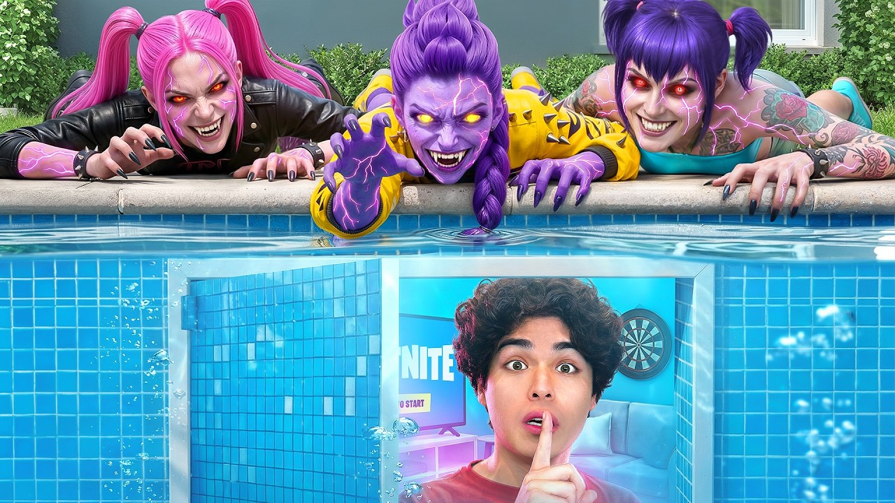](https://www.youtube.com/watch?v=U8UNlVatBCM)

  [I Built 5 Secret Rooms To Escape EVIL KPop Demon Hunters!](https://www.youtube.com/watch?v=U8UNlVatBCM)

  Stokes Twins · 2026-03-24 · family

  50,881,070 public views · 0.99× reported lift

  Same title/premise family: I Built 5 Secret Rooms To Escape EVIL KPop Demon Hunters!. Game, cast and execution transfer remains a hypothesis; this source does not validate the new episode outcome.Window: lifetime through source snapshot. [Metric source](https://majieddd.github.io/influint-channels-public/channels/UCbp9MyKCTEww4CxEzc_Tp0Q.html)
* 

  [1 vs 100 Player Manhunt!](https://www.youtube.com/watch?v=dLDj2TTyMGM)

  MrBeast Gaming · 2021-06-30 · family

  164,600,391 public views · 2.18× reported lift

  Same title/premise family: 1 vs 100 Player Manhunt!. Game, cast and execution transfer remains a hypothesis; this source does not validate the new episode outcome.Window: lifetime through source snapshot. [Metric source](https://majieddd.github.io/influint-channels-public/channels/UCIPPMRA040LQr5QPyJEbmXA.html)
* [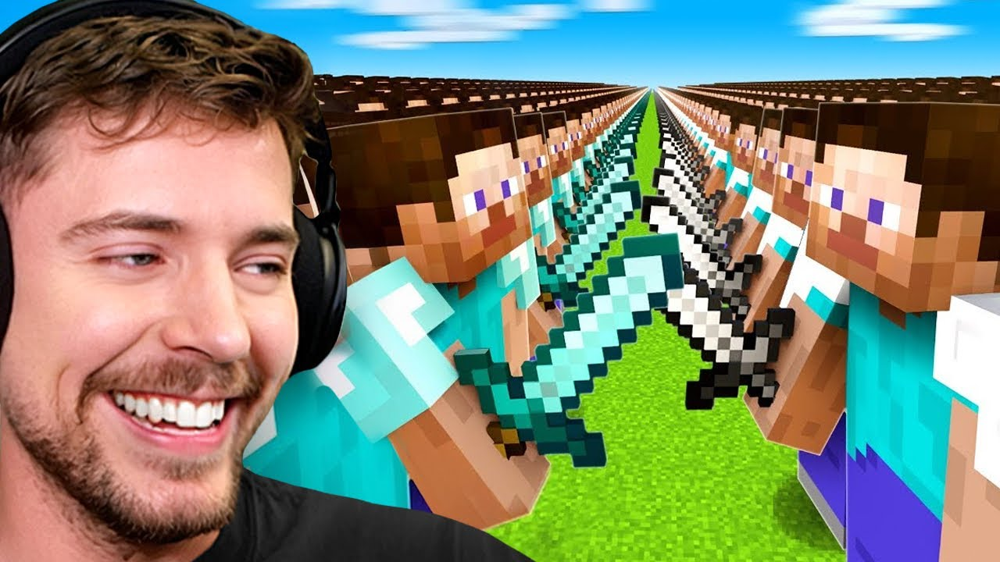](https://www.youtube.com/watch?v=VQY_m3wCBCE)

  [1000 vs 1000 Player War!](https://www.youtube.com/watch?v=VQY_m3wCBCE)

  MrBeast Gaming · 2021-09-11 · family

  79,327,795 public views · 1.83× reported lift

  Same title/premise family: 1000 vs 1000 Player War!. Game, cast and execution transfer remains a hypothesis; this source does not validate the new episode outcome.Window: lifetime through source snapshot. [Metric source](https://majieddd.github.io/influint-channels-public/channels/UCIPPMRA040LQr5QPyJEbmXA.html)

#### Principal content ingredient

1/2 qualifying outlier channels · 1 creator groups. Qualifying means source-reported lift ≥2×; family matches do not prove the exact mixed episode.

* 

  [1 vs 10 Hunters in GTA!](https://www.youtube.com/watch?v=xwdhHTtc-3w)

  MrBeast Gaming · 2021-02-16 · family

  116,232,703 public views · 2.25× reported lift

  Same concrete ingredient hunter: 1 vs 10 Hunters in GTA!. Game, cast and execution transfer remains a hypothesis; this source does not validate the new episode outcome.Window: lifetime through source snapshot. [Metric source](https://majieddd.github.io/influint-channels-public/channels/UCIPPMRA040LQr5QPyJEbmXA.html)
* [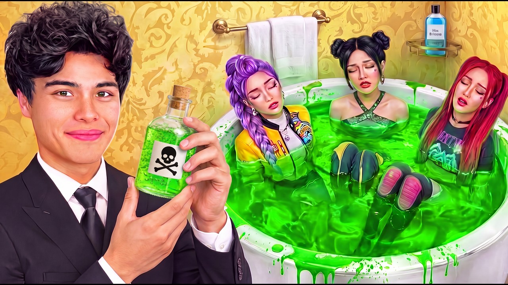](https://www.youtube.com/watch?v=oUee1Bv0sFE)

  [KPop Demon Hunters Were Murdered..](https://www.youtube.com/watch?v=oUee1Bv0sFE)

  Stokes Twins · 2026-01-28 · family

  70,579,597 public views · 1.20× reported lift

  Same concrete ingredient hunter: KPop Demon Hunters Were Murdered... Game, cast and execution transfer remains a hypothesis; this source does not validate the new episode outcome.Window: lifetime through source snapshot. [Metric source](https://majieddd.github.io/influint-channels-public/channels/UCbp9MyKCTEww4CxEzc_Tp0Q.html)
* [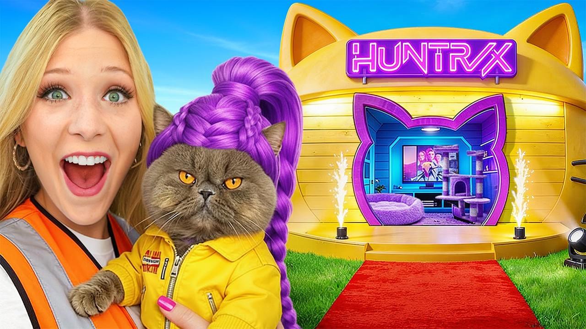](https://www.youtube.com/watch?v=c45NhKDTYto)

  [I Built a KPop Demon Hunter House for my Cat!](https://www.youtube.com/watch?v=c45NhKDTYto)

  Brianna · 2026-02-14 · family

  757,143 public views · 0.24× reported lift

  Same concrete ingredient hunter: I Built a KPop Demon Hunter House for my Cat!. Game, cast and execution transfer remains a hypothesis; this source does not validate the new episode outcome.Window: lifetime through source snapshot. [Metric source](https://majieddd.github.io/influint-channels-public/channels/UCXg4rJUbDP1IP3TmZ9KDpJg.html)
* 

  [1 vs 100 Player Manhunt!](https://www.youtube.com/watch?v=dLDj2TTyMGM)

  MrBeast Gaming · 2021-06-30 · family

  164,600,391 public views · 2.18× reported lift

  Same concrete ingredient hunter: 1 vs 100 Player Manhunt!. Game, cast and execution transfer remains a hypothesis; this source does not validate the new episode outcome.Window: lifetime through source snapshot. [Metric source](https://majieddd.github.io/influint-channels-public/channels/UCIPPMRA040LQr5QPyJEbmXA.html)

Shape: 1/2 qualifying outlier channels in the verified public pool; adjacent precedents remain proposals, not replication.

Ingredients: 1/2 qualifying outlier channels for the principal ingredient; this does not establish the full game/cast combination.

Ingredient matches concern the principal object/premise, not proof of every mixed ingredient. Views/lift are observed package/content performance.

Thumbnail reference and composition

Composition source: MrBeast Gaming · 1 vs 10 Hunters in GTA!

Finished Stokes concept for this episode.

Alan and a different adult crew member in a red getaway car foreground; a dense wall of pursuing police vehicles and helicopter behind; 2 vs 100.

Retain source subject placement, relative scale, action direction and visual contrast; use the Stokes identity and this episode’s actual content. This is a planned image, not a gameplay screenshot or a validated CTR winner.

Creative and production brief

Both fugitives reach the extraction pad before capture.

State the tested hunter count and player/NPC split; one marked exit, limited lives and no unannounced teleports.

#### Escalation

Hunters close the main road, the crew risks a decoy and the helicopter becomes a final exposed sprint.

#### Payoff

Show the arrival or final capture in continuous geography rather than manufacture an escape.

#### For both audiences

**Gamer:** Routes, vehicles and evasive skill create a second layer of strategy.

**Non-gamer:** The size mismatch, pursuit and finish line are understandable without knowing GTA.

#### People and production

Two featured fugitives; crew members lead hunter teams, set traps and supply rival personalities. A hundred hunters requires a verified player/NPC plan.

* Reliable pursuit setup, participant recording and a capacity test. Use the truthful actual hunter count; do not label NPCs as 100 real people.

#### Learning question

Does this distinct viewer promise attract broad viewers while feeling recognizably Stokes?

**Shorts opportunity:** Extract a complete first-complication-to-result micro-story or one resolved test/reveal; preserve setup and payoff.

[Link to idea 006](#idea-006)[Image prompt](prompts/006-correction.txt)

007 / FORMAT 02 · The crew versus overwhelming hunters

### We Escaped 100 Hunters With No Cars in GTA

The crew must escape on foot as hunters control the roads and every shortcut becomes a risky choice.

GTA 5 launch / follow-up · GTA 5

1. **0 (First Frame)–5s**Alex sprinting foreground across a rooftop, red hunter crowd below and rescue helicopter beyond; NO CARS.
2. **5s–15s**Reach the rooftop rescue beacon on foot. No entering vehicles.
3. **15s–30s**A hunter car seals the first alley and the crew has to climb instead. Show the crew choosing its next move.

[Medium complexity](#production)[Download image](full/007.jpg)

Why this idea

Title shape**We Escaped [COUNT] [SUBJECT] With No [SUBJECT] in [GAME]**Content ingredients**hunter, escape, challenge**Combined package**We Escaped 100 Hunters With No Cars in GTA**

Keep the chase and Stokes personalities; the fugitives can be either twin plus another crew member, or both twins when useful.

#### Title / premise family

1/2 qualifying outlier channels · 1 creator groups. Qualifying means source-reported lift ≥2×; family matches do not prove the exact mixed episode.

* 

  [1 vs 10 Hunters in GTA!](https://www.youtube.com/watch?v=xwdhHTtc-3w)

  MrBeast Gaming · 2021-02-16 · family

  116,232,703 public views · 2.25× reported lift

  Same title/premise family: 1 vs 10 Hunters in GTA!. Game, cast and execution transfer remains a hypothesis; this source does not validate the new episode outcome.Window: lifetime through source snapshot. [Metric source](https://majieddd.github.io/influint-channels-public/channels/UCIPPMRA040LQr5QPyJEbmXA.html)
* 

  [I Built 5 Secret Rooms To Escape EVIL KPop Demon Hunters!](https://www.youtube.com/watch?v=U8UNlVatBCM)

  Stokes Twins · 2026-03-24 · family

  50,881,070 public views · 0.99× reported lift

  Same title/premise family: I Built 5 Secret Rooms To Escape EVIL KPop Demon Hunters!. Game, cast and execution transfer remains a hypothesis; this source does not validate the new episode outcome.Window: lifetime through source snapshot. [Metric source](https://majieddd.github.io/influint-channels-public/channels/UCbp9MyKCTEww4CxEzc_Tp0Q.html)
* 

  [1 vs 100 Player Manhunt!](https://www.youtube.com/watch?v=dLDj2TTyMGM)

  MrBeast Gaming · 2021-06-30 · family

  164,600,391 public views · 2.18× reported lift

  Same title/premise family: 1 vs 100 Player Manhunt!. Game, cast and execution transfer remains a hypothesis; this source does not validate the new episode outcome.Window: lifetime through source snapshot. [Metric source](https://majieddd.github.io/influint-channels-public/channels/UCIPPMRA040LQr5QPyJEbmXA.html)
* 

  [1000 vs 1000 Player War!](https://www.youtube.com/watch?v=VQY_m3wCBCE)

  MrBeast Gaming · 2021-09-11 · family

  79,327,795 public views · 1.83× reported lift

  Same title/premise family: 1000 vs 1000 Player War!. Game, cast and execution transfer remains a hypothesis; this source does not validate the new episode outcome.Window: lifetime through source snapshot. [Metric source](https://majieddd.github.io/influint-channels-public/channels/UCIPPMRA040LQr5QPyJEbmXA.html)

#### Principal content ingredient

1/2 qualifying outlier channels · 1 creator groups. Qualifying means source-reported lift ≥2×; family matches do not prove the exact mixed episode.

* 

  [1 vs 10 Hunters in GTA!](https://www.youtube.com/watch?v=xwdhHTtc-3w)

  MrBeast Gaming · 2021-02-16 · family

  116,232,703 public views · 2.25× reported lift

  Same concrete ingredient hunter: 1 vs 10 Hunters in GTA!. Game, cast and execution transfer remains a hypothesis; this source does not validate the new episode outcome.Window: lifetime through source snapshot. [Metric source](https://majieddd.github.io/influint-channels-public/channels/UCIPPMRA040LQr5QPyJEbmXA.html)
* 

  [KPop Demon Hunters Were Murdered..](https://www.youtube.com/watch?v=oUee1Bv0sFE)

  Stokes Twins · 2026-01-28 · family

  70,579,597 public views · 1.20× reported lift

  Same concrete ingredient hunter: KPop Demon Hunters Were Murdered... Game, cast and execution transfer remains a hypothesis; this source does not validate the new episode outcome.Window: lifetime through source snapshot. [Metric source](https://majieddd.github.io/influint-channels-public/channels/UCbp9MyKCTEww4CxEzc_Tp0Q.html)
* 

  [I Built a KPop Demon Hunter House for my Cat!](https://www.youtube.com/watch?v=c45NhKDTYto)

  Brianna · 2026-02-14 · family

  757,143 public views · 0.24× reported lift

  Same concrete ingredient hunter: I Built a KPop Demon Hunter House for my Cat!. Game, cast and execution transfer remains a hypothesis; this source does not validate the new episode outcome.Window: lifetime through source snapshot. [Metric source](https://majieddd.github.io/influint-channels-public/channels/UCXg4rJUbDP1IP3TmZ9KDpJg.html)
* 

  [1 vs 100 Player Manhunt!](https://www.youtube.com/watch?v=dLDj2TTyMGM)

  MrBeast Gaming · 2021-06-30 · family

  164,600,391 public views · 2.18× reported lift

  Same concrete ingredient hunter: 1 vs 100 Player Manhunt!. Game, cast and execution transfer remains a hypothesis; this source does not validate the new episode outcome.Window: lifetime through source snapshot. [Metric source](https://majieddd.github.io/influint-channels-public/channels/UCIPPMRA040LQr5QPyJEbmXA.html)

Shape: 1/2 qualifying outlier channels in the verified public pool; adjacent precedents remain proposals, not replication.

Ingredients: 1/2 qualifying outlier channels for the principal ingredient; this does not establish the full game/cast combination.

Ingredient matches concern the principal object/premise, not proof of every mixed ingredient. Views/lift are observed package/content performance.

Thumbnail reference and composition

Composition source: MrBeast Gaming · 1 vs 10 Hunters in GTA!

Finished Stokes concept for this episode.

Alex sprinting foreground across a rooftop, red hunter crowd below and rescue helicopter beyond; NO CARS.

Retain source subject placement, relative scale, action direction and visual contrast; use the Stokes identity and this episode’s actual content. This is a planned image, not a gameplay screenshot or a validated CTR winner.

Creative and production brief

Reach the rooftop rescue beacon on foot.

No entering vehicles; disclosed hunter count, a limited map and clear tag/capture rules.

#### Escalation

Safe alleys disappear, a footbridge closes and the final climb leaves the crew exposed.

#### Payoff

Resolve the last rooftop approach with both sides' footage and an unambiguous capture result.

#### For both audiences

**Gamer:** Routes, vehicles and evasive skill create a second layer of strategy.

**Non-gamer:** The size mismatch, pursuit and finish line are understandable without knowing GTA.

#### People and production

Two featured fugitives; crew members lead hunter teams, set traps and supply rival personalities. A hundred hunters requires a verified player/NPC plan.

* Reliable pursuit setup, participant recording and a capacity test. Use the truthful actual hunter count; do not label NPCs as 100 real people.

#### Learning question

Does this distinct viewer promise attract broad viewers while feeling recognizably Stokes?

**Shorts opportunity:** Extract a complete first-complication-to-result micro-story or one resolved test/reveal; preserve setup and payoff.

[Link to idea 007](#idea-007)[Image prompt](prompts/007.txt)

008 / FORMAT 02 · The crew versus overwhelming hunters

### 1 Tiny Car vs 100 Hunters in GTA

A single crew team squeezes into a tiny getaway car and attempts three escapes against a far larger pursuit force.

GTA 5 launch / follow-up · GTA 5

1. **0 (First Frame)–5s**Alan squeezed into a ridiculous tiny yellow car, enormous black police SUVs towering behind, a ferry visible ahead; 1 vs 100.
2. **5s–15s**Reach the ferry with the tiny car still driveable. One preselected tiny car, a tested pursuit force, one repair token and no off-camera replacement.
3. **15s–30s**The little car cannot climb the first steep ramp with the whole team inside. Show the crew choosing its next move.

[Medium complexity](#production)[Download image](full/008.jpg)

Why this idea

Title shape**[COUNT] Tiny [SUBJECT] vs [COUNT] [SUBJECT] in [GAME]**Content ingredients**car, hunter, GTA**Combined package**1 Tiny Car vs 100 Hunters in GTA**

Keep the chase and Stokes personalities; the fugitives can be either twin plus another crew member, or both twins when useful.

#### Title / premise family

1/2 qualifying outlier channels · 1 creator groups. Qualifying means source-reported lift ≥2×; family matches do not prove the exact mixed episode.

* 

  [1 vs 10 Hunters in GTA!](https://www.youtube.com/watch?v=xwdhHTtc-3w)

  MrBeast Gaming · 2021-02-16 · family

  116,232,703 public views · 2.25× reported lift

  Same title/premise family: 1 vs 10 Hunters in GTA!. Game, cast and execution transfer remains a hypothesis; this source does not validate the new episode outcome.Window: lifetime through source snapshot. [Metric source](https://majieddd.github.io/influint-channels-public/channels/UCIPPMRA040LQr5QPyJEbmXA.html)
* 

  [I Built 5 Secret Rooms To Escape EVIL KPop Demon Hunters!](https://www.youtube.com/watch?v=U8UNlVatBCM)

  Stokes Twins · 2026-03-24 · family

  50,881,070 public views · 0.99× reported lift

  Same title/premise family: I Built 5 Secret Rooms To Escape EVIL KPop Demon Hunters!. Game, cast and execution transfer remains a hypothesis; this source does not validate the new episode outcome.Window: lifetime through source snapshot. [Metric source](https://majieddd.github.io/influint-channels-public/channels/UCbp9MyKCTEww4CxEzc_Tp0Q.html)
* 

  [1 vs 100 Player Manhunt!](https://www.youtube.com/watch?v=dLDj2TTyMGM)

  MrBeast Gaming · 2021-06-30 · family

  164,600,391 public views · 2.18× reported lift

  Same title/premise family: 1 vs 100 Player Manhunt!. Game, cast and execution transfer remains a hypothesis; this source does not validate the new episode outcome.Window: lifetime through source snapshot. [Metric source](https://majieddd.github.io/influint-channels-public/channels/UCIPPMRA040LQr5QPyJEbmXA.html)
* 

  [1000 vs 1000 Player War!](https://www.youtube.com/watch?v=VQY_m3wCBCE)

  MrBeast Gaming · 2021-09-11 · family

  79,327,795 public views · 1.83× reported lift

  Same title/premise family: 1000 vs 1000 Player War!. Game, cast and execution transfer remains a hypothesis; this source does not validate the new episode outcome.Window: lifetime through source snapshot. [Metric source](https://majieddd.github.io/influint-channels-public/channels/UCIPPMRA040LQr5QPyJEbmXA.html)

#### Principal content ingredient

4/2 qualifying outlier channels · 4 creator groups. Qualifying means source-reported lift ≥2×; family matches do not prove the exact mixed episode.

* 

  [Preston Cheated in Cardboard Hide and Seek](https://www.youtube.com/watch?v=5zbvDh28XUQ)

  Brianna · 2022-04-28 · family

  11,051,826 public views · 5.01× reported lift

  Same concrete ingredient car: Preston Cheated in Cardboard Hide and Seek. Game, cast and execution transfer remains a hypothesis; this source does not validate the new episode outcome.Window: lifetime through source snapshot. [Metric source](https://majieddd.github.io/influint-channels-public/channels/UCXg4rJUbDP1IP3TmZ9KDpJg.html)
* 

  [Tesla Autopilot For 24 Hours!](https://www.youtube.com/watch?v=SsJ7oOpbmIk)

  Stokes Twins · 2021-04-20 · family

  38,321,506 public views · 4.25× reported lift

  Same concrete ingredient car: Tesla Autopilot For 24 Hours!. Game, cast and execution transfer remains a hypothesis; this source does not validate the new episode outcome.Window: lifetime through source snapshot. [Metric source](https://majieddd.github.io/influint-channels-public/channels/UCbp9MyKCTEww4CxEzc_Tp0Q.html)
* 

  [World's Fastest Car!](https://www.youtube.com/watch?v=nopEs-K4ExM)

  MrBeast Gaming · 2022-07-09 · family

  122,277,058 public views · 3.68× reported lift

  Same concrete ingredient car: World's Fastest Car!. Game, cast and execution transfer remains a hypothesis; this source does not validate the new episode outcome.Window: lifetime through source snapshot. [Metric source](https://majieddd.github.io/influint-channels-public/channels/UCIPPMRA040LQr5QPyJEbmXA.html)
* 

  [7 Days Escaping Cardboard Prison!](https://www.youtube.com/watch?v=WU05jZnUiYs)

  Unspeakable · 2026-01-24 · family

  12,880,314 public views · 3.65× reported lift

  Same concrete ingredient car: 7 Days Escaping Cardboard Prison!. Game, cast and execution transfer remains a hypothesis; this source does not validate the new episode outcome.Window: lifetime through source snapshot. [Metric source](https://majieddd.github.io/influint-channels-public/channels/UCwIWAbIeu0xI0ReKWOcw3eg.html)

Shape: 1/2 qualifying outlier channels in the verified public pool; adjacent precedents remain proposals, not replication.

Ingredient matches concern the principal object/premise, not proof of every mixed ingredient. Views/lift are observed package/content performance.

Thumbnail reference and composition

Composition source: MrBeast Gaming · 1 vs 10 Hunters in GTA!

Finished Stokes concept for this episode.

Alan squeezed into a ridiculous tiny yellow car, enormous black police SUVs towering behind, a ferry visible ahead; 1 vs 100.

Retain source subject placement, relative scale, action direction and visual contrast; use the Stokes identity and this episode’s actual content. This is a planned image, not a gameplay screenshot or a validated CTR winner.

Creative and production brief

Reach the ferry with the tiny car still driveable.

One preselected tiny car, a tested pursuit force, one repair token and no off-camera replacement.

#### Escalation

Speed loses to concealment, the repair token becomes a tough decision and the ferry timer forces a sprint.

#### Payoff

Reveal whether the small car's one advantage beats the force chasing it.

#### For both audiences

**Gamer:** Routes, vehicles and evasive skill create a second layer of strategy.

**Non-gamer:** The size mismatch, pursuit and finish line are understandable without knowing GTA.

#### People and production

Two featured fugitives; crew members lead hunter teams, set traps and supply rival personalities. A hundred hunters requires a verified player/NPC plan.

* Reliable pursuit setup, participant recording and a capacity test. Use the truthful actual hunter count; do not label NPCs as 100 real people.

#### Learning question

Does this distinct viewer promise attract broad viewers while feeling recognizably Stokes?

**Shorts opportunity:** Extract a complete first-complication-to-result micro-story or one resolved test/reveal; preserve setup and payoff.

[Link to idea 008](#idea-008)[Image prompt](prompts/008.txt)

009 / FORMAT 02 · The crew versus overwhelming hunters

### We Hid $1,000,000 From 100 Hunters in GTA

The crew moves a marked virtual treasure across the city while hunters try to locate its carrier.

GTA 5 launch / follow-up · GTA 5

1. **0 (First Frame)–5s**Alan clutching a glowing money case marked $1M, black pursuit SUVs behind, one open bank door ahead.
2. **5s–15s**Deliver the game-value treasure to the bank without interception. One real tracked treasure object, disclosed hunters and three possible carriers.
3. **15s–30s**A hunter correctly identifies the first carrier before the decoy is ready. Show the crew choosing its next move.

[Medium complexity](#production)[Download image](full/009.jpg)

Why this idea

Title shape**We Hid $[VALUE] From [COUNT] [SUBJECT] in [GAME]**Content ingredients**hunter, money, escape**Combined package**We Hid $1,000,000 From 100 Hunters in GTA**

Keep the chase and Stokes personalities; the fugitives can be either twin plus another crew member, or both twins when useful.

#### Title / premise family

1/2 qualifying outlier channels · 1 creator groups. Qualifying means source-reported lift ≥2×; family matches do not prove the exact mixed episode.

* 

  [1 vs 10 Hunters in GTA!](https://www.youtube.com/watch?v=xwdhHTtc-3w)

  MrBeast Gaming · 2021-02-16 · family

  116,232,703 public views · 2.25× reported lift

  Same title/premise family: 1 vs 10 Hunters in GTA!. Game, cast and execution transfer remains a hypothesis; this source does not validate the new episode outcome.Window: lifetime through source snapshot. [Metric source](https://majieddd.github.io/influint-channels-public/channels/UCIPPMRA040LQr5QPyJEbmXA.html)
* 

  [I Built 5 Secret Rooms To Escape EVIL KPop Demon Hunters!](https://www.youtube.com/watch?v=U8UNlVatBCM)

  Stokes Twins · 2026-03-24 · family

  50,881,070 public views · 0.99× reported lift

  Same title/premise family: I Built 5 Secret Rooms To Escape EVIL KPop Demon Hunters!. Game, cast and execution transfer remains a hypothesis; this source does not validate the new episode outcome.Window: lifetime through source snapshot. [Metric source](https://majieddd.github.io/influint-channels-public/channels/UCbp9MyKCTEww4CxEzc_Tp0Q.html)
* 

  [1 vs 100 Player Manhunt!](https://www.youtube.com/watch?v=dLDj2TTyMGM)

  MrBeast Gaming · 2021-06-30 · family

  164,600,391 public views · 2.18× reported lift

  Same title/premise family: 1 vs 100 Player Manhunt!. Game, cast and execution transfer remains a hypothesis; this source does not validate the new episode outcome.Window: lifetime through source snapshot. [Metric source](https://majieddd.github.io/influint-channels-public/channels/UCIPPMRA040LQr5QPyJEbmXA.html)
* 

  [1000 vs 1000 Player War!](https://www.youtube.com/watch?v=VQY_m3wCBCE)

  MrBeast Gaming · 2021-09-11 · family

  79,327,795 public views · 1.83× reported lift

  Same title/premise family: 1000 vs 1000 Player War!. Game, cast and execution transfer remains a hypothesis; this source does not validate the new episode outcome.Window: lifetime through source snapshot. [Metric source](https://majieddd.github.io/influint-channels-public/channels/UCIPPMRA040LQr5QPyJEbmXA.html)

#### Principal content ingredient

1/2 qualifying outlier channels · 1 creator groups. Qualifying means source-reported lift ≥2×; family matches do not prove the exact mixed episode.

* 

  [1 vs 10 Hunters in GTA!](https://www.youtube.com/watch?v=xwdhHTtc-3w)

  MrBeast Gaming · 2021-02-16 · family

  116,232,703 public views · 2.25× reported lift

  Same concrete ingredient hunter: 1 vs 10 Hunters in GTA!. Game, cast and execution transfer remains a hypothesis; this source does not validate the new episode outcome.Window: lifetime through source snapshot. [Metric source](https://majieddd.github.io/influint-channels-public/channels/UCIPPMRA040LQr5QPyJEbmXA.html)
* 

  [KPop Demon Hunters Were Murdered..](https://www.youtube.com/watch?v=oUee1Bv0sFE)

  Stokes Twins · 2026-01-28 · family

  70,579,597 public views · 1.20× reported lift

  Same concrete ingredient hunter: KPop Demon Hunters Were Murdered... Game, cast and execution transfer remains a hypothesis; this source does not validate the new episode outcome.Window: lifetime through source snapshot. [Metric source](https://majieddd.github.io/influint-channels-public/channels/UCbp9MyKCTEww4CxEzc_Tp0Q.html)
* 

  [I Built a KPop Demon Hunter House for my Cat!](https://www.youtube.com/watch?v=c45NhKDTYto)

  Brianna · 2026-02-14 · family

  757,143 public views · 0.24× reported lift

  Same concrete ingredient hunter: I Built a KPop Demon Hunter House for my Cat!. Game, cast and execution transfer remains a hypothesis; this source does not validate the new episode outcome.Window: lifetime through source snapshot. [Metric source](https://majieddd.github.io/influint-channels-public/channels/UCXg4rJUbDP1IP3TmZ9KDpJg.html)
* 

  [1 vs 100 Player Manhunt!](https://www.youtube.com/watch?v=dLDj2TTyMGM)

  MrBeast Gaming · 2021-06-30 · family

  164,600,391 public views · 2.18× reported lift

  Same concrete ingredient hunter: 1 vs 100 Player Manhunt!. Game, cast and execution transfer remains a hypothesis; this source does not validate the new episode outcome.Window: lifetime through source snapshot. [Metric source](https://majieddd.github.io/influint-channels-public/channels/UCIPPMRA040LQr5QPyJEbmXA.html)

Shape: 1/2 qualifying outlier channels in the verified public pool; adjacent precedents remain proposals, not replication.

Ingredients: 1/2 qualifying outlier channels for the principal ingredient; this does not establish the full game/cast combination.

Ingredient matches concern the principal object/premise, not proof of every mixed ingredient. Views/lift are observed package/content performance.

Thumbnail reference and composition

Composition source: MrBeast Gaming · 1 vs 10 Hunters in GTA!

Finished Stokes concept for this episode.

Alan clutching a glowing money case marked $1M, black pursuit SUVs behind, one open bank door ahead.

Retain source subject placement, relative scale, action direction and visual contrast; use the Stokes identity and this episode’s actual content. This is a planned image, not a gameplay screenshot or a validated CTR winner.

Creative and production brief

Deliver the game-value treasure to the bank without interception.

One real tracked treasure object, disclosed hunters and three possible carriers; the audience always knows its true location.

#### Escalation

A fake convoy draws attention, a carrier swap nearly fails and the final bank corridor has no cover.

#### Payoff

Follow the actual treasure to a delivery or capture and reveal which decoy fooled the hunters.

#### For both audiences

**Gamer:** Routes, vehicles and evasive skill create a second layer of strategy.

**Non-gamer:** The size mismatch, pursuit and finish line are understandable without knowing GTA.

#### People and production

Two featured fugitives; crew members lead hunter teams, set traps and supply rival personalities. A hundred hunters requires a verified player/NPC plan.

* Reliable pursuit setup, participant recording and a capacity test. Use the truthful actual hunter count; do not label NPCs as 100 real people.

#### Learning question

Does this distinct viewer promise attract broad viewers while feeling recognizably Stokes?

**Shorts opportunity:** Extract a complete first-complication-to-result micro-story or one resolved test/reveal; preserve setup and payoff.

[Link to idea 009](#idea-009)[Image prompt](prompts/009.txt)

010 / FORMAT 02 · The crew versus overwhelming hunters

### 2 vs 100 Hunters in Minecraft

Two builders cross a shrinking wilderness to a rescue tower while hunters follow the visible trail they leave behind.

Later game expansion · Minecraft

1. **0 (First Frame)–5s**Alan and Alex small on a narrow Minecraft bridge, an enormous red-armored hunter crowd behind, blue rescue tower ahead; 2 vs 100.
2. **5s–15s**Reach the rescue tower alive as a pair. Disclosed human/NPC count, a bounded world and a fixed extraction tower.
3. **15s–30s**The crew reaches a ravine with hunters visible on the opposite hill. Show the crew choosing its next move.

[Medium complexity](#production)[Download image](full/010.jpg)

Why this idea

Title shape**[COUNT] vs [COUNT] [SUBJECT] in [GAME]**Content ingredients**hunter, Minecraft, escape**Combined package**2 vs 100 Hunters in Minecraft**

Keep the chase and Stokes personalities; the fugitives can be either twin plus another crew member, or both twins when useful.

#### Title / premise family

1/2 qualifying outlier channels · 1 creator groups. Qualifying means source-reported lift ≥2×; family matches do not prove the exact mixed episode.

* 

  [1 vs 10 Hunters in GTA!](https://www.youtube.com/watch?v=xwdhHTtc-3w)

  MrBeast Gaming · 2021-02-16 · family

  116,232,703 public views · 2.25× reported lift

  Same title/premise family: 1 vs 10 Hunters in GTA!. Game, cast and execution transfer remains a hypothesis; this source does not validate the new episode outcome.Window: lifetime through source snapshot. [Metric source](https://majieddd.github.io/influint-channels-public/channels/UCIPPMRA040LQr5QPyJEbmXA.html)
* 

  [I Built 5 Secret Rooms To Escape EVIL KPop Demon Hunters!](https://www.youtube.com/watch?v=U8UNlVatBCM)

  Stokes Twins · 2026-03-24 · family

  50,881,070 public views · 0.99× reported lift

  Same title/premise family: I Built 5 Secret Rooms To Escape EVIL KPop Demon Hunters!. Game, cast and execution transfer remains a hypothesis; this source does not validate the new episode outcome.Window: lifetime through source snapshot. [Metric source](https://majieddd.github.io/influint-channels-public/channels/UCbp9MyKCTEww4CxEzc_Tp0Q.html)
* 

  [1 vs 100 Player Manhunt!](https://www.youtube.com/watch?v=dLDj2TTyMGM)

  MrBeast Gaming · 2021-06-30 · family

  164,600,391 public views · 2.18× reported lift

  Same title/premise family: 1 vs 100 Player Manhunt!. Game, cast and execution transfer remains a hypothesis; this source does not validate the new episode outcome.Window: lifetime through source snapshot. [Metric source](https://majieddd.github.io/influint-channels-public/channels/UCIPPMRA040LQr5QPyJEbmXA.html)
* 

  [1000 vs 1000 Player War!](https://www.youtube.com/watch?v=VQY_m3wCBCE)

  MrBeast Gaming · 2021-09-11 · family

  79,327,795 public views · 1.83× reported lift

  Same title/premise family: 1000 vs 1000 Player War!. Game, cast and execution transfer remains a hypothesis; this source does not validate the new episode outcome.Window: lifetime through source snapshot. [Metric source](https://majieddd.github.io/influint-channels-public/channels/UCIPPMRA040LQr5QPyJEbmXA.html)

#### Principal content ingredient

1/2 qualifying outlier channels · 1 creator groups. Qualifying means source-reported lift ≥2×; family matches do not prove the exact mixed episode.

* 

  [1 vs 10 Hunters in GTA!](https://www.youtube.com/watch?v=xwdhHTtc-3w)

  MrBeast Gaming · 2021-02-16 · family

  116,232,703 public views · 2.25× reported lift

  Same concrete ingredient hunter: 1 vs 10 Hunters in GTA!. Game, cast and execution transfer remains a hypothesis; this source does not validate the new episode outcome.Window: lifetime through source snapshot. [Metric source](https://majieddd.github.io/influint-channels-public/channels/UCIPPMRA040LQr5QPyJEbmXA.html)
* 

  [KPop Demon Hunters Were Murdered..](https://www.youtube.com/watch?v=oUee1Bv0sFE)

  Stokes Twins · 2026-01-28 · family

  70,579,597 public views · 1.20× reported lift

  Same concrete ingredient hunter: KPop Demon Hunters Were Murdered... Game, cast and execution transfer remains a hypothesis; this source does not validate the new episode outcome.Window: lifetime through source snapshot. [Metric source](https://majieddd.github.io/influint-channels-public/channels/UCbp9MyKCTEww4CxEzc_Tp0Q.html)
* 

  [I Built a KPop Demon Hunter House for my Cat!](https://www.youtube.com/watch?v=c45NhKDTYto)

  Brianna · 2026-02-14 · family

  757,143 public views · 0.24× reported lift

  Same concrete ingredient hunter: I Built a KPop Demon Hunter House for my Cat!. Game, cast and execution transfer remains a hypothesis; this source does not validate the new episode outcome.Window: lifetime through source snapshot. [Metric source](https://majieddd.github.io/influint-channels-public/channels/UCXg4rJUbDP1IP3TmZ9KDpJg.html)
* 

  [1 vs 100 Player Manhunt!](https://www.youtube.com/watch?v=dLDj2TTyMGM)

  MrBeast Gaming · 2021-06-30 · family

  164,600,391 public views · 2.18× reported lift

  Same concrete ingredient hunter: 1 vs 100 Player Manhunt!. Game, cast and execution transfer remains a hypothesis; this source does not validate the new episode outcome.Window: lifetime through source snapshot. [Metric source](https://majieddd.github.io/influint-channels-public/channels/UCIPPMRA040LQr5QPyJEbmXA.html)

Shape: 1/2 qualifying outlier channels in the verified public pool; adjacent precedents remain proposals, not replication.

Ingredients: 1/2 qualifying outlier channels for the principal ingredient; this does not establish the full game/cast combination.

Ingredient matches concern the principal object/premise, not proof of every mixed ingredient. Views/lift are observed package/content performance.

Thumbnail reference and composition

Composition source: MrBeast Gaming · 1 vs 10 Hunters in GTA!

Finished Stokes concept for this episode.

Alan and Alex small on a narrow Minecraft bridge, an enormous red-armored hunter crowd behind, blue rescue tower ahead; 2 vs 100.

Retain source subject placement, relative scale, action direction and visual contrast; use the Stokes identity and this episode’s actual content. This is a planned image, not a gameplay screenshot or a validated CTR winner.

Creative and production brief

Reach the rescue tower alive as a pair.

Disclosed human/NPC count, a bounded world and a fixed extraction tower; no admin teleport for fugitives.

#### Escalation

A river crossing exposes them, a shelter becomes a trap and the last bridge must be built under pressure.

#### Payoff

Show the final bridge and the real winning side with both teams' views.

#### For both audiences

**Gamer:** Routes, vehicles and evasive skill create a second layer of strategy.

**Non-gamer:** The size mismatch, pursuit and finish line are understandable without knowing GTA.

#### People and production

Two featured fugitives; crew members lead hunter teams, set traps and supply rival personalities. A hundred hunters requires a verified player/NPC plan.

* Reliable pursuit setup, participant recording and a capacity test. Use the truthful actual hunter count; do not label NPCs as 100 real people.
* Verify the exact edition, map, mod license and working mechanics; GTA-system reuse does not imply Minecraft support.

#### Learning question

Does this distinct viewer promise attract broad viewers while feeling recognizably Stokes?

**Shorts opportunity:** Extract a complete first-complication-to-result micro-story or one resolved test/reveal; preserve setup and payoff.

[Link to idea 010](#idea-010)[Image prompt](prompts/010.txt)

011 / FORMAT 03 · Secret builds with a discovery deadline

### I Built 5 Secret Rooms You'd Never Find in GTA

The audience sees five ingenious hidden rooms before the crew searches the same building against a deadline.

GTA 5 launch / follow-up · GTA 5

1. **0 (First Frame)–5s**Alan shushing beside a normal brick wall sliding open to a luminous underwater lounge, tiny crew seeker walking past.
2. **5s–15s**Find all five functional entrances before the search timer runs out. The seekers receive a bounded search area.
3. **15s–30s**A seeker enters the first room through an unintended opening, testing whether the build actually conceals it. Show the crew choosing its next move.

[Heavy complexity](#production)[Download image](full/011.jpg)

Why this idea

Title shape**I Built [COUNT] [SUBJECT] You'd Never Find in [GAME]**Content ingredients**secret, room, hidden**Combined package**I Built 5 Secret Rooms You'd Never Find in GTA**

Keep the familiar Stokes secret-room promise and make the entrances/reveals genuinely new; the test is against the whole crew.

#### Title / premise family

2/2 qualifying outlier channels · 2 creator groups. Qualifying means source-reported lift ≥2×; family matches do not prove the exact mixed episode.

* [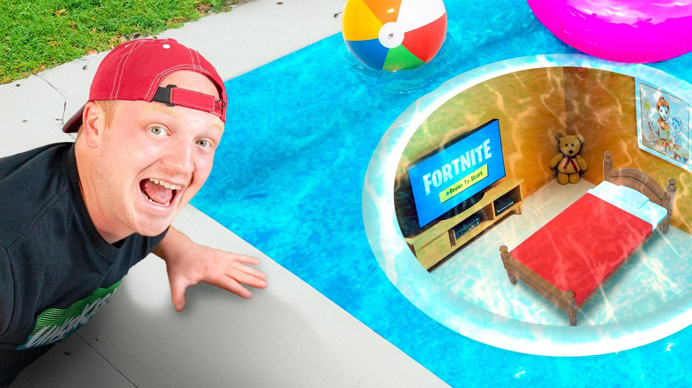](https://www.youtube.com/watch?v=X9AYf8gy5sU)

  [I Built 30 Secret Rooms You’d Never Find!](https://www.youtube.com/watch?v=X9AYf8gy5sU)

  Unspeakable · 2024-06-22 · family

  18,997,959 public views · 5.00× reported lift

  Same title/premise family: I Built 30 Secret Rooms You’d Never Find!. Game, cast and execution transfer remains a hypothesis; this source does not validate the new episode outcome.Window: lifetime through source snapshot. [Metric source](https://majieddd.github.io/influint-channels-public/channels/UCwIWAbIeu0xI0ReKWOcw3eg.html)
* [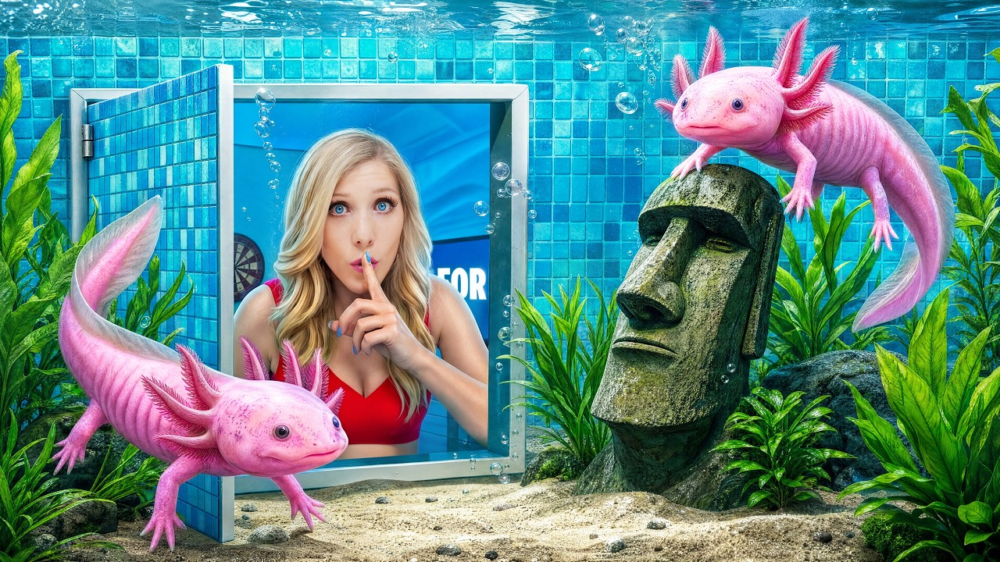](https://www.youtube.com/watch?v=ujX_NcWwnQo)

  [I Built 7 Secret Rooms That Shouldn't Exist...](https://www.youtube.com/watch?v=ujX_NcWwnQo)

  Brianna · 2024-01-11 · family

  4,313,017 public views · 2.38× reported lift

  Same title/premise family: I Built 7 Secret Rooms That Shouldn't Exist.... Game, cast and execution transfer remains a hypothesis; this source does not validate the new episode outcome.Window: lifetime through source snapshot. [Metric source](https://majieddd.github.io/influint-channels-public/channels/UCXg4rJUbDP1IP3TmZ9KDpJg.html)
* 

  [I Built 5 SECRET Rooms In ONE COLOR!](https://www.youtube.com/watch?v=cfFtBojH_-Y)

  Stokes Twins · 2025-06-27 · family

  180,421,614 public views · 1.74× reported lift

  Same title/premise family: I Built 5 SECRET Rooms In ONE COLOR!. Game, cast and execution transfer remains a hypothesis; this source does not validate the new episode outcome.Window: lifetime through source snapshot. [Metric source](https://majieddd.github.io/influint-channels-public/channels/UCbp9MyKCTEww4CxEzc_Tp0Q.html)
* [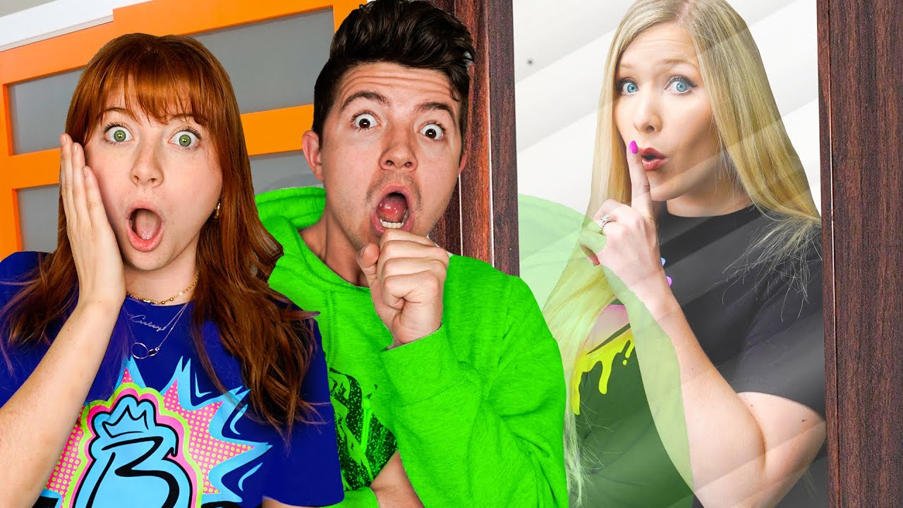](https://www.youtube.com/watch?v=HPtF-z5QAyI)

  [Preston Built a Secret HIDDEN Room to CHEAT in Hide and Seek!](https://www.youtube.com/watch?v=HPtF-z5QAyI)

  Brianna · 2021-03-04 · family

  7,584,560 public views · 2.16× reported lift

  Same title/premise family: Preston Built a Secret HIDDEN Room to CHEAT in Hide and Seek!. Game, cast and execution transfer remains a hypothesis; this source does not validate the new episode outcome.Window: lifetime through source snapshot. [Metric source](https://majieddd.github.io/influint-channels-public/channels/UCXg4rJUbDP1IP3TmZ9KDpJg.html)

#### Principal content ingredient

2/2 qualifying outlier channels · 2 creator groups. Qualifying means source-reported lift ≥2×; family matches do not prove the exact mixed episode.

* [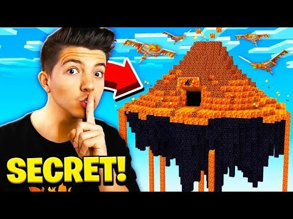](https://www.youtube.com/watch?v=d0q9y0GkrEg)

  [I FOUND PRESTONPLAYZ SECRET SKY BASE IN MINECRAFT!](https://www.youtube.com/watch?v=d0q9y0GkrEg)

  Brianna · 2019-02-01 · family

  27,428,622 public views · 8.87× reported lift

  Same concrete ingredient secret: I FOUND PRESTONPLAYZ SECRET SKY BASE IN MINECRAFT!. Game, cast and execution transfer remains a hypothesis; this source does not validate the new episode outcome.Window: lifetime through source snapshot. [Metric source](https://majieddd.github.io/influint-channels-public/channels/UCXg4rJUbDP1IP3TmZ9KDpJg.html)
* 

  [I Built 30 Secret Rooms You’d Never Find!](https://www.youtube.com/watch?v=X9AYf8gy5sU)

  Unspeakable · 2024-06-22 · family

  18,997,959 public views · 5.00× reported lift

  Same concrete ingredient secret: I Built 30 Secret Rooms You’d Never Find!. Game, cast and execution transfer remains a hypothesis; this source does not validate the new episode outcome.Window: lifetime through source snapshot. [Metric source](https://majieddd.github.io/influint-channels-public/channels/UCwIWAbIeu0xI0ReKWOcw3eg.html)
* 

  [$1 vs $25,000 Secret Rooms](https://www.youtube.com/watch?v=jEG8wuUE1pY)

  MrBeast Gaming · 2025-07-26 · family

  63,275,703 public views · 1.97× reported lift

  Same concrete ingredient secret: $1 vs $25,000 Secret Rooms. Game, cast and execution transfer remains a hypothesis; this source does not validate the new episode outcome.Window: lifetime through source snapshot. [Metric source](https://majieddd.github.io/influint-channels-public/channels/UCIPPMRA040LQr5QPyJEbmXA.html)
* 

  [I Built 5 SECRET Rooms In ONE COLOR!](https://www.youtube.com/watch?v=cfFtBojH_-Y)

  Stokes Twins · 2025-06-27 · family

  180,421,614 public views · 1.74× reported lift

  Same concrete ingredient secret: I Built 5 SECRET Rooms In ONE COLOR!. Game, cast and execution transfer remains a hypothesis; this source does not validate the new episode outcome.Window: lifetime through source snapshot. [Metric source](https://majieddd.github.io/influint-channels-public/channels/UCbp9MyKCTEww4CxEzc_Tp0Q.html)

Ingredient matches concern the principal object/premise, not proof of every mixed ingredient. Views/lift are observed package/content performance.

Thumbnail reference and composition

Composition source: Stokes Twins · I Built 5 SECRET Rooms In ONE COLOR!

Finished Stokes concept for this episode.

Alan shushing beside a normal brick wall sliding open to a luminous underwater lounge, tiny crew seeker walking past.

Retain source subject placement, relative scale, action direction and visual contrast; use the Stokes identity and this episode’s actual content. This is a planned image, not a gameplay screenshot or a validated CTR winner.

Creative and production brief

Find all five functional entrances before the search timer runs out.

The seekers receive a bounded search area; rooms must be accessible in the filmed build and clues are scheduled in advance.

#### Escalation

An easy fake door becomes a moving wall, an underwater entrance and a final room hiding in plain sight.

#### Payoff

Open every missed room and show the seekers' genuine reactions to the entrances they walked past.

#### For both audiences

**Gamer:** Game-world building tricks and concealed entrances create novelty.

**Non-gamer:** The audience knows the secret and anticipates the crew missing it or finding it.

#### People and production

One creator/host presents the builds; multiple crew members search, compete or react. Both twins need not be the only relationship.

* Custom environments/entrances and capture; costs are lower on sequels reusing the build system.

#### Learning question

Does this distinct viewer promise attract broad viewers while feeling recognizably Stokes?

**Shorts opportunity:** Extract a complete first-complication-to-result micro-story or one resolved test/reveal; preserve setup and payoff.

[Link to idea 011](#idea-011)[Image prompt](prompts/011.txt)

012 / FORMAT 03 · Secret builds with a discovery deadline

### I Built a Secret Room Under My Friend's GTA House

One host builds a functional hidden gaming lounge beneath a friend's familiar home and tries to keep the surprise intact all day.

GTA 5 launch / follow-up · GTA 5

1. **0 (First Frame)–5s**Alex shushing at a cutaway of an ordinary GTA house, luxurious red secret gaming room glowing beneath the floor.
2. **5s–15s**Complete and use the room without the resident finding it before the reveal. Use an agreed in-game house and genuine undisclosed entrance.
3. **15s–30s**The resident notices a floor tile moving during the first visit. Show the crew choosing its next move.

[Heavy complexity](#production)[Download image](full/012.jpg)

Why this idea

Title shape**I Built a [SUBJECT] Under My Friend's [GAME] [SUBJECT]**Content ingredients**secret, house, room**Combined package**I Built a Secret Room Under My Friend's GTA House**

Keep the familiar Stokes secret-room promise and make the entrances/reveals genuinely new; the test is against the whole crew.

#### Title / premise family

2/2 qualifying outlier channels · 2 creator groups. Qualifying means source-reported lift ≥2×; family matches do not prove the exact mixed episode.

* 

  [I Built 30 Secret Rooms You’d Never Find!](https://www.youtube.com/watch?v=X9AYf8gy5sU)

  Unspeakable · 2024-06-22 · family

  18,997,959 public views · 5.00× reported lift

  Same title/premise family: I Built 30 Secret Rooms You’d Never Find!. Game, cast and execution transfer remains a hypothesis; this source does not validate the new episode outcome.Window: lifetime through source snapshot. [Metric source](https://majieddd.github.io/influint-channels-public/channels/UCwIWAbIeu0xI0ReKWOcw3eg.html)
* 

  [I Built 7 Secret Rooms That Shouldn't Exist...](https://www.youtube.com/watch?v=ujX_NcWwnQo)

  Brianna · 2024-01-11 · family

  4,313,017 public views · 2.38× reported lift

  Same title/premise family: I Built 7 Secret Rooms That Shouldn't Exist.... Game, cast and execution transfer remains a hypothesis; this source does not validate the new episode outcome.Window: lifetime through source snapshot. [Metric source](https://majieddd.github.io/influint-channels-public/channels/UCXg4rJUbDP1IP3TmZ9KDpJg.html)
* 

  [I Built 5 SECRET Rooms In ONE COLOR!](https://www.youtube.com/watch?v=cfFtBojH_-Y)

  Stokes Twins · 2025-06-27 · family

  180,421,614 public views · 1.74× reported lift

  Same title/premise family: I Built 5 SECRET Rooms In ONE COLOR!. Game, cast and execution transfer remains a hypothesis; this source does not validate the new episode outcome.Window: lifetime through source snapshot. [Metric source](https://majieddd.github.io/influint-channels-public/channels/UCbp9MyKCTEww4CxEzc_Tp0Q.html)
* 

  [Preston Built a Secret HIDDEN Room to CHEAT in Hide and Seek!](https://www.youtube.com/watch?v=HPtF-z5QAyI)

  Brianna · 2021-03-04 · family

  7,584,560 public views · 2.16× reported lift

  Same title/premise family: Preston Built a Secret HIDDEN Room to CHEAT in Hide and Seek!. Game, cast and execution transfer remains a hypothesis; this source does not validate the new episode outcome.Window: lifetime through source snapshot. [Metric source](https://majieddd.github.io/influint-channels-public/channels/UCXg4rJUbDP1IP3TmZ9KDpJg.html)

#### Principal content ingredient

2/2 qualifying outlier channels · 2 creator groups. Qualifying means source-reported lift ≥2×; family matches do not prove the exact mixed episode.

* 

  [I FOUND PRESTONPLAYZ SECRET SKY BASE IN MINECRAFT!](https://www.youtube.com/watch?v=d0q9y0GkrEg)

  Brianna · 2019-02-01 · family

  27,428,622 public views · 8.87× reported lift

  Same concrete ingredient secret: I FOUND PRESTONPLAYZ SECRET SKY BASE IN MINECRAFT!. Game, cast and execution transfer remains a hypothesis; this source does not validate the new episode outcome.Window: lifetime through source snapshot. [Metric source](https://majieddd.github.io/influint-channels-public/channels/UCXg4rJUbDP1IP3TmZ9KDpJg.html)
* 

  [I Built 30 Secret Rooms You’d Never Find!](https://www.youtube.com/watch?v=X9AYf8gy5sU)

  Unspeakable · 2024-06-22 · family

  18,997,959 public views · 5.00× reported lift

  Same concrete ingredient secret: I Built 30 Secret Rooms You’d Never Find!. Game, cast and execution transfer remains a hypothesis; this source does not validate the new episode outcome.Window: lifetime through source snapshot. [Metric source](https://majieddd.github.io/influint-channels-public/channels/UCwIWAbIeu0xI0ReKWOcw3eg.html)
* 

  [$1 vs $25,000 Secret Rooms](https://www.youtube.com/watch?v=jEG8wuUE1pY)

  MrBeast Gaming · 2025-07-26 · family

  63,275,703 public views · 1.97× reported lift

  Same concrete ingredient secret: $1 vs $25,000 Secret Rooms. Game, cast and execution transfer remains a hypothesis; this source does not validate the new episode outcome.Window: lifetime through source snapshot. [Metric source](https://majieddd.github.io/influint-channels-public/channels/UCIPPMRA040LQr5QPyJEbmXA.html)
* 

  [I Built 5 SECRET Rooms In ONE COLOR!](https://www.youtube.com/watch?v=cfFtBojH_-Y)

  Stokes Twins · 2025-06-27 · family

  180,421,614 public views · 1.74× reported lift

  Same concrete ingredient secret: I Built 5 SECRET Rooms In ONE COLOR!. Game, cast and execution transfer remains a hypothesis; this source does not validate the new episode outcome.Window: lifetime through source snapshot. [Metric source](https://majieddd.github.io/influint-channels-public/channels/UCbp9MyKCTEww4CxEzc_Tp0Q.html)

Ingredient matches concern the principal object/premise, not proof of every mixed ingredient. Views/lift are observed package/content performance.

Thumbnail reference and composition

Composition source: Stokes Twins · I Built 5 SECRET Rooms In ONE COLOR!

Finished Stokes concept for this episode.

Alex shushing at a cutaway of an ordinary GTA house, luxurious red secret gaming room glowing beneath the floor.

Retain source subject placement, relative scale, action direction and visual contrast; use the Stokes identity and this episode’s actual content. This is a planned image, not a gameplay screenshot or a validated CTR winner.

Creative and production brief

Complete and use the room without the resident finding it before the reveal.

Use an agreed in-game house and genuine undisclosed entrance; the resident knows they are filming a challenge, not the precise prank.

#### Escalation

Construction noise becomes a clue, a delivery nearly exposes the hatch and the final visit forces a risky escape.

#### Payoff

Invite the friend through the hidden entrance and demonstrate the finished lounge actually works.

#### For both audiences

**Gamer:** Game-world building tricks and concealed entrances create novelty.

**Non-gamer:** The audience knows the secret and anticipates the crew missing it or finding it.

#### People and production

One creator/host presents the builds; multiple crew members search, compete or react. Both twins need not be the only relationship.

* Custom environments/entrances and capture; costs are lower on sequels reusing the build system.

#### Learning question

Does this distinct viewer promise attract broad viewers while feeling recognizably Stokes?

**Shorts opportunity:** Extract a complete first-complication-to-result micro-story or one resolved test/reveal; preserve setup and payoff.

[Link to idea 012](#idea-012)[Image prompt](prompts/012.txt)

013 / FORMAT 03 · Secret builds with a discovery deadline

### I Built 5 Secret Rooms Inside GTA Vehicles

The crew searches ordinary-looking vehicles that hide five surprising spaces inside or beneath their functioning entrances.

GTA 5 launch / follow-up · GTA 5

1. **0 (First Frame)–5s**Alan opening a plain white van door to a huge neon cinema, ordinary van silhouette outside, stunned adult crew member beside him.
2. **5s–15s**Discover all five rooms before the convoy leaves. Each vehicle has one documented custom interior.
3. **15s–30s**A seeker spots an interior much larger than the exterior and asks where the hidden door really leads. Show the crew choosing its next move.

[Heavy complexity](#production)[Download image](full/013.jpg)

Why this idea

Title shape**I Built [COUNT] [SUBJECT] Inside [GAME] [SUBJECT]**Content ingredients**secret, vehicle, room**Combined package**I Built 5 Secret Rooms Inside GTA Vehicles**

Keep the familiar Stokes secret-room promise and make the entrances/reveals genuinely new; the test is against the whole crew.

#### Title / premise family

2/2 qualifying outlier channels · 2 creator groups. Qualifying means source-reported lift ≥2×; family matches do not prove the exact mixed episode.

* 

  [I Built 30 Secret Rooms You’d Never Find!](https://www.youtube.com/watch?v=X9AYf8gy5sU)

  Unspeakable · 2024-06-22 · family

  18,997,959 public views · 5.00× reported lift

  Same title/premise family: I Built 30 Secret Rooms You’d Never Find!. Game, cast and execution transfer remains a hypothesis; this source does not validate the new episode outcome.Window: lifetime through source snapshot. [Metric source](https://majieddd.github.io/influint-channels-public/channels/UCwIWAbIeu0xI0ReKWOcw3eg.html)
* 

  [I Built 7 Secret Rooms That Shouldn't Exist...](https://www.youtube.com/watch?v=ujX_NcWwnQo)

  Brianna · 2024-01-11 · family

  4,313,017 public views · 2.38× reported lift

  Same title/premise family: I Built 7 Secret Rooms That Shouldn't Exist.... Game, cast and execution transfer remains a hypothesis; this source does not validate the new episode outcome.Window: lifetime through source snapshot. [Metric source](https://majieddd.github.io/influint-channels-public/channels/UCXg4rJUbDP1IP3TmZ9KDpJg.html)
* 

  [I Built 5 SECRET Rooms In ONE COLOR!](https://www.youtube.com/watch?v=cfFtBojH_-Y)

  Stokes Twins · 2025-06-27 · family

  180,421,614 public views · 1.74× reported lift

  Same title/premise family: I Built 5 SECRET Rooms In ONE COLOR!. Game, cast and execution transfer remains a hypothesis; this source does not validate the new episode outcome.Window: lifetime through source snapshot. [Metric source](https://majieddd.github.io/influint-channels-public/channels/UCbp9MyKCTEww4CxEzc_Tp0Q.html)
* 

  [Preston Built a Secret HIDDEN Room to CHEAT in Hide and Seek!](https://www.youtube.com/watch?v=HPtF-z5QAyI)

  Brianna · 2021-03-04 · family

  7,584,560 public views · 2.16× reported lift

  Same title/premise family: Preston Built a Secret HIDDEN Room to CHEAT in Hide and Seek!. Game, cast and execution transfer remains a hypothesis; this source does not validate the new episode outcome.Window: lifetime through source snapshot. [Metric source](https://majieddd.github.io/influint-channels-public/channels/UCXg4rJUbDP1IP3TmZ9KDpJg.html)

#### Principal content ingredient

2/2 qualifying outlier channels · 2 creator groups. Qualifying means source-reported lift ≥2×; family matches do not prove the exact mixed episode.

* 

  [I FOUND PRESTONPLAYZ SECRET SKY BASE IN MINECRAFT!](https://www.youtube.com/watch?v=d0q9y0GkrEg)

  Brianna · 2019-02-01 · family

  27,428,622 public views · 8.87× reported lift

  Same concrete ingredient secret: I FOUND PRESTONPLAYZ SECRET SKY BASE IN MINECRAFT!. Game, cast and execution transfer remains a hypothesis; this source does not validate the new episode outcome.Window: lifetime through source snapshot. [Metric source](https://majieddd.github.io/influint-channels-public/channels/UCXg4rJUbDP1IP3TmZ9KDpJg.html)
* 

  [I Built 30 Secret Rooms You’d Never Find!](https://www.youtube.com/watch?v=X9AYf8gy5sU)

  Unspeakable · 2024-06-22 · family

  18,997,959 public views · 5.00× reported lift

  Same concrete ingredient secret: I Built 30 Secret Rooms You’d Never Find!. Game, cast and execution transfer remains a hypothesis; this source does not validate the new episode outcome.Window: lifetime through source snapshot. [Metric source](https://majieddd.github.io/influint-channels-public/channels/UCwIWAbIeu0xI0ReKWOcw3eg.html)
* 

  [$1 vs $25,000 Secret Rooms](https://www.youtube.com/watch?v=jEG8wuUE1pY)

  MrBeast Gaming · 2025-07-26 · family

  63,275,703 public views · 1.97× reported lift

  Same concrete ingredient secret: $1 vs $25,000 Secret Rooms. Game, cast and execution transfer remains a hypothesis; this source does not validate the new episode outcome.Window: lifetime through source snapshot. [Metric source](https://majieddd.github.io/influint-channels-public/channels/UCIPPMRA040LQr5QPyJEbmXA.html)
* 

  [I Built 5 SECRET Rooms In ONE COLOR!](https://www.youtube.com/watch?v=cfFtBojH_-Y)

  Stokes Twins · 2025-06-27 · family

  180,421,614 public views · 1.74× reported lift

  Same concrete ingredient secret: I Built 5 SECRET Rooms In ONE COLOR!. Game, cast and execution transfer remains a hypothesis; this source does not validate the new episode outcome.Window: lifetime through source snapshot. [Metric source](https://majieddd.github.io/influint-channels-public/channels/UCbp9MyKCTEww4CxEzc_Tp0Q.html)

Ingredient matches concern the principal object/premise, not proof of every mixed ingredient. Views/lift are observed package/content performance.

Thumbnail reference and composition

Composition source: Stokes Twins · I Built 5 SECRET Rooms In ONE COLOR!

Finished Stokes concept for this episode.

Alan opening a plain white van door to a huge neon cinema, ordinary van silhouette outside, stunned adult crew member beside him.

Retain source subject placement, relative scale, action direction and visual contrast; use the Stokes identity and this episode’s actual content. This is a planned image, not a gameplay screenshot or a validated CTR winner.

Creative and production brief

Discover all five rooms before the convoy leaves.

Each vehicle has one documented custom interior; show exterior-to-interior continuity rather than imply stock-game geometry.

#### Escalation

A van hides a lounge, a bus conceals a cinema and a tiny vehicle carries the least expected doorway.

#### Payoff

Reveal the full convoy and prove every door leads to the room claimed.

#### For both audiences

**Gamer:** Game-world building tricks and concealed entrances create novelty.

**Non-gamer:** The audience knows the secret and anticipates the crew missing it or finding it.

#### People and production

One creator/host presents the builds; multiple crew members search, compete or react. Both twins need not be the only relationship.

* Custom environments/entrances and capture; costs are lower on sequels reusing the build system.

#### Learning question

Does this distinct viewer promise attract broad viewers while feeling recognizably Stokes?

**Shorts opportunity:** Extract a complete first-complication-to-result micro-story or one resolved test/reveal; preserve setup and payoff.

[Link to idea 013](#idea-013)[Image prompt](prompts/013.txt)

014 / FORMAT 03 · Secret builds with a discovery deadline

### I Built 5 Secret Rooms Using Only One Color in GTA

Five crew builders hide rooms in one color each while rival seekers try to spot the camouflage.

GTA 5 launch / follow-up · GTA 5

1. **0 (First Frame)–5s**Alan in front of a blue wall hatch revealing an aqua room, red wall hatch at right; saturated one-color secret-room split.
2. **5s–15s**Hide the most convincing room and discover the opposing team's entrances. Each builder draws one color.
3. **15s–30s**The first builder realizes their assigned neon red clashes with the street outside. Show the crew choosing its next move.

[Heavy complexity](#production)[Download image](full/014.jpg)

Why this idea

Title shape**I Built [COUNT] [SUBJECT] Using Only One Color in [GAME]**Content ingredients**secret, color, room**Combined package**I Built 5 Secret Rooms Using Only One Color in GTA**

Keep the familiar Stokes secret-room promise and make the entrances/reveals genuinely new; the test is against the whole crew.

#### Title / premise family

2/2 qualifying outlier channels · 2 creator groups. Qualifying means source-reported lift ≥2×; family matches do not prove the exact mixed episode.

* 

  [I Built 30 Secret Rooms You’d Never Find!](https://www.youtube.com/watch?v=X9AYf8gy5sU)

  Unspeakable · 2024-06-22 · family

  18,997,959 public views · 5.00× reported lift

  Same title/premise family: I Built 30 Secret Rooms You’d Never Find!. Game, cast and execution transfer remains a hypothesis; this source does not validate the new episode outcome.Window: lifetime through source snapshot. [Metric source](https://majieddd.github.io/influint-channels-public/channels/UCwIWAbIeu0xI0ReKWOcw3eg.html)
* 

  [I Built 7 Secret Rooms That Shouldn't Exist...](https://www.youtube.com/watch?v=ujX_NcWwnQo)

  Brianna · 2024-01-11 · family

  4,313,017 public views · 2.38× reported lift

  Same title/premise family: I Built 7 Secret Rooms That Shouldn't Exist.... Game, cast and execution transfer remains a hypothesis; this source does not validate the new episode outcome.Window: lifetime through source snapshot. [Metric source](https://majieddd.github.io/influint-channels-public/channels/UCXg4rJUbDP1IP3TmZ9KDpJg.html)
* 

  [I Built 5 SECRET Rooms In ONE COLOR!](https://www.youtube.com/watch?v=cfFtBojH_-Y)

  Stokes Twins · 2025-06-27 · family

  180,421,614 public views · 1.74× reported lift

  Same title/premise family: I Built 5 SECRET Rooms In ONE COLOR!. Game, cast and execution transfer remains a hypothesis; this source does not validate the new episode outcome.Window: lifetime through source snapshot. [Metric source](https://majieddd.github.io/influint-channels-public/channels/UCbp9MyKCTEww4CxEzc_Tp0Q.html)
* 

  [Preston Built a Secret HIDDEN Room to CHEAT in Hide and Seek!](https://www.youtube.com/watch?v=HPtF-z5QAyI)

  Brianna · 2021-03-04 · family

  7,584,560 public views · 2.16× reported lift

  Same title/premise family: Preston Built a Secret HIDDEN Room to CHEAT in Hide and Seek!. Game, cast and execution transfer remains a hypothesis; this source does not validate the new episode outcome.Window: lifetime through source snapshot. [Metric source](https://majieddd.github.io/influint-channels-public/channels/UCXg4rJUbDP1IP3TmZ9KDpJg.html)

#### Principal content ingredient

2/2 qualifying outlier channels · 2 creator groups. Qualifying means source-reported lift ≥2×; family matches do not prove the exact mixed episode.

* 

  [I FOUND PRESTONPLAYZ SECRET SKY BASE IN MINECRAFT!](https://www.youtube.com/watch?v=d0q9y0GkrEg)

  Brianna · 2019-02-01 · family

  27,428,622 public views · 8.87× reported lift

  Same concrete ingredient secret: I FOUND PRESTONPLAYZ SECRET SKY BASE IN MINECRAFT!. Game, cast and execution transfer remains a hypothesis; this source does not validate the new episode outcome.Window: lifetime through source snapshot. [Metric source](https://majieddd.github.io/influint-channels-public/channels/UCXg4rJUbDP1IP3TmZ9KDpJg.html)
* 

  [I Built 30 Secret Rooms You’d Never Find!](https://www.youtube.com/watch?v=X9AYf8gy5sU)

  Unspeakable · 2024-06-22 · family

  18,997,959 public views · 5.00× reported lift

  Same concrete ingredient secret: I Built 30 Secret Rooms You’d Never Find!. Game, cast and execution transfer remains a hypothesis; this source does not validate the new episode outcome.Window: lifetime through source snapshot. [Metric source](https://majieddd.github.io/influint-channels-public/channels/UCwIWAbIeu0xI0ReKWOcw3eg.html)
* 

  [$1 vs $25,000 Secret Rooms](https://www.youtube.com/watch?v=jEG8wuUE1pY)

  MrBeast Gaming · 2025-07-26 · family

  63,275,703 public views · 1.97× reported lift

  Same concrete ingredient secret: $1 vs $25,000 Secret Rooms. Game, cast and execution transfer remains a hypothesis; this source does not validate the new episode outcome.Window: lifetime through source snapshot. [Metric source](https://majieddd.github.io/influint-channels-public/channels/UCIPPMRA040LQr5QPyJEbmXA.html)
* 

  [I Built 5 SECRET Rooms In ONE COLOR!](https://www.youtube.com/watch?v=cfFtBojH_-Y)

  Stokes Twins · 2025-06-27 · family

  180,421,614 public views · 1.74× reported lift

  Same concrete ingredient secret: I Built 5 SECRET Rooms In ONE COLOR!. Game, cast and execution transfer remains a hypothesis; this source does not validate the new episode outcome.Window: lifetime through source snapshot. [Metric source](https://majieddd.github.io/influint-channels-public/channels/UCbp9MyKCTEww4CxEzc_Tp0Q.html)

Ingredient matches concern the principal object/premise, not proof of every mixed ingredient. Views/lift are observed package/content performance.

Thumbnail reference and composition

Composition source: Stokes Twins · I Built 5 SECRET Rooms In ONE COLOR!

Finished Stokes concept for this episode.

Alan in front of a blue wall hatch revealing an aqua room, red wall hatch at right; saturated one-color secret-room split.

Retain source subject placement, relative scale, action direction and visual contrast; use the Stokes identity and this episode’s actual content. This is a planned image, not a gameplay screenshot or a validated CTR winner.

Creative and production brief

Hide the most convincing room and discover the opposing team's entrances.

Each builder draws one color; entrances and interiors follow it, with identical build time and search boundaries.

#### Escalation

Bold rooms look impossible to hide until scenery becomes camouflage and a seeker notices one mismatched object.

#### Payoff

Rank discovery times, then reveal every builder's concealment trick.

#### For both audiences

**Gamer:** Game-world building tricks and concealed entrances create novelty.

**Non-gamer:** The audience knows the secret and anticipates the crew missing it or finding it.

#### People and production

One creator/host presents the builds; multiple crew members search, compete or react. Both twins need not be the only relationship.

* Custom environments/entrances and capture; costs are lower on sequels reusing the build system.

#### Learning question

Does this distinct viewer promise attract broad viewers while feeling recognizably Stokes?

**Shorts opportunity:** Extract a complete first-complication-to-result micro-story or one resolved test/reveal; preserve setup and payoff.

[Link to idea 014](#idea-014)[Image prompt](prompts/014-correction.txt)

015 / FORMAT 03 · Secret builds with a discovery deadline

### I Built Secret Rooms Inside Minecraft Landmarks

The crew explores recognizable Minecraft landmarks that conceal custom rooms behind ordinary details.

Later game expansion · Minecraft

1. **0 (First Frame)–5s**Alex shushing beside a Minecraft statue with an open chest hatch showing a golden lounge; tiny seeker below.
2. **5s–15s**Find the five hidden entrances on the marked landmark route. Use a bounded custom map with five working entrances and a fixed clue budget.
3. **15s–30s**The seekers correctly guess the first landmark but cannot find its actual door. Show the crew choosing its next move.

[Heavy complexity](#production)[Download image](full/015.jpg)

Why this idea

Title shape**I Built [SUBJECT] Inside [GAME] [SUBJECT]**Content ingredients**secret, Minecraft, build**Combined package**I Built Secret Rooms Inside Minecraft Landmarks**

Keep the familiar Stokes secret-room promise and make the entrances/reveals genuinely new; the test is against the whole crew.

#### Title / premise family

2/2 qualifying outlier channels · 2 creator groups. Qualifying means source-reported lift ≥2×; family matches do not prove the exact mixed episode.

* 

  [I Built 30 Secret Rooms You’d Never Find!](https://www.youtube.com/watch?v=X9AYf8gy5sU)

  Unspeakable · 2024-06-22 · family

  18,997,959 public views · 5.00× reported lift

  Same title/premise family: I Built 30 Secret Rooms You’d Never Find!. Game, cast and execution transfer remains a hypothesis; this source does not validate the new episode outcome.Window: lifetime through source snapshot. [Metric source](https://majieddd.github.io/influint-channels-public/channels/UCwIWAbIeu0xI0ReKWOcw3eg.html)
* 

  [I Built 7 Secret Rooms That Shouldn't Exist...](https://www.youtube.com/watch?v=ujX_NcWwnQo)

  Brianna · 2024-01-11 · family

  4,313,017 public views · 2.38× reported lift

  Same title/premise family: I Built 7 Secret Rooms That Shouldn't Exist.... Game, cast and execution transfer remains a hypothesis; this source does not validate the new episode outcome.Window: lifetime through source snapshot. [Metric source](https://majieddd.github.io/influint-channels-public/channels/UCXg4rJUbDP1IP3TmZ9KDpJg.html)
* 

  [I Built 5 SECRET Rooms In ONE COLOR!](https://www.youtube.com/watch?v=cfFtBojH_-Y)

  Stokes Twins · 2025-06-27 · family

  180,421,614 public views · 1.74× reported lift

  Same title/premise family: I Built 5 SECRET Rooms In ONE COLOR!. Game, cast and execution transfer remains a hypothesis; this source does not validate the new episode outcome.Window: lifetime through source snapshot. [Metric source](https://majieddd.github.io/influint-channels-public/channels/UCbp9MyKCTEww4CxEzc_Tp0Q.html)
* 

  [Preston Built a Secret HIDDEN Room to CHEAT in Hide and Seek!](https://www.youtube.com/watch?v=HPtF-z5QAyI)

  Brianna · 2021-03-04 · family

  7,584,560 public views · 2.16× reported lift

  Same title/premise family: Preston Built a Secret HIDDEN Room to CHEAT in Hide and Seek!. Game, cast and execution transfer remains a hypothesis; this source does not validate the new episode outcome.Window: lifetime through source snapshot. [Metric source](https://majieddd.github.io/influint-channels-public/channels/UCXg4rJUbDP1IP3TmZ9KDpJg.html)

#### Principal content ingredient

2/2 qualifying outlier channels · 2 creator groups. Qualifying means source-reported lift ≥2×; family matches do not prove the exact mixed episode.

* 

  [I FOUND PRESTONPLAYZ SECRET SKY BASE IN MINECRAFT!](https://www.youtube.com/watch?v=d0q9y0GkrEg)

  Brianna · 2019-02-01 · family

  27,428,622 public views · 8.87× reported lift

  Same concrete ingredient secret: I FOUND PRESTONPLAYZ SECRET SKY BASE IN MINECRAFT!. Game, cast and execution transfer remains a hypothesis; this source does not validate the new episode outcome.Window: lifetime through source snapshot. [Metric source](https://majieddd.github.io/influint-channels-public/channels/UCXg4rJUbDP1IP3TmZ9KDpJg.html)
* 

  [I Built 30 Secret Rooms You’d Never Find!](https://www.youtube.com/watch?v=X9AYf8gy5sU)

  Unspeakable · 2024-06-22 · family

  18,997,959 public views · 5.00× reported lift

  Same concrete ingredient secret: I Built 30 Secret Rooms You’d Never Find!. Game, cast and execution transfer remains a hypothesis; this source does not validate the new episode outcome.Window: lifetime through source snapshot. [Metric source](https://majieddd.github.io/influint-channels-public/channels/UCwIWAbIeu0xI0ReKWOcw3eg.html)
* 

  [$1 vs $25,000 Secret Rooms](https://www.youtube.com/watch?v=jEG8wuUE1pY)

  MrBeast Gaming · 2025-07-26 · family

  63,275,703 public views · 1.97× reported lift

  Same concrete ingredient secret: $1 vs $25,000 Secret Rooms. Game, cast and execution transfer remains a hypothesis; this source does not validate the new episode outcome.Window: lifetime through source snapshot. [Metric source](https://majieddd.github.io/influint-channels-public/channels/UCIPPMRA040LQr5QPyJEbmXA.html)
* 

  [I Built 5 SECRET Rooms In ONE COLOR!](https://www.youtube.com/watch?v=cfFtBojH_-Y)

  Stokes Twins · 2025-06-27 · family

  180,421,614 public views · 1.74× reported lift

  Same concrete ingredient secret: I Built 5 SECRET Rooms In ONE COLOR!. Game, cast and execution transfer remains a hypothesis; this source does not validate the new episode outcome.Window: lifetime through source snapshot. [Metric source](https://majieddd.github.io/influint-channels-public/channels/UCbp9MyKCTEww4CxEzc_Tp0Q.html)

Ingredient matches concern the principal object/premise, not proof of every mixed ingredient. Views/lift are observed package/content performance.

Thumbnail reference and composition

Composition source: Stokes Twins · I Built 5 SECRET Rooms In ONE COLOR!

Finished Stokes concept for this episode.

Alex shushing beside a Minecraft statue with an open chest hatch showing a golden lounge; tiny seeker below.

Retain source subject placement, relative scale, action direction and visual contrast; use the Stokes identity and this episode’s actual content. This is a planned image, not a gameplay screenshot or a validated CTR winner.

Creative and production brief

Find the five hidden entrances on the marked landmark route.

Use a bounded custom map with five working entrances and a fixed clue budget.

#### Escalation

A statue hides a bedroom, a bridge hides a cinema and the final landmark appears completely solid.

#### Payoff

Replay the missed details and open the last room from the seeker's original viewpoint.

#### For both audiences

**Gamer:** Game-world building tricks and concealed entrances create novelty.

**Non-gamer:** The audience knows the secret and anticipates the crew missing it or finding it.

#### People and production

One creator/host presents the builds; multiple crew members search, compete or react. Both twins need not be the only relationship.

* Custom environments/entrances and capture; costs are lower on sequels reusing the build system.
* Verify the exact edition, map, mod license and working mechanics; GTA-system reuse does not imply Minecraft support.

#### Learning question

Does this distinct viewer promise attract broad viewers while feeling recognizably Stokes?

**Shorts opportunity:** Extract a complete first-complication-to-result micro-story or one resolved test/reveal; preserve setup and payoff.

[Link to idea 015](#idea-015)[Image prompt](prompts/015.txt)

016 / FORMAT 04 · Budgeted secret-room build-off

### $1 vs $25,000 Secret Rooms in GTA

Two build teams use unequal virtual allowances to create hidden rooms for the same demanding crew guests.

GTA 5 launch / follow-up · GTA 5

1. **0 (First Frame)–5s**Tiny cardboard secret nook left versus spectacular gold underground pool right, Alan centered; $1 and $25,000.
2. **5s–15s**Win the crew's concealment, function and fun score. Amounts are disclosed in-game build values in this launch version, not real contractor spend.
3. **15s–30s**The cheap team cannot afford a normal door and designs a curtain camouflage instead. Show the crew choosing its next move.

[Heavy complexity](#production)[Download image](full/016.jpg)

Why this idea

Title shape**$[VALUE] vs $[VALUE] [SUBJECT] in [GAME]**Content ingredients**secret, room, cheap**Combined package**$1 vs $25,000 Secret Rooms in GTA**

Combine the user-requested price-contrast title with the main channel’s hidden construction appeal.

#### Title / premise family

3/2 qualifying outlier channels · 3 creator groups. Qualifying means source-reported lift ≥2×; family matches do not prove the exact mixed episode.

* 

  [$2 VS $16,000 Minecraft House!](https://www.youtube.com/watch?v=IPtpwh7r0Eo)

  MrBeast Gaming · 2021-08-25 · family

  116,928,432 public views · 3.26× reported lift

  Same title/premise family: $2 VS $16,000 Minecraft House!. Game, cast and execution transfer remains a hypothesis; this source does not validate the new episode outcome.Window: lifetime through source snapshot. [Metric source](https://majieddd.github.io/influint-channels-public/channels/UCIPPMRA040LQr5QPyJEbmXA.html)
* 

  [$1 VS $1,000,000 MOVIE THEATER!](https://www.youtube.com/watch?v=NbJGkWNL9Ow)

  Unspeakable · 2025-03-22 · family

  9,548,848 public views · 3.15× reported lift

  Same title/premise family: $1 VS $1,000,000 MOVIE THEATER!. Game, cast and execution transfer remains a hypothesis; this source does not validate the new episode outcome.Window: lifetime through source snapshot. [Metric source](https://majieddd.github.io/influint-channels-public/channels/UCwIWAbIeu0xI0ReKWOcw3eg.html)
* 

  [$50 vs $50,000 Family Vacation](https://www.youtube.com/watch?v=Mp8c5F16i1A)

  Brianna · 2022-08-28 · family

  4,879,296 public views · 2.45× reported lift

  Same title/premise family: $50 vs $50,000 Family Vacation. Game, cast and execution transfer remains a hypothesis; this source does not validate the new episode outcome.Window: lifetime through source snapshot. [Metric source](https://majieddd.github.io/influint-channels-public/channels/UCXg4rJUbDP1IP3TmZ9KDpJg.html)
* 

  [$1 vs $1,000,000 Vacation!](https://www.youtube.com/watch?v=K7FjCmlWvuY)

  Stokes Twins · 2022-11-23 · family

  127,518,732 public views · 1.33× reported lift

  Same title/premise family: $1 vs $1,000,000 Vacation!. Game, cast and execution transfer remains a hypothesis; this source does not validate the new episode outcome.Window: lifetime through source snapshot. [Metric source](https://majieddd.github.io/influint-channels-public/channels/UCbp9MyKCTEww4CxEzc_Tp0Q.html)

#### Principal content ingredient

2/2 qualifying outlier channels · 2 creator groups. Qualifying means source-reported lift ≥2×; family matches do not prove the exact mixed episode.

* 

  [I FOUND PRESTONPLAYZ SECRET SKY BASE IN MINECRAFT!](https://www.youtube.com/watch?v=d0q9y0GkrEg)

  Brianna · 2019-02-01 · family

  27,428,622 public views · 8.87× reported lift

  Same concrete ingredient secret: I FOUND PRESTONPLAYZ SECRET SKY BASE IN MINECRAFT!. Game, cast and execution transfer remains a hypothesis; this source does not validate the new episode outcome.Window: lifetime through source snapshot. [Metric source](https://majieddd.github.io/influint-channels-public/channels/UCXg4rJUbDP1IP3TmZ9KDpJg.html)
* 

  [I Built 30 Secret Rooms You’d Never Find!](https://www.youtube.com/watch?v=X9AYf8gy5sU)

  Unspeakable · 2024-06-22 · family

  18,997,959 public views · 5.00× reported lift

  Same concrete ingredient secret: I Built 30 Secret Rooms You’d Never Find!. Game, cast and execution transfer remains a hypothesis; this source does not validate the new episode outcome.Window: lifetime through source snapshot. [Metric source](https://majieddd.github.io/influint-channels-public/channels/UCwIWAbIeu0xI0ReKWOcw3eg.html)
* 

  [$1 vs $25,000 Secret Rooms](https://www.youtube.com/watch?v=jEG8wuUE1pY)

  MrBeast Gaming · 2025-07-26 · family

  63,275,703 public views · 1.97× reported lift

  Same concrete ingredient secret: $1 vs $25,000 Secret Rooms. Game, cast and execution transfer remains a hypothesis; this source does not validate the new episode outcome.Window: lifetime through source snapshot. [Metric source](https://majieddd.github.io/influint-channels-public/channels/UCIPPMRA040LQr5QPyJEbmXA.html)
* 

  [I Built 5 SECRET Rooms In ONE COLOR!](https://www.youtube.com/watch?v=cfFtBojH_-Y)

  Stokes Twins · 2025-06-27 · family

  180,421,614 public views · 1.74× reported lift

  Same concrete ingredient secret: I Built 5 SECRET Rooms In ONE COLOR!. Game, cast and execution transfer remains a hypothesis; this source does not validate the new episode outcome.Window: lifetime through source snapshot. [Metric source](https://majieddd.github.io/influint-channels-public/channels/UCbp9MyKCTEww4CxEzc_Tp0Q.html)

Ingredient matches concern the principal object/premise, not proof of every mixed ingredient. Views/lift are observed package/content performance.

Thumbnail reference and composition

Composition source: MrBeast Gaming · $1 vs $25,000 Secret Rooms

Finished Stokes concept for this episode.

Tiny cardboard secret nook left versus spectacular gold underground pool right, Alan centered; $1 and $25,000.

Retain source subject placement, relative scale, action direction and visual contrast; use the Stokes identity and this episode’s actual content. This is a planned image, not a gameplay screenshot or a validated CTR winner.

Creative and production brief

Win the crew's concealment, function and fun score.

Amounts are disclosed in-game build values in this launch version, not real contractor spend; same footprint and recording window.

#### Escalation

The cheap team improvises, the luxury team runs into a functional problem and blind guest testing upsets the price expectations.

#### Payoff

Reveal the judges' scores and the actual cash production allowance beside the game-value brief.

#### For both audiences

**Gamer:** Custom-world design and functional entrances supply ingenuity without a rules tutorial.

**Non-gamer:** The audience compares an obviously tiny allowance with a spectacular build and judges whether the upgrade is worth it.

#### People and production

Two or more build teams, crew room testers and an Alan/Alex host/judge; specialist developers can execute the selected designs.

* Real build allowances and contractor scope must be specified. $25,000 is a requested title direction, not approved launch spending; distinguish a real budget from a game-value variant.

#### Learning question

Does this distinct viewer promise attract broad viewers while feeling recognizably Stokes?

**Shorts opportunity:** Extract a complete first-complication-to-result micro-story or one resolved test/reveal; preserve setup and payoff.

[Link to idea 016](#idea-016)[Image prompt](prompts/016.txt)

017 / FORMAT 04 · Budgeted secret-room build-off

### $1 vs $25,000 Secret Rooms Inside GTA Cars

Two teams hide a tiny improvised lounge and an extravagant cinema behind matching vehicle entrances.

GTA 5 launch / follow-up · GTA 5

1. **0 (First Frame)–5s**Cheap rusty van with cramped nook left, polished supercar door opening to golden cinema right, Alex foreground; $1 / $25K.
2. **5s–15s**Make the most convincing and enjoyable hidden car room. Game-value allowances, same base vehicle and equal judging.
3. **15s–30s**The expensive interior is ready but the vehicle door fails to open correctly. Show the crew choosing its next move.

[Heavy complexity](#production)[Download image](full/017.jpg)

Why this idea

Title shape**$[VALUE] vs $[VALUE] [SUBJECT] Inside [GAME] [SUBJECT]**Content ingredients**secret, car, build**Combined package**$1 vs $25,000 Secret Rooms Inside GTA Cars**

Combine the user-requested price-contrast title with the main channel’s hidden construction appeal.

#### Title / premise family

3/2 qualifying outlier channels · 3 creator groups. Qualifying means source-reported lift ≥2×; family matches do not prove the exact mixed episode.

* 

  [$2 VS $16,000 Minecraft House!](https://www.youtube.com/watch?v=IPtpwh7r0Eo)

  MrBeast Gaming · 2021-08-25 · family

  116,928,432 public views · 3.26× reported lift

  Same title/premise family: $2 VS $16,000 Minecraft House!. Game, cast and execution transfer remains a hypothesis; this source does not validate the new episode outcome.Window: lifetime through source snapshot. [Metric source](https://majieddd.github.io/influint-channels-public/channels/UCIPPMRA040LQr5QPyJEbmXA.html)
* 

  [$1 VS $1,000,000 MOVIE THEATER!](https://www.youtube.com/watch?v=NbJGkWNL9Ow)

  Unspeakable · 2025-03-22 · family

  9,548,848 public views · 3.15× reported lift

  Same title/premise family: $1 VS $1,000,000 MOVIE THEATER!. Game, cast and execution transfer remains a hypothesis; this source does not validate the new episode outcome.Window: lifetime through source snapshot. [Metric source](https://majieddd.github.io/influint-channels-public/channels/UCwIWAbIeu0xI0ReKWOcw3eg.html)
* 

  [$50 vs $50,000 Family Vacation](https://www.youtube.com/watch?v=Mp8c5F16i1A)

  Brianna · 2022-08-28 · family

  4,879,296 public views · 2.45× reported lift

  Same title/premise family: $50 vs $50,000 Family Vacation. Game, cast and execution transfer remains a hypothesis; this source does not validate the new episode outcome.Window: lifetime through source snapshot. [Metric source](https://majieddd.github.io/influint-channels-public/channels/UCXg4rJUbDP1IP3TmZ9KDpJg.html)
* 

  [$1 vs $1,000,000 Vacation!](https://www.youtube.com/watch?v=K7FjCmlWvuY)

  Stokes Twins · 2022-11-23 · family

  127,518,732 public views · 1.33× reported lift

  Same title/premise family: $1 vs $1,000,000 Vacation!. Game, cast and execution transfer remains a hypothesis; this source does not validate the new episode outcome.Window: lifetime through source snapshot. [Metric source](https://majieddd.github.io/influint-channels-public/channels/UCbp9MyKCTEww4CxEzc_Tp0Q.html)

#### Principal content ingredient

2/2 qualifying outlier channels · 2 creator groups. Qualifying means source-reported lift ≥2×; family matches do not prove the exact mixed episode.

* 

  [I FOUND PRESTONPLAYZ SECRET SKY BASE IN MINECRAFT!](https://www.youtube.com/watch?v=d0q9y0GkrEg)

  Brianna · 2019-02-01 · family

  27,428,622 public views · 8.87× reported lift

  Same concrete ingredient secret: I FOUND PRESTONPLAYZ SECRET SKY BASE IN MINECRAFT!. Game, cast and execution transfer remains a hypothesis; this source does not validate the new episode outcome.Window: lifetime through source snapshot. [Metric source](https://majieddd.github.io/influint-channels-public/channels/UCXg4rJUbDP1IP3TmZ9KDpJg.html)
* 

  [I Built 30 Secret Rooms You’d Never Find!](https://www.youtube.com/watch?v=X9AYf8gy5sU)

  Unspeakable · 2024-06-22 · family

  18,997,959 public views · 5.00× reported lift

  Same concrete ingredient secret: I Built 30 Secret Rooms You’d Never Find!. Game, cast and execution transfer remains a hypothesis; this source does not validate the new episode outcome.Window: lifetime through source snapshot. [Metric source](https://majieddd.github.io/influint-channels-public/channels/UCwIWAbIeu0xI0ReKWOcw3eg.html)
* 

  [$1 vs $25,000 Secret Rooms](https://www.youtube.com/watch?v=jEG8wuUE1pY)

  MrBeast Gaming · 2025-07-26 · family

  63,275,703 public views · 1.97× reported lift

  Same concrete ingredient secret: $1 vs $25,000 Secret Rooms. Game, cast and execution transfer remains a hypothesis; this source does not validate the new episode outcome.Window: lifetime through source snapshot. [Metric source](https://majieddd.github.io/influint-channels-public/channels/UCIPPMRA040LQr5QPyJEbmXA.html)
* 

  [I Built 5 SECRET Rooms In ONE COLOR!](https://www.youtube.com/watch?v=cfFtBojH_-Y)

  Stokes Twins · 2025-06-27 · family

  180,421,614 public views · 1.74× reported lift

  Same concrete ingredient secret: I Built 5 SECRET Rooms In ONE COLOR!. Game, cast and execution transfer remains a hypothesis; this source does not validate the new episode outcome.Window: lifetime through source snapshot. [Metric source](https://majieddd.github.io/influint-channels-public/channels/UCbp9MyKCTEww4CxEzc_Tp0Q.html)

Ingredient matches concern the principal object/premise, not proof of every mixed ingredient. Views/lift are observed package/content performance.

Thumbnail reference and composition

Composition source: MrBeast Gaming · $1 vs $25,000 Secret Rooms

Finished Stokes concept for this episode.

Cheap rusty van with cramped nook left, polished supercar door opening to golden cinema right, Alex foreground; $1 / $25K.

Retain source subject placement, relative scale, action direction and visual contrast; use the Stokes identity and this episode’s actual content. This is a planned image, not a gameplay screenshot or a validated CTR winner.

Creative and production brief

Make the most convincing and enjoyable hidden car room.

Game-value allowances, same base vehicle and equal judging; custom doorway/interior geometry is explained visually.

#### Escalation

The small build wins portability while the luxury build struggles with a working reveal mechanism.

#### Payoff

Show each exterior-to-interior journey and let the guests choose the room they would keep.

#### For both audiences

**Gamer:** Custom-world design and functional entrances supply ingenuity without a rules tutorial.

**Non-gamer:** The audience compares an obviously tiny allowance with a spectacular build and judges whether the upgrade is worth it.

#### People and production

Two or more build teams, crew room testers and an Alan/Alex host/judge; specialist developers can execute the selected designs.

* Real build allowances and contractor scope must be specified. $25,000 is a requested title direction, not approved launch spending; distinguish a real budget from a game-value variant.

#### Learning question

Does this distinct viewer promise attract broad viewers while feeling recognizably Stokes?

**Shorts opportunity:** Extract a complete first-complication-to-result micro-story or one resolved test/reveal; preserve setup and payoff.

[Link to idea 017](#idea-017)[Image prompt](prompts/017.txt)

018 / FORMAT 04 · Budgeted secret-room build-off

### $1 vs $25,000 Underwater Rooms in GTA

The crew builds two underwater hideouts and tests whether either can stay concealed while remaining usable.

GTA 5 launch / follow-up · GTA 5

1. **0 (First Frame)–5s**Alan underwater beside tiny barrel hideout left and enormous glass blue underwater lounge right; $1 and $25K.
2. **5s–15s**Win a safe-entry, concealment and experience score inside the game. Disclosed virtual allowances and identical water depth.
3. **15s–30s**The crew can see the luxury room immediately from the surface. Show the crew choosing its next move.

[Heavy complexity](#production)[Download image](full/018.jpg)

Why this idea

Title shape**$[VALUE] vs $[VALUE] [SUBJECT] in [GAME]**Content ingredients**water, secret, room**Combined package**$1 vs $25,000 Underwater Rooms in GTA**

Combine the user-requested price-contrast title with the main channel’s hidden construction appeal.

#### Title / premise family

3/2 qualifying outlier channels · 3 creator groups. Qualifying means source-reported lift ≥2×; family matches do not prove the exact mixed episode.

* 

  [$2 VS $16,000 Minecraft House!](https://www.youtube.com/watch?v=IPtpwh7r0Eo)

  MrBeast Gaming · 2021-08-25 · family

  116,928,432 public views · 3.26× reported lift

  Same title/premise family: $2 VS $16,000 Minecraft House!. Game, cast and execution transfer remains a hypothesis; this source does not validate the new episode outcome.Window: lifetime through source snapshot. [Metric source](https://majieddd.github.io/influint-channels-public/channels/UCIPPMRA040LQr5QPyJEbmXA.html)
* 

  [$1 VS $1,000,000 MOVIE THEATER!](https://www.youtube.com/watch?v=NbJGkWNL9Ow)

  Unspeakable · 2025-03-22 · family

  9,548,848 public views · 3.15× reported lift

  Same title/premise family: $1 VS $1,000,000 MOVIE THEATER!. Game, cast and execution transfer remains a hypothesis; this source does not validate the new episode outcome.Window: lifetime through source snapshot. [Metric source](https://majieddd.github.io/influint-channels-public/channels/UCwIWAbIeu0xI0ReKWOcw3eg.html)
* 

  [$50 vs $50,000 Family Vacation](https://www.youtube.com/watch?v=Mp8c5F16i1A)

  Brianna · 2022-08-28 · family

  4,879,296 public views · 2.45× reported lift

  Same title/premise family: $50 vs $50,000 Family Vacation. Game, cast and execution transfer remains a hypothesis; this source does not validate the new episode outcome.Window: lifetime through source snapshot. [Metric source](https://majieddd.github.io/influint-channels-public/channels/UCXg4rJUbDP1IP3TmZ9KDpJg.html)
* 

  [$1 vs $1,000,000 Vacation!](https://www.youtube.com/watch?v=K7FjCmlWvuY)

  Stokes Twins · 2022-11-23 · family

  127,518,732 public views · 1.33× reported lift

  Same title/premise family: $1 vs $1,000,000 Vacation!. Game, cast and execution transfer remains a hypothesis; this source does not validate the new episode outcome.Window: lifetime through source snapshot. [Metric source](https://majieddd.github.io/influint-channels-public/channels/UCbp9MyKCTEww4CxEzc_Tp0Q.html)

#### Principal content ingredient

3/2 qualifying outlier channels · 2 creator groups. Qualifying means source-reported lift ≥2×; family matches do not prove the exact mixed episode.

* 

  [WORST Reviewed Water Park vs BEST Reviewed Water Park!](https://www.youtube.com/watch?v=-LVdJNIs2PY)

  Brianna · 2020-09-26 · family

  11,857,144 public views · 5.63× reported lift

  Same concrete ingredient water: WORST Reviewed Water Park vs BEST Reviewed Water Park!. Game, cast and execution transfer remains a hypothesis; this source does not validate the new episode outcome.Window: lifetime through source snapshot. [Metric source](https://majieddd.github.io/influint-channels-public/channels/UCXg4rJUbDP1IP3TmZ9KDpJg.html)
* 

  [I Turned My House Into a Waterpark!](https://www.youtube.com/watch?v=WthL6_K8Kys)

  Unspeakable · 2024-08-24 · family

  20,543,332 public views · 4.23× reported lift

  Same concrete ingredient water: I Turned My House Into a Waterpark!. Game, cast and execution transfer remains a hypothesis; this source does not validate the new episode outcome.Window: lifetime through source snapshot. [Metric source](https://majieddd.github.io/influint-channels-public/channels/UCwIWAbIeu0xI0ReKWOcw3eg.html)
* [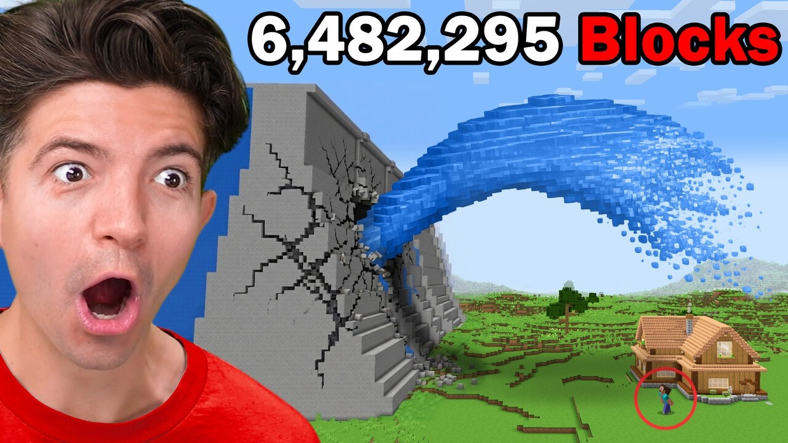](https://www.youtube.com/watch?v=-LUNQPxD0vY)

  [Why I Flooded My Friend’s ENTIRE World?](https://www.youtube.com/watch?v=-LUNQPxD0vY)

  PrestonPlayz · 2026-03-07 · family

  13,665,235 public views · 2.81× reported lift

  Same concrete ingredient water: Why I Flooded My Friend’s ENTIRE World?. Game, cast and execution transfer remains a hypothesis; this source does not validate the new episode outcome.Window: lifetime through source snapshot. [Metric source](https://majieddd.github.io/influint-channels-public/channels/UCJZam2u1G0syq3kyqrCXrNw.html)
* 

  [Walking on Water Prank!](https://www.youtube.com/watch?v=hHdKug_wQkU)

  Stokes Twins · 2025-03-22 · family

  169,129,541 public views · 1.34× reported lift

  Same concrete ingredient water: Walking on Water Prank!. Game, cast and execution transfer remains a hypothesis; this source does not validate the new episode outcome.Window: lifetime through source snapshot. [Metric source](https://majieddd.github.io/influint-channels-public/channels/UCbp9MyKCTEww4CxEzc_Tp0Q.html)

Ingredient matches concern the principal object/premise, not proof of every mixed ingredient. Views/lift are observed package/content performance.

Thumbnail reference and composition

Composition source: MrBeast Gaming · $1 vs $25,000 Secret Rooms

Finished Stokes concept for this episode.

Alan underwater beside tiny barrel hideout left and enormous glass blue underwater lounge right; $1 and $25K.

Retain source subject placement, relative scale, action direction and visual contrast; use the Stokes identity and this episode’s actual content. This is a planned image, not a gameplay screenshot or a validated CTR winner.

Creative and production brief

Win a safe-entry, concealment and experience score inside the game.

Disclosed virtual allowances and identical water depth; game oxygen rules are shown simply and no real underwater stunt is required.

#### Escalation

A cheap air pocket beats a grand view on access, then guests test each exit under a timer.

#### Payoff

Reveal the score and the room that the crew can genuinely enter, enjoy and leave.

#### For both audiences

**Gamer:** Custom-world design and functional entrances supply ingenuity without a rules tutorial.

**Non-gamer:** The audience compares an obviously tiny allowance with a spectacular build and judges whether the upgrade is worth it.

#### People and production

Two or more build teams, crew room testers and an Alan/Alex host/judge; specialist developers can execute the selected designs.

* Real build allowances and contractor scope must be specified. $25,000 is a requested title direction, not approved launch spending; distinguish a real budget from a game-value variant.

#### Learning question

Does this distinct viewer promise attract broad viewers while feeling recognizably Stokes?

**Shorts opportunity:** Extract a complete first-complication-to-result micro-story or one resolved test/reveal; preserve setup and payoff.

[Link to idea 018](#idea-018)[Image prompt](prompts/018.txt)

019 / FORMAT 04 · Budgeted secret-room build-off

### $1 vs $25,000 Secret Rooms for Our Friends in GTA

Build teams compete to satisfy one friend's exact wish using radically different game-value budgets.

GTA 5 launch / follow-up · GTA 5

1. **0 (First Frame)–5s**Alan presenting tiny cardboard snack room left and giant neon arcade right to one delighted crew guest; $1 / $25K.
2. **5s–15s**Win the friend's vote after both rooms meet a written wish list. Reveal the guest's three priorities before building.
3. **15s–30s**The guest's most important request turns out to be absent from the expensive design. Show the crew choosing its next move.

[Heavy complexity](#production)[Download image](full/019.jpg)

Why this idea

Title shape**$[VALUE] vs $[VALUE] [SUBJECT] for Our Friends in [GAME]**Content ingredients**secret, friends, build**Combined package**$1 vs $25,000 Secret Rooms for Our Friends in GTA**

Combine the user-requested price-contrast title with the main channel’s hidden construction appeal.

#### Title / premise family

3/2 qualifying outlier channels · 3 creator groups. Qualifying means source-reported lift ≥2×; family matches do not prove the exact mixed episode.

* 

  [$2 VS $16,000 Minecraft House!](https://www.youtube.com/watch?v=IPtpwh7r0Eo)

  MrBeast Gaming · 2021-08-25 · family

  116,928,432 public views · 3.26× reported lift

  Same title/premise family: $2 VS $16,000 Minecraft House!. Game, cast and execution transfer remains a hypothesis; this source does not validate the new episode outcome.Window: lifetime through source snapshot. [Metric source](https://majieddd.github.io/influint-channels-public/channels/UCIPPMRA040LQr5QPyJEbmXA.html)
* 

  [$1 VS $1,000,000 MOVIE THEATER!](https://www.youtube.com/watch?v=NbJGkWNL9Ow)

  Unspeakable · 2025-03-22 · family

  9,548,848 public views · 3.15× reported lift

  Same title/premise family: $1 VS $1,000,000 MOVIE THEATER!. Game, cast and execution transfer remains a hypothesis; this source does not validate the new episode outcome.Window: lifetime through source snapshot. [Metric source](https://majieddd.github.io/influint-channels-public/channels/UCwIWAbIeu0xI0ReKWOcw3eg.html)
* 

  [$50 vs $50,000 Family Vacation](https://www.youtube.com/watch?v=Mp8c5F16i1A)

  Brianna · 2022-08-28 · family

  4,879,296 public views · 2.45× reported lift

  Same title/premise family: $50 vs $50,000 Family Vacation. Game, cast and execution transfer remains a hypothesis; this source does not validate the new episode outcome.Window: lifetime through source snapshot. [Metric source](https://majieddd.github.io/influint-channels-public/channels/UCXg4rJUbDP1IP3TmZ9KDpJg.html)
* 

  [$1 vs $1,000,000 Vacation!](https://www.youtube.com/watch?v=K7FjCmlWvuY)

  Stokes Twins · 2022-11-23 · family

  127,518,732 public views · 1.33× reported lift

  Same title/premise family: $1 vs $1,000,000 Vacation!. Game, cast and execution transfer remains a hypothesis; this source does not validate the new episode outcome.Window: lifetime through source snapshot. [Metric source](https://majieddd.github.io/influint-channels-public/channels/UCbp9MyKCTEww4CxEzc_Tp0Q.html)

#### Principal content ingredient

2/2 qualifying outlier channels · 2 creator groups. Qualifying means source-reported lift ≥2×; family matches do not prove the exact mixed episode.

* 

  [I FOUND PRESTONPLAYZ SECRET SKY BASE IN MINECRAFT!](https://www.youtube.com/watch?v=d0q9y0GkrEg)

  Brianna · 2019-02-01 · family

  27,428,622 public views · 8.87× reported lift

  Same concrete ingredient secret: I FOUND PRESTONPLAYZ SECRET SKY BASE IN MINECRAFT!. Game, cast and execution transfer remains a hypothesis; this source does not validate the new episode outcome.Window: lifetime through source snapshot. [Metric source](https://majieddd.github.io/influint-channels-public/channels/UCXg4rJUbDP1IP3TmZ9KDpJg.html)
* 

  [I Built 30 Secret Rooms You’d Never Find!](https://www.youtube.com/watch?v=X9AYf8gy5sU)

  Unspeakable · 2024-06-22 · family

  18,997,959 public views · 5.00× reported lift

  Same concrete ingredient secret: I Built 30 Secret Rooms You’d Never Find!. Game, cast and execution transfer remains a hypothesis; this source does not validate the new episode outcome.Window: lifetime through source snapshot. [Metric source](https://majieddd.github.io/influint-channels-public/channels/UCwIWAbIeu0xI0ReKWOcw3eg.html)
* 

  [$1 vs $25,000 Secret Rooms](https://www.youtube.com/watch?v=jEG8wuUE1pY)

  MrBeast Gaming · 2025-07-26 · family

  63,275,703 public views · 1.97× reported lift

  Same concrete ingredient secret: $1 vs $25,000 Secret Rooms. Game, cast and execution transfer remains a hypothesis; this source does not validate the new episode outcome.Window: lifetime through source snapshot. [Metric source](https://majieddd.github.io/influint-channels-public/channels/UCIPPMRA040LQr5QPyJEbmXA.html)
* 

  [I Built 5 SECRET Rooms In ONE COLOR!](https://www.youtube.com/watch?v=cfFtBojH_-Y)

  Stokes Twins · 2025-06-27 · family

  180,421,614 public views · 1.74× reported lift

  Same concrete ingredient secret: I Built 5 SECRET Rooms In ONE COLOR!. Game, cast and execution transfer remains a hypothesis; this source does not validate the new episode outcome.Window: lifetime through source snapshot. [Metric source](https://majieddd.github.io/influint-channels-public/channels/UCbp9MyKCTEww4CxEzc_Tp0Q.html)

Ingredient matches concern the principal object/premise, not proof of every mixed ingredient. Views/lift are observed package/content performance.

Thumbnail reference and composition

Composition source: MrBeast Gaming · $1 vs $25,000 Secret Rooms

Finished Stokes concept for this episode.

Alan presenting tiny cardboard snack room left and giant neon arcade right to one delighted crew guest; $1 / $25K.

Retain source subject placement, relative scale, action direction and visual contrast; use the Stokes identity and this episode’s actual content. This is a planned image, not a gameplay screenshot or a validated CTR winner.

Creative and production brief

Win the friend's vote after both rooms meet a written wish list.

Reveal the guest's three priorities before building; virtual values, fixed scope and no changing the brief after judging.

#### Escalation

The cheap builder solves the personal detail first while the expensive builder chases spectacle and risks forgetting it.

#### Payoff

The friend tests both rooms and explains which details earned the vote.

#### For both audiences

**Gamer:** Custom-world design and functional entrances supply ingenuity without a rules tutorial.

**Non-gamer:** The audience compares an obviously tiny allowance with a spectacular build and judges whether the upgrade is worth it.

#### People and production

Two or more build teams, crew room testers and an Alan/Alex host/judge; specialist developers can execute the selected designs.

* Real build allowances and contractor scope must be specified. $25,000 is a requested title direction, not approved launch spending; distinguish a real budget from a game-value variant.

#### Learning question

Does this distinct viewer promise attract broad viewers while feeling recognizably Stokes?

**Shorts opportunity:** Extract a complete first-complication-to-result micro-story or one resolved test/reveal; preserve setup and payoff.

[Link to idea 019](#idea-019)[Image prompt](prompts/019.txt)

020 / FORMAT 04 · Budgeted secret-room build-off

### $1 vs $25,000 Secret Rooms in Minecraft

Two teams turn the same Minecraft hillside into a tiny clever hideout and a vast secret palace.

Later game expansion · Minecraft

1. **0 (First Frame)–5s**Dirt hatch with tiny bed left versus immense golden Minecraft underground palace right, Alex shushing; $1 / $25K.
2. **5s–15s**Earn the best concealment and guest-experience score. Amounts are symbolic game-value allowances.
3. **15s–30s**The expensive build lights leak through the hill and attract a seeker. Show the crew choosing its next move.

[Heavy complexity](#production)[Download image](full/020.jpg)

Why this idea

Title shape**$[VALUE] vs $[VALUE] [SUBJECT] in [GAME]**Content ingredients**secret, Minecraft, cheap**Combined package**$1 vs $25,000 Secret Rooms in Minecraft**

Combine the user-requested price-contrast title with the main channel’s hidden construction appeal.

#### Title / premise family

3/2 qualifying outlier channels · 3 creator groups. Qualifying means source-reported lift ≥2×; family matches do not prove the exact mixed episode.

* 

  [$2 VS $16,000 Minecraft House!](https://www.youtube.com/watch?v=IPtpwh7r0Eo)

  MrBeast Gaming · 2021-08-25 · family

  116,928,432 public views · 3.26× reported lift

  Same title/premise family: $2 VS $16,000 Minecraft House!. Game, cast and execution transfer remains a hypothesis; this source does not validate the new episode outcome.Window: lifetime through source snapshot. [Metric source](https://majieddd.github.io/influint-channels-public/channels/UCIPPMRA040LQr5QPyJEbmXA.html)
* 

  [$1 VS $1,000,000 MOVIE THEATER!](https://www.youtube.com/watch?v=NbJGkWNL9Ow)

  Unspeakable · 2025-03-22 · family

  9,548,848 public views · 3.15× reported lift

  Same title/premise family: $1 VS $1,000,000 MOVIE THEATER!. Game, cast and execution transfer remains a hypothesis; this source does not validate the new episode outcome.Window: lifetime through source snapshot. [Metric source](https://majieddd.github.io/influint-channels-public/channels/UCwIWAbIeu0xI0ReKWOcw3eg.html)
* 

  [$50 vs $50,000 Family Vacation](https://www.youtube.com/watch?v=Mp8c5F16i1A)

  Brianna · 2022-08-28 · family

  4,879,296 public views · 2.45× reported lift

  Same title/premise family: $50 vs $50,000 Family Vacation. Game, cast and execution transfer remains a hypothesis; this source does not validate the new episode outcome.Window: lifetime through source snapshot. [Metric source](https://majieddd.github.io/influint-channels-public/channels/UCXg4rJUbDP1IP3TmZ9KDpJg.html)
* 

  [$1 vs $1,000,000 Vacation!](https://www.youtube.com/watch?v=K7FjCmlWvuY)

  Stokes Twins · 2022-11-23 · family

  127,518,732 public views · 1.33× reported lift

  Same title/premise family: $1 vs $1,000,000 Vacation!. Game, cast and execution transfer remains a hypothesis; this source does not validate the new episode outcome.Window: lifetime through source snapshot. [Metric source](https://majieddd.github.io/influint-channels-public/channels/UCbp9MyKCTEww4CxEzc_Tp0Q.html)

#### Principal content ingredient

2/2 qualifying outlier channels · 2 creator groups. Qualifying means source-reported lift ≥2×; family matches do not prove the exact mixed episode.

* 

  [I FOUND PRESTONPLAYZ SECRET SKY BASE IN MINECRAFT!](https://www.youtube.com/watch?v=d0q9y0GkrEg)

  Brianna · 2019-02-01 · family

  27,428,622 public views · 8.87× reported lift

  Same concrete ingredient secret: I FOUND PRESTONPLAYZ SECRET SKY BASE IN MINECRAFT!. Game, cast and execution transfer remains a hypothesis; this source does not validate the new episode outcome.Window: lifetime through source snapshot. [Metric source](https://majieddd.github.io/influint-channels-public/channels/UCXg4rJUbDP1IP3TmZ9KDpJg.html)
* 

  [I Built 30 Secret Rooms You’d Never Find!](https://www.youtube.com/watch?v=X9AYf8gy5sU)

  Unspeakable · 2024-06-22 · family

  18,997,959 public views · 5.00× reported lift

  Same concrete ingredient secret: I Built 30 Secret Rooms You’d Never Find!. Game, cast and execution transfer remains a hypothesis; this source does not validate the new episode outcome.Window: lifetime through source snapshot. [Metric source](https://majieddd.github.io/influint-channels-public/channels/UCwIWAbIeu0xI0ReKWOcw3eg.html)
* 

  [$1 vs $25,000 Secret Rooms](https://www.youtube.com/watch?v=jEG8wuUE1pY)

  MrBeast Gaming · 2025-07-26 · family

  63,275,703 public views · 1.97× reported lift

  Same concrete ingredient secret: $1 vs $25,000 Secret Rooms. Game, cast and execution transfer remains a hypothesis; this source does not validate the new episode outcome.Window: lifetime through source snapshot. [Metric source](https://majieddd.github.io/influint-channels-public/channels/UCIPPMRA040LQr5QPyJEbmXA.html)
* 

  [I Built 5 SECRET Rooms In ONE COLOR!](https://www.youtube.com/watch?v=cfFtBojH_-Y)

  Stokes Twins · 2025-06-27 · family

  180,421,614 public views · 1.74× reported lift

  Same concrete ingredient secret: I Built 5 SECRET Rooms In ONE COLOR!. Game, cast and execution transfer remains a hypothesis; this source does not validate the new episode outcome.Window: lifetime through source snapshot. [Metric source](https://majieddd.github.io/influint-channels-public/channels/UCbp9MyKCTEww4CxEzc_Tp0Q.html)

Ingredient matches concern the principal object/premise, not proof of every mixed ingredient. Views/lift are observed package/content performance.

Thumbnail reference and composition

Composition source: MrBeast Gaming · $1 vs $25,000 Secret Rooms

Finished Stokes concept for this episode.

Dirt hatch with tiny bed left versus immense golden Minecraft underground palace right, Alex shushing; $1 / $25K.

Retain source subject placement, relative scale, action direction and visual contrast; use the Stokes identity and this episode’s actual content. This is a planned image, not a gameplay screenshot or a validated CTR winner.

Creative and production brief

Earn the best concealment and guest-experience score.

Amounts are symbolic game-value allowances; equal plot, entrance limit and search time.

#### Escalation

The cheap entrance disappears naturally while the luxury elevator gives away its location before a repair.

#### Payoff

Reveal both spaces and compare the discovery time with the crew's comfort vote.

#### For both audiences

**Gamer:** Custom-world design and functional entrances supply ingenuity without a rules tutorial.

**Non-gamer:** The audience compares an obviously tiny allowance with a spectacular build and judges whether the upgrade is worth it.

#### People and production

Two or more build teams, crew room testers and an Alan/Alex host/judge; specialist developers can execute the selected designs.

* Real build allowances and contractor scope must be specified. $25,000 is a requested title direction, not approved launch spending; distinguish a real budget from a game-value variant.
* Verify the exact edition, map, mod license and working mechanics; GTA-system reuse does not imply Minecraft support.

#### Learning question

Does this distinct viewer promise attract broad viewers while feeling recognizably Stokes?

**Shorts opportunity:** Extract a complete first-complication-to-result micro-story or one resolved test/reveal; preserve setup and payoff.

[Link to idea 020](#idea-020)[Image prompt](prompts/020.txt)

021 / FORMAT 05 · Survive a city-scale disaster

### We Survived GTA's Deadliest Natural Disasters

The crew races to a mountaintop shelter as three escalating simulated disasters remove their easiest escape routes.

GTA 5 launch / follow-up · GTA 5

1. **0 (First Frame)–5s**Alan and adult crew in a red jeep foreground, enormous blue tsunami at left and tornado at right over a GTA skyline.
2. **5s–15s**Get the entire crew to the shelter with the marked supply case. Three tested hazards, fixed safe zone and one shared supply case.
3. **15s–30s**The first flood takes the direct road before the crew leaves the city. Show the crew choosing its next move.

[Heavy complexity](#production)[Download image](full/021.jpg)

Why this idea

Title shape**We Survived [GAME]'s Deadliest [SUBJECT]**Content ingredients**disaster, survive, GTA**Combined package**We Survived GTA's Deadliest Natural Disasters**

Environmental survival spectacle with cast reactions; no map-lore knowledge is needed.

#### Title / premise family

3/2 qualifying outlier channels · 3 creator groups. Qualifying means source-reported lift ≥2×; family matches do not prove the exact mixed episode.

* [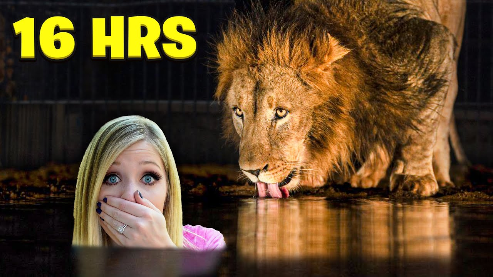](https://www.youtube.com/watch?v=TLHIKUvhXsU)

  [Overnight Survival Challenge in the World's Largest ZOO!](https://www.youtube.com/watch?v=TLHIKUvhXsU)

  Brianna · 2020-10-17 · family

  14,469,543 public views · 6.88× reported lift

  Same title/premise family: Overnight Survival Challenge in the World's Largest ZOO!. Game, cast and execution transfer remains a hypothesis; this source does not validate the new episode outcome.Window: lifetime through source snapshot. [Metric source](https://majieddd.github.io/influint-channels-public/channels/UCXg4rJUbDP1IP3TmZ9KDpJg.html)
* [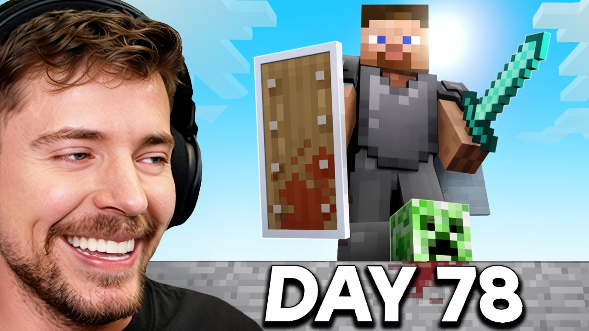](https://www.youtube.com/watch?v=jk6thMe6Vq8)

  [I Survived 100 Days Of Hardcore Minecraft!](https://www.youtube.com/watch?v=jk6thMe6Vq8)

  MrBeast Gaming · 2021-07-22 · family

  186,681,366 public views · 4.27× reported lift

  Same title/premise family: I Survived 100 Days Of Hardcore Minecraft!. Game, cast and execution transfer remains a hypothesis; this source does not validate the new episode outcome.Window: lifetime through source snapshot. [Metric source](https://majieddd.github.io/influint-channels-public/channels/UCIPPMRA040LQr5QPyJEbmXA.html)
* 

  [I Escaped 1,000 Layers of ICE!](https://www.youtube.com/watch?v=mXqlDp61MMA)

  Unspeakable · 2025-04-19 · family

  13,160,154 public views · 3.66× reported lift

  Same title/premise family: I Escaped 1,000 Layers of ICE!. Game, cast and execution transfer remains a hypothesis; this source does not validate the new episode outcome.Window: lifetime through source snapshot. [Metric source](https://majieddd.github.io/influint-channels-public/channels/UCwIWAbIeu0xI0ReKWOcw3eg.html)
* [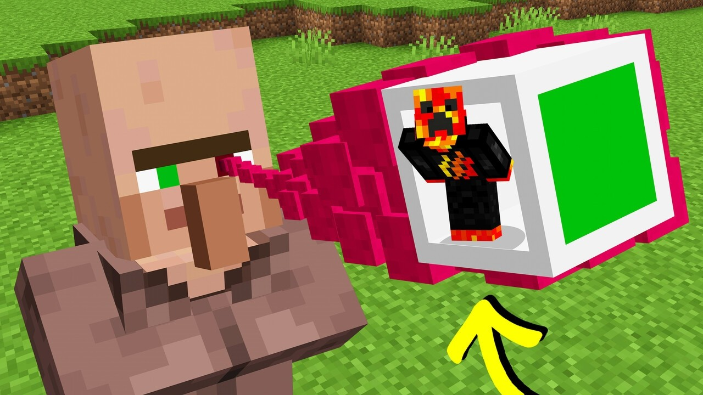](https://www.youtube.com/watch?v=ioTKTLSoIFw)

  [Can I Survive Inside a Mob's Body?](https://www.youtube.com/watch?v=ioTKTLSoIFw)

  PrestonPlayz · 2026-03-21 · family

  7,021,145 public views · 1.49× reported lift

  Same title/premise family: Can I Survive Inside a Mob's Body?. Game, cast and execution transfer remains a hypothesis; this source does not validate the new episode outcome.Window: lifetime through source snapshot. [Metric source](https://majieddd.github.io/influint-channels-public/channels/UCJZam2u1G0syq3kyqrCXrNw.html)

#### Principal content ingredient

2/2 qualifying outlier channels · 2 creator groups. Qualifying means source-reported lift ≥2×; family matches do not prove the exact mixed episode.

* [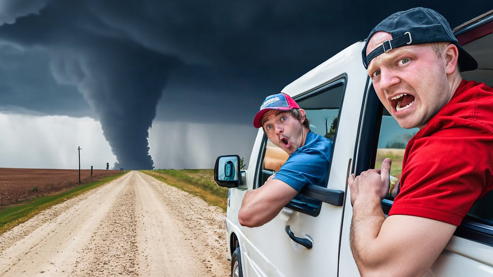](https://www.youtube.com/watch?v=Nq1OKpsJOMM)

  [13 Days Stranded Hunting Tornados](https://www.youtube.com/watch?v=Nq1OKpsJOMM)

  Unspeakable · 2024-08-17 · family

  20,700,552 public views · 3.56× reported lift

  Same concrete ingredient disaster: 13 Days Stranded Hunting Tornados. Game, cast and execution transfer remains a hypothesis; this source does not validate the new episode outcome.Window: lifetime through source snapshot. [Metric source](https://majieddd.github.io/influint-channels-public/channels/UCwIWAbIeu0xI0ReKWOcw3eg.html)
* 

  [Why I Flooded My Friend’s ENTIRE World?](https://www.youtube.com/watch?v=-LUNQPxD0vY)

  PrestonPlayz · 2026-03-07 · family

  13,665,235 public views · 2.81× reported lift

  Same concrete ingredient disaster: Why I Flooded My Friend’s ENTIRE World?. Game, cast and execution transfer remains a hypothesis; this source does not validate the new episode outcome.Window: lifetime through source snapshot. [Metric source](https://majieddd.github.io/influint-channels-public/channels/UCJZam2u1G0syq3kyqrCXrNw.html)
* [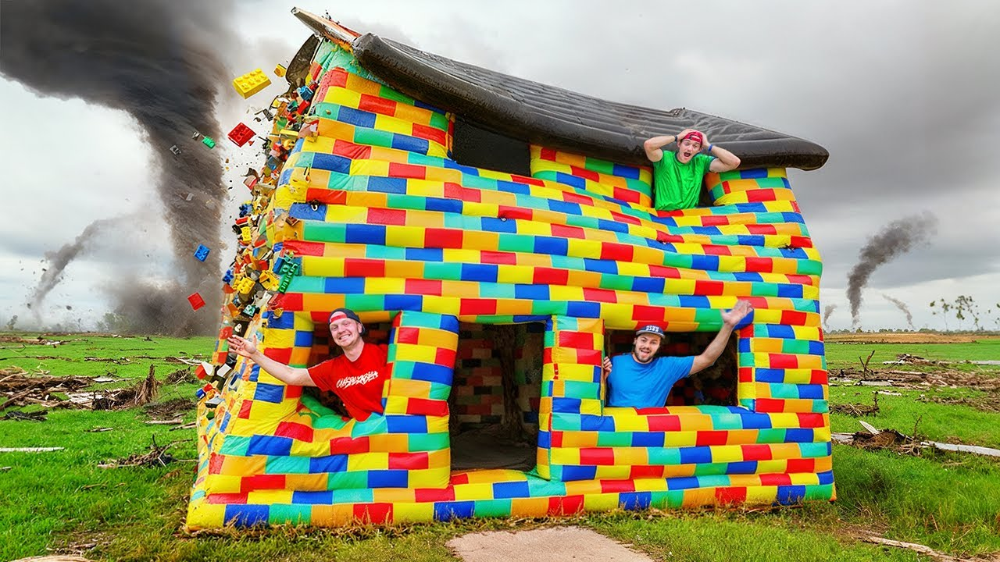](https://www.youtube.com/watch?v=-eVYFC7hd9o)

  [My Lego House Vs Natural Disasters](https://www.youtube.com/watch?v=-eVYFC7hd9o)

  Unspeakable · 2025-11-08 · family

  7,576,150 public views · 1.29× reported lift

  Same concrete ingredient disaster: My Lego House Vs Natural Disasters. Game, cast and execution transfer remains a hypothesis; this source does not validate the new episode outcome.Window: lifetime through source snapshot. [Metric source](https://majieddd.github.io/influint-channels-public/channels/UCwIWAbIeu0xI0ReKWOcw3eg.html)
* [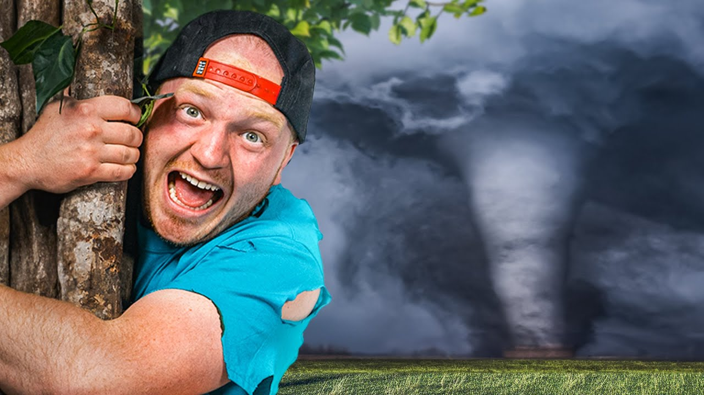](https://www.youtube.com/watch?v=8_TmqPxK6yI)

  [I Survived A Tornado](https://www.youtube.com/watch?v=8_TmqPxK6yI)

  Unspeakable · 2024-07-13 · family

  8,090,156 public views · 1.26× reported lift

  Same concrete ingredient disaster: I Survived A Tornado. Game, cast and execution transfer remains a hypothesis; this source does not validate the new episode outcome.Window: lifetime through source snapshot. [Metric source](https://majieddd.github.io/influint-channels-public/channels/UCwIWAbIeu0xI0ReKWOcw3eg.html)

Ingredient matches concern the principal object/premise, not proof of every mixed ingredient. Views/lift are observed package/content performance.

Thumbnail reference and composition

Composition source: Stokes Twins · 7 EXTREME Ways To Survive For 24 HOURS!

Finished Stokes concept for this episode.

Alan and adult crew in a red jeep foreground, enormous blue tsunami at left and tornado at right over a GTA skyline.

Retain source subject placement, relative scale, action direction and visual contrast; use the Stokes identity and this episode’s actual content. This is a planned image, not a gameplay screenshot or a validated CTR winner.

Creative and production brief

Get the entire crew to the shelter with the marked supply case.

Three tested hazards, fixed safe zone and one shared supply case; a visible map explains the route.

#### Escalation

A flood blocks the road, a quake breaks the bridge and a storm hits the final climb.

#### Payoff

Show who reaches shelter and which rescue choice changes the result.

#### For both audiences

**Gamer:** Map knowledge and improvised traversal become useful.

**Non-gamer:** A rising threat, shrinking safety and an earned escape need no game knowledge.

#### People and production

A mixed survival group with a visible shared objective; rotate who makes decisions, fails and rescues someone.

* Scoped GTA 5 hazards and a tested escape route, effects/capture and a fallback. GTA 6 adaptations depend on actual supported tools.

#### Learning question

Does this distinct viewer promise attract broad viewers while feeling recognizably Stokes?

**Shorts opportunity:** Extract a complete first-complication-to-result micro-story or one resolved test/reveal; preserve setup and payoff.

[Link to idea 021](#idea-021)[Image prompt](prompts/021.txt)

022 / FORMAT 05 · Survive a city-scale disaster

### We Survived a Giant Tsunami in GTA

The crew has to reach high ground before a giant simulated wave overtakes a city evacuation route.

GTA 5 launch / follow-up · GTA 5

1. **0 (First Frame)–5s**Alex fleeing in a tiny red car while a colossal turquoise tsunami curls above a GTA city, one mountain visible ahead.
2. **5s–15s**Reach the marked mountain shelter before the wave. One visible wave path and timer.
3. **15s–30s**The chosen road is jammed with abandoned vehicles. Show the crew choosing its next move.

[Heavy complexity](#production)[Download image](full/022.jpg)

Why this idea

Title shape**We Survived a Giant [SUBJECT] in [GAME]**Content ingredients**tsunami, water, survive**Combined package**We Survived a Giant Tsunami in GTA**

Environmental survival spectacle with cast reactions; no map-lore knowledge is needed.

#### Title / premise family

3/2 qualifying outlier channels · 3 creator groups. Qualifying means source-reported lift ≥2×; family matches do not prove the exact mixed episode.

* 

  [Overnight Survival Challenge in the World's Largest ZOO!](https://www.youtube.com/watch?v=TLHIKUvhXsU)

  Brianna · 2020-10-17 · family

  14,469,543 public views · 6.88× reported lift

  Same title/premise family: Overnight Survival Challenge in the World's Largest ZOO!. Game, cast and execution transfer remains a hypothesis; this source does not validate the new episode outcome.Window: lifetime through source snapshot. [Metric source](https://majieddd.github.io/influint-channels-public/channels/UCXg4rJUbDP1IP3TmZ9KDpJg.html)
* 

  [I Survived 100 Days Of Hardcore Minecraft!](https://www.youtube.com/watch?v=jk6thMe6Vq8)

  MrBeast Gaming · 2021-07-22 · family

  186,681,366 public views · 4.27× reported lift

  Same title/premise family: I Survived 100 Days Of Hardcore Minecraft!. Game, cast and execution transfer remains a hypothesis; this source does not validate the new episode outcome.Window: lifetime through source snapshot. [Metric source](https://majieddd.github.io/influint-channels-public/channels/UCIPPMRA040LQr5QPyJEbmXA.html)
* 

  [I Escaped 1,000 Layers of ICE!](https://www.youtube.com/watch?v=mXqlDp61MMA)

  Unspeakable · 2025-04-19 · family

  13,160,154 public views · 3.66× reported lift

  Same title/premise family: I Escaped 1,000 Layers of ICE!. Game, cast and execution transfer remains a hypothesis; this source does not validate the new episode outcome.Window: lifetime through source snapshot. [Metric source](https://majieddd.github.io/influint-channels-public/channels/UCwIWAbIeu0xI0ReKWOcw3eg.html)
* 

  [Can I Survive Inside a Mob's Body?](https://www.youtube.com/watch?v=ioTKTLSoIFw)

  PrestonPlayz · 2026-03-21 · family

  7,021,145 public views · 1.49× reported lift

  Same title/premise family: Can I Survive Inside a Mob's Body?. Game, cast and execution transfer remains a hypothesis; this source does not validate the new episode outcome.Window: lifetime through source snapshot. [Metric source](https://majieddd.github.io/influint-channels-public/channels/UCJZam2u1G0syq3kyqrCXrNw.html)

#### Principal content ingredient

3/2 qualifying outlier channels · 2 creator groups. Qualifying means source-reported lift ≥2×; family matches do not prove the exact mixed episode.

* 

  [WORST Reviewed Water Park vs BEST Reviewed Water Park!](https://www.youtube.com/watch?v=-LVdJNIs2PY)

  Brianna · 2020-09-26 · family

  11,857,144 public views · 5.63× reported lift

  Same concrete ingredient water: WORST Reviewed Water Park vs BEST Reviewed Water Park!. Game, cast and execution transfer remains a hypothesis; this source does not validate the new episode outcome.Window: lifetime through source snapshot. [Metric source](https://majieddd.github.io/influint-channels-public/channels/UCXg4rJUbDP1IP3TmZ9KDpJg.html)
* 

  [I Turned My House Into a Waterpark!](https://www.youtube.com/watch?v=WthL6_K8Kys)

  Unspeakable · 2024-08-24 · family

  20,543,332 public views · 4.23× reported lift

  Same concrete ingredient water: I Turned My House Into a Waterpark!. Game, cast and execution transfer remains a hypothesis; this source does not validate the new episode outcome.Window: lifetime through source snapshot. [Metric source](https://majieddd.github.io/influint-channels-public/channels/UCwIWAbIeu0xI0ReKWOcw3eg.html)
* 

  [Why I Flooded My Friend’s ENTIRE World?](https://www.youtube.com/watch?v=-LUNQPxD0vY)

  PrestonPlayz · 2026-03-07 · family

  13,665,235 public views · 2.81× reported lift

  Same concrete ingredient water: Why I Flooded My Friend’s ENTIRE World?. Game, cast and execution transfer remains a hypothesis; this source does not validate the new episode outcome.Window: lifetime through source snapshot. [Metric source](https://majieddd.github.io/influint-channels-public/channels/UCJZam2u1G0syq3kyqrCXrNw.html)
* 

  [Walking on Water Prank!](https://www.youtube.com/watch?v=hHdKug_wQkU)

  Stokes Twins · 2025-03-22 · family

  169,129,541 public views · 1.34× reported lift

  Same concrete ingredient water: Walking on Water Prank!. Game, cast and execution transfer remains a hypothesis; this source does not validate the new episode outcome.Window: lifetime through source snapshot. [Metric source](https://majieddd.github.io/influint-channels-public/channels/UCbp9MyKCTEww4CxEzc_Tp0Q.html)

Ingredient matches concern the principal object/premise, not proof of every mixed ingredient. Views/lift are observed package/content performance.

Thumbnail reference and composition

Composition source: Stokes Twins · 7 EXTREME Ways To Survive For 24 HOURS!

Finished Stokes concept for this episode.

Alex fleeing in a tiny red car while a colossal turquoise tsunami curls above a GTA city, one mountain visible ahead.

Retain source subject placement, relative scale, action direction and visual contrast; use the Stokes identity and this episode’s actual content. This is a planned image, not a gameplay screenshot or a validated CTR winner.

Creative and production brief

Reach the marked mountain shelter before the wave.

One visible wave path and timer; equal starts, no teleporting and a disclosed rescue policy.

#### Escalation

A traffic jam forces a vehicle swap, a friend falls behind and the final slope becomes a last-second climb.

#### Payoff

Resolve the mountain arrival with a wide view of the wave and the actual last survivor.

#### For both audiences

**Gamer:** Map knowledge and improvised traversal become useful.

**Non-gamer:** A rising threat, shrinking safety and an earned escape need no game knowledge.

#### People and production

A mixed survival group with a visible shared objective; rotate who makes decisions, fails and rescues someone.

* Scoped GTA 5 hazards and a tested escape route, effects/capture and a fallback. GTA 6 adaptations depend on actual supported tools.

#### Learning question

Does this distinct viewer promise attract broad viewers while feeling recognizably Stokes?

**Shorts opportunity:** Extract a complete first-complication-to-result micro-story or one resolved test/reveal; preserve setup and payoff.

[Link to idea 022](#idea-022)[Image prompt](prompts/022.txt)

023 / FORMAT 05 · Survive a city-scale disaster

### A Tornado Chased Us Across GTA

The crew transports a fragile prize across the city while a moving tornado tears apart every route they choose.

GTA 5 launch / follow-up · GTA 5

1. **0 (First Frame)–5s**Alan gripping a red jeep door, gigantic dark tornado behind pulling cars into the sky, gold prize case visible.
2. **5s–15s**Deliver the marked prize to the bunker intact. Tested moving hazard, one tracked prize and clear destruction rules.
3. **15s–30s**The first road disappears under the tornado's moving debris. Show the crew choosing its next move.

[Heavy complexity](#production)[Download image](full/023.jpg)

Why this idea

Title shape**A [SUBJECT] Chased Us Across [GAME]**Content ingredients**tornado, survive, disaster**Combined package**A Tornado Chased Us Across GTA**

Environmental survival spectacle with cast reactions; no map-lore knowledge is needed.

#### Title / premise family

3/2 qualifying outlier channels · 3 creator groups. Qualifying means source-reported lift ≥2×; family matches do not prove the exact mixed episode.

* 

  [Overnight Survival Challenge in the World's Largest ZOO!](https://www.youtube.com/watch?v=TLHIKUvhXsU)

  Brianna · 2020-10-17 · family

  14,469,543 public views · 6.88× reported lift

  Same title/premise family: Overnight Survival Challenge in the World's Largest ZOO!. Game, cast and execution transfer remains a hypothesis; this source does not validate the new episode outcome.Window: lifetime through source snapshot. [Metric source](https://majieddd.github.io/influint-channels-public/channels/UCXg4rJUbDP1IP3TmZ9KDpJg.html)
* 

  [I Survived 100 Days Of Hardcore Minecraft!](https://www.youtube.com/watch?v=jk6thMe6Vq8)

  MrBeast Gaming · 2021-07-22 · family

  186,681,366 public views · 4.27× reported lift

  Same title/premise family: I Survived 100 Days Of Hardcore Minecraft!. Game, cast and execution transfer remains a hypothesis; this source does not validate the new episode outcome.Window: lifetime through source snapshot. [Metric source](https://majieddd.github.io/influint-channels-public/channels/UCIPPMRA040LQr5QPyJEbmXA.html)
* 

  [I Escaped 1,000 Layers of ICE!](https://www.youtube.com/watch?v=mXqlDp61MMA)

  Unspeakable · 2025-04-19 · family

  13,160,154 public views · 3.66× reported lift

  Same title/premise family: I Escaped 1,000 Layers of ICE!. Game, cast and execution transfer remains a hypothesis; this source does not validate the new episode outcome.Window: lifetime through source snapshot. [Metric source](https://majieddd.github.io/influint-channels-public/channels/UCwIWAbIeu0xI0ReKWOcw3eg.html)
* 

  [Can I Survive Inside a Mob's Body?](https://www.youtube.com/watch?v=ioTKTLSoIFw)

  PrestonPlayz · 2026-03-21 · family

  7,021,145 public views · 1.49× reported lift

  Same title/premise family: Can I Survive Inside a Mob's Body?. Game, cast and execution transfer remains a hypothesis; this source does not validate the new episode outcome.Window: lifetime through source snapshot. [Metric source](https://majieddd.github.io/influint-channels-public/channels/UCJZam2u1G0syq3kyqrCXrNw.html)

#### Principal content ingredient

2/2 qualifying outlier channels · 2 creator groups. Qualifying means source-reported lift ≥2×; family matches do not prove the exact mixed episode.

* 

  [13 Days Stranded Hunting Tornados](https://www.youtube.com/watch?v=Nq1OKpsJOMM)

  Unspeakable · 2024-08-17 · family

  20,700,552 public views · 3.56× reported lift

  Same concrete ingredient disaster: 13 Days Stranded Hunting Tornados. Game, cast and execution transfer remains a hypothesis; this source does not validate the new episode outcome.Window: lifetime through source snapshot. [Metric source](https://majieddd.github.io/influint-channels-public/channels/UCwIWAbIeu0xI0ReKWOcw3eg.html)
* 

  [Why I Flooded My Friend’s ENTIRE World?](https://www.youtube.com/watch?v=-LUNQPxD0vY)

  PrestonPlayz · 2026-03-07 · family

  13,665,235 public views · 2.81× reported lift

  Same concrete ingredient disaster: Why I Flooded My Friend’s ENTIRE World?. Game, cast and execution transfer remains a hypothesis; this source does not validate the new episode outcome.Window: lifetime through source snapshot. [Metric source](https://majieddd.github.io/influint-channels-public/channels/UCJZam2u1G0syq3kyqrCXrNw.html)
* 

  [My Lego House Vs Natural Disasters](https://www.youtube.com/watch?v=-eVYFC7hd9o)

  Unspeakable · 2025-11-08 · family

  7,576,150 public views · 1.29× reported lift

  Same concrete ingredient disaster: My Lego House Vs Natural Disasters. Game, cast and execution transfer remains a hypothesis; this source does not validate the new episode outcome.Window: lifetime through source snapshot. [Metric source](https://majieddd.github.io/influint-channels-public/channels/UCwIWAbIeu0xI0ReKWOcw3eg.html)
* 

  [I Survived A Tornado](https://www.youtube.com/watch?v=8_TmqPxK6yI)

  Unspeakable · 2024-07-13 · family

  8,090,156 public views · 1.26× reported lift

  Same concrete ingredient disaster: I Survived A Tornado. Game, cast and execution transfer remains a hypothesis; this source does not validate the new episode outcome.Window: lifetime through source snapshot. [Metric source](https://majieddd.github.io/influint-channels-public/channels/UCwIWAbIeu0xI0ReKWOcw3eg.html)

Ingredient matches concern the principal object/premise, not proof of every mixed ingredient. Views/lift are observed package/content performance.

Thumbnail reference and composition

Composition source: Stokes Twins · 7 EXTREME Ways To Survive For 24 HOURS!

Finished Stokes concept for this episode.

Alan gripping a red jeep door, gigantic dark tornado behind pulling cars into the sky, gold prize case visible.

Retain source subject placement, relative scale, action direction and visual contrast; use the Stokes identity and this episode’s actual content. This is a planned image, not a gameplay screenshot or a validated CTR winner.

Creative and production brief

Deliver the marked prize to the bunker intact.

Tested moving hazard, one tracked prize and clear destruction rules; no real-weather claim.

#### Escalation

Open roads become debris fields, a detour loses time and the last handoff requires leaving the vehicle.

#### Payoff

Show the delivered or destroyed prize and replay the decisive choice from a wide camera.

#### For both audiences

**Gamer:** Map knowledge and improvised traversal become useful.

**Non-gamer:** A rising threat, shrinking safety and an earned escape need no game knowledge.

#### People and production

A mixed survival group with a visible shared objective; rotate who makes decisions, fails and rescues someone.

* Scoped GTA 5 hazards and a tested escape route, effects/capture and a fallback. GTA 6 adaptations depend on actual supported tools.

#### Learning question

Does this distinct viewer promise attract broad viewers while feeling recognizably Stokes?

**Shorts opportunity:** Extract a complete first-complication-to-result micro-story or one resolved test/reveal; preserve setup and payoff.

[Link to idea 023](#idea-023)[Image prompt](prompts/023.txt)

024 / FORMAT 05 · Survive a city-scale disaster

### We Survived a City That Flooded Every Minute in GTA

Water rises each minute while the crew moves supplies from the street to the last dry rooftop.

GTA 5 launch / follow-up · GTA 5

1. **0 (First Frame)–5s**Alex on a tiny rooftop holding a box, flooded GTA skyline and red submerged sports car below, rising water line.
2. **5s–15s**Save the crew and three marked supply boxes. Real timed water-height steps, visible rooftop finish and one box per carrier.
3. **15s–30s**The first supply box is left on a street that is already going underwater. Show the crew choosing its next move.

[Heavy complexity](#production)[Download image](full/024.jpg)

Why this idea

Title shape**We Survived a [SUBJECT] That Flooded Every Minute in [GAME]**Content ingredients**flood, water, survive**Combined package**We Survived a City That Flooded Every Minute in GTA**

Environmental survival spectacle with cast reactions; no map-lore knowledge is needed.

#### Title / premise family

3/2 qualifying outlier channels · 3 creator groups. Qualifying means source-reported lift ≥2×; family matches do not prove the exact mixed episode.

* 

  [Overnight Survival Challenge in the World's Largest ZOO!](https://www.youtube.com/watch?v=TLHIKUvhXsU)

  Brianna · 2020-10-17 · family

  14,469,543 public views · 6.88× reported lift

  Same title/premise family: Overnight Survival Challenge in the World's Largest ZOO!. Game, cast and execution transfer remains a hypothesis; this source does not validate the new episode outcome.Window: lifetime through source snapshot. [Metric source](https://majieddd.github.io/influint-channels-public/channels/UCXg4rJUbDP1IP3TmZ9KDpJg.html)
* 

  [I Survived 100 Days Of Hardcore Minecraft!](https://www.youtube.com/watch?v=jk6thMe6Vq8)

  MrBeast Gaming · 2021-07-22 · family

  186,681,366 public views · 4.27× reported lift

  Same title/premise family: I Survived 100 Days Of Hardcore Minecraft!. Game, cast and execution transfer remains a hypothesis; this source does not validate the new episode outcome.Window: lifetime through source snapshot. [Metric source](https://majieddd.github.io/influint-channels-public/channels/UCIPPMRA040LQr5QPyJEbmXA.html)
* 

  [I Escaped 1,000 Layers of ICE!](https://www.youtube.com/watch?v=mXqlDp61MMA)

  Unspeakable · 2025-04-19 · family

  13,160,154 public views · 3.66× reported lift

  Same title/premise family: I Escaped 1,000 Layers of ICE!. Game, cast and execution transfer remains a hypothesis; this source does not validate the new episode outcome.Window: lifetime through source snapshot. [Metric source](https://majieddd.github.io/influint-channels-public/channels/UCwIWAbIeu0xI0ReKWOcw3eg.html)
* 

  [Can I Survive Inside a Mob's Body?](https://www.youtube.com/watch?v=ioTKTLSoIFw)

  PrestonPlayz · 2026-03-21 · family

  7,021,145 public views · 1.49× reported lift

  Same title/premise family: Can I Survive Inside a Mob's Body?. Game, cast and execution transfer remains a hypothesis; this source does not validate the new episode outcome.Window: lifetime through source snapshot. [Metric source](https://majieddd.github.io/influint-channels-public/channels/UCJZam2u1G0syq3kyqrCXrNw.html)

#### Principal content ingredient

3/2 qualifying outlier channels · 2 creator groups. Qualifying means source-reported lift ≥2×; family matches do not prove the exact mixed episode.

* 

  [WORST Reviewed Water Park vs BEST Reviewed Water Park!](https://www.youtube.com/watch?v=-LVdJNIs2PY)

  Brianna · 2020-09-26 · family

  11,857,144 public views · 5.63× reported lift

  Same concrete ingredient water: WORST Reviewed Water Park vs BEST Reviewed Water Park!. Game, cast and execution transfer remains a hypothesis; this source does not validate the new episode outcome.Window: lifetime through source snapshot. [Metric source](https://majieddd.github.io/influint-channels-public/channels/UCXg4rJUbDP1IP3TmZ9KDpJg.html)
* 

  [I Turned My House Into a Waterpark!](https://www.youtube.com/watch?v=WthL6_K8Kys)

  Unspeakable · 2024-08-24 · family

  20,543,332 public views · 4.23× reported lift

  Same concrete ingredient water: I Turned My House Into a Waterpark!. Game, cast and execution transfer remains a hypothesis; this source does not validate the new episode outcome.Window: lifetime through source snapshot. [Metric source](https://majieddd.github.io/influint-channels-public/channels/UCwIWAbIeu0xI0ReKWOcw3eg.html)
* 

  [Why I Flooded My Friend’s ENTIRE World?](https://www.youtube.com/watch?v=-LUNQPxD0vY)

  PrestonPlayz · 2026-03-07 · family

  13,665,235 public views · 2.81× reported lift

  Same concrete ingredient water: Why I Flooded My Friend’s ENTIRE World?. Game, cast and execution transfer remains a hypothesis; this source does not validate the new episode outcome.Window: lifetime through source snapshot. [Metric source](https://majieddd.github.io/influint-channels-public/channels/UCJZam2u1G0syq3kyqrCXrNw.html)
* 

  [Walking on Water Prank!](https://www.youtube.com/watch?v=hHdKug_wQkU)

  Stokes Twins · 2025-03-22 · family

  169,129,541 public views · 1.34× reported lift

  Same concrete ingredient water: Walking on Water Prank!. Game, cast and execution transfer remains a hypothesis; this source does not validate the new episode outcome.Window: lifetime through source snapshot. [Metric source](https://majieddd.github.io/influint-channels-public/channels/UCbp9MyKCTEww4CxEzc_Tp0Q.html)

Ingredient matches concern the principal object/premise, not proof of every mixed ingredient. Views/lift are observed package/content performance.

Thumbnail reference and composition

Composition source: Stokes Twins · 7 EXTREME Ways To Survive For 24 HOURS!

Finished Stokes concept for this episode.

Alex on a tiny rooftop holding a box, flooded GTA skyline and red submerged sports car below, rising water line.

Retain source subject placement, relative scale, action direction and visual contrast; use the Stokes identity and this episode’s actual content. This is a planned image, not a gameplay screenshot or a validated CTR winner.

Creative and production brief

Save the crew and three marked supply boxes.

Real timed water-height steps, visible rooftop finish and one box per carrier; lost boxes remain lost.

#### Escalation

Street walking becomes boating, a staircase submerges and the final rooftop can only be reached by a risky bridge.

#### Payoff

Reveal the saved supplies and the last safe rooftop as the water stops.

#### For both audiences

**Gamer:** Map knowledge and improvised traversal become useful.

**Non-gamer:** A rising threat, shrinking safety and an earned escape need no game knowledge.

#### People and production

A mixed survival group with a visible shared objective; rotate who makes decisions, fails and rescues someone.

* Scoped GTA 5 hazards and a tested escape route, effects/capture and a fallback. GTA 6 adaptations depend on actual supported tools.

#### Learning question

Does this distinct viewer promise attract broad viewers while feeling recognizably Stokes?

**Shorts opportunity:** Extract a complete first-complication-to-result micro-story or one resolved test/reveal; preserve setup and payoff.

[Link to idea 024](#idea-024)[Image prompt](prompts/024.txt)

025 / FORMAT 05 · Survive a city-scale disaster

### We Survived a Giant Tsunami in Minecraft

The crew builds an escape tower before a advancing custom wave swallows the starting village.

Later game expansion · Minecraft

1. **0 (First Frame)–5s**Alan building a tiny Minecraft tower under an immense turquoise blocky wave, crew climbing behind him.
2. **5s–15s**Reach the tower with every remaining teammate before the wave. Custom wave shown as a game effect, fixed build time and shared materials.
3. **15s–30s**The crew discovers its first tower is lower than the marked wave height. Show the crew choosing its next move.

[Heavy complexity](#production)[Download image](full/025.jpg)

Why this idea

Title shape**We Survived a Giant [SUBJECT] in [GAME]**Content ingredients**tsunami, Minecraft, survive**Combined package**We Survived a Giant Tsunami in Minecraft**

Environmental survival spectacle with cast reactions; no map-lore knowledge is needed.

#### Title / premise family

3/2 qualifying outlier channels · 3 creator groups. Qualifying means source-reported lift ≥2×; family matches do not prove the exact mixed episode.

* 

  [Overnight Survival Challenge in the World's Largest ZOO!](https://www.youtube.com/watch?v=TLHIKUvhXsU)

  Brianna · 2020-10-17 · family

  14,469,543 public views · 6.88× reported lift

  Same title/premise family: Overnight Survival Challenge in the World's Largest ZOO!. Game, cast and execution transfer remains a hypothesis; this source does not validate the new episode outcome.Window: lifetime through source snapshot. [Metric source](https://majieddd.github.io/influint-channels-public/channels/UCXg4rJUbDP1IP3TmZ9KDpJg.html)
* 

  [I Survived 100 Days Of Hardcore Minecraft!](https://www.youtube.com/watch?v=jk6thMe6Vq8)

  MrBeast Gaming · 2021-07-22 · family

  186,681,366 public views · 4.27× reported lift

  Same title/premise family: I Survived 100 Days Of Hardcore Minecraft!. Game, cast and execution transfer remains a hypothesis; this source does not validate the new episode outcome.Window: lifetime through source snapshot. [Metric source](https://majieddd.github.io/influint-channels-public/channels/UCIPPMRA040LQr5QPyJEbmXA.html)
* 

  [I Escaped 1,000 Layers of ICE!](https://www.youtube.com/watch?v=mXqlDp61MMA)

  Unspeakable · 2025-04-19 · family

  13,160,154 public views · 3.66× reported lift

  Same title/premise family: I Escaped 1,000 Layers of ICE!. Game, cast and execution transfer remains a hypothesis; this source does not validate the new episode outcome.Window: lifetime through source snapshot. [Metric source](https://majieddd.github.io/influint-channels-public/channels/UCwIWAbIeu0xI0ReKWOcw3eg.html)
* 

  [Can I Survive Inside a Mob's Body?](https://www.youtube.com/watch?v=ioTKTLSoIFw)

  PrestonPlayz · 2026-03-21 · family

  7,021,145 public views · 1.49× reported lift

  Same title/premise family: Can I Survive Inside a Mob's Body?. Game, cast and execution transfer remains a hypothesis; this source does not validate the new episode outcome.Window: lifetime through source snapshot. [Metric source](https://majieddd.github.io/influint-channels-public/channels/UCJZam2u1G0syq3kyqrCXrNw.html)

#### Principal content ingredient

0/2 qualifying outlier channels · 0 creator groups. Qualifying means source-reported lift ≥2×; family matches do not prove the exact mixed episode.

* 

  [7 EXTREME Ways To Survive For 24 HOURS!](https://www.youtube.com/watch?v=A58m8KTOWWM)

  Stokes Twins · 2023-08-04 · adjacent

  152,360,828 public views · 1.21× reported lift

  Adjacent format/cast/setting reference from the reviewed board; does not satisfy exact/family outlier coverage for this episode.Window: lifetime through source snapshot. [Metric source](https://majieddd.github.io/influint-channels-public/channels/UCbp9MyKCTEww4CxEzc_Tp0Q.html)
* 

  [Why I Flooded My Friend’s ENTIRE World?](https://www.youtube.com/watch?v=-LUNQPxD0vY)

  PrestonPlayz · 2026-03-07 · adjacent

  13,665,235 public views · 2.81× reported lift

  Adjacent format/cast/setting reference from the reviewed board; does not satisfy exact/family outlier coverage for this episode.Window: lifetime through source snapshot. [Metric source](https://majieddd.github.io/influint-channels-public/channels/UCJZam2u1G0syq3kyqrCXrNw.html)
* 

  [I Survived 100 Days Of Hardcore Minecraft!](https://www.youtube.com/watch?v=jk6thMe6Vq8)

  MrBeast Gaming · 2021-07-22 · adjacent

  186,681,366 public views · 4.27× reported lift

  Adjacent format/cast/setting reference from the reviewed board; does not satisfy exact/family outlier coverage for this episode.Window: lifetime through source snapshot. [Metric source](https://majieddd.github.io/influint-channels-public/channels/UCIPPMRA040LQr5QPyJEbmXA.html)

Ingredients: 0/2 qualifying outlier channels for the principal ingredient; this does not establish the full game/cast combination.

Ingredient matches concern the principal object/premise, not proof of every mixed ingredient. Views/lift are observed package/content performance.

Thumbnail reference and composition

Composition source: Stokes Twins · 7 EXTREME Ways To Survive For 24 HOURS!

Finished Stokes concept for this episode.

Alan building a tiny Minecraft tower under an immense turquoise blocky wave, crew climbing behind him.

Retain source subject placement, relative scale, action direction and visual contrast; use the Stokes identity and this episode’s actual content. This is a planned image, not a gameplay screenshot or a validated CTR winner.

Creative and production brief

Reach the tower with every remaining teammate before the wave.

Custom wave shown as a game effect, fixed build time and shared materials; no hidden creative-mode rescue.

#### Escalation

The first tower is too low, a bridge collapses and the crew must decide who carries the last blocks.

#### Payoff

Show the final build and the real surviving team from an uninterrupted wide viewpoint.

#### For both audiences

**Gamer:** Map knowledge and improvised traversal become useful.

**Non-gamer:** A rising threat, shrinking safety and an earned escape need no game knowledge.

#### People and production

A mixed survival group with a visible shared objective; rotate who makes decisions, fails and rescues someone.

* Scoped GTA 5 hazards and a tested escape route, effects/capture and a fallback. GTA 6 adaptations depend on actual supported tools.
* Verify the exact edition, map, mod license and working mechanics; GTA-system reuse does not imply Minecraft support.

#### Learning question

Does this distinct viewer promise attract broad viewers while feeling recognizably Stokes?

**Shorts opportunity:** Extract a complete first-complication-to-result micro-story or one resolved test/reveal; preserve setup and payoff.

[Link to idea 025](#idea-025)[Image prompt](prompts/025.txt)

026 / FORMAT 06 · Busting spectacular myths

### We Busted 100 GTA Myths

The crew tests a counted list of spectacular GTA claims, saving the most unbelievable experiment for the final verdict.

GTA 5 launch / follow-up · GTA 5

1. **0 (First Frame)–5s**Alan shocked beside a red supercar landing on a huge air cushion, Alex judging nearby; MYTH #100.
2. **5s–15s**Give an observable verdict to 100 distinct prelisted claims. Publish the tested list, distinguish repeat trials from separate myths and show failures as well as successes.
3. **15s–30s**The first obvious-looking shortcut fails in a way the crew did not expect. Show the crew choosing its next move.

[Light complexity](#production)[Download image](full/026.jpg)

Why this idea

Title shape**We Busted [COUNT] [GAME] [SUBJECT]**Content ingredients**myth, GTA, test**Combined package**We Busted 100 GTA Myths**

Direct transfer of the main-channel myth-testing engine.

#### Title / premise family

2/2 qualifying outlier channels · 2 creator groups. Qualifying means source-reported lift ≥2×; family matches do not prove the exact mixed episode.

* [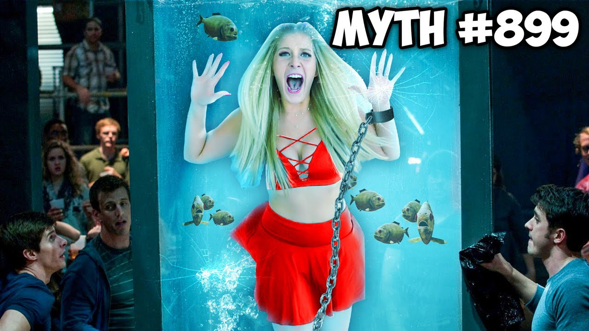](https://www.youtube.com/watch?v=77164j9LI0I)

  [Busting 1000 Deadliest Myths in 24 Hours](https://www.youtube.com/watch?v=77164j9LI0I)

  Brianna · 2022-07-14 · family

  16,791,526 public views · 6.38× reported lift

  Same title/premise family: Busting 1000 Deadliest Myths in 24 Hours. Game, cast and execution transfer remains a hypothesis; this source does not validate the new episode outcome.Window: lifetime through source snapshot. [Metric source](https://majieddd.github.io/influint-channels-public/channels/UCXg4rJUbDP1IP3TmZ9KDpJg.html)
* [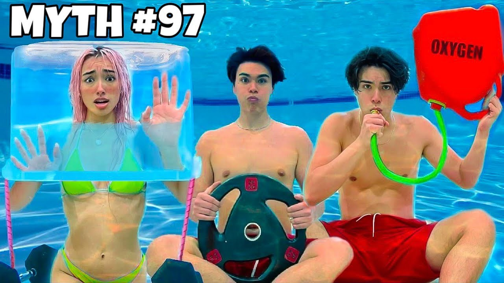](https://www.youtube.com/watch?v=IuWj5GAPdWo)

  [BUSTING 100 MYTHS IN 24 HOURS!!](https://www.youtube.com/watch?v=IuWj5GAPdWo)

  Stokes Twins · 2021-09-30 · family

  112,113,127 public views · 2.15× reported lift

  Same title/premise family: BUSTING 100 MYTHS IN 24 HOURS!!. Game, cast and execution transfer remains a hypothesis; this source does not validate the new episode outcome.Window: lifetime through source snapshot. [Metric source](https://majieddd.github.io/influint-channels-public/channels/UCbp9MyKCTEww4CxEzc_Tp0Q.html)
* [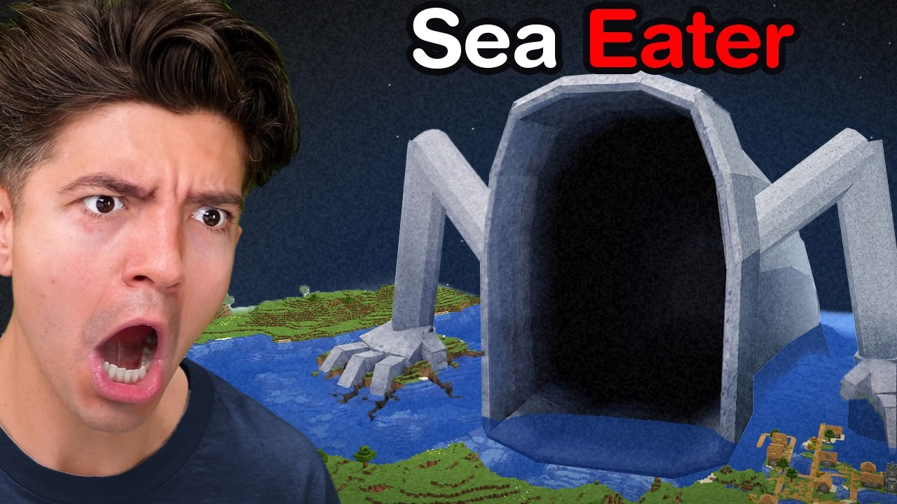](https://www.youtube.com/watch?v=_2jkon0w2zE)

  [Testing Scary Ocean Myths That Are Unsolved…](https://www.youtube.com/watch?v=_2jkon0w2zE)

  PrestonPlayz · 2026-04-25 · family

  4,479,771 public views · 1.26× reported lift

  Same title/premise family: Testing Scary Ocean Myths That Are Unsolved…. Game, cast and execution transfer remains a hypothesis; this source does not validate the new episode outcome.Window: lifetime through source snapshot. [Metric source](https://majieddd.github.io/influint-channels-public/channels/UCJZam2u1G0syq3kyqrCXrNw.html)
* [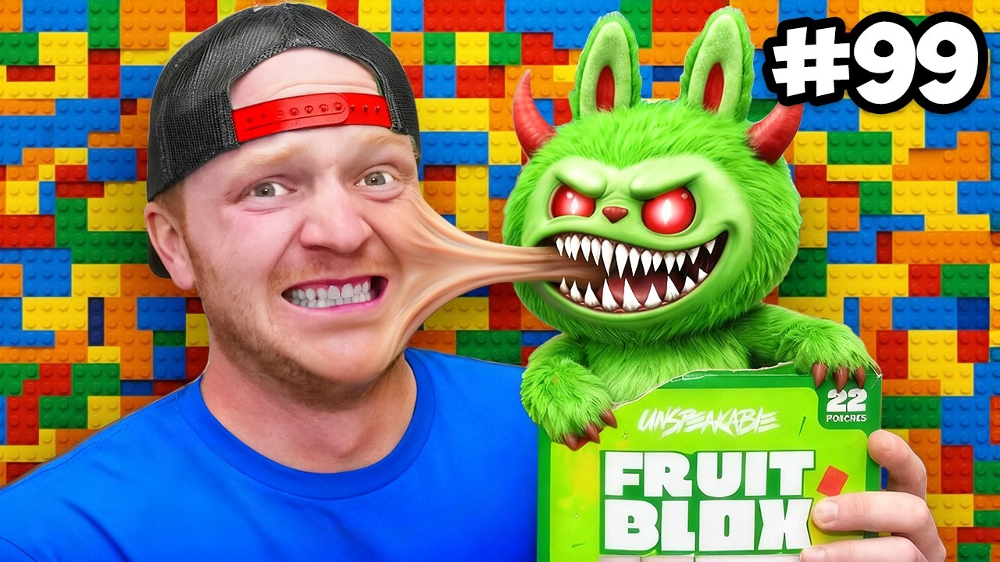](https://www.youtube.com/watch?v=UV6SL3InS1U)

  [Busting 100 Myths In 100 Hours!](https://www.youtube.com/watch?v=UV6SL3InS1U)

  Unspeakable · 2026-03-21 · family

  2,141,014 public views · 0.63× reported lift

  Same title/premise family: Busting 100 Myths In 100 Hours!. Game, cast and execution transfer remains a hypothesis; this source does not validate the new episode outcome.Window: lifetime through source snapshot. [Metric source](https://majieddd.github.io/influint-channels-public/channels/UCwIWAbIeu0xI0ReKWOcw3eg.html)

#### Principal content ingredient

2/2 qualifying outlier channels · 2 creator groups. Qualifying means source-reported lift ≥2×; family matches do not prove the exact mixed episode.

* 

  [Busting 1000 Deadliest Myths in 24 Hours](https://www.youtube.com/watch?v=77164j9LI0I)

  Brianna · 2022-07-14 · family

  16,791,526 public views · 6.38× reported lift

  Same concrete ingredient myth: Busting 1000 Deadliest Myths in 24 Hours. Game, cast and execution transfer remains a hypothesis; this source does not validate the new episode outcome.Window: lifetime through source snapshot. [Metric source](https://majieddd.github.io/influint-channels-public/channels/UCXg4rJUbDP1IP3TmZ9KDpJg.html)
* 

  [BUSTING 100 MYTHS IN 24 HOURS!!](https://www.youtube.com/watch?v=IuWj5GAPdWo)

  Stokes Twins · 2021-09-30 · family

  112,113,127 public views · 2.15× reported lift

  Same concrete ingredient myth: BUSTING 100 MYTHS IN 24 HOURS!!. Game, cast and execution transfer remains a hypothesis; this source does not validate the new episode outcome.Window: lifetime through source snapshot. [Metric source](https://majieddd.github.io/influint-channels-public/channels/UCbp9MyKCTEww4CxEzc_Tp0Q.html)
* 

  [Testing Scary Ocean Myths That Are Unsolved…](https://www.youtube.com/watch?v=_2jkon0w2zE)

  PrestonPlayz · 2026-04-25 · family

  4,479,771 public views · 1.26× reported lift

  Same concrete ingredient myth: Testing Scary Ocean Myths That Are Unsolved…. Game, cast and execution transfer remains a hypothesis; this source does not validate the new episode outcome.Window: lifetime through source snapshot. [Metric source](https://majieddd.github.io/influint-channels-public/channels/UCJZam2u1G0syq3kyqrCXrNw.html)
* 

  [Busting 100 Myths In 100 Hours!](https://www.youtube.com/watch?v=UV6SL3InS1U)

  Unspeakable · 2026-03-21 · family

  2,141,014 public views · 0.63× reported lift

  Same concrete ingredient myth: Busting 100 Myths In 100 Hours!. Game, cast and execution transfer remains a hypothesis; this source does not validate the new episode outcome.Window: lifetime through source snapshot. [Metric source](https://majieddd.github.io/influint-channels-public/channels/UCwIWAbIeu0xI0ReKWOcw3eg.html)

Ingredient matches concern the principal object/premise, not proof of every mixed ingredient. Views/lift are observed package/content performance.

Thumbnail reference and composition

Composition source: Stokes Twins · BUSTING 100 MYTHS IN 24 HOURS!!

Finished Stokes concept for this episode.

Alan shocked beside a red supercar landing on a huge air cushion, Alex judging nearby; MYTH #100.

Retain source subject placement, relative scale, action direction and visual contrast; use the Stokes identity and this episode’s actual content. This is a planned image, not a gameplay screenshot or a validated CTR winner.

Creative and production brief

Give an observable verdict to 100 distinct prelisted claims.

Publish the tested list, distinguish repeat trials from separate myths and show failures as well as successes.

#### Escalation

Quick obvious tests build to expensive-looking vehicle and survival claims that need several attempts.

#### Payoff

Resolve the teased final myth with the full test and reveal the true overall result count.

#### For both audiences

**Gamer:** Players get answers about familiar mechanics and surprising edge cases.

**Non-gamer:** Anyone understands whether the promised stunt or claim works.

#### People and production

Crew members propose, attempt and judge myths; Alan/Alex can host or compete with them.

* Research actual testable mechanics; title count must match real tests, with setups and resets compressed.

#### Learning question

Does this distinct viewer promise attract broad viewers while feeling recognizably Stokes?

**Shorts opportunity:** Extract a complete first-complication-to-result micro-story or one resolved test/reveal; preserve setup and payoff.

[Link to idea 026](#idea-026)[Image prompt](prompts/026.txt)

027 / FORMAT 06 · Busting spectacular myths

### We Tested GTA Myths That Should Be Impossible

The crew attempts five apparently impossible feats and explains the visible trick only after each fair test.

GTA 5 launch / follow-up · GTA 5

1. **0 (First Frame)–5s**Alex reaching toward a red supercar suspended above a tiny landing platform, Alan astonished; IMPOSSIBLE?.
2. **5s–15s**Find which of five physical-looking claims can actually work. Show the conditions before each test.
3. **15s–30s**The first test works once but fails on repetition, forcing a proper retest. Show the crew choosing its next move.

[Light complexity](#production)[Download image](full/027.jpg)

Why this idea

Title shape**We Tested [GAME] [SUBJECT] That Should Be Impossible**Content ingredients**myth, impossible, test**Combined package**We Tested GTA Myths That Should Be Impossible**

Direct transfer of the main-channel myth-testing engine.

#### Title / premise family

2/2 qualifying outlier channels · 2 creator groups. Qualifying means source-reported lift ≥2×; family matches do not prove the exact mixed episode.

* 

  [Busting 1000 Deadliest Myths in 24 Hours](https://www.youtube.com/watch?v=77164j9LI0I)

  Brianna · 2022-07-14 · family

  16,791,526 public views · 6.38× reported lift

  Same title/premise family: Busting 1000 Deadliest Myths in 24 Hours. Game, cast and execution transfer remains a hypothesis; this source does not validate the new episode outcome.Window: lifetime through source snapshot. [Metric source](https://majieddd.github.io/influint-channels-public/channels/UCXg4rJUbDP1IP3TmZ9KDpJg.html)
* 

  [BUSTING 100 MYTHS IN 24 HOURS!!](https://www.youtube.com/watch?v=IuWj5GAPdWo)

  Stokes Twins · 2021-09-30 · family

  112,113,127 public views · 2.15× reported lift

  Same title/premise family: BUSTING 100 MYTHS IN 24 HOURS!!. Game, cast and execution transfer remains a hypothesis; this source does not validate the new episode outcome.Window: lifetime through source snapshot. [Metric source](https://majieddd.github.io/influint-channels-public/channels/UCbp9MyKCTEww4CxEzc_Tp0Q.html)
* 

  [Testing Scary Ocean Myths That Are Unsolved…](https://www.youtube.com/watch?v=_2jkon0w2zE)

  PrestonPlayz · 2026-04-25 · family

  4,479,771 public views · 1.26× reported lift

  Same title/premise family: Testing Scary Ocean Myths That Are Unsolved…. Game, cast and execution transfer remains a hypothesis; this source does not validate the new episode outcome.Window: lifetime through source snapshot. [Metric source](https://majieddd.github.io/influint-channels-public/channels/UCJZam2u1G0syq3kyqrCXrNw.html)
* 

  [Busting 100 Myths In 100 Hours!](https://www.youtube.com/watch?v=UV6SL3InS1U)

  Unspeakable · 2026-03-21 · family

  2,141,014 public views · 0.63× reported lift

  Same title/premise family: Busting 100 Myths In 100 Hours!. Game, cast and execution transfer remains a hypothesis; this source does not validate the new episode outcome.Window: lifetime through source snapshot. [Metric source](https://majieddd.github.io/influint-channels-public/channels/UCwIWAbIeu0xI0ReKWOcw3eg.html)

#### Principal content ingredient

2/2 qualifying outlier channels · 2 creator groups. Qualifying means source-reported lift ≥2×; family matches do not prove the exact mixed episode.

* 

  [Busting 1000 Deadliest Myths in 24 Hours](https://www.youtube.com/watch?v=77164j9LI0I)

  Brianna · 2022-07-14 · family

  16,791,526 public views · 6.38× reported lift

  Same concrete ingredient myth: Busting 1000 Deadliest Myths in 24 Hours. Game, cast and execution transfer remains a hypothesis; this source does not validate the new episode outcome.Window: lifetime through source snapshot. [Metric source](https://majieddd.github.io/influint-channels-public/channels/UCXg4rJUbDP1IP3TmZ9KDpJg.html)
* 

  [BUSTING 100 MYTHS IN 24 HOURS!!](https://www.youtube.com/watch?v=IuWj5GAPdWo)

  Stokes Twins · 2021-09-30 · family

  112,113,127 public views · 2.15× reported lift

  Same concrete ingredient myth: BUSTING 100 MYTHS IN 24 HOURS!!. Game, cast and execution transfer remains a hypothesis; this source does not validate the new episode outcome.Window: lifetime through source snapshot. [Metric source](https://majieddd.github.io/influint-channels-public/channels/UCbp9MyKCTEww4CxEzc_Tp0Q.html)
* 

  [Testing Scary Ocean Myths That Are Unsolved…](https://www.youtube.com/watch?v=_2jkon0w2zE)

  PrestonPlayz · 2026-04-25 · family

  4,479,771 public views · 1.26× reported lift

  Same concrete ingredient myth: Testing Scary Ocean Myths That Are Unsolved…. Game, cast and execution transfer remains a hypothesis; this source does not validate the new episode outcome.Window: lifetime through source snapshot. [Metric source](https://majieddd.github.io/influint-channels-public/channels/UCJZam2u1G0syq3kyqrCXrNw.html)
* 

  [Busting 100 Myths In 100 Hours!](https://www.youtube.com/watch?v=UV6SL3InS1U)

  Unspeakable · 2026-03-21 · family

  2,141,014 public views · 0.63× reported lift

  Same concrete ingredient myth: Busting 100 Myths In 100 Hours!. Game, cast and execution transfer remains a hypothesis; this source does not validate the new episode outcome.Window: lifetime through source snapshot. [Metric source](https://majieddd.github.io/influint-channels-public/channels/UCwIWAbIeu0xI0ReKWOcw3eg.html)

Ingredient matches concern the principal object/premise, not proof of every mixed ingredient. Views/lift are observed package/content performance.

Thumbnail reference and composition

Composition source: Stokes Twins · BUSTING 100 MYTHS IN 24 HOURS!!

Finished Stokes concept for this episode.

Alex reaching toward a red supercar suspended above a tiny landing platform, Alan astonished; IMPOSSIBLE?.

Retain source subject placement, relative scale, action direction and visual contrast; use the Stokes identity and this episode’s actual content. This is a planned image, not a gameplay screenshot or a validated CTR winner.

Creative and production brief

Find which of five physical-looking claims can actually work.

Show the conditions before each test; keep failed attempts and label modded versus stock behavior.

#### Escalation

A simple bridge jump gives way to a falling-car catch and a finale with almost no margin for error.

#### Payoff

Replay the hardest success or failure slowly and explain why the result happened.

#### For both audiences

**Gamer:** Players get answers about familiar mechanics and surprising edge cases.

**Non-gamer:** Anyone understands whether the promised stunt or claim works.

#### People and production

Crew members propose, attempt and judge myths; Alan/Alex can host or compete with them.

* Research actual testable mechanics; title count must match real tests, with setups and resets compressed.

#### Learning question

Does this distinct viewer promise attract broad viewers while feeling recognizably Stokes?

**Shorts opportunity:** Extract a complete first-complication-to-result micro-story or one resolved test/reveal; preserve setup and payoff.

[Link to idea 027](#idea-027)[Image prompt](prompts/027.txt)

028 / FORMAT 06 · Busting spectacular myths

### We Tested Every Way to Escape a Sinking Car in GTA

Crew teams compare a defined set of sinking-car escape plans under the same simulated countdown.

GTA 5 launch / follow-up · GTA 5

1. **0 (First Frame)–5s**Alan trapped in a red GTA car underwater, open roof hatch visible, blue water and a giant question mark.
2. **5s–15s**Identify the fastest reliable exit from the disclosed test list. Every means every method on the shown list, not all imaginable methods.
3. **15s–30s**The obvious door cannot open in the first underwater attempt. Show the crew choosing its next move.

[Light complexity](#production)[Download image](full/028.jpg)

Why this idea

Title shape**We Tested Every Way to Escape a Sinking [SUBJECT] in [GAME]**Content ingredients**car, water, myth**Combined package**We Tested Every Way to Escape a Sinking Car in GTA**

Direct transfer of the main-channel myth-testing engine.

#### Title / premise family

2/2 qualifying outlier channels · 2 creator groups. Qualifying means source-reported lift ≥2×; family matches do not prove the exact mixed episode.

* 

  [Busting 1000 Deadliest Myths in 24 Hours](https://www.youtube.com/watch?v=77164j9LI0I)

  Brianna · 2022-07-14 · family

  16,791,526 public views · 6.38× reported lift

  Same title/premise family: Busting 1000 Deadliest Myths in 24 Hours. Game, cast and execution transfer remains a hypothesis; this source does not validate the new episode outcome.Window: lifetime through source snapshot. [Metric source](https://majieddd.github.io/influint-channels-public/channels/UCXg4rJUbDP1IP3TmZ9KDpJg.html)
* 

  [BUSTING 100 MYTHS IN 24 HOURS!!](https://www.youtube.com/watch?v=IuWj5GAPdWo)

  Stokes Twins · 2021-09-30 · family

  112,113,127 public views · 2.15× reported lift

  Same title/premise family: BUSTING 100 MYTHS IN 24 HOURS!!. Game, cast and execution transfer remains a hypothesis; this source does not validate the new episode outcome.Window: lifetime through source snapshot. [Metric source](https://majieddd.github.io/influint-channels-public/channels/UCbp9MyKCTEww4CxEzc_Tp0Q.html)
* 

  [Testing Scary Ocean Myths That Are Unsolved…](https://www.youtube.com/watch?v=_2jkon0w2zE)

  PrestonPlayz · 2026-04-25 · family

  4,479,771 public views · 1.26× reported lift

  Same title/premise family: Testing Scary Ocean Myths That Are Unsolved…. Game, cast and execution transfer remains a hypothesis; this source does not validate the new episode outcome.Window: lifetime through source snapshot. [Metric source](https://majieddd.github.io/influint-channels-public/channels/UCJZam2u1G0syq3kyqrCXrNw.html)
* 

  [Busting 100 Myths In 100 Hours!](https://www.youtube.com/watch?v=UV6SL3InS1U)

  Unspeakable · 2026-03-21 · family

  2,141,014 public views · 0.63× reported lift

  Same title/premise family: Busting 100 Myths In 100 Hours!. Game, cast and execution transfer remains a hypothesis; this source does not validate the new episode outcome.Window: lifetime through source snapshot. [Metric source](https://majieddd.github.io/influint-channels-public/channels/UCwIWAbIeu0xI0ReKWOcw3eg.html)

#### Principal content ingredient

4/2 qualifying outlier channels · 4 creator groups. Qualifying means source-reported lift ≥2×; family matches do not prove the exact mixed episode.

* 

  [Preston Cheated in Cardboard Hide and Seek](https://www.youtube.com/watch?v=5zbvDh28XUQ)

  Brianna · 2022-04-28 · family

  11,051,826 public views · 5.01× reported lift

  Same concrete ingredient car: Preston Cheated in Cardboard Hide and Seek. Game, cast and execution transfer remains a hypothesis; this source does not validate the new episode outcome.Window: lifetime through source snapshot. [Metric source](https://majieddd.github.io/influint-channels-public/channels/UCXg4rJUbDP1IP3TmZ9KDpJg.html)
* 

  [Tesla Autopilot For 24 Hours!](https://www.youtube.com/watch?v=SsJ7oOpbmIk)

  Stokes Twins · 2021-04-20 · family

  38,321,506 public views · 4.25× reported lift

  Same concrete ingredient car: Tesla Autopilot For 24 Hours!. Game, cast and execution transfer remains a hypothesis; this source does not validate the new episode outcome.Window: lifetime through source snapshot. [Metric source](https://majieddd.github.io/influint-channels-public/channels/UCbp9MyKCTEww4CxEzc_Tp0Q.html)
* 

  [World's Fastest Car!](https://www.youtube.com/watch?v=nopEs-K4ExM)

  MrBeast Gaming · 2022-07-09 · family

  122,277,058 public views · 3.68× reported lift

  Same concrete ingredient car: World's Fastest Car!. Game, cast and execution transfer remains a hypothesis; this source does not validate the new episode outcome.Window: lifetime through source snapshot. [Metric source](https://majieddd.github.io/influint-channels-public/channels/UCIPPMRA040LQr5QPyJEbmXA.html)
* 

  [7 Days Escaping Cardboard Prison!](https://www.youtube.com/watch?v=WU05jZnUiYs)

  Unspeakable · 2026-01-24 · family

  12,880,314 public views · 3.65× reported lift

  Same concrete ingredient car: 7 Days Escaping Cardboard Prison!. Game, cast and execution transfer remains a hypothesis; this source does not validate the new episode outcome.Window: lifetime through source snapshot. [Metric source](https://majieddd.github.io/influint-channels-public/channels/UCwIWAbIeu0xI0ReKWOcw3eg.html)

Ingredient matches concern the principal object/premise, not proof of every mixed ingredient. Views/lift are observed package/content performance.

Thumbnail reference and composition

Composition source: Stokes Twins · BUSTING 100 MYTHS IN 24 HOURS!!

Finished Stokes concept for this episode.

Alan trapped in a red GTA car underwater, open roof hatch visible, blue water and a giant question mark.

Retain source subject placement, relative scale, action direction and visual contrast; use the Stokes identity and this episode’s actual content. This is a planned image, not a gameplay screenshot or a validated CTR winner.

Creative and production brief

Identify the fastest reliable exit from the disclosed test list.

Every means every method on the shown list, not all imaginable methods; identical vehicle and water depth, game-only experiment.

#### Escalation

An obvious door fails, a roof exit looks promising and the final recovery test changes the winner.

#### Payoff

Rank reliable results and show the safest-in-game method actually repeated successfully.

#### For both audiences

**Gamer:** Players get answers about familiar mechanics and surprising edge cases.

**Non-gamer:** Anyone understands whether the promised stunt or claim works.

#### People and production

Crew members propose, attempt and judge myths; Alan/Alex can host or compete with them.

* Research actual testable mechanics; title count must match real tests, with setups and resets compressed.

#### Learning question

Does this distinct viewer promise attract broad viewers while feeling recognizably Stokes?

**Shorts opportunity:** Extract a complete first-complication-to-result micro-story or one resolved test/reveal; preserve setup and payoff.

[Link to idea 028](#idea-028)[Image prompt](prompts/028.txt)

029 / FORMAT 06 · Busting spectacular myths

### We Tested 100 Viral GTA Stunts

The crew recreates 100 counted stunt claims and tests whether the impressive clips can be repeated without hidden help.

GTA 5 launch / follow-up · GTA 5

1. **0 (First Frame)–5s**Alex watching a red sports car leap through a flaming game-world hoop between skyscrapers; 100 STUNTS.
2. **5s–15s**Separate repeatable stunts from setup-dependent or failed claims. Use a prelisted 100 attempts, cite submitted clips with permission where used and disclose vehicle/mod settings.
3. **15s–30s**The first copied stunt misses because the original clip never showed its starting speed. Show the crew choosing its next move.

[Light complexity](#production)[Download image](full/029.jpg)

Why this idea

Title shape**We Tested [COUNT] Viral [GAME] [SUBJECT]**Content ingredients**stunt, myth, GTA**Combined package**We Tested 100 Viral GTA Stunts**

Direct transfer of the main-channel myth-testing engine.

#### Title / premise family

2/2 qualifying outlier channels · 2 creator groups. Qualifying means source-reported lift ≥2×; family matches do not prove the exact mixed episode.

* 

  [Busting 1000 Deadliest Myths in 24 Hours](https://www.youtube.com/watch?v=77164j9LI0I)

  Brianna · 2022-07-14 · family

  16,791,526 public views · 6.38× reported lift

  Same title/premise family: Busting 1000 Deadliest Myths in 24 Hours. Game, cast and execution transfer remains a hypothesis; this source does not validate the new episode outcome.Window: lifetime through source snapshot. [Metric source](https://majieddd.github.io/influint-channels-public/channels/UCXg4rJUbDP1IP3TmZ9KDpJg.html)
* 

  [BUSTING 100 MYTHS IN 24 HOURS!!](https://www.youtube.com/watch?v=IuWj5GAPdWo)

  Stokes Twins · 2021-09-30 · family

  112,113,127 public views · 2.15× reported lift

  Same title/premise family: BUSTING 100 MYTHS IN 24 HOURS!!. Game, cast and execution transfer remains a hypothesis; this source does not validate the new episode outcome.Window: lifetime through source snapshot. [Metric source](https://majieddd.github.io/influint-channels-public/channels/UCbp9MyKCTEww4CxEzc_Tp0Q.html)
* 

  [Testing Scary Ocean Myths That Are Unsolved…](https://www.youtube.com/watch?v=_2jkon0w2zE)

  PrestonPlayz · 2026-04-25 · family

  4,479,771 public views · 1.26× reported lift

  Same title/premise family: Testing Scary Ocean Myths That Are Unsolved…. Game, cast and execution transfer remains a hypothesis; this source does not validate the new episode outcome.Window: lifetime through source snapshot. [Metric source](https://majieddd.github.io/influint-channels-public/channels/UCJZam2u1G0syq3kyqrCXrNw.html)
* 

  [Busting 100 Myths In 100 Hours!](https://www.youtube.com/watch?v=UV6SL3InS1U)

  Unspeakable · 2026-03-21 · family

  2,141,014 public views · 0.63× reported lift

  Same title/premise family: Busting 100 Myths In 100 Hours!. Game, cast and execution transfer remains a hypothesis; this source does not validate the new episode outcome.Window: lifetime through source snapshot. [Metric source](https://majieddd.github.io/influint-channels-public/channels/UCwIWAbIeu0xI0ReKWOcw3eg.html)

#### Principal content ingredient

0/2 qualifying outlier channels · 0 creator groups. Qualifying means source-reported lift ≥2×; family matches do not prove the exact mixed episode.

* [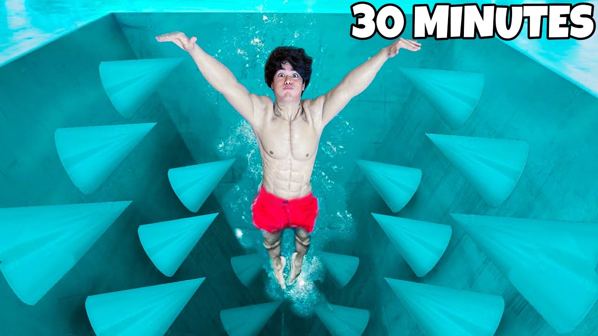](https://www.youtube.com/watch?v=xrH7VwkBzZI)

  [BREAKING 100 WORLD RECORDS IN 24 HOURS!!](https://www.youtube.com/watch?v=xrH7VwkBzZI)

  Stokes Twins · 2023-02-04 · family

  84,290,250 public views · 1.04× reported lift

  Same concrete ingredient stunt: BREAKING 100 WORLD RECORDS IN 24 HOURS!!. Game, cast and execution transfer remains a hypothesis; this source does not validate the new episode outcome.Window: lifetime through source snapshot. [Metric source](https://majieddd.github.io/influint-channels-public/channels/UCbp9MyKCTEww4CxEzc_Tp0Q.html)
* 

  [BUSTING 100 MYTHS IN 24 HOURS!!](https://www.youtube.com/watch?v=IuWj5GAPdWo)

  Stokes Twins · 2021-09-30 · adjacent

  112,113,127 public views · 2.15× reported lift

  Adjacent format/cast/setting reference from the reviewed board; does not satisfy exact/family outlier coverage for this episode.Window: lifetime through source snapshot. [Metric source](https://majieddd.github.io/influint-channels-public/channels/UCbp9MyKCTEww4CxEzc_Tp0Q.html)
* [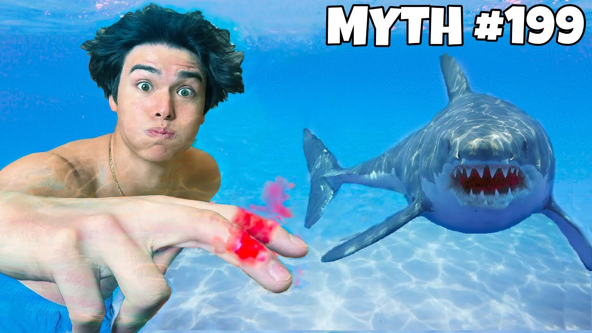](https://www.youtube.com/watch?v=bABseBbIiFk)

  [I Busted 200 Myths In 50 Hours!](https://www.youtube.com/watch?v=bABseBbIiFk)

  Stokes Twins · 2022-01-31 · adjacent

  178,358,799 public views · 1.98× reported lift

  Adjacent format/cast/setting reference from the reviewed board; does not satisfy exact/family outlier coverage for this episode.Window: lifetime through source snapshot. [Metric source](https://majieddd.github.io/influint-channels-public/channels/UCbp9MyKCTEww4CxEzc_Tp0Q.html)

Ingredients: 0/2 qualifying outlier channels for the principal ingredient; this does not establish the full game/cast combination.

Ingredient matches concern the principal object/premise, not proof of every mixed ingredient. Views/lift are observed package/content performance.

Thumbnail reference and composition

Composition source: Stokes Twins · BUSTING 100 MYTHS IN 24 HOURS!!

Finished Stokes concept for this episode.

Alex watching a red sports car leap through a flaming game-world hoop between skyscrapers; 100 STUNTS.

Retain source subject placement, relative scale, action direction and visual contrast; use the Stokes identity and this episode’s actual content. This is a planned image, not a gameplay screenshot or a validated CTR winner.

Creative and production brief

Separate repeatable stunts from setup-dependent or failed claims.

Use a prelisted 100 attempts, cite submitted clips with permission where used and disclose vehicle/mod settings.

#### Escalation

Small jumps lead to moving targets and a final stunt combining the most reliable tricks.

#### Payoff

Reveal the repeatability score and the full final attempt rather than only a flattering montage.

#### For both audiences

**Gamer:** Players get answers about familiar mechanics and surprising edge cases.

**Non-gamer:** Anyone understands whether the promised stunt or claim works.

#### People and production

Crew members propose, attempt and judge myths; Alan/Alex can host or compete with them.

* Research actual testable mechanics; title count must match real tests, with setups and resets compressed.

#### Learning question

Does this distinct viewer promise attract broad viewers while feeling recognizably Stokes?

**Shorts opportunity:** Extract a complete first-complication-to-result micro-story or one resolved test/reveal; preserve setup and payoff.

[Link to idea 029](#idea-029)[Image prompt](prompts/029.txt)

030 / FORMAT 06 · Busting spectacular myths

### We Busted 100 Minecraft Myths

The crew tests a counted mix of everyday and spectacular Minecraft claims before attempting the one the builders disagree about most.

Later game expansion · Minecraft

1. **0 (First Frame)–5s**Alan beside a huge Minecraft TNT test chamber with one intact tiny chicken, Alex stunned; MYTH #100.
2. **5s–15s**Give 100 prelisted claims a reproducible verdict. Label edition/version, separate modded effects from stock tests and do not count repeats as new myths.
3. **15s–30s**The first myth behaves differently in the selected version and the crew has to explain the condition. Show the crew choosing its next move.

[Light complexity](#production)[Download image](full/030.jpg)

Why this idea

Title shape**We Busted [COUNT] [GAME] [SUBJECT]**Content ingredients**myth, Minecraft, test**Combined package**We Busted 100 Minecraft Myths**

Direct transfer of the main-channel myth-testing engine.

#### Title / premise family

2/2 qualifying outlier channels · 2 creator groups. Qualifying means source-reported lift ≥2×; family matches do not prove the exact mixed episode.

* 

  [Busting 1000 Deadliest Myths in 24 Hours](https://www.youtube.com/watch?v=77164j9LI0I)

  Brianna · 2022-07-14 · family

  16,791,526 public views · 6.38× reported lift

  Same title/premise family: Busting 1000 Deadliest Myths in 24 Hours. Game, cast and execution transfer remains a hypothesis; this source does not validate the new episode outcome.Window: lifetime through source snapshot. [Metric source](https://majieddd.github.io/influint-channels-public/channels/UCXg4rJUbDP1IP3TmZ9KDpJg.html)
* 

  [BUSTING 100 MYTHS IN 24 HOURS!!](https://www.youtube.com/watch?v=IuWj5GAPdWo)

  Stokes Twins · 2021-09-30 · family

  112,113,127 public views · 2.15× reported lift

  Same title/premise family: BUSTING 100 MYTHS IN 24 HOURS!!. Game, cast and execution transfer remains a hypothesis; this source does not validate the new episode outcome.Window: lifetime through source snapshot. [Metric source](https://majieddd.github.io/influint-channels-public/channels/UCbp9MyKCTEww4CxEzc_Tp0Q.html)
* 

  [Testing Scary Ocean Myths That Are Unsolved…](https://www.youtube.com/watch?v=_2jkon0w2zE)

  PrestonPlayz · 2026-04-25 · family

  4,479,771 public views · 1.26× reported lift

  Same title/premise family: Testing Scary Ocean Myths That Are Unsolved…. Game, cast and execution transfer remains a hypothesis; this source does not validate the new episode outcome.Window: lifetime through source snapshot. [Metric source](https://majieddd.github.io/influint-channels-public/channels/UCJZam2u1G0syq3kyqrCXrNw.html)
* 

  [Busting 100 Myths In 100 Hours!](https://www.youtube.com/watch?v=UV6SL3InS1U)

  Unspeakable · 2026-03-21 · family

  2,141,014 public views · 0.63× reported lift

  Same title/premise family: Busting 100 Myths In 100 Hours!. Game, cast and execution transfer remains a hypothesis; this source does not validate the new episode outcome.Window: lifetime through source snapshot. [Metric source](https://majieddd.github.io/influint-channels-public/channels/UCwIWAbIeu0xI0ReKWOcw3eg.html)

#### Principal content ingredient

2/2 qualifying outlier channels · 2 creator groups. Qualifying means source-reported lift ≥2×; family matches do not prove the exact mixed episode.

* 

  [Busting 1000 Deadliest Myths in 24 Hours](https://www.youtube.com/watch?v=77164j9LI0I)

  Brianna · 2022-07-14 · family

  16,791,526 public views · 6.38× reported lift

  Same concrete ingredient myth: Busting 1000 Deadliest Myths in 24 Hours. Game, cast and execution transfer remains a hypothesis; this source does not validate the new episode outcome.Window: lifetime through source snapshot. [Metric source](https://majieddd.github.io/influint-channels-public/channels/UCXg4rJUbDP1IP3TmZ9KDpJg.html)
* 

  [BUSTING 100 MYTHS IN 24 HOURS!!](https://www.youtube.com/watch?v=IuWj5GAPdWo)

  Stokes Twins · 2021-09-30 · family

  112,113,127 public views · 2.15× reported lift

  Same concrete ingredient myth: BUSTING 100 MYTHS IN 24 HOURS!!. Game, cast and execution transfer remains a hypothesis; this source does not validate the new episode outcome.Window: lifetime through source snapshot. [Metric source](https://majieddd.github.io/influint-channels-public/channels/UCbp9MyKCTEww4CxEzc_Tp0Q.html)
* 

  [Testing Scary Ocean Myths That Are Unsolved…](https://www.youtube.com/watch?v=_2jkon0w2zE)

  PrestonPlayz · 2026-04-25 · family

  4,479,771 public views · 1.26× reported lift

  Same concrete ingredient myth: Testing Scary Ocean Myths That Are Unsolved…. Game, cast and execution transfer remains a hypothesis; this source does not validate the new episode outcome.Window: lifetime through source snapshot. [Metric source](https://majieddd.github.io/influint-channels-public/channels/UCJZam2u1G0syq3kyqrCXrNw.html)
* 

  [Busting 100 Myths In 100 Hours!](https://www.youtube.com/watch?v=UV6SL3InS1U)

  Unspeakable · 2026-03-21 · family

  2,141,014 public views · 0.63× reported lift

  Same concrete ingredient myth: Busting 100 Myths In 100 Hours!. Game, cast and execution transfer remains a hypothesis; this source does not validate the new episode outcome.Window: lifetime through source snapshot. [Metric source](https://majieddd.github.io/influint-channels-public/channels/UCwIWAbIeu0xI0ReKWOcw3eg.html)

Ingredient matches concern the principal object/premise, not proof of every mixed ingredient. Views/lift are observed package/content performance.

Thumbnail reference and composition

Composition source: Stokes Twins · BUSTING 100 MYTHS IN 24 HOURS!!

Finished Stokes concept for this episode.

Alan beside a huge Minecraft TNT test chamber with one intact tiny chicken, Alex stunned; MYTH #100.

Retain source subject placement, relative scale, action direction and visual contrast; use the Stokes identity and this episode’s actual content. This is a planned image, not a gameplay screenshot or a validated CTR winner.

Creative and production brief

Give 100 prelisted claims a reproducible verdict.

Label edition/version, separate modded effects from stock tests and do not count repeats as new myths.

#### Escalation

Simple player claims become enormous contraptions and a finale that can overturn the crew's favorite belief.

#### Payoff

Show the final mechanism working or failing and make the test world reproducible.

#### For both audiences

**Gamer:** Players get answers about familiar mechanics and surprising edge cases.

**Non-gamer:** Anyone understands whether the promised stunt or claim works.

#### People and production

Crew members propose, attempt and judge myths; Alan/Alex can host or compete with them.

* Research actual testable mechanics; title count must match real tests, with setups and resets compressed.
* Verify the exact edition, map, mod license and working mechanics; GTA-system reuse does not imply Minecraft support.

#### Learning question

Does this distinct viewer promise attract broad viewers while feeling recognizably Stokes?

**Shorts opportunity:** Extract a complete first-complication-to-result micro-story or one resolved test/reveal; preserve setup and payoff.

[Link to idea 030](#idea-030)[Image prompt](prompts/030.txt)

031 / FORMAT 07 · A wheel controls the crew’s lives

### We Let a Wheel Control Our Lives in GTA

A visible wheel chooses the crew's transport, teammates and home while they try to reach one final party on time.

GTA 5 launch / follow-up · GTA 5

1. **0 (First Frame)–5s**Alan beside an enormous red-yellow choice wheel, rusty bicycle versus red supercar visible behind it; Alex worried.
2. **5s–15s**Get the whole crew to the agreed party before sunset. Show all wheel options before each spin, accept the first valid result and preserve one continuing destination.
3. **15s–30s**The first transport spin gives the host a bicycle while everyone else receives cars. Show the crew choosing its next move.

[Light complexity](#production)[Download image](full/031.jpg)

Why this idea

Title shape**We Let a Wheel Control Our Lives in [GAME]**Content ingredients**wheel, friends, challenge**Combined package**We Let a Wheel Control Our Lives in GTA**

Dare-wheel and controls-our-life energy with the cast doing the performance.

#### Title / premise family

1/2 qualifying outlier channels · 1 creator groups. Qualifying means source-reported lift ≥2×; family matches do not prove the exact mixed episode.

* 

  [Spin The DARE Wheel Challenge w/ CRUSH!!](https://www.youtube.com/watch?v=-M2Q-HfhnSo)

  Stokes Twins · 2021-03-22 · family

  28,244,161 public views · 2.30× reported lift

  Same title/premise family: Spin The DARE Wheel Challenge w/ CRUSH!!. Game, cast and execution transfer remains a hypothesis; this source does not validate the new episode outcome.Window: lifetime through source snapshot. [Metric source](https://majieddd.github.io/influint-channels-public/channels/UCbp9MyKCTEww4CxEzc_Tp0Q.html)
* 

  [RAINBOW SPIN WHEEL TRUTH OR DARE CHALLENGE WITH PRESTONPLAYZ! (Husband vs Wife)](https://www.youtube.com/watch?v=SQbsQBAucBA)

  Brianna · 2019-01-02 · family

  2,368,180 public views · 1.83× reported lift

  Same title/premise family: RAINBOW SPIN WHEEL TRUTH OR DARE CHALLENGE WITH PRESTONPLAYZ! (Husband vs Wife). Game, cast and execution transfer remains a hypothesis; this source does not validate the new episode outcome.Window: lifetime through source snapshot. [Metric source](https://majieddd.github.io/influint-channels-public/channels/UCXg4rJUbDP1IP3TmZ9KDpJg.html)
* [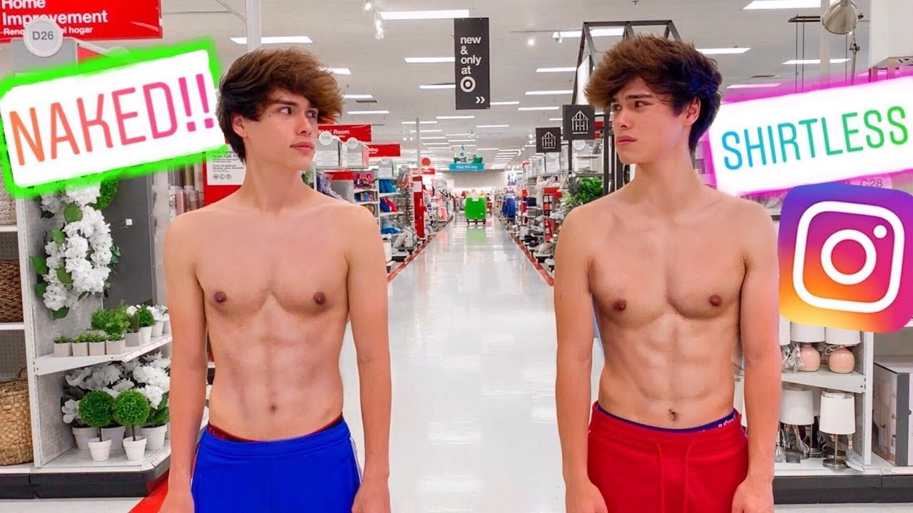](https://www.youtube.com/watch?v=4pAAskz5iw0)

  [Instagram Followers Control Our Life For a Day! | Stokes Twins](https://www.youtube.com/watch?v=4pAAskz5iw0)

  Stokes Twins · 2019-03-29 · family

  5,373,705 public views · 1.48× reported lift

  Same title/premise family: Instagram Followers Control Our Life For a Day! | Stokes Twins. Game, cast and execution transfer remains a hypothesis; this source does not validate the new episode outcome.Window: lifetime through source snapshot. [Metric source](https://majieddd.github.io/influint-channels-public/channels/UCbp9MyKCTEww4CxEzc_Tp0Q.html)
* 

  [100 YouTubers Control My Life for 24 Hours!](https://www.youtube.com/watch?v=5hr9GsVbt6s)

  Brianna · 2024-12-07 · family

  1,069,604 public views · 1.44× reported lift

  Same title/premise family: 100 YouTubers Control My Life for 24 Hours!. Game, cast and execution transfer remains a hypothesis; this source does not validate the new episode outcome.Window: lifetime through source snapshot. [Metric source](https://majieddd.github.io/influint-channels-public/channels/UCXg4rJUbDP1IP3TmZ9KDpJg.html)

#### Principal content ingredient

3/2 qualifying outlier channels · 3 creator groups. Qualifying means source-reported lift ≥2×; family matches do not prove the exact mixed episode.

* 

  [Spin The DARE Wheel Challenge w/ CRUSH!!](https://www.youtube.com/watch?v=-M2Q-HfhnSo)

  Stokes Twins · 2021-03-22 · family

  28,244,161 public views · 2.30× reported lift

  Same concrete ingredient wheel: Spin The DARE Wheel Challenge w/ CRUSH!!. Game, cast and execution transfer remains a hypothesis; this source does not validate the new episode outcome.Window: lifetime through source snapshot. [Metric source](https://majieddd.github.io/influint-channels-public/channels/UCbp9MyKCTEww4CxEzc_Tp0Q.html)
* [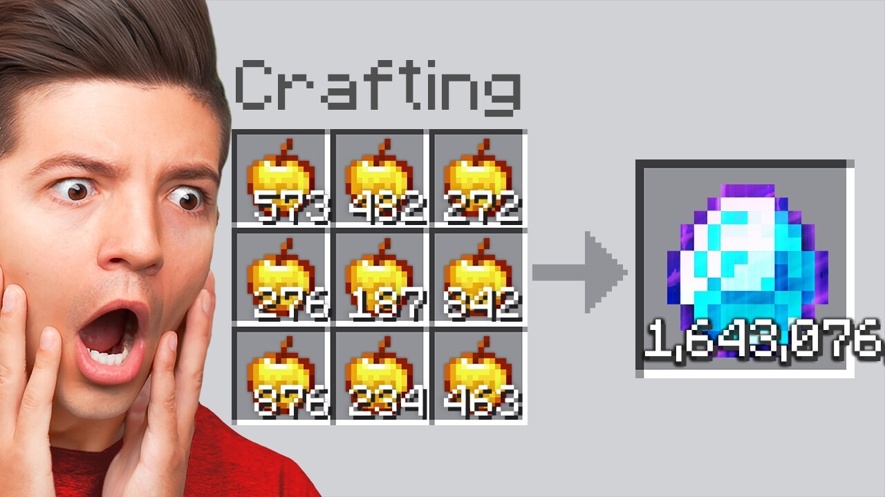](https://www.youtube.com/watch?v=KVNfYikQu48)

  [Minecraft, But Crafts Are Random…](https://www.youtube.com/watch?v=KVNfYikQu48)

  PrestonPlayz · 2025-07-26 · family

  15,896,072 public views · 2.29× reported lift

  Same concrete ingredient wheel: Minecraft, But Crafts Are Random…. Game, cast and execution transfer remains a hypothesis; this source does not validate the new episode outcome.Window: lifetime through source snapshot. [Metric source](https://majieddd.github.io/influint-channels-public/channels/UCJZam2u1G0syq3kyqrCXrNw.html)
* [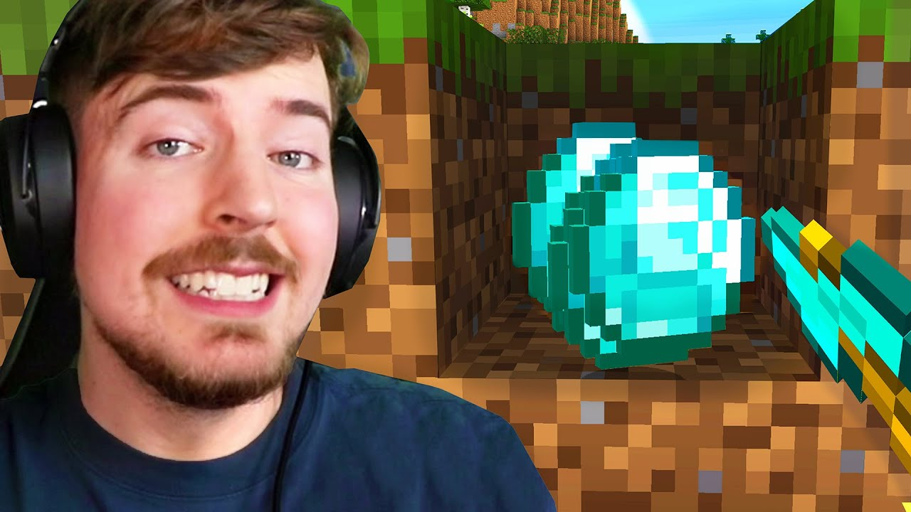](https://www.youtube.com/watch?v=D1eZybtieJM)

  [Minecraft, But Every Minute There's Random Chaos!](https://www.youtube.com/watch?v=D1eZybtieJM)

  MrBeast Gaming · 2020-11-19 · family

  77,561,333 public views · 2.05× reported lift

  Same concrete ingredient wheel: Minecraft, But Every Minute There's Random Chaos!. Game, cast and execution transfer remains a hypothesis; this source does not validate the new episode outcome.Window: lifetime through source snapshot. [Metric source](https://majieddd.github.io/influint-channels-public/channels/UCIPPMRA040LQr5QPyJEbmXA.html)
* 

  [RAINBOW SPIN WHEEL TRUTH OR DARE CHALLENGE WITH PRESTONPLAYZ! (Husband vs Wife)](https://www.youtube.com/watch?v=SQbsQBAucBA)

  Brianna · 2019-01-02 · family

  2,368,180 public views · 1.83× reported lift

  Same concrete ingredient wheel: RAINBOW SPIN WHEEL TRUTH OR DARE CHALLENGE WITH PRESTONPLAYZ! (Husband vs Wife). Game, cast and execution transfer remains a hypothesis; this source does not validate the new episode outcome.Window: lifetime through source snapshot. [Metric source](https://majieddd.github.io/influint-channels-public/channels/UCXg4rJUbDP1IP3TmZ9KDpJg.html)

Shape: 1/2 qualifying outlier channels in the verified public pool; adjacent precedents remain proposals, not replication.

Ingredient matches concern the principal object/premise, not proof of every mixed ingredient. Views/lift are observed package/content performance.

Thumbnail reference and composition

Composition source: MrBeast Gaming · Minecraft, But Every Minute There's Random Chaos!

Finished Stokes concept for this episode.

Alan beside an enormous red-yellow choice wheel, rusty bicycle versus red supercar visible behind it; Alex worried.

Retain source subject placement, relative scale, action direction and visual contrast; use the Stokes identity and this episode’s actual content. This is a planned image, not a gameplay screenshot or a validated CTR winner.

Creative and production brief

Get the whole crew to the agreed party before sunset.

Show all wheel options before each spin, accept the first valid result and preserve one continuing destination.

#### Escalation

A bad vehicle becomes a worse teammate pairing and the last spin changes where they must sleep.

#### Payoff

Show the party arrival and let each cast member reveal the choice that cost them most.

#### For both audiences

**Gamer:** The crew improvises with the game’s spaces and vehicles after each decision.

**Non-gamer:** The entertainment is losing control of familiar choices and watching friends deal with the consequences.

#### People and production

Crew spins, lives with the consequence and occasionally controls another player’s choice; rotate the host and affected participant.

* A small, tested list of visible choices and a continuing goal. Manual rules can stay inexpensive; automated effects are optional.

#### Learning question

Does this distinct viewer promise attract broad viewers while feeling recognizably Stokes?

**Shorts opportunity:** Extract a complete first-complication-to-result micro-story or one resolved test/reveal; preserve setup and payoff.

[Link to idea 031](#idea-031)[Image prompt](prompts/031.txt)

032 / FORMAT 07 · A wheel controls the crew’s lives

### My Friends Controlled My Life in GTA

The host hands every consequential choice to the crew while trying to keep a single appointment across the city.

GTA 5 launch / follow-up · GTA 5

1. **0 (First Frame)–5s**Alex strapped into a tiny pink GTA car, adult crew laughing with giant game controllers behind him; YOU CHOOSE.
2. **5s–15s**Reach the final appointment without rejecting the crew's choices. Crew can choose only from disclosed feasible options.
3. **15s–30s**The crew immediately votes against the host's preferred route. Show the crew choosing its next move.

[Light complexity](#production)[Download image](full/032.jpg)

Why this idea

Title shape**My Friends Controlled My Life in [GAME]**Content ingredients**friends, control, GTA**Combined package**My Friends Controlled My Life in GTA**

Dare-wheel and controls-our-life energy with the cast doing the performance.

#### Title / premise family

1/2 qualifying outlier channels · 1 creator groups. Qualifying means source-reported lift ≥2×; family matches do not prove the exact mixed episode.

* 

  [Spin The DARE Wheel Challenge w/ CRUSH!!](https://www.youtube.com/watch?v=-M2Q-HfhnSo)

  Stokes Twins · 2021-03-22 · family

  28,244,161 public views · 2.30× reported lift

  Same title/premise family: Spin The DARE Wheel Challenge w/ CRUSH!!. Game, cast and execution transfer remains a hypothesis; this source does not validate the new episode outcome.Window: lifetime through source snapshot. [Metric source](https://majieddd.github.io/influint-channels-public/channels/UCbp9MyKCTEww4CxEzc_Tp0Q.html)
* 

  [RAINBOW SPIN WHEEL TRUTH OR DARE CHALLENGE WITH PRESTONPLAYZ! (Husband vs Wife)](https://www.youtube.com/watch?v=SQbsQBAucBA)

  Brianna · 2019-01-02 · family

  2,368,180 public views · 1.83× reported lift

  Same title/premise family: RAINBOW SPIN WHEEL TRUTH OR DARE CHALLENGE WITH PRESTONPLAYZ! (Husband vs Wife). Game, cast and execution transfer remains a hypothesis; this source does not validate the new episode outcome.Window: lifetime through source snapshot. [Metric source](https://majieddd.github.io/influint-channels-public/channels/UCXg4rJUbDP1IP3TmZ9KDpJg.html)
* 

  [Instagram Followers Control Our Life For a Day! | Stokes Twins](https://www.youtube.com/watch?v=4pAAskz5iw0)

  Stokes Twins · 2019-03-29 · family

  5,373,705 public views · 1.48× reported lift

  Same title/premise family: Instagram Followers Control Our Life For a Day! | Stokes Twins. Game, cast and execution transfer remains a hypothesis; this source does not validate the new episode outcome.Window: lifetime through source snapshot. [Metric source](https://majieddd.github.io/influint-channels-public/channels/UCbp9MyKCTEww4CxEzc_Tp0Q.html)
* 

  [100 YouTubers Control My Life for 24 Hours!](https://www.youtube.com/watch?v=5hr9GsVbt6s)

  Brianna · 2024-12-07 · family

  1,069,604 public views · 1.44× reported lift

  Same title/premise family: 100 YouTubers Control My Life for 24 Hours!. Game, cast and execution transfer remains a hypothesis; this source does not validate the new episode outcome.Window: lifetime through source snapshot. [Metric source](https://majieddd.github.io/influint-channels-public/channels/UCXg4rJUbDP1IP3TmZ9KDpJg.html)

#### Principal content ingredient

1/2 qualifying outlier channels · 1 creator groups. Qualifying means source-reported lift ≥2×; family matches do not prove the exact mixed episode.

* 

  [Minecraft, But Every Minute There's Random Chaos!](https://www.youtube.com/watch?v=D1eZybtieJM)

  MrBeast Gaming · 2020-11-19 · family

  77,561,333 public views · 2.05× reported lift

  Same concrete ingredient control: Minecraft, But Every Minute There's Random Chaos!. Game, cast and execution transfer remains a hypothesis; this source does not validate the new episode outcome.Window: lifetime through source snapshot. [Metric source](https://majieddd.github.io/influint-channels-public/channels/UCIPPMRA040LQr5QPyJEbmXA.html)
* 

  [Instagram Followers Control Our Life For a Day! | Stokes Twins](https://www.youtube.com/watch?v=4pAAskz5iw0)

  Stokes Twins · 2019-03-29 · family

  5,373,705 public views · 1.48× reported lift

  Same concrete ingredient control: Instagram Followers Control Our Life For a Day! | Stokes Twins. Game, cast and execution transfer remains a hypothesis; this source does not validate the new episode outcome.Window: lifetime through source snapshot. [Metric source](https://majieddd.github.io/influint-channels-public/channels/UCbp9MyKCTEww4CxEzc_Tp0Q.html)
* 

  [100 YouTubers Control My Life for 24 Hours!](https://www.youtube.com/watch?v=5hr9GsVbt6s)

  Brianna · 2024-12-07 · family

  1,069,604 public views · 1.44× reported lift

  Same concrete ingredient control: 100 YouTubers Control My Life for 24 Hours!. Game, cast and execution transfer remains a hypothesis; this source does not validate the new episode outcome.Window: lifetime through source snapshot. [Metric source](https://majieddd.github.io/influint-channels-public/channels/UCXg4rJUbDP1IP3TmZ9KDpJg.html)
* [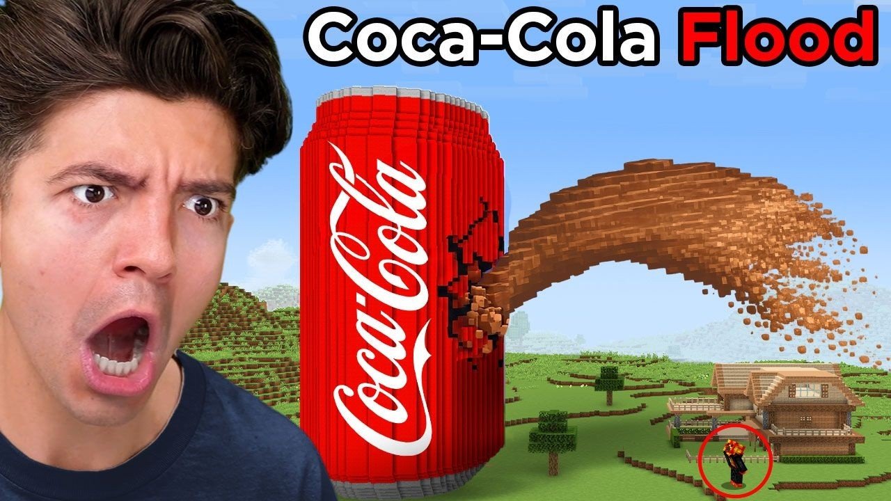](https://www.youtube.com/watch?v=dy1Pgbvmdfg)

  [Every Minute COCA-COLA Rises Higher In Minecraft!](https://www.youtube.com/watch?v=dy1Pgbvmdfg)

  PrestonPlayz · 2026-07-09 · family

  2,925,855 public views · 1.11× reported lift

  Same concrete ingredient control: Every Minute COCA-COLA Rises Higher In Minecraft!. Game, cast and execution transfer remains a hypothesis; this source does not validate the new episode outcome.Window: lifetime through source snapshot. [Metric source](https://majieddd.github.io/influint-channels-public/channels/UCJZam2u1G0syq3kyqrCXrNw.html)

Shape: 1/2 qualifying outlier channels in the verified public pool; adjacent precedents remain proposals, not replication.

Ingredients: 1/2 qualifying outlier channels for the principal ingredient; this does not establish the full game/cast combination.

Ingredient matches concern the principal object/premise, not proof of every mixed ingredient. Views/lift are observed package/content performance.

Thumbnail reference and composition

Composition source: MrBeast Gaming · Minecraft, But Every Minute There's Random Chaos!

Finished Stokes concept for this episode.

Alex strapped into a tiny pink GTA car, adult crew laughing with giant game controllers behind him; YOU CHOOSE.

Retain source subject placement, relative scale, action direction and visual contrast; use the Stokes identity and this episode’s actual content. This is a planned image, not a gameplay screenshot or a validated CTR winner.

Creative and production brief

Reach the final appointment without rejecting the crew's choices.

Crew can choose only from disclosed feasible options; every vote is visible and no secret override is allowed.

#### Escalation

A harmless outfit vote becomes a terrible vehicle choice and an expensive-looking detour at the worst moment.

#### Payoff

Resolve the appointment and reveal the crew member responsible for the decisive choice.

#### For both audiences

**Gamer:** The crew improvises with the game’s spaces and vehicles after each decision.

**Non-gamer:** The entertainment is losing control of familiar choices and watching friends deal with the consequences.

#### People and production

Crew spins, lives with the consequence and occasionally controls another player’s choice; rotate the host and affected participant.

* A small, tested list of visible choices and a continuing goal. Manual rules can stay inexpensive; automated effects are optional.

#### Learning question

Does this distinct viewer promise attract broad viewers while feeling recognizably Stokes?

**Shorts opportunity:** Extract a complete first-complication-to-result micro-story or one resolved test/reveal; preserve setup and payoff.

[Link to idea 032](#idea-032)[Image prompt](prompts/032.txt)

033 / FORMAT 07 · A wheel controls the crew’s lives

### A Wheel Decided Where We Lived in GTA

The crew experiences three wheel-selected homes while attempting to keep the same comfort checklist intact.

GTA 5 launch / follow-up · GTA 5

1. **0 (First Frame)–5s**Alan foreground spinning a giant wheel; mansion, rooftop and sewer-door silhouettes on its three large segments.
2. **5s–15s**Complete food, shelter and sleep tasks at all three selected homes. Disclosed locations and checklist, genuine random selection and equal time at each stop.
3. **15s–30s**The first lucky mansion has no usable kitchen in the selected build. Show the crew choosing its next move.

[Light complexity](#production)[Download image](full/033.jpg)

Why this idea

Title shape**A Wheel Decided Where We Lived in [GAME]**Content ingredients**wheel, house, challenge**Combined package**A Wheel Decided Where We Lived in GTA**

Dare-wheel and controls-our-life energy with the cast doing the performance.

#### Title / premise family

1/2 qualifying outlier channels · 1 creator groups. Qualifying means source-reported lift ≥2×; family matches do not prove the exact mixed episode.

* 

  [Spin The DARE Wheel Challenge w/ CRUSH!!](https://www.youtube.com/watch?v=-M2Q-HfhnSo)

  Stokes Twins · 2021-03-22 · family

  28,244,161 public views · 2.30× reported lift

  Same title/premise family: Spin The DARE Wheel Challenge w/ CRUSH!!. Game, cast and execution transfer remains a hypothesis; this source does not validate the new episode outcome.Window: lifetime through source snapshot. [Metric source](https://majieddd.github.io/influint-channels-public/channels/UCbp9MyKCTEww4CxEzc_Tp0Q.html)
* 

  [RAINBOW SPIN WHEEL TRUTH OR DARE CHALLENGE WITH PRESTONPLAYZ! (Husband vs Wife)](https://www.youtube.com/watch?v=SQbsQBAucBA)

  Brianna · 2019-01-02 · family

  2,368,180 public views · 1.83× reported lift

  Same title/premise family: RAINBOW SPIN WHEEL TRUTH OR DARE CHALLENGE WITH PRESTONPLAYZ! (Husband vs Wife). Game, cast and execution transfer remains a hypothesis; this source does not validate the new episode outcome.Window: lifetime through source snapshot. [Metric source](https://majieddd.github.io/influint-channels-public/channels/UCXg4rJUbDP1IP3TmZ9KDpJg.html)
* 

  [Instagram Followers Control Our Life For a Day! | Stokes Twins](https://www.youtube.com/watch?v=4pAAskz5iw0)

  Stokes Twins · 2019-03-29 · family

  5,373,705 public views · 1.48× reported lift

  Same title/premise family: Instagram Followers Control Our Life For a Day! | Stokes Twins. Game, cast and execution transfer remains a hypothesis; this source does not validate the new episode outcome.Window: lifetime through source snapshot. [Metric source](https://majieddd.github.io/influint-channels-public/channels/UCbp9MyKCTEww4CxEzc_Tp0Q.html)
* 

  [100 YouTubers Control My Life for 24 Hours!](https://www.youtube.com/watch?v=5hr9GsVbt6s)

  Brianna · 2024-12-07 · family

  1,069,604 public views · 1.44× reported lift

  Same title/premise family: 100 YouTubers Control My Life for 24 Hours!. Game, cast and execution transfer remains a hypothesis; this source does not validate the new episode outcome.Window: lifetime through source snapshot. [Metric source](https://majieddd.github.io/influint-channels-public/channels/UCXg4rJUbDP1IP3TmZ9KDpJg.html)

#### Principal content ingredient

3/2 qualifying outlier channels · 3 creator groups. Qualifying means source-reported lift ≥2×; family matches do not prove the exact mixed episode.

* 

  [Spin The DARE Wheel Challenge w/ CRUSH!!](https://www.youtube.com/watch?v=-M2Q-HfhnSo)

  Stokes Twins · 2021-03-22 · family

  28,244,161 public views · 2.30× reported lift

  Same concrete ingredient wheel: Spin The DARE Wheel Challenge w/ CRUSH!!. Game, cast and execution transfer remains a hypothesis; this source does not validate the new episode outcome.Window: lifetime through source snapshot. [Metric source](https://majieddd.github.io/influint-channels-public/channels/UCbp9MyKCTEww4CxEzc_Tp0Q.html)
* 

  [Minecraft, But Crafts Are Random…](https://www.youtube.com/watch?v=KVNfYikQu48)

  PrestonPlayz · 2025-07-26 · family

  15,896,072 public views · 2.29× reported lift

  Same concrete ingredient wheel: Minecraft, But Crafts Are Random…. Game, cast and execution transfer remains a hypothesis; this source does not validate the new episode outcome.Window: lifetime through source snapshot. [Metric source](https://majieddd.github.io/influint-channels-public/channels/UCJZam2u1G0syq3kyqrCXrNw.html)
* 

  [Minecraft, But Every Minute There's Random Chaos!](https://www.youtube.com/watch?v=D1eZybtieJM)

  MrBeast Gaming · 2020-11-19 · family

  77,561,333 public views · 2.05× reported lift

  Same concrete ingredient wheel: Minecraft, But Every Minute There's Random Chaos!. Game, cast and execution transfer remains a hypothesis; this source does not validate the new episode outcome.Window: lifetime through source snapshot. [Metric source](https://majieddd.github.io/influint-channels-public/channels/UCIPPMRA040LQr5QPyJEbmXA.html)
* 

  [RAINBOW SPIN WHEEL TRUTH OR DARE CHALLENGE WITH PRESTONPLAYZ! (Husband vs Wife)](https://www.youtube.com/watch?v=SQbsQBAucBA)

  Brianna · 2019-01-02 · family

  2,368,180 public views · 1.83× reported lift

  Same concrete ingredient wheel: RAINBOW SPIN WHEEL TRUTH OR DARE CHALLENGE WITH PRESTONPLAYZ! (Husband vs Wife). Game, cast and execution transfer remains a hypothesis; this source does not validate the new episode outcome.Window: lifetime through source snapshot. [Metric source](https://majieddd.github.io/influint-channels-public/channels/UCXg4rJUbDP1IP3TmZ9KDpJg.html)

Shape: 1/2 qualifying outlier channels in the verified public pool; adjacent precedents remain proposals, not replication.

Ingredient matches concern the principal object/premise, not proof of every mixed ingredient. Views/lift are observed package/content performance.

Thumbnail reference and composition

Composition source: MrBeast Gaming · Minecraft, But Every Minute There's Random Chaos!

Finished Stokes concept for this episode.

Alan foreground spinning a giant wheel; mansion, rooftop and sewer-door silhouettes on its three large segments.

Retain source subject placement, relative scale, action direction and visual contrast; use the Stokes identity and this episode’s actual content. This is a planned image, not a gameplay screenshot or a validated CTR winner.

Creative and production brief

Complete food, shelter and sleep tasks at all three selected homes.

Disclosed locations and checklist, genuine random selection and equal time at each stop.

#### Escalation

A mansion seems lucky until the next spin sends the crew to a roof and the final home requires a strange entrance.

#### Payoff

Show all completed tasks and the crew's honest best/worst-home vote.

#### For both audiences

**Gamer:** The crew improvises with the game’s spaces and vehicles after each decision.

**Non-gamer:** The entertainment is losing control of familiar choices and watching friends deal with the consequences.

#### People and production

Crew spins, lives with the consequence and occasionally controls another player’s choice; rotate the host and affected participant.

* A small, tested list of visible choices and a continuing goal. Manual rules can stay inexpensive; automated effects are optional.

#### Learning question

Does this distinct viewer promise attract broad viewers while feeling recognizably Stokes?

**Shorts opportunity:** Extract a complete first-complication-to-result micro-story or one resolved test/reveal; preserve setup and payoff.

[Link to idea 033](#idea-033)[Image prompt](prompts/033.txt)

034 / FORMAT 07 · A wheel controls the crew’s lives

### We Let a Wheel Choose Our Getaway in GTA

The crew faces the same escape mission three times with wheel-selected transport that can help or ruin the plan.

GTA 5 launch / follow-up · GTA 5

1. **0 (First Frame)–5s**Alex beside a giant wheel pointing at a bicycle, enormous police convoy behind; small red escape beacon ahead.
2. **5s–15s**Reach the extraction point in the chosen vehicle. Fixed pursuit route, disclosed transport options and no respin after a bad choice.
3. **15s–30s**The wheel selects a bus too large for the planned shortcut. Show the crew choosing its next move.

[Light complexity](#production)[Download image](full/034.jpg)

Why this idea

Title shape**We Let a Wheel Choose Our Getaway in [GAME]**Content ingredients**wheel, escape, vehicle**Combined package**We Let a Wheel Choose Our Getaway in GTA**

Dare-wheel and controls-our-life energy with the cast doing the performance.

#### Title / premise family

1/2 qualifying outlier channels · 1 creator groups. Qualifying means source-reported lift ≥2×; family matches do not prove the exact mixed episode.

* 

  [Spin The DARE Wheel Challenge w/ CRUSH!!](https://www.youtube.com/watch?v=-M2Q-HfhnSo)

  Stokes Twins · 2021-03-22 · family

  28,244,161 public views · 2.30× reported lift

  Same title/premise family: Spin The DARE Wheel Challenge w/ CRUSH!!. Game, cast and execution transfer remains a hypothesis; this source does not validate the new episode outcome.Window: lifetime through source snapshot. [Metric source](https://majieddd.github.io/influint-channels-public/channels/UCbp9MyKCTEww4CxEzc_Tp0Q.html)
* 

  [RAINBOW SPIN WHEEL TRUTH OR DARE CHALLENGE WITH PRESTONPLAYZ! (Husband vs Wife)](https://www.youtube.com/watch?v=SQbsQBAucBA)

  Brianna · 2019-01-02 · family

  2,368,180 public views · 1.83× reported lift

  Same title/premise family: RAINBOW SPIN WHEEL TRUTH OR DARE CHALLENGE WITH PRESTONPLAYZ! (Husband vs Wife). Game, cast and execution transfer remains a hypothesis; this source does not validate the new episode outcome.Window: lifetime through source snapshot. [Metric source](https://majieddd.github.io/influint-channels-public/channels/UCXg4rJUbDP1IP3TmZ9KDpJg.html)
* 

  [Instagram Followers Control Our Life For a Day! | Stokes Twins](https://www.youtube.com/watch?v=4pAAskz5iw0)

  Stokes Twins · 2019-03-29 · family

  5,373,705 public views · 1.48× reported lift

  Same title/premise family: Instagram Followers Control Our Life For a Day! | Stokes Twins. Game, cast and execution transfer remains a hypothesis; this source does not validate the new episode outcome.Window: lifetime through source snapshot. [Metric source](https://majieddd.github.io/influint-channels-public/channels/UCbp9MyKCTEww4CxEzc_Tp0Q.html)
* 

  [100 YouTubers Control My Life for 24 Hours!](https://www.youtube.com/watch?v=5hr9GsVbt6s)

  Brianna · 2024-12-07 · family

  1,069,604 public views · 1.44× reported lift

  Same title/premise family: 100 YouTubers Control My Life for 24 Hours!. Game, cast and execution transfer remains a hypothesis; this source does not validate the new episode outcome.Window: lifetime through source snapshot. [Metric source](https://majieddd.github.io/influint-channels-public/channels/UCXg4rJUbDP1IP3TmZ9KDpJg.html)

#### Principal content ingredient

3/2 qualifying outlier channels · 3 creator groups. Qualifying means source-reported lift ≥2×; family matches do not prove the exact mixed episode.

* 

  [Spin The DARE Wheel Challenge w/ CRUSH!!](https://www.youtube.com/watch?v=-M2Q-HfhnSo)

  Stokes Twins · 2021-03-22 · family

  28,244,161 public views · 2.30× reported lift

  Same concrete ingredient wheel: Spin The DARE Wheel Challenge w/ CRUSH!!. Game, cast and execution transfer remains a hypothesis; this source does not validate the new episode outcome.Window: lifetime through source snapshot. [Metric source](https://majieddd.github.io/influint-channels-public/channels/UCbp9MyKCTEww4CxEzc_Tp0Q.html)
* 

  [Minecraft, But Crafts Are Random…](https://www.youtube.com/watch?v=KVNfYikQu48)

  PrestonPlayz · 2025-07-26 · family

  15,896,072 public views · 2.29× reported lift

  Same concrete ingredient wheel: Minecraft, But Crafts Are Random…. Game, cast and execution transfer remains a hypothesis; this source does not validate the new episode outcome.Window: lifetime through source snapshot. [Metric source](https://majieddd.github.io/influint-channels-public/channels/UCJZam2u1G0syq3kyqrCXrNw.html)
* 

  [Minecraft, But Every Minute There's Random Chaos!](https://www.youtube.com/watch?v=D1eZybtieJM)

  MrBeast Gaming · 2020-11-19 · family

  77,561,333 public views · 2.05× reported lift

  Same concrete ingredient wheel: Minecraft, But Every Minute There's Random Chaos!. Game, cast and execution transfer remains a hypothesis; this source does not validate the new episode outcome.Window: lifetime through source snapshot. [Metric source](https://majieddd.github.io/influint-channels-public/channels/UCIPPMRA040LQr5QPyJEbmXA.html)
* 

  [RAINBOW SPIN WHEEL TRUTH OR DARE CHALLENGE WITH PRESTONPLAYZ! (Husband vs Wife)](https://www.youtube.com/watch?v=SQbsQBAucBA)

  Brianna · 2019-01-02 · family

  2,368,180 public views · 1.83× reported lift

  Same concrete ingredient wheel: RAINBOW SPIN WHEEL TRUTH OR DARE CHALLENGE WITH PRESTONPLAYZ! (Husband vs Wife). Game, cast and execution transfer remains a hypothesis; this source does not validate the new episode outcome.Window: lifetime through source snapshot. [Metric source](https://majieddd.github.io/influint-channels-public/channels/UCXg4rJUbDP1IP3TmZ9KDpJg.html)

Shape: 1/2 qualifying outlier channels in the verified public pool; adjacent precedents remain proposals, not replication.

Ingredient matches concern the principal object/premise, not proof of every mixed ingredient. Views/lift are observed package/content performance.

Thumbnail reference and composition

Composition source: MrBeast Gaming · Minecraft, But Every Minute There's Random Chaos!

Finished Stokes concept for this episode.

Alex beside a giant wheel pointing at a bicycle, enormous police convoy behind; small red escape beacon ahead.

Retain source subject placement, relative scale, action direction and visual contrast; use the Stokes identity and this episode’s actual content. This is a planned image, not a gameplay screenshot or a validated CTR winner.

Creative and production brief

Reach the extraction point in the chosen vehicle.

Fixed pursuit route, disclosed transport options and no respin after a bad choice.

#### Escalation

A fast car is followed by a bus, then a tiny bike that needs a completely different escape plan.

#### Payoff

Compare the three real escapes and show which absurd option unexpectedly worked best.

#### For both audiences

**Gamer:** The crew improvises with the game’s spaces and vehicles after each decision.

**Non-gamer:** The entertainment is losing control of familiar choices and watching friends deal with the consequences.

#### People and production

Crew spins, lives with the consequence and occasionally controls another player’s choice; rotate the host and affected participant.

* A small, tested list of visible choices and a continuing goal. Manual rules can stay inexpensive; automated effects are optional.

#### Learning question

Does this distinct viewer promise attract broad viewers while feeling recognizably Stokes?

**Shorts opportunity:** Extract a complete first-complication-to-result micro-story or one resolved test/reveal; preserve setup and payoff.

[Link to idea 034](#idea-034)[Image prompt](prompts/034.txt)

035 / FORMAT 07 · A wheel controls the crew’s lives

### My Friends Controlled My Roblox Life

The host lets the crew choose their home, job and transport in a private Roblox world while trying to finish one public-looking celebration.

Later game expansion · Roblox

1. **0 (First Frame)–5s**Alan foreground holding a controller; tiny Roblox delivery scooter, giant party castle and three adult crew choice cards behind.
2. **5s–15s**Deliver the party supplies and arrive at the celebration. Private owned or permitted experience, disclosed choices and no reliance on strangers' consent or purchases.
3. **15s–30s**The crew assigns a delivery job but chooses a vehicle that cannot carry the full order. Show the crew choosing its next move.

[Light complexity](#production)[Download image](full/035.jpg)

Why this idea

Title shape**My Friends Controlled My [GAME] Life**Content ingredients**Roblox, friends, control**Combined package**My Friends Controlled My Roblox Life**

Dare-wheel and controls-our-life energy with the cast doing the performance.

#### Title / premise family

1/2 qualifying outlier channels · 1 creator groups. Qualifying means source-reported lift ≥2×; family matches do not prove the exact mixed episode.

* 

  [Spin The DARE Wheel Challenge w/ CRUSH!!](https://www.youtube.com/watch?v=-M2Q-HfhnSo)

  Stokes Twins · 2021-03-22 · family

  28,244,161 public views · 2.30× reported lift

  Same title/premise family: Spin The DARE Wheel Challenge w/ CRUSH!!. Game, cast and execution transfer remains a hypothesis; this source does not validate the new episode outcome.Window: lifetime through source snapshot. [Metric source](https://majieddd.github.io/influint-channels-public/channels/UCbp9MyKCTEww4CxEzc_Tp0Q.html)
* 

  [RAINBOW SPIN WHEEL TRUTH OR DARE CHALLENGE WITH PRESTONPLAYZ! (Husband vs Wife)](https://www.youtube.com/watch?v=SQbsQBAucBA)

  Brianna · 2019-01-02 · family

  2,368,180 public views · 1.83× reported lift

  Same title/premise family: RAINBOW SPIN WHEEL TRUTH OR DARE CHALLENGE WITH PRESTONPLAYZ! (Husband vs Wife). Game, cast and execution transfer remains a hypothesis; this source does not validate the new episode outcome.Window: lifetime through source snapshot. [Metric source](https://majieddd.github.io/influint-channels-public/channels/UCXg4rJUbDP1IP3TmZ9KDpJg.html)
* 

  [Instagram Followers Control Our Life For a Day! | Stokes Twins](https://www.youtube.com/watch?v=4pAAskz5iw0)

  Stokes Twins · 2019-03-29 · family

  5,373,705 public views · 1.48× reported lift

  Same title/premise family: Instagram Followers Control Our Life For a Day! | Stokes Twins. Game, cast and execution transfer remains a hypothesis; this source does not validate the new episode outcome.Window: lifetime through source snapshot. [Metric source](https://majieddd.github.io/influint-channels-public/channels/UCbp9MyKCTEww4CxEzc_Tp0Q.html)
* 

  [100 YouTubers Control My Life for 24 Hours!](https://www.youtube.com/watch?v=5hr9GsVbt6s)

  Brianna · 2024-12-07 · family

  1,069,604 public views · 1.44× reported lift

  Same title/premise family: 100 YouTubers Control My Life for 24 Hours!. Game, cast and execution transfer remains a hypothesis; this source does not validate the new episode outcome.Window: lifetime through source snapshot. [Metric source](https://majieddd.github.io/influint-channels-public/channels/UCXg4rJUbDP1IP3TmZ9KDpJg.html)

#### Principal content ingredient

1/2 qualifying outlier channels · 1 creator groups. Qualifying means source-reported lift ≥2×; family matches do not prove the exact mixed episode.

* 

  [Minecraft, But Every Minute There's Random Chaos!](https://www.youtube.com/watch?v=D1eZybtieJM)

  MrBeast Gaming · 2020-11-19 · family

  77,561,333 public views · 2.05× reported lift

  Same concrete ingredient control: Minecraft, But Every Minute There's Random Chaos!. Game, cast and execution transfer remains a hypothesis; this source does not validate the new episode outcome.Window: lifetime through source snapshot. [Metric source](https://majieddd.github.io/influint-channels-public/channels/UCIPPMRA040LQr5QPyJEbmXA.html)
* 

  [Instagram Followers Control Our Life For a Day! | Stokes Twins](https://www.youtube.com/watch?v=4pAAskz5iw0)

  Stokes Twins · 2019-03-29 · family

  5,373,705 public views · 1.48× reported lift

  Same concrete ingredient control: Instagram Followers Control Our Life For a Day! | Stokes Twins. Game, cast and execution transfer remains a hypothesis; this source does not validate the new episode outcome.Window: lifetime through source snapshot. [Metric source](https://majieddd.github.io/influint-channels-public/channels/UCbp9MyKCTEww4CxEzc_Tp0Q.html)
* 

  [100 YouTubers Control My Life for 24 Hours!](https://www.youtube.com/watch?v=5hr9GsVbt6s)

  Brianna · 2024-12-07 · family

  1,069,604 public views · 1.44× reported lift

  Same concrete ingredient control: 100 YouTubers Control My Life for 24 Hours!. Game, cast and execution transfer remains a hypothesis; this source does not validate the new episode outcome.Window: lifetime through source snapshot. [Metric source](https://majieddd.github.io/influint-channels-public/channels/UCXg4rJUbDP1IP3TmZ9KDpJg.html)
* 

  [Every Minute COCA-COLA Rises Higher In Minecraft!](https://www.youtube.com/watch?v=dy1Pgbvmdfg)

  PrestonPlayz · 2026-07-09 · family

  2,925,855 public views · 1.11× reported lift

  Same concrete ingredient control: Every Minute COCA-COLA Rises Higher In Minecraft!. Game, cast and execution transfer remains a hypothesis; this source does not validate the new episode outcome.Window: lifetime through source snapshot. [Metric source](https://majieddd.github.io/influint-channels-public/channels/UCJZam2u1G0syq3kyqrCXrNw.html)

Shape: 1/2 qualifying outlier channels in the verified public pool; adjacent precedents remain proposals, not replication.

Ingredients: 1/2 qualifying outlier channels for the principal ingredient; this does not establish the full game/cast combination.

Ingredient matches concern the principal object/premise, not proof of every mixed ingredient. Views/lift are observed package/content performance.

Thumbnail reference and composition

Composition source: MrBeast Gaming · Minecraft, But Every Minute There's Random Chaos!

Finished Stokes concept for this episode.

Alan foreground holding a controller; tiny Roblox delivery scooter, giant party castle and three adult crew choice cards behind.

Retain source subject placement, relative scale, action direction and visual contrast; use the Stokes identity and this episode’s actual content. This is a planned image, not a gameplay screenshot or a validated CTR winner.

Creative and production brief

Deliver the party supplies and arrive at the celebration.

Private owned or permitted experience, disclosed choices and no reliance on strangers' consent or purchases.

#### Escalation

A silly job assignment delays the supplies and a bad vehicle choice threatens the final delivery.

#### Payoff

Show the completed celebration and award the crew's funniest consequential choice.

#### For both audiences

**Gamer:** The crew improvises with the game’s spaces and vehicles after each decision.

**Non-gamer:** The entertainment is losing control of familiar choices and watching friends deal with the consequences.

#### People and production

Crew spins, lives with the consequence and occasionally controls another player’s choice; rotate the host and affected participant.

* A small, tested list of visible choices and a continuing goal. Manual rules can stay inexpensive; automated effects are optional.
* Use an owned or permitted private experience and scoped developer features before casting/recording.

#### Learning question

Does this distinct viewer promise attract broad viewers while feeling recognizably Stokes?

**Shorts opportunity:** Extract a complete first-complication-to-result micro-story or one resolved test/reveal; preserve setup and payoff.

[Link to idea 035](#idea-035)[Image prompt](prompts/035.txt)

036 / FORMAT 08 · Give the crew their dream lives

### I Gave My Friends Their Dream Lives in GTA

Each friend gets a custom day built around a real wish before the crew compares which experience meant the most.

GTA 5 launch / follow-up · GTA 5

1. **0 (First Frame)–5s**Alan presenting a gold GTA mansion, red supercar and private helicopter to three delighted adult crew friends.
2. **5s–15s**Fulfill three recorded crew wishes in a working game world. Record the wish before building.
3. **15s–30s**The first friend's dream is a tiny personal detail the spectacular mansion does not contain yet. Show the crew choosing its next move.

[Light complexity](#production)[Download image](full/036.jpg)

Why this idea

Title shape**I Gave My Friends Their Dream Lives in [GAME]**Content ingredients**friends, dream, house**Combined package**I Gave My Friends Their Dream Lives in GTA**

Extend dream-car/surprise and aspirational-experience appeal to multiple crew members.

#### Title / premise family

0/2 qualifying outlier channels · 0 creator groups. Qualifying means source-reported lift ≥2×; family matches do not prove the exact mixed episode.

* [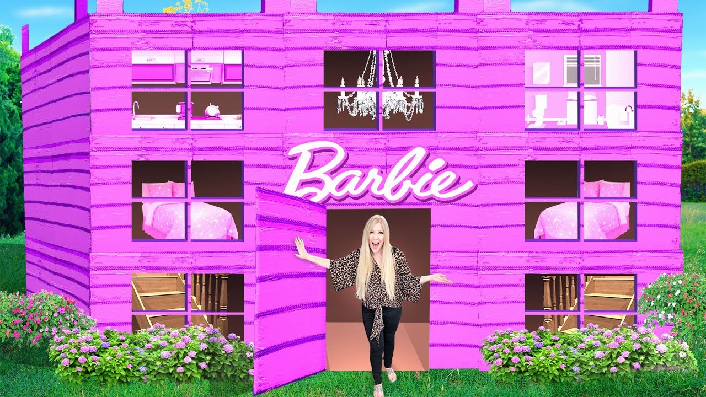](https://www.youtube.com/watch?v=XVhxtCHkb08)

  [I Made a GIANT Barbie Cardboard Dream House! - Challenge](https://www.youtube.com/watch?v=XVhxtCHkb08)

  Brianna · 2019-06-25 · family

  5,217,204 public views · 1.70× reported lift

  Same title/premise family: I Made a GIANT Barbie Cardboard Dream House! - Challenge. Game, cast and execution transfer remains a hypothesis; this source does not validate the new episode outcome.Window: lifetime through source snapshot. [Metric source](https://majieddd.github.io/influint-channels-public/channels/UCXg4rJUbDP1IP3TmZ9KDpJg.html)
* [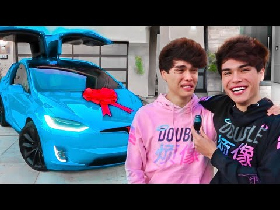](https://www.youtube.com/watch?v=sDmJz5TewoA)

  [SURPRISING MY TWIN BROTHER WITH HIS DREAM CAR!!](https://www.youtube.com/watch?v=sDmJz5TewoA)

  Stokes Twins · 2020-11-28 · family

  8,967,316 public views · 0.88× reported lift

  Same title/premise family: SURPRISING MY TWIN BROTHER WITH HIS DREAM CAR!!. Game, cast and execution transfer remains a hypothesis; this source does not validate the new episode outcome.Window: lifetime through source snapshot. [Metric source](https://majieddd.github.io/influint-channels-public/channels/UCbp9MyKCTEww4CxEzc_Tp0Q.html)
* [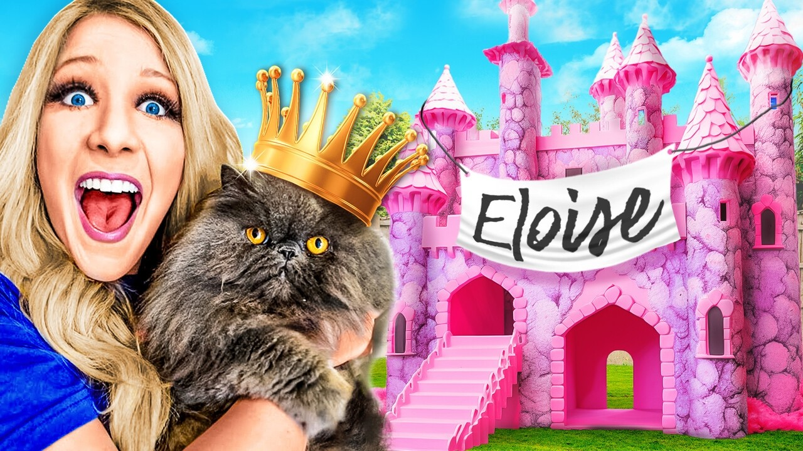](https://www.youtube.com/watch?v=PqANayOhIqQ)

  [I Built My Cat a BARBIE Dream House!](https://www.youtube.com/watch?v=PqANayOhIqQ)

  Brianna · 2023-07-09 · family

  4,372,306 public views · 1.11× reported lift

  Same title/premise family: I Built My Cat a BARBIE Dream House!. Game, cast and execution transfer remains a hypothesis; this source does not validate the new episode outcome.Window: lifetime through source snapshot. [Metric source](https://majieddd.github.io/influint-channels-public/channels/UCXg4rJUbDP1IP3TmZ9KDpJg.html)
* 

  [Surprising My Husband With His Dream Car! - Prank](https://www.youtube.com/watch?v=YSUGtRakpqk)

  Brianna · 2019-07-11 · family

  6,608,326 public views · 1.07× reported lift

  Same title/premise family: Surprising My Husband With His Dream Car! - Prank. Game, cast and execution transfer remains a hypothesis; this source does not validate the new episode outcome.Window: lifetime through source snapshot. [Metric source](https://majieddd.github.io/influint-channels-public/channels/UCXg4rJUbDP1IP3TmZ9KDpJg.html)

#### Principal content ingredient

0/2 qualifying outlier channels · 0 creator groups. Qualifying means source-reported lift ≥2×; family matches do not prove the exact mixed episode.

* 

  [I Made a GIANT Barbie Cardboard Dream House! - Challenge](https://www.youtube.com/watch?v=XVhxtCHkb08)

  Brianna · 2019-06-25 · family

  5,217,204 public views · 1.70× reported lift

  Same concrete ingredient dream: I Made a GIANT Barbie Cardboard Dream House! - Challenge. Game, cast and execution transfer remains a hypothesis; this source does not validate the new episode outcome.Window: lifetime through source snapshot. [Metric source](https://majieddd.github.io/influint-channels-public/channels/UCXg4rJUbDP1IP3TmZ9KDpJg.html)
* 

  [SURPRISING MY TWIN BROTHER WITH HIS DREAM CAR!!](https://www.youtube.com/watch?v=sDmJz5TewoA)

  Stokes Twins · 2020-11-28 · family

  8,967,316 public views · 0.88× reported lift

  Same concrete ingredient dream: SURPRISING MY TWIN BROTHER WITH HIS DREAM CAR!!. Game, cast and execution transfer remains a hypothesis; this source does not validate the new episode outcome.Window: lifetime through source snapshot. [Metric source](https://majieddd.github.io/influint-channels-public/channels/UCbp9MyKCTEww4CxEzc_Tp0Q.html)
* [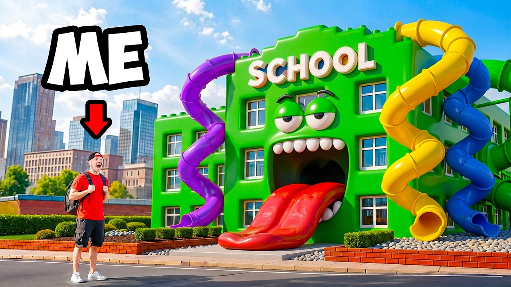](https://www.youtube.com/watch?v=Nx-oA7bsuCY)

  [Surviving First Day Of DREAM SCHOOL!](https://www.youtube.com/watch?v=Nx-oA7bsuCY)

  Unspeakable · 2026-06-27 · family

  3,167,331 public views · 0.81× reported lift

  Same concrete ingredient dream: Surviving First Day Of DREAM SCHOOL!. Game, cast and execution transfer remains a hypothesis; this source does not validate the new episode outcome.Window: lifetime through source snapshot. [Metric source](https://majieddd.github.io/influint-channels-public/channels/UCwIWAbIeu0xI0ReKWOcw3eg.html)
* [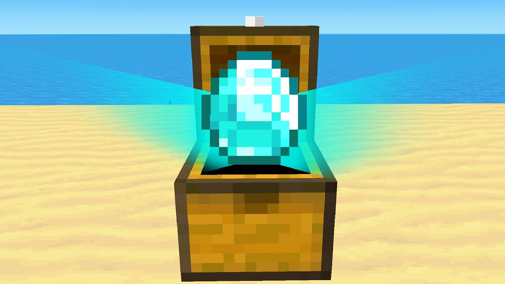](https://www.youtube.com/watch?v=HrY_eDbF0XQ)

  [I Hid $100,000 On The Dream SMP!](https://www.youtube.com/watch?v=HrY_eDbF0XQ)

  MrBeast Gaming · 2021-01-13 · family

  39,917,627 public views · 0.61× reported lift

  Same concrete ingredient dream: I Hid $100,000 On The Dream SMP!. Game, cast and execution transfer remains a hypothesis; this source does not validate the new episode outcome.Window: lifetime through source snapshot. [Metric source](https://majieddd.github.io/influint-channels-public/channels/UCIPPMRA040LQr5QPyJEbmXA.html)

Shape: 0/2 qualifying outlier channels in the verified public pool; adjacent precedents remain proposals, not replication.

Ingredients: 0/2 qualifying outlier channels for the principal ingredient; this does not establish the full game/cast combination.

Ingredient matches concern the principal object/premise, not proof of every mixed ingredient. Views/lift are observed package/content performance.

Thumbnail reference and composition

Composition source: Stokes Twins · SURPRISING MY TWIN BROTHER WITH HIS DREAM CAR!!

Finished Stokes concept for this episode.

Alan presenting a gold GTA mansion, red supercar and private helicopter to three delighted adult crew friends.

Retain source subject placement, relative scale, action direction and visual contrast; use the Stokes identity and this episode’s actual content. This is a planned image, not a gameplay screenshot or a validated CTR winner.

Creative and production brief

Fulfill three recorded crew wishes in a working game world.

Record the wish before building; use existing licensed assets where possible and avoid promising real property or money.

#### Escalation

A dream vehicle becomes a dream house, then a personalized finale that beats pure expense.

#### Payoff

The friends try every promised feature and explain the moment they would keep.

#### For both audiences

**Gamer:** Creative use of existing properties, vehicles and a few scoped modifications.

**Non-gamer:** Personal wishes, transformations, reactions and failure to live up to the fantasy carry the episode.

#### People and production

Several crew members receive different dreams; either twin or another regular can host, and participants perform their own story.

* Collect real crew wishes; use available in-game assets and limit bespoke builds. The fantasy is virtual, with no implied real gift purchase.

#### Learning question

Does this distinct viewer promise attract broad viewers while feeling recognizably Stokes?

**Shorts opportunity:** Extract a complete first-complication-to-result micro-story or one resolved test/reveal; preserve setup and payoff.

[Link to idea 036](#idea-036)[Image prompt](prompts/036.txt)

037 / FORMAT 08 · Give the crew their dream lives

### I Built My Friend's Dream Garage in GTA

The crew fills a working garage with one friend's dream vehicles and makes the owner prove each deserves a place.

GTA 5 launch / follow-up · GTA 5

1. **0 (First Frame)–5s**Alex opening an enormous glowing garage filled with red exotic cars, one delighted adult friend foreground.
2. **5s–15s**Keep the five vehicles that best fit the friend's disclosed priorities. Use actual pre-recorded preferences, disclosed vehicle mods and the same short test for every candidate.
3. **15s–30s**The most expensive-looking car cannot complete the friend's favorite stunt. Show the crew choosing its next move.

[Light complexity](#production)[Download image](full/037.jpg)

Why this idea

Title shape**I Built My Friend's Dream [SUBJECT] in [GAME]**Content ingredients**car, garage, friends**Combined package**I Built My Friend's Dream Garage in GTA**

Extend dream-car/surprise and aspirational-experience appeal to multiple crew members.

#### Title / premise family

0/2 qualifying outlier channels · 0 creator groups. Qualifying means source-reported lift ≥2×; family matches do not prove the exact mixed episode.

* 

  [I Made a GIANT Barbie Cardboard Dream House! - Challenge](https://www.youtube.com/watch?v=XVhxtCHkb08)

  Brianna · 2019-06-25 · family

  5,217,204 public views · 1.70× reported lift

  Same title/premise family: I Made a GIANT Barbie Cardboard Dream House! - Challenge. Game, cast and execution transfer remains a hypothesis; this source does not validate the new episode outcome.Window: lifetime through source snapshot. [Metric source](https://majieddd.github.io/influint-channels-public/channels/UCXg4rJUbDP1IP3TmZ9KDpJg.html)
* 

  [SURPRISING MY TWIN BROTHER WITH HIS DREAM CAR!!](https://www.youtube.com/watch?v=sDmJz5TewoA)

  Stokes Twins · 2020-11-28 · family

  8,967,316 public views · 0.88× reported lift

  Same title/premise family: SURPRISING MY TWIN BROTHER WITH HIS DREAM CAR!!. Game, cast and execution transfer remains a hypothesis; this source does not validate the new episode outcome.Window: lifetime through source snapshot. [Metric source](https://majieddd.github.io/influint-channels-public/channels/UCbp9MyKCTEww4CxEzc_Tp0Q.html)
* 

  [I Built My Cat a BARBIE Dream House!](https://www.youtube.com/watch?v=PqANayOhIqQ)

  Brianna · 2023-07-09 · family

  4,372,306 public views · 1.11× reported lift

  Same title/premise family: I Built My Cat a BARBIE Dream House!. Game, cast and execution transfer remains a hypothesis; this source does not validate the new episode outcome.Window: lifetime through source snapshot. [Metric source](https://majieddd.github.io/influint-channels-public/channels/UCXg4rJUbDP1IP3TmZ9KDpJg.html)
* 

  [Surprising My Husband With His Dream Car! - Prank](https://www.youtube.com/watch?v=YSUGtRakpqk)

  Brianna · 2019-07-11 · family

  6,608,326 public views · 1.07× reported lift

  Same title/premise family: Surprising My Husband With His Dream Car! - Prank. Game, cast and execution transfer remains a hypothesis; this source does not validate the new episode outcome.Window: lifetime through source snapshot. [Metric source](https://majieddd.github.io/influint-channels-public/channels/UCXg4rJUbDP1IP3TmZ9KDpJg.html)

#### Principal content ingredient

4/2 qualifying outlier channels · 4 creator groups. Qualifying means source-reported lift ≥2×; family matches do not prove the exact mixed episode.

* 

  [Preston Cheated in Cardboard Hide and Seek](https://www.youtube.com/watch?v=5zbvDh28XUQ)

  Brianna · 2022-04-28 · family

  11,051,826 public views · 5.01× reported lift

  Same concrete ingredient car: Preston Cheated in Cardboard Hide and Seek. Game, cast and execution transfer remains a hypothesis; this source does not validate the new episode outcome.Window: lifetime through source snapshot. [Metric source](https://majieddd.github.io/influint-channels-public/channels/UCXg4rJUbDP1IP3TmZ9KDpJg.html)
* 

  [Tesla Autopilot For 24 Hours!](https://www.youtube.com/watch?v=SsJ7oOpbmIk)

  Stokes Twins · 2021-04-20 · family

  38,321,506 public views · 4.25× reported lift

  Same concrete ingredient car: Tesla Autopilot For 24 Hours!. Game, cast and execution transfer remains a hypothesis; this source does not validate the new episode outcome.Window: lifetime through source snapshot. [Metric source](https://majieddd.github.io/influint-channels-public/channels/UCbp9MyKCTEww4CxEzc_Tp0Q.html)
* 

  [World's Fastest Car!](https://www.youtube.com/watch?v=nopEs-K4ExM)

  MrBeast Gaming · 2022-07-09 · family

  122,277,058 public views · 3.68× reported lift

  Same concrete ingredient car: World's Fastest Car!. Game, cast and execution transfer remains a hypothesis; this source does not validate the new episode outcome.Window: lifetime through source snapshot. [Metric source](https://majieddd.github.io/influint-channels-public/channels/UCIPPMRA040LQr5QPyJEbmXA.html)
* 

  [7 Days Escaping Cardboard Prison!](https://www.youtube.com/watch?v=WU05jZnUiYs)

  Unspeakable · 2026-01-24 · family

  12,880,314 public views · 3.65× reported lift

  Same concrete ingredient car: 7 Days Escaping Cardboard Prison!. Game, cast and execution transfer remains a hypothesis; this source does not validate the new episode outcome.Window: lifetime through source snapshot. [Metric source](https://majieddd.github.io/influint-channels-public/channels/UCwIWAbIeu0xI0ReKWOcw3eg.html)

Shape: 0/2 qualifying outlier channels in the verified public pool; adjacent precedents remain proposals, not replication.

Ingredient matches concern the principal object/premise, not proof of every mixed ingredient. Views/lift are observed package/content performance.

Thumbnail reference and composition

Composition source: Stokes Twins · SURPRISING MY TWIN BROTHER WITH HIS DREAM CAR!!

Finished Stokes concept for this episode.

Alex opening an enormous glowing garage filled with red exotic cars, one delighted adult friend foreground.

Retain source subject placement, relative scale, action direction and visual contrast; use the Stokes identity and this episode’s actual content. This is a planned image, not a gameplay screenshot or a validated CTR winner.

Creative and production brief

Keep the five vehicles that best fit the friend's disclosed priorities.

Use actual pre-recorded preferences, disclosed vehicle mods and the same short test for every candidate.

#### Escalation

A gorgeous car fails a practical task and the unexpected final vehicle wins the owner's favorite slot.

#### Payoff

Open the completed garage and let the friend choose the keys on merit.

#### For both audiences

**Gamer:** Creative use of existing properties, vehicles and a few scoped modifications.

**Non-gamer:** Personal wishes, transformations, reactions and failure to live up to the fantasy carry the episode.

#### People and production

Several crew members receive different dreams; either twin or another regular can host, and participants perform their own story.

* Collect real crew wishes; use available in-game assets and limit bespoke builds. The fantasy is virtual, with no implied real gift purchase.

#### Learning question

Does this distinct viewer promise attract broad viewers while feeling recognizably Stokes?

**Shorts opportunity:** Extract a complete first-complication-to-result micro-story or one resolved test/reveal; preserve setup and payoff.

[Link to idea 037](#idea-037)[Image prompt](prompts/037.txt)

038 / FORMAT 08 · Give the crew their dream lives

### We Lived Like Billionaires in GTA

The crew tries a game-world billionaire itinerary and discovers which extravagant experiences are actually fun together.

GTA 5 launch / follow-up · GTA 5

1. **0 (First Frame)–5s**Alan in black shirt foreground, gold mansion and enormous white yacht behind, cast celebrating in the pool.
2. **5s–15s**Complete five luxury experiences and choose the best shared moment. Every asset and price is virtual.
3. **15s–30s**The first luxury commute leaves half the crew behind because the helicopter is too small. Show the crew choosing its next move.

[Light complexity](#production)[Download image](full/038.jpg)

Why this idea

Title shape**We Lived Like Billionaires in [GAME]**Content ingredients**billionaire, house, friends**Combined package**We Lived Like Billionaires in GTA**

Extend dream-car/surprise and aspirational-experience appeal to multiple crew members.

#### Title / premise family

0/2 qualifying outlier channels · 0 creator groups. Qualifying means source-reported lift ≥2×; family matches do not prove the exact mixed episode.

* 

  [I Made a GIANT Barbie Cardboard Dream House! - Challenge](https://www.youtube.com/watch?v=XVhxtCHkb08)

  Brianna · 2019-06-25 · family

  5,217,204 public views · 1.70× reported lift

  Same title/premise family: I Made a GIANT Barbie Cardboard Dream House! - Challenge. Game, cast and execution transfer remains a hypothesis; this source does not validate the new episode outcome.Window: lifetime through source snapshot. [Metric source](https://majieddd.github.io/influint-channels-public/channels/UCXg4rJUbDP1IP3TmZ9KDpJg.html)
* 

  [SURPRISING MY TWIN BROTHER WITH HIS DREAM CAR!!](https://www.youtube.com/watch?v=sDmJz5TewoA)

  Stokes Twins · 2020-11-28 · family

  8,967,316 public views · 0.88× reported lift

  Same title/premise family: SURPRISING MY TWIN BROTHER WITH HIS DREAM CAR!!. Game, cast and execution transfer remains a hypothesis; this source does not validate the new episode outcome.Window: lifetime through source snapshot. [Metric source](https://majieddd.github.io/influint-channels-public/channels/UCbp9MyKCTEww4CxEzc_Tp0Q.html)
* 

  [I Built My Cat a BARBIE Dream House!](https://www.youtube.com/watch?v=PqANayOhIqQ)

  Brianna · 2023-07-09 · family

  4,372,306 public views · 1.11× reported lift

  Same title/premise family: I Built My Cat a BARBIE Dream House!. Game, cast and execution transfer remains a hypothesis; this source does not validate the new episode outcome.Window: lifetime through source snapshot. [Metric source](https://majieddd.github.io/influint-channels-public/channels/UCXg4rJUbDP1IP3TmZ9KDpJg.html)
* 

  [Surprising My Husband With His Dream Car! - Prank](https://www.youtube.com/watch?v=YSUGtRakpqk)

  Brianna · 2019-07-11 · family

  6,608,326 public views · 1.07× reported lift

  Same title/premise family: Surprising My Husband With His Dream Car! - Prank. Game, cast and execution transfer remains a hypothesis; this source does not validate the new episode outcome.Window: lifetime through source snapshot. [Metric source](https://majieddd.github.io/influint-channels-public/channels/UCXg4rJUbDP1IP3TmZ9KDpJg.html)

#### Principal content ingredient

0/2 qualifying outlier channels · 0 creator groups. Qualifying means source-reported lift ≥2×; family matches do not prove the exact mixed episode.

* 

  [Buying the Most EXPENSIVE TikTok Items](https://www.youtube.com/watch?v=bn0G_a9u_DQ)

  Brianna · 2022-12-18 · family

  2,120,452 public views · 1.19× reported lift

  Same concrete ingredient billionaire: Buying the Most EXPENSIVE TikTok Items. Game, cast and execution transfer remains a hypothesis; this source does not validate the new episode outcome.Window: lifetime through source snapshot. [Metric source](https://majieddd.github.io/influint-channels-public/channels/UCXg4rJUbDP1IP3TmZ9KDpJg.html)
* 

  [CHEAP VS. EXPENSIVE GIFTS!!](https://www.youtube.com/watch?v=x_FEhVzdBT4)

  Stokes Twins · 2021-01-10 · family

  7,481,802 public views · 1.14× reported lift

  Same concrete ingredient billionaire: CHEAP VS. EXPENSIVE GIFTS!!. Game, cast and execution transfer remains a hypothesis; this source does not validate the new episode outcome.Window: lifetime through source snapshot. [Metric source](https://majieddd.github.io/influint-channels-public/channels/UCbp9MyKCTEww4CxEzc_Tp0Q.html)
* [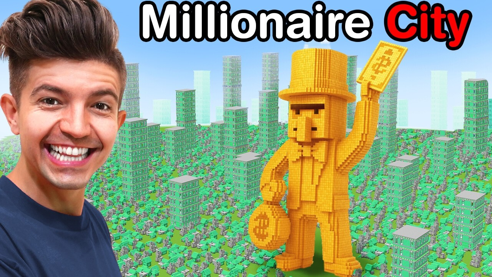](https://www.youtube.com/watch?v=sbDRfsEPlCo)

  [I Found Millionaire Villager City In Minecraft](https://www.youtube.com/watch?v=sbDRfsEPlCo)

  PrestonPlayz · 2025-09-06 · family

  26,971,771 public views · 1.07× reported lift

  Same concrete ingredient billionaire: I Found Millionaire Villager City In Minecraft. Game, cast and execution transfer remains a hypothesis; this source does not validate the new episode outcome.Window: lifetime through source snapshot. [Metric source](https://majieddd.github.io/influint-channels-public/channels/UCJZam2u1G0syq3kyqrCXrNw.html)
* [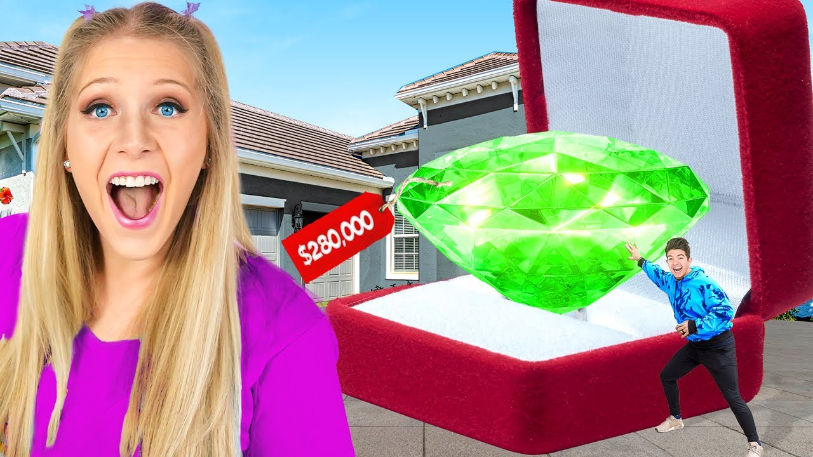](https://www.youtube.com/watch?v=Ns157ofMaWI)

  [Preston Surprised ME with the MOST Expensive Gift](https://www.youtube.com/watch?v=Ns157ofMaWI)

  Brianna · 2022-12-26 · family

  1,503,788 public views · 0.66× reported lift

  Same concrete ingredient billionaire: Preston Surprised ME with the MOST Expensive Gift. Game, cast and execution transfer remains a hypothesis; this source does not validate the new episode outcome.Window: lifetime through source snapshot. [Metric source](https://majieddd.github.io/influint-channels-public/channels/UCXg4rJUbDP1IP3TmZ9KDpJg.html)

Shape: 0/2 qualifying outlier channels in the verified public pool; adjacent precedents remain proposals, not replication.

Ingredients: 0/2 qualifying outlier channels for the principal ingredient; this does not establish the full game/cast combination.

Ingredient matches concern the principal object/premise, not proof of every mixed ingredient. Views/lift are observed package/content performance.

Thumbnail reference and composition

Composition source: Stokes Twins · SURPRISING MY TWIN BROTHER WITH HIS DREAM CAR!!

Finished Stokes concept for this episode.

Alan in black shirt foreground, gold mansion and enormous white yacht behind, cast celebrating in the pool.

Retain source subject placement, relative scale, action direction and visual contrast; use the Stokes identity and this episode’s actual content. This is a planned image, not a gameplay screenshot or a validated CTR winner.

Creative and production brief

Complete five luxury experiences and choose the best shared moment.

Every asset and price is virtual; a visible itinerary defines the day and all crew receive the same access.

#### Escalation

A mansion tour becomes a yacht event, a helicopter commute and a finale that unexpectedly favors a cheap activity.

#### Payoff

Reveal each person's favorite experience and compare spectacle with enjoyment.

#### For both audiences

**Gamer:** Creative use of existing properties, vehicles and a few scoped modifications.

**Non-gamer:** Personal wishes, transformations, reactions and failure to live up to the fantasy carry the episode.

#### People and production

Several crew members receive different dreams; either twin or another regular can host, and participants perform their own story.

* Collect real crew wishes; use available in-game assets and limit bespoke builds. The fantasy is virtual, with no implied real gift purchase.

#### Learning question

Does this distinct viewer promise attract broad viewers while feeling recognizably Stokes?

**Shorts opportunity:** Extract a complete first-complication-to-result micro-story or one resolved test/reveal; preserve setup and payoff.

[Link to idea 038](#idea-038)[Image prompt](prompts/038.txt)

039 / FORMAT 08 · Give the crew their dream lives

### I Gave My Friends Their Dream Vacations in GTA

Three friends choose wildly different vacations and the crew builds each wish into a functioning game-world day.

GTA 5 launch / follow-up · GTA 5

1. **0 (First Frame)–5s**Alex foreground opening his arms to a turquoise GTA island resort, snow chalet visible in another revealed game portal.
2. **5s–15s**Complete every friend's must-do vacation activity. Wishes recorded in advance, three fixed itineraries and honest custom-map disclosure.
3. **15s–30s**The friend who wants peace discovers their beach is next to the crew's loud race route. Show the crew choosing its next move.

[Light complexity](#production)[Download image](full/039.jpg)

Why this idea

Title shape**I Gave My Friends Their Dream [SUBJECT] in [GAME]**Content ingredients**vacation, friends, dream**Combined package**I Gave My Friends Their Dream Vacations in GTA**

Extend dream-car/surprise and aspirational-experience appeal to multiple crew members.

#### Title / premise family

0/2 qualifying outlier channels · 0 creator groups. Qualifying means source-reported lift ≥2×; family matches do not prove the exact mixed episode.

* 

  [I Made a GIANT Barbie Cardboard Dream House! - Challenge](https://www.youtube.com/watch?v=XVhxtCHkb08)

  Brianna · 2019-06-25 · family

  5,217,204 public views · 1.70× reported lift

  Same title/premise family: I Made a GIANT Barbie Cardboard Dream House! - Challenge. Game, cast and execution transfer remains a hypothesis; this source does not validate the new episode outcome.Window: lifetime through source snapshot. [Metric source](https://majieddd.github.io/influint-channels-public/channels/UCXg4rJUbDP1IP3TmZ9KDpJg.html)
* 

  [SURPRISING MY TWIN BROTHER WITH HIS DREAM CAR!!](https://www.youtube.com/watch?v=sDmJz5TewoA)

  Stokes Twins · 2020-11-28 · family

  8,967,316 public views · 0.88× reported lift

  Same title/premise family: SURPRISING MY TWIN BROTHER WITH HIS DREAM CAR!!. Game, cast and execution transfer remains a hypothesis; this source does not validate the new episode outcome.Window: lifetime through source snapshot. [Metric source](https://majieddd.github.io/influint-channels-public/channels/UCbp9MyKCTEww4CxEzc_Tp0Q.html)
* 

  [I Built My Cat a BARBIE Dream House!](https://www.youtube.com/watch?v=PqANayOhIqQ)

  Brianna · 2023-07-09 · family

  4,372,306 public views · 1.11× reported lift

  Same title/premise family: I Built My Cat a BARBIE Dream House!. Game, cast and execution transfer remains a hypothesis; this source does not validate the new episode outcome.Window: lifetime through source snapshot. [Metric source](https://majieddd.github.io/influint-channels-public/channels/UCXg4rJUbDP1IP3TmZ9KDpJg.html)
* 

  [Surprising My Husband With His Dream Car! - Prank](https://www.youtube.com/watch?v=YSUGtRakpqk)

  Brianna · 2019-07-11 · family

  6,608,326 public views · 1.07× reported lift

  Same title/premise family: Surprising My Husband With His Dream Car! - Prank. Game, cast and execution transfer remains a hypothesis; this source does not validate the new episode outcome.Window: lifetime through source snapshot. [Metric source](https://majieddd.github.io/influint-channels-public/channels/UCXg4rJUbDP1IP3TmZ9KDpJg.html)

#### Principal content ingredient

1/2 qualifying outlier channels · 1 creator groups. Qualifying means source-reported lift ≥2×; family matches do not prove the exact mixed episode.

* 

  [WORST Reviewed Hotel vs BEST Reviewed Hotel! \*disgusting\*](https://www.youtube.com/watch?v=saLH6f4jU1U)

  Brianna · 2019-12-03 · family

  17,452,634 public views · 3.79× reported lift

  Same concrete ingredient vacation: WORST Reviewed Hotel vs BEST Reviewed Hotel! \*disgusting\*. Game, cast and execution transfer remains a hypothesis; this source does not validate the new episode outcome.Window: lifetime through source snapshot. [Metric source](https://majieddd.github.io/influint-channels-public/channels/UCXg4rJUbDP1IP3TmZ9KDpJg.html)
* [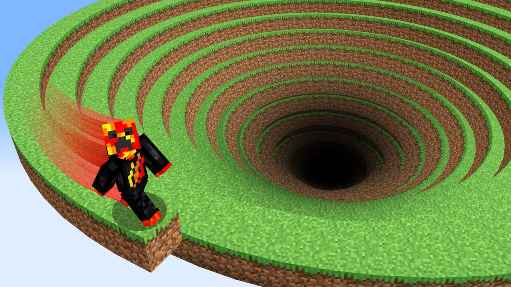](https://www.youtube.com/watch?v=8NBvKMbQqug)

  [Minecraft But You Can Travel 1,000,000 Blocks](https://www.youtube.com/watch?v=8NBvKMbQqug)

  PrestonPlayz · 2025-12-13 · family

  11,029,068 public views · 1.77× reported lift

  Same concrete ingredient vacation: Minecraft But You Can Travel 1,000,000 Blocks. Game, cast and execution transfer remains a hypothesis; this source does not validate the new episode outcome.Window: lifetime through source snapshot. [Metric source](https://majieddd.github.io/influint-channels-public/channels/UCJZam2u1G0syq3kyqrCXrNw.html)
* 

  [Last To Leave Capsule Hotel Wins $100,000](https://www.youtube.com/watch?v=aAFMeSRVTuw)

  Stokes Twins · 2023-04-29 · family

  141,773,914 public views · 1.70× reported lift

  Same concrete ingredient vacation: Last To Leave Capsule Hotel Wins $100,000. Game, cast and execution transfer remains a hypothesis; this source does not validate the new episode outcome.Window: lifetime through source snapshot. [Metric source](https://majieddd.github.io/influint-channels-public/channels/UCbp9MyKCTEww4CxEzc_Tp0Q.html)
* 

  [$1 VS $100,000 Hotel!](https://www.youtube.com/watch?v=Dzp4FyZHvDA)

  Unspeakable · 2025-04-12 · family

  2,172,253 public views · 0.49× reported lift

  Same concrete ingredient vacation: $1 VS $100,000 Hotel!. Game, cast and execution transfer remains a hypothesis; this source does not validate the new episode outcome.Window: lifetime through source snapshot. [Metric source](https://majieddd.github.io/influint-channels-public/channels/UCwIWAbIeu0xI0ReKWOcw3eg.html)

Shape: 0/2 qualifying outlier channels in the verified public pool; adjacent precedents remain proposals, not replication.

Ingredients: 1/2 qualifying outlier channels for the principal ingredient; this does not establish the full game/cast combination.

Ingredient matches concern the principal object/premise, not proof of every mixed ingredient. Views/lift are observed package/content performance.

Thumbnail reference and composition

Composition source: Stokes Twins · SURPRISING MY TWIN BROTHER WITH HIS DREAM CAR!!

Finished Stokes concept for this episode.

Alex foreground opening his arms to a turquoise GTA island resort, snow chalet visible in another revealed game portal.

Retain source subject placement, relative scale, action direction and visual contrast; use the Stokes identity and this episode’s actual content. This is a planned image, not a gameplay screenshot or a validated CTR winner.

Creative and production brief

Complete every friend's must-do vacation activity.

Wishes recorded in advance, three fixed itineraries and honest custom-map disclosure.

#### Escalation

A beach day clashes with a snow trip before a luxury cruise forces the crew to reconcile their preferences.

#### Payoff

End with all three friends comparing the specific moment that made their vacation.

#### For both audiences

**Gamer:** Creative use of existing properties, vehicles and a few scoped modifications.

**Non-gamer:** Personal wishes, transformations, reactions and failure to live up to the fantasy carry the episode.

#### People and production

Several crew members receive different dreams; either twin or another regular can host, and participants perform their own story.

* Collect real crew wishes; use available in-game assets and limit bespoke builds. The fantasy is virtual, with no implied real gift purchase.

#### Learning question

Does this distinct viewer promise attract broad viewers while feeling recognizably Stokes?

**Shorts opportunity:** Extract a complete first-complication-to-result micro-story or one resolved test/reveal; preserve setup and payoff.

[Link to idea 039](#idea-039)[Image prompt](prompts/039.txt)

040 / FORMAT 08 · Give the crew their dream lives

### I Built My Friends' Dream Worlds in Minecraft

Three builders turn their friends' personal wishes into playable Minecraft worlds rather than empty monuments.

Later game expansion · Minecraft

1. **0 (First Frame)–5s**Alan presenting a luminous Minecraft castle, roller coaster and tropical block island to delighted adult crew.
2. **5s–15s**Deliver three functional worlds that each friend can actually use. Recorded wish lists, bounded map sizes and one working signature activity in each world.
3. **15s–30s**The first beautiful world has no working activity and needs a focused redesign. Show the crew choosing its next move.

[Light complexity](#production)[Download image](full/040.jpg)

Why this idea

Title shape**I Built My Friends' Dream Worlds in [GAME]**Content ingredients**Minecraft, build, friends**Combined package**I Built My Friends' Dream Worlds in Minecraft**

Extend dream-car/surprise and aspirational-experience appeal to multiple crew members.

#### Title / premise family

0/2 qualifying outlier channels · 0 creator groups. Qualifying means source-reported lift ≥2×; family matches do not prove the exact mixed episode.

* 

  [I Made a GIANT Barbie Cardboard Dream House! - Challenge](https://www.youtube.com/watch?v=XVhxtCHkb08)

  Brianna · 2019-06-25 · family

  5,217,204 public views · 1.70× reported lift

  Same title/premise family: I Made a GIANT Barbie Cardboard Dream House! - Challenge. Game, cast and execution transfer remains a hypothesis; this source does not validate the new episode outcome.Window: lifetime through source snapshot. [Metric source](https://majieddd.github.io/influint-channels-public/channels/UCXg4rJUbDP1IP3TmZ9KDpJg.html)
* 

  [SURPRISING MY TWIN BROTHER WITH HIS DREAM CAR!!](https://www.youtube.com/watch?v=sDmJz5TewoA)

  Stokes Twins · 2020-11-28 · family

  8,967,316 public views · 0.88× reported lift

  Same title/premise family: SURPRISING MY TWIN BROTHER WITH HIS DREAM CAR!!. Game, cast and execution transfer remains a hypothesis; this source does not validate the new episode outcome.Window: lifetime through source snapshot. [Metric source](https://majieddd.github.io/influint-channels-public/channels/UCbp9MyKCTEww4CxEzc_Tp0Q.html)
* 

  [I Built My Cat a BARBIE Dream House!](https://www.youtube.com/watch?v=PqANayOhIqQ)

  Brianna · 2023-07-09 · family

  4,372,306 public views · 1.11× reported lift

  Same title/premise family: I Built My Cat a BARBIE Dream House!. Game, cast and execution transfer remains a hypothesis; this source does not validate the new episode outcome.Window: lifetime through source snapshot. [Metric source](https://majieddd.github.io/influint-channels-public/channels/UCXg4rJUbDP1IP3TmZ9KDpJg.html)
* 

  [Surprising My Husband With His Dream Car! - Prank](https://www.youtube.com/watch?v=YSUGtRakpqk)

  Brianna · 2019-07-11 · family

  6,608,326 public views · 1.07× reported lift

  Same title/premise family: Surprising My Husband With His Dream Car! - Prank. Game, cast and execution transfer remains a hypothesis; this source does not validate the new episode outcome.Window: lifetime through source snapshot. [Metric source](https://majieddd.github.io/influint-channels-public/channels/UCXg4rJUbDP1IP3TmZ9KDpJg.html)

#### Principal content ingredient

0/2 qualifying outlier channels · 0 creator groups. Qualifying means source-reported lift ≥2×; family matches do not prove the exact mixed episode.

* 

  [SURPRISING MY TWIN BROTHER WITH HIS DREAM CAR!!](https://www.youtube.com/watch?v=sDmJz5TewoA)

  Stokes Twins · 2020-11-28 · adjacent

  8,967,316 public views · 0.88× reported lift

  Adjacent format/cast/setting reference from the reviewed board; does not satisfy exact/family outlier coverage for this episode.Window: lifetime through source snapshot. [Metric source](https://majieddd.github.io/influint-channels-public/channels/UCbp9MyKCTEww4CxEzc_Tp0Q.html)
* 

  [Surprising Twin Brother With Dream Vacation!](https://www.youtube.com/watch?v=uKHKUyua9OE)

  Stokes Twins · 2025-07-23 · adjacent

  67,863,866 public views · 0.85× reported lift

  Adjacent format/cast/setting reference from the reviewed board; does not satisfy exact/family outlier coverage for this episode.Window: lifetime through source snapshot. [Metric source](https://majieddd.github.io/influint-channels-public/channels/UCbp9MyKCTEww4CxEzc_Tp0Q.html)
* 

  [Whatever You Buy, I'll Pay For!](https://www.youtube.com/watch?v=0OFwRdDeX4Y)

  MrBeast Gaming · 2020-11-02 · adjacent

  47,867,575 public views · 1.26× reported lift

  Adjacent format/cast/setting reference from the reviewed board; does not satisfy exact/family outlier coverage for this episode.Window: lifetime through source snapshot. [Metric source](https://majieddd.github.io/influint-channels-public/channels/UCIPPMRA040LQr5QPyJEbmXA.html)

Shape: 0/2 qualifying outlier channels in the verified public pool; adjacent precedents remain proposals, not replication.

Ingredients: 0/2 qualifying outlier channels for the principal ingredient; this does not establish the full game/cast combination.

Ingredient matches concern the principal object/premise, not proof of every mixed ingredient. Views/lift are observed package/content performance.

Thumbnail reference and composition

Composition source: Stokes Twins · SURPRISING MY TWIN BROTHER WITH HIS DREAM CAR!!

Finished Stokes concept for this episode.

Alan presenting a luminous Minecraft castle, roller coaster and tropical block island to delighted adult crew.

Retain source subject placement, relative scale, action direction and visual contrast; use the Stokes identity and this episode’s actual content. This is a planned image, not a gameplay screenshot or a validated CTR winner.

Creative and production brief

Deliver three functional worlds that each friend can actually use.

Recorded wish lists, bounded map sizes and one working signature activity in each world.

#### Escalation

An enormous design runs late, a personal detail gets lost and the final test checks the promised function.

#### Payoff

Give each friend control of the world and show them playing the feature built for them.

#### For both audiences

**Gamer:** Creative use of existing properties, vehicles and a few scoped modifications.

**Non-gamer:** Personal wishes, transformations, reactions and failure to live up to the fantasy carry the episode.

#### People and production

Several crew members receive different dreams; either twin or another regular can host, and participants perform their own story.

* Collect real crew wishes; use available in-game assets and limit bespoke builds. The fantasy is virtual, with no implied real gift purchase.
* Verify the exact edition, map, mod license and working mechanics; GTA-system reuse does not imply Minecraft support.

#### Learning question

Does this distinct viewer promise attract broad viewers while feeling recognizably Stokes?

**Shorts opportunity:** Extract a complete first-complication-to-result micro-story or one resolved test/reveal; preserve setup and payoff.

[Link to idea 040](#idea-040)[Image prompt](prompts/040.txt)

041 / FORMAT 09 · The world-sized experiment

### Can 10,000 Cars Stop a Train in GTA?

Crew teams increase the size and design of a car barrier until a genuine train impact resolves the experiment.

GTA 5 launch / follow-up · GTA 5

1. **0 (First Frame)–5s**Alan huge left, black train charging toward a colossal red-car wall stretching to the horizon; 10,000 CARS?.
2. **5s–15s**Find the smallest tested barrier that can actually stop the train. Prototype physical spawn capacity.
3. **15s–30s**The first ten-car barrier scatters without noticeably slowing the train. Show the crew choosing its next move.

[Medium complexity](#production)[Download image](full/041.jpg)

Why this idea

Title shape**Can [COUNT] [SUBJECT] Stop a [SUBJECT] in [GAME]?**Content ingredients**train, car, experiment**Combined package**Can 10,000 Cars Stop a Train in GTA?**

Transfer the main-channel product-test curiosity into one grand experiment.

#### Title / premise family

2/2 qualifying outlier channels · 2 creator groups. Qualifying means source-reported lift ≥2×; family matches do not prove the exact mixed episode.

* 

  [FILLING my pool with a THOUSAND Bath Bombs! - Experiment](https://www.youtube.com/watch?v=zfcKQlgOf0g)

  Brianna · 2019-06-20 · family

  19,523,536 public views · 7.70× reported lift

  Same title/premise family: FILLING my pool with a THOUSAND Bath Bombs! - Experiment. Game, cast and execution transfer remains a hypothesis; this source does not validate the new episode outcome.Window: lifetime through source snapshot. [Metric source](https://majieddd.github.io/influint-channels-public/channels/UCXg4rJUbDP1IP3TmZ9KDpJg.html)
* 

  [World’s Largest Explosion!](https://www.youtube.com/watch?v=ABTdTTnnEU8)

  MrBeast Gaming · 2021-04-07 · family

  287,473,152 public views · 3.15× reported lift

  Same title/premise family: World’s Largest Explosion!. Game, cast and execution transfer remains a hypothesis; this source does not validate the new episode outcome.Window: lifetime through source snapshot. [Metric source](https://majieddd.github.io/influint-channels-public/channels/UCIPPMRA040LQr5QPyJEbmXA.html)
* 

  [Experiment: Coca Cola and Mentos Inside Bathtub](https://www.youtube.com/watch?v=FvXudYgDJpc)

  Stokes Twins · 2019-12-15 · family

  6,049,060 public views · 1.03× reported lift

  Same title/premise family: Experiment: Coca Cola and Mentos Inside Bathtub. Game, cast and execution transfer remains a hypothesis; this source does not validate the new episode outcome.Window: lifetime through source snapshot. [Metric source](https://majieddd.github.io/influint-channels-public/channels/UCbp9MyKCTEww4CxEzc_Tp0Q.html)
* 

  [I Tested $1 VS $10,000 Experiments!](https://www.youtube.com/watch?v=p-CtAPVKKrQ)

  Unspeakable · 2024-11-30 · family

  6,262,307 public views · 1.00× reported lift

  Same title/premise family: I Tested $1 VS $10,000 Experiments!. Game, cast and execution transfer remains a hypothesis; this source does not validate the new episode outcome.Window: lifetime through source snapshot. [Metric source](https://majieddd.github.io/influint-channels-public/channels/UCwIWAbIeu0xI0ReKWOcw3eg.html)

#### Principal content ingredient

0/2 qualifying outlier channels · 0 creator groups. Qualifying means source-reported lift ≥2×; family matches do not prove the exact mixed episode.

* 

  [I Sent Preston to Santa Training School...](https://www.youtube.com/watch?v=1VUwRiae8IM)

  Brianna · 2020-12-02 · family

  3,067,787 public views · 1.80× reported lift

  Same concrete ingredient train: I Sent Preston to Santa Training School.... Game, cast and execution transfer remains a hypothesis; this source does not validate the new episode outcome.Window: lifetime through source snapshot. [Metric source](https://majieddd.github.io/influint-channels-public/channels/UCXg4rJUbDP1IP3TmZ9KDpJg.html)
* 

  [Driving 100 Hours In A Cardboard Train!](https://www.youtube.com/watch?v=3InYPKOC0jQ)

  Unspeakable · 2025-08-02 · family

  7,024,006 public views · 1.57× reported lift

  Same concrete ingredient train: Driving 100 Hours In A Cardboard Train!. Game, cast and execution transfer remains a hypothesis; this source does not validate the new episode outcome.Window: lifetime through source snapshot. [Metric source](https://majieddd.github.io/influint-channels-public/channels/UCwIWAbIeu0xI0ReKWOcw3eg.html)
* 

  [How To Train Your Dragon In Real Life](https://www.youtube.com/watch?v=x__vFVb4p78)

  Unspeakable · 2025-06-14 · family

  2,768,981 public views · 0.81× reported lift

  Same concrete ingredient train: How To Train Your Dragon In Real Life. Game, cast and execution transfer remains a hypothesis; this source does not validate the new episode outcome.Window: lifetime through source snapshot. [Metric source](https://majieddd.github.io/influint-channels-public/channels/UCwIWAbIeu0xI0ReKWOcw3eg.html)
* 

  [Last to Leave Actual SWAT Training Wins $1000! - Challenge](https://www.youtube.com/watch?v=Mz_4cCErgw4)

  Brianna · 2020-06-24 · family

  2,040,812 public views · 0.62× reported lift

  Same concrete ingredient train: Last to Leave Actual SWAT Training Wins $1000! - Challenge. Game, cast and execution transfer remains a hypothesis; this source does not validate the new episode outcome.Window: lifetime through source snapshot. [Metric source](https://majieddd.github.io/influint-channels-public/channels/UCXg4rJUbDP1IP3TmZ9KDpJg.html)

Ingredients: 0/2 qualifying outlier channels for the principal ingredient; this does not establish the full game/cast combination.

Ingredient matches concern the principal object/premise, not proof of every mixed ingredient. Views/lift are observed package/content performance.

Thumbnail reference and composition

Composition source: MrBeast Gaming · World's Largest Experiment!

Finished Stokes concept for this episode.

Alan huge left, black train charging toward a colossal red-car wall stretching to the horizon; 10,000 CARS?.

Retain source subject placement, relative scale, action direction and visual contrast; use the Stokes identity and this episode’s actual content. This is a planned image, not a gameplay screenshot or a validated CTR winner.

Creative and production brief

Find the smallest tested barrier that can actually stop the train.

Prototype physical spawn capacity; the final title uses the true achieved active count and separates decorative cars from physics objects.

#### Escalation

Ten cars fail, better geometry changes the impact and the largest feasible barrier becomes the final trial.

#### Payoff

Show the final train impact continuously and publish the real count and result even if the train wins.

#### For both audiences

**Gamer:** Physics and mechanics reward prior knowledge.

**Non-gamer:** Scale and an intuitive question carry the suspense.

#### People and production

Crew teams propose and build different barriers; Alan/Alex or another host runs the test while participants react to the result.

* A physics/spawn feasibility prototype before the full build, staged attempts and cinematic capture. Separate visual crowd dressing from objects that actually participate in the simulation.

#### Conditional additions

* Large-object physics proof: $1,000–$2,500; Before 09: count active simulated objects and record stable capture. Cut title scale to achieved count if needed.

#### Learning question

Does this distinct viewer promise attract broad viewers while feeling recognizably Stokes?

**Shorts opportunity:** Extract a complete first-complication-to-result micro-story or one resolved test/reveal; preserve setup and payoff.

[Link to idea 041](#idea-041)[Image prompt](prompts/041.txt)

042 / FORMAT 09 · The world-sized experiment

### Can 1,000 Boats Stop a Tsunami in GTA?

The crew tests increasingly large boat barriers against the same custom wave to learn whether more objects can redirect it.

GTA 5 launch / follow-up · GTA 5

1. **0 (First Frame)–5s**Alex beside a vast line of white boats confronting an enormous blue GTA wave; 1,000?.
2. **5s–15s**Find whether any tested barrier changes the wave's route. Simulation effect and active-object count disclosed.
3. **15s–30s**The first boats rise with the water instead of forming a wall. Show the crew choosing its next move.

[Medium complexity](#production)[Download image](full/042.jpg)

Why this idea

Title shape**Can [COUNT] [SUBJECT] Stop a [SUBJECT] in [GAME]?**Content ingredients**boat, tsunami, experiment**Combined package**Can 1,000 Boats Stop a Tsunami in GTA?**

Transfer the main-channel product-test curiosity into one grand experiment.

#### Title / premise family

2/2 qualifying outlier channels · 2 creator groups. Qualifying means source-reported lift ≥2×; family matches do not prove the exact mixed episode.

* 

  [FILLING my pool with a THOUSAND Bath Bombs! - Experiment](https://www.youtube.com/watch?v=zfcKQlgOf0g)

  Brianna · 2019-06-20 · family

  19,523,536 public views · 7.70× reported lift

  Same title/premise family: FILLING my pool with a THOUSAND Bath Bombs! - Experiment. Game, cast and execution transfer remains a hypothesis; this source does not validate the new episode outcome.Window: lifetime through source snapshot. [Metric source](https://majieddd.github.io/influint-channels-public/channels/UCXg4rJUbDP1IP3TmZ9KDpJg.html)
* 

  [World’s Largest Explosion!](https://www.youtube.com/watch?v=ABTdTTnnEU8)

  MrBeast Gaming · 2021-04-07 · family

  287,473,152 public views · 3.15× reported lift

  Same title/premise family: World’s Largest Explosion!. Game, cast and execution transfer remains a hypothesis; this source does not validate the new episode outcome.Window: lifetime through source snapshot. [Metric source](https://majieddd.github.io/influint-channels-public/channels/UCIPPMRA040LQr5QPyJEbmXA.html)
* 

  [Experiment: Coca Cola and Mentos Inside Bathtub](https://www.youtube.com/watch?v=FvXudYgDJpc)

  Stokes Twins · 2019-12-15 · family

  6,049,060 public views · 1.03× reported lift

  Same title/premise family: Experiment: Coca Cola and Mentos Inside Bathtub. Game, cast and execution transfer remains a hypothesis; this source does not validate the new episode outcome.Window: lifetime through source snapshot. [Metric source](https://majieddd.github.io/influint-channels-public/channels/UCbp9MyKCTEww4CxEzc_Tp0Q.html)
* 

  [I Tested $1 VS $10,000 Experiments!](https://www.youtube.com/watch?v=p-CtAPVKKrQ)

  Unspeakable · 2024-11-30 · family

  6,262,307 public views · 1.00× reported lift

  Same title/premise family: I Tested $1 VS $10,000 Experiments!. Game, cast and execution transfer remains a hypothesis; this source does not validate the new episode outcome.Window: lifetime through source snapshot. [Metric source](https://majieddd.github.io/influint-channels-public/channels/UCwIWAbIeu0xI0ReKWOcw3eg.html)

#### Principal content ingredient

2/2 qualifying outlier channels · 2 creator groups. Qualifying means source-reported lift ≥2×; family matches do not prove the exact mixed episode.

* 

  [WORST Reviewed Water Park vs BEST Reviewed Water Park!](https://www.youtube.com/watch?v=-LVdJNIs2PY)

  Brianna · 2020-09-26 · family

  11,857,144 public views · 5.63× reported lift

  Same concrete ingredient boat: WORST Reviewed Water Park vs BEST Reviewed Water Park!. Game, cast and execution transfer remains a hypothesis; this source does not validate the new episode outcome.Window: lifetime through source snapshot. [Metric source](https://majieddd.github.io/influint-channels-public/channels/UCXg4rJUbDP1IP3TmZ9KDpJg.html)
* 

  [I Turned My House Into a Waterpark!](https://www.youtube.com/watch?v=WthL6_K8Kys)

  Unspeakable · 2024-08-24 · family

  20,543,332 public views · 4.23× reported lift

  Same concrete ingredient boat: I Turned My House Into a Waterpark!. Game, cast and execution transfer remains a hypothesis; this source does not validate the new episode outcome.Window: lifetime through source snapshot. [Metric source](https://majieddd.github.io/influint-channels-public/channels/UCwIWAbIeu0xI0ReKWOcw3eg.html)
* 

  [Walking on Water Prank!](https://www.youtube.com/watch?v=hHdKug_wQkU)

  Stokes Twins · 2025-03-22 · family

  169,129,541 public views · 1.34× reported lift

  Same concrete ingredient boat: Walking on Water Prank!. Game, cast and execution transfer remains a hypothesis; this source does not validate the new episode outcome.Window: lifetime through source snapshot. [Metric source](https://majieddd.github.io/influint-channels-public/channels/UCbp9MyKCTEww4CxEzc_Tp0Q.html)
* 

  [Level 1 to 100 Waterparks in Minecraft!](https://www.youtube.com/watch?v=fU03uSHbTGo)

  PrestonPlayz · 2026-07-25 · family

  2,624,764 public views · 1.14× reported lift

  Same concrete ingredient boat: Level 1 to 100 Waterparks in Minecraft!. Game, cast and execution transfer remains a hypothesis; this source does not validate the new episode outcome.Window: lifetime through source snapshot. [Metric source](https://majieddd.github.io/influint-channels-public/channels/UCJZam2u1G0syq3kyqrCXrNw.html)

Ingredient matches concern the principal object/premise, not proof of every mixed ingredient. Views/lift are observed package/content performance.

Thumbnail reference and composition

Composition source: MrBeast Gaming · World's Largest Experiment!

Finished Stokes concept for this episode.

Alex beside a vast line of white boats confronting an enormous blue GTA wave; 1,000?.

Retain source subject placement, relative scale, action direction and visual contrast; use the Stokes identity and this episode’s actual content. This is a planned image, not a gameplay screenshot or a validated CTR winner.

Creative and production brief

Find whether any tested barrier changes the wave's route.

Simulation effect and active-object count disclosed; if the wave has no physical interaction, reframe as a flood evacuation test before filming.

#### Escalation

Loose boats fail, tethered rows last longer and the biggest feasible wall exposes the limit of the simulation.

#### Payoff

Reveal the real simulated interaction and the barrier that worked or failed without inventing physics.

#### For both audiences

**Gamer:** Physics and mechanics reward prior knowledge.

**Non-gamer:** Scale and an intuitive question carry the suspense.

#### People and production

Crew teams propose and build different barriers; Alan/Alex or another host runs the test while participants react to the result.

* A physics/spawn feasibility prototype before the full build, staged attempts and cinematic capture. Separate visual crowd dressing from objects that actually participate in the simulation.

#### Conditional additions

* Large-object physics proof: $1,000–$2,500; Before 09: count active simulated objects and record stable capture. Cut title scale to achieved count if needed.

#### Learning question

Does this distinct viewer promise attract broad viewers while feeling recognizably Stokes?

**Shorts opportunity:** Extract a complete first-complication-to-result micro-story or one resolved test/reveal; preserve setup and payoff.

[Link to idea 042](#idea-042)[Image prompt](prompts/042.txt)

043 / FORMAT 09 · The world-sized experiment

### I Created GTA's Biggest Car Crash

The crew combines its largest verified vehicle setup into one recorded chain reaction after smaller designs keep failing.

GTA 5 launch / follow-up · GTA 5

1. **0 (First Frame)–5s**Alan left foreground, giant red-car domino crash sweeping across a city bridge into a single huge pileup.
2. **5s–15s**Create the largest successful crash within the tested production setup. Biggest refers to this production's measured setup, not an unverified world record.
3. **15s–30s**The initial cars stop transferring momentum halfway through the line. Show the crew choosing its next move.

[Medium complexity](#production)[Download image](full/043.jpg)

Why this idea

Title shape**I Created [GAME]'s Biggest [SUBJECT] Crash**Content ingredients**car, experiment, crash**Combined package**I Created GTA's Biggest Car Crash**

Transfer the main-channel product-test curiosity into one grand experiment.

#### Title / premise family

2/2 qualifying outlier channels · 2 creator groups. Qualifying means source-reported lift ≥2×; family matches do not prove the exact mixed episode.

* 

  [FILLING my pool with a THOUSAND Bath Bombs! - Experiment](https://www.youtube.com/watch?v=zfcKQlgOf0g)

  Brianna · 2019-06-20 · family

  19,523,536 public views · 7.70× reported lift

  Same title/premise family: FILLING my pool with a THOUSAND Bath Bombs! - Experiment. Game, cast and execution transfer remains a hypothesis; this source does not validate the new episode outcome.Window: lifetime through source snapshot. [Metric source](https://majieddd.github.io/influint-channels-public/channels/UCXg4rJUbDP1IP3TmZ9KDpJg.html)
* 

  [World’s Largest Explosion!](https://www.youtube.com/watch?v=ABTdTTnnEU8)

  MrBeast Gaming · 2021-04-07 · family

  287,473,152 public views · 3.15× reported lift

  Same title/premise family: World’s Largest Explosion!. Game, cast and execution transfer remains a hypothesis; this source does not validate the new episode outcome.Window: lifetime through source snapshot. [Metric source](https://majieddd.github.io/influint-channels-public/channels/UCIPPMRA040LQr5QPyJEbmXA.html)
* 

  [Experiment: Coca Cola and Mentos Inside Bathtub](https://www.youtube.com/watch?v=FvXudYgDJpc)

  Stokes Twins · 2019-12-15 · family

  6,049,060 public views · 1.03× reported lift

  Same title/premise family: Experiment: Coca Cola and Mentos Inside Bathtub. Game, cast and execution transfer remains a hypothesis; this source does not validate the new episode outcome.Window: lifetime through source snapshot. [Metric source](https://majieddd.github.io/influint-channels-public/channels/UCbp9MyKCTEww4CxEzc_Tp0Q.html)
* 

  [I Tested $1 VS $10,000 Experiments!](https://www.youtube.com/watch?v=p-CtAPVKKrQ)

  Unspeakable · 2024-11-30 · family

  6,262,307 public views · 1.00× reported lift

  Same title/premise family: I Tested $1 VS $10,000 Experiments!. Game, cast and execution transfer remains a hypothesis; this source does not validate the new episode outcome.Window: lifetime through source snapshot. [Metric source](https://majieddd.github.io/influint-channels-public/channels/UCwIWAbIeu0xI0ReKWOcw3eg.html)

#### Principal content ingredient

4/2 qualifying outlier channels · 4 creator groups. Qualifying means source-reported lift ≥2×; family matches do not prove the exact mixed episode.

* 

  [Preston Cheated in Cardboard Hide and Seek](https://www.youtube.com/watch?v=5zbvDh28XUQ)

  Brianna · 2022-04-28 · family

  11,051,826 public views · 5.01× reported lift

  Same concrete ingredient car: Preston Cheated in Cardboard Hide and Seek. Game, cast and execution transfer remains a hypothesis; this source does not validate the new episode outcome.Window: lifetime through source snapshot. [Metric source](https://majieddd.github.io/influint-channels-public/channels/UCXg4rJUbDP1IP3TmZ9KDpJg.html)
* 

  [Tesla Autopilot For 24 Hours!](https://www.youtube.com/watch?v=SsJ7oOpbmIk)

  Stokes Twins · 2021-04-20 · family

  38,321,506 public views · 4.25× reported lift

  Same concrete ingredient car: Tesla Autopilot For 24 Hours!. Game, cast and execution transfer remains a hypothesis; this source does not validate the new episode outcome.Window: lifetime through source snapshot. [Metric source](https://majieddd.github.io/influint-channels-public/channels/UCbp9MyKCTEww4CxEzc_Tp0Q.html)
* 

  [World's Fastest Car!](https://www.youtube.com/watch?v=nopEs-K4ExM)

  MrBeast Gaming · 2022-07-09 · family

  122,277,058 public views · 3.68× reported lift

  Same concrete ingredient car: World's Fastest Car!. Game, cast and execution transfer remains a hypothesis; this source does not validate the new episode outcome.Window: lifetime through source snapshot. [Metric source](https://majieddd.github.io/influint-channels-public/channels/UCIPPMRA040LQr5QPyJEbmXA.html)
* 

  [7 Days Escaping Cardboard Prison!](https://www.youtube.com/watch?v=WU05jZnUiYs)

  Unspeakable · 2026-01-24 · family

  12,880,314 public views · 3.65× reported lift

  Same concrete ingredient car: 7 Days Escaping Cardboard Prison!. Game, cast and execution transfer remains a hypothesis; this source does not validate the new episode outcome.Window: lifetime through source snapshot. [Metric source](https://majieddd.github.io/influint-channels-public/channels/UCwIWAbIeu0xI0ReKWOcw3eg.html)

Ingredient matches concern the principal object/premise, not proof of every mixed ingredient. Views/lift are observed package/content performance.

Thumbnail reference and composition

Composition source: MrBeast Gaming · World's Largest Experiment!

Finished Stokes concept for this episode.

Alan left foreground, giant red-car domino crash sweeping across a city bridge into a single huge pileup.

Retain source subject placement, relative scale, action direction and visual contrast; use the Stokes identity and this episode’s actual content. This is a planned image, not a gameplay screenshot or a validated CTR winner.

Creative and production brief

Create the largest successful crash within the tested production setup.

Biggest refers to this production's measured setup, not an unverified world record; count active vehicles and use real replay footage.

#### Escalation

Spacing ruins the first chain, a ramp improves transfer and the final arrangement puts the whole design to the test.

#### Payoff

Show the full chain reaction, the actual count and the crew's winning design.

#### For both audiences

**Gamer:** Physics and mechanics reward prior knowledge.

**Non-gamer:** Scale and an intuitive question carry the suspense.

#### People and production

Crew teams propose and build different barriers; Alan/Alex or another host runs the test while participants react to the result.

* A physics/spawn feasibility prototype before the full build, staged attempts and cinematic capture. Separate visual crowd dressing from objects that actually participate in the simulation.

#### Conditional additions

* Large-object physics proof: $1,000–$2,500; Before 09: count active simulated objects and record stable capture. Cut title scale to achieved count if needed.

#### Learning question

Does this distinct viewer promise attract broad viewers while feeling recognizably Stokes?

**Shorts opportunity:** Extract a complete first-complication-to-result micro-story or one resolved test/reveal; preserve setup and payoff.

[Link to idea 043](#idea-043)[Image prompt](prompts/043.txt)

044 / FORMAT 09 · The world-sized experiment

### Can 100 Helicopters Lift a House in GTA?

Crew engineers try larger helicopter teams against a custom liftable house while ordinary-looking plans spectacularly fail.

GTA 5 launch / follow-up · GTA 5

1. **0 (First Frame)–5s**Alex foreground, an entire white GTA house suspended beneath a grand cluster of red helicopters, clear sky silhouette; 100?.
2. **5s–15s**Lift the disclosed movable house above the marked height. Custom physics house and attachment system disclosed.
3. **15s–30s**The first helicopter rotates the house instead of lifting it straight. Show the crew choosing its next move.

[Medium complexity](#production)[Download image](full/044.jpg)

Why this idea

Title shape**Can [COUNT] [SUBJECT] Lift a [SUBJECT] in [GAME]?**Content ingredients**helicopter, house, experiment**Combined package**Can 100 Helicopters Lift a House in GTA?**

Transfer the main-channel product-test curiosity into one grand experiment.

#### Title / premise family

2/2 qualifying outlier channels · 2 creator groups. Qualifying means source-reported lift ≥2×; family matches do not prove the exact mixed episode.

* 

  [FILLING my pool with a THOUSAND Bath Bombs! - Experiment](https://www.youtube.com/watch?v=zfcKQlgOf0g)

  Brianna · 2019-06-20 · family

  19,523,536 public views · 7.70× reported lift

  Same title/premise family: FILLING my pool with a THOUSAND Bath Bombs! - Experiment. Game, cast and execution transfer remains a hypothesis; this source does not validate the new episode outcome.Window: lifetime through source snapshot. [Metric source](https://majieddd.github.io/influint-channels-public/channels/UCXg4rJUbDP1IP3TmZ9KDpJg.html)
* 

  [World’s Largest Explosion!](https://www.youtube.com/watch?v=ABTdTTnnEU8)

  MrBeast Gaming · 2021-04-07 · family

  287,473,152 public views · 3.15× reported lift

  Same title/premise family: World’s Largest Explosion!. Game, cast and execution transfer remains a hypothesis; this source does not validate the new episode outcome.Window: lifetime through source snapshot. [Metric source](https://majieddd.github.io/influint-channels-public/channels/UCIPPMRA040LQr5QPyJEbmXA.html)
* 

  [Experiment: Coca Cola and Mentos Inside Bathtub](https://www.youtube.com/watch?v=FvXudYgDJpc)

  Stokes Twins · 2019-12-15 · family

  6,049,060 public views · 1.03× reported lift

  Same title/premise family: Experiment: Coca Cola and Mentos Inside Bathtub. Game, cast and execution transfer remains a hypothesis; this source does not validate the new episode outcome.Window: lifetime through source snapshot. [Metric source](https://majieddd.github.io/influint-channels-public/channels/UCbp9MyKCTEww4CxEzc_Tp0Q.html)
* 

  [I Tested $1 VS $10,000 Experiments!](https://www.youtube.com/watch?v=p-CtAPVKKrQ)

  Unspeakable · 2024-11-30 · family

  6,262,307 public views · 1.00× reported lift

  Same title/premise family: I Tested $1 VS $10,000 Experiments!. Game, cast and execution transfer remains a hypothesis; this source does not validate the new episode outcome.Window: lifetime through source snapshot. [Metric source](https://majieddd.github.io/influint-channels-public/channels/UCwIWAbIeu0xI0ReKWOcw3eg.html)

#### Principal content ingredient

0/2 qualifying outlier channels · 0 creator groups. Qualifying means source-reported lift ≥2×; family matches do not prove the exact mixed episode.

* 

  [World's Largest Experiment!](https://www.youtube.com/watch?v=JeTkMdw6RK8)

  MrBeast Gaming · 2022-05-22 · adjacent

  147,057,293 public views · 2.78× reported lift

  Adjacent format/cast/setting reference from the reviewed board; does not satisfy exact/family outlier coverage for this episode.Window: lifetime through source snapshot. [Metric source](https://majieddd.github.io/influint-channels-public/channels/UCIPPMRA040LQr5QPyJEbmXA.html)
* 

  [World’s Largest Explosion!](https://www.youtube.com/watch?v=ABTdTTnnEU8)

  MrBeast Gaming · 2021-04-07 · adjacent

  287,473,152 public views · 3.15× reported lift

  Adjacent format/cast/setting reference from the reviewed board; does not satisfy exact/family outlier coverage for this episode.Window: lifetime through source snapshot. [Metric source](https://majieddd.github.io/influint-channels-public/channels/UCIPPMRA040LQr5QPyJEbmXA.html)
* 

  [BUSTING VIRAL TIKTOK GADGETS!!](https://www.youtube.com/watch?v=AwQz703eOt0)

  Stokes Twins · 2021-01-15 · adjacent

  28,640,105 public views · 4.18× reported lift

  Adjacent format/cast/setting reference from the reviewed board; does not satisfy exact/family outlier coverage for this episode.Window: lifetime through source snapshot. [Metric source](https://majieddd.github.io/influint-channels-public/channels/UCbp9MyKCTEww4CxEzc_Tp0Q.html)

Ingredients: 0/2 qualifying outlier channels for the principal ingredient; this does not establish the full game/cast combination.

Ingredient matches concern the principal object/premise, not proof of every mixed ingredient. Views/lift are observed package/content performance.

Thumbnail reference and composition

Composition source: MrBeast Gaming · World's Largest Experiment!

Finished Stokes concept for this episode.

Alex foreground, an entire white GTA house suspended beneath a grand cluster of red helicopters, clear sky silhouette; 100?.

Retain source subject placement, relative scale, action direction and visual contrast; use the Stokes identity and this episode’s actual content. This is a planned image, not a gameplay screenshot or a validated CTR winner.

Creative and production brief

Lift the disclosed movable house above the marked height.

Custom physics house and attachment system disclosed, active helicopter count verified and title revised to real achieved scale.

#### Escalation

One aircraft tips the load, a better rig balances it and the final team must coordinate a simultaneous ascent.

#### Payoff

Show the real lift or failure and the exact rig configuration responsible.

#### For both audiences

**Gamer:** Physics and mechanics reward prior knowledge.

**Non-gamer:** Scale and an intuitive question carry the suspense.

#### People and production

Crew teams propose and build different barriers; Alan/Alex or another host runs the test while participants react to the result.

* A physics/spawn feasibility prototype before the full build, staged attempts and cinematic capture. Separate visual crowd dressing from objects that actually participate in the simulation.

#### Conditional additions

* Large-object physics proof: $1,000–$2,500; Before 09: count active simulated objects and record stable capture. Cut title scale to achieved count if needed.

#### Learning question

Does this distinct viewer promise attract broad viewers while feeling recognizably Stokes?

**Shorts opportunity:** Extract a complete first-complication-to-result micro-story or one resolved test/reveal; preserve setup and payoff.

[Link to idea 044](#idea-044)[Image prompt](prompts/044.txt)

045 / FORMAT 09 · The world-sized experiment

### Can 10,000 Minecraft Minecarts Stop a Train?

The crew uses a tested modded train world to compare increasingly large minecart barriers in one visible collision experiment.

Later game expansion · Minecraft

1. **0 (First Frame)–5s**Alan left, giant Minecraft train facing an enormous receding wall of minecarts, bright red/cyan cinematic block world.
2. **5s–15s**Find whether the largest functioning barrier can halt the modded train. Name and license the tested train mod, label non-stock behavior and count active minecarts.
3. **15s–30s**The smallest minecart barrier is pushed off the track before the train slows. Show the crew choosing its next move.

[Medium complexity](#production)[Download image](full/045.jpg)

Why this idea

Title shape**Can [COUNT] [GAME] Minecarts Stop a [SUBJECT]?**Content ingredients**Minecraft, train, experiment**Combined package**Can 10,000 Minecraft Minecarts Stop a Train?**

Transfer the main-channel product-test curiosity into one grand experiment.

#### Title / premise family

2/2 qualifying outlier channels · 2 creator groups. Qualifying means source-reported lift ≥2×; family matches do not prove the exact mixed episode.

* 

  [FILLING my pool with a THOUSAND Bath Bombs! - Experiment](https://www.youtube.com/watch?v=zfcKQlgOf0g)

  Brianna · 2019-06-20 · family

  19,523,536 public views · 7.70× reported lift

  Same title/premise family: FILLING my pool with a THOUSAND Bath Bombs! - Experiment. Game, cast and execution transfer remains a hypothesis; this source does not validate the new episode outcome.Window: lifetime through source snapshot. [Metric source](https://majieddd.github.io/influint-channels-public/channels/UCXg4rJUbDP1IP3TmZ9KDpJg.html)
* 

  [World’s Largest Explosion!](https://www.youtube.com/watch?v=ABTdTTnnEU8)

  MrBeast Gaming · 2021-04-07 · family

  287,473,152 public views · 3.15× reported lift

  Same title/premise family: World’s Largest Explosion!. Game, cast and execution transfer remains a hypothesis; this source does not validate the new episode outcome.Window: lifetime through source snapshot. [Metric source](https://majieddd.github.io/influint-channels-public/channels/UCIPPMRA040LQr5QPyJEbmXA.html)
* 

  [Experiment: Coca Cola and Mentos Inside Bathtub](https://www.youtube.com/watch?v=FvXudYgDJpc)

  Stokes Twins · 2019-12-15 · family

  6,049,060 public views · 1.03× reported lift

  Same title/premise family: Experiment: Coca Cola and Mentos Inside Bathtub. Game, cast and execution transfer remains a hypothesis; this source does not validate the new episode outcome.Window: lifetime through source snapshot. [Metric source](https://majieddd.github.io/influint-channels-public/channels/UCbp9MyKCTEww4CxEzc_Tp0Q.html)
* 

  [I Tested $1 VS $10,000 Experiments!](https://www.youtube.com/watch?v=p-CtAPVKKrQ)

  Unspeakable · 2024-11-30 · family

  6,262,307 public views · 1.00× reported lift

  Same title/premise family: I Tested $1 VS $10,000 Experiments!. Game, cast and execution transfer remains a hypothesis; this source does not validate the new episode outcome.Window: lifetime through source snapshot. [Metric source](https://majieddd.github.io/influint-channels-public/channels/UCwIWAbIeu0xI0ReKWOcw3eg.html)

#### Principal content ingredient

0/2 qualifying outlier channels · 0 creator groups. Qualifying means source-reported lift ≥2×; family matches do not prove the exact mixed episode.

* 

  [I Sent Preston to Santa Training School...](https://www.youtube.com/watch?v=1VUwRiae8IM)

  Brianna · 2020-12-02 · family

  3,067,787 public views · 1.80× reported lift

  Same concrete ingredient train: I Sent Preston to Santa Training School.... Game, cast and execution transfer remains a hypothesis; this source does not validate the new episode outcome.Window: lifetime through source snapshot. [Metric source](https://majieddd.github.io/influint-channels-public/channels/UCXg4rJUbDP1IP3TmZ9KDpJg.html)
* 

  [Driving 100 Hours In A Cardboard Train!](https://www.youtube.com/watch?v=3InYPKOC0jQ)

  Unspeakable · 2025-08-02 · family

  7,024,006 public views · 1.57× reported lift

  Same concrete ingredient train: Driving 100 Hours In A Cardboard Train!. Game, cast and execution transfer remains a hypothesis; this source does not validate the new episode outcome.Window: lifetime through source snapshot. [Metric source](https://majieddd.github.io/influint-channels-public/channels/UCwIWAbIeu0xI0ReKWOcw3eg.html)
* 

  [How To Train Your Dragon In Real Life](https://www.youtube.com/watch?v=x__vFVb4p78)

  Unspeakable · 2025-06-14 · family

  2,768,981 public views · 0.81× reported lift

  Same concrete ingredient train: How To Train Your Dragon In Real Life. Game, cast and execution transfer remains a hypothesis; this source does not validate the new episode outcome.Window: lifetime through source snapshot. [Metric source](https://majieddd.github.io/influint-channels-public/channels/UCwIWAbIeu0xI0ReKWOcw3eg.html)
* 

  [Last to Leave Actual SWAT Training Wins $1000! - Challenge](https://www.youtube.com/watch?v=Mz_4cCErgw4)

  Brianna · 2020-06-24 · family

  2,040,812 public views · 0.62× reported lift

  Same concrete ingredient train: Last to Leave Actual SWAT Training Wins $1000! - Challenge. Game, cast and execution transfer remains a hypothesis; this source does not validate the new episode outcome.Window: lifetime through source snapshot. [Metric source](https://majieddd.github.io/influint-channels-public/channels/UCXg4rJUbDP1IP3TmZ9KDpJg.html)

Ingredients: 0/2 qualifying outlier channels for the principal ingredient; this does not establish the full game/cast combination.

Ingredient matches concern the principal object/premise, not proof of every mixed ingredient. Views/lift are observed package/content performance.

Thumbnail reference and composition

Composition source: MrBeast Gaming · World's Largest Experiment!

Finished Stokes concept for this episode.

Alan left, giant Minecraft train facing an enormous receding wall of minecarts, bright red/cyan cinematic block world.

Retain source subject placement, relative scale, action direction and visual contrast; use the Stokes identity and this episode’s actual content. This is a planned image, not a gameplay screenshot or a validated CTR winner.

Creative and production brief

Find whether the largest functioning barrier can halt the modded train.

Name and license the tested train mod, label non-stock behavior and count active minecarts; scale is conditional on performance.

#### Escalation

Loose minecarts fail, stacked barriers change the collision and the biggest feasible setup gets one final run.

#### Payoff

Show the actual collision and the precise mod/settings rather than imply stock Minecraft has a train system.

#### For both audiences

**Gamer:** Physics and mechanics reward prior knowledge.

**Non-gamer:** Scale and an intuitive question carry the suspense.

#### People and production

Crew teams propose and build different barriers; Alan/Alex or another host runs the test while participants react to the result.

* A physics/spawn feasibility prototype before the full build, staged attempts and cinematic capture. Separate visual crowd dressing from objects that actually participate in the simulation.
* Verify the exact edition, map, mod license and working mechanics; GTA-system reuse does not imply Minecraft support.

#### Conditional additions

* Large-object physics proof: $1,000–$2,500; Before 09: count active simulated objects and record stable capture. Cut title scale to achieved count if needed.

#### Learning question

Does this distinct viewer promise attract broad viewers while feeling recognizably Stokes?

**Shorts opportunity:** Extract a complete first-complication-to-result micro-story or one resolved test/reveal; preserve setup and payoff.

[Link to idea 045](#idea-045)[Image prompt](prompts/045.txt)

046 / FORMAT 10 · Play GTA across its cities

### I Played GTA in Every GTA City!

A traveling host completes one matching game challenge at each real-world city inspiration in a defined GTA-city itinerary.

Later hybrid / travel pilot · GTA 5

1. **0 (First Frame)–5s**Alan foreground with a controller, epic globe journey joining Los Angeles-style skyline, Miami-style palms and New York-style towers; GTA CITIES.
2. **5s–15s**Finish the disclosed city list and its one simple challenge per stop. Working assumption is real-city filming.
3. **15s–30s**The first landmark looks familiar but the game route differs from the real street. Show the crew choosing its next move.

[Travel complexity](#production)[Download image](full/046.jpg)

Why this idea

Title shape**I Played [GAME] in Every [GAME] [SUBJECT]!**Content ingredients**city, travel, GTA**Combined package**I Played GTA in Every GTA City!**

The user’s proposed travel direction; cast personalities and landmark comparisons connect gaming to the broader Stokes audience.

#### Title / premise family

0/2 qualifying outlier channels · 0 creator groups. Qualifying means source-reported lift ≥2×; family matches do not prove the exact mixed episode.

* 

  [I Played Steal A Brainrot In REAL LIFE!](https://www.youtube.com/watch?v=PmFU6Dk5DRE)

  Unspeakable · 2025-10-11 · family

  10,365,257 public views · 1.68× reported lift

  Same title/premise family: I Played Steal A Brainrot In REAL LIFE!. Game, cast and execution transfer remains a hypothesis; this source does not validate the new episode outcome.Window: lifetime through source snapshot. [Metric source](https://majieddd.github.io/influint-channels-public/channels/UCwIWAbIeu0xI0ReKWOcw3eg.html)
* 

  [I Played POPPY PLAYTIME Chapter 2 in Real Life!](https://www.youtube.com/watch?v=oAGQugG1n4Q)

  Brianna · 2022-05-01 · family

  1,728,451 public views · 0.68× reported lift

  Same title/premise family: I Played POPPY PLAYTIME Chapter 2 in Real Life!. Game, cast and execution transfer remains a hypothesis; this source does not validate the new episode outcome.Window: lifetime through source snapshot. [Metric source](https://majieddd.github.io/influint-channels-public/channels/UCXg4rJUbDP1IP3TmZ9KDpJg.html)
* 

  [We Played AMONG US But IN REAL LIFE!! (Imposter IQ 9,999,999%)](https://www.youtube.com/watch?v=dajCqgha8vY)

  Stokes Twins · 2020-10-12 · family

  7,837,423 public views · 0.63× reported lift

  Same title/premise family: We Played AMONG US But IN REAL LIFE!! (Imposter IQ 9,999,999%). Game, cast and execution transfer remains a hypothesis; this source does not validate the new episode outcome.Window: lifetime through source snapshot. [Metric source](https://majieddd.github.io/influint-channels-public/channels/UCbp9MyKCTEww4CxEzc_Tp0Q.html)
* 

  [I Played Poppy Playtime in Real Life! \*Huggy Wuggy\*](https://www.youtube.com/watch?v=hkVgXv925HU)

  Brianna · 2021-12-19 · family

  2,004,126 public views · 0.40× reported lift

  Same title/premise family: I Played Poppy Playtime in Real Life! \*Huggy Wuggy\*. Game, cast and execution transfer remains a hypothesis; this source does not validate the new episode outcome.Window: lifetime through source snapshot. [Metric source](https://majieddd.github.io/influint-channels-public/channels/UCXg4rJUbDP1IP3TmZ9KDpJg.html)

#### Principal content ingredient

4/2 qualifying outlier channels · 3 creator groups. Qualifying means source-reported lift ≥2×; family matches do not prove the exact mixed episode.

* 

  [Overnight Survival Challenge in the World's Largest ZOO!](https://www.youtube.com/watch?v=TLHIKUvhXsU)

  Brianna · 2020-10-17 · family

  14,469,543 public views · 6.88× reported lift

  Same concrete ingredient city: Overnight Survival Challenge in the World's Largest ZOO!. Game, cast and execution transfer remains a hypothesis; this source does not validate the new episode outcome.Window: lifetime through source snapshot. [Metric source](https://majieddd.github.io/influint-channels-public/channels/UCXg4rJUbDP1IP3TmZ9KDpJg.html)
* 

  [World's Fastest Car!](https://www.youtube.com/watch?v=nopEs-K4ExM)

  MrBeast Gaming · 2022-07-09 · family

  122,277,058 public views · 3.68× reported lift

  Same concrete ingredient city: World's Fastest Car!. Game, cast and execution transfer remains a hypothesis; this source does not validate the new episode outcome.Window: lifetime through source snapshot. [Metric source](https://majieddd.github.io/influint-channels-public/channels/UCIPPMRA040LQr5QPyJEbmXA.html)
* 

  [Riding the World's Scariest Rollercoasters! (PASSED OUT)](https://www.youtube.com/watch?v=ZNoAsoLNyWA)

  Stokes Twins · 2019-09-29 · family

  17,068,064 public views · 2.81× reported lift

  Same concrete ingredient city: Riding the World's Scariest Rollercoasters! (PASSED OUT). Game, cast and execution transfer remains a hypothesis; this source does not validate the new episode outcome.Window: lifetime through source snapshot. [Metric source](https://majieddd.github.io/influint-channels-public/channels/UCbp9MyKCTEww4CxEzc_Tp0Q.html)
* 

  [Why I Flooded My Friend’s ENTIRE World?](https://www.youtube.com/watch?v=-LUNQPxD0vY)

  PrestonPlayz · 2026-03-07 · family

  13,665,235 public views · 2.81× reported lift

  Same concrete ingredient city: Why I Flooded My Friend’s ENTIRE World?. Game, cast and execution transfer remains a hypothesis; this source does not validate the new episode outcome.Window: lifetime through source snapshot. [Metric source](https://majieddd.github.io/influint-channels-public/channels/UCJZam2u1G0syq3kyqrCXrNw.html)

Shape: 0/2 qualifying outlier channels in the verified public pool; adjacent precedents remain proposals, not replication.

Exact successful game-versus-IRL or GTA-city journey precedent is not verified; test a smaller route before travel scale.

Ingredient matches concern the principal object/premise, not proof of every mixed ingredient. Views/lift are observed package/content performance.

Thumbnail reference and composition

Composition source: MrBeast Gaming · World's Largest Minecraft Build!

Finished Stokes concept for this episode.

Alan foreground with a controller, epic globe journey joining Los Angeles-style skyline, Miami-style palms and New York-style towers; GTA CITIES.

Retain source subject placement, relative scale, action direction and visual contrast; use the Stokes identity and this episode’s actual content. This is a planned image, not a gameplay screenshot or a validated CTR winner.

Creative and production brief

Finish the disclosed city list and its one simple challenge per stop.

Working assumption is real-city filming; say the exact selected-city scope in the opening, license location filming and never call an incomplete itinerary every city.

#### Escalation

Familiar landmark matching becomes a travel delay and a final city challenge with almost no spare time.

#### Payoff

Finish the map with paired real/game shots and the actual completed itinerary.

#### For both audiences

**Gamer:** Recognition, nostalgia and differences between the represented cities.

**Non-gamer:** A travel/journey goal, unfamiliar settings and a simple task at each stop carry the episode.

#### People and production

One traveling/playing host with crew participants at different stops; another cast member can lead the comparison or challenge.

* Pending user clarification on real cities versus cities across games. Real travel adds flights/hotels/local transport and location access; game touring adds game/capture setup. Verify the represented city list; every must match the stated scope.

#### Learning question

Does this distinct viewer promise attract broad viewers while feeling recognizably Stokes?

**Shorts opportunity:** Extract a complete first-complication-to-result micro-story or one resolved test/reveal; preserve setup and payoff.

[Link to idea 046](#idea-046)[Image prompt](prompts/046.txt)

047 / FORMAT 10 · Play GTA across its cities

### GTA vs Real Life: The Same Day in Every City

The cast attempts the same simple itinerary in a defined set of GTA-inspired real cities and their game counterparts.

Later hybrid / travel pilot · GTA 5

1. **0 (First Frame)–5s**Alex foreground holding a controller, clean game/real split of matching palm-lined city streets and skyline.
2. **5s–15s**Complete breakfast, transport and one local landmark task at each paired stop. Defined cities, lawful public-location filming and matched task scope.
3. **15s–30s**The virtual breakfast task finishes while the real crew is still traveling to the cafe. Show the crew choosing its next move.

[Travel complexity](#production)[Download image](full/047.jpg)

Why this idea

Title shape**[GAME] vs Real Life: The Same Day in Every [SUBJECT]**Content ingredients**city, IRL, GTA**Combined package**GTA vs Real Life: The Same Day in Every City**

The user’s proposed travel direction; cast personalities and landmark comparisons connect gaming to the broader Stokes audience.

#### Title / premise family

0/2 qualifying outlier channels · 0 creator groups. Qualifying means source-reported lift ≥2×; family matches do not prove the exact mixed episode.

* 

  [I Played Steal A Brainrot In REAL LIFE!](https://www.youtube.com/watch?v=PmFU6Dk5DRE)

  Unspeakable · 2025-10-11 · family

  10,365,257 public views · 1.68× reported lift

  Same title/premise family: I Played Steal A Brainrot In REAL LIFE!. Game, cast and execution transfer remains a hypothesis; this source does not validate the new episode outcome.Window: lifetime through source snapshot. [Metric source](https://majieddd.github.io/influint-channels-public/channels/UCwIWAbIeu0xI0ReKWOcw3eg.html)
* 

  [I Played POPPY PLAYTIME Chapter 2 in Real Life!](https://www.youtube.com/watch?v=oAGQugG1n4Q)

  Brianna · 2022-05-01 · family

  1,728,451 public views · 0.68× reported lift

  Same title/premise family: I Played POPPY PLAYTIME Chapter 2 in Real Life!. Game, cast and execution transfer remains a hypothesis; this source does not validate the new episode outcome.Window: lifetime through source snapshot. [Metric source](https://majieddd.github.io/influint-channels-public/channels/UCXg4rJUbDP1IP3TmZ9KDpJg.html)
* 

  [We Played AMONG US But IN REAL LIFE!! (Imposter IQ 9,999,999%)](https://www.youtube.com/watch?v=dajCqgha8vY)

  Stokes Twins · 2020-10-12 · family

  7,837,423 public views · 0.63× reported lift

  Same title/premise family: We Played AMONG US But IN REAL LIFE!! (Imposter IQ 9,999,999%). Game, cast and execution transfer remains a hypothesis; this source does not validate the new episode outcome.Window: lifetime through source snapshot. [Metric source](https://majieddd.github.io/influint-channels-public/channels/UCbp9MyKCTEww4CxEzc_Tp0Q.html)
* 

  [I Played Poppy Playtime in Real Life! \*Huggy Wuggy\*](https://www.youtube.com/watch?v=hkVgXv925HU)

  Brianna · 2021-12-19 · family

  2,004,126 public views · 0.40× reported lift

  Same title/premise family: I Played Poppy Playtime in Real Life! \*Huggy Wuggy\*. Game, cast and execution transfer remains a hypothesis; this source does not validate the new episode outcome.Window: lifetime through source snapshot. [Metric source](https://majieddd.github.io/influint-channels-public/channels/UCXg4rJUbDP1IP3TmZ9KDpJg.html)

#### Principal content ingredient

4/2 qualifying outlier channels · 3 creator groups. Qualifying means source-reported lift ≥2×; family matches do not prove the exact mixed episode.

* 

  [Overnight Survival Challenge in the World's Largest ZOO!](https://www.youtube.com/watch?v=TLHIKUvhXsU)

  Brianna · 2020-10-17 · family

  14,469,543 public views · 6.88× reported lift

  Same concrete ingredient city: Overnight Survival Challenge in the World's Largest ZOO!. Game, cast and execution transfer remains a hypothesis; this source does not validate the new episode outcome.Window: lifetime through source snapshot. [Metric source](https://majieddd.github.io/influint-channels-public/channels/UCXg4rJUbDP1IP3TmZ9KDpJg.html)
* 

  [World's Fastest Car!](https://www.youtube.com/watch?v=nopEs-K4ExM)

  MrBeast Gaming · 2022-07-09 · family

  122,277,058 public views · 3.68× reported lift

  Same concrete ingredient city: World's Fastest Car!. Game, cast and execution transfer remains a hypothesis; this source does not validate the new episode outcome.Window: lifetime through source snapshot. [Metric source](https://majieddd.github.io/influint-channels-public/channels/UCIPPMRA040LQr5QPyJEbmXA.html)
* 

  [Riding the World's Scariest Rollercoasters! (PASSED OUT)](https://www.youtube.com/watch?v=ZNoAsoLNyWA)

  Stokes Twins · 2019-09-29 · family

  17,068,064 public views · 2.81× reported lift

  Same concrete ingredient city: Riding the World's Scariest Rollercoasters! (PASSED OUT). Game, cast and execution transfer remains a hypothesis; this source does not validate the new episode outcome.Window: lifetime through source snapshot. [Metric source](https://majieddd.github.io/influint-channels-public/channels/UCbp9MyKCTEww4CxEzc_Tp0Q.html)
* 

  [Why I Flooded My Friend’s ENTIRE World?](https://www.youtube.com/watch?v=-LUNQPxD0vY)

  PrestonPlayz · 2026-03-07 · family

  13,665,235 public views · 2.81× reported lift

  Same concrete ingredient city: Why I Flooded My Friend’s ENTIRE World?. Game, cast and execution transfer remains a hypothesis; this source does not validate the new episode outcome.Window: lifetime through source snapshot. [Metric source](https://majieddd.github.io/influint-channels-public/channels/UCJZam2u1G0syq3kyqrCXrNw.html)

Shape: 0/2 qualifying outlier channels in the verified public pool; adjacent precedents remain proposals, not replication.

Exact successful game-versus-IRL or GTA-city journey precedent is not verified; test a smaller route before travel scale.

Ingredient matches concern the principal object/premise, not proof of every mixed ingredient. Views/lift are observed package/content performance.

Thumbnail reference and composition

Composition source: MrBeast Gaming · World's Largest Minecraft Build!

Finished Stokes concept for this episode.

Alex foreground holding a controller, clean game/real split of matching palm-lined city streets and skyline.

Retain source subject placement, relative scale, action direction and visual contrast; use the Stokes identity and this episode’s actual content. This is a planned image, not a gameplay screenshot or a validated CTR winner.

Creative and production brief

Complete breakfast, transport and one local landmark task at each paired stop.

Defined cities, lawful public-location filming and matched task scope; real travel time is shown separately from game time.

#### Escalation

A quick virtual errand takes hours outside the game and a later game limitation reverses the advantage.

#### Payoff

Compare the paired days and reveal where the crew most enjoyed the difference.

#### For both audiences

**Gamer:** Recognition, nostalgia and differences between the represented cities.

**Non-gamer:** A travel/journey goal, unfamiliar settings and a simple task at each stop carry the episode.

#### People and production

One traveling/playing host with crew participants at different stops; another cast member can lead the comparison or challenge.

* Pending user clarification on real cities versus cities across games. Real travel adds flights/hotels/local transport and location access; game touring adds game/capture setup. Verify the represented city list; every must match the stated scope.

#### Learning question

Does this distinct viewer promise attract broad viewers while feeling recognizably Stokes?

**Shorts opportunity:** Extract a complete first-complication-to-result micro-story or one resolved test/reveal; preserve setup and payoff.

[Link to idea 047](#idea-047)[Image prompt](prompts/047.txt)

048 / FORMAT 10 · Play GTA across its cities

### I Played GTA in the Real Places That Inspired It

The crew visits verified locations that inspired a selected game city and recreates harmless matching challenges on screen.

Later hybrid / travel pilot · GTA 5

1. **0 (First Frame)–5s**Alan holding a controller in a real palm-lined boulevard, cinematic matching GTA street opening beside him.
2. **5s–15s**Match five permitted real landmarks to their documented game inspirations. Verify inspiration sources and use safe permitted real activities.
3. **15s–30s**The first street layout changes so much that the crew needs a wider landmark view to establish the match. Show the crew choosing its next move.

[Travel complexity](#production)[Download image](full/048.jpg)

Why this idea

Title shape**I Played [GAME] in the Real Places That Inspired It**Content ingredients**city, IRL, GTA**Combined package**I Played GTA in the Real Places That Inspired It**

The user’s proposed travel direction; cast personalities and landmark comparisons connect gaming to the broader Stokes audience.

#### Title / premise family

0/2 qualifying outlier channels · 0 creator groups. Qualifying means source-reported lift ≥2×; family matches do not prove the exact mixed episode.

* 

  [I Played Steal A Brainrot In REAL LIFE!](https://www.youtube.com/watch?v=PmFU6Dk5DRE)

  Unspeakable · 2025-10-11 · family

  10,365,257 public views · 1.68× reported lift

  Same title/premise family: I Played Steal A Brainrot In REAL LIFE!. Game, cast and execution transfer remains a hypothesis; this source does not validate the new episode outcome.Window: lifetime through source snapshot. [Metric source](https://majieddd.github.io/influint-channels-public/channels/UCwIWAbIeu0xI0ReKWOcw3eg.html)
* 

  [I Played POPPY PLAYTIME Chapter 2 in Real Life!](https://www.youtube.com/watch?v=oAGQugG1n4Q)

  Brianna · 2022-05-01 · family

  1,728,451 public views · 0.68× reported lift

  Same title/premise family: I Played POPPY PLAYTIME Chapter 2 in Real Life!. Game, cast and execution transfer remains a hypothesis; this source does not validate the new episode outcome.Window: lifetime through source snapshot. [Metric source](https://majieddd.github.io/influint-channels-public/channels/UCXg4rJUbDP1IP3TmZ9KDpJg.html)
* 

  [We Played AMONG US But IN REAL LIFE!! (Imposter IQ 9,999,999%)](https://www.youtube.com/watch?v=dajCqgha8vY)

  Stokes Twins · 2020-10-12 · family

  7,837,423 public views · 0.63× reported lift

  Same title/premise family: We Played AMONG US But IN REAL LIFE!! (Imposter IQ 9,999,999%). Game, cast and execution transfer remains a hypothesis; this source does not validate the new episode outcome.Window: lifetime through source snapshot. [Metric source](https://majieddd.github.io/influint-channels-public/channels/UCbp9MyKCTEww4CxEzc_Tp0Q.html)
* 

  [I Played Poppy Playtime in Real Life! \*Huggy Wuggy\*](https://www.youtube.com/watch?v=hkVgXv925HU)

  Brianna · 2021-12-19 · family

  2,004,126 public views · 0.40× reported lift

  Same title/premise family: I Played Poppy Playtime in Real Life! \*Huggy Wuggy\*. Game, cast and execution transfer remains a hypothesis; this source does not validate the new episode outcome.Window: lifetime through source snapshot. [Metric source](https://majieddd.github.io/influint-channels-public/channels/UCXg4rJUbDP1IP3TmZ9KDpJg.html)

#### Principal content ingredient

4/2 qualifying outlier channels · 3 creator groups. Qualifying means source-reported lift ≥2×; family matches do not prove the exact mixed episode.

* 

  [Overnight Survival Challenge in the World's Largest ZOO!](https://www.youtube.com/watch?v=TLHIKUvhXsU)

  Brianna · 2020-10-17 · family

  14,469,543 public views · 6.88× reported lift

  Same concrete ingredient city: Overnight Survival Challenge in the World's Largest ZOO!. Game, cast and execution transfer remains a hypothesis; this source does not validate the new episode outcome.Window: lifetime through source snapshot. [Metric source](https://majieddd.github.io/influint-channels-public/channels/UCXg4rJUbDP1IP3TmZ9KDpJg.html)
* 

  [World's Fastest Car!](https://www.youtube.com/watch?v=nopEs-K4ExM)

  MrBeast Gaming · 2022-07-09 · family

  122,277,058 public views · 3.68× reported lift

  Same concrete ingredient city: World's Fastest Car!. Game, cast and execution transfer remains a hypothesis; this source does not validate the new episode outcome.Window: lifetime through source snapshot. [Metric source](https://majieddd.github.io/influint-channels-public/channels/UCIPPMRA040LQr5QPyJEbmXA.html)
* 

  [Riding the World's Scariest Rollercoasters! (PASSED OUT)](https://www.youtube.com/watch?v=ZNoAsoLNyWA)

  Stokes Twins · 2019-09-29 · family

  17,068,064 public views · 2.81× reported lift

  Same concrete ingredient city: Riding the World's Scariest Rollercoasters! (PASSED OUT). Game, cast and execution transfer remains a hypothesis; this source does not validate the new episode outcome.Window: lifetime through source snapshot. [Metric source](https://majieddd.github.io/influint-channels-public/channels/UCbp9MyKCTEww4CxEzc_Tp0Q.html)
* 

  [Why I Flooded My Friend’s ENTIRE World?](https://www.youtube.com/watch?v=-LUNQPxD0vY)

  PrestonPlayz · 2026-03-07 · family

  13,665,235 public views · 2.81× reported lift

  Same concrete ingredient city: Why I Flooded My Friend’s ENTIRE World?. Game, cast and execution transfer remains a hypothesis; this source does not validate the new episode outcome.Window: lifetime through source snapshot. [Metric source](https://majieddd.github.io/influint-channels-public/channels/UCJZam2u1G0syq3kyqrCXrNw.html)

Shape: 0/2 qualifying outlier channels in the verified public pool; adjacent precedents remain proposals, not replication.

Exact successful game-versus-IRL or GTA-city journey precedent is not verified; test a smaller route before travel scale.

Ingredient matches concern the principal object/premise, not proof of every mixed ingredient. Views/lift are observed package/content performance.

Thumbnail reference and composition

Composition source: MrBeast Gaming · World's Largest Minecraft Build!

Finished Stokes concept for this episode.

Alan holding a controller in a real palm-lined boulevard, cinematic matching GTA street opening beside him.

Retain source subject placement, relative scale, action direction and visual contrast; use the Stokes identity and this episode’s actual content. This is a planned image, not a gameplay screenshot or a validated CTR winner.

Creative and production brief

Match five permitted real landmarks to their documented game inspirations.

Verify inspiration sources and use safe permitted real activities; do not claim a filming location is a developer studio.

#### Escalation

An obvious landmark match becomes an ambiguous street, then a final route that shows what the game changed.

#### Payoff

Show all verified matches and the game-versus-reality differences without pretending every scene is exact.

#### For both audiences

**Gamer:** Recognition, nostalgia and differences between the represented cities.

**Non-gamer:** A travel/journey goal, unfamiliar settings and a simple task at each stop carry the episode.

#### People and production

One traveling/playing host with crew participants at different stops; another cast member can lead the comparison or challenge.

* Pending user clarification on real cities versus cities across games. Real travel adds flights/hotels/local transport and location access; game touring adds game/capture setup. Verify the represented city list; every must match the stated scope.

#### Learning question

Does this distinct viewer promise attract broad viewers while feeling recognizably Stokes?

**Shorts opportunity:** Extract a complete first-complication-to-result micro-story or one resolved test/reveal; preserve setup and payoff.

[Link to idea 048](#idea-048)[Image prompt](prompts/048.txt)

049 / FORMAT 10 · Play GTA across its cities

### We Crossed Every GTA City Without Flying

The crew tours a disclosed set of GTA games and must complete one ground-level traversal in each selected city.

Later hybrid / travel pilot · GTA 5

1. **0 (First Frame)–5s**Alex foreground, red road linking three stylized game city skylines with a grounded red car and crossed-out plane.
2. **5s–15s**Finish the selected playable-city route without aircraft. This is the lower-cost game-tour alternative, not seamless travel between games.
3. **15s–30s**The first game's convenient route does not exist in the next city. Show the crew choosing its next move.

[Light complexity](#production)[Download image](full/049.jpg)

Why this idea

Title shape**We Crossed Every [GAME] [SUBJECT] Without Flying**Content ingredients**city, journey, GTA**Combined package**We Crossed Every GTA City Without Flying**

The user’s proposed travel direction; cast personalities and landmark comparisons connect gaming to the broader Stokes audience.

#### Title / premise family

0/2 qualifying outlier channels · 0 creator groups. Qualifying means source-reported lift ≥2×; family matches do not prove the exact mixed episode.

* 

  [I Played Steal A Brainrot In REAL LIFE!](https://www.youtube.com/watch?v=PmFU6Dk5DRE)

  Unspeakable · 2025-10-11 · family

  10,365,257 public views · 1.68× reported lift

  Same title/premise family: I Played Steal A Brainrot In REAL LIFE!. Game, cast and execution transfer remains a hypothesis; this source does not validate the new episode outcome.Window: lifetime through source snapshot. [Metric source](https://majieddd.github.io/influint-channels-public/channels/UCwIWAbIeu0xI0ReKWOcw3eg.html)
* 

  [I Played POPPY PLAYTIME Chapter 2 in Real Life!](https://www.youtube.com/watch?v=oAGQugG1n4Q)

  Brianna · 2022-05-01 · family

  1,728,451 public views · 0.68× reported lift

  Same title/premise family: I Played POPPY PLAYTIME Chapter 2 in Real Life!. Game, cast and execution transfer remains a hypothesis; this source does not validate the new episode outcome.Window: lifetime through source snapshot. [Metric source](https://majieddd.github.io/influint-channels-public/channels/UCXg4rJUbDP1IP3TmZ9KDpJg.html)
* 

  [We Played AMONG US But IN REAL LIFE!! (Imposter IQ 9,999,999%)](https://www.youtube.com/watch?v=dajCqgha8vY)

  Stokes Twins · 2020-10-12 · family

  7,837,423 public views · 0.63× reported lift

  Same title/premise family: We Played AMONG US But IN REAL LIFE!! (Imposter IQ 9,999,999%). Game, cast and execution transfer remains a hypothesis; this source does not validate the new episode outcome.Window: lifetime through source snapshot. [Metric source](https://majieddd.github.io/influint-channels-public/channels/UCbp9MyKCTEww4CxEzc_Tp0Q.html)
* 

  [I Played Poppy Playtime in Real Life! \*Huggy Wuggy\*](https://www.youtube.com/watch?v=hkVgXv925HU)

  Brianna · 2021-12-19 · family

  2,004,126 public views · 0.40× reported lift

  Same title/premise family: I Played Poppy Playtime in Real Life! \*Huggy Wuggy\*. Game, cast and execution transfer remains a hypothesis; this source does not validate the new episode outcome.Window: lifetime through source snapshot. [Metric source](https://majieddd.github.io/influint-channels-public/channels/UCXg4rJUbDP1IP3TmZ9KDpJg.html)

#### Principal content ingredient

4/2 qualifying outlier channels · 3 creator groups. Qualifying means source-reported lift ≥2×; family matches do not prove the exact mixed episode.

* 

  [Overnight Survival Challenge in the World's Largest ZOO!](https://www.youtube.com/watch?v=TLHIKUvhXsU)

  Brianna · 2020-10-17 · family

  14,469,543 public views · 6.88× reported lift

  Same concrete ingredient city: Overnight Survival Challenge in the World's Largest ZOO!. Game, cast and execution transfer remains a hypothesis; this source does not validate the new episode outcome.Window: lifetime through source snapshot. [Metric source](https://majieddd.github.io/influint-channels-public/channels/UCXg4rJUbDP1IP3TmZ9KDpJg.html)
* 

  [World's Fastest Car!](https://www.youtube.com/watch?v=nopEs-K4ExM)

  MrBeast Gaming · 2022-07-09 · family

  122,277,058 public views · 3.68× reported lift

  Same concrete ingredient city: World's Fastest Car!. Game, cast and execution transfer remains a hypothesis; this source does not validate the new episode outcome.Window: lifetime through source snapshot. [Metric source](https://majieddd.github.io/influint-channels-public/channels/UCIPPMRA040LQr5QPyJEbmXA.html)
* 

  [Riding the World's Scariest Rollercoasters! (PASSED OUT)](https://www.youtube.com/watch?v=ZNoAsoLNyWA)

  Stokes Twins · 2019-09-29 · family

  17,068,064 public views · 2.81× reported lift

  Same concrete ingredient city: Riding the World's Scariest Rollercoasters! (PASSED OUT). Game, cast and execution transfer remains a hypothesis; this source does not validate the new episode outcome.Window: lifetime through source snapshot. [Metric source](https://majieddd.github.io/influint-channels-public/channels/UCbp9MyKCTEww4CxEzc_Tp0Q.html)
* 

  [Why I Flooded My Friend’s ENTIRE World?](https://www.youtube.com/watch?v=-LUNQPxD0vY)

  PrestonPlayz · 2026-03-07 · family

  13,665,235 public views · 2.81× reported lift

  Same concrete ingredient city: Why I Flooded My Friend’s ENTIRE World?. Game, cast and execution transfer remains a hypothesis; this source does not validate the new episode outcome.Window: lifetime through source snapshot. [Metric source](https://majieddd.github.io/influint-channels-public/channels/UCJZam2u1G0syq3kyqrCXrNw.html)

Shape: 0/2 qualifying outlier channels in the verified public pool; adjacent precedents remain proposals, not replication.

Exact successful game-versus-IRL or GTA-city journey precedent is not verified; test a smaller route before travel scale.

Ingredient matches concern the principal object/premise, not proof of every mixed ingredient. Views/lift are observed package/content performance.

Thumbnail reference and composition

Composition source: MrBeast Gaming · World's Largest Minecraft Build!

Finished Stokes concept for this episode.

Alex foreground, red road linking three stylized game city skylines with a grounded red car and crossed-out plane.

Retain source subject placement, relative scale, action direction and visual contrast; use the Stokes identity and this episode’s actual content. This is a planned image, not a gameplay screenshot or a validated CTR winner.

Creative and production brief

Finish the selected playable-city route without aircraft.

This is the lower-cost game-tour alternative, not seamless travel between games; show game changes, edition support and exact city list.

#### Escalation

A familiar car route becomes an older game's difficult crossing and the last city tests the crew's slowest vehicle.

#### Payoff

Complete the progress map and compare the distinct city journeys rather than hide loading transitions.

#### For both audiences

**Gamer:** Recognition, nostalgia and differences between the represented cities.

**Non-gamer:** A travel/journey goal, unfamiliar settings and a simple task at each stop carry the episode.

#### People and production

One traveling/playing host with crew participants at different stops; another cast member can lead the comparison or challenge.

* Pending user clarification on real cities versus cities across games. Real travel adds flights/hotels/local transport and location access; game touring adds game/capture setup. Verify the represented city list; every must match the stated scope.

#### Learning question

Does this distinct viewer promise attract broad viewers while feeling recognizably Stokes?

**Shorts opportunity:** Extract a complete first-complication-to-result micro-story or one resolved test/reveal; preserve setup and payoff.

[Link to idea 049](#idea-049)[Image prompt](prompts/049.txt)

050 / FORMAT 10 · Play GTA across its cities

### I Played GTA 6 in the City That Inspired It

After the released game is available, a host pairs its verified city inspirations with permitted real-world landmarks.

Post-release; capabilities to verify · GTA 6

1. **0 (First Frame)–5s**Alan foreground with a controller, epic photographic Miami-like waterfront beside a clearly conceptual game-city counterpart; no official GTA 6 logo.
2. **5s–15s**Complete five accessible location pairs from released GTA 6 gameplay. Post-release only, verified platform/capture support and location list.
3. **15s–30s**The first real route takes far longer than its compressed game counterpart. Show the crew choosing its next move.

[Hybrid complexity](#production)[Download image](full/050.jpg)

Why this idea

Title shape**I Played [GAME] in the [SUBJECT] That Inspired It**Content ingredients**city, GTA 6, IRL**Combined package**I Played GTA 6 in the City That Inspired It**

The user’s proposed travel direction; cast personalities and landmark comparisons connect gaming to the broader Stokes audience.

#### Title / premise family

0/2 qualifying outlier channels · 0 creator groups. Qualifying means source-reported lift ≥2×; family matches do not prove the exact mixed episode.

* 

  [I Played Steal A Brainrot In REAL LIFE!](https://www.youtube.com/watch?v=PmFU6Dk5DRE)

  Unspeakable · 2025-10-11 · family

  10,365,257 public views · 1.68× reported lift

  Same title/premise family: I Played Steal A Brainrot In REAL LIFE!. Game, cast and execution transfer remains a hypothesis; this source does not validate the new episode outcome.Window: lifetime through source snapshot. [Metric source](https://majieddd.github.io/influint-channels-public/channels/UCwIWAbIeu0xI0ReKWOcw3eg.html)
* 

  [I Played POPPY PLAYTIME Chapter 2 in Real Life!](https://www.youtube.com/watch?v=oAGQugG1n4Q)

  Brianna · 2022-05-01 · family

  1,728,451 public views · 0.68× reported lift

  Same title/premise family: I Played POPPY PLAYTIME Chapter 2 in Real Life!. Game, cast and execution transfer remains a hypothesis; this source does not validate the new episode outcome.Window: lifetime through source snapshot. [Metric source](https://majieddd.github.io/influint-channels-public/channels/UCXg4rJUbDP1IP3TmZ9KDpJg.html)
* 

  [We Played AMONG US But IN REAL LIFE!! (Imposter IQ 9,999,999%)](https://www.youtube.com/watch?v=dajCqgha8vY)

  Stokes Twins · 2020-10-12 · family

  7,837,423 public views · 0.63× reported lift

  Same title/premise family: We Played AMONG US But IN REAL LIFE!! (Imposter IQ 9,999,999%). Game, cast and execution transfer remains a hypothesis; this source does not validate the new episode outcome.Window: lifetime through source snapshot. [Metric source](https://majieddd.github.io/influint-channels-public/channels/UCbp9MyKCTEww4CxEzc_Tp0Q.html)
* 

  [I Played Poppy Playtime in Real Life! \*Huggy Wuggy\*](https://www.youtube.com/watch?v=hkVgXv925HU)

  Brianna · 2021-12-19 · family

  2,004,126 public views · 0.40× reported lift

  Same title/premise family: I Played Poppy Playtime in Real Life! \*Huggy Wuggy\*. Game, cast and execution transfer remains a hypothesis; this source does not validate the new episode outcome.Window: lifetime through source snapshot. [Metric source](https://majieddd.github.io/influint-channels-public/channels/UCXg4rJUbDP1IP3TmZ9KDpJg.html)

#### Principal content ingredient

4/2 qualifying outlier channels · 3 creator groups. Qualifying means source-reported lift ≥2×; family matches do not prove the exact mixed episode.

* 

  [Overnight Survival Challenge in the World's Largest ZOO!](https://www.youtube.com/watch?v=TLHIKUvhXsU)

  Brianna · 2020-10-17 · family

  14,469,543 public views · 6.88× reported lift

  Same concrete ingredient city: Overnight Survival Challenge in the World's Largest ZOO!. Game, cast and execution transfer remains a hypothesis; this source does not validate the new episode outcome.Window: lifetime through source snapshot. [Metric source](https://majieddd.github.io/influint-channels-public/channels/UCXg4rJUbDP1IP3TmZ9KDpJg.html)
* 

  [World's Fastest Car!](https://www.youtube.com/watch?v=nopEs-K4ExM)

  MrBeast Gaming · 2022-07-09 · family

  122,277,058 public views · 3.68× reported lift

  Same concrete ingredient city: World's Fastest Car!. Game, cast and execution transfer remains a hypothesis; this source does not validate the new episode outcome.Window: lifetime through source snapshot. [Metric source](https://majieddd.github.io/influint-channels-public/channels/UCIPPMRA040LQr5QPyJEbmXA.html)
* 

  [Riding the World's Scariest Rollercoasters! (PASSED OUT)](https://www.youtube.com/watch?v=ZNoAsoLNyWA)

  Stokes Twins · 2019-09-29 · family

  17,068,064 public views · 2.81× reported lift

  Same concrete ingredient city: Riding the World's Scariest Rollercoasters! (PASSED OUT). Game, cast and execution transfer remains a hypothesis; this source does not validate the new episode outcome.Window: lifetime through source snapshot. [Metric source](https://majieddd.github.io/influint-channels-public/channels/UCbp9MyKCTEww4CxEzc_Tp0Q.html)
* 

  [Why I Flooded My Friend’s ENTIRE World?](https://www.youtube.com/watch?v=-LUNQPxD0vY)

  PrestonPlayz · 2026-03-07 · family

  13,665,235 public views · 2.81× reported lift

  Same concrete ingredient city: Why I Flooded My Friend’s ENTIRE World?. Game, cast and execution transfer remains a hypothesis; this source does not validate the new episode outcome.Window: lifetime through source snapshot. [Metric source](https://majieddd.github.io/influint-channels-public/channels/UCJZam2u1G0syq3kyqrCXrNw.html)

Shape: 0/2 qualifying outlier channels in the verified public pool; adjacent precedents remain proposals, not replication.

Exact successful game-versus-IRL or GTA-city journey precedent is not verified; test a smaller route before travel scale.

Ingredient matches concern the principal object/premise, not proof of every mixed ingredient. Views/lift are observed package/content performance.

Thumbnail reference and composition

Composition source: MrBeast Gaming · World's Largest Minecraft Build!

Finished Stokes concept for this episode.

Alan foreground with a controller, epic photographic Miami-like waterfront beside a clearly conceptual game-city counterpart; no official GTA 6 logo.

Retain source subject placement, relative scale, action direction and visual contrast; use the Stokes identity and this episode’s actual content. This is a planned image, not a gameplay screenshot or a validated CTR winner.

Creative and production brief

Complete five accessible location pairs from released GTA 6 gameplay.

Post-release only, verified platform/capture support and location list; no fabricated GTA 6 gameplay or promised mods.

#### Escalation

A landmark match gives way to a surprising scale difference and the final route reveals what the game compressed.

#### Payoff

Show the completed paired journey and actual differences in the released game.

#### For both audiences

**Gamer:** Recognition, nostalgia and differences between the represented cities.

**Non-gamer:** A travel/journey goal, unfamiliar settings and a simple task at each stop carry the episode.

#### People and production

One traveling/playing host with crew participants at different stops; another cast member can lead the comparison or challenge.

* Pending user clarification on real cities versus cities across games. Real travel adds flights/hotels/local transport and location access; game touring adds game/capture setup. Verify the represented city list; every must match the stated scope.

#### Learning question

Does this distinct viewer promise attract broad viewers while feeling recognizably Stokes?

**Shorts opportunity:** Extract a complete first-complication-to-result micro-story or one resolved test/reveal; preserve setup and payoff.

[Link to idea 050](#idea-050)[Image prompt](prompts/050.txt)

051 / FORMAT 11 · A crew whodunit

### Who Murdered Our Friend in GTA?

The crew investigates a performed game-world mystery using clues the audience can inspect before the final accusation.

GTA 5 launch / follow-up · GTA 5

1. **0 (First Frame)–5s**Alan detective foreground, three adult crew suspects beside a covered game-world figure and one glowing tire-track clue; WHO?.
2. **5s–15s**Identify the culprit and explain the method from the same evidence viewers receive. Script the incident and clue logic, not the investigators' reactions.
3. **15s–30s**The obvious suspect was visible somewhere else when the incident happened. Show the crew choosing its next move.

[Medium complexity](#production)[Download image](full/051.jpg)

Why this idea

Title shape**Who Murdered Our Friend in [GAME]?**Content ingredients**murder, mystery, friends**Combined package**Who Murdered Our Friend in GTA?**

Adapt the main-channel mystery format without hinging on game property values or twin identity.

#### Title / premise family

1/2 qualifying outlier channels · 1 creator groups. Qualifying means source-reported lift ≥2×; family matches do not prove the exact mixed episode.

* 

  [Preston was MURDERED!!](https://www.youtube.com/watch?v=TqmKbXNslgs)

  Brianna · 2022-10-09 · family

  7,092,776 public views · 7.63× reported lift

  Same title/premise family: Preston was MURDERED!!. Game, cast and execution transfer remains a hypothesis; this source does not validate the new episode outcome.Window: lifetime through source snapshot. [Metric source](https://majieddd.github.io/influint-channels-public/channels/UCXg4rJUbDP1IP3TmZ9KDpJg.html)
* 

  [MrBeast Was Murdered..](https://www.youtube.com/watch?v=Vhlwk1HcFdI)

  Stokes Twins · 2024-12-19 · family

  207,198,706 public views · 1.77× reported lift

  Same title/premise family: MrBeast Was Murdered... Game, cast and execution transfer remains a hypothesis; this source does not validate the new episode outcome.Window: lifetime through source snapshot. [Metric source](https://majieddd.github.io/influint-channels-public/channels/UCbp9MyKCTEww4CxEzc_Tp0Q.html)
* 

  [Ben Azelart Was MURDERED!](https://www.youtube.com/watch?v=KKbyAUqlpCQ)

  Brianna · 2024-01-21 · family

  10,936,574 public views · 6.04× reported lift

  Same title/premise family: Ben Azelart Was MURDERED!. Game, cast and execution transfer remains a hypothesis; this source does not validate the new episode outcome.Window: lifetime through source snapshot. [Metric source](https://majieddd.github.io/influint-channels-public/channels/UCXg4rJUbDP1IP3TmZ9KDpJg.html)
* 

  [Unspeakable was MURDERED](https://www.youtube.com/watch?v=B5U3HYunkJc)

  Brianna · 2023-01-08 · family

  7,003,151 public views · 3.64× reported lift

  Same title/premise family: Unspeakable was MURDERED. Game, cast and execution transfer remains a hypothesis; this source does not validate the new episode outcome.Window: lifetime through source snapshot. [Metric source](https://majieddd.github.io/influint-channels-public/channels/UCXg4rJUbDP1IP3TmZ9KDpJg.html)

#### Principal content ingredient

2/2 qualifying outlier channels · 2 creator groups. Qualifying means source-reported lift ≥2×; family matches do not prove the exact mixed episode.

* 

  [Preston was MURDERED!!](https://www.youtube.com/watch?v=TqmKbXNslgs)

  Brianna · 2022-10-09 · family

  7,092,776 public views · 7.63× reported lift

  Same concrete ingredient murder: Preston was MURDERED!!. Game, cast and execution transfer remains a hypothesis; this source does not validate the new episode outcome.Window: lifetime through source snapshot. [Metric source](https://majieddd.github.io/influint-channels-public/channels/UCXg4rJUbDP1IP3TmZ9KDpJg.html)
* 

  [Among Us With 100 Real Players!](https://www.youtube.com/watch?v=-C_hRVM0_po)

  MrBeast Gaming · 2020-10-16 · family

  131,674,651 public views · 4.10× reported lift

  Same concrete ingredient murder: Among Us With 100 Real Players!. Game, cast and execution transfer remains a hypothesis; this source does not validate the new episode outcome.Window: lifetime through source snapshot. [Metric source](https://majieddd.github.io/influint-channels-public/channels/UCIPPMRA040LQr5QPyJEbmXA.html)
* 

  [MrBeast Was Murdered..](https://www.youtube.com/watch?v=Vhlwk1HcFdI)

  Stokes Twins · 2024-12-19 · family

  207,198,706 public views · 1.77× reported lift

  Same concrete ingredient murder: MrBeast Was Murdered... Game, cast and execution transfer remains a hypothesis; this source does not validate the new episode outcome.Window: lifetime through source snapshot. [Metric source](https://majieddd.github.io/influint-channels-public/channels/UCbp9MyKCTEww4CxEzc_Tp0Q.html)
* 

  [Ben Azelart Was MURDERED!](https://www.youtube.com/watch?v=KKbyAUqlpCQ)

  Brianna · 2024-01-21 · family

  10,936,574 public views · 6.04× reported lift

  Same concrete ingredient murder: Ben Azelart Was MURDERED!. Game, cast and execution transfer remains a hypothesis; this source does not validate the new episode outcome.Window: lifetime through source snapshot. [Metric source](https://majieddd.github.io/influint-channels-public/channels/UCXg4rJUbDP1IP3TmZ9KDpJg.html)

Shape: 1/2 qualifying outlier channels in the verified public pool; adjacent precedents remain proposals, not replication.

Ingredient matches concern the principal object/premise, not proof of every mixed ingredient. Views/lift are observed package/content performance.

Thumbnail reference and composition

Composition source: Stokes Twins · MrBeast Was Murdered..

Finished Stokes concept for this episode.

Alan detective foreground, three adult crew suspects beside a covered game-world figure and one glowing tire-track clue; WHO?.

Retain source subject placement, relative scale, action direction and visual contrast; use the Stokes identity and this episode’s actual content. This is a planned image, not a gameplay screenshot or a validated CTR winner.

Creative and production brief

Identify the culprit and explain the method from the same evidence viewers receive.

Script the incident and clue logic, not the investigators' reactions; no gore, fair clues and one declared accusation per team.

#### Escalation

A convincing suspect gains an alibi, a small background clue changes the timeline and the final reconstruction exposes the method.

#### Payoff

Reveal the culprit with a continuous reconstruction linking every decisive clue.

#### For both audiences

**Gamer:** The environment creates ingenious hiding places and methods, explained when they matter.

**Non-gamer:** A victim, suspects, clues and a fair reveal work as a human mystery.

#### People and production

An ensemble of investigators, suspects and a victim; Alan/Alex may take any of those roles.

* Scripted/performed scenes and multiple capture angles; clearly distinguish authored comedy from competitive outcomes.

#### Learning question

Does this distinct viewer promise attract broad viewers while feeling recognizably Stokes?

**Shorts opportunity:** Extract a complete first-complication-to-result micro-story or one resolved test/reveal; preserve setup and payoff.

[Link to idea 051](#idea-051)[Image prompt](prompts/051.txt)

052 / FORMAT 11 · A crew whodunit

### One of My Friends Is a Secret Killer in GTA

One cast member secretly eliminates game characters while the rest of the crew tries to expose them from visible behavior.

GTA 5 launch / follow-up · GTA 5

1. **0 (First Frame)–5s**Alex looking suspiciously at three adult crew silhouettes, one holding a concealed red game prop; giant question mark.
2. **5s–15s**Find the secret culprit before the final game-world elimination. Private performed game, no real harm, fixed role draw and evidence rules.
3. **15s–30s**The crew votes out its most suspicious friend and discovers the culprit is still active. Show the crew choosing its next move.

[Medium complexity](#production)[Download image](full/052.jpg)

Why this idea

Title shape**One of My Friends Is a Secret Killer in [GAME]**Content ingredients**killer, friends, mystery**Combined package**One of My Friends Is a Secret Killer in GTA**

Adapt the main-channel mystery format without hinging on game property values or twin identity.

#### Title / premise family

1/2 qualifying outlier channels · 1 creator groups. Qualifying means source-reported lift ≥2×; family matches do not prove the exact mixed episode.

* 

  [Preston was MURDERED!!](https://www.youtube.com/watch?v=TqmKbXNslgs)

  Brianna · 2022-10-09 · family

  7,092,776 public views · 7.63× reported lift

  Same title/premise family: Preston was MURDERED!!. Game, cast and execution transfer remains a hypothesis; this source does not validate the new episode outcome.Window: lifetime through source snapshot. [Metric source](https://majieddd.github.io/influint-channels-public/channels/UCXg4rJUbDP1IP3TmZ9KDpJg.html)
* 

  [MrBeast Was Murdered..](https://www.youtube.com/watch?v=Vhlwk1HcFdI)

  Stokes Twins · 2024-12-19 · family

  207,198,706 public views · 1.77× reported lift

  Same title/premise family: MrBeast Was Murdered... Game, cast and execution transfer remains a hypothesis; this source does not validate the new episode outcome.Window: lifetime through source snapshot. [Metric source](https://majieddd.github.io/influint-channels-public/channels/UCbp9MyKCTEww4CxEzc_Tp0Q.html)
* 

  [Ben Azelart Was MURDERED!](https://www.youtube.com/watch?v=KKbyAUqlpCQ)

  Brianna · 2024-01-21 · family

  10,936,574 public views · 6.04× reported lift

  Same title/premise family: Ben Azelart Was MURDERED!. Game, cast and execution transfer remains a hypothesis; this source does not validate the new episode outcome.Window: lifetime through source snapshot. [Metric source](https://majieddd.github.io/influint-channels-public/channels/UCXg4rJUbDP1IP3TmZ9KDpJg.html)
* 

  [Unspeakable was MURDERED](https://www.youtube.com/watch?v=B5U3HYunkJc)

  Brianna · 2023-01-08 · family

  7,003,151 public views · 3.64× reported lift

  Same title/premise family: Unspeakable was MURDERED. Game, cast and execution transfer remains a hypothesis; this source does not validate the new episode outcome.Window: lifetime through source snapshot. [Metric source](https://majieddd.github.io/influint-channels-public/channels/UCXg4rJUbDP1IP3TmZ9KDpJg.html)

#### Principal content ingredient

2/2 qualifying outlier channels · 2 creator groups. Qualifying means source-reported lift ≥2×; family matches do not prove the exact mixed episode.

* 

  [Preston was MURDERED!!](https://www.youtube.com/watch?v=TqmKbXNslgs)

  Brianna · 2022-10-09 · family

  7,092,776 public views · 7.63× reported lift

  Same concrete ingredient mystery: Preston was MURDERED!!. Game, cast and execution transfer remains a hypothesis; this source does not validate the new episode outcome.Window: lifetime through source snapshot. [Metric source](https://majieddd.github.io/influint-channels-public/channels/UCXg4rJUbDP1IP3TmZ9KDpJg.html)
* 

  [Among Us With 100 Real Players!](https://www.youtube.com/watch?v=-C_hRVM0_po)

  MrBeast Gaming · 2020-10-16 · family

  131,674,651 public views · 4.10× reported lift

  Same concrete ingredient mystery: Among Us With 100 Real Players!. Game, cast and execution transfer remains a hypothesis; this source does not validate the new episode outcome.Window: lifetime through source snapshot. [Metric source](https://majieddd.github.io/influint-channels-public/channels/UCIPPMRA040LQr5QPyJEbmXA.html)
* 

  [MrBeast Was Murdered..](https://www.youtube.com/watch?v=Vhlwk1HcFdI)

  Stokes Twins · 2024-12-19 · family

  207,198,706 public views · 1.77× reported lift

  Same concrete ingredient mystery: MrBeast Was Murdered... Game, cast and execution transfer remains a hypothesis; this source does not validate the new episode outcome.Window: lifetime through source snapshot. [Metric source](https://majieddd.github.io/influint-channels-public/channels/UCbp9MyKCTEww4CxEzc_Tp0Q.html)
* 

  [Ben Azelart Was MURDERED!](https://www.youtube.com/watch?v=KKbyAUqlpCQ)

  Brianna · 2024-01-21 · family

  10,936,574 public views · 6.04× reported lift

  Same concrete ingredient mystery: Ben Azelart Was MURDERED!. Game, cast and execution transfer remains a hypothesis; this source does not validate the new episode outcome.Window: lifetime through source snapshot. [Metric source](https://majieddd.github.io/influint-channels-public/channels/UCXg4rJUbDP1IP3TmZ9KDpJg.html)

Shape: 1/2 qualifying outlier channels in the verified public pool; adjacent precedents remain proposals, not replication.

Ingredient matches concern the principal object/premise, not proof of every mixed ingredient. Views/lift are observed package/content performance.

Thumbnail reference and composition

Composition source: Stokes Twins · MrBeast Was Murdered..

Finished Stokes concept for this episode.

Alex looking suspiciously at three adult crew silhouettes, one holding a concealed red game prop; giant question mark.

Retain source subject placement, relative scale, action direction and visual contrast; use the Stokes identity and this episode’s actual content. This is a planned image, not a gameplay screenshot or a validated CTR winner.

Creative and production brief

Find the secret culprit before the final game-world elimination.

Private performed game, no real harm, fixed role draw and evidence rules; observers cannot use hidden voice channels to cheat.

#### Escalation

An accusation divides the crew, a false trail wastes a vote and the final suspect must explain an impossible timeline.

#### Payoff

Reveal the role and replay the clues viewers could fairly have noticed.

#### For both audiences

**Gamer:** The environment creates ingenious hiding places and methods, explained when they matter.

**Non-gamer:** A victim, suspects, clues and a fair reveal work as a human mystery.

#### People and production

An ensemble of investigators, suspects and a victim; Alan/Alex may take any of those roles.

* Scripted/performed scenes and multiple capture angles; clearly distinguish authored comedy from competitive outcomes.

#### Learning question

Does this distinct viewer promise attract broad viewers while feeling recognizably Stokes?

**Shorts opportunity:** Extract a complete first-complication-to-result micro-story or one resolved test/reveal; preserve setup and payoff.

[Link to idea 052](#idea-052)[Image prompt](prompts/052.txt)

053 / FORMAT 11 · A crew whodunit

### Who Stole Our $1,000,000 Car in GTA?

The crew follows physical clues after a marked virtual supercar disappears from a locked garage.

GTA 5 launch / follow-up · GTA 5

1. **0 (First Frame)–5s**Alan in front of an empty gold-lit garage, red supercar silhouette ghosted in place, three crew suspects and one question mark.
2. **5s–15s**Recover the game-value car and identify the crew thief. One traceable vehicle, visible clue chain and no off-camera vehicle swap.
3. **15s–30s**The garage is locked but the car's tracker shows it moving above street level. Show the crew choosing its next move.

[Medium complexity](#production)[Download image](full/053.jpg)

Why this idea

Title shape**Who Stole Our $[VALUE] [SUBJECT] in [GAME]?**Content ingredients**car, mystery, money**Combined package**Who Stole Our $1,000,000 Car in GTA?**

Adapt the main-channel mystery format without hinging on game property values or twin identity.

#### Title / premise family

1/2 qualifying outlier channels · 1 creator groups. Qualifying means source-reported lift ≥2×; family matches do not prove the exact mixed episode.

* 

  [Preston was MURDERED!!](https://www.youtube.com/watch?v=TqmKbXNslgs)

  Brianna · 2022-10-09 · family

  7,092,776 public views · 7.63× reported lift

  Same title/premise family: Preston was MURDERED!!. Game, cast and execution transfer remains a hypothesis; this source does not validate the new episode outcome.Window: lifetime through source snapshot. [Metric source](https://majieddd.github.io/influint-channels-public/channels/UCXg4rJUbDP1IP3TmZ9KDpJg.html)
* 

  [MrBeast Was Murdered..](https://www.youtube.com/watch?v=Vhlwk1HcFdI)

  Stokes Twins · 2024-12-19 · family

  207,198,706 public views · 1.77× reported lift

  Same title/premise family: MrBeast Was Murdered... Game, cast and execution transfer remains a hypothesis; this source does not validate the new episode outcome.Window: lifetime through source snapshot. [Metric source](https://majieddd.github.io/influint-channels-public/channels/UCbp9MyKCTEww4CxEzc_Tp0Q.html)
* 

  [Ben Azelart Was MURDERED!](https://www.youtube.com/watch?v=KKbyAUqlpCQ)

  Brianna · 2024-01-21 · family

  10,936,574 public views · 6.04× reported lift

  Same title/premise family: Ben Azelart Was MURDERED!. Game, cast and execution transfer remains a hypothesis; this source does not validate the new episode outcome.Window: lifetime through source snapshot. [Metric source](https://majieddd.github.io/influint-channels-public/channels/UCXg4rJUbDP1IP3TmZ9KDpJg.html)
* 

  [Unspeakable was MURDERED](https://www.youtube.com/watch?v=B5U3HYunkJc)

  Brianna · 2023-01-08 · family

  7,003,151 public views · 3.64× reported lift

  Same title/premise family: Unspeakable was MURDERED. Game, cast and execution transfer remains a hypothesis; this source does not validate the new episode outcome.Window: lifetime through source snapshot. [Metric source](https://majieddd.github.io/influint-channels-public/channels/UCXg4rJUbDP1IP3TmZ9KDpJg.html)

#### Principal content ingredient

4/2 qualifying outlier channels · 4 creator groups. Qualifying means source-reported lift ≥2×; family matches do not prove the exact mixed episode.

* 

  [Preston Cheated in Cardboard Hide and Seek](https://www.youtube.com/watch?v=5zbvDh28XUQ)

  Brianna · 2022-04-28 · family

  11,051,826 public views · 5.01× reported lift

  Same concrete ingredient car: Preston Cheated in Cardboard Hide and Seek. Game, cast and execution transfer remains a hypothesis; this source does not validate the new episode outcome.Window: lifetime through source snapshot. [Metric source](https://majieddd.github.io/influint-channels-public/channels/UCXg4rJUbDP1IP3TmZ9KDpJg.html)
* 

  [Tesla Autopilot For 24 Hours!](https://www.youtube.com/watch?v=SsJ7oOpbmIk)

  Stokes Twins · 2021-04-20 · family

  38,321,506 public views · 4.25× reported lift

  Same concrete ingredient car: Tesla Autopilot For 24 Hours!. Game, cast and execution transfer remains a hypothesis; this source does not validate the new episode outcome.Window: lifetime through source snapshot. [Metric source](https://majieddd.github.io/influint-channels-public/channels/UCbp9MyKCTEww4CxEzc_Tp0Q.html)
* 

  [World's Fastest Car!](https://www.youtube.com/watch?v=nopEs-K4ExM)

  MrBeast Gaming · 2022-07-09 · family

  122,277,058 public views · 3.68× reported lift

  Same concrete ingredient car: World's Fastest Car!. Game, cast and execution transfer remains a hypothesis; this source does not validate the new episode outcome.Window: lifetime through source snapshot. [Metric source](https://majieddd.github.io/influint-channels-public/channels/UCIPPMRA040LQr5QPyJEbmXA.html)
* 

  [7 Days Escaping Cardboard Prison!](https://www.youtube.com/watch?v=WU05jZnUiYs)

  Unspeakable · 2026-01-24 · family

  12,880,314 public views · 3.65× reported lift

  Same concrete ingredient car: 7 Days Escaping Cardboard Prison!. Game, cast and execution transfer remains a hypothesis; this source does not validate the new episode outcome.Window: lifetime through source snapshot. [Metric source](https://majieddd.github.io/influint-channels-public/channels/UCwIWAbIeu0xI0ReKWOcw3eg.html)

Shape: 1/2 qualifying outlier channels in the verified public pool; adjacent precedents remain proposals, not replication.

Ingredient matches concern the principal object/premise, not proof of every mixed ingredient. Views/lift are observed package/content performance.

Thumbnail reference and composition

Composition source: Stokes Twins · MrBeast Was Murdered..

Finished Stokes concept for this episode.

Alan in front of an empty gold-lit garage, red supercar silhouette ghosted in place, three crew suspects and one question mark.

Retain source subject placement, relative scale, action direction and visual contrast; use the Stokes identity and this episode’s actual content. This is a planned image, not a gameplay screenshot or a validated CTR winner.

Creative and production brief

Recover the game-value car and identify the crew thief.

One traceable vehicle, visible clue chain and no off-camera vehicle swap; game value is stated immediately.

#### Escalation

A tire trail points at the wrong friend, an alibi collapses and a hidden transport method explains the locked garage.

#### Payoff

Find the actual car and demonstrate how the theft was performed.

#### For both audiences

**Gamer:** The environment creates ingenious hiding places and methods, explained when they matter.

**Non-gamer:** A victim, suspects, clues and a fair reveal work as a human mystery.

#### People and production

An ensemble of investigators, suspects and a victim; Alan/Alex may take any of those roles.

* Scripted/performed scenes and multiple capture angles; clearly distinguish authored comedy from competitive outcomes.

#### Learning question

Does this distinct viewer promise attract broad viewers while feeling recognizably Stokes?

**Shorts opportunity:** Extract a complete first-complication-to-result micro-story or one resolved test/reveal; preserve setup and payoff.

[Link to idea 053](#idea-053)[Image prompt](prompts/053.txt)

054 / FORMAT 11 · A crew whodunit

### Who Trapped Our Friends in a Secret GTA Room?

Investigators race to free the crew from a hidden room while one participant quietly misdirects the search.

GTA 5 launch / follow-up · GTA 5

1. **0 (First Frame)–5s**Alex detective left, adult crew behind a glowing secret-room hatch right, one masked game-world suspect in background.
2. **5s–15s**Find the room, solve its exit and identify the saboteur. A performed confinement in-game, verified working exit and shared clue feed.
3. **15s–30s**The first map clue points to a room that has no entrance where expected. Show the crew choosing its next move.

[Medium complexity](#production)[Download image](full/054.jpg)

Why this idea

Title shape**Who Trapped Our Friends in a Secret [GAME] [SUBJECT]?**Content ingredients**secret, room, mystery**Combined package**Who Trapped Our Friends in a Secret GTA Room?**

Adapt the main-channel mystery format without hinging on game property values or twin identity.

#### Title / premise family

1/2 qualifying outlier channels · 1 creator groups. Qualifying means source-reported lift ≥2×; family matches do not prove the exact mixed episode.

* 

  [Preston was MURDERED!!](https://www.youtube.com/watch?v=TqmKbXNslgs)

  Brianna · 2022-10-09 · family

  7,092,776 public views · 7.63× reported lift

  Same title/premise family: Preston was MURDERED!!. Game, cast and execution transfer remains a hypothesis; this source does not validate the new episode outcome.Window: lifetime through source snapshot. [Metric source](https://majieddd.github.io/influint-channels-public/channels/UCXg4rJUbDP1IP3TmZ9KDpJg.html)
* 

  [MrBeast Was Murdered..](https://www.youtube.com/watch?v=Vhlwk1HcFdI)

  Stokes Twins · 2024-12-19 · family

  207,198,706 public views · 1.77× reported lift

  Same title/premise family: MrBeast Was Murdered... Game, cast and execution transfer remains a hypothesis; this source does not validate the new episode outcome.Window: lifetime through source snapshot. [Metric source](https://majieddd.github.io/influint-channels-public/channels/UCbp9MyKCTEww4CxEzc_Tp0Q.html)
* 

  [Ben Azelart Was MURDERED!](https://www.youtube.com/watch?v=KKbyAUqlpCQ)

  Brianna · 2024-01-21 · family

  10,936,574 public views · 6.04× reported lift

  Same title/premise family: Ben Azelart Was MURDERED!. Game, cast and execution transfer remains a hypothesis; this source does not validate the new episode outcome.Window: lifetime through source snapshot. [Metric source](https://majieddd.github.io/influint-channels-public/channels/UCXg4rJUbDP1IP3TmZ9KDpJg.html)
* 

  [Unspeakable was MURDERED](https://www.youtube.com/watch?v=B5U3HYunkJc)

  Brianna · 2023-01-08 · family

  7,003,151 public views · 3.64× reported lift

  Same title/premise family: Unspeakable was MURDERED. Game, cast and execution transfer remains a hypothesis; this source does not validate the new episode outcome.Window: lifetime through source snapshot. [Metric source](https://majieddd.github.io/influint-channels-public/channels/UCXg4rJUbDP1IP3TmZ9KDpJg.html)

#### Principal content ingredient

2/2 qualifying outlier channels · 2 creator groups. Qualifying means source-reported lift ≥2×; family matches do not prove the exact mixed episode.

* 

  [I FOUND PRESTONPLAYZ SECRET SKY BASE IN MINECRAFT!](https://www.youtube.com/watch?v=d0q9y0GkrEg)

  Brianna · 2019-02-01 · family

  27,428,622 public views · 8.87× reported lift

  Same concrete ingredient secret: I FOUND PRESTONPLAYZ SECRET SKY BASE IN MINECRAFT!. Game, cast and execution transfer remains a hypothesis; this source does not validate the new episode outcome.Window: lifetime through source snapshot. [Metric source](https://majieddd.github.io/influint-channels-public/channels/UCXg4rJUbDP1IP3TmZ9KDpJg.html)
* 

  [I Built 30 Secret Rooms You’d Never Find!](https://www.youtube.com/watch?v=X9AYf8gy5sU)

  Unspeakable · 2024-06-22 · family

  18,997,959 public views · 5.00× reported lift

  Same concrete ingredient secret: I Built 30 Secret Rooms You’d Never Find!. Game, cast and execution transfer remains a hypothesis; this source does not validate the new episode outcome.Window: lifetime through source snapshot. [Metric source](https://majieddd.github.io/influint-channels-public/channels/UCwIWAbIeu0xI0ReKWOcw3eg.html)
* 

  [$1 vs $25,000 Secret Rooms](https://www.youtube.com/watch?v=jEG8wuUE1pY)

  MrBeast Gaming · 2025-07-26 · family

  63,275,703 public views · 1.97× reported lift

  Same concrete ingredient secret: $1 vs $25,000 Secret Rooms. Game, cast and execution transfer remains a hypothesis; this source does not validate the new episode outcome.Window: lifetime through source snapshot. [Metric source](https://majieddd.github.io/influint-channels-public/channels/UCIPPMRA040LQr5QPyJEbmXA.html)
* 

  [I Built 5 SECRET Rooms In ONE COLOR!](https://www.youtube.com/watch?v=cfFtBojH_-Y)

  Stokes Twins · 2025-06-27 · family

  180,421,614 public views · 1.74× reported lift

  Same concrete ingredient secret: I Built 5 SECRET Rooms In ONE COLOR!. Game, cast and execution transfer remains a hypothesis; this source does not validate the new episode outcome.Window: lifetime through source snapshot. [Metric source](https://majieddd.github.io/influint-channels-public/channels/UCbp9MyKCTEww4CxEzc_Tp0Q.html)

Shape: 1/2 qualifying outlier channels in the verified public pool; adjacent precedents remain proposals, not replication.

Ingredient matches concern the principal object/premise, not proof of every mixed ingredient. Views/lift are observed package/content performance.

Thumbnail reference and composition

Composition source: Stokes Twins · MrBeast Was Murdered..

Finished Stokes concept for this episode.

Alex detective left, adult crew behind a glowing secret-room hatch right, one masked game-world suspect in background.

Retain source subject placement, relative scale, action direction and visual contrast; use the Stokes identity and this episode’s actual content. This is a planned image, not a gameplay screenshot or a validated CTR winner.

Creative and production brief

Find the room, solve its exit and identify the saboteur.

A performed confinement in-game, verified working exit and shared clue feed; no real person is restrained.

#### Escalation

A useful clue disappears, a false room costs time and the final door needs cooperation with the trapped team.

#### Payoff

Free the crew and explain the saboteur's actions from evidence already shown.

#### For both audiences

**Gamer:** The environment creates ingenious hiding places and methods, explained when they matter.

**Non-gamer:** A victim, suspects, clues and a fair reveal work as a human mystery.

#### People and production

An ensemble of investigators, suspects and a victim; Alan/Alex may take any of those roles.

* Scripted/performed scenes and multiple capture angles; clearly distinguish authored comedy from competitive outcomes.

#### Learning question

Does this distinct viewer promise attract broad viewers while feeling recognizably Stokes?

**Shorts opportunity:** Extract a complete first-complication-to-result micro-story or one resolved test/reveal; preserve setup and payoff.

[Link to idea 054](#idea-054)[Image prompt](prompts/054.txt)

055 / FORMAT 11 · A crew whodunit

### Who Destroyed Our Minecraft Mansion?

The crew investigates a ruined shared mansion and reconstructs which friend's actions caused the damage.

Later game expansion · Minecraft

1. **0 (First Frame)–5s**Alan foreground shocked, enormous broken Minecraft mansion, three adult crew suspects and a glowing TNT clue.
2. **5s–15s**Identify the responsible player and recover the hidden keepsake. A performed custom-map mystery, equal clue access and visible event timeline.
3. **15s–30s**The most obvious suspect's equipment could not have triggered the recorded destruction. Show the crew choosing its next move.

[Medium complexity](#production)[Download image](full/055.jpg)

Why this idea

Title shape**Who Destroyed Our [GAME] [SUBJECT]?**Content ingredients**Minecraft, mansion, mystery**Combined package**Who Destroyed Our Minecraft Mansion?**

Adapt the main-channel mystery format without hinging on game property values or twin identity.

#### Title / premise family

1/2 qualifying outlier channels · 1 creator groups. Qualifying means source-reported lift ≥2×; family matches do not prove the exact mixed episode.

* 

  [Preston was MURDERED!!](https://www.youtube.com/watch?v=TqmKbXNslgs)

  Brianna · 2022-10-09 · family

  7,092,776 public views · 7.63× reported lift

  Same title/premise family: Preston was MURDERED!!. Game, cast and execution transfer remains a hypothesis; this source does not validate the new episode outcome.Window: lifetime through source snapshot. [Metric source](https://majieddd.github.io/influint-channels-public/channels/UCXg4rJUbDP1IP3TmZ9KDpJg.html)
* 

  [MrBeast Was Murdered..](https://www.youtube.com/watch?v=Vhlwk1HcFdI)

  Stokes Twins · 2024-12-19 · family

  207,198,706 public views · 1.77× reported lift

  Same title/premise family: MrBeast Was Murdered... Game, cast and execution transfer remains a hypothesis; this source does not validate the new episode outcome.Window: lifetime through source snapshot. [Metric source](https://majieddd.github.io/influint-channels-public/channels/UCbp9MyKCTEww4CxEzc_Tp0Q.html)
* 

  [Ben Azelart Was MURDERED!](https://www.youtube.com/watch?v=KKbyAUqlpCQ)

  Brianna · 2024-01-21 · family

  10,936,574 public views · 6.04× reported lift

  Same title/premise family: Ben Azelart Was MURDERED!. Game, cast and execution transfer remains a hypothesis; this source does not validate the new episode outcome.Window: lifetime through source snapshot. [Metric source](https://majieddd.github.io/influint-channels-public/channels/UCXg4rJUbDP1IP3TmZ9KDpJg.html)
* 

  [Unspeakable was MURDERED](https://www.youtube.com/watch?v=B5U3HYunkJc)

  Brianna · 2023-01-08 · family

  7,003,151 public views · 3.64× reported lift

  Same title/premise family: Unspeakable was MURDERED. Game, cast and execution transfer remains a hypothesis; this source does not validate the new episode outcome.Window: lifetime through source snapshot. [Metric source](https://majieddd.github.io/influint-channels-public/channels/UCXg4rJUbDP1IP3TmZ9KDpJg.html)

#### Principal content ingredient

4/2 qualifying outlier channels · 3 creator groups. Qualifying means source-reported lift ≥2×; family matches do not prove the exact mixed episode.

* 

  [I FOUND PRESTON'S SECRET MINECRAFT HOUSE!](https://www.youtube.com/watch?v=1tlqVLYR9aM)

  Brianna · 2019-01-19 · family

  20,172,457 public views · 6.78× reported lift

  Same concrete ingredient mansion: I FOUND PRESTON'S SECRET MINECRAFT HOUSE!. Game, cast and execution transfer remains a hypothesis; this source does not validate the new episode outcome.Window: lifetime through source snapshot. [Metric source](https://majieddd.github.io/influint-channels-public/channels/UCXg4rJUbDP1IP3TmZ9KDpJg.html)
* 

  [If You Build a House, I'll Pay For It!](https://www.youtube.com/watch?v=xN8ENrfE-TY)

  MrBeast Gaming · 2021-01-02 · family

  249,642,469 public views · 5.38× reported lift

  Same concrete ingredient mansion: If You Build a House, I'll Pay For It!. Game, cast and execution transfer remains a hypothesis; this source does not validate the new episode outcome.Window: lifetime through source snapshot. [Metric source](https://majieddd.github.io/influint-channels-public/channels/UCIPPMRA040LQr5QPyJEbmXA.html)
* 

  [I Turned My House Into a Waterpark!](https://www.youtube.com/watch?v=WthL6_K8Kys)

  Unspeakable · 2024-08-24 · family

  20,543,332 public views · 4.23× reported lift

  Same concrete ingredient mansion: I Turned My House Into a Waterpark!. Game, cast and execution transfer remains a hypothesis; this source does not validate the new episode outcome.Window: lifetime through source snapshot. [Metric source](https://majieddd.github.io/influint-channels-public/channels/UCwIWAbIeu0xI0ReKWOcw3eg.html)
* 

  [I Found the HOUSE HEAD in Minecraft…](https://www.youtube.com/watch?v=JCy5R45b7k0)

  PrestonPlayz · 2026-08-29 · family

  4,665,662 public views · 2.38× reported lift

  Same concrete ingredient mansion: I Found the HOUSE HEAD in Minecraft…. Game, cast and execution transfer remains a hypothesis; this source does not validate the new episode outcome.Window: Source says lifetime; row says 28d; unresolved. [Metric source](https://majieddd.github.io/influint-channels-public/channels/UCJZam2u1G0syq3kyqrCXrNw.html)

Shape: 1/2 qualifying outlier channels in the verified public pool; adjacent precedents remain proposals, not replication.

Ingredient matches concern the principal object/premise, not proof of every mixed ingredient. Views/lift are observed package/content performance.

Thumbnail reference and composition

Composition source: Stokes Twins · MrBeast Was Murdered..

Finished Stokes concept for this episode.

Alan foreground shocked, enormous broken Minecraft mansion, three adult crew suspects and a glowing TNT clue.

Retain source subject placement, relative scale, action direction and visual contrast; use the Stokes identity and this episode’s actual content. This is a planned image, not a gameplay screenshot or a validated CTR winner.

Creative and production brief

Identify the responsible player and recover the hidden keepsake.

A performed custom-map mystery, equal clue access and visible event timeline; no accusations about real unfilmed behavior.

#### Escalation

A familiar tool looks incriminating, a redstone clue changes the sequence and the last intact room reveals the motive.

#### Payoff

Replay the actual mechanism and give the keepsake back to the crew.

#### For both audiences

**Gamer:** The environment creates ingenious hiding places and methods, explained when they matter.

**Non-gamer:** A victim, suspects, clues and a fair reveal work as a human mystery.

#### People and production

An ensemble of investigators, suspects and a victim; Alan/Alex may take any of those roles.

* Scripted/performed scenes and multiple capture angles; clearly distinguish authored comedy from competitive outcomes.
* Verify the exact edition, map, mod license and working mechanics; GTA-system reuse does not imply Minecraft support.

#### Learning question

Does this distinct viewer promise attract broad viewers while feeling recognizably Stokes?

**Shorts opportunity:** Extract a complete first-complication-to-result micro-story or one resolved test/reveal; preserve setup and payoff.

[Link to idea 055](#idea-055)[Image prompt](prompts/055.txt)

056 / FORMAT 12 · Pranks that change the mission

### I Secretly Made GTA Harder Every Minute

One host secretly adds a meaningful obstacle each minute while the whole crew attempts an ordinary delivery.

GTA 5 launch / follow-up · GTA 5

1. **0 (First Frame)–5s**Alan shushing at left with one large red difficulty lever, Alex and two varied adult crew in a tiny car facing a giant road obstacle; HARDER.
2. **5s–15s**Deliver one marked package while unknowingly facing the growing prank. Actual minute triggers and one fixed mission.
3. **15s–30s**The crew notices a suddenly blocked road but blames its route choice. Show the crew choosing its next move.

[Light complexity](#production)[Download image](full/056.jpg)

Why this idea

Title shape**I Secretly Made [GAME] Harder Every Minute**Content ingredients**prank, GTA, harder**Combined package**I Secretly Made GTA Harder Every Minute**

Keep Stokes prank energy while targeting the entire crew.

#### Title / premise family

1/2 qualifying outlier channels · 1 creator groups. Qualifying means source-reported lift ≥2×; family matches do not prove the exact mixed episode.

* 

  [Minecraft, But Every Minute There's Random Chaos!](https://www.youtube.com/watch?v=D1eZybtieJM)

  MrBeast Gaming · 2020-11-19 · family

  77,561,333 public views · 2.05× reported lift

  Same title/premise family: Minecraft, But Every Minute There's Random Chaos!. Game, cast and execution transfer remains a hypothesis; this source does not validate the new episode outcome.Window: lifetime through source snapshot. [Metric source](https://majieddd.github.io/influint-channels-public/channels/UCIPPMRA040LQr5QPyJEbmXA.html)
* 

  [Every Minute COCA-COLA Rises Higher In Minecraft!](https://www.youtube.com/watch?v=dy1Pgbvmdfg)

  PrestonPlayz · 2026-07-09 · family

  2,925,855 public views · 1.11× reported lift

  Same title/premise family: Every Minute COCA-COLA Rises Higher In Minecraft!. Game, cast and execution transfer remains a hypothesis; this source does not validate the new episode outcome.Window: lifetime through source snapshot. [Metric source](https://majieddd.github.io/influint-channels-public/channels/UCJZam2u1G0syq3kyqrCXrNw.html)
* 

  [100 Players, But Lava Rises Every Minute!](https://www.youtube.com/watch?v=TU99gX7NGZ8)

  MrBeast Gaming · 2020-11-27 · family

  73,449,855 public views · 1.88× reported lift

  Same title/premise family: 100 Players, But Lava Rises Every Minute!. Game, cast and execution transfer remains a hypothesis; this source does not validate the new episode outcome.Window: lifetime through source snapshot. [Metric source](https://majieddd.github.io/influint-channels-public/channels/UCIPPMRA040LQr5QPyJEbmXA.html)
* 

  [$1,000 Every Minute You Survive](https://www.youtube.com/watch?v=usGPK2hHomI)

  MrBeast Gaming · 2025-08-09 · family

  20,496,918 public views · 0.64× reported lift

  Same title/premise family: $1,000 Every Minute You Survive. Game, cast and execution transfer remains a hypothesis; this source does not validate the new episode outcome.Window: lifetime through source snapshot. [Metric source](https://majieddd.github.io/influint-channels-public/channels/UCIPPMRA040LQr5QPyJEbmXA.html)

#### Principal content ingredient

2/2 qualifying outlier channels · 2 creator groups. Qualifying means source-reported lift ≥2×; family matches do not prove the exact mixed episode.

* 

  [100 Pranks on Preston in 24 Hours! \*REVENGE\*](https://www.youtube.com/watch?v=ya5Ehhltcpw)

  Brianna · 2023-12-03 · family

  8,781,789 public views · 5.44× reported lift

  Same concrete ingredient prank: 100 Pranks on Preston in 24 Hours! \*REVENGE\*. Game, cast and execution transfer remains a hypothesis; this source does not validate the new episode outcome.Window: lifetime through source snapshot. [Metric source](https://majieddd.github.io/influint-channels-public/channels/UCXg4rJUbDP1IP3TmZ9KDpJg.html)
* 

  [Prisoner Drive Thru Prank](https://www.youtube.com/watch?v=nuK7e1xzThc)

  Stokes Twins · 2019-08-18 · family

  25,610,924 public views · 2.94× reported lift

  Same concrete ingredient prank: Prisoner Drive Thru Prank. Game, cast and execution transfer remains a hypothesis; this source does not validate the new episode outcome.Window: lifetime through source snapshot. [Metric source](https://majieddd.github.io/influint-channels-public/channels/UCbp9MyKCTEww4CxEzc_Tp0Q.html)
* 

  [I Built Satisfying Traps to Prank My Friends](https://www.youtube.com/watch?v=He-6IxLgr74)

  PrestonPlayz · 2025-06-28 · family

  5,816,216 public views · 0.91× reported lift

  Same concrete ingredient prank: I Built Satisfying Traps to Prank My Friends. Game, cast and execution transfer remains a hypothesis; this source does not validate the new episode outcome.Window: lifetime through source snapshot. [Metric source](https://majieddd.github.io/influint-channels-public/channels/UCJZam2u1G0syq3kyqrCXrNw.html)
* 

  [1,000 PRANKS IN 24 HOURS!!](https://www.youtube.com/watch?v=S3unAsfCFSs)

  Brianna · 2024-03-17 · family

  4,725,931 public views · 5.39× reported lift

  Same concrete ingredient prank: 1,000 PRANKS IN 24 HOURS!!. Game, cast and execution transfer remains a hypothesis; this source does not validate the new episode outcome.Window: lifetime through source snapshot. [Metric source](https://majieddd.github.io/influint-channels-public/channels/UCXg4rJUbDP1IP3TmZ9KDpJg.html)

Shape: 1/2 qualifying outlier channels in the verified public pool; adjacent precedents remain proposals, not replication.

Ingredient matches concern the principal object/premise, not proof of every mixed ingredient. Views/lift are observed package/content performance.

Thumbnail reference and composition

Composition source: Stokes Twins · 365 PRANKS IN 365 DAYS!!

Finished Stokes concept for this episode.

Alan shushing at left with one large red difficulty lever, Alex and two varied adult crew in a tiny car facing a giant road obstacle; HARDER.

Retain source subject placement, relative scale, action direction and visual contrast; use the Stokes identity and this episode’s actual content. This is a planned image, not a gameplay screenshot or a validated CTR winner.

Creative and production brief

Deliver one marked package while unknowingly facing the growing prank.

Actual minute triggers and one fixed mission; audience sees the changes, crew reactions are unscripted and retries are defined.

#### Escalation

Traffic thickens, weather changes and the final route becomes an absurd obstacle course.

#### Payoff

Resolve the delivery first, then reveal the operator and replay the crew's missed clues.

#### For both audiences

**Gamer:** Players recognize the escalating obstacles and enjoy clever responses.

**Non-gamer:** Dramatic irony, growing frustration and the reveal create a prank story.

#### People and production

One concealed prank operator, several unaware crew participants and recorded reactions from everyone.

* Reversible, rehearsed difficulty effects and visible cause-and-effect. The audience understands the secret; the final reveal and crew reaction are the payoff.

#### Learning question

Does this distinct viewer promise attract broad viewers while feeling recognizably Stokes?

**Shorts opportunity:** Extract a complete first-complication-to-result micro-story or one resolved test/reveal; preserve setup and payoff.

[Link to idea 056](#idea-056)[Image prompt](higgsfield-prompts/056.txt)

057 / FORMAT 12 · Pranks that change the mission

### I Secretly Made My Friends' GTA Cars Worse

The host quietly degrades the crew's vehicles between matched tests until they work out why their race keeps collapsing.

GTA 5 launch / follow-up · GTA 5

1. **0 (First Frame)–5s**Alan shushing with controller left, Alex beside a red supercar visibly shrinking into a battered tiny car right.
2. **5s–15s**Finish the race and identify the cause of the worsening cars. One disclosed post-reveal mod setup, changes only between tests and no fake reaction takes.
3. **15s–30s**The first driver complains about acceleration even though the car looks unchanged. Show the crew choosing its next move.

[Light complexity](#production)[Download image](full/057.jpg)

Why this idea

Title shape**I Secretly Made My Friends' [GAME] [SUBJECT] Worse**Content ingredients**prank, car, GTA**Combined package**I Secretly Made My Friends' GTA Cars Worse**

Keep Stokes prank energy while targeting the entire crew.

#### Title / premise family

1/2 qualifying outlier channels · 1 creator groups. Qualifying means source-reported lift ≥2×; family matches do not prove the exact mixed episode.

* 

  [Minecraft, But Every Minute There's Random Chaos!](https://www.youtube.com/watch?v=D1eZybtieJM)

  MrBeast Gaming · 2020-11-19 · family

  77,561,333 public views · 2.05× reported lift

  Same title/premise family: Minecraft, But Every Minute There's Random Chaos!. Game, cast and execution transfer remains a hypothesis; this source does not validate the new episode outcome.Window: lifetime through source snapshot. [Metric source](https://majieddd.github.io/influint-channels-public/channels/UCIPPMRA040LQr5QPyJEbmXA.html)
* 

  [Every Minute COCA-COLA Rises Higher In Minecraft!](https://www.youtube.com/watch?v=dy1Pgbvmdfg)

  PrestonPlayz · 2026-07-09 · family

  2,925,855 public views · 1.11× reported lift

  Same title/premise family: Every Minute COCA-COLA Rises Higher In Minecraft!. Game, cast and execution transfer remains a hypothesis; this source does not validate the new episode outcome.Window: lifetime through source snapshot. [Metric source](https://majieddd.github.io/influint-channels-public/channels/UCJZam2u1G0syq3kyqrCXrNw.html)
* 

  [100 Players, But Lava Rises Every Minute!](https://www.youtube.com/watch?v=TU99gX7NGZ8)

  MrBeast Gaming · 2020-11-27 · family

  73,449,855 public views · 1.88× reported lift

  Same title/premise family: 100 Players, But Lava Rises Every Minute!. Game, cast and execution transfer remains a hypothesis; this source does not validate the new episode outcome.Window: lifetime through source snapshot. [Metric source](https://majieddd.github.io/influint-channels-public/channels/UCIPPMRA040LQr5QPyJEbmXA.html)
* 

  [$1,000 Every Minute You Survive](https://www.youtube.com/watch?v=usGPK2hHomI)

  MrBeast Gaming · 2025-08-09 · family

  20,496,918 public views · 0.64× reported lift

  Same title/premise family: $1,000 Every Minute You Survive. Game, cast and execution transfer remains a hypothesis; this source does not validate the new episode outcome.Window: lifetime through source snapshot. [Metric source](https://majieddd.github.io/influint-channels-public/channels/UCIPPMRA040LQr5QPyJEbmXA.html)

#### Principal content ingredient

2/2 qualifying outlier channels · 2 creator groups. Qualifying means source-reported lift ≥2×; family matches do not prove the exact mixed episode.

* 

  [100 Pranks on Preston in 24 Hours! \*REVENGE\*](https://www.youtube.com/watch?v=ya5Ehhltcpw)

  Brianna · 2023-12-03 · family

  8,781,789 public views · 5.44× reported lift

  Same concrete ingredient prank: 100 Pranks on Preston in 24 Hours! \*REVENGE\*. Game, cast and execution transfer remains a hypothesis; this source does not validate the new episode outcome.Window: lifetime through source snapshot. [Metric source](https://majieddd.github.io/influint-channels-public/channels/UCXg4rJUbDP1IP3TmZ9KDpJg.html)
* 

  [Prisoner Drive Thru Prank](https://www.youtube.com/watch?v=nuK7e1xzThc)

  Stokes Twins · 2019-08-18 · family

  25,610,924 public views · 2.94× reported lift

  Same concrete ingredient prank: Prisoner Drive Thru Prank. Game, cast and execution transfer remains a hypothesis; this source does not validate the new episode outcome.Window: lifetime through source snapshot. [Metric source](https://majieddd.github.io/influint-channels-public/channels/UCbp9MyKCTEww4CxEzc_Tp0Q.html)
* 

  [I Built Satisfying Traps to Prank My Friends](https://www.youtube.com/watch?v=He-6IxLgr74)

  PrestonPlayz · 2025-06-28 · family

  5,816,216 public views · 0.91× reported lift

  Same concrete ingredient prank: I Built Satisfying Traps to Prank My Friends. Game, cast and execution transfer remains a hypothesis; this source does not validate the new episode outcome.Window: lifetime through source snapshot. [Metric source](https://majieddd.github.io/influint-channels-public/channels/UCJZam2u1G0syq3kyqrCXrNw.html)
* 

  [1,000 PRANKS IN 24 HOURS!!](https://www.youtube.com/watch?v=S3unAsfCFSs)

  Brianna · 2024-03-17 · family

  4,725,931 public views · 5.39× reported lift

  Same concrete ingredient prank: 1,000 PRANKS IN 24 HOURS!!. Game, cast and execution transfer remains a hypothesis; this source does not validate the new episode outcome.Window: lifetime through source snapshot. [Metric source](https://majieddd.github.io/influint-channels-public/channels/UCXg4rJUbDP1IP3TmZ9KDpJg.html)

Shape: 1/2 qualifying outlier channels in the verified public pool; adjacent precedents remain proposals, not replication.

Ingredient matches concern the principal object/premise, not proof of every mixed ingredient. Views/lift are observed package/content performance.

Thumbnail reference and composition

Composition source: Stokes Twins · 365 PRANKS IN 365 DAYS!!

Finished Stokes concept for this episode.

Alan shushing with controller left, Alex beside a red supercar visibly shrinking into a battered tiny car right.

Retain source subject placement, relative scale, action direction and visual contrast; use the Stokes identity and this episode’s actual content. This is a planned image, not a gameplay screenshot or a validated CTR winner.

Creative and production brief

Finish the race and identify the cause of the worsening cars.

One disclosed post-reveal mod setup, changes only between tests and no fake reaction takes; record the alteration log.

#### Escalation

A slow engine becomes bad handling and the final tiny-car swap makes the pattern hard to ignore.

#### Payoff

Reveal the actual change sequence and let the crew demand one fair rematch.

#### For both audiences

**Gamer:** Players recognize the escalating obstacles and enjoy clever responses.

**Non-gamer:** Dramatic irony, growing frustration and the reveal create a prank story.

#### People and production

One concealed prank operator, several unaware crew participants and recorded reactions from everyone.

* Reversible, rehearsed difficulty effects and visible cause-and-effect. The audience understands the secret; the final reveal and crew reaction are the payoff.

#### Learning question

Does this distinct viewer promise attract broad viewers while feeling recognizably Stokes?

**Shorts opportunity:** Extract a complete first-complication-to-result micro-story or one resolved test/reveal; preserve setup and payoff.

[Link to idea 057](#idea-057)[Image prompt](higgsfield-prompts/057.txt)

058 / FORMAT 12 · Pranks that change the mission

### I Secretly Shrunk Our GTA World Every Minute

The host reduces the playable space while the crew tries to finish a scavenger delivery across the city.

GTA 5 launch / follow-up · GTA 5

1. **0 (First Frame)–5s**Alan shushing left, tiny GTA city island compressing inside giant glowing red walls, surprised crew car in the center.
2. **5s–15s**Collect three marked objects and reach the finish before the space closes. Timed boundary changes shown to viewers, collisions tested and one visible final goal.
3. **15s–30s**The crew's familiar shortcut now ends at an unexplained wall. Show the crew choosing its next move.

[Light complexity](#production)[Download image](full/058.jpg)

Why this idea

Title shape**I Secretly Shrunk Our [GAME] [SUBJECT] Every Minute**Content ingredients**prank, world, GTA**Combined package**I Secretly Shrunk Our GTA World Every Minute**

Keep Stokes prank energy while targeting the entire crew.

#### Title / premise family

1/2 qualifying outlier channels · 1 creator groups. Qualifying means source-reported lift ≥2×; family matches do not prove the exact mixed episode.

* 

  [Minecraft, But Every Minute There's Random Chaos!](https://www.youtube.com/watch?v=D1eZybtieJM)

  MrBeast Gaming · 2020-11-19 · family

  77,561,333 public views · 2.05× reported lift

  Same title/premise family: Minecraft, But Every Minute There's Random Chaos!. Game, cast and execution transfer remains a hypothesis; this source does not validate the new episode outcome.Window: lifetime through source snapshot. [Metric source](https://majieddd.github.io/influint-channels-public/channels/UCIPPMRA040LQr5QPyJEbmXA.html)
* 

  [Every Minute COCA-COLA Rises Higher In Minecraft!](https://www.youtube.com/watch?v=dy1Pgbvmdfg)

  PrestonPlayz · 2026-07-09 · family

  2,925,855 public views · 1.11× reported lift

  Same title/premise family: Every Minute COCA-COLA Rises Higher In Minecraft!. Game, cast and execution transfer remains a hypothesis; this source does not validate the new episode outcome.Window: lifetime through source snapshot. [Metric source](https://majieddd.github.io/influint-channels-public/channels/UCJZam2u1G0syq3kyqrCXrNw.html)
* 

  [100 Players, But Lava Rises Every Minute!](https://www.youtube.com/watch?v=TU99gX7NGZ8)

  MrBeast Gaming · 2020-11-27 · family

  73,449,855 public views · 1.88× reported lift

  Same title/premise family: 100 Players, But Lava Rises Every Minute!. Game, cast and execution transfer remains a hypothesis; this source does not validate the new episode outcome.Window: lifetime through source snapshot. [Metric source](https://majieddd.github.io/influint-channels-public/channels/UCIPPMRA040LQr5QPyJEbmXA.html)
* 

  [$1,000 Every Minute You Survive](https://www.youtube.com/watch?v=usGPK2hHomI)

  MrBeast Gaming · 2025-08-09 · family

  20,496,918 public views · 0.64× reported lift

  Same title/premise family: $1,000 Every Minute You Survive. Game, cast and execution transfer remains a hypothesis; this source does not validate the new episode outcome.Window: lifetime through source snapshot. [Metric source](https://majieddd.github.io/influint-channels-public/channels/UCIPPMRA040LQr5QPyJEbmXA.html)

#### Principal content ingredient

2/2 qualifying outlier channels · 2 creator groups. Qualifying means source-reported lift ≥2×; family matches do not prove the exact mixed episode.

* 

  [100 Pranks on Preston in 24 Hours! \*REVENGE\*](https://www.youtube.com/watch?v=ya5Ehhltcpw)

  Brianna · 2023-12-03 · family

  8,781,789 public views · 5.44× reported lift

  Same concrete ingredient prank: 100 Pranks on Preston in 24 Hours! \*REVENGE\*. Game, cast and execution transfer remains a hypothesis; this source does not validate the new episode outcome.Window: lifetime through source snapshot. [Metric source](https://majieddd.github.io/influint-channels-public/channels/UCXg4rJUbDP1IP3TmZ9KDpJg.html)
* 

  [Prisoner Drive Thru Prank](https://www.youtube.com/watch?v=nuK7e1xzThc)

  Stokes Twins · 2019-08-18 · family

  25,610,924 public views · 2.94× reported lift

  Same concrete ingredient prank: Prisoner Drive Thru Prank. Game, cast and execution transfer remains a hypothesis; this source does not validate the new episode outcome.Window: lifetime through source snapshot. [Metric source](https://majieddd.github.io/influint-channels-public/channels/UCbp9MyKCTEww4CxEzc_Tp0Q.html)
* 

  [I Built Satisfying Traps to Prank My Friends](https://www.youtube.com/watch?v=He-6IxLgr74)

  PrestonPlayz · 2025-06-28 · family

  5,816,216 public views · 0.91× reported lift

  Same concrete ingredient prank: I Built Satisfying Traps to Prank My Friends. Game, cast and execution transfer remains a hypothesis; this source does not validate the new episode outcome.Window: lifetime through source snapshot. [Metric source](https://majieddd.github.io/influint-channels-public/channels/UCJZam2u1G0syq3kyqrCXrNw.html)
* 

  [1,000 PRANKS IN 24 HOURS!!](https://www.youtube.com/watch?v=S3unAsfCFSs)

  Brianna · 2024-03-17 · family

  4,725,931 public views · 5.39× reported lift

  Same concrete ingredient prank: 1,000 PRANKS IN 24 HOURS!!. Game, cast and execution transfer remains a hypothesis; this source does not validate the new episode outcome.Window: lifetime through source snapshot. [Metric source](https://majieddd.github.io/influint-channels-public/channels/UCXg4rJUbDP1IP3TmZ9KDpJg.html)

Shape: 1/2 qualifying outlier channels in the verified public pool; adjacent precedents remain proposals, not replication.

Ingredient matches concern the principal object/premise, not proof of every mixed ingredient. Views/lift are observed package/content performance.

Thumbnail reference and composition

Composition source: Stokes Twins · 365 PRANKS IN 365 DAYS!!

Finished Stokes concept for this episode.

Alan shushing left, tiny GTA city island compressing inside giant glowing red walls, surprised crew car in the center.

Retain source subject placement, relative scale, action direction and visual contrast; use the Stokes identity and this episode’s actual content. This is a planned image, not a gameplay screenshot or a validated CTR winner.

Creative and production brief

Collect three marked objects and reach the finish before the space closes.

Timed boundary changes shown to viewers, collisions tested and one visible final goal; do not secretly undo a genuine failure.

#### Escalation

A shortcut disappears, teammates separate and the last shrinking block forces a hard route decision.

#### Payoff

Resolve the mission and show the full overhead change log during the reveal.

#### For both audiences

**Gamer:** Players recognize the escalating obstacles and enjoy clever responses.

**Non-gamer:** Dramatic irony, growing frustration and the reveal create a prank story.

#### People and production

One concealed prank operator, several unaware crew participants and recorded reactions from everyone.

* Reversible, rehearsed difficulty effects and visible cause-and-effect. The audience understands the secret; the final reveal and crew reaction are the payoff.

#### Learning question

Does this distinct viewer promise attract broad viewers while feeling recognizably Stokes?

**Shorts opportunity:** Extract a complete first-complication-to-result micro-story or one resolved test/reveal; preserve setup and payoff.

[Link to idea 058](#idea-058)[Image prompt](higgsfield-prompts/058.txt)

059 / FORMAT 12 · Pranks that change the mission

### I Secretly Made GTA Flood While My Friends Played

The crew attempts a normal city errand as a hidden operator raises the water in timed stages.

GTA 5 launch / follow-up · GTA 5

1. **0 (First Frame)–5s**Alan shushing with a large red water valve left, Alex surprised in a red car half-submerged in vivid blue city water right.
2. **5s–15s**Deliver the errand item and work out the strange changes. Actual staged water triggers and tested exit routes, game-only effect.
3. **15s–30s**The crew drives through its first shallow puddle and dismisses the warning. Show the crew choosing its next move.

[Light complexity](#production)[Download image](full/059.jpg)

Why this idea

Title shape**I Secretly Made [GAME] Flood While My Friends Played**Content ingredients**prank, flood, GTA**Combined package**I Secretly Made GTA Flood While My Friends Played**

Keep Stokes prank energy while targeting the entire crew.

#### Title / premise family

1/2 qualifying outlier channels · 1 creator groups. Qualifying means source-reported lift ≥2×; family matches do not prove the exact mixed episode.

* 

  [Minecraft, But Every Minute There's Random Chaos!](https://www.youtube.com/watch?v=D1eZybtieJM)

  MrBeast Gaming · 2020-11-19 · family

  77,561,333 public views · 2.05× reported lift

  Same title/premise family: Minecraft, But Every Minute There's Random Chaos!. Game, cast and execution transfer remains a hypothesis; this source does not validate the new episode outcome.Window: lifetime through source snapshot. [Metric source](https://majieddd.github.io/influint-channels-public/channels/UCIPPMRA040LQr5QPyJEbmXA.html)
* 

  [Every Minute COCA-COLA Rises Higher In Minecraft!](https://www.youtube.com/watch?v=dy1Pgbvmdfg)

  PrestonPlayz · 2026-07-09 · family

  2,925,855 public views · 1.11× reported lift

  Same title/premise family: Every Minute COCA-COLA Rises Higher In Minecraft!. Game, cast and execution transfer remains a hypothesis; this source does not validate the new episode outcome.Window: lifetime through source snapshot. [Metric source](https://majieddd.github.io/influint-channels-public/channels/UCJZam2u1G0syq3kyqrCXrNw.html)
* 

  [100 Players, But Lava Rises Every Minute!](https://www.youtube.com/watch?v=TU99gX7NGZ8)

  MrBeast Gaming · 2020-11-27 · family

  73,449,855 public views · 1.88× reported lift

  Same title/premise family: 100 Players, But Lava Rises Every Minute!. Game, cast and execution transfer remains a hypothesis; this source does not validate the new episode outcome.Window: lifetime through source snapshot. [Metric source](https://majieddd.github.io/influint-channels-public/channels/UCIPPMRA040LQr5QPyJEbmXA.html)
* 

  [$1,000 Every Minute You Survive](https://www.youtube.com/watch?v=usGPK2hHomI)

  MrBeast Gaming · 2025-08-09 · family

  20,496,918 public views · 0.64× reported lift

  Same title/premise family: $1,000 Every Minute You Survive. Game, cast and execution transfer remains a hypothesis; this source does not validate the new episode outcome.Window: lifetime through source snapshot. [Metric source](https://majieddd.github.io/influint-channels-public/channels/UCIPPMRA040LQr5QPyJEbmXA.html)

#### Principal content ingredient

2/2 qualifying outlier channels · 2 creator groups. Qualifying means source-reported lift ≥2×; family matches do not prove the exact mixed episode.

* 

  [100 Pranks on Preston in 24 Hours! \*REVENGE\*](https://www.youtube.com/watch?v=ya5Ehhltcpw)

  Brianna · 2023-12-03 · family

  8,781,789 public views · 5.44× reported lift

  Same concrete ingredient prank: 100 Pranks on Preston in 24 Hours! \*REVENGE\*. Game, cast and execution transfer remains a hypothesis; this source does not validate the new episode outcome.Window: lifetime through source snapshot. [Metric source](https://majieddd.github.io/influint-channels-public/channels/UCXg4rJUbDP1IP3TmZ9KDpJg.html)
* 

  [Prisoner Drive Thru Prank](https://www.youtube.com/watch?v=nuK7e1xzThc)

  Stokes Twins · 2019-08-18 · family

  25,610,924 public views · 2.94× reported lift

  Same concrete ingredient prank: Prisoner Drive Thru Prank. Game, cast and execution transfer remains a hypothesis; this source does not validate the new episode outcome.Window: lifetime through source snapshot. [Metric source](https://majieddd.github.io/influint-channels-public/channels/UCbp9MyKCTEww4CxEzc_Tp0Q.html)
* 

  [I Built Satisfying Traps to Prank My Friends](https://www.youtube.com/watch?v=He-6IxLgr74)

  PrestonPlayz · 2025-06-28 · family

  5,816,216 public views · 0.91× reported lift

  Same concrete ingredient prank: I Built Satisfying Traps to Prank My Friends. Game, cast and execution transfer remains a hypothesis; this source does not validate the new episode outcome.Window: lifetime through source snapshot. [Metric source](https://majieddd.github.io/influint-channels-public/channels/UCJZam2u1G0syq3kyqrCXrNw.html)
* 

  [1,000 PRANKS IN 24 HOURS!!](https://www.youtube.com/watch?v=S3unAsfCFSs)

  Brianna · 2024-03-17 · family

  4,725,931 public views · 5.39× reported lift

  Same concrete ingredient prank: 1,000 PRANKS IN 24 HOURS!!. Game, cast and execution transfer remains a hypothesis; this source does not validate the new episode outcome.Window: lifetime through source snapshot. [Metric source](https://majieddd.github.io/influint-channels-public/channels/UCXg4rJUbDP1IP3TmZ9KDpJg.html)

Shape: 1/2 qualifying outlier channels in the verified public pool; adjacent precedents remain proposals, not replication.

Ingredient matches concern the principal object/premise, not proof of every mixed ingredient. Views/lift are observed package/content performance.

Thumbnail reference and composition

Composition source: Stokes Twins · 365 PRANKS IN 365 DAYS!!

Finished Stokes concept for this episode.

Alan shushing with a large red water valve left, Alex surprised in a red car half-submerged in vivid blue city water right.

Retain source subject placement, relative scale, action direction and visual contrast; use the Stokes identity and this episode’s actual content. This is a planned image, not a gameplay screenshot or a validated CTR winner.

Creative and production brief

Deliver the errand item and work out the strange changes.

Actual staged water triggers and tested exit routes, game-only effect; audience sees cause before reaction.

#### Escalation

Wet streets become abandoned cars, a boat becomes necessary and the final clue exposes the prank.

#### Payoff

Finish or fail the errand honestly, then show the operator's full sequence.

#### For both audiences

**Gamer:** Players recognize the escalating obstacles and enjoy clever responses.

**Non-gamer:** Dramatic irony, growing frustration and the reveal create a prank story.

#### People and production

One concealed prank operator, several unaware crew participants and recorded reactions from everyone.

* Reversible, rehearsed difficulty effects and visible cause-and-effect. The audience understands the secret; the final reveal and crew reaction are the payoff.

#### Learning question

Does this distinct viewer promise attract broad viewers while feeling recognizably Stokes?

**Shorts opportunity:** Extract a complete first-complication-to-result micro-story or one resolved test/reveal; preserve setup and payoff.

[Link to idea 059](#idea-059)[Image prompt](higgsfield-prompts/059.txt)

060 / FORMAT 12 · Pranks that change the mission

### I Secretly Made Minecraft Harder Every Minute

The host adds a new meaningful difficulty each minute while friends try to finish one ordinary house.

Later game expansion · Minecraft

1. **0 (First Frame)–5s**Alan shushing with a red lever, Alex and adult crew building a small Minecraft house as the land rises into impossible cliffs.
2. **5s–15s**Finish the house and survive its first night despite the hidden changes. Working custom rules recorded in a trigger log, fixed build brief and no secret creative-mode repairs.
3. **15s–30s**A familiar material disappears from the crew's supply chest. Show the crew choosing its next move.

[Light complexity](#production)[Download image](full/060.jpg)

Why this idea

Title shape**I Secretly Made [GAME] Harder Every Minute**Content ingredients**prank, Minecraft, harder**Combined package**I Secretly Made Minecraft Harder Every Minute**

Keep Stokes prank energy while targeting the entire crew.

#### Title / premise family

1/2 qualifying outlier channels · 1 creator groups. Qualifying means source-reported lift ≥2×; family matches do not prove the exact mixed episode.

* 

  [Minecraft, But Every Minute There's Random Chaos!](https://www.youtube.com/watch?v=D1eZybtieJM)

  MrBeast Gaming · 2020-11-19 · family

  77,561,333 public views · 2.05× reported lift

  Same title/premise family: Minecraft, But Every Minute There's Random Chaos!. Game, cast and execution transfer remains a hypothesis; this source does not validate the new episode outcome.Window: lifetime through source snapshot. [Metric source](https://majieddd.github.io/influint-channels-public/channels/UCIPPMRA040LQr5QPyJEbmXA.html)
* 

  [Every Minute COCA-COLA Rises Higher In Minecraft!](https://www.youtube.com/watch?v=dy1Pgbvmdfg)

  PrestonPlayz · 2026-07-09 · family

  2,925,855 public views · 1.11× reported lift

  Same title/premise family: Every Minute COCA-COLA Rises Higher In Minecraft!. Game, cast and execution transfer remains a hypothesis; this source does not validate the new episode outcome.Window: lifetime through source snapshot. [Metric source](https://majieddd.github.io/influint-channels-public/channels/UCJZam2u1G0syq3kyqrCXrNw.html)
* 

  [100 Players, But Lava Rises Every Minute!](https://www.youtube.com/watch?v=TU99gX7NGZ8)

  MrBeast Gaming · 2020-11-27 · family

  73,449,855 public views · 1.88× reported lift

  Same title/premise family: 100 Players, But Lava Rises Every Minute!. Game, cast and execution transfer remains a hypothesis; this source does not validate the new episode outcome.Window: lifetime through source snapshot. [Metric source](https://majieddd.github.io/influint-channels-public/channels/UCIPPMRA040LQr5QPyJEbmXA.html)
* 

  [$1,000 Every Minute You Survive](https://www.youtube.com/watch?v=usGPK2hHomI)

  MrBeast Gaming · 2025-08-09 · family

  20,496,918 public views · 0.64× reported lift

  Same title/premise family: $1,000 Every Minute You Survive. Game, cast and execution transfer remains a hypothesis; this source does not validate the new episode outcome.Window: lifetime through source snapshot. [Metric source](https://majieddd.github.io/influint-channels-public/channels/UCIPPMRA040LQr5QPyJEbmXA.html)

#### Principal content ingredient

2/2 qualifying outlier channels · 2 creator groups. Qualifying means source-reported lift ≥2×; family matches do not prove the exact mixed episode.

* 

  [100 Pranks on Preston in 24 Hours! \*REVENGE\*](https://www.youtube.com/watch?v=ya5Ehhltcpw)

  Brianna · 2023-12-03 · family

  8,781,789 public views · 5.44× reported lift

  Same concrete ingredient prank: 100 Pranks on Preston in 24 Hours! \*REVENGE\*. Game, cast and execution transfer remains a hypothesis; this source does not validate the new episode outcome.Window: lifetime through source snapshot. [Metric source](https://majieddd.github.io/influint-channels-public/channels/UCXg4rJUbDP1IP3TmZ9KDpJg.html)
* 

  [Prisoner Drive Thru Prank](https://www.youtube.com/watch?v=nuK7e1xzThc)

  Stokes Twins · 2019-08-18 · family

  25,610,924 public views · 2.94× reported lift

  Same concrete ingredient prank: Prisoner Drive Thru Prank. Game, cast and execution transfer remains a hypothesis; this source does not validate the new episode outcome.Window: lifetime through source snapshot. [Metric source](https://majieddd.github.io/influint-channels-public/channels/UCbp9MyKCTEww4CxEzc_Tp0Q.html)
* 

  [I Built Satisfying Traps to Prank My Friends](https://www.youtube.com/watch?v=He-6IxLgr74)

  PrestonPlayz · 2025-06-28 · family

  5,816,216 public views · 0.91× reported lift

  Same concrete ingredient prank: I Built Satisfying Traps to Prank My Friends. Game, cast and execution transfer remains a hypothesis; this source does not validate the new episode outcome.Window: lifetime through source snapshot. [Metric source](https://majieddd.github.io/influint-channels-public/channels/UCJZam2u1G0syq3kyqrCXrNw.html)
* 

  [1,000 PRANKS IN 24 HOURS!!](https://www.youtube.com/watch?v=S3unAsfCFSs)

  Brianna · 2024-03-17 · family

  4,725,931 public views · 5.39× reported lift

  Same concrete ingredient prank: 1,000 PRANKS IN 24 HOURS!!. Game, cast and execution transfer remains a hypothesis; this source does not validate the new episode outcome.Window: lifetime through source snapshot. [Metric source](https://majieddd.github.io/influint-channels-public/channels/UCXg4rJUbDP1IP3TmZ9KDpJg.html)

Shape: 1/2 qualifying outlier channels in the verified public pool; adjacent precedents remain proposals, not replication.

Ingredient matches concern the principal object/premise, not proof of every mixed ingredient. Views/lift are observed package/content performance.

Thumbnail reference and composition

Composition source: Stokes Twins · 365 PRANKS IN 365 DAYS!!

Finished Stokes concept for this episode.

Alan shushing with a red lever, Alex and adult crew building a small Minecraft house as the land rises into impossible cliffs.

Retain source subject placement, relative scale, action direction and visual contrast; use the Stokes identity and this episode’s actual content. This is a planned image, not a gameplay screenshot or a validated CTR winner.

Creative and production brief

Finish the house and survive its first night despite the hidden changes.

Working custom rules recorded in a trigger log, fixed build brief and no secret creative-mode repairs.

#### Escalation

Missing resources become changing terrain and the final night forces the crew to use its unfinished home.

#### Payoff

Test the completed or incomplete house and reveal the operator after the outcome.

#### For both audiences

**Gamer:** Players recognize the escalating obstacles and enjoy clever responses.

**Non-gamer:** Dramatic irony, growing frustration and the reveal create a prank story.

#### People and production

One concealed prank operator, several unaware crew participants and recorded reactions from everyone.

* Reversible, rehearsed difficulty effects and visible cause-and-effect. The audience understands the secret; the final reveal and crew reaction are the payoff.
* Verify the exact edition, map, mod license and working mechanics; GTA-system reuse does not imply Minecraft support.

#### Learning question

Does this distinct viewer promise attract broad viewers while feeling recognizably Stokes?

**Shorts opportunity:** Extract a complete first-complication-to-result micro-story or one resolved test/reveal; preserve setup and payoff.

[Link to idea 060](#idea-060)[Image prompt](higgsfield-prompts/060.txt)

061 / FORMAT 13 · One day in an impossible job

### We Became The Worst Taxi Drivers in GTA

Crew drivers try to satisfy increasingly demanding game-world passengers while their terrible decisions build an escalating comedy story.

GTA 5 launch / follow-up · GTA 5

1. **0 (First Frame)–5s**Alan in a bright yellow taxi tilted on a GTA rooftop, Alex and a varied adult crew passenger staring in disbelief.
2. **5s–15s**Earn the best passenger score across three fixed rides. Crew performs passenger roles, identical base fares and visible route/comfort scoring.
3. **15s–30s**The first driver takes a jump shortcut that scares the passenger more than it saves time. Show the crew choosing its next move.

[Light complexity](#production)[Download image](full/061.jpg)

Why this idea

Title shape**We Became The Worst [SUBJECT] in [GAME]**Content ingredients**taxi, job, friends**Combined package**We Became The Worst Taxi Drivers in GTA**

Cast-led job comedy. We reflects a group attempting the job rather than a twin-only setup.

#### Title / premise family

0/2 qualifying outlier channels · 0 creator groups. Qualifying means source-reported lift ≥2×; family matches do not prove the exact mixed episode.

* 

  [I Became A Principal At The World's Strictest School!](https://www.youtube.com/watch?v=LJYkuCoTOKg)

  Stokes Twins · 2026-04-24 · adjacent

  58,118,322 public views · 1.58× reported lift

  Adjacent format/cast/setting reference from the reviewed board; does not satisfy exact/family outlier coverage for this episode.Window: lifetime through source snapshot. [Metric source](https://majieddd.github.io/influint-channels-public/channels/UCbp9MyKCTEww4CxEzc_Tp0Q.html)
* 

  [I Sent Preston Back to Minecraft School...](https://www.youtube.com/watch?v=_Fu97rtvJPw)

  Brianna · 2020-09-09 · adjacent

  31,092,651 public views · 9.46× reported lift

  Adjacent format/cast/setting reference from the reviewed board; does not satisfy exact/family outlier coverage for this episode.Window: lifetime through source snapshot. [Metric source](https://majieddd.github.io/influint-channels-public/channels/UCXg4rJUbDP1IP3TmZ9KDpJg.html)
* 

  [LIVING Like MY SIM For 24 HOURS! - Challenge](https://www.youtube.com/watch?v=MNqF0h6LJDI)

  Brianna · 2019-04-26 · adjacent

  17,927,907 public views · 4.58× reported lift

  Adjacent format/cast/setting reference from the reviewed board; does not satisfy exact/family outlier coverage for this episode.Window: lifetime through source snapshot. [Metric source](https://majieddd.github.io/influint-channels-public/channels/UCXg4rJUbDP1IP3TmZ9KDpJg.html)

#### Principal content ingredient

0/2 qualifying outlier channels · 0 creator groups. Qualifying means source-reported lift ≥2×; family matches do not prove the exact mixed episode.

* 

  [I Became A Principal At The World's Strictest School!](https://www.youtube.com/watch?v=LJYkuCoTOKg)

  Stokes Twins · 2026-04-24 · adjacent

  58,118,322 public views · 1.58× reported lift

  Adjacent format/cast/setting reference from the reviewed board; does not satisfy exact/family outlier coverage for this episode.Window: lifetime through source snapshot. [Metric source](https://majieddd.github.io/influint-channels-public/channels/UCbp9MyKCTEww4CxEzc_Tp0Q.html)
* 

  [I Sent Preston Back to Minecraft School...](https://www.youtube.com/watch?v=_Fu97rtvJPw)

  Brianna · 2020-09-09 · adjacent

  31,092,651 public views · 9.46× reported lift

  Adjacent format/cast/setting reference from the reviewed board; does not satisfy exact/family outlier coverage for this episode.Window: lifetime through source snapshot. [Metric source](https://majieddd.github.io/influint-channels-public/channels/UCXg4rJUbDP1IP3TmZ9KDpJg.html)
* 

  [LIVING Like MY SIM For 24 HOURS! - Challenge](https://www.youtube.com/watch?v=MNqF0h6LJDI)

  Brianna · 2019-04-26 · adjacent

  17,927,907 public views · 4.58× reported lift

  Adjacent format/cast/setting reference from the reviewed board; does not satisfy exact/family outlier coverage for this episode.Window: lifetime through source snapshot. [Metric source](https://majieddd.github.io/influint-channels-public/channels/UCXg4rJUbDP1IP3TmZ9KDpJg.html)

Shape: 0/2 qualifying outlier channels in the verified public pool; adjacent precedents remain proposals, not replication.

Ingredients: 0/2 qualifying outlier channels for the principal ingredient; this does not establish the full game/cast combination.

Ingredient matches concern the principal object/premise, not proof of every mixed ingredient. Views/lift are observed package/content performance.

Thumbnail reference and composition

Composition source: Stokes Twins · I Became A Principal At The World's Strictest School!

Finished Stokes concept for this episode.

Alan in a bright yellow taxi tilted on a GTA rooftop, Alex and a varied adult crew passenger staring in disbelief.

Retain source subject placement, relative scale, action direction and visual contrast; use the Stokes identity and this episode’s actual content. This is a planned image, not a gameplay screenshot or a validated CTR winner.

Creative and production brief

Earn the best passenger score across three fixed rides.

Crew performs passenger roles, identical base fares and visible route/comfort scoring; no real taxi service or unsuspecting riders.

#### Escalation

A rushed airport run becomes a fragile-cargo ride and the final passenger refuses the crew's favorite shortcut.

#### Payoff

Reveal the real passenger votes and the driver who learned enough to recover.

#### For both audiences

**Gamer:** Game systems and roleplay provide situational variety.

**Non-gamer:** The ordinary job and escalating incompetence are understandable.

#### People and production

Multiple crew drivers and customers, with Alan/Alex participating or directing the day.

* Actual supported job mechanic or a transparently performed scenario; keep exposition short and task outcomes visible.

#### Learning question

Does this distinct viewer promise attract broad viewers while feeling recognizably Stokes?

**Shorts opportunity:** Extract a complete first-complication-to-result micro-story or one resolved test/reveal; preserve setup and payoff.

[Link to idea 061](#idea-061)[Image prompt](higgsfield-prompts/061.txt)

062 / FORMAT 13 · One day in an impossible job

### We Became GTA's Worst Delivery Drivers

The crew transports progressively more fragile game-world orders and turns a simple delivery into a rivalry with real consequences.

GTA 5 launch / follow-up · GTA 5

1. **0 (First Frame)–5s**Alex driving a tiny red delivery scooter beside a enormous toppled game-world cake, Alan astonished as a customer.
2. **5s–15s**Deliver three marked orders with the least damage and delay. Same route windows, tracked cargo and disclosed scoring.
3. **15s–30s**The first driver accelerates before fastening the order to the vehicle. Show the crew choosing its next move.

[Light complexity](#production)[Download image](full/062.jpg)

Why this idea

Title shape**We Became [GAME]'s Worst [SUBJECT]**Content ingredients**delivery, job, vehicle**Combined package**We Became GTA's Worst Delivery Drivers**

Cast-led job comedy. We reflects a group attempting the job rather than a twin-only setup.

#### Title / premise family

0/2 qualifying outlier channels · 0 creator groups. Qualifying means source-reported lift ≥2×; family matches do not prove the exact mixed episode.

* 

  [I Became A Principal At The World's Strictest School!](https://www.youtube.com/watch?v=LJYkuCoTOKg)

  Stokes Twins · 2026-04-24 · adjacent

  58,118,322 public views · 1.58× reported lift

  Adjacent format/cast/setting reference from the reviewed board; does not satisfy exact/family outlier coverage for this episode.Window: lifetime through source snapshot. [Metric source](https://majieddd.github.io/influint-channels-public/channels/UCbp9MyKCTEww4CxEzc_Tp0Q.html)
* 

  [I Sent Preston Back to Minecraft School...](https://www.youtube.com/watch?v=_Fu97rtvJPw)

  Brianna · 2020-09-09 · adjacent

  31,092,651 public views · 9.46× reported lift

  Adjacent format/cast/setting reference from the reviewed board; does not satisfy exact/family outlier coverage for this episode.Window: lifetime through source snapshot. [Metric source](https://majieddd.github.io/influint-channels-public/channels/UCXg4rJUbDP1IP3TmZ9KDpJg.html)
* 

  [LIVING Like MY SIM For 24 HOURS! - Challenge](https://www.youtube.com/watch?v=MNqF0h6LJDI)

  Brianna · 2019-04-26 · adjacent

  17,927,907 public views · 4.58× reported lift

  Adjacent format/cast/setting reference from the reviewed board; does not satisfy exact/family outlier coverage for this episode.Window: lifetime through source snapshot. [Metric source](https://majieddd.github.io/influint-channels-public/channels/UCXg4rJUbDP1IP3TmZ9KDpJg.html)

#### Principal content ingredient

0/2 qualifying outlier channels · 0 creator groups. Qualifying means source-reported lift ≥2×; family matches do not prove the exact mixed episode.

* 

  [Minecraft PIZZA DELIVERY Girl vs Boy Challenge!](https://www.youtube.com/watch?v=ZR_GoeGho9U)

  Brianna · 2019-06-06 · family

  1,651,238 public views · 0.40× reported lift

  Same concrete ingredient delivery: Minecraft PIZZA DELIVERY Girl vs Boy Challenge!. Game, cast and execution transfer remains a hypothesis; this source does not validate the new episode outcome.Window: lifetime through source snapshot. [Metric source](https://majieddd.github.io/influint-channels-public/channels/UCXg4rJUbDP1IP3TmZ9KDpJg.html)
* 

  [I Became A Principal At The World's Strictest School!](https://www.youtube.com/watch?v=LJYkuCoTOKg)

  Stokes Twins · 2026-04-24 · adjacent

  58,118,322 public views · 1.58× reported lift

  Adjacent format/cast/setting reference from the reviewed board; does not satisfy exact/family outlier coverage for this episode.Window: lifetime through source snapshot. [Metric source](https://majieddd.github.io/influint-channels-public/channels/UCbp9MyKCTEww4CxEzc_Tp0Q.html)
* 

  [I Sent Preston Back to Minecraft School...](https://www.youtube.com/watch?v=_Fu97rtvJPw)

  Brianna · 2020-09-09 · adjacent

  31,092,651 public views · 9.46× reported lift

  Adjacent format/cast/setting reference from the reviewed board; does not satisfy exact/family outlier coverage for this episode.Window: lifetime through source snapshot. [Metric source](https://majieddd.github.io/influint-channels-public/channels/UCXg4rJUbDP1IP3TmZ9KDpJg.html)

Shape: 0/2 qualifying outlier channels in the verified public pool; adjacent precedents remain proposals, not replication.

Ingredients: 0/2 qualifying outlier channels for the principal ingredient; this does not establish the full game/cast combination.

Ingredient matches concern the principal object/premise, not proof of every mixed ingredient. Views/lift are observed package/content performance.

Thumbnail reference and composition

Composition source: Stokes Twins · I Became A Principal At The World's Strictest School!

Finished Stokes concept for this episode.

Alex driving a tiny red delivery scooter beside a enormous toppled game-world cake, Alan astonished as a customer.

Retain source subject placement, relative scale, action direction and visual contrast; use the Stokes identity and this episode’s actual content. This is a planned image, not a gameplay screenshot or a validated CTR winner.

Creative and production brief

Deliver three marked orders with the least damage and delay.

Same route windows, tracked cargo and disclosed scoring; the customers are crew performers.

#### Escalation

Pizza seems easy until a giant cake tips over and the final valuable order forces the driver to slow down.

#### Payoff

Open the delivered cargo and reveal the actual winning score.

#### For both audiences

**Gamer:** Game systems and roleplay provide situational variety.

**Non-gamer:** The ordinary job and escalating incompetence are understandable.

#### People and production

Multiple crew drivers and customers, with Alan/Alex participating or directing the day.

* Actual supported job mechanic or a transparently performed scenario; keep exposition short and task outcomes visible.

#### Learning question

Does this distinct viewer promise attract broad viewers while feeling recognizably Stokes?

**Shorts opportunity:** Extract a complete first-complication-to-result micro-story or one resolved test/reveal; preserve setup and payoff.

[Link to idea 062](#idea-062)[Image prompt](higgsfield-prompts/062.txt)

063 / FORMAT 13 · One day in an impossible job

### We Opened GTA's Worst Restaurant

The crew runs a working game-world restaurant where impatient crew guests expose every flaw in the team's plan.

GTA 5 launch / follow-up · GTA 5

1. **0 (First Frame)–5s**Alan as chef foreground, bright GTA restaurant counter, giant burger collapse and annoyed adult crew customers.
2. **5s–15s**Serve all five guest orders before the closing timer. Crew customers, a fixed simple menu and visible order board.
3. **15s–30s**The crew receives its first order before anyone agrees who is cooking. Show the crew choosing its next move.

[Light complexity](#production)[Download image](full/063.jpg)

Why this idea

Title shape**We Opened [GAME]'s Worst [SUBJECT]**Content ingredients**restaurant, job, friends**Combined package**We Opened GTA's Worst Restaurant**

Cast-led job comedy. We reflects a group attempting the job rather than a twin-only setup.

#### Title / premise family

0/2 qualifying outlier channels · 0 creator groups. Qualifying means source-reported lift ≥2×; family matches do not prove the exact mixed episode.

* 

  [I Became A Principal At The World's Strictest School!](https://www.youtube.com/watch?v=LJYkuCoTOKg)

  Stokes Twins · 2026-04-24 · adjacent

  58,118,322 public views · 1.58× reported lift

  Adjacent format/cast/setting reference from the reviewed board; does not satisfy exact/family outlier coverage for this episode.Window: lifetime through source snapshot. [Metric source](https://majieddd.github.io/influint-channels-public/channels/UCbp9MyKCTEww4CxEzc_Tp0Q.html)
* 

  [I Sent Preston Back to Minecraft School...](https://www.youtube.com/watch?v=_Fu97rtvJPw)

  Brianna · 2020-09-09 · adjacent

  31,092,651 public views · 9.46× reported lift

  Adjacent format/cast/setting reference from the reviewed board; does not satisfy exact/family outlier coverage for this episode.Window: lifetime through source snapshot. [Metric source](https://majieddd.github.io/influint-channels-public/channels/UCXg4rJUbDP1IP3TmZ9KDpJg.html)
* 

  [LIVING Like MY SIM For 24 HOURS! - Challenge](https://www.youtube.com/watch?v=MNqF0h6LJDI)

  Brianna · 2019-04-26 · adjacent

  17,927,907 public views · 4.58× reported lift

  Adjacent format/cast/setting reference from the reviewed board; does not satisfy exact/family outlier coverage for this episode.Window: lifetime through source snapshot. [Metric source](https://majieddd.github.io/influint-channels-public/channels/UCXg4rJUbDP1IP3TmZ9KDpJg.html)

#### Principal content ingredient

2/2 qualifying outlier channels · 2 creator groups. Qualifying means source-reported lift ≥2×; family matches do not prove the exact mixed episode.

* 

  [I Sent Preston Back to Minecraft School...](https://www.youtube.com/watch?v=_Fu97rtvJPw)

  Brianna · 2020-09-09 · family

  31,092,651 public views · 9.46× reported lift

  Same concrete ingredient job: I Sent Preston Back to Minecraft School.... Game, cast and execution transfer remains a hypothesis; this source does not validate the new episode outcome.Window: lifetime through source snapshot. [Metric source](https://majieddd.github.io/influint-channels-public/channels/UCXg4rJUbDP1IP3TmZ9KDpJg.html)
* 

  [I Turned My School Bus Into A FISH TANK!](https://www.youtube.com/watch?v=Uq3-7nrC8gI)

  Unspeakable · 2026-03-28 · family

  17,610,818 public views · 6.82× reported lift

  Same concrete ingredient job: I Turned My School Bus Into A FISH TANK!. Game, cast and execution transfer remains a hypothesis; this source does not validate the new episode outcome.Window: lifetime through source snapshot. [Metric source](https://majieddd.github.io/influint-channels-public/channels/UCwIWAbIeu0xI0ReKWOcw3eg.html)
* 

  [5 BEST WAYS TO SKIP SCHOOL!](https://www.youtube.com/watch?v=aaG-QeqPKhA)

  Stokes Twins · 2020-03-08 · family

  13,217,445 public views · 1.64× reported lift

  Same concrete ingredient job: 5 BEST WAYS TO SKIP SCHOOL!. Game, cast and execution transfer remains a hypothesis; this source does not validate the new episode outcome.Window: lifetime through source snapshot. [Metric source](https://majieddd.github.io/influint-channels-public/channels/UCbp9MyKCTEww4CxEzc_Tp0Q.html)
* 

  [Minecraft Mobs If They Had Jobs](https://www.youtube.com/watch?v=n31qOWV3ev0)

  PrestonPlayz · 2025-08-23 · family

  24,824,020 public views · 1.00× reported lift

  Same concrete ingredient job: Minecraft Mobs If They Had Jobs. Game, cast and execution transfer remains a hypothesis; this source does not validate the new episode outcome.Window: lifetime through source snapshot. [Metric source](https://majieddd.github.io/influint-channels-public/channels/UCJZam2u1G0syq3kyqrCXrNw.html)

Shape: 0/2 qualifying outlier channels in the verified public pool; adjacent precedents remain proposals, not replication.

Ingredient matches concern the principal object/premise, not proof of every mixed ingredient. Views/lift are observed package/content performance.

Thumbnail reference and composition

Composition source: Stokes Twins · I Became A Principal At The World's Strictest School!

Finished Stokes concept for this episode.

Alan as chef foreground, bright GTA restaurant counter, giant burger collapse and annoyed adult crew customers.

Retain source subject placement, relative scale, action direction and visual contrast; use the Stokes identity and this episode’s actual content. This is a planned image, not a gameplay screenshot or a validated CTR winner.

Creative and production brief

Serve all five guest orders before the closing timer.

Crew customers, a fixed simple menu and visible order board; interaction scope and game mod are disclosed.

#### Escalation

One missing ingredient becomes a queue, a surprise large order and a final team reshuffle.

#### Payoff

Serve the remaining order or show the genuine failure and publish the guest verdicts.

#### For both audiences

**Gamer:** Game systems and roleplay provide situational variety.

**Non-gamer:** The ordinary job and escalating incompetence are understandable.

#### People and production

Multiple crew drivers and customers, with Alan/Alex participating or directing the day.

* Actual supported job mechanic or a transparently performed scenario; keep exposition short and task outcomes visible.

#### Learning question

Does this distinct viewer promise attract broad viewers while feeling recognizably Stokes?

**Shorts opportunity:** Extract a complete first-complication-to-result micro-story or one resolved test/reveal; preserve setup and payoff.

[Link to idea 063](#idea-063)[Image prompt](higgsfield-prompts/063.txt)

064 / FORMAT 13 · One day in an impossible job

### We Became GTA's Worst Firefighters

Crew teams attempt three plainly visible game-world rescue tasks while their improvised teamwork causes comic setbacks.

GTA 5 launch / follow-up · GTA 5

1. **0 (First Frame)–5s**Alex gripping a hose spraying the wrong direction, red GTA fire truck, giant building blaze and Alan reacting; no injured people.
2. **5s–15s**Rescue the marked game characters and contain the three tested hazards. Simulated fires only, no real instructional claim.
3. **15s–30s**The first team arrives with a truck but forgets who operates the water. Show the crew choosing its next move.

[Light complexity](#production)[Download image](full/064.jpg)

Why this idea

Title shape**We Became [GAME]'s Worst [SUBJECT]**Content ingredients**fire, job, rescue**Combined package**We Became GTA's Worst Firefighters**

Cast-led job comedy. We reflects a group attempting the job rather than a twin-only setup.

#### Title / premise family

0/2 qualifying outlier channels · 0 creator groups. Qualifying means source-reported lift ≥2×; family matches do not prove the exact mixed episode.

* 

  [I Became A Principal At The World's Strictest School!](https://www.youtube.com/watch?v=LJYkuCoTOKg)

  Stokes Twins · 2026-04-24 · adjacent

  58,118,322 public views · 1.58× reported lift

  Adjacent format/cast/setting reference from the reviewed board; does not satisfy exact/family outlier coverage for this episode.Window: lifetime through source snapshot. [Metric source](https://majieddd.github.io/influint-channels-public/channels/UCbp9MyKCTEww4CxEzc_Tp0Q.html)
* 

  [I Sent Preston Back to Minecraft School...](https://www.youtube.com/watch?v=_Fu97rtvJPw)

  Brianna · 2020-09-09 · adjacent

  31,092,651 public views · 9.46× reported lift

  Adjacent format/cast/setting reference from the reviewed board; does not satisfy exact/family outlier coverage for this episode.Window: lifetime through source snapshot. [Metric source](https://majieddd.github.io/influint-channels-public/channels/UCXg4rJUbDP1IP3TmZ9KDpJg.html)
* 

  [LIVING Like MY SIM For 24 HOURS! - Challenge](https://www.youtube.com/watch?v=MNqF0h6LJDI)

  Brianna · 2019-04-26 · adjacent

  17,927,907 public views · 4.58× reported lift

  Adjacent format/cast/setting reference from the reviewed board; does not satisfy exact/family outlier coverage for this episode.Window: lifetime through source snapshot. [Metric source](https://majieddd.github.io/influint-channels-public/channels/UCXg4rJUbDP1IP3TmZ9KDpJg.html)

#### Principal content ingredient

1/2 qualifying outlier channels · 1 creator groups. Qualifying means source-reported lift ≥2×; family matches do not prove the exact mixed episode.

* 

  [I Found PrestonPlayz Secret Lava Minecraft House!](https://www.youtube.com/watch?v=5bX69nAZ5cM)

  Brianna · 2019-02-09 · family

  10,031,355 public views · 2.91× reported lift

  Same concrete ingredient fire: I Found PrestonPlayz Secret Lava Minecraft House!. Game, cast and execution transfer remains a hypothesis; this source does not validate the new episode outcome.Window: lifetime through source snapshot. [Metric source](https://majieddd.github.io/influint-channels-public/channels/UCXg4rJUbDP1IP3TmZ9KDpJg.html)
* 

  [100 Players, But Lava Rises Every Minute!](https://www.youtube.com/watch?v=TU99gX7NGZ8)

  MrBeast Gaming · 2020-11-27 · family

  73,449,855 public views · 1.88× reported lift

  Same concrete ingredient fire: 100 Players, But Lava Rises Every Minute!. Game, cast and execution transfer remains a hypothesis; this source does not validate the new episode outcome.Window: lifetime through source snapshot. [Metric source](https://majieddd.github.io/influint-channels-public/channels/UCIPPMRA040LQr5QPyJEbmXA.html)
* 

  [I Filled My House with LAVA vs ICE!](https://www.youtube.com/watch?v=bcHBD0dlDR4)

  Unspeakable · 2026-06-20 · family

  5,056,562 public views · 1.29× reported lift

  Same concrete ingredient fire: I Filled My House with LAVA vs ICE!. Game, cast and execution transfer remains a hypothesis; this source does not validate the new episode outcome.Window: lifetime through source snapshot. [Metric source](https://majieddd.github.io/influint-channels-public/channels/UCwIWAbIeu0xI0ReKWOcw3eg.html)
* 

  [100 Layers Challenge vs An Actual Firefighter!](https://www.youtube.com/watch?v=0P0iMl0cfKY)

  Brianna · 2020-03-06 · family

  9,549,528 public views · 1.53× reported lift

  Same concrete ingredient fire: 100 Layers Challenge vs An Actual Firefighter!. Game, cast and execution transfer remains a hypothesis; this source does not validate the new episode outcome.Window: lifetime through source snapshot. [Metric source](https://majieddd.github.io/influint-channels-public/channels/UCXg4rJUbDP1IP3TmZ9KDpJg.html)

Shape: 0/2 qualifying outlier channels in the verified public pool; adjacent precedents remain proposals, not replication.

Ingredients: 1/2 qualifying outlier channels for the principal ingredient; this does not establish the full game/cast combination.

Ingredient matches concern the principal object/premise, not proof of every mixed ingredient. Views/lift are observed package/content performance.

Thumbnail reference and composition

Composition source: Stokes Twins · I Became A Principal At The World's Strictest School!

Finished Stokes concept for this episode.

Alex gripping a hose spraying the wrong direction, red GTA fire truck, giant building blaze and Alan reacting; no injured people.

Retain source subject placement, relative scale, action direction and visual contrast; use the Stokes identity and this episode’s actual content. This is a planned image, not a gameplay screenshot or a validated CTR winner.

Creative and production brief

Rescue the marked game characters and contain the three tested hazards.

Simulated fires only, no real instructional claim; clear rescue markers, timer and tested game tools.

#### Escalation

A small kitchen fire becomes a tall-building rescue and a finale requiring every crew role.

#### Payoff

Show who is rescued and whether the final fire objective is achieved.

#### For both audiences

**Gamer:** Game systems and roleplay provide situational variety.

**Non-gamer:** The ordinary job and escalating incompetence are understandable.

#### People and production

Multiple crew drivers and customers, with Alan/Alex participating or directing the day.

* Actual supported job mechanic or a transparently performed scenario; keep exposition short and task outcomes visible.

#### Learning question

Does this distinct viewer promise attract broad viewers while feeling recognizably Stokes?

**Shorts opportunity:** Extract a complete first-complication-to-result micro-story or one resolved test/reveal; preserve setup and payoff.

[Link to idea 064](#idea-064)[Image prompt](higgsfield-prompts/064.txt)

065 / FORMAT 13 · One day in an impossible job

### We Became Roblox's Worst Taxi Drivers

The crew runs a private Roblox taxi challenge where simple passenger wishes become increasingly absurd delivery tasks.

Later game expansion · Roblox

1. **0 (First Frame)–5s**Alan foreground in a tiny bright yellow Roblox taxi, enormous cheerful block-avatar passenger towering through the roof.
2. **5s–15s**Win the best combined passenger and arrival score. Owned or permitted private experience, crew customers and fixed scoring.
3. **15s–30s**The first passenger cannot fit in the taxi model the crew selected. Show the crew choosing its next move.

[Light complexity](#production)[Download image](full/065.jpg)

Why this idea

Title shape**We Became [GAME]'s Worst [SUBJECT]**Content ingredients**Roblox, taxi, job**Combined package**We Became Roblox's Worst Taxi Drivers**

Cast-led job comedy. We reflects a group attempting the job rather than a twin-only setup.

#### Title / premise family

0/2 qualifying outlier channels · 0 creator groups. Qualifying means source-reported lift ≥2×; family matches do not prove the exact mixed episode.

* 

  [I Became A Principal At The World's Strictest School!](https://www.youtube.com/watch?v=LJYkuCoTOKg)

  Stokes Twins · 2026-04-24 · adjacent

  58,118,322 public views · 1.58× reported lift

  Adjacent format/cast/setting reference from the reviewed board; does not satisfy exact/family outlier coverage for this episode.Window: lifetime through source snapshot. [Metric source](https://majieddd.github.io/influint-channels-public/channels/UCbp9MyKCTEww4CxEzc_Tp0Q.html)
* 

  [I Sent Preston Back to Minecraft School...](https://www.youtube.com/watch?v=_Fu97rtvJPw)

  Brianna · 2020-09-09 · adjacent

  31,092,651 public views · 9.46× reported lift

  Adjacent format/cast/setting reference from the reviewed board; does not satisfy exact/family outlier coverage for this episode.Window: lifetime through source snapshot. [Metric source](https://majieddd.github.io/influint-channels-public/channels/UCXg4rJUbDP1IP3TmZ9KDpJg.html)
* 

  [LIVING Like MY SIM For 24 HOURS! - Challenge](https://www.youtube.com/watch?v=MNqF0h6LJDI)

  Brianna · 2019-04-26 · adjacent

  17,927,907 public views · 4.58× reported lift

  Adjacent format/cast/setting reference from the reviewed board; does not satisfy exact/family outlier coverage for this episode.Window: lifetime through source snapshot. [Metric source](https://majieddd.github.io/influint-channels-public/channels/UCXg4rJUbDP1IP3TmZ9KDpJg.html)

#### Principal content ingredient

0/2 qualifying outlier channels · 0 creator groups. Qualifying means source-reported lift ≥2×; family matches do not prove the exact mixed episode.

* 

  [I Became A Principal At The World's Strictest School!](https://www.youtube.com/watch?v=LJYkuCoTOKg)

  Stokes Twins · 2026-04-24 · adjacent

  58,118,322 public views · 1.58× reported lift

  Adjacent format/cast/setting reference from the reviewed board; does not satisfy exact/family outlier coverage for this episode.Window: lifetime through source snapshot. [Metric source](https://majieddd.github.io/influint-channels-public/channels/UCbp9MyKCTEww4CxEzc_Tp0Q.html)
* 

  [I Sent Preston Back to Minecraft School...](https://www.youtube.com/watch?v=_Fu97rtvJPw)

  Brianna · 2020-09-09 · adjacent

  31,092,651 public views · 9.46× reported lift

  Adjacent format/cast/setting reference from the reviewed board; does not satisfy exact/family outlier coverage for this episode.Window: lifetime through source snapshot. [Metric source](https://majieddd.github.io/influint-channels-public/channels/UCXg4rJUbDP1IP3TmZ9KDpJg.html)
* 

  [LIVING Like MY SIM For 24 HOURS! - Challenge](https://www.youtube.com/watch?v=MNqF0h6LJDI)

  Brianna · 2019-04-26 · adjacent

  17,927,907 public views · 4.58× reported lift

  Adjacent format/cast/setting reference from the reviewed board; does not satisfy exact/family outlier coverage for this episode.Window: lifetime through source snapshot. [Metric source](https://majieddd.github.io/influint-channels-public/channels/UCXg4rJUbDP1IP3TmZ9KDpJg.html)

Shape: 0/2 qualifying outlier channels in the verified public pool; adjacent precedents remain proposals, not replication.

Ingredients: 0/2 qualifying outlier channels for the principal ingredient; this does not establish the full game/cast combination.

Ingredient matches concern the principal object/premise, not proof of every mixed ingredient. Views/lift are observed package/content performance.

Thumbnail reference and composition

Composition source: Stokes Twins · I Became A Principal At The World's Strictest School!

Finished Stokes concept for this episode.

Alan foreground in a tiny bright yellow Roblox taxi, enormous cheerful block-avatar passenger towering through the roof.

Retain source subject placement, relative scale, action direction and visual contrast; use the Stokes identity and this episode’s actual content. This is a planned image, not a gameplay screenshot or a validated CTR winner.

Creative and production brief

Win the best combined passenger and arrival score.

Owned or permitted private experience, crew customers and fixed scoring; no random-player harassment or pay-to-win shopping.

#### Escalation

A normal passenger becomes a towering avatar guest and the final ride requires a vehicle the driver dislikes.

#### Payoff

Let the passengers reveal their votes and show the last arrival.

#### For both audiences

**Gamer:** Game systems and roleplay provide situational variety.

**Non-gamer:** The ordinary job and escalating incompetence are understandable.

#### People and production

Multiple crew drivers and customers, with Alan/Alex participating or directing the day.

* Actual supported job mechanic or a transparently performed scenario; keep exposition short and task outcomes visible.
* Use an owned or permitted private experience and scoped developer features before casting/recording.

#### Learning question

Does this distinct viewer promise attract broad viewers while feeling recognizably Stokes?

**Shorts opportunity:** Extract a complete first-complication-to-result micro-story or one resolved test/reveal; preserve setup and payoff.

[Link to idea 065](#idea-065)[Image prompt](higgsfield-prompts/065.txt)

066 / FORMAT 14 · Beat the impossible course

### We Built GTA's Most Impossible Obstacle Course

The crew attempts a reusable custom course where each recognizable obstacle demands a different kind of nerve and teamwork.

GTA 5 launch / follow-up · GTA 5

1. **0 (First Frame)–5s**Alan shocked foreground, enormous red GTA stunt track winding above skyscrapers toward one gold finish platform.
2. **5s–15s**Complete the course from the start to its visible final platform. Most impossible is a proposal superlative to test, not a world-record claim.
3. **15s–30s**The first driver reaches a bridge narrower than the selected car. Show the crew choosing its next move.

[Medium complexity](#production)[Download image](full/066.jpg)

Why this idea

Title shape**We Built [GAME]'s Most Impossible Obstacle [SUBJECT]**Content ingredients**course, impossible, GTA**Combined package**We Built GTA's Most Impossible Obstacle Course**

Stokes competition and engineering humor with an ensemble, not compulsory twin rivalry.

#### Title / premise family

1/2 qualifying outlier channels · 1 creator groups. Qualifying means source-reported lift ≥2×; family matches do not prove the exact mixed episode.

* 

  [I Made 100 Players Escape An Impossible Maze!](https://www.youtube.com/watch?v=vrUOPr9v8g4)

  MrBeast Gaming · 2020-12-02 · family

  157,040,201 public views · 3.72× reported lift

  Same title/premise family: I Made 100 Players Escape An Impossible Maze!. Game, cast and execution transfer remains a hypothesis; this source does not validate the new episode outcome.Window: lifetime through source snapshot. [Metric source](https://majieddd.github.io/influint-channels-public/channels/UCIPPMRA040LQr5QPyJEbmXA.html)
* 

  [I Escaped 1,000 Layers of ICE!](https://www.youtube.com/watch?v=mXqlDp61MMA)

  Unspeakable · 2025-04-19 · adjacent

  13,160,154 public views · 3.66× reported lift

  Adjacent format/cast/setting reference from the reviewed board; does not satisfy exact/family outlier coverage for this episode.Window: lifetime through source snapshot. [Metric source](https://majieddd.github.io/influint-channels-public/channels/UCwIWAbIeu0xI0ReKWOcw3eg.html)
* 

  [7 Days Escaping Cardboard Prison!](https://www.youtube.com/watch?v=WU05jZnUiYs)

  Unspeakable · 2026-01-24 · adjacent

  12,880,314 public views · 3.65× reported lift

  Adjacent format/cast/setting reference from the reviewed board; does not satisfy exact/family outlier coverage for this episode.Window: lifetime through source snapshot. [Metric source](https://majieddd.github.io/influint-channels-public/channels/UCwIWAbIeu0xI0ReKWOcw3eg.html)

#### Principal content ingredient

1/2 qualifying outlier channels · 1 creator groups. Qualifying means source-reported lift ≥2×; family matches do not prove the exact mixed episode.

* 

  [I Made 100 Players Escape An Impossible Maze!](https://www.youtube.com/watch?v=vrUOPr9v8g4)

  MrBeast Gaming · 2020-12-02 · family

  157,040,201 public views · 3.72× reported lift

  Same concrete ingredient course: I Made 100 Players Escape An Impossible Maze!. Game, cast and execution transfer remains a hypothesis; this source does not validate the new episode outcome.Window: lifetime through source snapshot. [Metric source](https://majieddd.github.io/influint-channels-public/channels/UCIPPMRA040LQr5QPyJEbmXA.html)
* 

  [I Tested BANNED Obstacle Courses!](https://www.youtube.com/watch?v=9BVTCRIyb9U)

  Stokes Twins · 2023-04-15 · family

  34,479,740 public views · 0.41× reported lift

  Same concrete ingredient course: I Tested BANNED Obstacle Courses!. Game, cast and execution transfer remains a hypothesis; this source does not validate the new episode outcome.Window: lifetime through source snapshot. [Metric source](https://majieddd.github.io/influint-channels-public/channels/UCbp9MyKCTEww4CxEzc_Tp0Q.html)

Shape: 1/2 qualifying outlier channels in the verified public pool; adjacent precedents remain proposals, not replication.

Ingredients: 1/2 qualifying outlier channels for the principal ingredient; this does not establish the full game/cast combination.

Ingredient matches concern the principal object/premise, not proof of every mixed ingredient. Views/lift are observed package/content performance.

Thumbnail reference and composition

Composition source: MrBeast Gaming · I Made 100 Players Escape An Impossible Maze!

Finished Stokes concept for this episode.

Alan shocked foreground, enormous red GTA stunt track winding above skyscrapers toward one gold finish platform.

Retain source subject placement, relative scale, action direction and visual contrast; use the Stokes identity and this episode’s actual content. This is a planned image, not a gameplay screenshot or a validated CTR winner.

Creative and production brief

Complete the course from the start to its visible final platform.

Most impossible is a proposal superlative to test, not a world-record claim; fixed retry/life rules and no hidden shortcuts.

#### Escalation

A narrow drive becomes a moving bridge, a leap and a finale that combines earlier skills.

#### Payoff

Show a complete legitimate finish or honestly reveal that nobody beat the course.

#### For both audiences

**Gamer:** Vehicle/control mastery adds a skill reward.

**Non-gamer:** The viewer can see each obstacle, failure and improvement.

#### People and production

Crew members attempt, coach and redesign obstacles; rotate competitors and provide each an understandable objective.

* Course construction, finish-state validation and varied capture; reuse obstacles across subsequent episodes.

#### Learning question

Does this distinct viewer promise attract broad viewers while feeling recognizably Stokes?

**Shorts opportunity:** Extract a complete first-complication-to-result micro-story or one resolved test/reveal; preserve setup and payoff.

[Link to idea 066](#idea-066)[Image prompt](higgsfield-prompts/066.txt)

067 / FORMAT 14 · Beat the impossible course

### We Built an Obstacle Course Above GTA's Tallest Buildings

The crew crosses a clearly visible high-altitude course and discovers which player stays calm when the ground disappears.

GTA 5 launch / follow-up · GTA 5

1. **0 (First Frame)–5s**Alex hanging over a tiny red platform high above GTA skyscrapers, gold rooftop finish in the distance.
2. **5s–15s**Reach the final rooftop through five connected obstacles. Verify the selected skyline and bounded superlative, fixed starts/checkpoints and actual attempt footage.
3. **15s–30s**The starting rooftop looks easy until the next platform begins moving. Show the crew choosing its next move.

[Medium complexity](#production)[Download image](full/067.jpg)

Why this idea

Title shape**We Built an Obstacle [SUBJECT] Above [GAME]'s Tallest Buildings**Content ingredients**course, roof, GTA**Combined package**We Built an Obstacle Course Above GTA's Tallest Buildings**

Stokes competition and engineering humor with an ensemble, not compulsory twin rivalry.

#### Title / premise family

1/2 qualifying outlier channels · 1 creator groups. Qualifying means source-reported lift ≥2×; family matches do not prove the exact mixed episode.

* 

  [I Made 100 Players Escape An Impossible Maze!](https://www.youtube.com/watch?v=vrUOPr9v8g4)

  MrBeast Gaming · 2020-12-02 · family

  157,040,201 public views · 3.72× reported lift

  Same title/premise family: I Made 100 Players Escape An Impossible Maze!. Game, cast and execution transfer remains a hypothesis; this source does not validate the new episode outcome.Window: lifetime through source snapshot. [Metric source](https://majieddd.github.io/influint-channels-public/channels/UCIPPMRA040LQr5QPyJEbmXA.html)
* 

  [I Escaped 1,000 Layers of ICE!](https://www.youtube.com/watch?v=mXqlDp61MMA)

  Unspeakable · 2025-04-19 · adjacent

  13,160,154 public views · 3.66× reported lift

  Adjacent format/cast/setting reference from the reviewed board; does not satisfy exact/family outlier coverage for this episode.Window: lifetime through source snapshot. [Metric source](https://majieddd.github.io/influint-channels-public/channels/UCwIWAbIeu0xI0ReKWOcw3eg.html)
* 

  [7 Days Escaping Cardboard Prison!](https://www.youtube.com/watch?v=WU05jZnUiYs)

  Unspeakable · 2026-01-24 · adjacent

  12,880,314 public views · 3.65× reported lift

  Adjacent format/cast/setting reference from the reviewed board; does not satisfy exact/family outlier coverage for this episode.Window: lifetime through source snapshot. [Metric source](https://majieddd.github.io/influint-channels-public/channels/UCwIWAbIeu0xI0ReKWOcw3eg.html)

#### Principal content ingredient

1/2 qualifying outlier channels · 1 creator groups. Qualifying means source-reported lift ≥2×; family matches do not prove the exact mixed episode.

* 

  [I Made 100 Players Escape An Impossible Maze!](https://www.youtube.com/watch?v=vrUOPr9v8g4)

  MrBeast Gaming · 2020-12-02 · family

  157,040,201 public views · 3.72× reported lift

  Same concrete ingredient course: I Made 100 Players Escape An Impossible Maze!. Game, cast and execution transfer remains a hypothesis; this source does not validate the new episode outcome.Window: lifetime through source snapshot. [Metric source](https://majieddd.github.io/influint-channels-public/channels/UCIPPMRA040LQr5QPyJEbmXA.html)
* 

  [I Tested BANNED Obstacle Courses!](https://www.youtube.com/watch?v=9BVTCRIyb9U)

  Stokes Twins · 2023-04-15 · family

  34,479,740 public views · 0.41× reported lift

  Same concrete ingredient course: I Tested BANNED Obstacle Courses!. Game, cast and execution transfer remains a hypothesis; this source does not validate the new episode outcome.Window: lifetime through source snapshot. [Metric source](https://majieddd.github.io/influint-channels-public/channels/UCbp9MyKCTEww4CxEzc_Tp0Q.html)

Shape: 1/2 qualifying outlier channels in the verified public pool; adjacent precedents remain proposals, not replication.

Ingredients: 1/2 qualifying outlier channels for the principal ingredient; this does not establish the full game/cast combination.

Ingredient matches concern the principal object/premise, not proof of every mixed ingredient. Views/lift are observed package/content performance.

Thumbnail reference and composition

Composition source: MrBeast Gaming · I Made 100 Players Escape An Impossible Maze!

Finished Stokes concept for this episode.

Alex hanging over a tiny red platform high above GTA skyscrapers, gold rooftop finish in the distance.

Retain source subject placement, relative scale, action direction and visual contrast; use the Stokes identity and this episode’s actual content. This is a planned image, not a gameplay screenshot or a validated CTR winner.

Creative and production brief

Reach the final rooftop through five connected obstacles.

Verify the selected skyline and bounded superlative, fixed starts/checkpoints and actual attempt footage.

#### Escalation

A simple rooftop gap becomes a balance drive and the last obstacle removes the safety checkpoint.

#### Payoff

Resolve the final crossing with one wide view connecting start and finish.

#### For both audiences

**Gamer:** Vehicle/control mastery adds a skill reward.

**Non-gamer:** The viewer can see each obstacle, failure and improvement.

#### People and production

Crew members attempt, coach and redesign obstacles; rotate competitors and provide each an understandable objective.

* Course construction, finish-state validation and varied capture; reuse obstacles across subsequent episodes.

#### Learning question

Does this distinct viewer promise attract broad viewers while feeling recognizably Stokes?

**Shorts opportunity:** Extract a complete first-complication-to-result micro-story or one resolved test/reveal; preserve setup and payoff.

[Link to idea 067](#idea-067)[Image prompt](higgsfield-prompts/067.txt)

068 / FORMAT 14 · Beat the impossible course

### We Built GTA's Impossible Course for Tiny Cars

The crew tries to beat a custom gauntlet in the same ridiculous tiny vehicle and learns that small size has real tradeoffs.

GTA 5 launch / follow-up · GTA 5

1. **0 (First Frame)–5s**Alan squeezed into a tiny yellow car at the edge of a huge red stunt ramp, enormous city gap ahead.
2. **5s–15s**Finish five obstacles using the unchanged tiny-car model. Same vehicle and physics settings, equal attempts and one published checkpoint map.
3. **15s–30s**The tiny car fits the first tunnel but cannot gather enough speed for the next ramp. Show the crew choosing its next move.

[Medium complexity](#production)[Download image](full/068.jpg)

Why this idea

Title shape**We Built [GAME]'s Impossible [SUBJECT] for Tiny [SUBJECT]**Content ingredients**car, course, impossible**Combined package**We Built GTA's Impossible Course for Tiny Cars**

Stokes competition and engineering humor with an ensemble, not compulsory twin rivalry.

#### Title / premise family

1/2 qualifying outlier channels · 1 creator groups. Qualifying means source-reported lift ≥2×; family matches do not prove the exact mixed episode.

* 

  [I Made 100 Players Escape An Impossible Maze!](https://www.youtube.com/watch?v=vrUOPr9v8g4)

  MrBeast Gaming · 2020-12-02 · family

  157,040,201 public views · 3.72× reported lift

  Same title/premise family: I Made 100 Players Escape An Impossible Maze!. Game, cast and execution transfer remains a hypothesis; this source does not validate the new episode outcome.Window: lifetime through source snapshot. [Metric source](https://majieddd.github.io/influint-channels-public/channels/UCIPPMRA040LQr5QPyJEbmXA.html)
* 

  [I Escaped 1,000 Layers of ICE!](https://www.youtube.com/watch?v=mXqlDp61MMA)

  Unspeakable · 2025-04-19 · adjacent

  13,160,154 public views · 3.66× reported lift

  Adjacent format/cast/setting reference from the reviewed board; does not satisfy exact/family outlier coverage for this episode.Window: lifetime through source snapshot. [Metric source](https://majieddd.github.io/influint-channels-public/channels/UCwIWAbIeu0xI0ReKWOcw3eg.html)
* 

  [7 Days Escaping Cardboard Prison!](https://www.youtube.com/watch?v=WU05jZnUiYs)

  Unspeakable · 2026-01-24 · adjacent

  12,880,314 public views · 3.65× reported lift

  Adjacent format/cast/setting reference from the reviewed board; does not satisfy exact/family outlier coverage for this episode.Window: lifetime through source snapshot. [Metric source](https://majieddd.github.io/influint-channels-public/channels/UCwIWAbIeu0xI0ReKWOcw3eg.html)

#### Principal content ingredient

4/2 qualifying outlier channels · 4 creator groups. Qualifying means source-reported lift ≥2×; family matches do not prove the exact mixed episode.

* 

  [Preston Cheated in Cardboard Hide and Seek](https://www.youtube.com/watch?v=5zbvDh28XUQ)

  Brianna · 2022-04-28 · family

  11,051,826 public views · 5.01× reported lift

  Same concrete ingredient car: Preston Cheated in Cardboard Hide and Seek. Game, cast and execution transfer remains a hypothesis; this source does not validate the new episode outcome.Window: lifetime through source snapshot. [Metric source](https://majieddd.github.io/influint-channels-public/channels/UCXg4rJUbDP1IP3TmZ9KDpJg.html)
* 

  [Tesla Autopilot For 24 Hours!](https://www.youtube.com/watch?v=SsJ7oOpbmIk)

  Stokes Twins · 2021-04-20 · family

  38,321,506 public views · 4.25× reported lift

  Same concrete ingredient car: Tesla Autopilot For 24 Hours!. Game, cast and execution transfer remains a hypothesis; this source does not validate the new episode outcome.Window: lifetime through source snapshot. [Metric source](https://majieddd.github.io/influint-channels-public/channels/UCbp9MyKCTEww4CxEzc_Tp0Q.html)
* 

  [World's Fastest Car!](https://www.youtube.com/watch?v=nopEs-K4ExM)

  MrBeast Gaming · 2022-07-09 · family

  122,277,058 public views · 3.68× reported lift

  Same concrete ingredient car: World's Fastest Car!. Game, cast and execution transfer remains a hypothesis; this source does not validate the new episode outcome.Window: lifetime through source snapshot. [Metric source](https://majieddd.github.io/influint-channels-public/channels/UCIPPMRA040LQr5QPyJEbmXA.html)
* 

  [7 Days Escaping Cardboard Prison!](https://www.youtube.com/watch?v=WU05jZnUiYs)

  Unspeakable · 2026-01-24 · family

  12,880,314 public views · 3.65× reported lift

  Same concrete ingredient car: 7 Days Escaping Cardboard Prison!. Game, cast and execution transfer remains a hypothesis; this source does not validate the new episode outcome.Window: lifetime through source snapshot. [Metric source](https://majieddd.github.io/influint-channels-public/channels/UCwIWAbIeu0xI0ReKWOcw3eg.html)

Shape: 1/2 qualifying outlier channels in the verified public pool; adjacent precedents remain proposals, not replication.

Ingredient matches concern the principal object/premise, not proof of every mixed ingredient. Views/lift are observed package/content performance.

Thumbnail reference and composition

Composition source: MrBeast Gaming · I Made 100 Players Escape An Impossible Maze!

Finished Stokes concept for this episode.

Alan squeezed into a tiny yellow car at the edge of a huge red stunt ramp, enormous city gap ahead.

Retain source subject placement, relative scale, action direction and visual contrast; use the Stokes identity and this episode’s actual content. This is a planned image, not a gameplay screenshot or a validated CTR winner.

Creative and production brief

Finish five obstacles using the unchanged tiny-car model.

Same vehicle and physics settings, equal attempts and one published checkpoint map.

#### Escalation

A narrow tunnel helps the car, a long jump exposes its weakness and a final moving target tests timing.

#### Payoff

Show the actual fastest full completion and the failed plan that nearly worked.

#### For both audiences

**Gamer:** Vehicle/control mastery adds a skill reward.

**Non-gamer:** The viewer can see each obstacle, failure and improvement.

#### People and production

Crew members attempt, coach and redesign obstacles; rotate competitors and provide each an understandable objective.

* Course construction, finish-state validation and varied capture; reuse obstacles across subsequent episodes.

#### Learning question

Does this distinct viewer promise attract broad viewers while feeling recognizably Stokes?

**Shorts opportunity:** Extract a complete first-complication-to-result micro-story or one resolved test/reveal; preserve setup and payoff.

[Link to idea 068](#idea-068)[Image prompt](higgsfield-prompts/068.txt)

069 / FORMAT 14 · Beat the impossible course

### We Built a Course That Gets Harder Every Time You Fail

Each genuine failure changes a reusable GTA gauntlet so the crew must adapt rather than repeat the same route.

GTA 5 launch / follow-up · GTA 5

1. **0 (First Frame)–5s**Alex foreground staring at a huge GTA course with three progressively smaller red platforms; one big red difficulty arrow.
2. **5s–15s**Finish before the disclosed maximum difficulty stage. Changes occur after recorded failures, every stage is prototype-tested and the crew sees the update.
3. **15s–30s**The first easy-looking failure removes the team's favorite checkpoint. Show the crew choosing its next move.

[Medium complexity](#production)[Download image](full/069.jpg)

Why this idea

Title shape**We Built a [SUBJECT] That Gets Harder Every Time You Fail**Content ingredients**course, harder, challenge**Combined package**We Built a Course That Gets Harder Every Time You Fail**

Stokes competition and engineering humor with an ensemble, not compulsory twin rivalry.

#### Title / premise family

1/2 qualifying outlier channels · 1 creator groups. Qualifying means source-reported lift ≥2×; family matches do not prove the exact mixed episode.

* 

  [I Made 100 Players Escape An Impossible Maze!](https://www.youtube.com/watch?v=vrUOPr9v8g4)

  MrBeast Gaming · 2020-12-02 · family

  157,040,201 public views · 3.72× reported lift

  Same title/premise family: I Made 100 Players Escape An Impossible Maze!. Game, cast and execution transfer remains a hypothesis; this source does not validate the new episode outcome.Window: lifetime through source snapshot. [Metric source](https://majieddd.github.io/influint-channels-public/channels/UCIPPMRA040LQr5QPyJEbmXA.html)
* 

  [I Escaped 1,000 Layers of ICE!](https://www.youtube.com/watch?v=mXqlDp61MMA)

  Unspeakable · 2025-04-19 · adjacent

  13,160,154 public views · 3.66× reported lift

  Adjacent format/cast/setting reference from the reviewed board; does not satisfy exact/family outlier coverage for this episode.Window: lifetime through source snapshot. [Metric source](https://majieddd.github.io/influint-channels-public/channels/UCwIWAbIeu0xI0ReKWOcw3eg.html)
* 

  [7 Days Escaping Cardboard Prison!](https://www.youtube.com/watch?v=WU05jZnUiYs)

  Unspeakable · 2026-01-24 · adjacent

  12,880,314 public views · 3.65× reported lift

  Adjacent format/cast/setting reference from the reviewed board; does not satisfy exact/family outlier coverage for this episode.Window: lifetime through source snapshot. [Metric source](https://majieddd.github.io/influint-channels-public/channels/UCwIWAbIeu0xI0ReKWOcw3eg.html)

#### Principal content ingredient

1/2 qualifying outlier channels · 1 creator groups. Qualifying means source-reported lift ≥2×; family matches do not prove the exact mixed episode.

* 

  [I Made 100 Players Escape An Impossible Maze!](https://www.youtube.com/watch?v=vrUOPr9v8g4)

  MrBeast Gaming · 2020-12-02 · family

  157,040,201 public views · 3.72× reported lift

  Same concrete ingredient course: I Made 100 Players Escape An Impossible Maze!. Game, cast and execution transfer remains a hypothesis; this source does not validate the new episode outcome.Window: lifetime through source snapshot. [Metric source](https://majieddd.github.io/influint-channels-public/channels/UCIPPMRA040LQr5QPyJEbmXA.html)
* 

  [I Tested BANNED Obstacle Courses!](https://www.youtube.com/watch?v=9BVTCRIyb9U)

  Stokes Twins · 2023-04-15 · family

  34,479,740 public views · 0.41× reported lift

  Same concrete ingredient course: I Tested BANNED Obstacle Courses!. Game, cast and execution transfer remains a hypothesis; this source does not validate the new episode outcome.Window: lifetime through source snapshot. [Metric source](https://majieddd.github.io/influint-channels-public/channels/UCbp9MyKCTEww4CxEzc_Tp0Q.html)

Shape: 1/2 qualifying outlier channels in the verified public pool; adjacent precedents remain proposals, not replication.

Ingredients: 1/2 qualifying outlier channels for the principal ingredient; this does not establish the full game/cast combination.

Ingredient matches concern the principal object/premise, not proof of every mixed ingredient. Views/lift are observed package/content performance.

Thumbnail reference and composition

Composition source: MrBeast Gaming · I Made 100 Players Escape An Impossible Maze!

Finished Stokes concept for this episode.

Alex foreground staring at a huge GTA course with three progressively smaller red platforms; one big red difficulty arrow.

Retain source subject placement, relative scale, action direction and visual contrast; use the Stokes identity and this episode’s actual content. This is a planned image, not a gameplay screenshot or a validated CTR winner.

Creative and production brief

Finish before the disclosed maximum difficulty stage.

Changes occur after recorded failures, every stage is prototype-tested and the crew sees the update.

#### Escalation

A missed jump narrows a bridge, another mistake moves the landing and the last attempt becomes a shared planning decision.

#### Payoff

Resolve the final attempt and show the real failure-to-change log.

#### For both audiences

**Gamer:** Vehicle/control mastery adds a skill reward.

**Non-gamer:** The viewer can see each obstacle, failure and improvement.

#### People and production

Crew members attempt, coach and redesign obstacles; rotate competitors and provide each an understandable objective.

* Course construction, finish-state validation and varied capture; reuse obstacles across subsequent episodes.

#### Learning question

Does this distinct viewer promise attract broad viewers while feeling recognizably Stokes?

**Shorts opportunity:** Extract a complete first-complication-to-result micro-story or one resolved test/reveal; preserve setup and payoff.

[Link to idea 069](#idea-069)[Image prompt](higgsfield-prompts/069.txt)

070 / FORMAT 14 · Beat the impossible course

### We Built Minecraft's Most Impossible Obstacle Course

The crew tackles a purpose-built Minecraft course that combines physical-looking hazards with simple teamwork rules.

Later game expansion · Minecraft

1. **0 (First Frame)–5s**Alan foreground, massive red-and-gold Minecraft parkour course suspended over blue void, tiny players near the finish.
2. **5s–15s**Finish the five-stage course without bypassing its published route. Custom map, fixed checkpoints and actual player attempts.
3. **15s–30s**The first player reaches a platform that moves as soon as a teammate steps on it. Show the crew choosing its next move.

[Medium complexity](#production)[Download image](full/070.jpg)

Why this idea

Title shape**We Built [GAME]'s Most Impossible Obstacle [SUBJECT]**Content ingredients**Minecraft, course, impossible**Combined package**We Built Minecraft's Most Impossible Obstacle Course**

Stokes competition and engineering humor with an ensemble, not compulsory twin rivalry.

#### Title / premise family

1/2 qualifying outlier channels · 1 creator groups. Qualifying means source-reported lift ≥2×; family matches do not prove the exact mixed episode.

* 

  [I Made 100 Players Escape An Impossible Maze!](https://www.youtube.com/watch?v=vrUOPr9v8g4)

  MrBeast Gaming · 2020-12-02 · family

  157,040,201 public views · 3.72× reported lift

  Same title/premise family: I Made 100 Players Escape An Impossible Maze!. Game, cast and execution transfer remains a hypothesis; this source does not validate the new episode outcome.Window: lifetime through source snapshot. [Metric source](https://majieddd.github.io/influint-channels-public/channels/UCIPPMRA040LQr5QPyJEbmXA.html)
* 

  [I Escaped 1,000 Layers of ICE!](https://www.youtube.com/watch?v=mXqlDp61MMA)

  Unspeakable · 2025-04-19 · adjacent

  13,160,154 public views · 3.66× reported lift

  Adjacent format/cast/setting reference from the reviewed board; does not satisfy exact/family outlier coverage for this episode.Window: lifetime through source snapshot. [Metric source](https://majieddd.github.io/influint-channels-public/channels/UCwIWAbIeu0xI0ReKWOcw3eg.html)
* 

  [7 Days Escaping Cardboard Prison!](https://www.youtube.com/watch?v=WU05jZnUiYs)

  Unspeakable · 2026-01-24 · adjacent

  12,880,314 public views · 3.65× reported lift

  Adjacent format/cast/setting reference from the reviewed board; does not satisfy exact/family outlier coverage for this episode.Window: lifetime through source snapshot. [Metric source](https://majieddd.github.io/influint-channels-public/channels/UCwIWAbIeu0xI0ReKWOcw3eg.html)

#### Principal content ingredient

1/2 qualifying outlier channels · 1 creator groups. Qualifying means source-reported lift ≥2×; family matches do not prove the exact mixed episode.

* 

  [I Made 100 Players Escape An Impossible Maze!](https://www.youtube.com/watch?v=vrUOPr9v8g4)

  MrBeast Gaming · 2020-12-02 · family

  157,040,201 public views · 3.72× reported lift

  Same concrete ingredient course: I Made 100 Players Escape An Impossible Maze!. Game, cast and execution transfer remains a hypothesis; this source does not validate the new episode outcome.Window: lifetime through source snapshot. [Metric source](https://majieddd.github.io/influint-channels-public/channels/UCIPPMRA040LQr5QPyJEbmXA.html)
* 

  [I Tested BANNED Obstacle Courses!](https://www.youtube.com/watch?v=9BVTCRIyb9U)

  Stokes Twins · 2023-04-15 · family

  34,479,740 public views · 0.41× reported lift

  Same concrete ingredient course: I Tested BANNED Obstacle Courses!. Game, cast and execution transfer remains a hypothesis; this source does not validate the new episode outcome.Window: lifetime through source snapshot. [Metric source](https://majieddd.github.io/influint-channels-public/channels/UCbp9MyKCTEww4CxEzc_Tp0Q.html)

Shape: 1/2 qualifying outlier channels in the verified public pool; adjacent precedents remain proposals, not replication.

Ingredients: 1/2 qualifying outlier channels for the principal ingredient; this does not establish the full game/cast combination.

Ingredient matches concern the principal object/premise, not proof of every mixed ingredient. Views/lift are observed package/content performance.

Thumbnail reference and composition

Composition source: MrBeast Gaming · I Made 100 Players Escape An Impossible Maze!

Finished Stokes concept for this episode.

Alan foreground, massive red-and-gold Minecraft parkour course suspended over blue void, tiny players near the finish.

Retain source subject placement, relative scale, action direction and visual contrast; use the Stokes identity and this episode’s actual content. This is a planned image, not a gameplay screenshot or a validated CTR winner.

Creative and production brief

Finish the five-stage course without bypassing its published route.

Custom map, fixed checkpoints and actual player attempts; use the final difficulty claim only after playtesting.

#### Escalation

A familiar jump becomes a moving-block crossing and a final shared mechanism punishes poor communication.

#### Payoff

Show the real full completion or the obstacle that defeats every participant.

#### For both audiences

**Gamer:** Vehicle/control mastery adds a skill reward.

**Non-gamer:** The viewer can see each obstacle, failure and improvement.

#### People and production

Crew members attempt, coach and redesign obstacles; rotate competitors and provide each an understandable objective.

* Course construction, finish-state validation and varied capture; reuse obstacles across subsequent episodes.
* Verify the exact edition, map, mod license and working mechanics; GTA-system reuse does not imply Minecraft support.

#### Learning question

Does this distinct viewer promise attract broad viewers while feeling recognizably Stokes?

**Shorts opportunity:** Extract a complete first-complication-to-result micro-story or one resolved test/reveal; preserve setup and payoff.

[Link to idea 070](#idea-070)[Image prompt](higgsfield-prompts/070.txt)

071 / FORMAT 15 · Keep the reward or risk the next level

### Keep Or Risk $1,000,000 in GTA

Each crew contestant repeatedly chooses to bank a virtual reward or risk it on a harder visible challenge.

GTA 5 launch / follow-up · GTA 5

1. **0 (First Frame)–5s**Alan face left, glowing game-money case marked $1M right balanced above a deep GTA pit; KEEP or RISK.
2. **5s–15s**Finish with the largest honestly banked game-value reward. State virtual money in the first frame.
3. **15s–30s**The first successful contestant immediately disagrees with the crew about whether to take the next risk. Show the crew choosing its next move.

[Light complexity](#production)[Download image](full/071.jpg)

Why this idea

Title shape**Keep Or Risk $[VALUE] in [GAME]**Content ingredients**risk, money, challenge**Combined package**Keep Or Risk $1,000,000 in GTA**

Use the cast's contrasting confidence and decision styles.

#### Title / premise family

1/2 qualifying outlier channels · 1 creator groups. Qualifying means source-reported lift ≥2×; family matches do not prove the exact mixed episode.

* 

  [Would You Risk $5,000 for $100,000?](https://www.youtube.com/watch?v=2O-9RmuiXog)

  MrBeast Gaming · 2021-03-16 · family

  159,792,929 public views · 2.70× reported lift

  Same title/premise family: Would You Risk $5,000 for $100,000?. Game, cast and execution transfer remains a hypothesis; this source does not validate the new episode outcome.Window: lifetime through source snapshot. [Metric source](https://majieddd.github.io/influint-channels-public/channels/UCIPPMRA040LQr5QPyJEbmXA.html)
* 

  [Press This Button = Win $100,000!](https://www.youtube.com/watch?v=lJrHLnhJl-M)

  MrBeast Gaming · 2023-07-07 · family

  141,650,337 public views · 2.35× reported lift

  Same title/premise family: Press This Button = Win $100,000!. Game, cast and execution transfer remains a hypothesis; this source does not validate the new episode outcome.Window: lifetime through source snapshot. [Metric source](https://majieddd.github.io/influint-channels-public/channels/UCIPPMRA040LQr5QPyJEbmXA.html)
* 

  [Press This Button To Win $250,000](https://www.youtube.com/watch?v=70LOaxzmcg4)

  MrBeast Gaming · 2026-03-28 · family

  27,919,825 public views · 0.54× reported lift

  Same title/premise family: Press This Button To Win $250,000. Game, cast and execution transfer remains a hypothesis; this source does not validate the new episode outcome.Window: lifetime through source snapshot. [Metric source](https://majieddd.github.io/influint-channels-public/channels/UCIPPMRA040LQr5QPyJEbmXA.html)

#### Principal content ingredient

2/2 qualifying outlier channels · 2 creator groups. Qualifying means source-reported lift ≥2×; family matches do not prove the exact mixed episode.

* 

  [100 Underwater Mystery Buttons but Only One Lets You Escape...](https://www.youtube.com/watch?v=XvV13G_WDdc)

  Brianna · 2021-08-11 · family

  13,972,848 public views · 4.63× reported lift

  Same concrete ingredient risk: 100 Underwater Mystery Buttons but Only One Lets You Escape.... Game, cast and execution transfer remains a hypothesis; this source does not validate the new episode outcome.Window: lifetime through source snapshot. [Metric source](https://majieddd.github.io/influint-channels-public/channels/UCXg4rJUbDP1IP3TmZ9KDpJg.html)
* 

  [Would You Risk $5,000 for $100,000?](https://www.youtube.com/watch?v=2O-9RmuiXog)

  MrBeast Gaming · 2021-03-16 · family

  159,792,929 public views · 2.70× reported lift

  Same concrete ingredient risk: Would You Risk $5,000 for $100,000?. Game, cast and execution transfer remains a hypothesis; this source does not validate the new episode outcome.Window: lifetime through source snapshot. [Metric source](https://majieddd.github.io/influint-channels-public/channels/UCIPPMRA040LQr5QPyJEbmXA.html)
* 

  [Clean The Sports Car, Keep It!](https://www.youtube.com/watch?v=6EtuOTq5TmM)

  Stokes Twins · 2026-02-11 · family

  87,106,209 public views · 1.48× reported lift

  Same concrete ingredient risk: Clean The Sports Car, Keep It!. Game, cast and execution transfer remains a hypothesis; this source does not validate the new episode outcome.Window: lifetime through source snapshot. [Metric source](https://majieddd.github.io/influint-channels-public/channels/UCbp9MyKCTEww4CxEzc_Tp0Q.html)
* 

  [If You Clean My House, You Keep It!](https://www.youtube.com/watch?v=I2MTojlaGQs)

  Unspeakable · 2026-04-18 · family

  4,794,517 public views · 1.47× reported lift

  Same concrete ingredient risk: If You Clean My House, You Keep It!. Game, cast and execution transfer remains a hypothesis; this source does not validate the new episode outcome.Window: lifetime through source snapshot. [Metric source](https://majieddd.github.io/influint-channels-public/channels/UCwIWAbIeu0xI0ReKWOcw3eg.html)

Shape: 1/2 qualifying outlier channels in the verified public pool; adjacent precedents remain proposals, not replication.

Ingredient matches concern the principal object/premise, not proof of every mixed ingredient. Views/lift are observed package/content performance.

Thumbnail reference and composition

Composition source: MrBeast Gaming · Would You Risk $5,000 for $100,000?

Finished Stokes concept for this episode.

Alan face left, glowing game-money case marked $1M right balanced above a deep GTA pit; KEEP or RISK.

Retain source subject placement, relative scale, action direction and visual contrast; use the Stokes identity and this episode’s actual content. This is a planned image, not a gameplay screenshot or a validated CTR winner.

Creative and production brief

Finish with the largest honestly banked game-value reward.

State virtual money in the first frame, publish the reward ladder and rules, and never undo a loss for a better ending.

#### Escalation

An easy small win becomes a meaningful middle decision and a final choice where a cautious player can still win.

#### Payoff

Resolve the final attempt and compare banked rewards with forfeited rewards.

#### For both audiences

**Gamer:** Risk decisions can reflect real game skill.

**Non-gamer:** Tradeoffs, regret and a readable ladder are universal.

#### People and production

Several crew contestants with different risk tolerances; a host presents each choice and clearly tracks what is at stake.

* Define the actual reward pool, eligibility, challenge and loss conditions. Requested cash headlines need funded real stakes or explicit GTA/game-value wording that tells viewers what is being offered.

#### Learning question

Does this distinct viewer promise attract broad viewers while feeling recognizably Stokes?

**Shorts opportunity:** Extract a complete first-complication-to-result micro-story or one resolved test/reveal; preserve setup and payoff.

[Link to idea 071](#idea-071)[Image prompt](higgsfield-prompts/071.txt)

072 / FORMAT 15 · Keep the reward or risk the next level

### Risk A Lamborghini, Win $1,000,000 in GTA

A player stakes a virtual supercar on a staged challenge ladder whose final reward is one million in disclosed game value.

GTA 5 launch / follow-up · GTA 5

1. **0 (First Frame)–5s**Alex worried foreground, red game-world Lamborghini-like supercar teetering over a pit beside a glowing $1M money case; RISK?.
2. **5s–15s**Choose whether to keep the game car or attempt the final virtual-money trial. Car and money are virtual in the launch version.
3. **15s–30s**The player clears the first jump easily and becomes overconfident about the next one. Show the crew choosing its next move.

[Light complexity](#production)[Download image](full/072.jpg)

Why this idea

Title shape**Risk A [SUBJECT], Win $[VALUE] in [GAME]**Content ingredients**risk, car, money**Combined package**Risk A Lamborghini, Win $1,000,000 in GTA**

Use the cast's contrasting confidence and decision styles.

#### Title / premise family

1/2 qualifying outlier channels · 1 creator groups. Qualifying means source-reported lift ≥2×; family matches do not prove the exact mixed episode.

* 

  [Would You Risk $5,000 for $100,000?](https://www.youtube.com/watch?v=2O-9RmuiXog)

  MrBeast Gaming · 2021-03-16 · family

  159,792,929 public views · 2.70× reported lift

  Same title/premise family: Would You Risk $5,000 for $100,000?. Game, cast and execution transfer remains a hypothesis; this source does not validate the new episode outcome.Window: lifetime through source snapshot. [Metric source](https://majieddd.github.io/influint-channels-public/channels/UCIPPMRA040LQr5QPyJEbmXA.html)
* 

  [Press This Button = Win $100,000!](https://www.youtube.com/watch?v=lJrHLnhJl-M)

  MrBeast Gaming · 2023-07-07 · family

  141,650,337 public views · 2.35× reported lift

  Same title/premise family: Press This Button = Win $100,000!. Game, cast and execution transfer remains a hypothesis; this source does not validate the new episode outcome.Window: lifetime through source snapshot. [Metric source](https://majieddd.github.io/influint-channels-public/channels/UCIPPMRA040LQr5QPyJEbmXA.html)
* 

  [Press This Button To Win $250,000](https://www.youtube.com/watch?v=70LOaxzmcg4)

  MrBeast Gaming · 2026-03-28 · family

  27,919,825 public views · 0.54× reported lift

  Same title/premise family: Press This Button To Win $250,000. Game, cast and execution transfer remains a hypothesis; this source does not validate the new episode outcome.Window: lifetime through source snapshot. [Metric source](https://majieddd.github.io/influint-channels-public/channels/UCIPPMRA040LQr5QPyJEbmXA.html)

#### Principal content ingredient

2/2 qualifying outlier channels · 2 creator groups. Qualifying means source-reported lift ≥2×; family matches do not prove the exact mixed episode.

* 

  [100 Underwater Mystery Buttons but Only One Lets You Escape...](https://www.youtube.com/watch?v=XvV13G_WDdc)

  Brianna · 2021-08-11 · family

  13,972,848 public views · 4.63× reported lift

  Same concrete ingredient risk: 100 Underwater Mystery Buttons but Only One Lets You Escape.... Game, cast and execution transfer remains a hypothesis; this source does not validate the new episode outcome.Window: lifetime through source snapshot. [Metric source](https://majieddd.github.io/influint-channels-public/channels/UCXg4rJUbDP1IP3TmZ9KDpJg.html)
* 

  [Would You Risk $5,000 for $100,000?](https://www.youtube.com/watch?v=2O-9RmuiXog)

  MrBeast Gaming · 2021-03-16 · family

  159,792,929 public views · 2.70× reported lift

  Same concrete ingredient risk: Would You Risk $5,000 for $100,000?. Game, cast and execution transfer remains a hypothesis; this source does not validate the new episode outcome.Window: lifetime through source snapshot. [Metric source](https://majieddd.github.io/influint-channels-public/channels/UCIPPMRA040LQr5QPyJEbmXA.html)
* 

  [Clean The Sports Car, Keep It!](https://www.youtube.com/watch?v=6EtuOTq5TmM)

  Stokes Twins · 2026-02-11 · family

  87,106,209 public views · 1.48× reported lift

  Same concrete ingredient risk: Clean The Sports Car, Keep It!. Game, cast and execution transfer remains a hypothesis; this source does not validate the new episode outcome.Window: lifetime through source snapshot. [Metric source](https://majieddd.github.io/influint-channels-public/channels/UCbp9MyKCTEww4CxEzc_Tp0Q.html)
* 

  [If You Clean My House, You Keep It!](https://www.youtube.com/watch?v=I2MTojlaGQs)

  Unspeakable · 2026-04-18 · family

  4,794,517 public views · 1.47× reported lift

  Same concrete ingredient risk: If You Clean My House, You Keep It!. Game, cast and execution transfer remains a hypothesis; this source does not validate the new episode outcome.Window: lifetime through source snapshot. [Metric source](https://majieddd.github.io/influint-channels-public/channels/UCwIWAbIeu0xI0ReKWOcw3eg.html)

Shape: 1/2 qualifying outlier channels in the verified public pool; adjacent precedents remain proposals, not replication.

Ingredient matches concern the principal object/premise, not proof of every mixed ingredient. Views/lift are observed package/content performance.

Thumbnail reference and composition

Composition source: MrBeast Gaming · Would You Risk $5,000 for $100,000?

Finished Stokes concept for this episode.

Alex worried foreground, red game-world Lamborghini-like supercar teetering over a pit beside a glowing $1M money case; RISK?.

Retain source subject placement, relative scale, action direction and visual contrast; use the Stokes identity and this episode’s actual content. This is a planned image, not a gameplay screenshot or a validated CTR winner.

Creative and production brief

Choose whether to keep the game car or attempt the final virtual-money trial.

Car and money are virtual in the launch version; real-prize variation is conditional on separately funded obligations.

#### Escalation

Early checkpoints feel safe until the last jump makes the car stake matter emotionally.

#### Payoff

Show the decision and its real game result before any celebration.

#### For both audiences

**Gamer:** Risk decisions can reflect real game skill.

**Non-gamer:** Tradeoffs, regret and a readable ladder are universal.

#### People and production

Several crew contestants with different risk tolerances; a host presents each choice and clearly tracks what is at stake.

* Define the actual reward pool, eligibility, challenge and loss conditions. Requested cash headlines need funded real stakes or explicit GTA/game-value wording that tells viewers what is being offered.

#### Learning question

Does this distinct viewer promise attract broad viewers while feeling recognizably Stokes?

**Shorts opportunity:** Extract a complete first-complication-to-result micro-story or one resolved test/reveal; preserve setup and payoff.

[Link to idea 072](#idea-072)[Image prompt](higgsfield-prompts/072.txt)

073 / FORMAT 15 · Keep the reward or risk the next level

### Press the Button, Risk Everything in GTA

The crew decides whether to press a visible button that reveals a harder trial and can wipe out their banked virtual rewards.

GTA 5 launch / follow-up · GTA 5

1. **0 (First Frame)–5s**Alan hand hovering above one enormous red button, gold game-money tower behind and Alex worried; PRESS?.
2. **5s–15s**Leave with the largest remaining game-value reward. Published odds or deterministic ladder, no fake randomness and a visible bank.
3. **15s–30s**The first lucky button result makes the crew underestimate the next risk. Show the crew choosing its next move.

[Light complexity](#production)[Download image](full/073.jpg)

Why this idea

Title shape**Press the Button, Risk Everything in [GAME]**Content ingredients**button, risk, money**Combined package**Press the Button, Risk Everything in GTA**

Use the cast's contrasting confidence and decision styles.

#### Title / premise family

1/2 qualifying outlier channels · 1 creator groups. Qualifying means source-reported lift ≥2×; family matches do not prove the exact mixed episode.

* 

  [Would You Risk $5,000 for $100,000?](https://www.youtube.com/watch?v=2O-9RmuiXog)

  MrBeast Gaming · 2021-03-16 · family

  159,792,929 public views · 2.70× reported lift

  Same title/premise family: Would You Risk $5,000 for $100,000?. Game, cast and execution transfer remains a hypothesis; this source does not validate the new episode outcome.Window: lifetime through source snapshot. [Metric source](https://majieddd.github.io/influint-channels-public/channels/UCIPPMRA040LQr5QPyJEbmXA.html)
* 

  [Press This Button = Win $100,000!](https://www.youtube.com/watch?v=lJrHLnhJl-M)

  MrBeast Gaming · 2023-07-07 · family

  141,650,337 public views · 2.35× reported lift

  Same title/premise family: Press This Button = Win $100,000!. Game, cast and execution transfer remains a hypothesis; this source does not validate the new episode outcome.Window: lifetime through source snapshot. [Metric source](https://majieddd.github.io/influint-channels-public/channels/UCIPPMRA040LQr5QPyJEbmXA.html)
* 

  [Press This Button To Win $250,000](https://www.youtube.com/watch?v=70LOaxzmcg4)

  MrBeast Gaming · 2026-03-28 · family

  27,919,825 public views · 0.54× reported lift

  Same title/premise family: Press This Button To Win $250,000. Game, cast and execution transfer remains a hypothesis; this source does not validate the new episode outcome.Window: lifetime through source snapshot. [Metric source](https://majieddd.github.io/influint-channels-public/channels/UCIPPMRA040LQr5QPyJEbmXA.html)

#### Principal content ingredient

2/2 qualifying outlier channels · 2 creator groups. Qualifying means source-reported lift ≥2×; family matches do not prove the exact mixed episode.

* 

  [100 Underwater Mystery Buttons but Only One Lets You Escape...](https://www.youtube.com/watch?v=XvV13G_WDdc)

  Brianna · 2021-08-11 · family

  13,972,848 public views · 4.63× reported lift

  Same concrete ingredient button: 100 Underwater Mystery Buttons but Only One Lets You Escape.... Game, cast and execution transfer remains a hypothesis; this source does not validate the new episode outcome.Window: lifetime through source snapshot. [Metric source](https://majieddd.github.io/influint-channels-public/channels/UCXg4rJUbDP1IP3TmZ9KDpJg.html)
* 

  [Press This Button = Win $100,000!](https://www.youtube.com/watch?v=lJrHLnhJl-M)

  MrBeast Gaming · 2023-07-07 · family

  141,650,337 public views · 2.35× reported lift

  Same concrete ingredient button: Press This Button = Win $100,000!. Game, cast and execution transfer remains a hypothesis; this source does not validate the new episode outcome.Window: lifetime through source snapshot. [Metric source](https://majieddd.github.io/influint-channels-public/channels/UCIPPMRA040LQr5QPyJEbmXA.html)
* 

  [100 BOY vs GIRL YouTuber Mystery Buttons! \*Only One Lets You Escape\*](https://www.youtube.com/watch?v=zn8vlq1qjP8)

  Brianna · 2021-08-18 · family

  8,707,916 public views · 2.89× reported lift

  Same concrete ingredient button: 100 BOY vs GIRL YouTuber Mystery Buttons! \*Only One Lets You Escape\*. Game, cast and execution transfer remains a hypothesis; this source does not validate the new episode outcome.Window: lifetime through source snapshot. [Metric source](https://majieddd.github.io/influint-channels-public/channels/UCXg4rJUbDP1IP3TmZ9KDpJg.html)
* 

  [100 ART Mystery Buttons with ZHC! - Challenge](https://www.youtube.com/watch?v=D9Bp2qvdgow)

  Brianna · 2021-07-28 · family

  7,543,533 public views · 2.50× reported lift

  Same concrete ingredient button: 100 ART Mystery Buttons with ZHC! - Challenge. Game, cast and execution transfer remains a hypothesis; this source does not validate the new episode outcome.Window: lifetime through source snapshot. [Metric source](https://majieddd.github.io/influint-channels-public/channels/UCXg4rJUbDP1IP3TmZ9KDpJg.html)

Shape: 1/2 qualifying outlier channels in the verified public pool; adjacent precedents remain proposals, not replication.

Ingredient matches concern the principal object/premise, not proof of every mixed ingredient. Views/lift are observed package/content performance.

Thumbnail reference and composition

Composition source: MrBeast Gaming · Would You Risk $5,000 for $100,000?

Finished Stokes concept for this episode.

Alan hand hovering above one enormous red button, gold game-money tower behind and Alex worried; PRESS?.

Retain source subject placement, relative scale, action direction and visual contrast; use the Stokes identity and this episode’s actual content. This is a planned image, not a gameplay screenshot or a validated CTR winner.

Creative and production brief

Leave with the largest remaining game-value reward.

Published odds or deterministic ladder, no fake randomness and a visible bank; pressing always has the stated consequence.

#### Escalation

A generous first result encourages another press before a serious setback divides the group.

#### Payoff

Reveal the last button result and the contestant whose decision paid off.

#### For both audiences

**Gamer:** Risk decisions can reflect real game skill.

**Non-gamer:** Tradeoffs, regret and a readable ladder are universal.

#### People and production

Several crew contestants with different risk tolerances; a host presents each choice and clearly tracks what is at stake.

* Define the actual reward pool, eligibility, challenge and loss conditions. Requested cash headlines need funded real stakes or explicit GTA/game-value wording that tells viewers what is being offered.

#### Learning question

Does this distinct viewer promise attract broad viewers while feeling recognizably Stokes?

**Shorts opportunity:** Extract a complete first-complication-to-result micro-story or one resolved test/reveal; preserve setup and payoff.

[Link to idea 073](#idea-073)[Image prompt](higgsfield-prompts/073.txt)

074 / FORMAT 15 · Keep the reward or risk the next level

### Risk Your Dream House, Win a Mansion in GTA

Crew contestants decide whether to keep a virtual dream home or risk it for a larger house through a fair final challenge.

GTA 5 launch / follow-up · GTA 5

1. **0 (First Frame)–5s**Alex foreground between a small red GTA home and a huge gold mansion, a dangerous gap separating them; KEEP / RISK.
2. **5s–15s**Choose and earn the home each contestant actually keeps. All property is in-game, disclosed house ladder and one fixed final trial.
3. **15s–30s**A contestant prefers the smaller house and refuses the seemingly obvious upgrade. Show the crew choosing its next move.

[Light complexity](#production)[Download image](full/074.jpg)

Why this idea

Title shape**Risk Your Dream [SUBJECT], Win a [SUBJECT] in [GAME]**Content ingredients**house, risk, money**Combined package**Risk Your Dream House, Win a Mansion in GTA**

Use the cast's contrasting confidence and decision styles.

#### Title / premise family

1/2 qualifying outlier channels · 1 creator groups. Qualifying means source-reported lift ≥2×; family matches do not prove the exact mixed episode.

* 

  [Would You Risk $5,000 for $100,000?](https://www.youtube.com/watch?v=2O-9RmuiXog)

  MrBeast Gaming · 2021-03-16 · family

  159,792,929 public views · 2.70× reported lift

  Same title/premise family: Would You Risk $5,000 for $100,000?. Game, cast and execution transfer remains a hypothesis; this source does not validate the new episode outcome.Window: lifetime through source snapshot. [Metric source](https://majieddd.github.io/influint-channels-public/channels/UCIPPMRA040LQr5QPyJEbmXA.html)
* 

  [Press This Button = Win $100,000!](https://www.youtube.com/watch?v=lJrHLnhJl-M)

  MrBeast Gaming · 2023-07-07 · family

  141,650,337 public views · 2.35× reported lift

  Same title/premise family: Press This Button = Win $100,000!. Game, cast and execution transfer remains a hypothesis; this source does not validate the new episode outcome.Window: lifetime through source snapshot. [Metric source](https://majieddd.github.io/influint-channels-public/channels/UCIPPMRA040LQr5QPyJEbmXA.html)
* 

  [Press This Button To Win $250,000](https://www.youtube.com/watch?v=70LOaxzmcg4)

  MrBeast Gaming · 2026-03-28 · family

  27,919,825 public views · 0.54× reported lift

  Same title/premise family: Press This Button To Win $250,000. Game, cast and execution transfer remains a hypothesis; this source does not validate the new episode outcome.Window: lifetime through source snapshot. [Metric source](https://majieddd.github.io/influint-channels-public/channels/UCIPPMRA040LQr5QPyJEbmXA.html)

#### Principal content ingredient

4/2 qualifying outlier channels · 3 creator groups. Qualifying means source-reported lift ≥2×; family matches do not prove the exact mixed episode.

* 

  [I FOUND PRESTON'S SECRET MINECRAFT HOUSE!](https://www.youtube.com/watch?v=1tlqVLYR9aM)

  Brianna · 2019-01-19 · family

  20,172,457 public views · 6.78× reported lift

  Same concrete ingredient house: I FOUND PRESTON'S SECRET MINECRAFT HOUSE!. Game, cast and execution transfer remains a hypothesis; this source does not validate the new episode outcome.Window: lifetime through source snapshot. [Metric source](https://majieddd.github.io/influint-channels-public/channels/UCXg4rJUbDP1IP3TmZ9KDpJg.html)
* 

  [If You Build a House, I'll Pay For It!](https://www.youtube.com/watch?v=xN8ENrfE-TY)

  MrBeast Gaming · 2021-01-02 · family

  249,642,469 public views · 5.38× reported lift

  Same concrete ingredient house: If You Build a House, I'll Pay For It!. Game, cast and execution transfer remains a hypothesis; this source does not validate the new episode outcome.Window: lifetime through source snapshot. [Metric source](https://majieddd.github.io/influint-channels-public/channels/UCIPPMRA040LQr5QPyJEbmXA.html)
* 

  [I Turned My House Into a Waterpark!](https://www.youtube.com/watch?v=WthL6_K8Kys)

  Unspeakable · 2024-08-24 · family

  20,543,332 public views · 4.23× reported lift

  Same concrete ingredient house: I Turned My House Into a Waterpark!. Game, cast and execution transfer remains a hypothesis; this source does not validate the new episode outcome.Window: lifetime through source snapshot. [Metric source](https://majieddd.github.io/influint-channels-public/channels/UCwIWAbIeu0xI0ReKWOcw3eg.html)
* 

  [I Found the HOUSE HEAD in Minecraft…](https://www.youtube.com/watch?v=JCy5R45b7k0)

  PrestonPlayz · 2026-08-29 · family

  4,665,662 public views · 2.38× reported lift

  Same concrete ingredient house: I Found the HOUSE HEAD in Minecraft…. Game, cast and execution transfer remains a hypothesis; this source does not validate the new episode outcome.Window: Source says lifetime; row says 28d; unresolved. [Metric source](https://majieddd.github.io/influint-channels-public/channels/UCJZam2u1G0syq3kyqrCXrNw.html)

Shape: 1/2 qualifying outlier channels in the verified public pool; adjacent precedents remain proposals, not replication.

Ingredient matches concern the principal object/premise, not proof of every mixed ingredient. Views/lift are observed package/content performance.

Thumbnail reference and composition

Composition source: MrBeast Gaming · Would You Risk $5,000 for $100,000?

Finished Stokes concept for this episode.

Alex foreground between a small red GTA home and a huge gold mansion, a dangerous gap separating them; KEEP / RISK.

Retain source subject placement, relative scale, action direction and visual contrast; use the Stokes identity and this episode’s actual content. This is a planned image, not a gameplay screenshot or a validated CTR winner.

Creative and production brief

Choose and earn the home each contestant actually keeps.

All property is in-game, disclosed house ladder and one fixed final trial; no real-estate promise.

#### Escalation

A small upgrade seems obvious until a friend reaches the home they already love.

#### Payoff

Open the house actually won or retained and show the forfeiture if the attempt fails.

#### For both audiences

**Gamer:** Risk decisions can reflect real game skill.

**Non-gamer:** Tradeoffs, regret and a readable ladder are universal.

#### People and production

Several crew contestants with different risk tolerances; a host presents each choice and clearly tracks what is at stake.

* Define the actual reward pool, eligibility, challenge and loss conditions. Requested cash headlines need funded real stakes or explicit GTA/game-value wording that tells viewers what is being offered.

#### Learning question

Does this distinct viewer promise attract broad viewers while feeling recognizably Stokes?

**Shorts opportunity:** Extract a complete first-complication-to-result micro-story or one resolved test/reveal; preserve setup and payoff.

[Link to idea 074](#idea-074)[Image prompt](higgsfield-prompts/074.txt)

075 / FORMAT 15 · Keep the reward or risk the next level

### Keep Your Minecraft Castle or Risk Everything

Builders choose whether to preserve their earned castle or wager it on a harder trial for a spectacular upgrade.

Later game expansion · Minecraft

1. **0 (First Frame)–5s**Alan foreground, gorgeous Minecraft castle behind a single red risk button, lava gap and bigger gold palace ahead.
2. **5s–15s**Finish with the best castle the contestant chooses to keep. Disclosed game builds and challenge ladder.
3. **15s–30s**The first builder becomes attached to a modest castle and surprises the crew by banking early. Show the crew choosing its next move.

[Light complexity](#production)[Download image](full/075.jpg)

Why this idea

Title shape**Keep Your [GAME] [SUBJECT] or Risk Everything**Content ingredients**Minecraft, risk, castle**Combined package**Keep Your Minecraft Castle or Risk Everything**

Use the cast's contrasting confidence and decision styles.

#### Title / premise family

1/2 qualifying outlier channels · 1 creator groups. Qualifying means source-reported lift ≥2×; family matches do not prove the exact mixed episode.

* 

  [Would You Risk $5,000 for $100,000?](https://www.youtube.com/watch?v=2O-9RmuiXog)

  MrBeast Gaming · 2021-03-16 · family

  159,792,929 public views · 2.70× reported lift

  Same title/premise family: Would You Risk $5,000 for $100,000?. Game, cast and execution transfer remains a hypothesis; this source does not validate the new episode outcome.Window: lifetime through source snapshot. [Metric source](https://majieddd.github.io/influint-channels-public/channels/UCIPPMRA040LQr5QPyJEbmXA.html)
* 

  [Press This Button = Win $100,000!](https://www.youtube.com/watch?v=lJrHLnhJl-M)

  MrBeast Gaming · 2023-07-07 · family

  141,650,337 public views · 2.35× reported lift

  Same title/premise family: Press This Button = Win $100,000!. Game, cast and execution transfer remains a hypothesis; this source does not validate the new episode outcome.Window: lifetime through source snapshot. [Metric source](https://majieddd.github.io/influint-channels-public/channels/UCIPPMRA040LQr5QPyJEbmXA.html)
* 

  [Press This Button To Win $250,000](https://www.youtube.com/watch?v=70LOaxzmcg4)

  MrBeast Gaming · 2026-03-28 · family

  27,919,825 public views · 0.54× reported lift

  Same title/premise family: Press This Button To Win $250,000. Game, cast and execution transfer remains a hypothesis; this source does not validate the new episode outcome.Window: lifetime through source snapshot. [Metric source](https://majieddd.github.io/influint-channels-public/channels/UCIPPMRA040LQr5QPyJEbmXA.html)

#### Principal content ingredient

2/2 qualifying outlier channels · 2 creator groups. Qualifying means source-reported lift ≥2×; family matches do not prove the exact mixed episode.

* 

  [100 Underwater Mystery Buttons but Only One Lets You Escape...](https://www.youtube.com/watch?v=XvV13G_WDdc)

  Brianna · 2021-08-11 · family

  13,972,848 public views · 4.63× reported lift

  Same concrete ingredient risk: 100 Underwater Mystery Buttons but Only One Lets You Escape.... Game, cast and execution transfer remains a hypothesis; this source does not validate the new episode outcome.Window: lifetime through source snapshot. [Metric source](https://majieddd.github.io/influint-channels-public/channels/UCXg4rJUbDP1IP3TmZ9KDpJg.html)
* 

  [Would You Risk $5,000 for $100,000?](https://www.youtube.com/watch?v=2O-9RmuiXog)

  MrBeast Gaming · 2021-03-16 · family

  159,792,929 public views · 2.70× reported lift

  Same concrete ingredient risk: Would You Risk $5,000 for $100,000?. Game, cast and execution transfer remains a hypothesis; this source does not validate the new episode outcome.Window: lifetime through source snapshot. [Metric source](https://majieddd.github.io/influint-channels-public/channels/UCIPPMRA040LQr5QPyJEbmXA.html)
* 

  [Clean The Sports Car, Keep It!](https://www.youtube.com/watch?v=6EtuOTq5TmM)

  Stokes Twins · 2026-02-11 · family

  87,106,209 public views · 1.48× reported lift

  Same concrete ingredient risk: Clean The Sports Car, Keep It!. Game, cast and execution transfer remains a hypothesis; this source does not validate the new episode outcome.Window: lifetime through source snapshot. [Metric source](https://majieddd.github.io/influint-channels-public/channels/UCbp9MyKCTEww4CxEzc_Tp0Q.html)
* 

  [If You Clean My House, You Keep It!](https://www.youtube.com/watch?v=I2MTojlaGQs)

  Unspeakable · 2026-04-18 · family

  4,794,517 public views · 1.47× reported lift

  Same concrete ingredient risk: If You Clean My House, You Keep It!. Game, cast and execution transfer remains a hypothesis; this source does not validate the new episode outcome.Window: lifetime through source snapshot. [Metric source](https://majieddd.github.io/influint-channels-public/channels/UCwIWAbIeu0xI0ReKWOcw3eg.html)

Shape: 1/2 qualifying outlier channels in the verified public pool; adjacent precedents remain proposals, not replication.

Ingredient matches concern the principal object/premise, not proof of every mixed ingredient. Views/lift are observed package/content performance.

Thumbnail reference and composition

Composition source: MrBeast Gaming · Would You Risk $5,000 for $100,000?

Finished Stokes concept for this episode.

Alan foreground, gorgeous Minecraft castle behind a single red risk button, lava gap and bigger gold palace ahead.

Retain source subject placement, relative scale, action direction and visual contrast; use the Stokes identity and this episode’s actual content. This is a planned image, not a gameplay screenshot or a validated CTR winner.

Creative and production brief

Finish with the best castle the contestant chooses to keep.

Disclosed game builds and challenge ladder, backup for production safety only and no restoring a loss inside the published outcome.

#### Escalation

A cheap tower becomes a loved castle before a final trial threatens the entire result.

#### Payoff

Reveal the actual kept build and give every contestant a clear ending.

#### For both audiences

**Gamer:** Risk decisions can reflect real game skill.

**Non-gamer:** Tradeoffs, regret and a readable ladder are universal.

#### People and production

Several crew contestants with different risk tolerances; a host presents each choice and clearly tracks what is at stake.

* Define the actual reward pool, eligibility, challenge and loss conditions. Requested cash headlines need funded real stakes or explicit GTA/game-value wording that tells viewers what is being offered.
* Verify the exact edition, map, mod license and working mechanics; GTA-system reuse does not imply Minecraft support.

#### Learning question

Does this distinct viewer promise attract broad viewers while feeling recognizably Stokes?

**Shorts opportunity:** Extract a complete first-complication-to-result micro-story or one resolved test/reveal; preserve setup and payoff.

[Link to idea 075](#idea-075)[Image prompt](higgsfield-prompts/075.txt)

076 / FORMAT 16 · Escape an extraordinary prison

### We Escaped GTA's Most Secure Prison

The crew breaks out of a purpose-built game prison by combining clues, timed choices and distinct cast roles.

GTA 5 launch / follow-up · GTA 5

1. **0 (First Frame)–5s**Alan climbing through a tiny bright opening in an immense steel GTA prison, red laser grid and adult crew guards behind.
2. **5s–15s**Get every surviving inmate through the final outside gate. Custom playable prison, fair disclosed life/time rules and crew guards.
3. **15s–30s**The first key opens a door but leads directly into the guard route. Show the crew choosing its next move.

[Medium complexity](#production)[Download image](full/076.jpg)

Why this idea

Title shape**We Escaped [GAME]'s Most Secure [SUBJECT]**Content ingredients**prison, escape, GTA**Combined package**We Escaped GTA's Most Secure Prison**

Bring IRL prison/escape spectacle into a playable cast adventure.

#### Title / premise family

1/2 qualifying outlier channels · 1 creator groups. Qualifying means source-reported lift ≥2×; family matches do not prove the exact mixed episode.

* 

  [7 Days Escaping Cardboard Prison!](https://www.youtube.com/watch?v=WU05jZnUiYs)

  Unspeakable · 2026-01-24 · family

  12,880,314 public views · 3.65× reported lift

  Same title/premise family: 7 Days Escaping Cardboard Prison!. Game, cast and execution transfer remains a hypothesis; this source does not validate the new episode outcome.Window: lifetime through source snapshot. [Metric source](https://majieddd.github.io/influint-channels-public/channels/UCwIWAbIeu0xI0ReKWOcw3eg.html)
* 

  [7 Days Escaping Trampoline Park Prison!](https://www.youtube.com/watch?v=Rsx9LHfKoXU)

  Unspeakable · 2026-09-05 · family

  4,301,184 public views · 1.73× reported lift

  Same title/premise family: 7 Days Escaping Trampoline Park Prison!. Game, cast and execution transfer remains a hypothesis; this source does not validate the new episode outcome.Window: lifetime through source snapshot. [Metric source](https://majieddd.github.io/influint-channels-public/channels/UCwIWAbIeu0xI0ReKWOcw3eg.html)

#### Principal content ingredient

3/2 qualifying outlier channels · 3 creator groups. Qualifying means source-reported lift ≥2×; family matches do not prove the exact mixed episode.

* 

  [7 Days Escaping Cardboard Prison!](https://www.youtube.com/watch?v=WU05jZnUiYs)

  Unspeakable · 2026-01-24 · family

  12,880,314 public views · 3.65× reported lift

  Same concrete ingredient prison: 7 Days Escaping Cardboard Prison!. Game, cast and execution transfer remains a hypothesis; this source does not validate the new episode outcome.Window: lifetime through source snapshot. [Metric source](https://majieddd.github.io/influint-channels-public/channels/UCwIWAbIeu0xI0ReKWOcw3eg.html)
* 

  [Preston TRAPPED Me in an UNDERWATER Prison!](https://www.youtube.com/watch?v=4ydq5MXO42c)

  Brianna · 2022-07-31 · family

  4,059,814 public views · 2.97× reported lift

  Same concrete ingredient prison: Preston TRAPPED Me in an UNDERWATER Prison!. Game, cast and execution transfer remains a hypothesis; this source does not validate the new episode outcome.Window: lifetime through source snapshot. [Metric source](https://majieddd.github.io/influint-channels-public/channels/UCXg4rJUbDP1IP3TmZ9KDpJg.html)
* 

  [Prisoner Drive Thru Prank](https://www.youtube.com/watch?v=nuK7e1xzThc)

  Stokes Twins · 2019-08-18 · family

  25,610,924 public views · 2.94× reported lift

  Same concrete ingredient prison: Prisoner Drive Thru Prank. Game, cast and execution transfer remains a hypothesis; this source does not validate the new episode outcome.Window: lifetime through source snapshot. [Metric source](https://majieddd.github.io/influint-channels-public/channels/UCbp9MyKCTEww4CxEzc_Tp0Q.html)
* 

  [7 Days Escaping Trampoline Park Prison!](https://www.youtube.com/watch?v=Rsx9LHfKoXU)

  Unspeakable · 2026-09-05 · family

  4,301,184 public views · 1.73× reported lift

  Same concrete ingredient prison: 7 Days Escaping Trampoline Park Prison!. Game, cast and execution transfer remains a hypothesis; this source does not validate the new episode outcome.Window: lifetime through source snapshot. [Metric source](https://majieddd.github.io/influint-channels-public/channels/UCwIWAbIeu0xI0ReKWOcw3eg.html)

Shape: 1/2 qualifying outlier channels in the verified public pool; adjacent precedents remain proposals, not replication.

Ingredient matches concern the principal object/premise, not proof of every mixed ingredient. Views/lift are observed package/content performance.

Thumbnail reference and composition

Composition source: Unspeakable · 7 Days Escaping Cardboard Prison!

Finished Stokes concept for this episode.

Alan climbing through a tiny bright opening in an immense steel GTA prison, red laser grid and adult crew guards behind.

Retain source subject placement, relative scale, action direction and visual contrast; use the Stokes identity and this episode’s actual content. This is a planned image, not a gameplay screenshot or a validated CTR winner.

Creative and production brief

Get every surviving inmate through the final outside gate.

Custom playable prison, fair disclosed life/time rules and crew guards; superlative is a tested creative premise, not a security record.

#### Escalation

A simple lock becomes a patrol problem, an apparent shortcut traps a teammate and the final gate requires coordinated action.

#### Payoff

Show the real escape or capture and replay the clue that made the difference.

#### For both audiences

**Gamer:** Sandbox improvisation and exploiting a deliberately built security puzzle.

**Non-gamer:** The guards, barriers, plan and freedom are easy to understand.

#### People and production

Several crew inmates; other crew play guards or the designer, with flexible twin roles.

* Scoped prison/guard behaviors, a solvable final route and multi-angle recording. The most-secure headline needs a visibly exceptional designed challenge.

#### Learning question

Does this distinct viewer promise attract broad viewers while feeling recognizably Stokes?

**Shorts opportunity:** Extract a complete first-complication-to-result micro-story or one resolved test/reveal; preserve setup and payoff.

[Link to idea 076](#idea-076)[Image prompt](higgsfield-prompts/076.txt)

077 / FORMAT 16 · Escape an extraordinary prison

### We Escaped an Underwater Prison in GTA

The crew solves a submerged custom prison and must plan an exit before a shared oxygen timer runs out.

GTA 5 launch / follow-up · GTA 5

1. **0 (First Frame)–5s**Alex behind enormous glass underwater prison bars, blue ocean outside, red rescue boat above and a tiny open hatch.
2. **5s–15s**Reach the marked rescue boat after opening the prison exit. Game-only oxygen rules, a tested playable exit and fixed retries.
3. **15s–30s**The crew sees the exit key through the glass but cannot reach it from the cell. Show the crew choosing its next move.

[Medium complexity](#production)[Download image](full/077.jpg)

Why this idea

Title shape**We Escaped an Underwater [SUBJECT] in [GAME]**Content ingredients**prison, water, escape**Combined package**We Escaped an Underwater Prison in GTA**

Bring IRL prison/escape spectacle into a playable cast adventure.

#### Title / premise family

1/2 qualifying outlier channels · 1 creator groups. Qualifying means source-reported lift ≥2×; family matches do not prove the exact mixed episode.

* 

  [7 Days Escaping Cardboard Prison!](https://www.youtube.com/watch?v=WU05jZnUiYs)

  Unspeakable · 2026-01-24 · family

  12,880,314 public views · 3.65× reported lift

  Same title/premise family: 7 Days Escaping Cardboard Prison!. Game, cast and execution transfer remains a hypothesis; this source does not validate the new episode outcome.Window: lifetime through source snapshot. [Metric source](https://majieddd.github.io/influint-channels-public/channels/UCwIWAbIeu0xI0ReKWOcw3eg.html)
* 

  [7 Days Escaping Trampoline Park Prison!](https://www.youtube.com/watch?v=Rsx9LHfKoXU)

  Unspeakable · 2026-09-05 · family

  4,301,184 public views · 1.73× reported lift

  Same title/premise family: 7 Days Escaping Trampoline Park Prison!. Game, cast and execution transfer remains a hypothesis; this source does not validate the new episode outcome.Window: lifetime through source snapshot. [Metric source](https://majieddd.github.io/influint-channels-public/channels/UCwIWAbIeu0xI0ReKWOcw3eg.html)

#### Principal content ingredient

3/2 qualifying outlier channels · 3 creator groups. Qualifying means source-reported lift ≥2×; family matches do not prove the exact mixed episode.

* 

  [7 Days Escaping Cardboard Prison!](https://www.youtube.com/watch?v=WU05jZnUiYs)

  Unspeakable · 2026-01-24 · family

  12,880,314 public views · 3.65× reported lift

  Same concrete ingredient prison: 7 Days Escaping Cardboard Prison!. Game, cast and execution transfer remains a hypothesis; this source does not validate the new episode outcome.Window: lifetime through source snapshot. [Metric source](https://majieddd.github.io/influint-channels-public/channels/UCwIWAbIeu0xI0ReKWOcw3eg.html)
* 

  [Preston TRAPPED Me in an UNDERWATER Prison!](https://www.youtube.com/watch?v=4ydq5MXO42c)

  Brianna · 2022-07-31 · family

  4,059,814 public views · 2.97× reported lift

  Same concrete ingredient prison: Preston TRAPPED Me in an UNDERWATER Prison!. Game, cast and execution transfer remains a hypothesis; this source does not validate the new episode outcome.Window: lifetime through source snapshot. [Metric source](https://majieddd.github.io/influint-channels-public/channels/UCXg4rJUbDP1IP3TmZ9KDpJg.html)
* 

  [Prisoner Drive Thru Prank](https://www.youtube.com/watch?v=nuK7e1xzThc)

  Stokes Twins · 2019-08-18 · family

  25,610,924 public views · 2.94× reported lift

  Same concrete ingredient prison: Prisoner Drive Thru Prank. Game, cast and execution transfer remains a hypothesis; this source does not validate the new episode outcome.Window: lifetime through source snapshot. [Metric source](https://majieddd.github.io/influint-channels-public/channels/UCbp9MyKCTEww4CxEzc_Tp0Q.html)
* 

  [7 Days Escaping Trampoline Park Prison!](https://www.youtube.com/watch?v=Rsx9LHfKoXU)

  Unspeakable · 2026-09-05 · family

  4,301,184 public views · 1.73× reported lift

  Same concrete ingredient prison: 7 Days Escaping Trampoline Park Prison!. Game, cast and execution transfer remains a hypothesis; this source does not validate the new episode outcome.Window: lifetime through source snapshot. [Metric source](https://majieddd.github.io/influint-channels-public/channels/UCwIWAbIeu0xI0ReKWOcw3eg.html)

Shape: 1/2 qualifying outlier channels in the verified public pool; adjacent precedents remain proposals, not replication.

Ingredient matches concern the principal object/premise, not proof of every mixed ingredient. Views/lift are observed package/content performance.

Thumbnail reference and composition

Composition source: Unspeakable · 7 Days Escaping Cardboard Prison!

Finished Stokes concept for this episode.

Alex behind enormous glass underwater prison bars, blue ocean outside, red rescue boat above and a tiny open hatch.

Retain source subject placement, relative scale, action direction and visual contrast; use the Stokes identity and this episode’s actual content. This is a planned image, not a gameplay screenshot or a validated CTR winner.

Creative and production brief

Reach the marked rescue boat after opening the prison exit.

Game-only oxygen rules, a tested playable exit and fixed retries; no real underwater confinement.

#### Escalation

A key lies outside the cell, a leak blocks the easy tunnel and the final escape needs a coordinated handoff.

#### Payoff

Show the actual last inmate reaching the boat or the clear in-game failure.

#### For both audiences

**Gamer:** Sandbox improvisation and exploiting a deliberately built security puzzle.

**Non-gamer:** The guards, barriers, plan and freedom are easy to understand.

#### People and production

Several crew inmates; other crew play guards or the designer, with flexible twin roles.

* Scoped prison/guard behaviors, a solvable final route and multi-angle recording. The most-secure headline needs a visibly exceptional designed challenge.

#### Learning question

Does this distinct viewer promise attract broad viewers while feeling recognizably Stokes?

**Shorts opportunity:** Extract a complete first-complication-to-result micro-story or one resolved test/reveal; preserve setup and payoff.

[Link to idea 077](#idea-077)[Image prompt](higgsfield-prompts/077.txt)

078 / FORMAT 16 · Escape an extraordinary prison

### We Escaped a Prison Inside a Moving Train in GTA

The crew works through a custom moving-train prison while the final destination creates a clear deadline.

GTA 5 launch / follow-up · GTA 5

1. **0 (First Frame)–5s**Alan reaching out of a barred red train-car window, enormous moving train over a blue valley, safe platform ahead.
2. **5s–15s**Unlock the exit and reach the marked safe platform before arrival. Tested game moving interior, fixed route and no off-camera vehicle teleport.
3. **15s–30s**The crew opens the first cell but discovers the connecting carriage door is missing its handle. Show the crew choosing its next move.

[Medium complexity](#production)[Download image](full/078.jpg)

Why this idea

Title shape**We Escaped a [SUBJECT] Inside a Moving [SUBJECT] in [GAME]**Content ingredients**train, prison, escape**Combined package**We Escaped a Prison Inside a Moving Train in GTA**

Bring IRL prison/escape spectacle into a playable cast adventure.

#### Title / premise family

1/2 qualifying outlier channels · 1 creator groups. Qualifying means source-reported lift ≥2×; family matches do not prove the exact mixed episode.

* 

  [7 Days Escaping Cardboard Prison!](https://www.youtube.com/watch?v=WU05jZnUiYs)

  Unspeakable · 2026-01-24 · family

  12,880,314 public views · 3.65× reported lift

  Same title/premise family: 7 Days Escaping Cardboard Prison!. Game, cast and execution transfer remains a hypothesis; this source does not validate the new episode outcome.Window: lifetime through source snapshot. [Metric source](https://majieddd.github.io/influint-channels-public/channels/UCwIWAbIeu0xI0ReKWOcw3eg.html)
* 

  [7 Days Escaping Trampoline Park Prison!](https://www.youtube.com/watch?v=Rsx9LHfKoXU)

  Unspeakable · 2026-09-05 · family

  4,301,184 public views · 1.73× reported lift

  Same title/premise family: 7 Days Escaping Trampoline Park Prison!. Game, cast and execution transfer remains a hypothesis; this source does not validate the new episode outcome.Window: lifetime through source snapshot. [Metric source](https://majieddd.github.io/influint-channels-public/channels/UCwIWAbIeu0xI0ReKWOcw3eg.html)

#### Principal content ingredient

0/2 qualifying outlier channels · 0 creator groups. Qualifying means source-reported lift ≥2×; family matches do not prove the exact mixed episode.

* 

  [I Sent Preston to Santa Training School...](https://www.youtube.com/watch?v=1VUwRiae8IM)

  Brianna · 2020-12-02 · family

  3,067,787 public views · 1.80× reported lift

  Same concrete ingredient train: I Sent Preston to Santa Training School.... Game, cast and execution transfer remains a hypothesis; this source does not validate the new episode outcome.Window: lifetime through source snapshot. [Metric source](https://majieddd.github.io/influint-channels-public/channels/UCXg4rJUbDP1IP3TmZ9KDpJg.html)
* 

  [Driving 100 Hours In A Cardboard Train!](https://www.youtube.com/watch?v=3InYPKOC0jQ)

  Unspeakable · 2025-08-02 · family

  7,024,006 public views · 1.57× reported lift

  Same concrete ingredient train: Driving 100 Hours In A Cardboard Train!. Game, cast and execution transfer remains a hypothesis; this source does not validate the new episode outcome.Window: lifetime through source snapshot. [Metric source](https://majieddd.github.io/influint-channels-public/channels/UCwIWAbIeu0xI0ReKWOcw3eg.html)
* 

  [How To Train Your Dragon In Real Life](https://www.youtube.com/watch?v=x__vFVb4p78)

  Unspeakable · 2025-06-14 · family

  2,768,981 public views · 0.81× reported lift

  Same concrete ingredient train: How To Train Your Dragon In Real Life. Game, cast and execution transfer remains a hypothesis; this source does not validate the new episode outcome.Window: lifetime through source snapshot. [Metric source](https://majieddd.github.io/influint-channels-public/channels/UCwIWAbIeu0xI0ReKWOcw3eg.html)
* 

  [Last to Leave Actual SWAT Training Wins $1000! - Challenge](https://www.youtube.com/watch?v=Mz_4cCErgw4)

  Brianna · 2020-06-24 · family

  2,040,812 public views · 0.62× reported lift

  Same concrete ingredient train: Last to Leave Actual SWAT Training Wins $1000! - Challenge. Game, cast and execution transfer remains a hypothesis; this source does not validate the new episode outcome.Window: lifetime through source snapshot. [Metric source](https://majieddd.github.io/influint-channels-public/channels/UCXg4rJUbDP1IP3TmZ9KDpJg.html)

Shape: 1/2 qualifying outlier channels in the verified public pool; adjacent precedents remain proposals, not replication.

Ingredients: 0/2 qualifying outlier channels for the principal ingredient; this does not establish the full game/cast combination.

Ingredient matches concern the principal object/premise, not proof of every mixed ingredient. Views/lift are observed package/content performance.

Thumbnail reference and composition

Composition source: Unspeakable · 7 Days Escaping Cardboard Prison!

Finished Stokes concept for this episode.

Alan reaching out of a barred red train-car window, enormous moving train over a blue valley, safe platform ahead.

Retain source subject placement, relative scale, action direction and visual contrast; use the Stokes identity and this episode’s actual content. This is a planned image, not a gameplay screenshot or a validated CTR winner.

Creative and production brief

Unlock the exit and reach the marked safe platform before arrival.

Tested game moving interior, fixed route and no off-camera vehicle teleport; explain custom geometry visually.

#### Escalation

The first car opens, a missing bridge separates teammates and the approaching station forces one final timing choice.

#### Payoff

Show the actual escape with a wide exterior view and the train's arrival.

#### For both audiences

**Gamer:** Sandbox improvisation and exploiting a deliberately built security puzzle.

**Non-gamer:** The guards, barriers, plan and freedom are easy to understand.

#### People and production

Several crew inmates; other crew play guards or the designer, with flexible twin roles.

* Scoped prison/guard behaviors, a solvable final route and multi-angle recording. The most-secure headline needs a visibly exceptional designed challenge.

#### Learning question

Does this distinct viewer promise attract broad viewers while feeling recognizably Stokes?

**Shorts opportunity:** Extract a complete first-complication-to-result micro-story or one resolved test/reveal; preserve setup and payoff.

[Link to idea 078](#idea-078)[Image prompt](higgsfield-prompts/078.txt)

079 / FORMAT 16 · Escape an extraordinary prison

### We Escaped a Prison That Changed Every Minute in GTA

A visible timed prison mechanism changes the crew's route while they try to solve one consistent escape objective.

GTA 5 launch / follow-up · GTA 5

1. **0 (First Frame)–5s**Alex foreground surrounded by enormous moving steel prison walls, a single golden exit and red timer display.
2. **5s–15s**Exit before the final configuration closes the route. Every minute change is real and logged, each configuration is solvable and the audience sees the cause.
3. **15s–30s**The crew memorizes the first corridor just before its walls shift. Show the crew choosing its next move.

[Medium complexity](#production)[Download image](full/079.jpg)

Why this idea

Title shape**We Escaped a [SUBJECT] That Changed Every Minute in [GAME]**Content ingredients**prison, harder, escape**Combined package**We Escaped a Prison That Changed Every Minute in GTA**

Bring IRL prison/escape spectacle into a playable cast adventure.

#### Title / premise family

1/2 qualifying outlier channels · 1 creator groups. Qualifying means source-reported lift ≥2×; family matches do not prove the exact mixed episode.

* 

  [7 Days Escaping Cardboard Prison!](https://www.youtube.com/watch?v=WU05jZnUiYs)

  Unspeakable · 2026-01-24 · family

  12,880,314 public views · 3.65× reported lift

  Same title/premise family: 7 Days Escaping Cardboard Prison!. Game, cast and execution transfer remains a hypothesis; this source does not validate the new episode outcome.Window: lifetime through source snapshot. [Metric source](https://majieddd.github.io/influint-channels-public/channels/UCwIWAbIeu0xI0ReKWOcw3eg.html)
* 

  [7 Days Escaping Trampoline Park Prison!](https://www.youtube.com/watch?v=Rsx9LHfKoXU)

  Unspeakable · 2026-09-05 · family

  4,301,184 public views · 1.73× reported lift

  Same title/premise family: 7 Days Escaping Trampoline Park Prison!. Game, cast and execution transfer remains a hypothesis; this source does not validate the new episode outcome.Window: lifetime through source snapshot. [Metric source](https://majieddd.github.io/influint-channels-public/channels/UCwIWAbIeu0xI0ReKWOcw3eg.html)

#### Principal content ingredient

3/2 qualifying outlier channels · 3 creator groups. Qualifying means source-reported lift ≥2×; family matches do not prove the exact mixed episode.

* 

  [7 Days Escaping Cardboard Prison!](https://www.youtube.com/watch?v=WU05jZnUiYs)

  Unspeakable · 2026-01-24 · family

  12,880,314 public views · 3.65× reported lift

  Same concrete ingredient prison: 7 Days Escaping Cardboard Prison!. Game, cast and execution transfer remains a hypothesis; this source does not validate the new episode outcome.Window: lifetime through source snapshot. [Metric source](https://majieddd.github.io/influint-channels-public/channels/UCwIWAbIeu0xI0ReKWOcw3eg.html)
* 

  [Preston TRAPPED Me in an UNDERWATER Prison!](https://www.youtube.com/watch?v=4ydq5MXO42c)

  Brianna · 2022-07-31 · family

  4,059,814 public views · 2.97× reported lift

  Same concrete ingredient prison: Preston TRAPPED Me in an UNDERWATER Prison!. Game, cast and execution transfer remains a hypothesis; this source does not validate the new episode outcome.Window: lifetime through source snapshot. [Metric source](https://majieddd.github.io/influint-channels-public/channels/UCXg4rJUbDP1IP3TmZ9KDpJg.html)
* 

  [Prisoner Drive Thru Prank](https://www.youtube.com/watch?v=nuK7e1xzThc)

  Stokes Twins · 2019-08-18 · family

  25,610,924 public views · 2.94× reported lift

  Same concrete ingredient prison: Prisoner Drive Thru Prank. Game, cast and execution transfer remains a hypothesis; this source does not validate the new episode outcome.Window: lifetime through source snapshot. [Metric source](https://majieddd.github.io/influint-channels-public/channels/UCbp9MyKCTEww4CxEzc_Tp0Q.html)
* 

  [7 Days Escaping Trampoline Park Prison!](https://www.youtube.com/watch?v=Rsx9LHfKoXU)

  Unspeakable · 2026-09-05 · family

  4,301,184 public views · 1.73× reported lift

  Same concrete ingredient prison: 7 Days Escaping Trampoline Park Prison!. Game, cast and execution transfer remains a hypothesis; this source does not validate the new episode outcome.Window: lifetime through source snapshot. [Metric source](https://majieddd.github.io/influint-channels-public/channels/UCwIWAbIeu0xI0ReKWOcw3eg.html)

Shape: 1/2 qualifying outlier channels in the verified public pool; adjacent precedents remain proposals, not replication.

Ingredient matches concern the principal object/premise, not proof of every mixed ingredient. Views/lift are observed package/content performance.

Thumbnail reference and composition

Composition source: Unspeakable · 7 Days Escaping Cardboard Prison!

Finished Stokes concept for this episode.

Alex foreground surrounded by enormous moving steel prison walls, a single golden exit and red timer display.

Retain source subject placement, relative scale, action direction and visual contrast; use the Stokes identity and this episode’s actual content. This is a planned image, not a gameplay screenshot or a validated CTR winner.

Creative and production brief

Exit before the final configuration closes the route.

Every minute change is real and logged, each configuration is solvable and the audience sees the cause.

#### Escalation

A familiar corridor moves, a previous clue gains a new use and the final change forces a shared gamble.

#### Payoff

Resolve the final escape and show the exact sequence of changes.

#### For both audiences

**Gamer:** Sandbox improvisation and exploiting a deliberately built security puzzle.

**Non-gamer:** The guards, barriers, plan and freedom are easy to understand.

#### People and production

Several crew inmates; other crew play guards or the designer, with flexible twin roles.

* Scoped prison/guard behaviors, a solvable final route and multi-angle recording. The most-secure headline needs a visibly exceptional designed challenge.

#### Learning question

Does this distinct viewer promise attract broad viewers while feeling recognizably Stokes?

**Shorts opportunity:** Extract a complete first-complication-to-result micro-story or one resolved test/reveal; preserve setup and payoff.

[Link to idea 079](#idea-079)[Image prompt](higgsfield-prompts/079.txt)

080 / FORMAT 16 · Escape an extraordinary prison

### We Escaped Minecraft's Most Secure Prison

The crew solves a purpose-built Minecraft prison through environmental clues and cooperative mechanisms.

Later game expansion · Minecraft

1. **0 (First Frame)–5s**Alan behind gigantic Minecraft obsidian prison bars, tiny glowing exit, lava channel and adult crew guard silhouettes.
2. **5s–15s**Get the group through the final outside gate without bypassing the puzzle route. Custom map, fixed clue budget, true participant attempts and no admin escape during the filmed result.
3. **15s–30s**The first discovered switch helps one teammate but locks the other's route. Show the crew choosing its next move.

[Medium complexity](#production)[Download image](full/080.jpg)

Why this idea

Title shape**We Escaped [GAME]'s Most Secure [SUBJECT]**Content ingredients**Minecraft, prison, escape**Combined package**We Escaped Minecraft's Most Secure Prison**

Bring IRL prison/escape spectacle into a playable cast adventure.

#### Title / premise family

1/2 qualifying outlier channels · 1 creator groups. Qualifying means source-reported lift ≥2×; family matches do not prove the exact mixed episode.

* 

  [7 Days Escaping Cardboard Prison!](https://www.youtube.com/watch?v=WU05jZnUiYs)

  Unspeakable · 2026-01-24 · family

  12,880,314 public views · 3.65× reported lift

  Same title/premise family: 7 Days Escaping Cardboard Prison!. Game, cast and execution transfer remains a hypothesis; this source does not validate the new episode outcome.Window: lifetime through source snapshot. [Metric source](https://majieddd.github.io/influint-channels-public/channels/UCwIWAbIeu0xI0ReKWOcw3eg.html)
* 

  [7 Days Escaping Trampoline Park Prison!](https://www.youtube.com/watch?v=Rsx9LHfKoXU)

  Unspeakable · 2026-09-05 · family

  4,301,184 public views · 1.73× reported lift

  Same title/premise family: 7 Days Escaping Trampoline Park Prison!. Game, cast and execution transfer remains a hypothesis; this source does not validate the new episode outcome.Window: lifetime through source snapshot. [Metric source](https://majieddd.github.io/influint-channels-public/channels/UCwIWAbIeu0xI0ReKWOcw3eg.html)

#### Principal content ingredient

3/2 qualifying outlier channels · 3 creator groups. Qualifying means source-reported lift ≥2×; family matches do not prove the exact mixed episode.

* 

  [7 Days Escaping Cardboard Prison!](https://www.youtube.com/watch?v=WU05jZnUiYs)

  Unspeakable · 2026-01-24 · family

  12,880,314 public views · 3.65× reported lift

  Same concrete ingredient prison: 7 Days Escaping Cardboard Prison!. Game, cast and execution transfer remains a hypothesis; this source does not validate the new episode outcome.Window: lifetime through source snapshot. [Metric source](https://majieddd.github.io/influint-channels-public/channels/UCwIWAbIeu0xI0ReKWOcw3eg.html)
* 

  [Preston TRAPPED Me in an UNDERWATER Prison!](https://www.youtube.com/watch?v=4ydq5MXO42c)

  Brianna · 2022-07-31 · family

  4,059,814 public views · 2.97× reported lift

  Same concrete ingredient prison: Preston TRAPPED Me in an UNDERWATER Prison!. Game, cast and execution transfer remains a hypothesis; this source does not validate the new episode outcome.Window: lifetime through source snapshot. [Metric source](https://majieddd.github.io/influint-channels-public/channels/UCXg4rJUbDP1IP3TmZ9KDpJg.html)
* 

  [Prisoner Drive Thru Prank](https://www.youtube.com/watch?v=nuK7e1xzThc)

  Stokes Twins · 2019-08-18 · family

  25,610,924 public views · 2.94× reported lift

  Same concrete ingredient prison: Prisoner Drive Thru Prank. Game, cast and execution transfer remains a hypothesis; this source does not validate the new episode outcome.Window: lifetime through source snapshot. [Metric source](https://majieddd.github.io/influint-channels-public/channels/UCbp9MyKCTEww4CxEzc_Tp0Q.html)
* 

  [7 Days Escaping Trampoline Park Prison!](https://www.youtube.com/watch?v=Rsx9LHfKoXU)

  Unspeakable · 2026-09-05 · family

  4,301,184 public views · 1.73× reported lift

  Same concrete ingredient prison: 7 Days Escaping Trampoline Park Prison!. Game, cast and execution transfer remains a hypothesis; this source does not validate the new episode outcome.Window: lifetime through source snapshot. [Metric source](https://majieddd.github.io/influint-channels-public/channels/UCwIWAbIeu0xI0ReKWOcw3eg.html)

Shape: 1/2 qualifying outlier channels in the verified public pool; adjacent precedents remain proposals, not replication.

Ingredient matches concern the principal object/premise, not proof of every mixed ingredient. Views/lift are observed package/content performance.

Thumbnail reference and composition

Composition source: Unspeakable · 7 Days Escaping Cardboard Prison!

Finished Stokes concept for this episode.

Alan behind gigantic Minecraft obsidian prison bars, tiny glowing exit, lava channel and adult crew guard silhouettes.

Retain source subject placement, relative scale, action direction and visual contrast; use the Stokes identity and this episode’s actual content. This is a planned image, not a gameplay screenshot or a validated CTR winner.

Creative and production brief

Get the group through the final outside gate without bypassing the puzzle route.

Custom map, fixed clue budget, true participant attempts and no admin escape during the filmed result.

#### Escalation

A simple chest clue becomes a team split and the final redstone gate needs both sides to act together.

#### Payoff

Show the full winning mechanism or the puzzle that actually defeats the crew.

#### For both audiences

**Gamer:** Sandbox improvisation and exploiting a deliberately built security puzzle.

**Non-gamer:** The guards, barriers, plan and freedom are easy to understand.

#### People and production

Several crew inmates; other crew play guards or the designer, with flexible twin roles.

* Scoped prison/guard behaviors, a solvable final route and multi-angle recording. The most-secure headline needs a visibly exceptional designed challenge.
* Verify the exact edition, map, mod license and working mechanics; GTA-system reuse does not imply Minecraft support.

#### Learning question

Does this distinct viewer promise attract broad viewers while feeling recognizably Stokes?

**Shorts opportunity:** Extract a complete first-complication-to-result micro-story or one resolved test/reveal; preserve setup and payoff.

[Link to idea 080](#idea-080)[Image prompt](higgsfield-prompts/080.txt)

081 / FORMAT 17 · I’ll buy anything you build

### I'll Buy Anything You Build in GTA

Crew builders design functioning game creations and the host fulfills the winning designs inside the game.

GTA 5 launch / follow-up · GTA 5

1. **0 (First Frame)–5s**Alan delighted left pointing at an enormous gold GTA mansion and red custom supercar build; BUILD IT.
2. **5s–15s**Deliver every build that meets the disclosed size, function and game-value allowance. Launch version buys virtual creations with game currency.
3. **15s–30s**The first builder asks for a creation too large for the agreed plot. Show the crew choosing its next move.

[Heavy complexity](#production)[Download image](full/081.jpg)

Why this idea

Title shape**I'll Buy Anything You Build in [GAME]**Content ingredients**build, buy, GTA**Combined package**I'll Buy Anything You Build in GTA**

Use the user’s preferred broad build-and-buy promise with Stokes presentation.

#### Title / premise family

2/2 qualifying outlier channels · 2 creator groups. Qualifying means source-reported lift ≥2×; family matches do not prove the exact mixed episode.

* 

  [If You Build a House, I'll Pay For It!](https://www.youtube.com/watch?v=xN8ENrfE-TY)

  MrBeast Gaming · 2021-01-02 · family

  249,642,469 public views · 5.38× reported lift

  Same title/premise family: If You Build a House, I'll Pay For It!. Game, cast and execution transfer remains a hypothesis; this source does not validate the new episode outcome.Window: lifetime through source snapshot. [Metric source](https://majieddd.github.io/influint-channels-public/channels/UCIPPMRA040LQr5QPyJEbmXA.html)
* 

  [Whatever You Build, I'll Buy! - Challenge](https://www.youtube.com/watch?v=kvgm3ZrPgzk)

  Brianna · 2020-12-19 · family

  3,825,802 public views · 2.43× reported lift

  Same title/premise family: Whatever You Build, I'll Buy! - Challenge. Game, cast and execution transfer remains a hypothesis; this source does not validate the new episode outcome.Window: lifetime through source snapshot. [Metric source](https://majieddd.github.io/influint-channels-public/channels/UCXg4rJUbDP1IP3TmZ9KDpJg.html)
* 

  [If You Build It, I'll Pay For It!](https://www.youtube.com/watch?v=RvYkeTmM1gc)

  MrBeast Gaming · 2022-12-31 · family

  121,694,173 public views · 2.02× reported lift

  Same title/premise family: If You Build It, I'll Pay For It!. Game, cast and execution transfer remains a hypothesis; this source does not validate the new episode outcome.Window: lifetime through source snapshot. [Metric source](https://majieddd.github.io/influint-channels-public/channels/UCIPPMRA040LQr5QPyJEbmXA.html)
* 

  [If You Build A Lambo I'll Pay For It!](https://www.youtube.com/watch?v=iSvsf27wRns)

  MrBeast Gaming · 2021-04-26 · family

  128,272,619 public views · 1.24× reported lift

  Same title/premise family: If You Build A Lambo I'll Pay For It!. Game, cast and execution transfer remains a hypothesis; this source does not validate the new episode outcome.Window: lifetime through source snapshot. [Metric source](https://majieddd.github.io/influint-channels-public/channels/UCIPPMRA040LQr5QPyJEbmXA.html)

#### Principal content ingredient

2/2 qualifying outlier channels · 2 creator groups. Qualifying means source-reported lift ≥2×; family matches do not prove the exact mixed episode.

* 

  [If You Build a House, I'll Pay For It!](https://www.youtube.com/watch?v=xN8ENrfE-TY)

  MrBeast Gaming · 2021-01-02 · family

  249,642,469 public views · 5.38× reported lift

  Same concrete ingredient buy: If You Build a House, I'll Pay For It!. Game, cast and execution transfer remains a hypothesis; this source does not validate the new episode outcome.Window: lifetime through source snapshot. [Metric source](https://majieddd.github.io/influint-channels-public/channels/UCIPPMRA040LQr5QPyJEbmXA.html)
* 

  [I'll buy anything Preston Can Carry Challenge](https://www.youtube.com/watch?v=o-p9NSGzFOk)

  Brianna · 2019-10-26 · family

  17,304,168 public views · 2.96× reported lift

  Same concrete ingredient buy: I'll buy anything Preston Can Carry Challenge. Game, cast and execution transfer remains a hypothesis; this source does not validate the new episode outcome.Window: lifetime through source snapshot. [Metric source](https://majieddd.github.io/influint-channels-public/channels/UCXg4rJUbDP1IP3TmZ9KDpJg.html)
* 

  [Buying EVERYTHING My Twin Touches Blindfolded!](https://www.youtube.com/watch?v=V20fOzefeso)

  Stokes Twins · 2019-08-14 · family

  4,237,440 public views · 0.49× reported lift

  Same concrete ingredient buy: Buying EVERYTHING My Twin Touches Blindfolded!. Game, cast and execution transfer remains a hypothesis; this source does not validate the new episode outcome.Window: lifetime through source snapshot. [Metric source](https://majieddd.github.io/influint-channels-public/channels/UCbp9MyKCTEww4CxEzc_Tp0Q.html)
* 

  [Whatever You Build, I'll Buy! - Challenge](https://www.youtube.com/watch?v=kvgm3ZrPgzk)

  Brianna · 2020-12-19 · family

  3,825,802 public views · 2.43× reported lift

  Same concrete ingredient buy: Whatever You Build, I'll Buy! - Challenge. Game, cast and execution transfer remains a hypothesis; this source does not validate the new episode outcome.Window: lifetime through source snapshot. [Metric source](https://majieddd.github.io/influint-channels-public/channels/UCXg4rJUbDP1IP3TmZ9KDpJg.html)

Ingredient matches concern the principal object/premise, not proof of every mixed ingredient. Views/lift are observed package/content performance.

Thumbnail reference and composition

Composition source: MrBeast Gaming · If You Build a House, I'll Pay For It!

Finished Stokes concept for this episode.

Alan delighted left pointing at an enormous gold GTA mansion and red custom supercar build; BUILD IT.

Retain source subject placement, relative scale, action direction and visual contrast; use the Stokes identity and this episode’s actual content. This is a planned image, not a gameplay screenshot or a validated CTR winner.

Creative and production brief

Deliver every build that meets the disclosed size, function and game-value allowance.

Launch version buys virtual creations with game currency; explain the cap before building, with no implied real unlimited purchases.

#### Escalation

An ordinary request becomes a ridiculous vehicle and the final builder uses the rules more cleverly than expected.

#### Payoff

Deliver the accepted builds, demonstrate each function and show any rejection against the original rules.

#### For both audiences

**Gamer:** Design ingenuity and game-world function reward gamers.

**Non-gamer:** A creative transformation and the participant receiving the thing they wanted carry the payoff.

#### People and production

Several cast members or invited builders propose and create, while one host funds and tests the build; twins can rotate hosting.

* A game/build environment, builder compensation, clear purchase rules and a funded reward cap. If fulfilling real builds is unaffordable, use an explicitly virtual version rather than imply a real purchase.

#### Learning question

Does this distinct viewer promise attract broad viewers while feeling recognizably Stokes?

**Shorts opportunity:** Extract a complete first-complication-to-result micro-story or one resolved test/reveal; preserve setup and payoff.

[Link to idea 081](#idea-081)[Image prompt](higgsfield-prompts/081.txt)

082 / FORMAT 17 · I’ll buy anything you build

### I'll Buy Any Car My Friends Build in GTA

The crew designs custom vehicles whose real game performance determines which virtual purchase the host fulfills.

GTA 5 launch / follow-up · GTA 5

1. **0 (First Frame)–5s**Alex foreground beside an outrageous red custom GTA supercar with giant wheels, adult crew builder proudly presenting it; BUILD IT.
2. **5s–15s**Build a driveable vehicle that passes the three disclosed tests. Game-only purchase, scoped modular vehicle editor and known asset licenses.
3. **15s–30s**The first dream car looks spectacular but cannot turn on the test track. Show the crew choosing its next move.

[Medium complexity](#production)[Download image](full/082.jpg)

Why this idea

Title shape**I'll Buy Any [SUBJECT] My Friends Build in [GAME]**Content ingredients**car, build, buy**Combined package**I'll Buy Any Car My Friends Build in GTA**

Use the user’s preferred broad build-and-buy promise with Stokes presentation.

#### Title / premise family

2/2 qualifying outlier channels · 2 creator groups. Qualifying means source-reported lift ≥2×; family matches do not prove the exact mixed episode.

* 

  [If You Build a House, I'll Pay For It!](https://www.youtube.com/watch?v=xN8ENrfE-TY)

  MrBeast Gaming · 2021-01-02 · family

  249,642,469 public views · 5.38× reported lift

  Same title/premise family: If You Build a House, I'll Pay For It!. Game, cast and execution transfer remains a hypothesis; this source does not validate the new episode outcome.Window: lifetime through source snapshot. [Metric source](https://majieddd.github.io/influint-channels-public/channels/UCIPPMRA040LQr5QPyJEbmXA.html)
* 

  [Whatever You Build, I'll Buy! - Challenge](https://www.youtube.com/watch?v=kvgm3ZrPgzk)

  Brianna · 2020-12-19 · family

  3,825,802 public views · 2.43× reported lift

  Same title/premise family: Whatever You Build, I'll Buy! - Challenge. Game, cast and execution transfer remains a hypothesis; this source does not validate the new episode outcome.Window: lifetime through source snapshot. [Metric source](https://majieddd.github.io/influint-channels-public/channels/UCXg4rJUbDP1IP3TmZ9KDpJg.html)
* 

  [If You Build It, I'll Pay For It!](https://www.youtube.com/watch?v=RvYkeTmM1gc)

  MrBeast Gaming · 2022-12-31 · family

  121,694,173 public views · 2.02× reported lift

  Same title/premise family: If You Build It, I'll Pay For It!. Game, cast and execution transfer remains a hypothesis; this source does not validate the new episode outcome.Window: lifetime through source snapshot. [Metric source](https://majieddd.github.io/influint-channels-public/channels/UCIPPMRA040LQr5QPyJEbmXA.html)
* 

  [If You Build A Lambo I'll Pay For It!](https://www.youtube.com/watch?v=iSvsf27wRns)

  MrBeast Gaming · 2021-04-26 · family

  128,272,619 public views · 1.24× reported lift

  Same title/premise family: If You Build A Lambo I'll Pay For It!. Game, cast and execution transfer remains a hypothesis; this source does not validate the new episode outcome.Window: lifetime through source snapshot. [Metric source](https://majieddd.github.io/influint-channels-public/channels/UCIPPMRA040LQr5QPyJEbmXA.html)

#### Principal content ingredient

4/2 qualifying outlier channels · 4 creator groups. Qualifying means source-reported lift ≥2×; family matches do not prove the exact mixed episode.

* 

  [Preston Cheated in Cardboard Hide and Seek](https://www.youtube.com/watch?v=5zbvDh28XUQ)

  Brianna · 2022-04-28 · family

  11,051,826 public views · 5.01× reported lift

  Same concrete ingredient car: Preston Cheated in Cardboard Hide and Seek. Game, cast and execution transfer remains a hypothesis; this source does not validate the new episode outcome.Window: lifetime through source snapshot. [Metric source](https://majieddd.github.io/influint-channels-public/channels/UCXg4rJUbDP1IP3TmZ9KDpJg.html)
* 

  [Tesla Autopilot For 24 Hours!](https://www.youtube.com/watch?v=SsJ7oOpbmIk)

  Stokes Twins · 2021-04-20 · family

  38,321,506 public views · 4.25× reported lift

  Same concrete ingredient car: Tesla Autopilot For 24 Hours!. Game, cast and execution transfer remains a hypothesis; this source does not validate the new episode outcome.Window: lifetime through source snapshot. [Metric source](https://majieddd.github.io/influint-channels-public/channels/UCbp9MyKCTEww4CxEzc_Tp0Q.html)
* 

  [World's Fastest Car!](https://www.youtube.com/watch?v=nopEs-K4ExM)

  MrBeast Gaming · 2022-07-09 · family

  122,277,058 public views · 3.68× reported lift

  Same concrete ingredient car: World's Fastest Car!. Game, cast and execution transfer remains a hypothesis; this source does not validate the new episode outcome.Window: lifetime through source snapshot. [Metric source](https://majieddd.github.io/influint-channels-public/channels/UCIPPMRA040LQr5QPyJEbmXA.html)
* 

  [7 Days Escaping Cardboard Prison!](https://www.youtube.com/watch?v=WU05jZnUiYs)

  Unspeakable · 2026-01-24 · family

  12,880,314 public views · 3.65× reported lift

  Same concrete ingredient car: 7 Days Escaping Cardboard Prison!. Game, cast and execution transfer remains a hypothesis; this source does not validate the new episode outcome.Window: lifetime through source snapshot. [Metric source](https://majieddd.github.io/influint-channels-public/channels/UCwIWAbIeu0xI0ReKWOcw3eg.html)

Ingredient matches concern the principal object/premise, not proof of every mixed ingredient. Views/lift are observed package/content performance.

Thumbnail reference and composition

Composition source: MrBeast Gaming · If You Build a House, I'll Pay For It!

Finished Stokes concept for this episode.

Alex foreground beside an outrageous red custom GTA supercar with giant wheels, adult crew builder proudly presenting it; BUILD IT.

Retain source subject placement, relative scale, action direction and visual contrast; use the Stokes identity and this episode’s actual content. This is a planned image, not a gameplay screenshot or a validated CTR winner.

Creative and production brief

Build a driveable vehicle that passes the three disclosed tests.

Game-only purchase, scoped modular vehicle editor and known asset licenses; no unfunded promise to buy real cars.

#### Escalation

A gorgeous design fails handling, a silly design wins practicality and the last builder combines both.

#### Payoff

Buy and test the accepted game cars, then let their creators drive them.

#### For both audiences

**Gamer:** Design ingenuity and game-world function reward gamers.

**Non-gamer:** A creative transformation and the participant receiving the thing they wanted carry the payoff.

#### People and production

Several cast members or invited builders propose and create, while one host funds and tests the build; twins can rotate hosting.

* A game/build environment, builder compensation, clear purchase rules and a funded reward cap. If fulfilling real builds is unaffordable, use an explicitly virtual version rather than imply a real purchase.

#### Learning question

Does this distinct viewer promise attract broad viewers while feeling recognizably Stokes?

**Shorts opportunity:** Extract a complete first-complication-to-result micro-story or one resolved test/reveal; preserve setup and payoff.

[Link to idea 082](#idea-082)[Image prompt](higgsfield-prompts/082.txt)

083 / FORMAT 17 · I’ll buy anything you build

### I'll Buy Any House You Build in GTA

Crew designers compete to create a functioning dream home that the host can fulfill within a disclosed game-value brief.

GTA 5 launch / follow-up · GTA 5

1. **0 (First Frame)–5s**Alan smiling left, enormous spectacular GTA glass mansion with blue pool right, one adult crew builder in foreground.
2. **5s–15s**Complete a usable home with the three promised features. Virtual purchase, equal plots and functional checklist.
3. **15s–30s**The first builder spends the allowance on size and has no working entrance. Show the crew choosing its next move.

[Medium complexity](#production)[Download image](full/083.jpg)

Why this idea

Title shape**I'll Buy Any [SUBJECT] You Build in [GAME]**Content ingredients**house, build, buy**Combined package**I'll Buy Any House You Build in GTA**

Use the user’s preferred broad build-and-buy promise with Stokes presentation.

#### Title / premise family

2/2 qualifying outlier channels · 2 creator groups. Qualifying means source-reported lift ≥2×; family matches do not prove the exact mixed episode.

* 

  [If You Build a House, I'll Pay For It!](https://www.youtube.com/watch?v=xN8ENrfE-TY)

  MrBeast Gaming · 2021-01-02 · family

  249,642,469 public views · 5.38× reported lift

  Same title/premise family: If You Build a House, I'll Pay For It!. Game, cast and execution transfer remains a hypothesis; this source does not validate the new episode outcome.Window: lifetime through source snapshot. [Metric source](https://majieddd.github.io/influint-channels-public/channels/UCIPPMRA040LQr5QPyJEbmXA.html)
* 

  [Whatever You Build, I'll Buy! - Challenge](https://www.youtube.com/watch?v=kvgm3ZrPgzk)

  Brianna · 2020-12-19 · family

  3,825,802 public views · 2.43× reported lift

  Same title/premise family: Whatever You Build, I'll Buy! - Challenge. Game, cast and execution transfer remains a hypothesis; this source does not validate the new episode outcome.Window: lifetime through source snapshot. [Metric source](https://majieddd.github.io/influint-channels-public/channels/UCXg4rJUbDP1IP3TmZ9KDpJg.html)
* 

  [If You Build It, I'll Pay For It!](https://www.youtube.com/watch?v=RvYkeTmM1gc)

  MrBeast Gaming · 2022-12-31 · family

  121,694,173 public views · 2.02× reported lift

  Same title/premise family: If You Build It, I'll Pay For It!. Game, cast and execution transfer remains a hypothesis; this source does not validate the new episode outcome.Window: lifetime through source snapshot. [Metric source](https://majieddd.github.io/influint-channels-public/channels/UCIPPMRA040LQr5QPyJEbmXA.html)
* 

  [If You Build A Lambo I'll Pay For It!](https://www.youtube.com/watch?v=iSvsf27wRns)

  MrBeast Gaming · 2021-04-26 · family

  128,272,619 public views · 1.24× reported lift

  Same title/premise family: If You Build A Lambo I'll Pay For It!. Game, cast and execution transfer remains a hypothesis; this source does not validate the new episode outcome.Window: lifetime through source snapshot. [Metric source](https://majieddd.github.io/influint-channels-public/channels/UCIPPMRA040LQr5QPyJEbmXA.html)

#### Principal content ingredient

4/2 qualifying outlier channels · 3 creator groups. Qualifying means source-reported lift ≥2×; family matches do not prove the exact mixed episode.

* 

  [I FOUND PRESTON'S SECRET MINECRAFT HOUSE!](https://www.youtube.com/watch?v=1tlqVLYR9aM)

  Brianna · 2019-01-19 · family

  20,172,457 public views · 6.78× reported lift

  Same concrete ingredient house: I FOUND PRESTON'S SECRET MINECRAFT HOUSE!. Game, cast and execution transfer remains a hypothesis; this source does not validate the new episode outcome.Window: lifetime through source snapshot. [Metric source](https://majieddd.github.io/influint-channels-public/channels/UCXg4rJUbDP1IP3TmZ9KDpJg.html)
* 

  [If You Build a House, I'll Pay For It!](https://www.youtube.com/watch?v=xN8ENrfE-TY)

  MrBeast Gaming · 2021-01-02 · family

  249,642,469 public views · 5.38× reported lift

  Same concrete ingredient house: If You Build a House, I'll Pay For It!. Game, cast and execution transfer remains a hypothesis; this source does not validate the new episode outcome.Window: lifetime through source snapshot. [Metric source](https://majieddd.github.io/influint-channels-public/channels/UCIPPMRA040LQr5QPyJEbmXA.html)
* 

  [I Turned My House Into a Waterpark!](https://www.youtube.com/watch?v=WthL6_K8Kys)

  Unspeakable · 2024-08-24 · family

  20,543,332 public views · 4.23× reported lift

  Same concrete ingredient house: I Turned My House Into a Waterpark!. Game, cast and execution transfer remains a hypothesis; this source does not validate the new episode outcome.Window: lifetime through source snapshot. [Metric source](https://majieddd.github.io/influint-channels-public/channels/UCwIWAbIeu0xI0ReKWOcw3eg.html)
* 

  [I Found the HOUSE HEAD in Minecraft…](https://www.youtube.com/watch?v=JCy5R45b7k0)

  PrestonPlayz · 2026-08-29 · family

  4,665,662 public views · 2.38× reported lift

  Same concrete ingredient house: I Found the HOUSE HEAD in Minecraft…. Game, cast and execution transfer remains a hypothesis; this source does not validate the new episode outcome.Window: Source says lifetime; row says 28d; unresolved. [Metric source](https://majieddd.github.io/influint-channels-public/channels/UCJZam2u1G0syq3kyqrCXrNw.html)

Ingredient matches concern the principal object/premise, not proof of every mixed ingredient. Views/lift are observed package/content performance.

Thumbnail reference and composition

Composition source: MrBeast Gaming · If You Build a House, I'll Pay For It!

Finished Stokes concept for this episode.

Alan smiling left, enormous spectacular GTA glass mansion with blue pool right, one adult crew builder in foreground.

Retain source subject placement, relative scale, action direction and visual contrast; use the Stokes identity and this episode’s actual content. This is a planned image, not a gameplay screenshot or a validated CTR winner.

Creative and production brief

Complete a usable home with the three promised features.

Virtual purchase, equal plots and functional checklist; funded real-world recreation is a separate later variation.

#### Escalation

A mansion budget runs out, a small house nails the personal details and the final room tests whether the entrance works.

#### Payoff

Deliver the actual finished homes and let the crew choose where to live for the next challenge.

#### For both audiences

**Gamer:** Design ingenuity and game-world function reward gamers.

**Non-gamer:** A creative transformation and the participant receiving the thing they wanted carry the payoff.

#### People and production

Several cast members or invited builders propose and create, while one host funds and tests the build; twins can rotate hosting.

* A game/build environment, builder compensation, clear purchase rules and a funded reward cap. If fulfilling real builds is unaffordable, use an explicitly virtual version rather than imply a real purchase.

#### Learning question

Does this distinct viewer promise attract broad viewers while feeling recognizably Stokes?

**Shorts opportunity:** Extract a complete first-complication-to-result micro-story or one resolved test/reveal; preserve setup and payoff.

[Link to idea 083](#idea-083)[Image prompt](higgsfield-prompts/083.txt)

084 / FORMAT 17 · I’ll buy anything you build

### I'll Buy Anything You Build in Minecraft

The crew competes to build one affordable real item in Minecraft before the host buys approved recreations from a separately capped fund.

Later game expansion · Minecraft

1. **0 (First Frame)–5s**Alex delighted left beside a massive Minecraft red sports-car build with an adult crew builder presenting it; BUILD IT.
2. **5s–15s**Earn the actual purchase of a qualifying build within the disclosed funded allowance. This real-prize variation requires a committed purchase fund before filming.
3. **15s–30s**The first build resembles the requested item but is too ambiguous to price against the original rules. Show the crew choosing its next move.

[Heavy complexity](#production)[Download image](full/084.jpg)

Why this idea

Title shape**I'll Buy Anything You Build in [GAME]**Content ingredients**Minecraft, build, buy**Combined package**I'll Buy Anything You Build in Minecraft**

Use the user’s preferred broad build-and-buy promise with Stokes presentation.

#### Title / premise family

2/2 qualifying outlier channels · 2 creator groups. Qualifying means source-reported lift ≥2×; family matches do not prove the exact mixed episode.

* 

  [If You Build a House, I'll Pay For It!](https://www.youtube.com/watch?v=xN8ENrfE-TY)

  MrBeast Gaming · 2021-01-02 · family

  249,642,469 public views · 5.38× reported lift

  Same title/premise family: If You Build a House, I'll Pay For It!. Game, cast and execution transfer remains a hypothesis; this source does not validate the new episode outcome.Window: lifetime through source snapshot. [Metric source](https://majieddd.github.io/influint-channels-public/channels/UCIPPMRA040LQr5QPyJEbmXA.html)
* 

  [Whatever You Build, I'll Buy! - Challenge](https://www.youtube.com/watch?v=kvgm3ZrPgzk)

  Brianna · 2020-12-19 · family

  3,825,802 public views · 2.43× reported lift

  Same title/premise family: Whatever You Build, I'll Buy! - Challenge. Game, cast and execution transfer remains a hypothesis; this source does not validate the new episode outcome.Window: lifetime through source snapshot. [Metric source](https://majieddd.github.io/influint-channels-public/channels/UCXg4rJUbDP1IP3TmZ9KDpJg.html)
* 

  [If You Build It, I'll Pay For It!](https://www.youtube.com/watch?v=RvYkeTmM1gc)

  MrBeast Gaming · 2022-12-31 · family

  121,694,173 public views · 2.02× reported lift

  Same title/premise family: If You Build It, I'll Pay For It!. Game, cast and execution transfer remains a hypothesis; this source does not validate the new episode outcome.Window: lifetime through source snapshot. [Metric source](https://majieddd.github.io/influint-channels-public/channels/UCIPPMRA040LQr5QPyJEbmXA.html)
* 

  [If You Build A Lambo I'll Pay For It!](https://www.youtube.com/watch?v=iSvsf27wRns)

  MrBeast Gaming · 2021-04-26 · family

  128,272,619 public views · 1.24× reported lift

  Same title/premise family: If You Build A Lambo I'll Pay For It!. Game, cast and execution transfer remains a hypothesis; this source does not validate the new episode outcome.Window: lifetime through source snapshot. [Metric source](https://majieddd.github.io/influint-channels-public/channels/UCIPPMRA040LQr5QPyJEbmXA.html)

#### Principal content ingredient

2/2 qualifying outlier channels · 2 creator groups. Qualifying means source-reported lift ≥2×; family matches do not prove the exact mixed episode.

* 

  [If You Build a House, I'll Pay For It!](https://www.youtube.com/watch?v=xN8ENrfE-TY)

  MrBeast Gaming · 2021-01-02 · family

  249,642,469 public views · 5.38× reported lift

  Same concrete ingredient buy: If You Build a House, I'll Pay For It!. Game, cast and execution transfer remains a hypothesis; this source does not validate the new episode outcome.Window: lifetime through source snapshot. [Metric source](https://majieddd.github.io/influint-channels-public/channels/UCIPPMRA040LQr5QPyJEbmXA.html)
* 

  [I'll buy anything Preston Can Carry Challenge](https://www.youtube.com/watch?v=o-p9NSGzFOk)

  Brianna · 2019-10-26 · family

  17,304,168 public views · 2.96× reported lift

  Same concrete ingredient buy: I'll buy anything Preston Can Carry Challenge. Game, cast and execution transfer remains a hypothesis; this source does not validate the new episode outcome.Window: lifetime through source snapshot. [Metric source](https://majieddd.github.io/influint-channels-public/channels/UCXg4rJUbDP1IP3TmZ9KDpJg.html)
* 

  [Buying EVERYTHING My Twin Touches Blindfolded!](https://www.youtube.com/watch?v=V20fOzefeso)

  Stokes Twins · 2019-08-14 · family

  4,237,440 public views · 0.49× reported lift

  Same concrete ingredient buy: Buying EVERYTHING My Twin Touches Blindfolded!. Game, cast and execution transfer remains a hypothesis; this source does not validate the new episode outcome.Window: lifetime through source snapshot. [Metric source](https://majieddd.github.io/influint-channels-public/channels/UCbp9MyKCTEww4CxEzc_Tp0Q.html)
* 

  [Whatever You Build, I'll Buy! - Challenge](https://www.youtube.com/watch?v=kvgm3ZrPgzk)

  Brianna · 2020-12-19 · family

  3,825,802 public views · 2.43× reported lift

  Same concrete ingredient buy: Whatever You Build, I'll Buy! - Challenge. Game, cast and execution transfer remains a hypothesis; this source does not validate the new episode outcome.Window: lifetime through source snapshot. [Metric source](https://majieddd.github.io/influint-channels-public/channels/UCXg4rJUbDP1IP3TmZ9KDpJg.html)

Ingredient matches concern the principal object/premise, not proof of every mixed ingredient. Views/lift are observed package/content performance.

Thumbnail reference and composition

Composition source: MrBeast Gaming · If You Build a House, I'll Pay For It!

Finished Stokes concept for this episode.

Alex delighted left beside a massive Minecraft red sports-car build with an adult crew builder presenting it; BUILD IT.

Retain source subject placement, relative scale, action direction and visual contrast; use the Stokes identity and this episode’s actual content. This is a planned image, not a gameplay screenshot or a validated CTR winner.

Creative and production brief

Earn the actual purchase of a qualifying build within the disclosed funded allowance.

This real-prize variation requires a committed purchase fund before filming; exclusions, cap and delivery terms are visible from the opening.

#### Escalation

A simple item becomes a creative interpretation and the final builder risks missing the function requirement.

#### Payoff

Show real receipts and delivery for funded approved items, or use the virtual-only alternative if funding is absent.

#### For both audiences

**Gamer:** Design ingenuity and game-world function reward gamers.

**Non-gamer:** A creative transformation and the participant receiving the thing they wanted carry the payoff.

#### People and production

Several cast members or invited builders propose and create, while one host funds and tests the build; twins can rotate hosting.

* A game/build environment, builder compensation, clear purchase rules and a funded reward cap. If fulfilling real builds is unaffordable, use an explicitly virtual version rather than imply a real purchase.
* Verify the exact edition, map, mod license and working mechanics; GTA-system reuse does not imply Minecraft support.

#### Conditional additions

* Conditional real purchases for Minecraft builds: $1,000–$5,000; Add to 084 only when funded; virtual-only alternative is available.

#### Learning question

Does this distinct viewer promise attract broad viewers while feeling recognizably Stokes?

**Shorts opportunity:** Extract a complete first-complication-to-result micro-story or one resolved test/reveal; preserve setup and payoff.

[Link to idea 084](#idea-084)[Image prompt](higgsfield-prompts/084.txt)

085 / FORMAT 17 · I’ll buy anything you build

### I'll Buy Anything Our Crew Builds With One Color

Each builder draws one color and creates a functional game-world wish whose fulfillment follows the same capped rules.

Later game expansion · Minecraft

1. **0 (First Frame)–5s**Alan foreground, enormous single-color red Minecraft vehicle beside blue block mansion, adult crew builders at each build.
2. **5s–15s**Build a qualifying one-color creation and receive it in-game. Virtual fulfillment by default, equal color/plot rules and a clear function checklist.
3. **15s–30s**A builder draws brown for a wish that usually depends on bright neon colors. Show the crew choosing its next move.

[Heavy complexity](#production)[Download image](full/085.jpg)

Why this idea

Title shape**I'll Buy Anything Our Crew Builds With One Color**Content ingredients**color, build, Minecraft**Combined package**I'll Buy Anything Our Crew Builds With One Color**

Use the user’s preferred broad build-and-buy promise with Stokes presentation.

#### Title / premise family

2/2 qualifying outlier channels · 2 creator groups. Qualifying means source-reported lift ≥2×; family matches do not prove the exact mixed episode.

* 

  [If You Build a House, I'll Pay For It!](https://www.youtube.com/watch?v=xN8ENrfE-TY)

  MrBeast Gaming · 2021-01-02 · family

  249,642,469 public views · 5.38× reported lift

  Same title/premise family: If You Build a House, I'll Pay For It!. Game, cast and execution transfer remains a hypothesis; this source does not validate the new episode outcome.Window: lifetime through source snapshot. [Metric source](https://majieddd.github.io/influint-channels-public/channels/UCIPPMRA040LQr5QPyJEbmXA.html)
* 

  [Whatever You Build, I'll Buy! - Challenge](https://www.youtube.com/watch?v=kvgm3ZrPgzk)

  Brianna · 2020-12-19 · family

  3,825,802 public views · 2.43× reported lift

  Same title/premise family: Whatever You Build, I'll Buy! - Challenge. Game, cast and execution transfer remains a hypothesis; this source does not validate the new episode outcome.Window: lifetime through source snapshot. [Metric source](https://majieddd.github.io/influint-channels-public/channels/UCXg4rJUbDP1IP3TmZ9KDpJg.html)
* 

  [If You Build It, I'll Pay For It!](https://www.youtube.com/watch?v=RvYkeTmM1gc)

  MrBeast Gaming · 2022-12-31 · family

  121,694,173 public views · 2.02× reported lift

  Same title/premise family: If You Build It, I'll Pay For It!. Game, cast and execution transfer remains a hypothesis; this source does not validate the new episode outcome.Window: lifetime through source snapshot. [Metric source](https://majieddd.github.io/influint-channels-public/channels/UCIPPMRA040LQr5QPyJEbmXA.html)
* 

  [If You Build A Lambo I'll Pay For It!](https://www.youtube.com/watch?v=iSvsf27wRns)

  MrBeast Gaming · 2021-04-26 · family

  128,272,619 public views · 1.24× reported lift

  Same title/premise family: If You Build A Lambo I'll Pay For It!. Game, cast and execution transfer remains a hypothesis; this source does not validate the new episode outcome.Window: lifetime through source snapshot. [Metric source](https://majieddd.github.io/influint-channels-public/channels/UCIPPMRA040LQr5QPyJEbmXA.html)

#### Principal content ingredient

1/2 qualifying outlier channels · 1 creator groups. Qualifying means source-reported lift ≥2×; family matches do not prove the exact mixed episode.

* 

  [I Adopted Animals in One Color!](https://www.youtube.com/watch?v=_qfQLKwJ4j4)

  Brianna · 2025-10-18 · family

  19,874,174 public views · 7.48× reported lift

  Same concrete ingredient color: I Adopted Animals in One Color!. Game, cast and execution transfer remains a hypothesis; this source does not validate the new episode outcome.Window: lifetime through source snapshot. [Metric source](https://majieddd.github.io/influint-channels-public/channels/UCXg4rJUbDP1IP3TmZ9KDpJg.html)
* 

  [I Built 5 SECRET Rooms In ONE COLOR!](https://www.youtube.com/watch?v=cfFtBojH_-Y)

  Stokes Twins · 2025-06-27 · family

  180,421,614 public views · 1.74× reported lift

  Same concrete ingredient color: I Built 5 SECRET Rooms In ONE COLOR!. Game, cast and execution transfer remains a hypothesis; this source does not validate the new episode outcome.Window: lifetime through source snapshot. [Metric source](https://majieddd.github.io/influint-channels-public/channels/UCbp9MyKCTEww4CxEzc_Tp0Q.html)
* 

  [I Survived 3 Houses In ONE COLOR!](https://www.youtube.com/watch?v=4FlLuKbKa_s)

  Unspeakable · 2025-03-01 · family

  3,428,613 public views · 0.48× reported lift

  Same concrete ingredient color: I Survived 3 Houses In ONE COLOR!. Game, cast and execution transfer remains a hypothesis; this source does not validate the new episode outcome.Window: lifetime through source snapshot. [Metric source](https://majieddd.github.io/influint-channels-public/channels/UCwIWAbIeu0xI0ReKWOcw3eg.html)
* 

  [Extreme Hide and Seek in One Color (Camouflage)](https://www.youtube.com/watch?v=BRqa1TRPs7Y)

  Brianna · 2022-11-03 · family

  6,009,920 public views · 5.22× reported lift

  Same concrete ingredient color: Extreme Hide and Seek in One Color (Camouflage). Game, cast and execution transfer remains a hypothesis; this source does not validate the new episode outcome.Window: lifetime through source snapshot. [Metric source](https://majieddd.github.io/influint-channels-public/channels/UCXg4rJUbDP1IP3TmZ9KDpJg.html)

Ingredients: 1/2 qualifying outlier channels for the principal ingredient; this does not establish the full game/cast combination.

Ingredient matches concern the principal object/premise, not proof of every mixed ingredient. Views/lift are observed package/content performance.

Thumbnail reference and composition

Composition source: MrBeast Gaming · If You Build a House, I'll Pay For It!

Finished Stokes concept for this episode.

Alan foreground, enormous single-color red Minecraft vehicle beside blue block mansion, adult crew builders at each build.

Retain source subject placement, relative scale, action direction and visual contrast; use the Stokes identity and this episode’s actual content. This is a planned image, not a gameplay screenshot or a validated CTR winner.

Creative and production brief

Build a qualifying one-color creation and receive it in-game.

Virtual fulfillment by default, equal color/plot rules and a clear function checklist; real purchase requires separate funding.

#### Escalation

A bad color draw forces improvisation, a beautiful build fails function and the last reveal combines personality with utility.

#### Payoff

Deliver every accepted creation and show the rule that decides the close case.

#### For both audiences

**Gamer:** Design ingenuity and game-world function reward gamers.

**Non-gamer:** A creative transformation and the participant receiving the thing they wanted carry the payoff.

#### People and production

Several cast members or invited builders propose and create, while one host funds and tests the build; twins can rotate hosting.

* A game/build environment, builder compensation, clear purchase rules and a funded reward cap. If fulfilling real builds is unaffordable, use an explicitly virtual version rather than imply a real purchase.
* Verify the exact edition, map, mod license and working mechanics; GTA-system reuse does not imply Minecraft support.

#### Learning question

Does this distinct viewer promise attract broad viewers while feeling recognizably Stokes?

**Shorts opportunity:** Extract a complete first-complication-to-result micro-story or one resolved test/reveal; preserve setup and payoff.

[Link to idea 085](#idea-085)[Image prompt](higgsfield-prompts/085.txt)

086 / FORMAT 18 · Game versus real life, same race

### GTA vs Real Life: Race Across the City

Two cast teams race between matched local landmarks, one inside GTA and one on a permitted real-world route.

Later hybrid / travel pilot · GTA 5

1. **0 (First Frame)–5s**Alan driving a red GTA car left and Alex riding in a real red car right, matching city bridge and one finish arch; GAME vs REAL.
2. **5s–15s**Reach the declared finish under transparent matched travel rules. Fixed local route, safe lawful real travel and separate in-game/real scale explanation.
3. **15s–30s**The game team arrives quickly but discovers it still must complete the shared landmark task. Show the crew choosing its next move.

[Hybrid complexity](#production)[Download image](full/086.jpg)

Why this idea

Title shape**[GAME] vs Real Life: Race Across the [SUBJECT]**Content ingredients**race, IRL, GTA**Combined package**GTA vs Real Life: Race Across the City**

The user-confirmed game/IRL blend extends the Stokes spectacle and crew rivalry into both worlds.

#### Title / premise family

0/2 qualifying outlier channels · 0 creator groups. Qualifying means source-reported lift ≥2×; family matches do not prove the exact mixed episode.

* 

  [Tesla Autopilot For 24 Hours!](https://www.youtube.com/watch?v=SsJ7oOpbmIk)

  Stokes Twins · 2021-04-20 · adjacent

  38,321,506 public views · 4.25× reported lift

  Adjacent format/cast/setting reference from the reviewed board; does not satisfy exact/family outlier coverage for this episode.Window: lifetime through source snapshot. [Metric source](https://majieddd.github.io/influint-channels-public/channels/UCbp9MyKCTEww4CxEzc_Tp0Q.html)
* 

  [World's Fastest Car!](https://www.youtube.com/watch?v=nopEs-K4ExM)

  MrBeast Gaming · 2022-07-09 · adjacent

  122,277,058 public views · 3.68× reported lift

  Adjacent format/cast/setting reference from the reviewed board; does not satisfy exact/family outlier coverage for this episode.Window: lifetime through source snapshot. [Metric source](https://majieddd.github.io/influint-channels-public/channels/UCIPPMRA040LQr5QPyJEbmXA.html)
* 

  [Clean The Sports Car, Keep It!](https://www.youtube.com/watch?v=6EtuOTq5TmM)

  Stokes Twins · 2026-02-11 · adjacent

  87,106,209 public views · 1.48× reported lift

  Adjacent format/cast/setting reference from the reviewed board; does not satisfy exact/family outlier coverage for this episode.Window: lifetime through source snapshot. [Metric source](https://majieddd.github.io/influint-channels-public/channels/UCbp9MyKCTEww4CxEzc_Tp0Q.html)

#### Principal content ingredient

4/2 qualifying outlier channels · 4 creator groups. Qualifying means source-reported lift ≥2×; family matches do not prove the exact mixed episode.

* 

  [Preston Cheated in Cardboard Hide and Seek](https://www.youtube.com/watch?v=5zbvDh28XUQ)

  Brianna · 2022-04-28 · family

  11,051,826 public views · 5.01× reported lift

  Same concrete ingredient race: Preston Cheated in Cardboard Hide and Seek. Game, cast and execution transfer remains a hypothesis; this source does not validate the new episode outcome.Window: lifetime through source snapshot. [Metric source](https://majieddd.github.io/influint-channels-public/channels/UCXg4rJUbDP1IP3TmZ9KDpJg.html)
* 

  [World's Fastest Car!](https://www.youtube.com/watch?v=nopEs-K4ExM)

  MrBeast Gaming · 2022-07-09 · family

  122,277,058 public views · 3.68× reported lift

  Same concrete ingredient race: World's Fastest Car!. Game, cast and execution transfer remains a hypothesis; this source does not validate the new episode outcome.Window: lifetime through source snapshot. [Metric source](https://majieddd.github.io/influint-channels-public/channels/UCIPPMRA040LQr5QPyJEbmXA.html)
* 

  [7 Days Escaping Cardboard Prison!](https://www.youtube.com/watch?v=WU05jZnUiYs)

  Unspeakable · 2026-01-24 · family

  12,880,314 public views · 3.65× reported lift

  Same concrete ingredient race: 7 Days Escaping Cardboard Prison!. Game, cast and execution transfer remains a hypothesis; this source does not validate the new episode outcome.Window: lifetime through source snapshot. [Metric source](https://majieddd.github.io/influint-channels-public/channels/UCwIWAbIeu0xI0ReKWOcw3eg.html)
* 

  [SCARY Halloween Prank On Friends!](https://www.youtube.com/watch?v=a-8WCFtPhBU)

  Stokes Twins · 2020-10-30 · family

  31,262,000 public views · 2.87× reported lift

  Same concrete ingredient race: SCARY Halloween Prank On Friends!. Game, cast and execution transfer remains a hypothesis; this source does not validate the new episode outcome.Window: lifetime through source snapshot. [Metric source](https://majieddd.github.io/influint-channels-public/channels/UCbp9MyKCTEww4CxEzc_Tp0Q.html)

Shape: 0/2 qualifying outlier channels in the verified public pool; adjacent precedents remain proposals, not replication.

Exact successful game-versus-IRL or GTA-city journey precedent is not verified; test a smaller route before travel scale.

Ingredient matches concern the principal object/premise, not proof of every mixed ingredient. Views/lift are observed package/content performance.

Thumbnail reference and composition

Composition source: Stokes Twins · Tesla Autopilot For 24 Hours!

Finished Stokes concept for this episode.

Alan driving a red GTA car left and Alex riding in a real red car right, matching city bridge and one finish arch; GAME vs REAL.

Retain source subject placement, relative scale, action direction and visual contrast; use the Stokes identity and this episode’s actual content. This is a planned image, not a gameplay screenshot or a validated CTR winner.

Creative and production brief

Reach the declared finish under transparent matched travel rules.

Fixed local route, safe lawful real travel and separate in-game/real scale explanation; avoid promising a perfect geography match.

#### Escalation

Game shortcuts dominate early, real traffic changes the gap and the last landmark needs a task both teams must perform.

#### Payoff

Show both finish timestamps and the factors that produced the winner.

#### For both audiences

**Gamer:** Real versus virtual geography and traversal choices create a second layer of comparison.

**Non-gamer:** The audience follows one physical route, a simple scoreboard and a recognizable winner’s reward.

#### People and production

Two mixed cast teams with separate game/IRL capture, a common presenter and a fair shared scoreboard.

* Flights only if the selected route requires them; local transport, lodging, access and extra IRL crew/capture are incremental costs. Define scale, checkpoints, allowed transport, start conditions and meal-prize liability.

#### Learning question

Does this distinct viewer promise attract broad viewers while feeling recognizably Stokes?

**Shorts opportunity:** Extract a complete first-complication-to-result micro-story or one resolved test/reveal; preserve setup and payoff.

[Link to idea 086](#idea-086)[Image prompt](higgsfield-prompts/086.txt)

087 / FORMAT 18 · Game versus real life, same race

### Minecraft vs Real Life: Race Across the Earth

Two teams complete a declared four-city world route in Minecraft and real life for a separately funded dinner allowance.

Later funded global tentpole; local pilot separately scoped · Minecraft

1. **0 (First Frame)–5s**Alan on a beautiful blocky Minecraft Earth route left, Alex on the matching photographic landmark route right, cinematic globe behind; GAME vs REAL.
2. **5s–15s**Reach the four verified landmark checkpoints and win the defined dinner-for-a-year prize. Later global tentpole: proposed New York, Paris, Tokyo and Los Angeles route.
3. **15s–30s**The first matched landmark task requires a detour under the already declared route rules. Show the crew choosing its next move.

[Travel complexity](#production)[Download image](full/087.jpg)

Why this idea

Title shape**[GAME] vs Real Life: Race Across the [SUBJECT]**Content ingredients**Minecraft, Earth, IRL, race**Combined package**Minecraft vs Real Life: Race Across the Earth**

The user-confirmed game/IRL blend extends the Stokes spectacle and crew rivalry into both worlds.

#### Title / premise family

0/2 qualifying outlier channels · 0 creator groups. Qualifying means source-reported lift ≥2×; family matches do not prove the exact mixed episode.

* 

  [Tesla Autopilot For 24 Hours!](https://www.youtube.com/watch?v=SsJ7oOpbmIk)

  Stokes Twins · 2021-04-20 · adjacent

  38,321,506 public views · 4.25× reported lift

  Adjacent format/cast/setting reference from the reviewed board; does not satisfy exact/family outlier coverage for this episode.Window: lifetime through source snapshot. [Metric source](https://majieddd.github.io/influint-channels-public/channels/UCbp9MyKCTEww4CxEzc_Tp0Q.html)
* 

  [World's Fastest Car!](https://www.youtube.com/watch?v=nopEs-K4ExM)

  MrBeast Gaming · 2022-07-09 · adjacent

  122,277,058 public views · 3.68× reported lift

  Adjacent format/cast/setting reference from the reviewed board; does not satisfy exact/family outlier coverage for this episode.Window: lifetime through source snapshot. [Metric source](https://majieddd.github.io/influint-channels-public/channels/UCIPPMRA040LQr5QPyJEbmXA.html)
* 

  [Clean The Sports Car, Keep It!](https://www.youtube.com/watch?v=6EtuOTq5TmM)

  Stokes Twins · 2026-02-11 · adjacent

  87,106,209 public views · 1.48× reported lift

  Adjacent format/cast/setting reference from the reviewed board; does not satisfy exact/family outlier coverage for this episode.Window: lifetime through source snapshot. [Metric source](https://majieddd.github.io/influint-channels-public/channels/UCbp9MyKCTEww4CxEzc_Tp0Q.html)

#### Principal content ingredient

4/2 qualifying outlier channels · 3 creator groups. Qualifying means source-reported lift ≥2×; family matches do not prove the exact mixed episode.

* 

  [Overnight Survival Challenge in the World's Largest ZOO!](https://www.youtube.com/watch?v=TLHIKUvhXsU)

  Brianna · 2020-10-17 · family

  14,469,543 public views · 6.88× reported lift

  Same concrete ingredient Earth: Overnight Survival Challenge in the World's Largest ZOO!. Game, cast and execution transfer remains a hypothesis; this source does not validate the new episode outcome.Window: lifetime through source snapshot. [Metric source](https://majieddd.github.io/influint-channels-public/channels/UCXg4rJUbDP1IP3TmZ9KDpJg.html)
* 

  [World's Fastest Car!](https://www.youtube.com/watch?v=nopEs-K4ExM)

  MrBeast Gaming · 2022-07-09 · family

  122,277,058 public views · 3.68× reported lift

  Same concrete ingredient Earth: World's Fastest Car!. Game, cast and execution transfer remains a hypothesis; this source does not validate the new episode outcome.Window: lifetime through source snapshot. [Metric source](https://majieddd.github.io/influint-channels-public/channels/UCIPPMRA040LQr5QPyJEbmXA.html)
* 

  [Riding the World's Scariest Rollercoasters! (PASSED OUT)](https://www.youtube.com/watch?v=ZNoAsoLNyWA)

  Stokes Twins · 2019-09-29 · family

  17,068,064 public views · 2.81× reported lift

  Same concrete ingredient Earth: Riding the World's Scariest Rollercoasters! (PASSED OUT). Game, cast and execution transfer remains a hypothesis; this source does not validate the new episode outcome.Window: lifetime through source snapshot. [Metric source](https://majieddd.github.io/influint-channels-public/channels/UCbp9MyKCTEww4CxEzc_Tp0Q.html)
* 

  [Why I Flooded My Friend’s ENTIRE World?](https://www.youtube.com/watch?v=-LUNQPxD0vY)

  PrestonPlayz · 2026-03-07 · family

  13,665,235 public views · 2.81× reported lift

  Same concrete ingredient Earth: Why I Flooded My Friend’s ENTIRE World?. Game, cast and execution transfer remains a hypothesis; this source does not validate the new episode outcome.Window: lifetime through source snapshot. [Metric source](https://majieddd.github.io/influint-channels-public/channels/UCJZam2u1G0syq3kyqrCXrNw.html)

Shape: 0/2 qualifying outlier channels in the verified public pool; adjacent precedents remain proposals, not replication.

Exact successful game-versus-IRL or GTA-city journey precedent is not verified; test a smaller route before travel scale.

Ingredient matches concern the principal object/premise, not proof of every mixed ingredient. Views/lift are observed package/content performance.

Thumbnail reference and composition

Composition source: Stokes Twins · Tesla Autopilot For 24 Hours!

Finished Stokes concept for this episode.

Alan on a beautiful blocky Minecraft Earth route left, Alex on the matching photographic landmark route right, cinematic globe behind; GAME vs REAL.

Retain source subject placement, relative scale, action direction and visual contrast; use the Stokes identity and this episode’s actual content. This is a planned image, not a gameplay screenshot or a validated CTR winner.

Creative and production brief

Reach the four verified landmark checkpoints and win the defined dinner-for-a-year prize.

Later global tentpole: proposed New York, Paris, Tokyo and Los Angeles route; verify completed map coverage, permissions, entry requirements, clocks and meal funding before locking the itinerary. A local pilot uses the actual city title instead.

#### Escalation

Virtual travel wins early time, then each checkpoint requires the same visible task and the final destination changes the lead.

#### Payoff

Show both arrivals, explain real versus game travel time and deliver the funded meal allowance without implying a complete Earth map.

#### For both audiences

**Gamer:** Real versus virtual geography and traversal choices create a second layer of comparison.

**Non-gamer:** The audience follows one physical route, a simple scoreboard and a recognizable winner’s reward.

#### People and production

Two mixed cast teams with separate game/IRL capture, a common presenter and a fair shared scoreboard.

* Flights only if the selected route requires them; local transport, lodging, access and extra IRL crew/capture are incremental costs. Define scale, checkpoints, allowed transport, start conditions and meal-prize liability.
* Verify the exact edition, map, mod license and working mechanics; GTA-system reuse does not imply Minecraft support.

#### Conditional additions

* Conditional dinner-for-a-year reward: $7,300–$7,300; Illustrative capped real reward, not funded or promised now. Add to 087 only for the funded variation.

#### Learning question

Does this distinct viewer promise attract broad viewers while feeling recognizably Stokes?

**Shorts opportunity:** Extract a complete first-complication-to-result micro-story or one resolved test/reveal; preserve setup and payoff.

[Link to idea 087](#idea-087)[Image prompt](higgsfield-prompts/087.txt)

088 / FORMAT 18 · Game versus real life, same race

### GTA vs Real Life: Who Can Deliver Dinner Faster?

The crew races a permitted real dinner delivery against a matching game route with the same final handoff task.

Later hybrid / travel pilot · GTA 5

1. **0 (First Frame)–5s**Alan in a red GTA delivery scooter left, Alex with a real dinner box beside a red bicycle right, matching restaurant fronts.
2. **5s–15s**Deliver the marked dinner to the recipient first. No speeding or risky real maneuvers.
3. **15s–30s**The game driver reaches the destination but the recipient is one floor above the street. Show the crew choosing its next move.

[Hybrid complexity](#production)[Download image](full/088.jpg)

Why this idea

Title shape**[GAME] vs Real Life: Who Can Deliver Dinner Faster?**Content ingredients**delivery, IRL, race**Combined package**GTA vs Real Life: Who Can Deliver Dinner Faster?**

The user-confirmed game/IRL blend extends the Stokes spectacle and crew rivalry into both worlds.

#### Title / premise family

0/2 qualifying outlier channels · 0 creator groups. Qualifying means source-reported lift ≥2×; family matches do not prove the exact mixed episode.

* 

  [Tesla Autopilot For 24 Hours!](https://www.youtube.com/watch?v=SsJ7oOpbmIk)

  Stokes Twins · 2021-04-20 · adjacent

  38,321,506 public views · 4.25× reported lift

  Adjacent format/cast/setting reference from the reviewed board; does not satisfy exact/family outlier coverage for this episode.Window: lifetime through source snapshot. [Metric source](https://majieddd.github.io/influint-channels-public/channels/UCbp9MyKCTEww4CxEzc_Tp0Q.html)
* 

  [World's Fastest Car!](https://www.youtube.com/watch?v=nopEs-K4ExM)

  MrBeast Gaming · 2022-07-09 · adjacent

  122,277,058 public views · 3.68× reported lift

  Adjacent format/cast/setting reference from the reviewed board; does not satisfy exact/family outlier coverage for this episode.Window: lifetime through source snapshot. [Metric source](https://majieddd.github.io/influint-channels-public/channels/UCIPPMRA040LQr5QPyJEbmXA.html)
* 

  [Clean The Sports Car, Keep It!](https://www.youtube.com/watch?v=6EtuOTq5TmM)

  Stokes Twins · 2026-02-11 · adjacent

  87,106,209 public views · 1.48× reported lift

  Adjacent format/cast/setting reference from the reviewed board; does not satisfy exact/family outlier coverage for this episode.Window: lifetime through source snapshot. [Metric source](https://majieddd.github.io/influint-channels-public/channels/UCbp9MyKCTEww4CxEzc_Tp0Q.html)

#### Principal content ingredient

0/2 qualifying outlier channels · 0 creator groups. Qualifying means source-reported lift ≥2×; family matches do not prove the exact mixed episode.

* 

  [Minecraft PIZZA DELIVERY Girl vs Boy Challenge!](https://www.youtube.com/watch?v=ZR_GoeGho9U)

  Brianna · 2019-06-06 · family

  1,651,238 public views · 0.40× reported lift

  Same concrete ingredient delivery: Minecraft PIZZA DELIVERY Girl vs Boy Challenge!. Game, cast and execution transfer remains a hypothesis; this source does not validate the new episode outcome.Window: lifetime through source snapshot. [Metric source](https://majieddd.github.io/influint-channels-public/channels/UCXg4rJUbDP1IP3TmZ9KDpJg.html)
* 

  [Tesla Autopilot For 24 Hours!](https://www.youtube.com/watch?v=SsJ7oOpbmIk)

  Stokes Twins · 2021-04-20 · adjacent

  38,321,506 public views · 4.25× reported lift

  Adjacent format/cast/setting reference from the reviewed board; does not satisfy exact/family outlier coverage for this episode.Window: lifetime through source snapshot. [Metric source](https://majieddd.github.io/influint-channels-public/channels/UCbp9MyKCTEww4CxEzc_Tp0Q.html)
* 

  [World's Fastest Car!](https://www.youtube.com/watch?v=nopEs-K4ExM)

  MrBeast Gaming · 2022-07-09 · adjacent

  122,277,058 public views · 3.68× reported lift

  Adjacent format/cast/setting reference from the reviewed board; does not satisfy exact/family outlier coverage for this episode.Window: lifetime through source snapshot. [Metric source](https://majieddd.github.io/influint-channels-public/channels/UCIPPMRA040LQr5QPyJEbmXA.html)

Shape: 0/2 qualifying outlier channels in the verified public pool; adjacent precedents remain proposals, not replication.

Ingredients: 0/2 qualifying outlier channels for the principal ingredient; this does not establish the full game/cast combination.

Exact successful game-versus-IRL or GTA-city journey precedent is not verified; test a smaller route before travel scale.

Ingredient matches concern the principal object/premise, not proof of every mixed ingredient. Views/lift are observed package/content performance.

Thumbnail reference and composition

Composition source: Stokes Twins · Tesla Autopilot For 24 Hours!

Finished Stokes concept for this episode.

Alan in a red GTA delivery scooter left, Alex with a real dinner box beside a red bicycle right, matching restaurant fronts.

Retain source subject placement, relative scale, action direction and visual contrast; use the Stokes identity and this episode’s actual content. This is a planned image, not a gameplay screenshot or a validated CTR winner.

Creative and production brief

Deliver the marked dinner to the recipient first.

No speeding or risky real maneuvers; lawful route, published task rules and game/real timing shown separately.

#### Escalation

A fast game route meets a parking task, real traffic improves unexpectedly and the last handoff makes the result close.

#### Payoff

Show the recipient receiving both deliveries and the real finish times.

#### For both audiences

**Gamer:** Real versus virtual geography and traversal choices create a second layer of comparison.

**Non-gamer:** The audience follows one physical route, a simple scoreboard and a recognizable winner’s reward.

#### People and production

Two mixed cast teams with separate game/IRL capture, a common presenter and a fair shared scoreboard.

* Flights only if the selected route requires them; local transport, lodging, access and extra IRL crew/capture are incremental costs. Define scale, checkpoints, allowed transport, start conditions and meal-prize liability.

#### Learning question

Does this distinct viewer promise attract broad viewers while feeling recognizably Stokes?

**Shorts opportunity:** Extract a complete first-complication-to-result micro-story or one resolved test/reveal; preserve setup and payoff.

[Link to idea 088](#idea-088)[Image prompt](higgsfield-prompts/088.txt)

089 / FORMAT 18 · Game versus real life, same race

### GTA vs Real Life: Can We Escape the Same Maze?

Two crew teams solve matching game and real-location mazes whose different constraints make the winner unpredictable.

Later hybrid / travel pilot · GTA 5

1. **0 (First Frame)–5s**Alan inside giant GTA hedge maze left, Alex inside a real matching maze right, one red finish gate at center.
2. **5s–15s**Reach the visible exit using the same clue budget. Permitted real maze, game replica of the relevant layout and disclosed scale.
3. **15s–30s**The game team spots the exit from above but cannot identify the corridor leading to it. Show the crew choosing its next move.

[Hybrid complexity](#production)[Download image](full/089.jpg)

Why this idea

Title shape**[GAME] vs Real Life: Can We Escape the Same [SUBJECT]?**Content ingredients**maze, IRL, race**Combined package**GTA vs Real Life: Can We Escape the Same Maze?**

The user-confirmed game/IRL blend extends the Stokes spectacle and crew rivalry into both worlds.

#### Title / premise family

0/2 qualifying outlier channels · 0 creator groups. Qualifying means source-reported lift ≥2×; family matches do not prove the exact mixed episode.

* 

  [Tesla Autopilot For 24 Hours!](https://www.youtube.com/watch?v=SsJ7oOpbmIk)

  Stokes Twins · 2021-04-20 · adjacent

  38,321,506 public views · 4.25× reported lift

  Adjacent format/cast/setting reference from the reviewed board; does not satisfy exact/family outlier coverage for this episode.Window: lifetime through source snapshot. [Metric source](https://majieddd.github.io/influint-channels-public/channels/UCbp9MyKCTEww4CxEzc_Tp0Q.html)
* 

  [World's Fastest Car!](https://www.youtube.com/watch?v=nopEs-K4ExM)

  MrBeast Gaming · 2022-07-09 · adjacent

  122,277,058 public views · 3.68× reported lift

  Adjacent format/cast/setting reference from the reviewed board; does not satisfy exact/family outlier coverage for this episode.Window: lifetime through source snapshot. [Metric source](https://majieddd.github.io/influint-channels-public/channels/UCIPPMRA040LQr5QPyJEbmXA.html)
* 

  [Clean The Sports Car, Keep It!](https://www.youtube.com/watch?v=6EtuOTq5TmM)

  Stokes Twins · 2026-02-11 · adjacent

  87,106,209 public views · 1.48× reported lift

  Adjacent format/cast/setting reference from the reviewed board; does not satisfy exact/family outlier coverage for this episode.Window: lifetime through source snapshot. [Metric source](https://majieddd.github.io/influint-channels-public/channels/UCbp9MyKCTEww4CxEzc_Tp0Q.html)

#### Principal content ingredient

4/2 qualifying outlier channels · 3 creator groups. Qualifying means source-reported lift ≥2×; family matches do not prove the exact mixed episode.

* 

  [Overnight Survival Challenge in the World's Largest ZOO!](https://www.youtube.com/watch?v=TLHIKUvhXsU)

  Brianna · 2020-10-17 · family

  14,469,543 public views · 6.88× reported lift

  Same concrete ingredient IRL: Overnight Survival Challenge in the World's Largest ZOO!. Game, cast and execution transfer remains a hypothesis; this source does not validate the new episode outcome.Window: lifetime through source snapshot. [Metric source](https://majieddd.github.io/influint-channels-public/channels/UCXg4rJUbDP1IP3TmZ9KDpJg.html)
* 

  [World's Fastest Car!](https://www.youtube.com/watch?v=nopEs-K4ExM)

  MrBeast Gaming · 2022-07-09 · family

  122,277,058 public views · 3.68× reported lift

  Same concrete ingredient IRL: World's Fastest Car!. Game, cast and execution transfer remains a hypothesis; this source does not validate the new episode outcome.Window: lifetime through source snapshot. [Metric source](https://majieddd.github.io/influint-channels-public/channels/UCIPPMRA040LQr5QPyJEbmXA.html)
* 

  [Riding the World's Scariest Rollercoasters! (PASSED OUT)](https://www.youtube.com/watch?v=ZNoAsoLNyWA)

  Stokes Twins · 2019-09-29 · family

  17,068,064 public views · 2.81× reported lift

  Same concrete ingredient IRL: Riding the World's Scariest Rollercoasters! (PASSED OUT). Game, cast and execution transfer remains a hypothesis; this source does not validate the new episode outcome.Window: lifetime through source snapshot. [Metric source](https://majieddd.github.io/influint-channels-public/channels/UCbp9MyKCTEww4CxEzc_Tp0Q.html)
* 

  [Why I Flooded My Friend’s ENTIRE World?](https://www.youtube.com/watch?v=-LUNQPxD0vY)

  PrestonPlayz · 2026-03-07 · family

  13,665,235 public views · 2.81× reported lift

  Same concrete ingredient IRL: Why I Flooded My Friend’s ENTIRE World?. Game, cast and execution transfer remains a hypothesis; this source does not validate the new episode outcome.Window: lifetime through source snapshot. [Metric source](https://majieddd.github.io/influint-channels-public/channels/UCJZam2u1G0syq3kyqrCXrNw.html)

Shape: 0/2 qualifying outlier channels in the verified public pool; adjacent precedents remain proposals, not replication.

Exact successful game-versus-IRL or GTA-city journey precedent is not verified; test a smaller route before travel scale.

Ingredient matches concern the principal object/premise, not proof of every mixed ingredient. Views/lift are observed package/content performance.

Thumbnail reference and composition

Composition source: Stokes Twins · Tesla Autopilot For 24 Hours!

Finished Stokes concept for this episode.

Alan inside giant GTA hedge maze left, Alex inside a real matching maze right, one red finish gate at center.

Retain source subject placement, relative scale, action direction and visual contrast; use the Stokes identity and this episode’s actual content. This is a planned image, not a gameplay screenshot or a validated CTR winner.

Creative and production brief

Reach the visible exit using the same clue budget.

Permitted real maze, game replica of the relevant layout and disclosed scale; no hiding differences that affect the race.

#### Escalation

The game camera gives a clue, the physical team finds a useful landmark and the final junction tests memory.

#### Payoff

Show both continuous routes and compare how each world helped or hindered the players.

#### For both audiences

**Gamer:** Real versus virtual geography and traversal choices create a second layer of comparison.

**Non-gamer:** The audience follows one physical route, a simple scoreboard and a recognizable winner’s reward.

#### People and production

Two mixed cast teams with separate game/IRL capture, a common presenter and a fair shared scoreboard.

* Flights only if the selected route requires them; local transport, lodging, access and extra IRL crew/capture are incremental costs. Define scale, checkpoints, allowed transport, start conditions and meal-prize liability.

#### Learning question

Does this distinct viewer promise attract broad viewers while feeling recognizably Stokes?

**Shorts opportunity:** Extract a complete first-complication-to-result micro-story or one resolved test/reveal; preserve setup and payoff.

[Link to idea 089](#idea-089)[Image prompt](higgsfield-prompts/089.txt)

090 / FORMAT 18 · Game versus real life, same race

### Minecraft vs Real Life: Build the Same Secret Room

Two teams recreate the same small hidden room in Minecraft and a permitted existing real space with equal function goals.

Later hybrid / travel pilot · Minecraft

1. **0 (First Frame)–5s**Alan opening a golden Minecraft secret hatch left, Alex opening a photographic blue hidden room right; GAME vs REAL.
2. **5s–15s**Finish a usable concealed entrance and three matching room functions. Real-property permission, small funded retrofit and disclosed time/scale differences.
3. **15s–30s**The real room's wall cannot move the way the block-world entrance does. Show the crew choosing its next move.

[Hybrid complexity](#production)[Download image](full/090.jpg)

Why this idea

Title shape**[GAME] vs Real Life: Build the Same [SUBJECT]**Content ingredients**secret, room, Minecraft, IRL**Combined package**Minecraft vs Real Life: Build the Same Secret Room**

The user-confirmed game/IRL blend extends the Stokes spectacle and crew rivalry into both worlds.

#### Title / premise family

0/2 qualifying outlier channels · 0 creator groups. Qualifying means source-reported lift ≥2×; family matches do not prove the exact mixed episode.

* 

  [Tesla Autopilot For 24 Hours!](https://www.youtube.com/watch?v=SsJ7oOpbmIk)

  Stokes Twins · 2021-04-20 · adjacent

  38,321,506 public views · 4.25× reported lift

  Adjacent format/cast/setting reference from the reviewed board; does not satisfy exact/family outlier coverage for this episode.Window: lifetime through source snapshot. [Metric source](https://majieddd.github.io/influint-channels-public/channels/UCbp9MyKCTEww4CxEzc_Tp0Q.html)
* 

  [World's Fastest Car!](https://www.youtube.com/watch?v=nopEs-K4ExM)

  MrBeast Gaming · 2022-07-09 · adjacent

  122,277,058 public views · 3.68× reported lift

  Adjacent format/cast/setting reference from the reviewed board; does not satisfy exact/family outlier coverage for this episode.Window: lifetime through source snapshot. [Metric source](https://majieddd.github.io/influint-channels-public/channels/UCIPPMRA040LQr5QPyJEbmXA.html)
* 

  [Clean The Sports Car, Keep It!](https://www.youtube.com/watch?v=6EtuOTq5TmM)

  Stokes Twins · 2026-02-11 · adjacent

  87,106,209 public views · 1.48× reported lift

  Adjacent format/cast/setting reference from the reviewed board; does not satisfy exact/family outlier coverage for this episode.Window: lifetime through source snapshot. [Metric source](https://majieddd.github.io/influint-channels-public/channels/UCbp9MyKCTEww4CxEzc_Tp0Q.html)

#### Principal content ingredient

2/2 qualifying outlier channels · 2 creator groups. Qualifying means source-reported lift ≥2×; family matches do not prove the exact mixed episode.

* 

  [I FOUND PRESTONPLAYZ SECRET SKY BASE IN MINECRAFT!](https://www.youtube.com/watch?v=d0q9y0GkrEg)

  Brianna · 2019-02-01 · family

  27,428,622 public views · 8.87× reported lift

  Same concrete ingredient secret: I FOUND PRESTONPLAYZ SECRET SKY BASE IN MINECRAFT!. Game, cast and execution transfer remains a hypothesis; this source does not validate the new episode outcome.Window: lifetime through source snapshot. [Metric source](https://majieddd.github.io/influint-channels-public/channels/UCXg4rJUbDP1IP3TmZ9KDpJg.html)
* 

  [I Built 30 Secret Rooms You’d Never Find!](https://www.youtube.com/watch?v=X9AYf8gy5sU)

  Unspeakable · 2024-06-22 · family

  18,997,959 public views · 5.00× reported lift

  Same concrete ingredient secret: I Built 30 Secret Rooms You’d Never Find!. Game, cast and execution transfer remains a hypothesis; this source does not validate the new episode outcome.Window: lifetime through source snapshot. [Metric source](https://majieddd.github.io/influint-channels-public/channels/UCwIWAbIeu0xI0ReKWOcw3eg.html)
* 

  [$1 vs $25,000 Secret Rooms](https://www.youtube.com/watch?v=jEG8wuUE1pY)

  MrBeast Gaming · 2025-07-26 · family

  63,275,703 public views · 1.97× reported lift

  Same concrete ingredient secret: $1 vs $25,000 Secret Rooms. Game, cast and execution transfer remains a hypothesis; this source does not validate the new episode outcome.Window: lifetime through source snapshot. [Metric source](https://majieddd.github.io/influint-channels-public/channels/UCIPPMRA040LQr5QPyJEbmXA.html)
* 

  [I Built 5 SECRET Rooms In ONE COLOR!](https://www.youtube.com/watch?v=cfFtBojH_-Y)

  Stokes Twins · 2025-06-27 · family

  180,421,614 public views · 1.74× reported lift

  Same concrete ingredient secret: I Built 5 SECRET Rooms In ONE COLOR!. Game, cast and execution transfer remains a hypothesis; this source does not validate the new episode outcome.Window: lifetime through source snapshot. [Metric source](https://majieddd.github.io/influint-channels-public/channels/UCbp9MyKCTEww4CxEzc_Tp0Q.html)

Shape: 0/2 qualifying outlier channels in the verified public pool; adjacent precedents remain proposals, not replication.

Exact successful game-versus-IRL or GTA-city journey precedent is not verified; test a smaller route before travel scale.

Ingredient matches concern the principal object/premise, not proof of every mixed ingredient. Views/lift are observed package/content performance.

Thumbnail reference and composition

Composition source: Stokes Twins · Tesla Autopilot For 24 Hours!

Finished Stokes concept for this episode.

Alan opening a golden Minecraft secret hatch left, Alex opening a photographic blue hidden room right; GAME vs REAL.

Retain source subject placement, relative scale, action direction and visual contrast; use the Stokes identity and this episode’s actual content. This is a planned image, not a gameplay screenshot or a validated CTR winner.

Creative and production brief

Finish a usable concealed entrance and three matching room functions.

Real-property permission, small funded retrofit and disclosed time/scale differences; no structural work assumed without specialists.

#### Escalation

The game build is faster but fails a real function, while the physical team discovers an entrance constraint.

#### Payoff

Open both rooms to the same guest and reveal the judged function and concealment score.

#### For both audiences

**Gamer:** Real versus virtual geography and traversal choices create a second layer of comparison.

**Non-gamer:** The audience follows one physical route, a simple scoreboard and a recognizable winner’s reward.

#### People and production

Two mixed cast teams with separate game/IRL capture, a common presenter and a fair shared scoreboard.

* Flights only if the selected route requires them; local transport, lodging, access and extra IRL crew/capture are incremental costs. Define scale, checkpoints, allowed transport, start conditions and meal-prize liability.
* Verify the exact edition, map, mod license and working mechanics; GTA-system reuse does not imply Minecraft support.

#### Learning question

Does this distinct viewer promise attract broad viewers while feeling recognizably Stokes?

**Shorts opportunity:** Extract a complete first-complication-to-result micro-story or one resolved test/reveal; preserve setup and payoff.

[Link to idea 090](#idea-090)[Image prompt](higgsfield-prompts/090.txt)

091 / FORMAT 19 · Extreme test-drive catalogue

### I Tested GTA's Most Dangerous Vehicles

The crew tests a defined catalogue of outrageous vehicles on the same increasingly difficult mission.

GTA 5 launch / follow-up · GTA 5

1. **0 (First Frame)–5s**Alan foreground terrified, enormous red rocket-powered GTA car launching above a city ramp, clear exhaust and vehicle silhouette.
2. **5s–15s**Choose the most thrilling vehicle that can actually finish the route. Disclosed tested vehicle list and custom assets, fixed task and genuine attempts.
3. **15s–30s**The first powerful vehicle overshoots the simple stopping zone. Show the crew choosing its next move.

[Light complexity](#production)[Download image](full/091.jpg)

Why this idea

Title shape**I Tested [GAME]'s Most Dangerous [SUBJECT]**Content ingredients**vehicle, dangerous, test**Combined package**I Tested GTA's Most Dangerous Vehicles**

Adapt experiential product testing with crew reactions; do not call a vehicle banned unless that claim is actually true.

#### Title / premise family

1/2 qualifying outlier channels · 1 creator groups. Qualifying means source-reported lift ≥2×; family matches do not prove the exact mixed episode.

* 

  [World's Fastest Car!](https://www.youtube.com/watch?v=nopEs-K4ExM)

  MrBeast Gaming · 2022-07-09 · family

  122,277,058 public views · 3.68× reported lift

  Same title/premise family: World's Fastest Car!. Game, cast and execution transfer remains a hypothesis; this source does not validate the new episode outcome.Window: lifetime through source snapshot. [Metric source](https://majieddd.github.io/influint-channels-public/channels/UCIPPMRA040LQr5QPyJEbmXA.html)
* 

  [Testing Scary Ocean Myths That Are Unsolved…](https://www.youtube.com/watch?v=_2jkon0w2zE)

  PrestonPlayz · 2026-04-25 · family

  4,479,771 public views · 1.26× reported lift

  Same title/premise family: Testing Scary Ocean Myths That Are Unsolved…. Game, cast and execution transfer remains a hypothesis; this source does not validate the new episode outcome.Window: lifetime through source snapshot. [Metric source](https://majieddd.github.io/influint-channels-public/channels/UCJZam2u1G0syq3kyqrCXrNw.html)
* 

  [Testing Scary Minecraft Myths That Are Unsolved…](https://www.youtube.com/watch?v=gEVCXrjvaT4)

  PrestonPlayz · 2026-06-27 · family

  2,639,718 public views · 1.08× reported lift

  Same title/premise family: Testing Scary Minecraft Myths That Are Unsolved…. Game, cast and execution transfer remains a hypothesis; this source does not validate the new episode outcome.Window: lifetime through source snapshot. [Metric source](https://majieddd.github.io/influint-channels-public/channels/UCJZam2u1G0syq3kyqrCXrNw.html)
* 

  [Testing Scary Minecraft Stories that are True](https://www.youtube.com/watch?v=zJ1ri976FCY)

  PrestonPlayz · 2025-02-08 · family

  3,825,530 public views · 1.05× reported lift

  Same title/premise family: Testing Scary Minecraft Stories that are True. Game, cast and execution transfer remains a hypothesis; this source does not validate the new episode outcome.Window: lifetime through source snapshot. [Metric source](https://majieddd.github.io/influint-channels-public/channels/UCJZam2u1G0syq3kyqrCXrNw.html)

#### Principal content ingredient

4/2 qualifying outlier channels · 4 creator groups. Qualifying means source-reported lift ≥2×; family matches do not prove the exact mixed episode.

* 

  [Preston Cheated in Cardboard Hide and Seek](https://www.youtube.com/watch?v=5zbvDh28XUQ)

  Brianna · 2022-04-28 · family

  11,051,826 public views · 5.01× reported lift

  Same concrete ingredient vehicle: Preston Cheated in Cardboard Hide and Seek. Game, cast and execution transfer remains a hypothesis; this source does not validate the new episode outcome.Window: lifetime through source snapshot. [Metric source](https://majieddd.github.io/influint-channels-public/channels/UCXg4rJUbDP1IP3TmZ9KDpJg.html)
* 

  [World's Fastest Car!](https://www.youtube.com/watch?v=nopEs-K4ExM)

  MrBeast Gaming · 2022-07-09 · family

  122,277,058 public views · 3.68× reported lift

  Same concrete ingredient vehicle: World's Fastest Car!. Game, cast and execution transfer remains a hypothesis; this source does not validate the new episode outcome.Window: lifetime through source snapshot. [Metric source](https://majieddd.github.io/influint-channels-public/channels/UCIPPMRA040LQr5QPyJEbmXA.html)
* 

  [7 Days Escaping Cardboard Prison!](https://www.youtube.com/watch?v=WU05jZnUiYs)

  Unspeakable · 2026-01-24 · family

  12,880,314 public views · 3.65× reported lift

  Same concrete ingredient vehicle: 7 Days Escaping Cardboard Prison!. Game, cast and execution transfer remains a hypothesis; this source does not validate the new episode outcome.Window: lifetime through source snapshot. [Metric source](https://majieddd.github.io/influint-channels-public/channels/UCwIWAbIeu0xI0ReKWOcw3eg.html)
* 

  [SCARY Halloween Prank On Friends!](https://www.youtube.com/watch?v=a-8WCFtPhBU)

  Stokes Twins · 2020-10-30 · family

  31,262,000 public views · 2.87× reported lift

  Same concrete ingredient vehicle: SCARY Halloween Prank On Friends!. Game, cast and execution transfer remains a hypothesis; this source does not validate the new episode outcome.Window: lifetime through source snapshot. [Metric source](https://majieddd.github.io/influint-channels-public/channels/UCbp9MyKCTEww4CxEzc_Tp0Q.html)

Shape: 1/2 qualifying outlier channels in the verified public pool; adjacent precedents remain proposals, not replication.

Ingredient matches concern the principal object/premise, not proof of every mixed ingredient. Views/lift are observed package/content performance.

Thumbnail reference and composition

Composition source: Stokes Twins · I Tested 100 BANNED School Products!

Finished Stokes concept for this episode.

Alan foreground terrified, enormous red rocket-powered GTA car launching above a city ramp, clear exhaust and vehicle silhouette.

Retain source subject placement, relative scale, action direction and visual contrast; use the Stokes identity and this episode’s actual content. This is a planned image, not a gameplay screenshot or a validated CTR winner.

Creative and production brief

Choose the most thrilling vehicle that can actually finish the route.

Disclosed tested vehicle list and custom assets, fixed task and genuine attempts; danger is in-game spectacle.

#### Escalation

A fast vehicle loses control, a huge vehicle cannot fit and the final oddity solves a problem nobody expected.

#### Payoff

Reveal the scored winner and the full final run.

#### For both audiences

**Gamer:** Surprising vehicle behavior and capabilities, rather than menu statistics.

**Non-gamer:** Anyone can understand whether a ridiculous car can fly, cross water or survive a visible obstacle.

#### People and production

Multiple crew drivers and a host, with specialists taking genuinely harder attempts.

* An available varied asset list, rights/access where needed and short test setups. Bespoke vehicle creation increases cost; avoid buying owned capture equipment again.

#### Learning question

Does this distinct viewer promise attract broad viewers while feeling recognizably Stokes?

**Shorts opportunity:** Extract a complete first-complication-to-result micro-story or one resolved test/reveal; preserve setup and payoff.

[Link to idea 091](#idea-091)[Image prompt](higgsfield-prompts/091.txt)

092 / FORMAT 19 · Extreme test-drive catalogue

### I Tested GTA's Smallest and Biggest Cars

The crew compares extreme vehicle sizes on one familiar city mission and discovers which tradeoffs matter.

GTA 5 launch / follow-up · GTA 5

1. **0 (First Frame)–5s**Alex foreground between a tiny yellow GTA car and a colossal red SUV towering over a skyscraper; SMALL / BIG.
2. **5s–15s**Complete parking, transport and jump tasks in both size extremes. List the custom size range and truthful scope.
3. **15s–30s**The biggest vehicle cannot fit through the first garage door. Show the crew choosing its next move.

[Light complexity](#production)[Download image](full/092.jpg)

Why this idea

Title shape**I Tested [GAME]'s Smallest and Biggest [SUBJECT]**Content ingredients**car, size, test**Combined package**I Tested GTA's Smallest and Biggest Cars**

Adapt experiential product testing with crew reactions; do not call a vehicle banned unless that claim is actually true.

#### Title / premise family

1/2 qualifying outlier channels · 1 creator groups. Qualifying means source-reported lift ≥2×; family matches do not prove the exact mixed episode.

* 

  [World's Fastest Car!](https://www.youtube.com/watch?v=nopEs-K4ExM)

  MrBeast Gaming · 2022-07-09 · family

  122,277,058 public views · 3.68× reported lift

  Same title/premise family: World's Fastest Car!. Game, cast and execution transfer remains a hypothesis; this source does not validate the new episode outcome.Window: lifetime through source snapshot. [Metric source](https://majieddd.github.io/influint-channels-public/channels/UCIPPMRA040LQr5QPyJEbmXA.html)
* 

  [Testing Scary Ocean Myths That Are Unsolved…](https://www.youtube.com/watch?v=_2jkon0w2zE)

  PrestonPlayz · 2026-04-25 · family

  4,479,771 public views · 1.26× reported lift

  Same title/premise family: Testing Scary Ocean Myths That Are Unsolved…. Game, cast and execution transfer remains a hypothesis; this source does not validate the new episode outcome.Window: lifetime through source snapshot. [Metric source](https://majieddd.github.io/influint-channels-public/channels/UCJZam2u1G0syq3kyqrCXrNw.html)
* 

  [Testing Scary Minecraft Myths That Are Unsolved…](https://www.youtube.com/watch?v=gEVCXrjvaT4)

  PrestonPlayz · 2026-06-27 · family

  2,639,718 public views · 1.08× reported lift

  Same title/premise family: Testing Scary Minecraft Myths That Are Unsolved…. Game, cast and execution transfer remains a hypothesis; this source does not validate the new episode outcome.Window: lifetime through source snapshot. [Metric source](https://majieddd.github.io/influint-channels-public/channels/UCJZam2u1G0syq3kyqrCXrNw.html)
* 

  [Testing Scary Minecraft Stories that are True](https://www.youtube.com/watch?v=zJ1ri976FCY)

  PrestonPlayz · 2025-02-08 · family

  3,825,530 public views · 1.05× reported lift

  Same title/premise family: Testing Scary Minecraft Stories that are True. Game, cast and execution transfer remains a hypothesis; this source does not validate the new episode outcome.Window: lifetime through source snapshot. [Metric source](https://majieddd.github.io/influint-channels-public/channels/UCJZam2u1G0syq3kyqrCXrNw.html)

#### Principal content ingredient

4/2 qualifying outlier channels · 4 creator groups. Qualifying means source-reported lift ≥2×; family matches do not prove the exact mixed episode.

* 

  [Preston Cheated in Cardboard Hide and Seek](https://www.youtube.com/watch?v=5zbvDh28XUQ)

  Brianna · 2022-04-28 · family

  11,051,826 public views · 5.01× reported lift

  Same concrete ingredient car: Preston Cheated in Cardboard Hide and Seek. Game, cast and execution transfer remains a hypothesis; this source does not validate the new episode outcome.Window: lifetime through source snapshot. [Metric source](https://majieddd.github.io/influint-channels-public/channels/UCXg4rJUbDP1IP3TmZ9KDpJg.html)
* 

  [Tesla Autopilot For 24 Hours!](https://www.youtube.com/watch?v=SsJ7oOpbmIk)

  Stokes Twins · 2021-04-20 · family

  38,321,506 public views · 4.25× reported lift

  Same concrete ingredient car: Tesla Autopilot For 24 Hours!. Game, cast and execution transfer remains a hypothesis; this source does not validate the new episode outcome.Window: lifetime through source snapshot. [Metric source](https://majieddd.github.io/influint-channels-public/channels/UCbp9MyKCTEww4CxEzc_Tp0Q.html)
* 

  [World's Fastest Car!](https://www.youtube.com/watch?v=nopEs-K4ExM)

  MrBeast Gaming · 2022-07-09 · family

  122,277,058 public views · 3.68× reported lift

  Same concrete ingredient car: World's Fastest Car!. Game, cast and execution transfer remains a hypothesis; this source does not validate the new episode outcome.Window: lifetime through source snapshot. [Metric source](https://majieddd.github.io/influint-channels-public/channels/UCIPPMRA040LQr5QPyJEbmXA.html)
* 

  [7 Days Escaping Cardboard Prison!](https://www.youtube.com/watch?v=WU05jZnUiYs)

  Unspeakable · 2026-01-24 · family

  12,880,314 public views · 3.65× reported lift

  Same concrete ingredient car: 7 Days Escaping Cardboard Prison!. Game, cast and execution transfer remains a hypothesis; this source does not validate the new episode outcome.Window: lifetime through source snapshot. [Metric source](https://majieddd.github.io/influint-channels-public/channels/UCwIWAbIeu0xI0ReKWOcw3eg.html)

Shape: 1/2 qualifying outlier channels in the verified public pool; adjacent precedents remain proposals, not replication.

Ingredient matches concern the principal object/premise, not proof of every mixed ingredient. Views/lift are observed package/content performance.

Thumbnail reference and composition

Composition source: Stokes Twins · I Tested 100 BANNED School Products!

Finished Stokes concept for this episode.

Alex foreground between a tiny yellow GTA car and a colossal red SUV towering over a skyscraper; SMALL / BIG.

Retain source subject placement, relative scale, action direction and visual contrast; use the Stokes identity and this episode’s actual content. This is a planned image, not a gameplay screenshot or a validated CTR winner.

Creative and production brief

Complete parking, transport and jump tasks in both size extremes.

List the custom size range and truthful scope; identical tasks and unchanged physics settings after the start.

#### Escalation

The tiny car wins access, the huge car wins a load task and the final gap tests their opposite weaknesses.

#### Payoff

Compare the actual task scores and show the surprise result.

#### For both audiences

**Gamer:** Surprising vehicle behavior and capabilities, rather than menu statistics.

**Non-gamer:** Anyone can understand whether a ridiculous car can fly, cross water or survive a visible obstacle.

#### People and production

Multiple crew drivers and a host, with specialists taking genuinely harder attempts.

* An available varied asset list, rights/access where needed and short test setups. Bespoke vehicle creation increases cost; avoid buying owned capture equipment again.

#### Learning question

Does this distinct viewer promise attract broad viewers while feeling recognizably Stokes?

**Shorts opportunity:** Extract a complete first-complication-to-result micro-story or one resolved test/reveal; preserve setup and payoff.

[Link to idea 092](#idea-092)[Image prompt](higgsfield-prompts/092.txt)

093 / FORMAT 19 · Extreme test-drive catalogue

### We Tested Vehicles That Shouldn't Exist in GTA

Crew drivers put five bizarre custom vehicles through a practical mission to see which invention is useful beyond its reveal.

GTA 5 launch / follow-up · GTA 5

1. **0 (First Frame)–5s**Alan foreground, gigantic red car with mechanical legs stepping over a GTA street, crew reacting nearby.
2. **5s–15s**Finish the fixed delivery mission in each accepted custom vehicle. Custom asset permissions, pretested handling and clear task.
3. **15s–30s**The first strange vehicle looks perfect until it reaches a normal road corner. Show the crew choosing its next move.

[Light complexity](#production)[Download image](full/093.jpg)

Why this idea

Title shape**We Tested [SUBJECT] That Shouldn't Exist in [GAME]**Content ingredients**vehicle, impossible, test**Combined package**We Tested Vehicles That Shouldn't Exist in GTA**

Adapt experiential product testing with crew reactions; do not call a vehicle banned unless that claim is actually true.

#### Title / premise family

1/2 qualifying outlier channels · 1 creator groups. Qualifying means source-reported lift ≥2×; family matches do not prove the exact mixed episode.

* 

  [World's Fastest Car!](https://www.youtube.com/watch?v=nopEs-K4ExM)

  MrBeast Gaming · 2022-07-09 · family

  122,277,058 public views · 3.68× reported lift

  Same title/premise family: World's Fastest Car!. Game, cast and execution transfer remains a hypothesis; this source does not validate the new episode outcome.Window: lifetime through source snapshot. [Metric source](https://majieddd.github.io/influint-channels-public/channels/UCIPPMRA040LQr5QPyJEbmXA.html)
* 

  [Testing Scary Ocean Myths That Are Unsolved…](https://www.youtube.com/watch?v=_2jkon0w2zE)

  PrestonPlayz · 2026-04-25 · family

  4,479,771 public views · 1.26× reported lift

  Same title/premise family: Testing Scary Ocean Myths That Are Unsolved…. Game, cast and execution transfer remains a hypothesis; this source does not validate the new episode outcome.Window: lifetime through source snapshot. [Metric source](https://majieddd.github.io/influint-channels-public/channels/UCJZam2u1G0syq3kyqrCXrNw.html)
* 

  [Testing Scary Minecraft Myths That Are Unsolved…](https://www.youtube.com/watch?v=gEVCXrjvaT4)

  PrestonPlayz · 2026-06-27 · family

  2,639,718 public views · 1.08× reported lift

  Same title/premise family: Testing Scary Minecraft Myths That Are Unsolved…. Game, cast and execution transfer remains a hypothesis; this source does not validate the new episode outcome.Window: lifetime through source snapshot. [Metric source](https://majieddd.github.io/influint-channels-public/channels/UCJZam2u1G0syq3kyqrCXrNw.html)
* 

  [Testing Scary Minecraft Stories that are True](https://www.youtube.com/watch?v=zJ1ri976FCY)

  PrestonPlayz · 2025-02-08 · family

  3,825,530 public views · 1.05× reported lift

  Same title/premise family: Testing Scary Minecraft Stories that are True. Game, cast and execution transfer remains a hypothesis; this source does not validate the new episode outcome.Window: lifetime through source snapshot. [Metric source](https://majieddd.github.io/influint-channels-public/channels/UCJZam2u1G0syq3kyqrCXrNw.html)

#### Principal content ingredient

4/2 qualifying outlier channels · 4 creator groups. Qualifying means source-reported lift ≥2×; family matches do not prove the exact mixed episode.

* 

  [Preston Cheated in Cardboard Hide and Seek](https://www.youtube.com/watch?v=5zbvDh28XUQ)

  Brianna · 2022-04-28 · family

  11,051,826 public views · 5.01× reported lift

  Same concrete ingredient vehicle: Preston Cheated in Cardboard Hide and Seek. Game, cast and execution transfer remains a hypothesis; this source does not validate the new episode outcome.Window: lifetime through source snapshot. [Metric source](https://majieddd.github.io/influint-channels-public/channels/UCXg4rJUbDP1IP3TmZ9KDpJg.html)
* 

  [World's Fastest Car!](https://www.youtube.com/watch?v=nopEs-K4ExM)

  MrBeast Gaming · 2022-07-09 · family

  122,277,058 public views · 3.68× reported lift

  Same concrete ingredient vehicle: World's Fastest Car!. Game, cast and execution transfer remains a hypothesis; this source does not validate the new episode outcome.Window: lifetime through source snapshot. [Metric source](https://majieddd.github.io/influint-channels-public/channels/UCIPPMRA040LQr5QPyJEbmXA.html)
* 

  [7 Days Escaping Cardboard Prison!](https://www.youtube.com/watch?v=WU05jZnUiYs)

  Unspeakable · 2026-01-24 · family

  12,880,314 public views · 3.65× reported lift

  Same concrete ingredient vehicle: 7 Days Escaping Cardboard Prison!. Game, cast and execution transfer remains a hypothesis; this source does not validate the new episode outcome.Window: lifetime through source snapshot. [Metric source](https://majieddd.github.io/influint-channels-public/channels/UCwIWAbIeu0xI0ReKWOcw3eg.html)
* 

  [SCARY Halloween Prank On Friends!](https://www.youtube.com/watch?v=a-8WCFtPhBU)

  Stokes Twins · 2020-10-30 · family

  31,262,000 public views · 2.87× reported lift

  Same concrete ingredient vehicle: SCARY Halloween Prank On Friends!. Game, cast and execution transfer remains a hypothesis; this source does not validate the new episode outcome.Window: lifetime through source snapshot. [Metric source](https://majieddd.github.io/influint-channels-public/channels/UCbp9MyKCTEww4CxEzc_Tp0Q.html)

Shape: 1/2 qualifying outlier channels in the verified public pool; adjacent precedents remain proposals, not replication.

Ingredient matches concern the principal object/premise, not proof of every mixed ingredient. Views/lift are observed package/content performance.

Thumbnail reference and composition

Composition source: Stokes Twins · I Tested 100 BANNED School Products!

Finished Stokes concept for this episode.

Alan foreground, gigantic red car with mechanical legs stepping over a GTA street, crew reacting nearby.

Retain source subject placement, relative scale, action direction and visual contrast; use the Stokes identity and this episode’s actual content. This is a planned image, not a gameplay screenshot or a validated CTR winner.

Creative and production brief

Finish the fixed delivery mission in each accepted custom vehicle.

Custom asset permissions, pretested handling and clear task; no implication these vehicles are stock-game unlocks.

#### Escalation

A walking car solves steps but falls on a bridge, a boat-car helps a flood and the final hybrid faces all obstacles.

#### Payoff

Rank the real mission completions and give the winning vehicle to its crew driver in-game.

#### For both audiences

**Gamer:** Surprising vehicle behavior and capabilities, rather than menu statistics.

**Non-gamer:** Anyone can understand whether a ridiculous car can fly, cross water or survive a visible obstacle.

#### People and production

Multiple crew drivers and a host, with specialists taking genuinely harder attempts.

* An available varied asset list, rights/access where needed and short test setups. Bespoke vehicle creation increases cost; avoid buying owned capture equipment again.

#### Learning question

Does this distinct viewer promise attract broad viewers while feeling recognizably Stokes?

**Shorts opportunity:** Extract a complete first-complication-to-result micro-story or one resolved test/reveal; preserve setup and payoff.

[Link to idea 093](#idea-093)[Image prompt](higgsfield-prompts/093.txt)

094 / FORMAT 19 · Extreme test-drive catalogue

### Can GTA's Fastest Car Beat a Helicopter?

The crew races a verified fastest-in-test car against a helicopter under simple matched checkpoint rules.

GTA 5 launch / follow-up · GTA 5

1. **0 (First Frame)–5s**Alex driving a red supercar foreground left, enormous red helicopter racing beside it above a GTA bridge; CAR vs HELI.
2. **5s–15s**Hit all three checkpoints and reach the finish first. Fastest refers to the tested selected fleet, not an unverified global record.
3. **15s–30s**The helicopter reaches the first checkpoint but cannot claim it until landing in the marked zone. Show the crew choosing its next move.

[Light complexity](#production)[Download image](full/094.jpg)

Why this idea

Title shape**Can [GAME]'s Fastest [SUBJECT] Beat a [SUBJECT]?**Content ingredients**car, helicopter, race**Combined package**Can GTA's Fastest Car Beat a Helicopter?**

Adapt experiential product testing with crew reactions; do not call a vehicle banned unless that claim is actually true.

#### Title / premise family

1/2 qualifying outlier channels · 1 creator groups. Qualifying means source-reported lift ≥2×; family matches do not prove the exact mixed episode.

* 

  [World's Fastest Car!](https://www.youtube.com/watch?v=nopEs-K4ExM)

  MrBeast Gaming · 2022-07-09 · family

  122,277,058 public views · 3.68× reported lift

  Same title/premise family: World's Fastest Car!. Game, cast and execution transfer remains a hypothesis; this source does not validate the new episode outcome.Window: lifetime through source snapshot. [Metric source](https://majieddd.github.io/influint-channels-public/channels/UCIPPMRA040LQr5QPyJEbmXA.html)
* 

  [Testing Scary Ocean Myths That Are Unsolved…](https://www.youtube.com/watch?v=_2jkon0w2zE)

  PrestonPlayz · 2026-04-25 · family

  4,479,771 public views · 1.26× reported lift

  Same title/premise family: Testing Scary Ocean Myths That Are Unsolved…. Game, cast and execution transfer remains a hypothesis; this source does not validate the new episode outcome.Window: lifetime through source snapshot. [Metric source](https://majieddd.github.io/influint-channels-public/channels/UCJZam2u1G0syq3kyqrCXrNw.html)
* 

  [Testing Scary Minecraft Myths That Are Unsolved…](https://www.youtube.com/watch?v=gEVCXrjvaT4)

  PrestonPlayz · 2026-06-27 · family

  2,639,718 public views · 1.08× reported lift

  Same title/premise family: Testing Scary Minecraft Myths That Are Unsolved…. Game, cast and execution transfer remains a hypothesis; this source does not validate the new episode outcome.Window: lifetime through source snapshot. [Metric source](https://majieddd.github.io/influint-channels-public/channels/UCJZam2u1G0syq3kyqrCXrNw.html)
* 

  [Testing Scary Minecraft Stories that are True](https://www.youtube.com/watch?v=zJ1ri976FCY)

  PrestonPlayz · 2025-02-08 · family

  3,825,530 public views · 1.05× reported lift

  Same title/premise family: Testing Scary Minecraft Stories that are True. Game, cast and execution transfer remains a hypothesis; this source does not validate the new episode outcome.Window: lifetime through source snapshot. [Metric source](https://majieddd.github.io/influint-channels-public/channels/UCJZam2u1G0syq3kyqrCXrNw.html)

#### Principal content ingredient

4/2 qualifying outlier channels · 4 creator groups. Qualifying means source-reported lift ≥2×; family matches do not prove the exact mixed episode.

* 

  [Preston Cheated in Cardboard Hide and Seek](https://www.youtube.com/watch?v=5zbvDh28XUQ)

  Brianna · 2022-04-28 · family

  11,051,826 public views · 5.01× reported lift

  Same concrete ingredient car: Preston Cheated in Cardboard Hide and Seek. Game, cast and execution transfer remains a hypothesis; this source does not validate the new episode outcome.Window: lifetime through source snapshot. [Metric source](https://majieddd.github.io/influint-channels-public/channels/UCXg4rJUbDP1IP3TmZ9KDpJg.html)
* 

  [Tesla Autopilot For 24 Hours!](https://www.youtube.com/watch?v=SsJ7oOpbmIk)

  Stokes Twins · 2021-04-20 · family

  38,321,506 public views · 4.25× reported lift

  Same concrete ingredient car: Tesla Autopilot For 24 Hours!. Game, cast and execution transfer remains a hypothesis; this source does not validate the new episode outcome.Window: lifetime through source snapshot. [Metric source](https://majieddd.github.io/influint-channels-public/channels/UCbp9MyKCTEww4CxEzc_Tp0Q.html)
* 

  [World's Fastest Car!](https://www.youtube.com/watch?v=nopEs-K4ExM)

  MrBeast Gaming · 2022-07-09 · family

  122,277,058 public views · 3.68× reported lift

  Same concrete ingredient car: World's Fastest Car!. Game, cast and execution transfer remains a hypothesis; this source does not validate the new episode outcome.Window: lifetime through source snapshot. [Metric source](https://majieddd.github.io/influint-channels-public/channels/UCIPPMRA040LQr5QPyJEbmXA.html)
* 

  [7 Days Escaping Cardboard Prison!](https://www.youtube.com/watch?v=WU05jZnUiYs)

  Unspeakable · 2026-01-24 · family

  12,880,314 public views · 3.65× reported lift

  Same concrete ingredient car: 7 Days Escaping Cardboard Prison!. Game, cast and execution transfer remains a hypothesis; this source does not validate the new episode outcome.Window: lifetime through source snapshot. [Metric source](https://majieddd.github.io/influint-channels-public/channels/UCwIWAbIeu0xI0ReKWOcw3eg.html)

Shape: 1/2 qualifying outlier channels in the verified public pool; adjacent precedents remain proposals, not replication.

Ingredient matches concern the principal object/premise, not proof of every mixed ingredient. Views/lift are observed package/content performance.

Thumbnail reference and composition

Composition source: Stokes Twins · I Tested 100 BANNED School Products!

Finished Stokes concept for this episode.

Alex driving a red supercar foreground left, enormous red helicopter racing beside it above a GTA bridge; CAR vs HELI.

Retain source subject placement, relative scale, action direction and visual contrast; use the Stokes identity and this episode’s actual content. This is a planned image, not a gameplay screenshot or a validated CTR winner.

Creative and production brief

Hit all three checkpoints and reach the finish first.

Fastest refers to the tested selected fleet, not an unverified global record; fixed start, checkpoints and travel restrictions.

#### Escalation

The helicopter takes an early lead, a landing task narrows the gap and the final city checkpoint favors precision.

#### Payoff

Show both finish times and the complete checkpoint record.

#### For both audiences

**Gamer:** Surprising vehicle behavior and capabilities, rather than menu statistics.

**Non-gamer:** Anyone can understand whether a ridiculous car can fly, cross water or survive a visible obstacle.

#### People and production

Multiple crew drivers and a host, with specialists taking genuinely harder attempts.

* An available varied asset list, rights/access where needed and short test setups. Bespoke vehicle creation increases cost; avoid buying owned capture equipment again.

#### Learning question

Does this distinct viewer promise attract broad viewers while feeling recognizably Stokes?

**Shorts opportunity:** Extract a complete first-complication-to-result micro-story or one resolved test/reveal; preserve setup and payoff.

[Link to idea 094](#idea-094)[Image prompt](higgsfield-prompts/094.txt)

095 / FORMAT 19 · Extreme test-drive catalogue

### I Tested Minecraft's Most Ridiculous Vehicles

The crew tests a clearly modded vehicle catalogue on one shared transport mission and discovers what the bizarre designs can do.

Later game expansion · Minecraft

1. **0 (First Frame)–5s**Alan foreground beside an enormous bright-red Minecraft walking truck crossing a block river with tiny passengers.
2. **5s–15s**Deliver the passengers and fragile cargo through the marked route. Name and license the selected mod, bounded vehicle list and stock/mod disclosure.
3. **15s–30s**The first enormous vehicle cannot pass under the route's smallest bridge. Show the crew choosing its next move.

[Light complexity](#production)[Download image](full/095.jpg)

Why this idea

Title shape**I Tested [GAME]'s Most Ridiculous [SUBJECT]**Content ingredients**Minecraft, vehicle, test**Combined package**I Tested Minecraft's Most Ridiculous Vehicles**

Adapt experiential product testing with crew reactions; do not call a vehicle banned unless that claim is actually true.

#### Title / premise family

1/2 qualifying outlier channels · 1 creator groups. Qualifying means source-reported lift ≥2×; family matches do not prove the exact mixed episode.

* 

  [World's Fastest Car!](https://www.youtube.com/watch?v=nopEs-K4ExM)

  MrBeast Gaming · 2022-07-09 · family

  122,277,058 public views · 3.68× reported lift

  Same title/premise family: World's Fastest Car!. Game, cast and execution transfer remains a hypothesis; this source does not validate the new episode outcome.Window: lifetime through source snapshot. [Metric source](https://majieddd.github.io/influint-channels-public/channels/UCIPPMRA040LQr5QPyJEbmXA.html)
* 

  [Testing Scary Ocean Myths That Are Unsolved…](https://www.youtube.com/watch?v=_2jkon0w2zE)

  PrestonPlayz · 2026-04-25 · family

  4,479,771 public views · 1.26× reported lift

  Same title/premise family: Testing Scary Ocean Myths That Are Unsolved…. Game, cast and execution transfer remains a hypothesis; this source does not validate the new episode outcome.Window: lifetime through source snapshot. [Metric source](https://majieddd.github.io/influint-channels-public/channels/UCJZam2u1G0syq3kyqrCXrNw.html)
* 

  [Testing Scary Minecraft Myths That Are Unsolved…](https://www.youtube.com/watch?v=gEVCXrjvaT4)

  PrestonPlayz · 2026-06-27 · family

  2,639,718 public views · 1.08× reported lift

  Same title/premise family: Testing Scary Minecraft Myths That Are Unsolved…. Game, cast and execution transfer remains a hypothesis; this source does not validate the new episode outcome.Window: lifetime through source snapshot. [Metric source](https://majieddd.github.io/influint-channels-public/channels/UCJZam2u1G0syq3kyqrCXrNw.html)
* 

  [Testing Scary Minecraft Stories that are True](https://www.youtube.com/watch?v=zJ1ri976FCY)

  PrestonPlayz · 2025-02-08 · family

  3,825,530 public views · 1.05× reported lift

  Same title/premise family: Testing Scary Minecraft Stories that are True. Game, cast and execution transfer remains a hypothesis; this source does not validate the new episode outcome.Window: lifetime through source snapshot. [Metric source](https://majieddd.github.io/influint-channels-public/channels/UCJZam2u1G0syq3kyqrCXrNw.html)

#### Principal content ingredient

4/2 qualifying outlier channels · 4 creator groups. Qualifying means source-reported lift ≥2×; family matches do not prove the exact mixed episode.

* 

  [Preston Cheated in Cardboard Hide and Seek](https://www.youtube.com/watch?v=5zbvDh28XUQ)

  Brianna · 2022-04-28 · family

  11,051,826 public views · 5.01× reported lift

  Same concrete ingredient vehicle: Preston Cheated in Cardboard Hide and Seek. Game, cast and execution transfer remains a hypothesis; this source does not validate the new episode outcome.Window: lifetime through source snapshot. [Metric source](https://majieddd.github.io/influint-channels-public/channels/UCXg4rJUbDP1IP3TmZ9KDpJg.html)
* 

  [World's Fastest Car!](https://www.youtube.com/watch?v=nopEs-K4ExM)

  MrBeast Gaming · 2022-07-09 · family

  122,277,058 public views · 3.68× reported lift

  Same concrete ingredient vehicle: World's Fastest Car!. Game, cast and execution transfer remains a hypothesis; this source does not validate the new episode outcome.Window: lifetime through source snapshot. [Metric source](https://majieddd.github.io/influint-channels-public/channels/UCIPPMRA040LQr5QPyJEbmXA.html)
* 

  [7 Days Escaping Cardboard Prison!](https://www.youtube.com/watch?v=WU05jZnUiYs)

  Unspeakable · 2026-01-24 · family

  12,880,314 public views · 3.65× reported lift

  Same concrete ingredient vehicle: 7 Days Escaping Cardboard Prison!. Game, cast and execution transfer remains a hypothesis; this source does not validate the new episode outcome.Window: lifetime through source snapshot. [Metric source](https://majieddd.github.io/influint-channels-public/channels/UCwIWAbIeu0xI0ReKWOcw3eg.html)
* 

  [SCARY Halloween Prank On Friends!](https://www.youtube.com/watch?v=a-8WCFtPhBU)

  Stokes Twins · 2020-10-30 · family

  31,262,000 public views · 2.87× reported lift

  Same concrete ingredient vehicle: SCARY Halloween Prank On Friends!. Game, cast and execution transfer remains a hypothesis; this source does not validate the new episode outcome.Window: lifetime through source snapshot. [Metric source](https://majieddd.github.io/influint-channels-public/channels/UCbp9MyKCTEww4CxEzc_Tp0Q.html)

Shape: 1/2 qualifying outlier channels in the verified public pool; adjacent precedents remain proposals, not replication.

Ingredient matches concern the principal object/premise, not proof of every mixed ingredient. Views/lift are observed package/content performance.

Thumbnail reference and composition

Composition source: Stokes Twins · I Tested 100 BANNED School Products!

Finished Stokes concept for this episode.

Alan foreground beside an enormous bright-red Minecraft walking truck crossing a block river with tiny passengers.

Retain source subject placement, relative scale, action direction and visual contrast; use the Stokes identity and this episode’s actual content. This is a planned image, not a gameplay screenshot or a validated CTR winner.

Creative and production brief

Deliver the passengers and fragile cargo through the marked route.

Name and license the selected mod, bounded vehicle list and stock/mod disclosure; identical mission for each entry.

#### Escalation

A huge block truck fails a tunnel, a tiny craft struggles with cargo and a hybrid solves the final route.

#### Payoff

Reveal actual completions and the odd vehicle the crew would use again.

#### For both audiences

**Gamer:** Surprising vehicle behavior and capabilities, rather than menu statistics.

**Non-gamer:** Anyone can understand whether a ridiculous car can fly, cross water or survive a visible obstacle.

#### People and production

Multiple crew drivers and a host, with specialists taking genuinely harder attempts.

* An available varied asset list, rights/access where needed and short test setups. Bespoke vehicle creation increases cost; avoid buying owned capture equipment again.
* Verify the exact edition, map, mod license and working mechanics; GTA-system reuse does not imply Minecraft support.

#### Learning question

Does this distinct viewer promise attract broad viewers while feeling recognizably Stokes?

**Shorts opportunity:** Extract a complete first-complication-to-result micro-story or one resolved test/reveal; preserve setup and payoff.

[Link to idea 095](#idea-095)[Image prompt](higgsfield-prompts/095.txt)

096 / FORMAT 20 · Transform the world into an impossible attraction

### I Turned GTA Into a Giant Waterpark

The crew builds a functioning game-world waterpark and tests every major attraction on opening day.

GTA 5 launch / follow-up · GTA 5

1. **0 (First Frame)–5s**Alan delighted foreground, enormous colorful GTA waterpark winding between skyscrapers, huge red slide into turquoise pool.
2. **5s–15s**Open three working rides and satisfy the crew's guest score. Scoped modular map, licensed assets and actual playable rides.
3. **15s–30s**The first ride looks spectacular but its landing throws players past the pool. Show the crew choosing its next move.

[Heavy complexity](#production)[Download image](full/096.jpg)

Why this idea

Title shape**I Turned [GAME] Into a Giant [SUBJECT]**Content ingredients**waterpark, build, GTA**Combined package**I Turned GTA Into a Giant Waterpark**

Directly adapt waterpark/house transformation appeal instead of packaging a release-day task list.

#### Title / premise family

2/2 qualifying outlier channels · 2 creator groups. Qualifying means source-reported lift ≥2×; family matches do not prove the exact mixed episode.

* 

  [I Turned My House Into a Waterpark!](https://www.youtube.com/watch?v=WthL6_K8Kys)

  Unspeakable · 2024-08-24 · family

  20,543,332 public views · 4.23× reported lift

  Same title/premise family: I Turned My House Into a Waterpark!. Game, cast and execution transfer remains a hypothesis; this source does not validate the new episode outcome.Window: lifetime through source snapshot. [Metric source](https://majieddd.github.io/influint-channels-public/channels/UCwIWAbIeu0xI0ReKWOcw3eg.html)
* 

  [I Built a WATERPARK in My House!](https://www.youtube.com/watch?v=T8EC8CTw_uU)

  Brianna · 2024-07-14 · family

  2,435,631 public views · 2.28× reported lift

  Same title/premise family: I Built a WATERPARK in My House!. Game, cast and execution transfer remains a hypothesis; this source does not validate the new episode outcome.Window: lifetime through source snapshot. [Metric source](https://majieddd.github.io/influint-channels-public/channels/UCXg4rJUbDP1IP3TmZ9KDpJg.html)
* 

  [I Built a WATERPARK In My House!](https://www.youtube.com/watch?v=An52a50mVXs)

  Stokes Twins · 2024-08-25 · family

  169,904,985 public views · 1.21× reported lift

  Same title/premise family: I Built a WATERPARK In My House!. Game, cast and execution transfer remains a hypothesis; this source does not validate the new episode outcome.Window: lifetime through source snapshot. [Metric source](https://majieddd.github.io/influint-channels-public/channels/UCbp9MyKCTEww4CxEzc_Tp0Q.html)
* 

  [I Turned My Lego House Into A WATERPARK!](https://www.youtube.com/watch?v=r2yNGBz-mVc)

  Unspeakable · 2025-09-27 · family

  15,896,305 public views · 2.89× reported lift

  Same title/premise family: I Turned My Lego House Into A WATERPARK!. Game, cast and execution transfer remains a hypothesis; this source does not validate the new episode outcome.Window: lifetime through source snapshot. [Metric source](https://majieddd.github.io/influint-channels-public/channels/UCwIWAbIeu0xI0ReKWOcw3eg.html)

#### Principal content ingredient

2/2 qualifying outlier channels · 2 creator groups. Qualifying means source-reported lift ≥2×; family matches do not prove the exact mixed episode.

* 

  [I Turned My House Into a Waterpark!](https://www.youtube.com/watch?v=WthL6_K8Kys)

  Unspeakable · 2024-08-24 · family

  20,543,332 public views · 4.23× reported lift

  Same concrete ingredient waterpark: I Turned My House Into a Waterpark!. Game, cast and execution transfer remains a hypothesis; this source does not validate the new episode outcome.Window: lifetime through source snapshot. [Metric source](https://majieddd.github.io/influint-channels-public/channels/UCwIWAbIeu0xI0ReKWOcw3eg.html)
* 

  [Preston TRAPPED Me in 1 Star Waterpark](https://www.youtube.com/watch?v=_s1y0-x5oJI)

  Brianna · 2024-06-23 · family

  2,026,378 public views · 2.48× reported lift

  Same concrete ingredient waterpark: Preston TRAPPED Me in 1 Star Waterpark. Game, cast and execution transfer remains a hypothesis; this source does not validate the new episode outcome.Window: lifetime through source snapshot. [Metric source](https://majieddd.github.io/influint-channels-public/channels/UCXg4rJUbDP1IP3TmZ9KDpJg.html)
* 

  [I Built a WATERPARK In My House!](https://www.youtube.com/watch?v=An52a50mVXs)

  Stokes Twins · 2024-08-25 · family

  169,904,985 public views · 1.21× reported lift

  Same concrete ingredient waterpark: I Built a WATERPARK In My House!. Game, cast and execution transfer remains a hypothesis; this source does not validate the new episode outcome.Window: lifetime through source snapshot. [Metric source](https://majieddd.github.io/influint-channels-public/channels/UCbp9MyKCTEww4CxEzc_Tp0Q.html)
* 

  [Level 1 to 100 Waterparks in Minecraft!](https://www.youtube.com/watch?v=fU03uSHbTGo)

  PrestonPlayz · 2026-07-25 · family

  2,624,764 public views · 1.14× reported lift

  Same concrete ingredient waterpark: Level 1 to 100 Waterparks in Minecraft!. Game, cast and execution transfer remains a hypothesis; this source does not validate the new episode outcome.Window: lifetime through source snapshot. [Metric source](https://majieddd.github.io/influint-channels-public/channels/UCJZam2u1G0syq3kyqrCXrNw.html)

Ingredient matches concern the principal object/premise, not proof of every mixed ingredient. Views/lift are observed package/content performance.

Thumbnail reference and composition

Composition source: Stokes Twins · I Built a WATERPARK In My House!

Finished Stokes concept for this episode.

Alan delighted foreground, enormous colorful GTA waterpark winding between skyscrapers, huge red slide into turquoise pool.

Retain source subject placement, relative scale, action direction and visual contrast; use the Stokes identity and this episode’s actual content. This is a planned image, not a gameplay screenshot or a validated CTR winner.

Creative and production brief

Open three working rides and satisfy the crew's guest score.

Scoped modular map, licensed assets and actual playable rides; reveal only functions the finished build supports.

#### Escalation

A giant slide works alone, a queue breaks the launch and the last attraction needs a cooperative crew repair.

#### Payoff

Show the completed park functioning with guests rather than end at a cinematic fly-through.

#### For both audiences

**Gamer:** World design and familiar spaces reimagined at impossible scale.

**Non-gamer:** A waterpark and a before/after transformation are readable without game lore.

#### People and production

Builders/designers, crew attraction testers and an Alan/Alex host; guest cast can appear at the opening.

* A scoped modular attraction, working traversal/ride behavior and cinematic crew testing; build one area first instead of committing a whole city.

#### Learning question

Does this distinct viewer promise attract broad viewers while feeling recognizably Stokes?

**Shorts opportunity:** Extract a complete first-complication-to-result micro-story or one resolved test/reveal; preserve setup and payoff.

[Link to idea 096](#idea-096)[Image prompt](higgsfield-prompts/096.txt)

097 / FORMAT 20 · Transform the world into an impossible attraction

### I Turned GTA Into a Giant Theme Park

The crew transforms a defined district into three playable attractions and lets guests choose whether the build deserves to open.

GTA 5 launch / follow-up · GTA 5

1. **0 (First Frame)–5s**Alex foreground pointing at a colossal red roller coaster looping around a GTA skyline, giant golden entrance gate.
2. **5s–15s**Complete three functional rides and a shared guest route. Clearly bounded park district, pretested interactions and honest custom-map disclosure.
3. **15s–30s**The first guests reach the entrance before the main ride passes its test. Show the crew choosing its next move.

[Heavy complexity](#production)[Download image](full/097.jpg)

Why this idea

Title shape**I Turned [GAME] Into a Giant [SUBJECT]**Content ingredients**park, build, GTA**Combined package**I Turned GTA Into a Giant Theme Park**

Directly adapt waterpark/house transformation appeal instead of packaging a release-day task list.

#### Title / premise family

2/2 qualifying outlier channels · 2 creator groups. Qualifying means source-reported lift ≥2×; family matches do not prove the exact mixed episode.

* 

  [I Turned My House Into a Waterpark!](https://www.youtube.com/watch?v=WthL6_K8Kys)

  Unspeakable · 2024-08-24 · family

  20,543,332 public views · 4.23× reported lift

  Same title/premise family: I Turned My House Into a Waterpark!. Game, cast and execution transfer remains a hypothesis; this source does not validate the new episode outcome.Window: lifetime through source snapshot. [Metric source](https://majieddd.github.io/influint-channels-public/channels/UCwIWAbIeu0xI0ReKWOcw3eg.html)
* 

  [I Built a WATERPARK in My House!](https://www.youtube.com/watch?v=T8EC8CTw_uU)

  Brianna · 2024-07-14 · family

  2,435,631 public views · 2.28× reported lift

  Same title/premise family: I Built a WATERPARK in My House!. Game, cast and execution transfer remains a hypothesis; this source does not validate the new episode outcome.Window: lifetime through source snapshot. [Metric source](https://majieddd.github.io/influint-channels-public/channels/UCXg4rJUbDP1IP3TmZ9KDpJg.html)
* 

  [I Built a WATERPARK In My House!](https://www.youtube.com/watch?v=An52a50mVXs)

  Stokes Twins · 2024-08-25 · family

  169,904,985 public views · 1.21× reported lift

  Same title/premise family: I Built a WATERPARK In My House!. Game, cast and execution transfer remains a hypothesis; this source does not validate the new episode outcome.Window: lifetime through source snapshot. [Metric source](https://majieddd.github.io/influint-channels-public/channels/UCbp9MyKCTEww4CxEzc_Tp0Q.html)
* 

  [I Turned My Lego House Into A WATERPARK!](https://www.youtube.com/watch?v=r2yNGBz-mVc)

  Unspeakable · 2025-09-27 · family

  15,896,305 public views · 2.89× reported lift

  Same title/premise family: I Turned My Lego House Into A WATERPARK!. Game, cast and execution transfer remains a hypothesis; this source does not validate the new episode outcome.Window: lifetime through source snapshot. [Metric source](https://majieddd.github.io/influint-channels-public/channels/UCwIWAbIeu0xI0ReKWOcw3eg.html)

#### Principal content ingredient

2/2 qualifying outlier channels · 2 creator groups. Qualifying means source-reported lift ≥2×; family matches do not prove the exact mixed episode.

* 

  [I Turned My House Into a Waterpark!](https://www.youtube.com/watch?v=WthL6_K8Kys)

  Unspeakable · 2024-08-24 · family

  20,543,332 public views · 4.23× reported lift

  Same concrete ingredient park: I Turned My House Into a Waterpark!. Game, cast and execution transfer remains a hypothesis; this source does not validate the new episode outcome.Window: lifetime through source snapshot. [Metric source](https://majieddd.github.io/influint-channels-public/channels/UCwIWAbIeu0xI0ReKWOcw3eg.html)
* 

  [Preston TRAPPED Me in 1 Star Waterpark](https://www.youtube.com/watch?v=_s1y0-x5oJI)

  Brianna · 2024-06-23 · family

  2,026,378 public views · 2.48× reported lift

  Same concrete ingredient park: Preston TRAPPED Me in 1 Star Waterpark. Game, cast and execution transfer remains a hypothesis; this source does not validate the new episode outcome.Window: lifetime through source snapshot. [Metric source](https://majieddd.github.io/influint-channels-public/channels/UCXg4rJUbDP1IP3TmZ9KDpJg.html)
* 

  [I Built a WATERPARK In My House!](https://www.youtube.com/watch?v=An52a50mVXs)

  Stokes Twins · 2024-08-25 · family

  169,904,985 public views · 1.21× reported lift

  Same concrete ingredient park: I Built a WATERPARK In My House!. Game, cast and execution transfer remains a hypothesis; this source does not validate the new episode outcome.Window: lifetime through source snapshot. [Metric source](https://majieddd.github.io/influint-channels-public/channels/UCbp9MyKCTEww4CxEzc_Tp0Q.html)
* 

  [Level 1 to 100 Waterparks in Minecraft!](https://www.youtube.com/watch?v=fU03uSHbTGo)

  PrestonPlayz · 2026-07-25 · family

  2,624,764 public views · 1.14× reported lift

  Same concrete ingredient park: Level 1 to 100 Waterparks in Minecraft!. Game, cast and execution transfer remains a hypothesis; this source does not validate the new episode outcome.Window: lifetime through source snapshot. [Metric source](https://majieddd.github.io/influint-channels-public/channels/UCJZam2u1G0syq3kyqrCXrNw.html)

Ingredient matches concern the principal object/premise, not proof of every mixed ingredient. Views/lift are observed package/content performance.

Thumbnail reference and composition

Composition source: Stokes Twins · I Built a WATERPARK In My House!

Finished Stokes concept for this episode.

Alex foreground pointing at a colossal red roller coaster looping around a GTA skyline, giant golden entrance gate.

Retain source subject placement, relative scale, action direction and visual contrast; use the Stokes identity and this episode’s actual content. This is a planned image, not a gameplay screenshot or a validated CTR winner.

Creative and production brief

Complete three functional rides and a shared guest route.

Clearly bounded park district, pretested interactions and honest custom-map disclosure.

#### Escalation

A grand entrance hides a broken ride, an unexpected shortcut fixes the queue and the finale combines the attractions.

#### Payoff

Open the park and show each ride's actual guest experience and vote.

#### For both audiences

**Gamer:** World design and familiar spaces reimagined at impossible scale.

**Non-gamer:** A waterpark and a before/after transformation are readable without game lore.

#### People and production

Builders/designers, crew attraction testers and an Alan/Alex host; guest cast can appear at the opening.

* A scoped modular attraction, working traversal/ride behavior and cinematic crew testing; build one area first instead of committing a whole city.

#### Learning question

Does this distinct viewer promise attract broad viewers while feeling recognizably Stokes?

**Shorts opportunity:** Extract a complete first-complication-to-result micro-story or one resolved test/reveal; preserve setup and payoff.

[Link to idea 097](#idea-097)[Image prompt](higgsfield-prompts/097.txt)

098 / FORMAT 20 · Transform the world into an impossible attraction

### I Built a Giant Race Track Across GTA

Crew builders link recognizable city locations into a single spectacular driveable track and compete in its first complete race.

GTA 5 launch / follow-up · GTA 5

1. **0 (First Frame)–5s**Alan foreground, enormous red GTA race track weaving above a city and across a turquoise bay, gold finish arch.
2. **5s–15s**Build and finish the full disclosed route without skipped sections. Bounded map route, usable checkpoints and genuine completion footage.
3. **15s–30s**The first joined track section sends every test driver off the road. Show the crew choosing its next move.

[Heavy complexity](#production)[Download image](full/098.jpg)

Why this idea

Title shape**I Built a Giant [SUBJECT] Across [GAME]**Content ingredients**track, build, race**Combined package**I Built a Giant Race Track Across GTA**

Directly adapt waterpark/house transformation appeal instead of packaging a release-day task list.

#### Title / premise family

2/2 qualifying outlier channels · 2 creator groups. Qualifying means source-reported lift ≥2×; family matches do not prove the exact mixed episode.

* 

  [I Turned My House Into a Waterpark!](https://www.youtube.com/watch?v=WthL6_K8Kys)

  Unspeakable · 2024-08-24 · family

  20,543,332 public views · 4.23× reported lift

  Same title/premise family: I Turned My House Into a Waterpark!. Game, cast and execution transfer remains a hypothesis; this source does not validate the new episode outcome.Window: lifetime through source snapshot. [Metric source](https://majieddd.github.io/influint-channels-public/channels/UCwIWAbIeu0xI0ReKWOcw3eg.html)
* 

  [I Built a WATERPARK in My House!](https://www.youtube.com/watch?v=T8EC8CTw_uU)

  Brianna · 2024-07-14 · family

  2,435,631 public views · 2.28× reported lift

  Same title/premise family: I Built a WATERPARK in My House!. Game, cast and execution transfer remains a hypothesis; this source does not validate the new episode outcome.Window: lifetime through source snapshot. [Metric source](https://majieddd.github.io/influint-channels-public/channels/UCXg4rJUbDP1IP3TmZ9KDpJg.html)
* 

  [I Built a WATERPARK In My House!](https://www.youtube.com/watch?v=An52a50mVXs)

  Stokes Twins · 2024-08-25 · family

  169,904,985 public views · 1.21× reported lift

  Same title/premise family: I Built a WATERPARK In My House!. Game, cast and execution transfer remains a hypothesis; this source does not validate the new episode outcome.Window: lifetime through source snapshot. [Metric source](https://majieddd.github.io/influint-channels-public/channels/UCbp9MyKCTEww4CxEzc_Tp0Q.html)
* 

  [I Turned My Lego House Into A WATERPARK!](https://www.youtube.com/watch?v=r2yNGBz-mVc)

  Unspeakable · 2025-09-27 · family

  15,896,305 public views · 2.89× reported lift

  Same title/premise family: I Turned My Lego House Into A WATERPARK!. Game, cast and execution transfer remains a hypothesis; this source does not validate the new episode outcome.Window: lifetime through source snapshot. [Metric source](https://majieddd.github.io/influint-channels-public/channels/UCwIWAbIeu0xI0ReKWOcw3eg.html)

#### Principal content ingredient

0/2 qualifying outlier channels · 0 creator groups. Qualifying means source-reported lift ≥2×; family matches do not prove the exact mixed episode.

* 

  [Beat This Race, Win This Lamborghini!](https://www.youtube.com/watch?v=xiFsAjUDwdU)

  MrBeast Gaming · 2025-06-14 · family

  67,273,664 public views · 1.85× reported lift

  Same concrete ingredient track: Beat This Race, Win This Lamborghini!. Game, cast and execution transfer remains a hypothesis; this source does not validate the new episode outcome.Window: lifetime through source snapshot. [Metric source](https://majieddd.github.io/influint-channels-public/channels/UCIPPMRA040LQr5QPyJEbmXA.html)
* 

  [I Built a WATERPARK In My House!](https://www.youtube.com/watch?v=An52a50mVXs)

  Stokes Twins · 2024-08-25 · adjacent

  169,904,985 public views · 1.21× reported lift

  Adjacent format/cast/setting reference from the reviewed board; does not satisfy exact/family outlier coverage for this episode.Window: lifetime through source snapshot. [Metric source](https://majieddd.github.io/influint-channels-public/channels/UCbp9MyKCTEww4CxEzc_Tp0Q.html)
* 

  [I Turned My House Into a Waterpark!](https://www.youtube.com/watch?v=WthL6_K8Kys)

  Unspeakable · 2024-08-24 · adjacent

  20,543,332 public views · 4.23× reported lift

  Adjacent format/cast/setting reference from the reviewed board; does not satisfy exact/family outlier coverage for this episode.Window: lifetime through source snapshot. [Metric source](https://majieddd.github.io/influint-channels-public/channels/UCwIWAbIeu0xI0ReKWOcw3eg.html)

Ingredients: 0/2 qualifying outlier channels for the principal ingredient; this does not establish the full game/cast combination.

Ingredient matches concern the principal object/premise, not proof of every mixed ingredient. Views/lift are observed package/content performance.

Thumbnail reference and composition

Composition source: Stokes Twins · I Built a WATERPARK In My House!

Finished Stokes concept for this episode.

Alan foreground, enormous red GTA race track weaving above a city and across a turquoise bay, gold finish arch.

Retain source subject placement, relative scale, action direction and visual contrast; use the Stokes identity and this episode’s actual content. This is a planned image, not a gameplay screenshot or a validated CTR winner.

Creative and production brief

Build and finish the full disclosed route without skipped sections.

Bounded map route, usable checkpoints and genuine completion footage; no whole-world scale claim.

#### Escalation

A rooftop section breaks the route, a bridge redesign changes the racing line and the last jump decides the opening race.

#### Payoff

Show the entire tested course and the real first-race winner.

#### For both audiences

**Gamer:** World design and familiar spaces reimagined at impossible scale.

**Non-gamer:** A waterpark and a before/after transformation are readable without game lore.

#### People and production

Builders/designers, crew attraction testers and an Alan/Alex host; guest cast can appear at the opening.

* A scoped modular attraction, working traversal/ride behavior and cinematic crew testing; build one area first instead of committing a whole city.

#### Learning question

Does this distinct viewer promise attract broad viewers while feeling recognizably Stokes?

**Shorts opportunity:** Extract a complete first-complication-to-result micro-story or one resolved test/reveal; preserve setup and payoff.

[Link to idea 098](#idea-098)[Image prompt](higgsfield-prompts/098.txt)

099 / FORMAT 20 · Transform the world into an impossible attraction

### I Turned Minecraft Into a Giant Waterpark

The crew constructs a playable Minecraft waterpark whose biggest ride must work before guests judge opening day.

Later game expansion · Minecraft

1. **0 (First Frame)–5s**Alex foreground, colossal Minecraft waterpark with red and yellow block slides spiraling into huge blue pools.
2. **5s–15s**Open the three disclosed rides and complete a full guest circuit. Custom map and necessary mods declared, scoped functional rides and tested route.
3. **15s–30s**The first giant slide deposits guests outside its promised landing pool. Show the crew choosing its next move.

[Heavy complexity](#production)[Download image](full/099.jpg)

Why this idea

Title shape**I Turned [GAME] Into a Giant [SUBJECT]**Content ingredients**Minecraft, waterpark, build**Combined package**I Turned Minecraft Into a Giant Waterpark**

Directly adapt waterpark/house transformation appeal instead of packaging a release-day task list.

#### Title / premise family

2/2 qualifying outlier channels · 2 creator groups. Qualifying means source-reported lift ≥2×; family matches do not prove the exact mixed episode.

* 

  [I Turned My House Into a Waterpark!](https://www.youtube.com/watch?v=WthL6_K8Kys)

  Unspeakable · 2024-08-24 · family

  20,543,332 public views · 4.23× reported lift

  Same title/premise family: I Turned My House Into a Waterpark!. Game, cast and execution transfer remains a hypothesis; this source does not validate the new episode outcome.Window: lifetime through source snapshot. [Metric source](https://majieddd.github.io/influint-channels-public/channels/UCwIWAbIeu0xI0ReKWOcw3eg.html)
* 

  [I Built a WATERPARK in My House!](https://www.youtube.com/watch?v=T8EC8CTw_uU)

  Brianna · 2024-07-14 · family

  2,435,631 public views · 2.28× reported lift

  Same title/premise family: I Built a WATERPARK in My House!. Game, cast and execution transfer remains a hypothesis; this source does not validate the new episode outcome.Window: lifetime through source snapshot. [Metric source](https://majieddd.github.io/influint-channels-public/channels/UCXg4rJUbDP1IP3TmZ9KDpJg.html)
* 

  [I Built a WATERPARK In My House!](https://www.youtube.com/watch?v=An52a50mVXs)

  Stokes Twins · 2024-08-25 · family

  169,904,985 public views · 1.21× reported lift

  Same title/premise family: I Built a WATERPARK In My House!. Game, cast and execution transfer remains a hypothesis; this source does not validate the new episode outcome.Window: lifetime through source snapshot. [Metric source](https://majieddd.github.io/influint-channels-public/channels/UCbp9MyKCTEww4CxEzc_Tp0Q.html)
* 

  [I Turned My Lego House Into A WATERPARK!](https://www.youtube.com/watch?v=r2yNGBz-mVc)

  Unspeakable · 2025-09-27 · family

  15,896,305 public views · 2.89× reported lift

  Same title/premise family: I Turned My Lego House Into A WATERPARK!. Game, cast and execution transfer remains a hypothesis; this source does not validate the new episode outcome.Window: lifetime through source snapshot. [Metric source](https://majieddd.github.io/influint-channels-public/channels/UCwIWAbIeu0xI0ReKWOcw3eg.html)

#### Principal content ingredient

2/2 qualifying outlier channels · 2 creator groups. Qualifying means source-reported lift ≥2×; family matches do not prove the exact mixed episode.

* 

  [I Turned My House Into a Waterpark!](https://www.youtube.com/watch?v=WthL6_K8Kys)

  Unspeakable · 2024-08-24 · family

  20,543,332 public views · 4.23× reported lift

  Same concrete ingredient waterpark: I Turned My House Into a Waterpark!. Game, cast and execution transfer remains a hypothesis; this source does not validate the new episode outcome.Window: lifetime through source snapshot. [Metric source](https://majieddd.github.io/influint-channels-public/channels/UCwIWAbIeu0xI0ReKWOcw3eg.html)
* 

  [Preston TRAPPED Me in 1 Star Waterpark](https://www.youtube.com/watch?v=_s1y0-x5oJI)

  Brianna · 2024-06-23 · family

  2,026,378 public views · 2.48× reported lift

  Same concrete ingredient waterpark: Preston TRAPPED Me in 1 Star Waterpark. Game, cast and execution transfer remains a hypothesis; this source does not validate the new episode outcome.Window: lifetime through source snapshot. [Metric source](https://majieddd.github.io/influint-channels-public/channels/UCXg4rJUbDP1IP3TmZ9KDpJg.html)
* 

  [I Built a WATERPARK In My House!](https://www.youtube.com/watch?v=An52a50mVXs)

  Stokes Twins · 2024-08-25 · family

  169,904,985 public views · 1.21× reported lift

  Same concrete ingredient waterpark: I Built a WATERPARK In My House!. Game, cast and execution transfer remains a hypothesis; this source does not validate the new episode outcome.Window: lifetime through source snapshot. [Metric source](https://majieddd.github.io/influint-channels-public/channels/UCbp9MyKCTEww4CxEzc_Tp0Q.html)
* 

  [Level 1 to 100 Waterparks in Minecraft!](https://www.youtube.com/watch?v=fU03uSHbTGo)

  PrestonPlayz · 2026-07-25 · family

  2,624,764 public views · 1.14× reported lift

  Same concrete ingredient waterpark: Level 1 to 100 Waterparks in Minecraft!. Game, cast and execution transfer remains a hypothesis; this source does not validate the new episode outcome.Window: lifetime through source snapshot. [Metric source](https://majieddd.github.io/influint-channels-public/channels/UCJZam2u1G0syq3kyqrCXrNw.html)

Ingredient matches concern the principal object/premise, not proof of every mixed ingredient. Views/lift are observed package/content performance.

Thumbnail reference and composition

Composition source: Stokes Twins · I Built a WATERPARK In My House!

Finished Stokes concept for this episode.

Alex foreground, colossal Minecraft waterpark with red and yellow block slides spiraling into huge blue pools.

Retain source subject placement, relative scale, action direction and visual contrast; use the Stokes identity and this episode’s actual content. This is a planned image, not a gameplay screenshot or a validated CTR winner.

Creative and production brief

Open the three disclosed rides and complete a full guest circuit.

Custom map and necessary mods declared, scoped functional rides and tested route; do not promise unsupported water physics.

#### Escalation

A simple slide becomes a giant drop and the final shared raft ride requires a redesign.

#### Payoff

Show the actual guest circuit and the crew's ride ranking.

#### For both audiences

**Gamer:** World design and familiar spaces reimagined at impossible scale.

**Non-gamer:** A waterpark and a before/after transformation are readable without game lore.

#### People and production

Builders/designers, crew attraction testers and an Alan/Alex host; guest cast can appear at the opening.

* A scoped modular attraction, working traversal/ride behavior and cinematic crew testing; build one area first instead of committing a whole city.
* Verify the exact edition, map, mod license and working mechanics; GTA-system reuse does not imply Minecraft support.

#### Learning question

Does this distinct viewer promise attract broad viewers while feeling recognizably Stokes?

**Shorts opportunity:** Extract a complete first-complication-to-result micro-story or one resolved test/reveal; preserve setup and payoff.

[Link to idea 099](#idea-099)[Image prompt](higgsfield-prompts/099.txt)

100 / FORMAT 20 · Transform the world into an impossible attraction

### I Built Our Dream Theme Park in Roblox

The crew designs a private Roblox park around its own favorite experiences and tests which attractions guests actually love.

Later game expansion · Roblox

1. **0 (First Frame)–5s**Alan foreground, epic bright-red Roblox roller coaster, enormous gold castle gate and adult crew avatars enjoying a blue water ride.
2. **5s–15s**Deliver three working attractions with clear play goals. Owned or permitted experience, no public-user spend assumed and scoped developer features.
3. **15s–30s**The first beautiful attraction has no meaningful player decision and gets an honest bad review. Show the crew choosing its next move.

[Heavy complexity](#production)[Download image](full/100.jpg)

Why this idea

Title shape**I Built Our Dream [SUBJECT] in [GAME]**Content ingredients**Roblox, park, build**Combined package**I Built Our Dream Theme Park in Roblox**

Directly adapt waterpark/house transformation appeal instead of packaging a release-day task list.

#### Title / premise family

2/2 qualifying outlier channels · 2 creator groups. Qualifying means source-reported lift ≥2×; family matches do not prove the exact mixed episode.

* 

  [I Turned My House Into a Waterpark!](https://www.youtube.com/watch?v=WthL6_K8Kys)

  Unspeakable · 2024-08-24 · family

  20,543,332 public views · 4.23× reported lift

  Same title/premise family: I Turned My House Into a Waterpark!. Game, cast and execution transfer remains a hypothesis; this source does not validate the new episode outcome.Window: lifetime through source snapshot. [Metric source](https://majieddd.github.io/influint-channels-public/channels/UCwIWAbIeu0xI0ReKWOcw3eg.html)
* 

  [I Built a WATERPARK in My House!](https://www.youtube.com/watch?v=T8EC8CTw_uU)

  Brianna · 2024-07-14 · family

  2,435,631 public views · 2.28× reported lift

  Same title/premise family: I Built a WATERPARK in My House!. Game, cast and execution transfer remains a hypothesis; this source does not validate the new episode outcome.Window: lifetime through source snapshot. [Metric source](https://majieddd.github.io/influint-channels-public/channels/UCXg4rJUbDP1IP3TmZ9KDpJg.html)
* 

  [I Built a WATERPARK In My House!](https://www.youtube.com/watch?v=An52a50mVXs)

  Stokes Twins · 2024-08-25 · family

  169,904,985 public views · 1.21× reported lift

  Same title/premise family: I Built a WATERPARK In My House!. Game, cast and execution transfer remains a hypothesis; this source does not validate the new episode outcome.Window: lifetime through source snapshot. [Metric source](https://majieddd.github.io/influint-channels-public/channels/UCbp9MyKCTEww4CxEzc_Tp0Q.html)
* 

  [I Turned My Lego House Into A WATERPARK!](https://www.youtube.com/watch?v=r2yNGBz-mVc)

  Unspeakable · 2025-09-27 · family

  15,896,305 public views · 2.89× reported lift

  Same title/premise family: I Turned My Lego House Into A WATERPARK!. Game, cast and execution transfer remains a hypothesis; this source does not validate the new episode outcome.Window: lifetime through source snapshot. [Metric source](https://majieddd.github.io/influint-channels-public/channels/UCwIWAbIeu0xI0ReKWOcw3eg.html)

#### Principal content ingredient

2/2 qualifying outlier channels · 2 creator groups. Qualifying means source-reported lift ≥2×; family matches do not prove the exact mixed episode.

* 

  [I Turned My House Into a Waterpark!](https://www.youtube.com/watch?v=WthL6_K8Kys)

  Unspeakable · 2024-08-24 · family

  20,543,332 public views · 4.23× reported lift

  Same concrete ingredient park: I Turned My House Into a Waterpark!. Game, cast and execution transfer remains a hypothesis; this source does not validate the new episode outcome.Window: lifetime through source snapshot. [Metric source](https://majieddd.github.io/influint-channels-public/channels/UCwIWAbIeu0xI0ReKWOcw3eg.html)
* 

  [Preston TRAPPED Me in 1 Star Waterpark](https://www.youtube.com/watch?v=_s1y0-x5oJI)

  Brianna · 2024-06-23 · family

  2,026,378 public views · 2.48× reported lift

  Same concrete ingredient park: Preston TRAPPED Me in 1 Star Waterpark. Game, cast and execution transfer remains a hypothesis; this source does not validate the new episode outcome.Window: lifetime through source snapshot. [Metric source](https://majieddd.github.io/influint-channels-public/channels/UCXg4rJUbDP1IP3TmZ9KDpJg.html)
* 

  [I Built a WATERPARK In My House!](https://www.youtube.com/watch?v=An52a50mVXs)

  Stokes Twins · 2024-08-25 · family

  169,904,985 public views · 1.21× reported lift

  Same concrete ingredient park: I Built a WATERPARK In My House!. Game, cast and execution transfer remains a hypothesis; this source does not validate the new episode outcome.Window: lifetime through source snapshot. [Metric source](https://majieddd.github.io/influint-channels-public/channels/UCbp9MyKCTEww4CxEzc_Tp0Q.html)
* 

  [Level 1 to 100 Waterparks in Minecraft!](https://www.youtube.com/watch?v=fU03uSHbTGo)

  PrestonPlayz · 2026-07-25 · family

  2,624,764 public views · 1.14× reported lift

  Same concrete ingredient park: Level 1 to 100 Waterparks in Minecraft!. Game, cast and execution transfer remains a hypothesis; this source does not validate the new episode outcome.Window: lifetime through source snapshot. [Metric source](https://majieddd.github.io/influint-channels-public/channels/UCJZam2u1G0syq3kyqrCXrNw.html)

Ingredient matches concern the principal object/premise, not proof of every mixed ingredient. Views/lift are observed package/content performance.

Thumbnail reference and composition

Composition source: Stokes Twins · I Built a WATERPARK In My House!

Finished Stokes concept for this episode.

Alan foreground, epic bright-red Roblox roller coaster, enormous gold castle gate and adult crew avatars enjoying a blue water ride.

Retain source subject placement, relative scale, action direction and visual contrast; use the Stokes identity and this episode’s actual content. This is a planned image, not a gameplay screenshot or a validated CTR winner.

Creative and production brief

Deliver three working attractions with clear play goals.

Owned or permitted experience, no public-user spend assumed and scoped developer features; playability takes priority over empty scenery.

#### Escalation

A great-looking ride feels dull, a simple crew game wins attention and the final attraction combines both.

#### Payoff

Open the private park, show actual play and reveal the guest-vote winner.

#### For both audiences

**Gamer:** World design and familiar spaces reimagined at impossible scale.

**Non-gamer:** A waterpark and a before/after transformation are readable without game lore.

#### People and production

Builders/designers, crew attraction testers and an Alan/Alex host; guest cast can appear at the opening.

* A scoped modular attraction, working traversal/ride behavior and cinematic crew testing; build one area first instead of committing a whole city.
* Use an owned or permitted private experience and scoped developer features before casting/recording.

#### Learning question

Does this distinct viewer promise attract broad viewers while feeling recognizably Stokes?

**Shorts opportunity:** Extract a complete first-complication-to-result micro-story or one resolved test/reveal; preserve setup and payoff.

[Link to idea 100](#idea-100)[Image prompt](higgsfield-prompts/100.txt)

No ideas match these filters. Reset filters or search for a different premise.

PreviousNext

All ideas are visible without JavaScript. Open individual image links to view and download.

Three additional episode concepts

### I Played GTA in Every GTA City

Crew teams visit Los Angeles, San Francisco, New York and Miami to complete GTA challenges that mirror the real places.

Existing artwork is composition inspiration; the final five pairings and shared boss package remain to review.

[A · Four cities in one trip](canvas.html?scope=all#card-L02-A)[B · Real city meets its game](canvas.html?scope=all#card-L02-B)[C · The whole country is the board](canvas.html?scope=all#card-L02-C)[D · Miami has two versions](canvas.html?scope=all#card-L02-D)[E · The bridge challenge](canvas.html?scope=all#card-L02-E)

1. **0 (First Frame)–5s**Match a real landmark to its game counterpart in the same camera movement.
2. **5s–15s**Reveal four cities, team assignments and the linked real/game challenge rule.
3. **15s–30s**A city team gets its first location clue and must find the matching in-game route.

Why this idea and source videos

**Title shape:** I Played \_\_\_ in Every \_\_\_

**Ingredients:** GTA city recognition + real-world travel + matched virtual and physical challenges

**Objective:** Finish the four-city slate, with the twins covering Vice City and GTA 6-inspired Miami challenges after release.

* [MrBeast Gaming · I Walked Across The Earth!](https://www.youtube.com/watch?v=OMAZB31W9nE): Observed source image: host left, Earth right and a broad travel arrow. Source score 0.75x is an aesthetic/subject precedent, not a qualifying outlier.
* [MrBeast Gaming · World's Largest Minecraft Build!](https://www.youtube.com/watch?v=Dy06SXknr_g): Large real host at left, giant block-built Earth at right, bright blue sky and greens. User-selected aesthetic; unresolved source window and 0.81x means it is not a qualifying outlier.
* [Stokes Twins · Riding the World's Scariest Rollercoasters! (PASSED OUT)](https://www.youtube.com/watch?v=ZNoAsoLNyWA): Real faces point toward camera in a rollercoaster seat above a park. The adaptation uses the frontal face-plus-danger framing.

Public source views/lift support adjacent formats and composition choices, not measured CTR or proof of these exact custom crossovers.

### Win This Race, Keep Your Car

Crew members race in-game replicas of real prize cars, and the winner receives the matching real car.

Existing artwork is composition inspiration; the final five pairings and shared boss package remain to review.

[A · The keys are real](canvas.html?scope=all#card-L04-A)[B · One race for all these cars](canvas.html?scope=all#card-L04-B)[C · The car is locked until you win](canvas.html?scope=all#card-L04-C)[D · Same car, two worlds](canvas.html?scope=all#card-L04-D)[E · The final corner](canvas.html?scope=all#card-L04-E)

1. **0 (First Frame)–5s**Show the physical car and keys, then match-cut to its in-game counterpart one corner from the finish.
2. **5s–15s**Explain the winner, prize and race rules in one sentence; establish that the reward is a real car.
3. **15s–30s**The first driver takes an aggressive shortcut while a safer competitor gains ground.

Why this idea and source videos

**Title shape:** Win This \_\_\_, Keep Your \_\_\_

**Ingredients:** A simple game race + visible real-world car ownership stakes + a crew competition

**Objective:** Win the final race under agreed rules to receive the real car represented in the game.

* [MrBeast Gaming · Beat This Race, Win This Lamborghini!](https://www.youtube.com/watch?v=xiFsAjUDwdU): Observed source image: host centered between converging rows of yellow and red cars; repeated prize objects and strong depth. Source score 1.85x is below the 2x qualifying threshold.
* [Stokes Twins · Clean The Sports Car, Keep It!](https://www.youtube.com/watch?v=6EtuOTq5TmM): Observed source image: real host at left and one enormous muddy luxury car at right. Borrow the tangible car-reward promise, not the cleaning scene. 1.48x is below the qualifying threshold.
* [MrBeast Gaming · World's Fastest Car!](https://www.youtube.com/watch?v=nopEs-K4ExM): Observed source image: host left beside a rear-view sports car on a bright green acceleration lane. Source score 3.68x is a qualifying public outlier.

Public source views/lift support adjacent formats and composition choices, not measured CTR or proof of these exact custom crossovers.

### I Built Secret Rooms in GTA/Minecraft/Roblox

The crew hides spectacular rooms in ordinary game locations and challenges the others to discover the entrances before time runs out.

Existing artwork is composition inspiration; the final five pairings and shared boss package remain to review.

[A · Under the ordinary house](canvas.html?scope=all#card-L05-A)[B · The smallest door hides a mansion](canvas.html?scope=all#card-L05-B)[C · Inside the giant avatar](canvas.html?scope=all#card-L05-C)[D · Choose the hidden world](canvas.html?scope=all#card-L05-D)[E · Hidden under the water](canvas.html?scope=all#card-L05-E)

1. **0 (First Frame)–5s**An ordinary surface opens to reveal an impossible luxury room beneath it.
2. **5s–15s**Explain the hiding/search rule and the game or three-game comparison selected for the final episode.
3. **15s–30s**A searcher walks past the first entrance while the hidden builder silently reacts.

Why this idea and source videos

**Title shape:** I Built Secret Rooms in \_\_\_

**Ingredients:** A proven Stokes main-channel subject + hidden entrance + oversized interior reveal + game-world freedom

**Objective:** Build a convincing hidden entrance and see which crew member can discover every room.

* [Stokes Twins · I Built 5 SECRET Rooms You’d Never Find!](https://www.youtube.com/watch?v=-5bcG6tZKx8): Observed source image: a real host hides inside a tiny concealed shower-wall opening; a nearby body provides scale. 1.69x is below the qualifying threshold.
* [Unspeakable · I Built 30 Secret Rooms You’d Never Find!](https://www.youtube.com/watch?v=X9AYf8gy5sU): Observed source image: host left presents a large circular pool cutaway revealing a colorful hidden room. Source score 5.00x is a qualifying public outlier.
* [MrBeast Gaming · $1 vs $25,000 Secret Rooms](https://www.youtube.com/watch?v=jEG8wuUE1pY): Observed source image: host left beside a small surface hatch; the title supplies secret-room value. 1.97x is below the qualifying threshold.

Public source views/lift support adjacent formats and composition choices, not measured CTR or proof of these exact custom crossovers.

Game-crossover scenario briefs (K–AD)

Alternative scenes within the approved Multiverse format. Games and mechanics are creative proposals; the exact playable integration needs prototyping. New images use the built-in generator, with its model unverified, as approved by the user.

#### K · The diamond heist

K · The diamond heist

**GTA / Minecraft / Portal**

The crew steals a giant Minecraft diamond with a GTA cargo helicopter, using a portal to bypass the vault.

**Objective:** Extract the world-key diamond before the portal closes.

**Thumbnail:** Oversized object extraction. Can a helicopter steal something that cannot fit through the bank door?

[Compare image and leave shared feedback](canvas.html#card-MV-K)

#### L · Rainbow Road getaway

L · Rainbow Road getaway

**GTA / Mario Kart / Rocket League**

A GTA supercar escapes across Rainbow Road using Rocket League-style boost while a giant blue shell closes in.

**Objective:** Carry the crew across the final broken section before the shell catches them.

**Thumbnail:** Diagonal leap and pursuit. Can a street car survive a race track built in the sky?

[Compare image and leave shared feedback](canvas.html#card-MV-L)

#### M · The last house standing

M · The last house standing

**Minecraft / Fortnite / Call of Duty Zombies**

The crew combines Minecraft blocks and Fortnite building to protect one safe house from a Call of Duty zombie invasion.

**Objective:** Keep the house's glowing power core intact through the last wave.

**Thumbnail:** Fortress cutaway and siege. Will one house survive an invasion from another game?

[Compare image and leave shared feedback](canvas.html#card-MV-M)

#### N · The ocean invaded the city

N · The ocean invaded the city

**GTA / Sea of Thieves / Subnautica**

A pirate ship rescues the crew from a flooded GTA city while a Subnautica sea monster hunts underneath it.

**Objective:** Reach the pirate ship and sail out before the monster destroys the escape route.

**Thumbnail:** Waterline scale reveal. What is hiding under the only escape ship?

[Compare image and leave shared feedback](canvas.html#card-MV-N)

#### O · One Pokémon powers the world

O · One Pokémon powers the world

**Pokémon / GTA / Minecraft**

The crew uses Pikachu and a Minecraft redstone network to restart a GTA city and power the exit portal.

**Objective:** Route the electricity into the portal without overloading the city.

**Thumbnail:** Tiny cause and enormous effect. How can one tiny creature power an entire city?

[Compare image and leave shared feedback](canvas.html#card-MV-O)

#### P · The impostor opened the portal

P · The impostor opened the portal

**Among Us / Minecraft / GTA**

A hidden saboteur opens an invasion portal while the rest of the crew tries to secure a Minecraft power core inside a GTA vault.

**Objective:** Identify the saboteur and shut the portal before the core is stolen.

**Thumbnail:** Threat behind an unaware hero. The viewer sees the saboteur before the host does.

[Compare image and leave shared feedback](canvas.html#card-MV-P)

#### Q · I washed the wrong world

Q · I washed the wrong world

**PowerWash Simulator / GTA / Minecraft**

A pressure washer turns GTA objects into Minecraft blocks, forcing the crew to finish an escape vehicle before it transforms completely.

**Objective:** Clear the route and get the crew out before the car becomes immobile blocks.

**Thumbnail:** Transformation across one object. Why does cleaning the car turn it into another game?

[Compare image and leave shared feedback](canvas.html#card-MV-Q)

#### R · The sky is playing Tetris

R · The sky is playing Tetris

**Tetris / Minecraft / GTA**

Giant Tetris pieces fall into a Minecraft city while the crew uses GTA vehicles and block ramps to climb to the only exit.

**Objective:** Reach the high exit before falling blocks seal the route.

**Thumbnail:** Falling oversized obstacle. Can the crew use the falling danger as its escape staircase?

[Compare image and leave shared feedback](canvas.html#card-MV-R)

#### S · A goose ruined the heist

S · A goose ruined the heist

**Untitled Goose Game / GTA**

A mischievous goose steals the crew's GTA getaway car and the bank loot, turning the heist into a chase.

**Objective:** Recover the loot and the escape vehicle before the police arrive.

**Thumbnail:** Unexpected driver reveal. Why is a goose driving the getaway car?

[Compare image and leave shared feedback](canvas.html#card-MV-S)

#### T · The robot built from every game

T · The robot built from every game

**Minecraft / Halo / GTA**

The crew builds one giant machine from Minecraft blocks, GTA vehicles and Halo equipment to close the final world collision.

**Objective:** Assemble and control the machine long enough to seal the final rift.

**Thumbnail:** Giant hybrid-machine reveal. Can parts from completely different games become one usable machine?

[Compare image and leave shared feedback](canvas.html#card-MV-T)

#### I Filled GTA With Dinosaurs!

U · Dinosaurs took over the city

**GTA / ARK: Survival Evolved**

The crew releases ARK dinosaurs into a GTA city and must recover the escape vehicles before the streets are overrun.

**Objective:** Cross the city and reach the evacuation point without losing the last getaway car.

**Why this title:** I Filled \_\_\_ With \_\_\_ · A familiar city plus a universally understood dinosaur takeover; the car and jaw make the impossible intervention concrete.

**Thumbnail:** Close escape and oversized jaw. How will a supercar escape a dinosaur that fills the whole street?

[Compare image and leave shared feedback](canvas.html#card-MV-U)

#### I Gave My Friends Every Superpower!

V · Everyone gets a superpower

**GTA / Marvel’s Spider-Man / Minecraft**

The crew tests superhero abilities in GTA, combining web swinging with Minecraft block creation to stop a runaway car.

**Objective:** Catch the runaway car before it destroys the crew’s block-built base.

**Why this title:** I Gave My Friends \_\_\_ · The friends are the protagonists and superpowers are the benefit; game names stay secondary to the impossible ability.

**Thumbnail:** Human power causes an impossible suspended object. What happens when ordinary friends can suddenly stop cars with their hands?

[Compare image and leave shared feedback](canvas.html#card-MV-V)

#### We Built a Roller Coaster Across Video Games!

W · One coaster crosses three worlds

**Roblox: Theme Park Tycoon 2 / Minecraft / GTA**

The crew builds one continuous roller coaster that races from a Roblox theme park through Minecraft terrain into a GTA skyline.

**Objective:** Complete the full coaster without the train stopping at a world boundary.

**Why this title:** We Built \_\_\_ Across \_\_\_ · One familiar ride connects incompatible worlds; the front-seat reaction makes the scale emotional rather than technical.

**Thumbnail:** Frontal thrill ride and continuous track. Can one ride survive the rules of three completely different games?

[Compare image and leave shared feedback](canvas.html#card-MV-W)

#### We Escaped the World’s Deadliest Obstacle Course!

X · The impossible obstacle course

**Roblox / Fall Guys / Minecraft**

The crew combines a Roblox obstacle course, Fall Guys swinging obstacles and Minecraft lava into a team escape challenge.

**Objective:** Get every player across the final gap before the platform falls.

**Why this title:** We Escaped \_\_\_ · Clear team jeopardy and a visible landing target; the viewer does not need to know what an obby is.

**Thumbnail:** Foreshortened jump over one clear hazard. Will he reach the only safe platform before the hammer catches him?

[Compare image and leave shared feedback](canvas.html#card-MV-X)

#### We Escaped a Prison That Changes Games!

Y · The prison changes games

**Minecraft / Portal / GTA**

Every escape step transforms the crew’s prison into a different game, forcing them to solve the new rules together.

**Objective:** Reach the GTA getaway car through the last portal before the prison changes again.

**Why this title:** We Escaped \_\_\_ That \_\_\_ · A familiar escape promise plus one rule-changing twist; the portal and getaway car show the rule visually.

**Thumbnail:** Cell cutaway and impossible exit. How can a prison cell suddenly contain an exit into another game?

[Compare image and leave shared feedback](canvas.html#card-MV-Y)

#### I Controlled GTA With a Board Game!

Z · The city is a board game

**GTA / Mario Party / Monopoly Plus**

The crew turns a GTA city into a living board game where dice rolls move real cars and trigger city-sized challenges.

**Objective:** Roll the route that gets the crew’s car to the finish without landing on a trap.

**Why this title:** I Controlled \_\_\_ With \_\_\_ · A tiny familiar object controls a whole city; the miniature setting explains the absurd power imbalance.

**Thumbnail:** Giant host over a miniature playable city. Can a single dice roll change an entire city?

[Compare image and leave shared feedback](canvas.html#card-MV-Z)

#### I Turned GTA Into a Water Park!

AA · The city becomes a water park

**GTA / Planet Coaster 2 / Minecraft**

The crew transforms a GTA city into a giant water park using Planet Coaster-style slides and Minecraft water channels.

**Objective:** Slide from the tallest tower to the beach pool without leaving the continuous water route.

**Why this title:** I Turned \_\_\_ Into \_\_\_ · Transformation from a familiar city into a universally recognizable attraction; the continuous slide is the visible payoff.

**Thumbnail:** Ride-level perspective down a city-sized water slide. What if the entire city became one enormous water slide?

[Compare image and leave shared feedback](canvas.html#card-MV-AA)

#### We Became Ghost Hunters in GTA!

AB · Ghost hunters in the city

**GTA / Luigi’s Mansion / Pac-Man**

The crew uses Luigi’s Mansion ghost-catching equipment to clear Pac-Man ghosts from a GTA city.

**Objective:** Catch the final giant ghost before it escapes through the skyline.

**Why this title:** We Became \_\_\_ In \_\_\_ · Crew role-play and a clear supernatural problem; the suction stream explains the challenge instantly.

**Thumbnail:** One suction stream and a giant fleeing ghost. Can a backpack vacuum capture a ghost bigger than a car?

[Compare image and leave shared feedback](canvas.html#card-MV-AB)

#### We Played Soccer With an Exploding Ball!

AC · Soccer with an exploding ball

**Rocket League / Super Mario / GTA**

The crew plays Rocket League using GTA cars and a giant Mario bomb as the ball, with a visible fuse deciding the round.

**Objective:** Score the final goal before the bomb’s fuse burns out.

**Why this title:** We Played \_\_\_ With \_\_\_ · A universal sport gets one dangerous game-world twist; the fuse and goal communicate the timer and objective.

**Thumbnail:** Giant foreground hazard and distant goal. Can they score before their soccer ball explodes?

[Compare image and leave shared feedback](canvas.html#card-MV-AC)

#### I Became Faster Than Every Car in GTA!

AD · Faster than every car

**Sonic the Hedgehog / GTA / Minecraft**

The crew gives one player Sonic speed and pits him against GTA supercars across a city that ends in Minecraft terrain.

**Objective:** Reach the block-world finish before the fastest supercar catches up.

**Why this title:** I Became \_\_\_ Than \_\_\_ · A personal impossible advantage measured against familiar cars; speed trails and red shoes provide the crossover flavor.

**Thumbnail:** Human running toward camera outruns vehicles. What happens when a person can outrun every car in the city?

[Compare image and leave shared feedback](canvas.html#card-MV-AD)

02 / NEW CHANNEL LAUNCH VISION

## Packaging

Make a stranger understand the human promise before they recognize the game. Keep the game name as context, then earn the click with a familiar object, unequal stakes, an intriguing secret or a visible decision. The thumbnails carry cinematic scale; the page stays simple.

Packaging the three launch videos

| Video | Promise and composition | Expectation match |
| --- | --- | --- |
| I Beat The World’s Best Video Game | One dominant collision, five worlds, or the shared giant threat. Photographic cast in a cinematic game world; bright blue sky when the scene supports it. | Final image must fit the chosen five worlds and actual shared boss. |
| I Found The Leaked GTA 6 | Alex’s convincing setup and crew suspicion. Preserve the unanswered question without exposing the entire twist. | The title and opening lead to a staged experience and earned reveal. |
| I Survived 100 Hours in GTA | Five real people in a room, individual progress and a clear exit. Existing L01-D is only a composition reference. | First actual GTA 6 completion releases everyone; time claims follow recorded duration. |

Existing generated options remain available for comparison. Shortlist choices are proposals, not votes transferred to new artwork.

* Expectation match: the opening gameplay must establish the same object, scale and danger shown in the thumbnail. Generated concepts are planning images; replace unsupported elements with the finished playable build before upload.
* Complement the title: a price title gets a tangible cheap/expensive object, a secret-room title gets the entrance, and a risk title gets the visible thing that can be lost. Avoid pasting the complete headline into the image.
* Use one dominant subject and at most three visual groups. A repeated wall of cars counts as one coherent group; ten disconnected props do not.
* Recognizable Stokes face, expressive but story-appropriate emotion, photographic creator cutout and a coherent cinematic game world. Rotate who is featured when the crew member drives the story.
* Show functional spectacle: a course has a reachable finish, a room has an entrance, a race has matching directions and a giant experiment has an observable impact. Increase actual consequence before increasing a title number.
* At phone size, identify the face, challenge object and information gap in a glance. Preserve silhouettes, color separation and readable minimal labels; check the duration-overlay corner.
* Translate later: ordinary words, numerals, objects and movement do the work. Avoid lore, unexplained acronyms, fake review screenshots and English puns as the sole hook.

### Title families that inform the choices

| Family | Observed performance | Editorial choice |
| --- | --- | --- |
| Price contrast | MrBeast Gaming: 1.97× median, n=5; Stokes: 1.05×, n=4. | Use the obvious object/value contrast, then build a fair test; do not promise that adding dollars produces a hit. |
| Unequal matchups | MrBeast Gaming: 1.745× median, n=8; recent subset 1.20×, n=3. | Keep a concrete escape goal and meaningful opposition; 2 vs 100 is a proposed execution, not an established optimum. |
| Secret rooms | Stokes: 1.005× median, n=10; the 67-room and 10-room examples fall to 0.48× and 0.37×. | Retain recognizable brand interest while improving concealment and reveals; more rooms alone is not the answer. |
| Build and fulfill | MrBeast Gaming: 1.63× median, n=4; individual Build A House examples vary sharply. | The user’s I’ll Buy Anything You Build wording is the direction; make the build choice, function and fulfillment the story. |
| Risk / prizes | MrBeast Gaming: \_\_\_ Wins $\_\_\_ family median 0.535×, n=14; Risk $5,000 example 2.70×. | Package the decision and loss possibility rather than a generic contest plus a giant prize number. |
| Superlatives | MrBeast Gaming: World’s \_\_\_ median 0.83×, n=9; giant-experiment individual examples reach 2.78×/3.15×. | Use verified spectacle and a simple experiment question; scale claims require a working prototype. |

### Thumbnail compositions

### Value contrast

Two tangible versions of the same object, small/rough versus grand/polished; simple price anchors and one host.

**Curiosity:** Does the expensive version actually solve the problem?

**Execution:** 01 compares supplied products; 04 follows unequal-budget builders. Game values must not masquerade as cash production spend.

Formats 01, 04

Actual thumbnail examples and datapoints

* 

  [$2 VS $16,000 Minecraft House!](https://www.youtube.com/watch?v=IPtpwh7r0Eo)

  MrBeast Gaming · 2021-08-25 · reference

  116,928,432 public views · 3.26× reported lift

  Composition reference; title and content transfer must be tested.Window: lifetime through source snapshot. [Metric source](https://majieddd.github.io/influint-channels-public/channels/UCIPPMRA040LQr5QPyJEbmXA.html)
* 

  [$1 vs $25,000 Secret Rooms](https://www.youtube.com/watch?v=jEG8wuUE1pY)

  MrBeast Gaming · 2025-07-26 · reference

  63,275,703 public views · 1.97× reported lift

  Composition reference; title and content transfer must be tested.Window: lifetime through source snapshot. [Metric source](https://majieddd.github.io/influint-channels-public/channels/UCIPPMRA040LQr5QPyJEbmXA.html)
* 

  [$1 vs $100,000,000 YouTuber Houses!](https://www.youtube.com/watch?v=u1i_GTpuhUc)

  Stokes Twins · 2024-12-09 · reference

  147,206,799 public views · 1.26× reported lift

  Composition reference; title and content transfer must be tested.Window: lifetime through source snapshot. [Metric source](https://majieddd.github.io/influint-channels-public/channels/UCbp9MyKCTEww4CxEzc_Tp0Q.html)

### Hidden entrance / revealed world

Ordinary exterior with one open hatch into a surprising large space; shushing host and a clearly different interior color.

**Curiosity:** Where is it, how does it work, and will the crew discover it?

**Execution:** A cinematic cutaway must match a working entrance in the final filmed map.

Formats 03, 04

Actual thumbnail examples and datapoints

* 

  [I Built 5 SECRET Rooms In ONE COLOR!](https://www.youtube.com/watch?v=cfFtBojH_-Y)

  Stokes Twins · 2025-06-27 · reference

  180,421,614 public views · 1.74× reported lift

  Composition reference; title and content transfer must be tested.Window: lifetime through source snapshot. [Metric source](https://majieddd.github.io/influint-channels-public/channels/UCbp9MyKCTEww4CxEzc_Tp0Q.html)
* 

  [I Built 5 SECRET Rooms You’d Never Find!](https://www.youtube.com/watch?v=-5bcG6tZKx8)

  Stokes Twins · 2024-03-26 · reference

  222,712,770 public views · 1.69× reported lift

  Composition reference; title and content transfer must be tested.Window: lifetime through source snapshot. [Metric source](https://majieddd.github.io/influint-channels-public/channels/UCbp9MyKCTEww4CxEzc_Tp0Q.html)
* 

  [I Built 30 Secret Rooms You’d Never Find!](https://www.youtube.com/watch?v=X9AYf8gy5sU)

  Unspeakable · 2024-06-22 · reference

  18,997,959 public views · 5.00× reported lift

  Composition reference; title and content transfer must be tested.Window: lifetime through source snapshot. [Metric source](https://majieddd.github.io/influint-channels-public/channels/UCwIWAbIeu0xI0ReKWOcw3eg.html)

### Small team / overwhelming force

Big expressive host or small escape vehicle foreground; pursuit force receding into depth; readable destination.

**Curiosity:** How could they possibly get away?

**Execution:** Actual participant/NPC counts and capture rules matter more than a decorative crowd.

Formats 02

Actual thumbnail examples and datapoints

* 

  [1 vs 10 Hunters in GTA!](https://www.youtube.com/watch?v=xwdhHTtc-3w)

  MrBeast Gaming · 2021-02-16 · reference

  116,232,703 public views · 2.25× reported lift

  Composition reference; title and content transfer must be tested.Window: lifetime through source snapshot. [Metric source](https://majieddd.github.io/influint-channels-public/channels/UCIPPMRA040LQr5QPyJEbmXA.html)
* 

  [1 vs 100 Player Manhunt!](https://www.youtube.com/watch?v=dLDj2TTyMGM)

  MrBeast Gaming · 2021-06-30 · reference

  164,600,391 public views · 2.18× reported lift

  Composition reference; title and content transfer must be tested.Window: lifetime through source snapshot. [Metric source](https://majieddd.github.io/influint-channels-public/channels/UCIPPMRA040LQr5QPyJEbmXA.html)

### Disaster and escape route

Recognizable cast in danger, one dominant wave/tornado and one visibly attainable safe area.

**Curiosity:** Who makes it out and what has to be sacrificed?

**Execution:** No Los Santos dependency or unsupported disaster physics; use the real configured effect.

Formats 05

Actual thumbnail examples and datapoints

* 

  [7 EXTREME Ways To Survive For 24 HOURS!](https://www.youtube.com/watch?v=A58m8KTOWWM)

  Stokes Twins · 2023-08-04 · reference

  152,360,828 public views · 1.21× reported lift

  Composition reference; title and content transfer must be tested.Window: lifetime through source snapshot. [Metric source](https://majieddd.github.io/influint-channels-public/channels/UCbp9MyKCTEww4CxEzc_Tp0Q.html)
* 

  [I Survived 100 Days Of Hardcore Minecraft!](https://www.youtube.com/watch?v=jk6thMe6Vq8)

  MrBeast Gaming · 2021-07-22 · reference

  186,681,366 public views · 4.27× reported lift

  Composition reference; title and content transfer must be tested.Window: lifetime through source snapshot. [Metric source](https://majieddd.github.io/influint-channels-public/channels/UCIPPMRA040LQr5QPyJEbmXA.html)

### Impossible physical question

Host plus one unusual test object; repetition or scale difference supplies the apparent impossibility.

**Curiosity:** Will the collision, jump or strange invention really work?

**Execution:** Do not spoil the final result or imply unverified stock-game behavior.

Formats 06, 09, 19

Actual thumbnail examples and datapoints

* 

  [BUSTING 100 MYTHS IN 24 HOURS!!](https://www.youtube.com/watch?v=IuWj5GAPdWo)

  Stokes Twins · 2021-09-30 · reference

  112,113,127 public views · 2.15× reported lift

  Composition reference; title and content transfer must be tested.Window: lifetime through source snapshot. [Metric source](https://majieddd.github.io/influint-channels-public/channels/UCbp9MyKCTEww4CxEzc_Tp0Q.html)
* 

  [World's Largest Experiment!](https://www.youtube.com/watch?v=JeTkMdw6RK8)

  MrBeast Gaming · 2022-05-22 · reference

  147,057,293 public views · 2.78× reported lift

  Composition reference; title and content transfer must be tested.Window: lifetime through source snapshot. [Metric source](https://majieddd.github.io/influint-channels-public/channels/UCIPPMRA040LQr5QPyJEbmXA.html)
* 

  [World’s Largest Explosion!](https://www.youtube.com/watch?v=ABTdTTnnEU8)

  MrBeast Gaming · 2021-04-07 · reference

  287,473,152 public views · 3.15× reported lift

  Composition reference; title and content transfer must be tested.Window: lifetime through source snapshot. [Metric source](https://majieddd.github.io/influint-channels-public/channels/UCIPPMRA040LQr5QPyJEbmXA.html)

### Dramatic irony / prank cause

Knowing operator contrasted with surprised crew and one visible cause: lever, wheel or altered vehicle.

**Curiosity:** When will the crew realize what is happening?

**Execution:** Prank the mission rather than recycle unrelated loud reactions.

Formats 07, 12

Actual thumbnail examples and datapoints

* 

  [365 PRANKS IN 365 DAYS!!](https://www.youtube.com/watch?v=5ZX_eypUHns)

  Stokes Twins · 2022-01-07 · reference

  169,418,903 public views · 2.17× reported lift

  Composition reference; title and content transfer must be tested.Window: lifetime through source snapshot. [Metric source](https://majieddd.github.io/influint-channels-public/channels/UCbp9MyKCTEww4CxEzc_Tp0Q.html)
* 

  [Minecraft, But Every Minute There's Random Chaos!](https://www.youtube.com/watch?v=D1eZybtieJM)

  MrBeast Gaming · 2020-11-19 · reference

  77,561,333 public views · 2.05× reported lift

  Composition reference; title and content transfer must be tested.Window: lifetime through source snapshot. [Metric source](https://majieddd.github.io/influint-channels-public/channels/UCIPPMRA040LQr5QPyJEbmXA.html)

### Dream fulfillment

Delighted creator/recipient and one enormous personal dream object or functioning build.

**Curiosity:** What will the friends choose, and can the promise be fulfilled?

**Execution:** Name real versus virtual fulfillment; an unlimited real purchase headline needs an actual funded commitment.

Formats 08, 17

Actual thumbnail examples and datapoints

* 

  [SURPRISING MY TWIN BROTHER WITH HIS DREAM CAR!!](https://www.youtube.com/watch?v=sDmJz5TewoA)

  Stokes Twins · 2020-11-28 · reference

  8,967,316 public views · 0.88× reported lift

  Composition reference; title and content transfer must be tested.Window: lifetime through source snapshot. [Metric source](https://majieddd.github.io/influint-channels-public/channels/UCbp9MyKCTEww4CxEzc_Tp0Q.html)
* 

  [If You Build a House, I'll Pay For It!](https://www.youtube.com/watch?v=xN8ENrfE-TY)

  MrBeast Gaming · 2021-01-02 · reference

  249,642,469 public views · 5.38× reported lift

  Composition reference; title and content transfer must be tested.Window: lifetime through source snapshot. [Metric source](https://majieddd.github.io/influint-channels-public/channels/UCIPPMRA040LQr5QPyJEbmXA.html)
* 

  [If You Build It, I'll Pay For It!](https://www.youtube.com/watch?v=RvYkeTmM1gc)

  MrBeast Gaming · 2022-12-31 · reference

  121,694,173 public views · 2.02× reported lift

  Composition reference; title and content transfer must be tested.Window: lifetime through source snapshot. [Metric source](https://majieddd.github.io/influint-channels-public/channels/UCIPPMRA040LQr5QPyJEbmXA.html)

### Fair mystery / suspects

A performed incident, a readable suspect group and one clue; cinematic suspense without gore.

**Curiosity:** Which friend did it and what clue did we miss?

**Execution:** The mystery family is mixed; casting and fair reveal must earn the title.

Formats 11

Actual thumbnail examples and datapoints

* 

  [MrBeast Was Murdered..](https://www.youtube.com/watch?v=Vhlwk1HcFdI)

  Stokes Twins · 2024-12-19 · reference

  207,198,706 public views · 1.77× reported lift

  Composition reference; title and content transfer must be tested.Window: lifetime through source snapshot. [Metric source](https://majieddd.github.io/influint-channels-public/channels/UCbp9MyKCTEww4CxEzc_Tp0Q.html)
* 

  [Preston was MURDERED!!](https://www.youtube.com/watch?v=TqmKbXNslgs)

  Brianna · 2022-10-09 · reference

  7,092,776 public views · 7.63× reported lift

  Composition reference; title and content transfer must be tested.Window: lifetime through source snapshot. [Metric source](https://majieddd.github.io/influint-channels-public/channels/UCXg4rJUbDP1IP3TmZ9KDpJg.html)

### Risk versus kept reward

One valuable object visibly at risk, a big host reaction and a simple keep/risk decision.

**Curiosity:** Will the player bank the reward or lose it trying for more?

**Execution:** Larger cash text alone is weak: the MrBeast Gaming prize family has a lower median than the best individual risk video.

Formats 15

Actual thumbnail examples and datapoints

* 

  [Would You Risk $5,000 for $100,000?](https://www.youtube.com/watch?v=2O-9RmuiXog)

  MrBeast Gaming · 2021-03-16 · reference

  159,792,929 public views · 2.70× reported lift

  Composition reference; title and content transfer must be tested.Window: lifetime through source snapshot. [Metric source](https://majieddd.github.io/influint-channels-public/channels/UCIPPMRA040LQr5QPyJEbmXA.html)
* 

  [Press This Button = Win $100,000!](https://www.youtube.com/watch?v=lJrHLnhJl-M)

  MrBeast Gaming · 2023-07-07 · reference

  141,650,337 public views · 2.35× reported lift

  Composition reference; title and content transfer must be tested.Window: lifetime through source snapshot. [Metric source](https://majieddd.github.io/influint-channels-public/channels/UCIPPMRA040LQr5QPyJEbmXA.html)

### Impossible route / prison

Tiny opening or finish framed by an enormous readable obstacle or enclosure; host foreground for scale.

**Curiosity:** How can the crew cross or get out?

**Execution:** 14 is skill/attempts; 16 is cooperative clues/security. Their thumbnails can overlap, so titles and opening goals must distinguish them.

Formats 14, 16

Actual thumbnail examples and datapoints

* 

  [I Made 100 Players Escape An Impossible Maze!](https://www.youtube.com/watch?v=vrUOPr9v8g4)

  MrBeast Gaming · 2020-12-02 · reference

  157,040,201 public views · 3.72× reported lift

  Composition reference; title and content transfer must be tested.Window: lifetime through source snapshot. [Metric source](https://majieddd.github.io/influint-channels-public/channels/UCIPPMRA040LQr5QPyJEbmXA.html)
* 

  [7 Days Escaping Cardboard Prison!](https://www.youtube.com/watch?v=WU05jZnUiYs)

  Unspeakable · 2026-01-24 · reference

  12,880,314 public views · 3.65× reported lift

  Composition reference; title and content transfer must be tested.Window: lifetime through source snapshot. [Metric source](https://majieddd.github.io/influint-channels-public/channels/UCwIWAbIeu0xI0ReKWOcw3eg.html)
* 

  [Preston TRAPPED Me in an UNDERWATER Prison!](https://www.youtube.com/watch?v=4ydq5MXO42c)

  Brianna · 2022-07-31 · reference

  4,059,814 public views · 2.97× reported lift

  Composition reference; title and content transfer must be tested.Window: lifetime through source snapshot. [Metric source](https://majieddd.github.io/influint-channels-public/channels/UCXg4rJUbDP1IP3TmZ9KDpJg.html)

### Game versus reality / journey

Matched spatial directions across a clean split; selected landmarks or a globe supply journey scale.

**Curiosity:** Which world wins, and what changes when a game task becomes real?

**Execution:** The exact winning cross-world race precedent is unverified. Name the actual route; a local pilot cannot promise a circumnavigation.

Formats 10, 18

Actual thumbnail examples and datapoints

* 

  [World's Largest Minecraft Build!](https://www.youtube.com/watch?v=Dy06SXknr_g)

  MrBeast Gaming · 2026-08-29 · reference

  46,271,437 public views · 0.81× reported lift

  Composition reference; title and content transfer must be tested.Window: Source says lifetime; row says 28d; unresolved. [Metric source](https://majieddd.github.io/influint-channels-public/channels/UCIPPMRA040LQr5QPyJEbmXA.html)
* 

  [Tesla Autopilot For 24 Hours!](https://www.youtube.com/watch?v=SsJ7oOpbmIk)

  Stokes Twins · 2021-04-20 · reference

  38,321,506 public views · 4.25× reported lift

  Composition reference; title and content transfer must be tested.Window: lifetime through source snapshot. [Metric source](https://majieddd.github.io/influint-channels-public/channels/UCbp9MyKCTEww4CxEzc_Tp0Q.html)

### Ordinary job made absurd

Familiar taxi/delivery/restaurant object, one visibly absurd consequence and expressive crew.

**Curiosity:** How badly can a normal job go, and can the crew recover?

**Execution:** The source references are adjacent performance/cast examples, not proof that this specific job format is an outlier.

Formats 13

Actual thumbnail examples and datapoints

* 

  [I Became A Principal At The World's Strictest School!](https://www.youtube.com/watch?v=LJYkuCoTOKg)

  Stokes Twins · 2026-04-24 · reference

  58,118,322 public views · 1.58× reported lift

  Composition reference; title and content transfer must be tested.Window: lifetime through source snapshot. [Metric source](https://majieddd.github.io/influint-channels-public/channels/UCbp9MyKCTEww4CxEzc_Tp0Q.html)
* 

  [I Sent Preston Back to Minecraft School...](https://www.youtube.com/watch?v=_Fu97rtvJPw)

  Brianna · 2020-09-09 · reference

  31,092,651 public views · 9.46× reported lift

  Composition reference; title and content transfer must be tested.Window: lifetime through source snapshot. [Metric source](https://majieddd.github.io/influint-channels-public/channels/UCXg4rJUbDP1IP3TmZ9KDpJg.html)

### Functional attraction / transformation

One creator in a hero attraction with the larger park receding into depth; bright paths and a readable destination.

**Curiosity:** Does this huge creation actually work on opening day?

**Execution:** Waterpark hits and weak sequels coexist. A new playable experience beats repeating a giant-slide image.

Formats 20

Actual thumbnail examples and datapoints

* 

  [I Built a WATERPARK In My House!](https://www.youtube.com/watch?v=An52a50mVXs)

  Stokes Twins · 2024-08-25 · reference

  169,904,985 public views · 1.21× reported lift

  Composition reference; title and content transfer must be tested.Window: lifetime through source snapshot. [Metric source](https://majieddd.github.io/influint-channels-public/channels/UCbp9MyKCTEww4CxEzc_Tp0Q.html)
* 

  [I Turned My House Into a Waterpark!](https://www.youtube.com/watch?v=WthL6_K8Kys)

  Unspeakable · 2024-08-24 · reference

  20,543,332 public views · 4.23× reported lift

  Composition reference; title and content transfer must be tested.Window: lifetime through source snapshot. [Metric source](https://majieddd.github.io/influint-channels-public/channels/UCwIWAbIeu0xI0ReKWOcw3eg.html)
* 

  [I Turned My Lego House Into A WATERPARK!](https://www.youtube.com/watch?v=r2yNGBz-mVc)

  Unspeakable · 2025-09-27 · reference

  15,896,305 public views · 2.89× reported lift

  Composition reference; title and content transfer must be tested.Window: lifetime through source snapshot. [Metric source](https://majieddd.github.io/influint-channels-public/channels/UCwIWAbIeu0xI0ReKWOcw3eg.html)
* 

  [I Turned My Trampoline Into A WATERPARK!](https://www.youtube.com/watch?v=nYwjuv4mukg)

  Unspeakable · 2026-01-10 · reference

  2,445,559 public views · 0.56× reported lift

  Composition reference; title and content transfer must be tested.Window: lifetime through source snapshot. [Metric source](https://majieddd.github.io/influint-channels-public/channels/UCwIWAbIeu0xI0ReKWOcw3eg.html)

### Testing the actual package

Create at least five distinct thumbnail sketches per pilot (comparison, action, reveal, scale, consequence), then choose one finished direction. This document supplies one selected concept per episode, not five rendered variants per idea. For upload tests, keep the premise truthful, compare watch-time share where native tests provide it, log dates and exposure, and avoid calling tiny uncontrolled samples winners.

The supplied thumbnail PDFs informed expectation match, one clear visual question, mobile readability, emotion and complementary title/image information. One rendered concept is supplied per episode. Make pilot variants before an actual upload test.

03 / NEW CHANNEL LAUNCH VISION

## Creative

The broad audience watches a person attempt something clear; the gamer also enjoys the route, physics, build ingenuity or strategy. Introduce only the mechanic needed to understand the next consequence. A difficult game can hold a simple story.

### Five worlds, one shared payoff

Give each cast member one different crossover. Establish who is where, then intercut discoveries and setbacks. Bring all five into one Godzilla fight with readable roles and a clear win condition.

| Creative card | What to show |
| --- | --- |
| Each individual world | Entry frame, familiar setting, unexpected mechanic, obvious objective, escalation and fail/retry rule. |
| Cross-cutting | A discovery or setback in one world motivates the cut to a contrasting experience. Short identity/progress labels keep viewers oriented. |
| Shared finale | A common arena, readable boss attacks, useful roles for all five and a decisive team payoff. |

Other launch story engines

Alex’s prank: apparent proof, controlled oddities, suspicion, reveal and reactions. Keep the audience guessing.

GTA 6 room challenge: matched individual starts, visible progress, first finish, winner and group release. 100 Hours is provisional.

| Hook | How to execute | Formats |
| --- | --- | --- |
| Visible mismatch | Start with the wreck and supercar or the crew facing a hunter wall. A viewer can predict the obvious favorite before the first fair test. | 01, 02, 04 |
| Physical question | Put the moving train and barrier in the same geography. Ask one concrete question, show the smallest failed test, then earn the bigger attempt. | 06, 09, 19 |
| Dramatic irony | Let the audience see the hidden operator before the crew notices the obstruction. The gap is when and how the friends discover the cause. | 03, 07, 12 |
| Immediate jeopardy | Show the wave or locked exit while naming one attainable safe destination. Establish who can still succeed and what they carry. | 05, 14, 16 |
| Meaningful choice | Give someone a reward they already care about, then offer one visible harder trial. Let the person deliberate instead of forcing a scripted risk. | 15, 17 |
| Human wish | Record a friend’s exact wish before building. The payoff is their use and reaction, not an endless tour of expensive objects. | 08, 17, 20 |
| Fair mystery | Introduce a victim/object, suspects and one inspectable clue. Viewers should be able to form and revise an explanation. | 11 |
| World comparison | Use a matched task/landmark in both worlds and an understandable finish. Their different constraints create the interest. | 10, 18 |
| Comic competence gap | Show a familiar job, a crew member’s bad first decision and its consequence. Their attempt to recover links the jokes into a story. | 13 |

### Retentive story structure

| Stage | Editorial purpose |
| --- | --- |
| 0–30 seconds | The card’s three authored beats establish the image promise, objective/rule and first consequential attempt. No game-history lecture or obligatory cast roll call. |
| First act | Demonstrate the minimum rules through a real attempt; show a failure that teaches viewers how success would work. Introduce personalities when their decisions matter. |
| Middle | Every sequence changes state: route lost, reward banked, clue found, room discovered, supply saved, design improved. Alternate progress with setbacks; remove repeated resets without new learning. |
| Before finale | Account for what remains and why the last attempt is harder or more meaningful. Re-establish geography and stakes so a casual viewer can follow the outcome. |
| Finale | Resolve the actual challenge clearly, preserve the failure if that is what happened, then show the human reaction and fulfilled reward. No arbitrary extra twist after the main payoff. |

### Different ways to perform the content

* Performed competition: a producer knows the rules, cast knows its role and the outcome remains earned. Use for races, pursuit, risk and obstacle attempts.
* Authored environment with unscripted discovery: developers build the room/puzzle, audience sees selected clues, crew discovers it on camera. Use for secret rooms and prisons.
* Performed story: clue logic, suspects and incident are authored; investigators and viewer deductions carry the mystery. Label clearly as a game-world story rather than a real crime.
* Experiment documentary: predeclare conditions, preserve failures and show measured counts/settings. Cinematic replays clarify the result without replacing the test.
* Crew comedy: normal job, meaningful score and recurring consequences. Plan playable situations rather than demand a joke at every cut.
* IRL/game hybrid: match task scope, establish route and travel rules, capture both clocks. The differences between worlds are the entertainment, not a fairness issue hidden from viewers.

### Cast and crew

Alan and Alex anchor recognition. Rotate operator, skeptic, ambitious builder, nervous driver, strategist, guest judge and comic challenger across the crew. Give a supporting performer the consequential choice or payoff when it improves the episode; use the twins’ relationship only when it adds a specific story beat.

### Localization

Record clean isolated dialogue, protect words from music, keep names consistent, retain text-free title/thumbnail alternatives, export graphics separately and write jokes that survive translation. Explain a GTA wanted level as “the pursuers are closing in” before expecting the star icon to do the work. Teach a Minecraft interaction by showing its consequence.

Before greenlight, a non-gamer should explain the objective, failure condition and final reward from the first 30 seconds. A gamer should identify at least one real ingenuity or skill layer. This is a proposed editorial acceptance test, not measured audience retention.

## Production

Scope the playable experience, then prove gameplay and capture.

| Video | Needed proof | Reuse opportunity |
| --- | --- | --- |
| Five-world mashup | One individual crossover and a five-client Godzilla arena, then the other worlds. Test the actual handoff into the common finale. | Tested mechanics, a reusable common arena and planned cameras. |
| Fake GTA 6 prank | Convincing GTA 5/custom experience, resettable clues and genuine briefing separation. | Existing custom world tools and operator controls. |
| Actual GTA 6 completion | Actual supported access, five separate runs, readable finish proof and synchronized capture. | Owned capture resources after inventory/testing. |

### Custom route versus actual GTA 6

Modded GTA 5 and a separate recreation with AI-assisted development are candidate routes for custom crossover/prank gameplay. A wholly new engine is not assumed built or necessary. Prove a bounded mechanic and the shared finale before scaling.

The completion video uses actual GTA 6. Verify current supported access and capture separately; a custom recreation is not native GTA 6. [Official GTA VI status](https://www.rockstargames.com/VI).

### Reusable setup

Use the existing warehouse while a dedicated gaming room is developed. Test only the setup the approved episode needs. Detailed budgeting, personnel costs and internal production schedules are kept in the private packet.

Complexity labels used in the idea bank

Light, Medium and Heavy describe relative execution scope. The previous monetary tiers are retired and are not public estimates or funded budgets.

**Reuse a tested world:** Scope the selected execution before making a production commitment.

**Reusable custom challenge:** Scope the selected execution before making a production commitment.

**Bespoke working hero build:** Scope the selected execution before making a production commitment.

**Three-city travel pilot:** Scope the selected execution before making a production commitment.

**Local game / IRL matched-route pilot:** Scope the selected execution before making a production commitment.

**Four-city global Earth race:** Scope the selected execution before making a production commitment.

**Shared reusable capture / mod foundation:** Scope the selected execution before making a production commitment.

**Large-object physics proof:** Scope the selected execution before making a production commitment.

**Optional recurring infrastructure:** Scope the selected execution before making a production commitment.

**Conditional dinner-for-a-year reward:** Scope the selected execution before making a production commitment.

**Conditional real purchases for Minecraft builds:** Scope the selected execution before making a production commitment.

05 / NEW CHANNEL LAUNCH VISION

## Post-Production

Four real peer/main-channel videos were sent for automated footage analysis. The moment notes identify candidate hooks, reveals and decisions to inspect; they do not identify measured retention winners. Two analyses cover only introductory excerpts and one stops before the catalogue runtime. Source-linked timestamps make each observation reviewable.

Editing the selected launch stories

Mashup: establish five distinct cast/world identities, cut between meaningful discoveries and setbacks, then converge into the shared Godzilla fight.

Prank: preserve audience uncertainty and genuine cause/effect; earn the reveal with clues and crew reactions.

GTA 6: assemble progress while filming, resolve the first finish and group release, then complete final picture/sound/QC for ASAP publication.

No private YouTube Studio CTR, retention curves or audience-segment data has been supplied for Stokes Gaming or the parent channel. No MoreNizarisaqt graph is imported as Stokes evidence. Automated scene indexing can misdescribe longer videos; verify the original footage before copying an editorial moment.

### [$1 vs $25,000 Secret Rooms](https://www.youtube.com/watch?v=jEG8wuUE1pY)

MrBeast Gaming · Indexed through 40s of 975s catalogue runtime; incomplete coverage · qualitative automated footage index; candidate moments require original-video verification

[0:00 · View moment ↗](https://www.youtube.com/watch?v=jEG8wuUE1pY&t=0s)

**Promise and build spectacle**

Start with the build promise before a lecture; translate the setup into a real GTA room entrance.

**Avoid:** Do not treat a beauty montage as proof that the room functions.

[0:04 · View moment ↗](https://www.youtube.com/watch?v=jEG8wuUE1pY&t=4s)

**First concrete budget and objective**

A tiny first build makes the comparison understandable and begins searching quickly.

**Avoid:** Do not spend the opening on every later room.

[0:20 · View moment ↗](https://www.youtube.com/watch?v=jEG8wuUE1pY&t=20s)

**An early revealed room**

Reward curiosity early, then retain another larger reveal for later.

**Avoid:** Do not make all the reveals identical.

[0:28 · View moment ↗](https://www.youtube.com/watch?v=jEG8wuUE1pY&t=28s)

**Judging adds a second engine**

A clear scoring/reward rule explains why the cast will compare the rooms.

**Avoid:** In the Stokes version, state real versus virtual prize and the budget scope sooner.

### [1 vs 10 Hunters in GTA!](https://www.youtube.com/watch?v=xwdhHTtc-3w)

MrBeast Gaming · Indexed through 548s of 605s catalogue runtime; incomplete coverage · qualitative automated footage index; candidate moments require original-video verification

[0:00 · View moment ↗](https://www.youtube.com/watch?v=xwdhHTtc-3w&t=0s)

**Visible opposition**

Introduce the hunters in the same shot as the player relationship.

**Avoid:** A decorative crowd without real pursuit does not earn the count.

[2:30 · View moment ↗](https://www.youtube.com/watch?v=xwdhHTtc-3w&t=150s)

**Chase and search perspective**

Alternate escape decisions and what hunters know; maintain a marked destination.

**Avoid:** Close-up cuts alone can make geography unreadable.

[5:03 · View moment ↗](https://www.youtube.com/watch?v=xwdhHTtc-3w&t=303s)

**A coordinated getaway**

A friend’s vehicle pickup converts banter into consequential teamwork.

**Avoid:** Keep the real approach, pickup and exit in a legible sequence.

[8:55 · View moment ↗](https://www.youtube.com/watch?v=xwdhHTtc-3w&t=535s)

**Final pressure and result**

A late encounter and captured player provide a clear outcome to resolve.

**Avoid:** Scene indexing stops before the catalogue runtime; verify the original ending before adapting it.

### [Would You Risk $5,000 for $100,000?](https://www.youtube.com/watch?v=2O-9RmuiXog)

MrBeast Gaming · Full indexed duration · qualitative automated footage index; candidate moments require original-video verification

[0:00 · View moment ↗](https://www.youtube.com/watch?v=2O-9RmuiXog&t=0s)

**Risk demonstrated immediately**

An initial win and visible failure risk teach the game through action.

**Avoid:** No long reward/economy preamble.

[1:25 · View moment ↗](https://www.youtube.com/watch?v=2O-9RmuiXog&t=85s)

**A bank-or-continue choice**

Pause for the contestant’s decision before the harder attempt.

**Avoid:** Do not force everyone to take the same risk.

[2:25 · View moment ↗](https://www.youtube.com/watch?v=2O-9RmuiXog&t=145s)

**Personal meaning after a result**

Let a winner explain what the reward means once the outcome is clear.

**Avoid:** Avoid adding a sentimental speech before the first playable decision.

[9:10 · View moment ↗](https://www.youtube.com/watch?v=2O-9RmuiXog&t=550s)

**Reward visibly drains under pressure**

A diminishing amount turns damage into an understandable human stake.

**Avoid:** Maintain the visible tally; do not create a fake loss after filming.

[10:10 · View moment ↗](https://www.youtube.com/watch?v=2O-9RmuiXog&t=610s)

**Final account and ending**

Resolve the last participant’s reward and finish on fulfilled value.

**Avoid:** This is a candidate editorial payoff, not a measured retention peak.

### [I Built 5 SECRET Rooms In ONE COLOR!](https://www.youtube.com/watch?v=cfFtBojH_-Y)

Stokes Twins · Indexed through 19s of 1599s catalogue runtime; incomplete coverage · qualitative automated footage index; candidate moments require original-video verification

[0:00 · View moment ↗](https://www.youtube.com/watch?v=cfFtBojH_-Y&t=0s)

**Direct secret-room promise**

Open with the hidden-build commitment and a recognizable Stokes host.

**Avoid:** Avoid obscure map names or lore.

[0:07 · View moment ↗](https://www.youtube.com/watch?v=cfFtBojH_-Y&t=7s)

**Confidence tested by a seeker**

Turn a reveal into a challenge by introducing who will search.

**Avoid:** An expert label alone does not create credible pressure.

[0:14 · View moment ↗](https://www.youtube.com/watch?v=cfFtBojH_-Y&t=14s)

**Clear consequence**

Add an understandable consequence to concealment while the entrance stays mysterious.

**Avoid:** This analysis covers only 19 seconds; do not infer later structure or successful audience retention.

### Review the edit before upload

* First-frame match: compare the thumbnail subject, opening environment and first spoken objective. Remove an unrelated cold open that postpones the promised challenge.
* Geography: use a brief overhead/map when the viewer loses the destination, then return to character action. A string of close-up crashes cannot explain who is winning a chase.
* State changes: annotate every new clue, decision, failure and gain. Cut repeated travel/reset footage when it changes neither understanding nor stakes.
* Reactions: preserve the decision, consequence and response in order. Do not splice a different reaction onto the result for manufactured drama.
* Payoffs: include the complete final attempt and real reward handoff. The viewer must know what happened before the cast celebrates.
* Avoid: unexplained inventory jargon, repeated rule speeches, arbitrary difficulty without a goal, visually impressive builds that never function and expensive prizes that have no human decision attached.

### Measure the channel’s actual learning

| When | Measurement |
| --- | --- |
| Before launch | Create an event log keyed to source timecode: opening promise, first attempt, rule explanation, travel, reveal, choice, setback, finale and outro. |
| After each upload | With authorized Studio access, export the real curve and align it to the event log. Inspect the first 30 seconds, exits around repeated explanations and responses to each payoff; watch the footage around every candidate dip/peak. |
| Compare fairly | Separate first-time and returning viewers where available, traffic sources, age of upload and video length. Lifetime public lift and retention percentage are different quantities. |
| Decide | A spike may be replay/confusion and a dip may be skipped dead time. Record a hypothesis, make one clear editorial change in the next comparable episode and check the outcome. |

Each episode handoff contains the raw camera/gameplay clocks, separate cast audio, working map/mod version, rule/trigger log, attempt log, true count/prize ledger, edit event sheet, clean graphics and delivery receipt for funded rewards. An editor can verify the ending without relying on a producer’s memory.

06 / NEW CHANNEL LAUNCH VISION

## Shorts Strategy

Use standalone micro-stories that make a complete promise and show a result. Actual public Shorts examples below establish identifiable formats and raw reach, not a proven conversion system or age-controlled outlier lift. GTA myth examples come from two creators; Minecraft examples show a clear constraint and a hidden-build reveal.

Launch extracts

* One complete crossover interaction with a result.
* A cast discovery or near-failure that makes sense on its own.
* A shared-boss role/reversal and payoff.
* A prank clue or suspicion without spoiling the long-form reveal before its intended release.
* A GTA progress reversal, winning finish or group-release reaction.

Capture vertical-safe reactions and readable objectives. Measure whether each extract sends qualified viewers to the episode; conversion is a test, not a proven outcome.

For each long-form capture, deliberately record one self-contained myth test, one decisive crew reaction and one reveal or near-failure with enough vertical framing. Publish only clips with their own setup and payoff. Start with a small varied batch rather than filling a daily quota with incomplete teasers.

Working launch experiment: two strong Shorts around each of eight uploads, plus one native micro-experiment when capture capacity allows. Timing is a testable publishing plan, not an algorithm rule. Keep the long-form team’s edit bandwidth protected.

Attach the related long-form video where the platform permits and track engaged views, viewed-versus-swiped, actual retention, returning viewers and attributable long-form traffic with authorized analytics. A Short can have many public views and still attract viewers who never watch the launch channel’s episodes.

S01

### One spectacular myth, complete verdict

A familiar-looking claim gets a decisive test.

**Hook:** Show the car or object poised for the unusual test and state the claim in plain words.

* 0–2s: claim/object
* 2–8s: conditions
* 8–25s: actual attempt
* 25–35s: result and one crew reaction

**Need:** Crop or recapture one complete long-form myth with a wide enough vertical frame.

Actual source videos

* 

  [Busting 10 Myths in GTA 5! #shorts](https://www.youtube.com/watch?v=O0I6f8Crdao)

  Caylus · 2022-07-24 · reference

  25,991,913 public views · Lift unavailable

  Composition reference; title and content transfer must be tested.Window: Lifetime reach at retrieved snapshot; not age-controlled. [Metric source](https://www.youtube.com/watch?v=O0I6f8Crdao)
* 

  [Busting 10 Myths in GTA 5 #shorts](https://www.youtube.com/watch?v=n_ARYccwelI)

  Nought · 2023-03-11 · reference

  9,173,638 public views · Lift unavailable

  Composition reference; title and content transfer must be tested.Window: Lifetime reach at retrieved snapshot; not age-controlled. [Metric source](https://www.youtube.com/watch?v=n_ARYccwelI)

[Idea 026](#idea-026)[Idea 027](#idea-027)[Idea 028](#idea-028)[Idea 029](#idea-029)[Idea 030](#idea-030)

S02

### Several fast tests with a final favorite

A short, accurately counted batch of claims yields visible verdicts.

**Hook:** Lead with the hardest claim, then begin the easiest test immediately.

* 0–2s: count/promise
* 2–35s: 3–5 fast verified tests
* 35–50s: last test/result

**Need:** Use only distinct filmed tests; fewer complete tests beat an inflated count.

Actual source videos

* 

  [Busting 10 Myths in GTA 5! #shorts](https://www.youtube.com/watch?v=O0I6f8Crdao)

  Caylus · 2022-07-24 · reference

  25,991,913 public views · Lift unavailable

  Composition reference; title and content transfer must be tested.Window: Lifetime reach at retrieved snapshot; not age-controlled. [Metric source](https://www.youtube.com/watch?v=O0I6f8Crdao)
* 

  [Busting 10 Myths in GTA 5 #shorts](https://www.youtube.com/watch?v=n_ARYccwelI)

  Nought · 2023-03-11 · reference

  9,173,638 public views · Lift unavailable

  Composition reference; title and content transfer must be tested.Window: Lifetime reach at retrieved snapshot; not age-controlled. [Metric source](https://www.youtube.com/watch?v=n_ARYccwelI)

[Idea 026](#idea-026)[Idea 029](#idea-029)[Idea 091](#idea-091)

S03

### One obvious constraint, one goal

A familiar goal becomes hard because a single restriction is visible.

**Hook:** A normal action immediately hits the new limit.

* 0–2s: constraint
* 2–8s: one objective
* 8–35s: consequential attempts
* 35–50s: resolve success/failure

**Need:** Native simple custom rule or a self-contained attempt from the course/prank episode; no rules menu.

Actual source videos

* 

  [Minecraft, But I Shrunk](https://www.youtube.com/watch?v=80VtSQHvWBo)

  camman18 · 2021-12-03 · reference

  15,243,827 public views · Lift unavailable

  Composition reference; title and content transfer must be tested.Window: Lifetime reach at retrieved snapshot; not age-controlled. [Metric source](https://www.youtube.com/watch?v=80VtSQHvWBo)
* 

  [Minecraft, But You Can't Touch Grass...](https://www.youtube.com/watch?v=ssxkVMzGf9M)

  camman18 · 2021-06-04 · reference

  17,100,214 public views · Lift unavailable

  Composition reference; title and content transfer must be tested.Window: Lifetime reach at retrieved snapshot; not age-controlled. [Metric source](https://www.youtube.com/watch?v=ssxkVMzGf9M)

[Idea 007](#idea-007)[Idea 067](#idea-067)[Idea 068](#idea-068)[Idea 060](#idea-060)

S04

### Hidden entrance with a real reveal

A normal-looking surface opens into an unexpected functional space.

**Hook:** Show the suspicious ordinary exterior and the host’s knowing reaction.

* 0–3s: exterior
* 3–12s: discover/use entrance
* 12–25s: reveal the working room
* 25–35s: guest payoff

**Need:** Capture entrance continuity and an actual usable interior; source shelf classification is provisional.

Actual source videos

* 

  [i made the most hidden base ever...](https://www.youtube.com/watch?v=FvIE7eYnaI8)

  camman18 · 2022-10-26 · reference

  3,815,514 public views · Lift unavailable

  Composition reference; title and content transfer must be tested.Window: Lifetime reach at retrieved snapshot; not age-controlled. [Metric source](https://www.youtube.com/watch?v=FvIE7eYnaI8)

[Idea 011](#idea-011)[Idea 012](#idea-012)[Idea 013](#idea-013)[Idea 020](#idea-020)[Idea 090](#idea-090)

S05

### Absurd scale or body-size consequence

One immediately readable scale change creates a fresh problem.

**Hook:** Show the tiny player or enormous object against an ordinary familiar thing.

* 0–2s: scale contrast
* 2–10s: goal
* 10–30s: attempt
* 30–45s: consequential result

**Need:** Shorts source establishes the size-constraint family; GTA vehicle/experiment adaptation remains a hypothesis.

Actual source videos

* 

  [Minecraft, But I Shrunk](https://www.youtube.com/watch?v=80VtSQHvWBo)

  camman18 · 2021-12-03 · reference

  15,243,827 public views · Lift unavailable

  Composition reference; title and content transfer must be tested.Window: Lifetime reach at retrieved snapshot; not age-controlled. [Metric source](https://www.youtube.com/watch?v=80VtSQHvWBo)

[Idea 008](#idea-008)[Idea 041](#idea-041)[Idea 044](#idea-044)[Idea 092](#idea-092)

S06

### Audience knows the obstacle before the player

Viewers see the constraint, then a crew member discovers its consequence.

**Hook:** Reveal one hidden change visually and immediately cut to the affected attempt.

* 0–3s: audience sees change
* 3–10s: crew goal
* 10–30s: attempt/reaction
* 30–45s: truthful reveal/result

**Need:** The source proves a visible constraint example, not this crew-prank variant; format is a launch test supported by long-form 12.

Actual source videos

* 

  [Minecraft, But I Shrunk](https://www.youtube.com/watch?v=80VtSQHvWBo)

  camman18 · 2021-12-03 · reference

  15,243,827 public views · Lift unavailable

  Composition reference; title and content transfer must be tested.Window: Lifetime reach at retrieved snapshot; not age-controlled. [Metric source](https://www.youtube.com/watch?v=80VtSQHvWBo)

[Idea 056](#idea-056)[Idea 057](#idea-057)[Idea 058](#idea-058)[Idea 059](#idea-059)[Idea 060](#idea-060)

Five primary-title/author-verified examples; two Minecraft examples have provisional shelf classification because the Shorts page could not be retrieved. Older public counts are reach examples, not a claim of current format growth. No verified Shorts-to-long-form conversion data is available.

07 / NEW CHANNEL LAUNCH VISION

## Data Analysis

The research uses the public Influint intelligence index, gaming theory/standing/rejection pages and five public channel catalogues, plus exact primary video metadata and capability sources. Authenticated API/private creator data was unavailable. The plan uses the system’s evidence labels and keeps theory, observed performance and creative hypotheses separate.

**1,271**unique public catalogue videos

**23**actual title families compared

**153**bound source videos

**33/100**two outlier channels on both axes

| Metric | Meaning and boundary |
| --- | --- |
| Public individual lift | Influint reports views relative to publication-date nearby uploads. The exact neighbor count/value is not exposed. Preserve each row’s metric window; some displayed 28d labels conflict with the global lifetime description. |
| Repeated title families | All 23 displayed repeated Stokes/MrBeast Gaming family memberships were read; medians, sample size, date range, recent subsets, best and weakest examples were recomputed from reported lifts. |
| Outlier coverage | 2.0× is the declared qualifying threshold, with separate shape and ingredient matches. Adjacent examples, raw view counts and 1.97× secret-room evidence do not count as 2× proof. |
| Creator diversity | Two channels can belong to the same creator ecosystem: Preston/Brianna are grouped together. Count channels and creator groups separately. |
| Footage | Automated timestamps are qualitative candidate observations, with incomplete analysis scope disclosed. They are not Studio retention measurements. |
| Generated images | One independently generated selected concept per idea, exact prompt/reference IDs, image dimensions, hashes and recorded model availability. No image has a measured CTR result. |
| Costs | Incremental USD planning assumptions, separate per-video/one-time/monthly pools and unfunded real-prize liabilities. No contractor quote or approved cash budget is implied. |

### Title performance: wins and counterexamples

Families use the source’s actual membership, not a regex invented to select winners. Each median includes the weaker members. The recent subset starts October 5, 2024; public lifetime windows and unequal ages remain limitations. A title/content combination’s lift does not isolate title causality or forecast a new channel.

| Channel | Family shape | n | Median lift | Recent median | Publication range | Best observed member | Weakest observed member |
| --- | --- | --- | --- | --- | --- | --- | --- |
| MrBeast Gaming | I Survived 100 Days \_\_\_ | 3 | 2.24× | 1.91× (n=2) | 2021-07-22 → 2026-06-06 | [I Survived 100 Days Of Hardcore Minecraft!](https://www.youtube.com/watch?v=jk6thMe6Vq8) 4.27× | [I Survived 100 Days In Realistic Minecraft](https://www.youtube.com/watch?v=5F5MKI_jXJw) 1.58× |
| MrBeast Gaming | $1 vs $\_\_\_ \_\_\_ | 5 | 1.97× | 1.97× (n=3) | 2021-08-25 → 2025-09-06 | [$2 VS $16,000 Minecraft House!](https://www.youtube.com/watch?v=IPtpwh7r0Eo) 3.26× | [$1 vs $25,000 Trap](https://www.youtube.com/watch?v=YWeEE9vchDo) 0.97× |
| MrBeast Gaming | \_\_\_ vs \_\_\_ Player \_\_\_ | 8 | 1.75× | 1.20× (n=3) | 2021-02-16 → 2026-02-14 | [100 Assassins vs 10 Real Cops!](https://www.youtube.com/watch?v=ilS38Z0vysA) 2.31× | [10 vs 1000 Player Manhunt!](https://www.youtube.com/watch?v=rdsXcS4guLQ) 0.39× |
| MrBeast Gaming | If You Build \_\_\_, I'll Pay For It! | 4 | 1.63× | 1.09× (n=1) | 2021-01-02 → 2026-06-20 | [If You Build a House, I'll Pay For It!](https://www.youtube.com/watch?v=xN8ENrfE-TY) 5.38× | [If You Build It, I'll Buy It!](https://www.youtube.com/watch?v=wZW016nna48) 1.09× |
| MrBeast Gaming | Among Us But \_\_\_ | 8 | 1.51× | : (n=0) | 2020-10-04 → 2020-11-29 | [Among Us With 100 Real Players!](https://www.youtube.com/watch?v=-C_hRVM0_po) 4.10× | [The Biggest Outplay Ever in 3D Among Us!](https://www.youtube.com/watch?v=WbIACyJPaH8) 0.39× |
| MrBeast Gaming | Minecraft, But \_\_\_ | 4 | 1.49× | : (n=0) | 2020-11-19 → 2021-02-24 | [Minecraft, But It's Only One Block!](https://www.youtube.com/watch?v=jl7whFSiE0Q) 2.56× | [Minecraft, But With Only 1 Heart!](https://www.youtube.com/watch?v=YaIh2sg2W-c) 0.54× |
| MrBeast Gaming | 1000 Players \_\_\_ | 4 | 0.86× | 1.18× (n=1) | 2021-03-28 → 2025-12-27 | [1000 Players Simulate Civilization: Boys vs Girls](https://www.youtube.com/watch?v=zPbrkmdcTfo) 1.18× | [1000 Players Simulate Civilization!](https://www.youtube.com/watch?v=mkKteoXE-X0) 0.36× |
| MrBeast Gaming | World's \_\_\_ \_\_\_! | 9 | 0.83× | 0.74× (n=2) | 2021-04-07 → 2026-08-29 | [World's Fastest Car!](https://www.youtube.com/watch?v=nopEs-K4ExM) 3.68× | [World's Hardest Challenge!](https://www.youtube.com/watch?v=WkZHyBc3Xnc) 0.49× |
| MrBeast Gaming | $\_\_\_ Every \_\_\_ You \_\_\_ | 5 | 0.76× | 1.45× (n=3) | 2021-04-22 → 2025-08-23 | [$10,000 Every Explosion You Survive](https://www.youtube.com/watch?v=zp_S2Uwjb-M) 2.35× | [$1000 For Every Kill!](https://www.youtube.com/watch?v=dmNUwPxAuow) 0.22× |
| MrBeast Gaming | \_\_\_ Wins $\_\_\_ | 14 | 0.54× | 0.64× (n=8) | 2020-11-09 → 2026-03-28 | [Survive 1000 Days, Win $100,000](https://www.youtube.com/watch?v=npNmyb-qqGw) 3.44× | [First To Raid Island Wins $100,000!](https://www.youtube.com/watch?v=t2AB05DypWk) 0.17× |
| Stokes Twins | \_\_\_ \_\_\_ In 24 Hours | 19 | 1.33× | : (n=0) | 2020-08-04 → 2023-04-01 | [EATING 100,000 CALORIES IN 24 HOURS CHALLENGE](https://www.youtube.com/watch?v=xUDLtB2Kcfg) 2.39× | [100 DARES IN 24 HOURS!](https://www.youtube.com/watch?v=oN0iK-cClQI) 0.88× |
| Stokes Twins | \_\_\_ Was Murdered.. | 6 | 1.14× | 0.94× (n=4) | 2023-06-26 → 2026-01-28 | [MrBeast Was Murdered..](https://www.youtube.com/watch?v=Vhlwk1HcFdI) 1.77× | [3 YouTubers Were Murdered..](https://www.youtube.com/watch?v=9Ib1rni1SCc) 0.53× |
| Stokes Twins | \_\_\_ For 24 Hours | 11 | 1.07× | : (n=0) | 2020-11-22 → 2022-12-28 | [SPEAKING ONLY CHINESE TO MY FRIENDS FOR 24 HOURS!!](https://www.youtube.com/watch?v=sBkphcVw3jo) 4.30× | [Saying YES to a Subscriber for 24 Hours!](https://www.youtube.com/watch?v=6_sMyALZ-mM) 0.66× |
| Stokes Twins | I Spent 24 Hours With The World's \_\_\_ \_\_\_ | 4 | 1.06× | 0.91× (n=1) | 2023-07-24 → 2025-09-06 | [I Spent 24 Hours With The World’s SHORTEST Woman!](https://www.youtube.com/watch?v=TzebVGUMrGU) 1.29× | [Eating The World's HEAVIEST Man’s Daily Diet!](https://www.youtube.com/watch?v=wTnp74TnRjQ) 0.82× |
| Stokes Twins | $1 vs $\_\_\_ \_\_\_ | 4 | 1.05× | 1.26× (n=1) | 2022-04-09 → 2024-12-09 | [$1 vs $1,000,000 Vacation!](https://www.youtube.com/watch?v=K7FjCmlWvuY) 1.33× | [$1 vs $1,000,000,000 Nuclear Bunker!](https://www.youtube.com/watch?v=I_4hE_hsyu4) 0.42× |
| Stokes Twins | I Tested \_\_\_ Banned \_\_\_ | 7 | 1.02× | 1.02× (n=3) | 2023-04-15 → 2026-05-02 | [I Tested 100 BANNED School Products!](https://www.youtube.com/watch?v=AKa1N3Mo8mQ) 1.40× | [I Tested BANNED Obstacle Courses!](https://www.youtube.com/watch?v=9BVTCRIyb9U) 0.41× |
| Stokes Twins | I Bought \_\_\_ \_\_\_ Products | 5 | 1.01× | : (n=0) | 2023-08-19 → 2024-03-09 | [I Bought 250 DISCONTINUED Products From Our Childhood!](https://www.youtube.com/watch?v=Wny9C18HuHs) 1.19× | [I Tested 100 Al Products That Shouldn't Exist!](https://www.youtube.com/watch?v=f5o7_wPmuiE) 0.68× |
| Stokes Twins | I Built \_\_\_ Secret Rooms \_\_\_ | 10 | 1.00× | 1.00× (n=4) | 2024-02-07 → 2026-03-24 | [I Built 5 SECRET Rooms In ONE COLOR!](https://www.youtube.com/watch?v=cfFtBojH_-Y) 1.74× | [I Built 10 SECRET Rooms You'll Never Believe Exist!](https://www.youtube.com/watch?v=raxAy3asJ90) 0.37× |
| Stokes Twins | I Built A Secret \_\_\_ In My \_\_\_ | 7 | 0.97× | 0.72× (n=2) | 2022-09-14 → 2024-11-10 | [I Built a WATERPARK In My House!](https://www.youtube.com/watch?v=An52a50mVXs) 1.21× | [I Built A Trampoline Park In My House!](https://www.youtube.com/watch?v=tB6nwft9KFk) 0.41× |
| Stokes Twins | Busting \_\_\_ Myths \_\_\_ | 6 | 0.94× | 1.02× (n=1) | 2022-01-31 → 2026-07-18 | [I Busted 200 Myths In 50 Hours!](https://www.youtube.com/watch?v=bABseBbIiFk) 1.98× | [Busting 100 Movie Myths In Real Life!](https://www.youtube.com/watch?v=dG3bhkAHMfA) 0.73× |
| Stokes Twins | Last To Leave \_\_\_ Wins $\_\_\_ | 10 | 0.88× | 0.75× (n=1) | 2021-09-21 → 2026-08-15 | [LAST TO FALL ASLEEP WINS $10,000](https://www.youtube.com/watch?v=4PaqJhHM9-s) 2.25× | [LAST TO LEAVE ABANDONED BUILDING WINS $20,000!!](https://www.youtube.com/watch?v=Q6r6oRg7s3A) 0.32× |
| Stokes Twins | I Exposed \_\_\_ \_\_\_ | 6 | 0.81× | 0.90× (n=5) | 2020-09-13 → 2026-06-06 | [I Exposed 100 Evil Kids!](https://www.youtube.com/watch?v=mPcvc6Rak6A) 1.22× | [Exposing My FAKE Friends!](https://www.youtube.com/watch?v=cWtb2EhYGUE) 0.45× |
| Stokes Twins | Pranking My Friends With \_\_\_ | 7 | 0.66× | : (n=0) | 2020-10-04 → 2021-07-16 | [PRANKING MY FRIENDS WITH MY NEW HAIR!!](https://www.youtube.com/watch?v=SVshRi2tCtk) 1.32× | [PRANKING MY FRIENDS WITH A CELEBRITY!!](https://www.youtube.com/watch?v=wmieCj2AREQ) 0.15× |

### Influint Intelligence applications

Applied labels retain their evidence standing. Near-duplicate gaming claims sometimes have conflicting Theory and Rejected labels; none of the six items below is presented as a universal law.

| System topic | Standing | Application / limit |
| --- | --- | --- |
| Setup cost and views | Theory / similar rejected entry | Use cheap pilots to learn; the public system does not prove that setup cost is unrelated to views. |
| Three-to-five game rounds | Theory | Test escalating rounds only when they earn different choices and a finale; treat exact timing as a proposal. |
| Novelty early, familiarity later | Theory | Start a distinct attempt early; confirm any benefit with the channel’s actual event log and curve. |
| Average view duration alone | Warning | Compare percent viewed, length and moments; the niche evidence is limited and CTR is unavailable. |
| Audience-specific upload timing | Theory | Use authorized audience-online data; public posting time does not establish an audience peak. |
| Manufactured winner attachment | Theory / contradictory rejected entry | Capture real choices and reactions. Do not invent earlier testimony after learning the winner. |

[Intelligence index](https://majieddd.github.io/influint-channels-public/intelligence.html)[Gaming intelligence](https://majieddd.github.io/influint-channels-public/intelligence/niche-gaming.html)[Evidence system](https://majieddd.github.io/influint-channels-public/intelligence-system.html)

### Goals and measurement windows

Six uploads plus a seventh stretch. Retain the 10M-subscriber ambition by January 1 and 10M views per video in each upload’s first 28 days. December uploads may mature in January. These are goals, not forecasts.

### What remains unknown

* No authenticated API/private Studio data was queried.
* Exact game-versus-IRL and GTA-city journey performance precedent remains unverified.
* Per-episode gaps are enumerated; adjacent examples do not count as outlier replication.
* Some view-window labels conflict with the global metric description.
* Two Shorts shelf classifications are provisional; no conversion analytics.

Refresh public reference snapshots before selecting the next slate; preserve immutable snapshots and observed dates. Once the channel has comparable uploads and authorized analytics, build its own nearby-upload baseline rather than applying Stokes-main-channel views to a new gaming channel.

The two attached thumbnail PDFs informed expectation match, complementary text/visuals, one clear subject, restrained visual groups, mobile readability and appropriate emotion. Relevant frameworks include price/size comparison, action, hidden reveal, object repetition, landscape/map and transformation. Social/news UI is used only when it is genuine evidence; a decorative fake headline is not needed.

### Portable source files

[Full editable plan](launch-plan.json)[Sources and metrics](sources.json)[Title-family analysis](title-performance-analysis.json)[Image hashes and provenance](thumbnail-manifest.json)[Full Markdown document](NEW_CHANNEL_LAUNCH_VISION_DOC.md)[Reusable blueprint](blueprint-plugin/skills/new-channel-launch-vision/references/blueprint.md)[Instructional skill](blueprint-plugin/skills/new-channel-launch-vision/SKILL.md)[151 original PNGs + prompts](https://github.com/majieddd/stokes-gaming-vision/releases/download/launch-v7/Stokes-Gaming-Creative-151.zip)